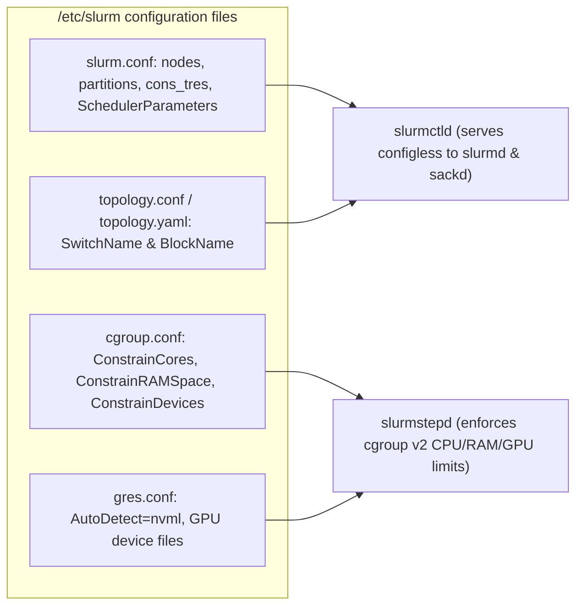

# 6.8 Slurm configuration: nodes, partitions and cgroups

| Field | Value |
|---|---|
| Level | Intermediate |
| Priority tier | 1 |
| Lab venue | Any machine with Python 3; `slurmconf_lint_lab.py` runs 3 checks locally and live Slurm daemon commands are **untested** here |
| Part | Part 6: HPC and Slurm |
| Status | Drafted |

## Why this matters for AI infrastructure

Almost every "my GPU job is behaving strangely" ticket on an AI cluster traces back to three sections of `slurm.conf` and `cgroup.conf`. A researcher requests 2 GPUs on an 8-GPU node and accidentally sees all 8 GPUs because `ConstrainDevices=yes` was left out. Another job is killed by the node kernel's OOM killer and takes down three neighboring jobs on the same server because `SelectTypeParameters` omitted `_Memory`. A newly provisioned DGX node registers with the controller and immediately flips to `drain` (`invalid`) because `RealMemory` in `slurm.conf` exceeded the kernel's reported memory after BIOS reservations. Getting node definitions, partition policies, `cons_tres` resource tracking, cgroup containment, and switch topology (`topology.conf` / `topology.yaml` and `SwitchAsNodeRank`) right turns a fragile cluster into a predictable production appliance.

## Prerequisites and outcomes

You need Chapters 6.2 and 6.7 and Linux cgroups basics from Part 1. After finishing this chapter, you will be able to accomplish the following goals.

- Write accurate `NodeName` definitions from `slurmd -C`, including `NodeSet` aliases, reserved system cores and memory (`CoreSpecCount`, `MemSpecLimit`), boolean `Features`, scheduling `Weight`, and `Gres`.
- Explain node states (`IDLE`, `MIXED`, `ALLOCATED`, `DRAINING`, `DRAINED`, `DOWN`, `FUTURE`), state suffix symbols (`*`, `$`, `~`, `#`, `!`, `%`, `@`, `^`), and automatic recovery (`ReturnToService`).
- Design overlapping and hardware-isolated `PartitionName` queues using `PriorityTier`, `PriorityJobFactor`, `OverSubscribe`, `DefMemPerGPU`, `DefCpuPerGPU`, and `MaxCPUsPerNode`, and modify them live with `scontrol`.
- Configure `SelectType=select/cons_tres`, `SelectTypeParameters=CR_Core_Memory`, and `cgroup.conf` (`ConstrainCores`, `ConstrainRAMSpace`, `ConstrainDevices`) so the Linux kernel enforces every scheduler allocation.
- Configure network topology (`topology.conf` / `topology.yaml` `block` and `tree` plugins, plus `TopologyParam=SwitchAsNodeRank`) and advanced `slurm.conf` parameters (`PrologFlags`, `SchedulerParameters`, `HealthCheckInterval`, `PrivateData`) from *Supercomputers for Linux SysAdmins* Chapter 15.

## 1. How Slurm configuration is organized



Slurm reads `slurm.conf` and its companion files (`cgroup.conf`, `gres.conf`, `topology.conf` or `topology.yaml`, `plugstack.conf`, and `slurmdbd.conf`) from `/etc/slurm` (`slurm.conf(5)` man page, commit `521370b`, and `SCL` Chapter 15):

- **Syntax and `Include` files:** Parameter names are case-insensitive, `#` begins a comment, and `Include <filename>` pulls in sub-files so you can keep node and partition definitions in modular files managed by Ansible or BCM.
- **Permissions:** `slurm.conf` must be world-readable (`0644`) because user CLI tools (`sbatch`, `squeue`, `sinfo`) parse it directly. Never put database passwords in `slurm.conf`; keep credentials in `slurmdbd.conf` (`0600`, owned by `SlurmUser`).
- **Consistency across nodes:** Either distribute identical copies of `/etc/slurm/*` to every node (a hash mismatch drains the node) or enable **configless mode** (`SlurmctldParameters=enable_configless`, Chapter 6.7) so `slurmctld` serves configuration files directly to `slurmd` and `sackd`.
- **Hostlist bracket notation and `cluset`:** Slurm uses compact bracket ranges everywhere (`node[1-10]`, `gpu[01-04,07]`, `n[15-33]`). As Zhumatiy notes in Chapter 15, Slurm itself does not ship a standalone CLI utility to convert bracket notation into plain space-separated host lists (or vice versa), though `scontrol show hostnames gpu[01-04]` expands them and external tools like **`cluset`** from the **ClusterShell** package convert in both directions.

**Keep `slurm.conf` modular with `Include` files, never put secrets in `slurm.conf`, and lint every edit before running `scontrol reconfigure`**.

> **In one minute:**
> - Slurm combines `slurm.conf`, `cgroup.conf`, `gres.conf`, and `topology.conf`/`topology.yaml` in `/etc/slurm`.
> - Use `SlurmctldParameters=enable_configless` so `slurmctld` serves one authoritative config across all nodes.

## 2. Nodes: hardware discovery (`slurmd -C`), `DEFAULT`, `NodeSet`, and states

### Describing node hardware (`slurmd -C` and `SCL` Chapter 15 attributes)

Never guess CPU counts or physical RAM from a server datasheet—the Linux kernel reserves several gigabytes of RAM for page tables and kernel structures, so `MemTotal` is always slightly less than nominal DIMM capacity. Run **`slurmd -C`** on each node class to print the exact hardware topology that `slurmd` detects (**untested** here):

```bash
# (untested here)
slurmd -C
# NodeName=gpu01 CPUs=64 Boards=1 SocketsPerBoard=2 CoresPerSocket=16 ThreadsPerCore=2 RealMemory=515000 ...
```

In `slurm.conf`, nodes are declared on `NodeName=...` lines. Never write one line per node; group identical nodes using bracket notation (`NodeName=gpu[01-32] ...`), and use **`NodeName=DEFAULT`** to set shared attributes for all subsequent `NodeName` lines until the next `DEFAULT` line. You can also define a **`NodeSet`** alias to shorten node lists inside partition definitions (`SCL` Chapter 15):

```ini
NodeSet=Set1 Nodes=n[10-20],n[55,66,77]
```

| Node attribute | Purpose and operational rules (`slurm.conf(5)` & `SCL` Ch. 15) |
|---|---|
| `NodeName`, `NodeHostname`, `NodeAddr` | `NodeName` is Slurm's logical name; set `NodeHostname` or `NodeAddr` if the DNS hostname or management/fabric IP differs |
| `Boards`, `Sockets` / `SocketsPerBoard`, `CoresPerSocket`, `ThreadsPerCore`, `CPUs` | Hardware CPU hierarchy; `CPUs` must equal `Boards * SocketsPerBoard * CoresPerSocket * ThreadsPerCore` (or set `CPUs` to physical cores when hiding HyperThreading; Chapter 6.2) |
| `RealMemory` | Physical RAM in MiB available to Slurm (defaults to `1` MiB if omitted). Set `RealMemory` slightly below `slurmd -C` (`~97%`) so the node never drains with `Low RealMemory`, and enable `CR_*_Memory` |
| `MemSpecLimit`, `CoreSpecCount` / `CpuSpecList` | Reserves MiB of `RealMemory` (`MemSpecLimit`) and CPU cores (`CoreSpecCount` or `CpuSpecList`) for the OS and `slurmd` daemon so user jobs cannot starve system services |
| `Features` | Comma-separated boolean labels (`Features=h100,nvlink,lustre_fast`) that users request with `sbatch -C/--constraint=h100`; partitions can also select nodes via `Nodes=feature{h100}` |
| `Gres` | Generic measurable resources on the node, formatted as `<name>[:<type>][:no_consume]:<number>[K\|M\|G]`. Must be declared in global `GresTypes` first (`GresTypes=gpu,fastfs` -> `Gres=gpu:volta:8,fastfs:lustre:no_consume:100G`; `:no_consume` means Slurm checks availability without decrementing the count per job) |
| `Weight` | Scheduling preference integer: Slurm allocates the **lowest-weight** nodes that satisfy a job first. Assign higher `Weight` to large-RAM or special-feature nodes so ordinary jobs leave them free |
| `State` | Set `State=UNKNOWN` in `slurm.conf` (never hardcode `IDLE` or `BUSY` in the config file) |

### Node states, state suffix symbols (`*`, `$`, `~`, `#`, `!`, `%`, `@`, `^`), and `ReturnToService`

When you inspect nodes with `sinfo` (using `-t STATES`, `-n NODES`, `-R` for reasons, `-s` for summary, `-h` for no header, or `--json`/`--yaml`; `SCL` Table 15-3 and Table 15-4 formats `%a`, `%A` busy/free, `%C` processors busy/free/other/total, `%D` nodes, `%E` reason, `%F` nodes busy/free/other/total, `%P` partition with `*` for default, `%t`/`%T` short/long state), nodes appear in base states (`IDLE`, `MIXED`, `ALLOCATED`, `DRAIN`/`DRAINING`/`DRAINED`, `DOWN`, `FAIL`/`FAILING`, `COMPLETING`, `MAINT`, `RESERVED`, `FUTURE`, `UNKNOWN`).

Often `sinfo` appends a single **suffix symbol** to a node's state (`idle*`, `drain$`, `idle~`). Table 15-4 in `SCL` Chapter 15 decodes all eight suffix symbols:

| Suffix symbol | Meaning on node state in `sinfo` (`SCL` Chapter 15) |
|---|---|
| `*` | The node is currently **not responding** (`slurmd` unreachable) |
| `$` | The node is currently in **maintenance mode** (covered by a maintenance reservation) |
| `~` | The node is currently **powered off** (power-saving state) |
| `#` | The node is currently **being powered up or configured** |
| `!` | The node is **pending power down** |
| `%` | The node is **currently being powered down** |
| `@` | The node is **pending reboot** (for example via `scontrol reboot asap`) |
| `^` | A **node reboot was issued** and is in progress |

What happens when a `DOWN` node finishes rebooting and its `slurmd` registers with `slurmctld`? The global **`ReturnToService`** parameter decides:

- **`ReturnToService=0` (default):** A `DOWN` node remains `DOWN` until an administrator manually inspects it and runs `scontrol update nodename=<node> state=resume`.
- **`ReturnToService=1`:** A `DOWN` node automatically returns to service upon valid registration *only* if it was marked `DOWN` because `slurmd` stopped responding (`SlurmdTimeout`).
- **`ReturnToService=2`:** A `DOWN` node automatically returns to service upon valid registration regardless of why it went `DOWN` (safe only if gated by a strict node health check; Chapter 6.14). Note that an explicitly **`DRAIN`ed** node never auto-resumes under `ReturnToService` until resumed by an admin or health program.

**Always generate `NodeName` lines from `slurmd -C`, set `RealMemory` slightly below physical RAM, use `Weight` to protect scarce high-memory or multi-GPU nodes, and memorize the `sinfo` suffix symbols (`*` unresponsive, `$` maintenance, `@`/`^` rebooting)**.

> **In one minute:**
> - Run `slurmd -C` on real hardware; never leave `RealMemory` at its default (`1` MiB), and ensure `CPUs = Boards * SocketsPerBoard * CoresPerSocket * ThreadsPerCore`.
> - Use `NodeName=DEFAULT` and `NodeSet` to keep configs concise, use `Gres=gpu:volta:8,fastfs:lustre:no_consume:100G` with `GresTypes`, and watch `sinfo` state suffixes (`*`, `$`, `~`, `#`, `!`, `%`, `@`, `^`).

## 3. Partitions: attributes, states, and live `scontrol` updates (`SCL` Chapter 15)

A **partition** is a logical queue wrapping a set of nodes (`Nodes=...`) with scheduling constraints and access controls. Partitions can be nested, share the exact same physical nodes, or intersect. `SCL` Chapter 15 summarizes the key partition attributes and states:

| Partition attribute | Operational meaning (`SCL` Chapter 15 & `slurm.conf(5)`) |
|---|---|
| `Nodes` | Hostlist or `NodeSet` of nodes in this partition (`Nodes=gpu[01-32]` or `ALL`) |
| `Default=YES` | Makes this the default partition when a user omits `-p` (**must be set on at most 1 partition**) |
| `DefaultTime`, `MaxTime` | Default walltime (when `-t` is omitted) and maximum allowed walltime (`2-00:00:00`) |
| `MaxNodes`, `MinNodes`, `MaxCPUsPerNode` | Per-job node limits and per-node CPU cap (`MaxCPUsPerNode` is handy when sharing nodes between CPU and GPU partitions or hiding hyperthreads) |
| `AllowAccounts`, `DenyAccounts`, `AllowGroups` | Restricts which accounts or Linux groups may submit jobs to the partition |
| `Hidden=YES` | Hides the partition from `sinfo`/`squeue` output for non-admin users unless explicitly requested by name |
| `OverSubscribe` | Controls whether multiple jobs can share a node: `NO` (only 1 job per node, or `EXCLUSIVE`), `YES[:N]` (resources except GRES can be shared/oversubscribed up to `N` times when requested), `FORCE[:N]` (shared by default without `--oversubscribe`) |
| `PriorityTier`, `PriorityJobFactor` | **Crucial distinction:** *any* job in a partition with a higher **`PriorityTier`** is scheduled before jobs in lower-tier partitions (and can preempt them), whereas **`PriorityJobFactor`** is simply the numerical partition weight inside the multifactor priority formula |
| `QOS`, `TRESBillingWeights` | Attaches a partition QoS (only one per partition) and defines TRES billing weights (`GPU=1.0,CPU=0.001,Mem=0.01G`) |
| `DefMemPerGPU`, `DefCpuPerGPU` | Automatically grants a sensible default RAM (`65536` MiB) and CPU count (`8` cores) per requested GPU |

Partitions in Slurm have **four operational states** (`SCL` Chapter 15):

1. **`UP`:** New jobs can be submitted and queued jobs will start.
2. **`DOWN`:** New jobs can still be submitted to the queue, **but no new jobs will start** (already running jobs continue to completion).
3. **`DRAIN`:** **No new jobs can be submitted**, while already queued jobs in the partition continue to start and finish.
4. **`INACTIVE`:** Neither new job submissions nor job starts are permitted.

You can modify or create partitions on the fly without restarting `slurmctld` using `scontrol` (note the syntax nuances highlighted in `SCL` Chapter 15: `update` uses `partitionname=main` as one word and supports `+=`/`-=` on node lists, whereas `create` uses `partition` and `name=new` as two separate arguments; **untested** here):

```bash
# Modify an existing partition on the fly (untested here)
scontrol update partitionname=main nodes=node[1-29] \
  MaxNodes=5 MaxTime=24:00:00 DefaultTime=12:00:00

# Create a new partition dynamically restricted to accounts acc1 and acc3 (untested here)
scontrol create partition name=new nodes=node[30-32] \
  allowaccounts=acc1,acc3
```

**Set `Default=YES` on exactly one partition, configure `DefCpuPerGPU` and `DefMemPerGPU` on every GPU partition, and use `PriorityTier` (not just `PriorityJobFactor`) when an interactive/debug queue must jump ahead of batch jobs**.

> **In one minute:**
> - Partitions have four states: `UP` (submit + start), `DOWN` (submit only, no starts), `DRAIN` (no submits, queued jobs still start), and `INACTIVE` (no submits or starts).
> - `PriorityTier` strictly orders whole partitions ahead of lower tiers, whereas `PriorityJobFactor` only adds points inside the multifactor priority sum.

## 4. Resource selection (`select/cons_tres`) and cgroup containment

Scheduling a GPU node safely requires two halves working together: **resource selection** in `slurmctld` and **cgroup containment** in `slurmstepd`:

1. **Consumable Trackable Resources (`select/cons_tres`):** In `slurm.conf`, set:
   ```ini
   SelectType=select/cons_tres
   SelectTypeParameters=CR_Core_Memory
   GresTypes=gpu
   AccountingStorageTRES=gres/gpu
   ```
   As `SCL` Chapter 15 notes, Slurm tracks `Billing`, `CPU`, `Energy`, `Mem`, `Node`, `Pages`, `VMem`, and `FS` (`disk`, `lustre`) by default, and can additionally track `BB` (burst buffers), `GRES` (`gres/gpu`), `IC` (`ic/ofed`), and `License` (`license/cad`). **Never omit `_Memory` from `SelectTypeParameters`** (`CR_Core_Memory`): without `_Memory`, Slurm treats RAM as advisory, allows jobs to oversubscribe node memory, and disables cgroup RAM enforcement.
2. **Kernel enforcement (`proctrack/cgroup`, `task/cgroup`, and `cgroup.conf`):** In `slurm.conf`, set `ProctrackType=proctrack/cgroup`, `TaskPlugin=task/affinity,task/cgroup`, and `JobAcctGatherType=jobacct_gather/cgroup`. Because **every `Constrain*` option in `cgroup.conf` defaults to `no`**, you must explicitly enable all three in `/etc/slurm/cgroup.conf`:
   ```ini
   CgroupPlugin=autodetect
   ConstrainCores=yes
   ConstrainRAMSpace=yes
   ConstrainDevices=yes
   ```
   Without `ConstrainDevices=yes`, a user who requests `--gres=gpu:1` can simply unset `CUDA_VISIBLE_DEVICES` inside their script and use all 8 GPUs on the node.

**Always pair `SelectTypeParameters=CR_Core_Memory` with `ConstrainCores=yes`, `ConstrainRAMSpace=yes`, and `ConstrainDevices=yes` in `cgroup.conf`**.

> **In one minute:**
> - `SelectType=select/cons_tres` with `SelectTypeParameters=CR_Core_Memory` tracks cores, memory, and GPUs per node.
> - All `Constrain*` flags in `cgroup.conf` default to `no`; explicitly set `ConstrainCores=yes`, `ConstrainRAMSpace=yes`, and `ConstrainDevices=yes`.

## 5. Topology awareness (`topology.conf` / `topology.yaml` and `SwitchAsNodeRank`)

On an InfiniBand or RoCE fat-tree fabric, placing a 16-node job under a single leaf switch keeps all collective traffic local to that switch (`1` hop) and avoids congesting spine uplinks. In `SCL` Chapter 15, setting `TopologyPlugin=topology/<type>` (`default`, `block`, `3d-torus`, or `tree`; configured in `topology.conf` or modern `topology.yaml`) makes Slurm topology-aware:

```ini
# (untested here) — topology/block example in topology.conf
BlockName=block1 Nodes=n[1-32]
BlockName=block2 Nodes=n[33-64]

# (untested here) — topology/tree example in topology.conf (even/odd nodes on different leaf switches)
SwitchName=s0 Nodes=n[0,2,4,6]
SwitchName=s1 Nodes=n[1,3,5,7]
SwitchName=top Switches=s[0-1]
```

Look closely at the `topology/tree` example above: even-numbered nodes (`n0, n2, n4, n6`) sit on leaf switch `s0`, while odd-numbered nodes (`n1, n3, n5, n7`) sit on leaf switch `s1`. If a job is allocated `n0, n1, n2, n3`, Slurm's default alphabetical ordering assigns Rank 0 to `n0` (`s0`), Rank 1 to `n1` (`s1`), Rank 2 to `n2` (`s0`), and Rank 3 to `n3` (`s1`)—forcing every nearest-neighbor message between consecutive ranks (`0 <-> 1`, `1 <-> 2`, `2 <-> 3`) to cross the `top` spine switch.

Setting **`TopologyParam=SwitchAsNodeRank`** in `slurm.conf` (modeled in `reorder_nodes_switch_as_node_rank()` in `code/part06/slurmconf_lint_lab.py`) fixes this immediately: Slurm sorts the allocated node list **by leaf switch first and then by node name** (`['n0', 'n2', 'n1', 'n3']`), keeping consecutive ranks on the same leaf switch. **Warning:** Whenever you add new compute nodes to `slurm.conf`, update `topology.conf` / `topology.yaml` at the same time—any node omitted from the topology file will never be scheduled.

## 6. Advanced `slurm.conf` parameters (`PrologFlags`, `SchedulerParameters`, `PrivateData`)

At the end of Chapter 15, Zhumatiy catalogs the high-leverage `slurm.conf` parameters (`PropagateResourceLimits`, `HealthCheckInterval`, `HealthCheckNodeState=ALLOC,ANY,CYCLE,IDLE,NONDRAINED_IDLE,MIXED`, `PrivateData=accounts,events,jobs,nodes,partitions,reservations,usage,users`, `SlurmSchedLogFile`, `SlurmSchedLogLevel`), plus the critical **`PrologFlags`** and **`SchedulerParameters`** sub-options that solve scale-up bottlenecks:

| Parameter family | Sub-option (`SCL` Chapter 15) | What it does in production |
|---|---|---|
| **`PrologFlags`** | `Alloc` | Runs `Prolog` at allocation time (even for `salloc`), rather than waiting for the first step launch; required by most other `PrologFlags` |
| **`PrologFlags`** | `Contain` | Uses the `Proctrack` plugin (`cgroup`) to create a job container (`extern` step) on all allocated nodes at allocation time so `pam_slurm_adopt` can place direct user `ssh` sessions inside the job's cgroup |
| **`PrologFlags`** | `DeferBatch` | Waits until `Prolog` finishes on **all** allocated nodes before launching the batch script, preventing unsynchronized MPI job startups |
| **`PrologFlags`** | `RunInJob` vs `Serial` | `RunInJob` runs prolog/epilog inside the `extern` `slurmstepd` container (implies `Contain,Alloc`); `Serial` runs prolog/epilog sequentially instead of in parallel (incompatible with `RunInJob`) |
| **`SchedulerParameters`** | `batch_sched_delay=3`, `default_queue_depth=100`, `sched_max_job_start=0` | Controls main scheduler pacing and how many queued jobs are evaluated per pass (`100` by default) |
| **`SchedulerParameters`** | `defer` / `defer_batch` | Avoids running a scheduling pass on every single `sbatch` submission during a submit storm; batches scheduling into periodic passes (`defer_batch` still schedules interactive `salloc`/`srun` immediately) |
| **`SchedulerParameters`** | `bf_interval=30`, `bf_max_job_test=500`, `bf_max_time`, `bf_max_job_user/part/assoc/start` | Tunes the `sched/backfill` loop: runs every `30` s (`-1` disables), tests up to `500` deep jobs by default, and caps backfill time/starts so backfill never freezes `slurmctld` |
| **`SchedulerParameters`** | `max_rpc_cnt=N`, `max_sched_time`, `max_switch_wait=300` | `max_rpc_cnt` defers scheduling whenever active `slurmctld` RPC threads exceed `N` (`256` max threads note); `max_sched_time` caps scheduler loop duration (keep `< MessageTimeout`); `max_switch_wait` caps `--switches` wait (`300` s default) |
| **`SchedulerParameters`** | `salloc_wait_nodes`, `sbatch_wait_nodes`, `nohold_on_prolog_fail`, `pack_serial_at_end` | Waits for all allocated nodes to finish prolog/boot before starting `salloc`/`sbatch` (`--wait-all-nodes`); requeues jobs without holding them on prolog failure; packs serial jobs at the end of node lists to reduce fragmentation |

**Set `PrologFlags=Alloc,Contain,DeferBatch` on GPU clusters using `pam_slurm_adopt`, and tune `SchedulerParameters=defer_batch,bf_max_job_test=500,max_rpc_cnt=128` when large queues or submit storms slow down `slurmctld`**.

> **In one minute:**
> - `TopologyParam=SwitchAsNodeRank` orders allocated nodes by leaf switch first so adjacent MPI ranks stay on the same switch.
> - `PrologFlags=Alloc,Contain,DeferBatch` prepares cgroup containers for `pam_slurm_adopt` and waits for all nodes' prologs before starting batch scripts.
> - `SchedulerParameters` (`defer_batch`, `bf_interval=30`, `bf_max_job_test=500`, `max_rpc_cnt`, `sbatch_wait_nodes`) keeps `slurmctld` responsive under heavy load.

## 7. Validating configurations: `slurmconf_lint.py` and `gen_slurm_conf.py`

Before running `scontrol reconfigure` or restarting `slurmctld`, validate your configuration with `code/part06/slurmconf_lint.py` (and generate clean starter configs from a CSV hardware inventory with `code/part06/gen_slurm_conf.py`).

First, run the self-checking Python lab (`code/part06/slurmconf_lint_lab.py`) locally. It verifies bracket hostlist expansion (`expand("gpu[01-04,07]")`), runs `slurmconf_lint.py` against both a deliberately broken config (catching all 5 errors and 3 warnings) and a valid production GPU config (`0` findings), and tests `TopologyParam=SwitchAsNodeRank` leaf-switch sorting (`reorder_nodes_switch_as_node_rank`):

```bash
python3 code/part06/slurmconf_lint_lab.py
```

On the broken test configuration, `slurmconf_lint.py` catches every classic mistake before it can take down a node:

```text
ERROR: gpu[01-04]: CPUs=64 but Sockets*CoresPerSocket*ThreadsPerCore=32
ERROR: gpu[01-04]: Gres=gpu:8 but GresTypes does not list gpu
ERROR: node gpu04 defined more than once
ERROR: partition gpu: node gpu05 is not defined
ERROR: 2 partitions marked Default=YES (expected exactly 1)
warn:  gpu[01-04]: RealMemory not set (defaults to 1 MB; memory limits will not work)
warn:  SelectTypeParameters has no *_Memory: memory is not a consumable resource, ConstrainRAMSpace has no effect
warn:  TaskPlugin/ProctrackType do not both use cgroup: job cleanup and containment will be weak
```

## 8. Interview angles

- A user submits `sbatch --gres=gpu:1` on an 8-GPU node, but `nvidia-smi` inside their job lists all 8 GPUs. Which exact file and parameter were missed?
- What is the difference between a partition in state `DOWN` and a partition in state `DRAIN`? What about `PriorityTier` versus `PriorityJobFactor`?
- Why does `SelectTypeParameters=CR_Core` (without `_Memory`) render `ConstrainRAMSpace=yes` in `cgroup.conf` completely ineffective?
- Explain what `TopologyParam=SwitchAsNodeRank` does when nodes `n[0,2,4,6]` are on switch `s0` and `n[1,3,5,7]` are on switch `s1`.
- What do `PrologFlags=Alloc,Contain,DeferBatch` and `SchedulerParameters=defer_batch,max_rpc_cnt=128,sbatch_wait_nodes` solve on a busy GPU cluster?

## Exercises

1. **Linting `slurm.conf` Arithmetic, GRES, and Partition Errors (`code/part06/slurmconf_lint.py`):** Using `lint()` and `expand()` in `code/part06/slurmconf_lint.py`, explain why `CPUs=64` with `Sockets=2 CoresPerSocket=16 ThreadsPerCore=1` fails, what happens if `RealMemory` is omitted from a `NodeName` line, why `SelectTypeParameters` must include `_Memory`, and why exactly one partition should set `Default=YES`.
2. **Generating Cluster Configurations from Hardware Inventories (`code/part06/gen_slurm_conf.py`):** Run `python3 code/part06/gen_slurm_conf.py code/part06/capstone_inputs/hardware.csv /tmp/slurm_out` and inspect the generated `slurm.conf`, `cgroup.conf`, and `gres.conf`. Explain why `gen_slurm_conf.py` multiplies `mem_mb` by `0.97` for `RealMemory` and sets `DefMemPerGPU=65536` and `DefCpuPerGPU=8` on GPU partitions.
3. **Node States, `sinfo` Suffix Symbols, and `ReturnToService` (`SCL` Chapter 15):** Decode the `sinfo` node state strings `idle*`, `drain$`, `idle~`, `alloc#`, `comp@`, and `down^`, contrast `ReturnToService=0`, `1`, and `2`, and write the `scontrol` commands to drain nodes `n[22,25]` with reason `'badmem'` and to schedule an immediate drain-and-reboot (`scontrol reboot asap nextstate=resume`).
4. **Partition States (`UP`, `DOWN`, `DRAIN`, `INACTIVE`), `OverSubscribe`, and `PriorityTier` (`SCL` Chapter 15):** Contrast the four partition states on job submissions versus job starts, compare `OverSubscribe=NO`, `YES:4`, `FORCE:4`, and `EXCLUSIVE`, and write the `scontrol` commands to update partition `main` and create partition `new` restricted to `acc1,acc3`.
5. **Leaf-Switch Rank Sorting (`TopologyParam=SwitchAsNodeRank`, `SCL` Chapter 15):** Given leaf switch `s0` hosting `n[0,2,4,6]` and leaf switch `s1` hosting `n[1,3,5,7]`, use `reorder_nodes_switch_as_node_rank()` in `code/part06/slurmconf_lint_lab.py` to show how `TopologyParam=SwitchAsNodeRank` reorders an allocation of `n0, n1, n2, n3` so neighboring MPI ranks stay on the same leaf switch.
6. **High-Throughput `PrologFlags` and `SchedulerParameters` Tuning (`SCL` Chapter 15):** Design the `PrologFlags` and `SchedulerParameters` lines for a 1,000-node GPU cluster that uses `pam_slurm_adopt`, suffers from synchronized MPI startup failures when one node's prolog runs slowly, and experiences `sbatch` submission bursts of 2,000 jobs at a time.

## Checkpoint questions (20)

<details>
<summary>1. Why must `slurm.conf` be world-readable (`0644`), and how do you split a large `slurm.conf` into modular files?</summary>

User-space client commands (`sbatch`, `srun`, `squeue`, `sinfo`) parse `slurm.conf` directly as the calling user, so it must be readable by all users (`0644`), while sensitive database credentials stay in `slurmdbd.conf` (`0600`, owned by `SlurmUser`). Use `Include <filename>` directives inside `slurm.conf` to split node definitions, partitions, and QoS settings into separate files.
</details>

<details>
<summary>2. What is the default value of `RealMemory` on a `NodeName` line if you omit it, and why should you set `RealMemory` slightly below `slurmd -C`?</summary>

If omitted, **`RealMemory` defaults to `1` MiB**—which breaks memory-based scheduling (`--mem`). You should always copy the hardware layout from `slurmd -C` and set `RealMemory` slightly below the reported total (for example `97%` of physical RAM, or use `MemSpecLimit`) so minor kernel memory reservation differences after a reboot or OS patch never cause `slurmctld` to drain the node as `invalid` (`Low RealMemory`).
</details>

<details>
<summary>3. What do `MemSpecLimit` and `CoreSpecCount` / `CpuSpecList` do on a compute node?</summary>

- **`MemSpecLimit`:** Reserves the specified MiB of `RealMemory` for the operating system and `slurmd` daemon so user jobs cannot allocate it (requires `SelectTypeParameters=CR_*_Memory` and `task/cgroup` with `ConstrainRAMSpace=yes`).
- **`CoreSpecCount` / `CpuSpecList`:** Reserves a count or explicit list of CPU cores exclusively for system daemons and OS interrupts, reducing OS jitter on user compute tasks.
</details>

<details>
<summary>4. How are node `Features`, `Weight`, and `NodeSet` used in `slurm.conf` (`SCL` Chapter 15)?</summary>

- **`Features`:** Boolean tags attached to a node (`Features=h100,nvlink,fast_scratch`) that users request with `sbatch -C h100&nvlink` (and partitions can reference via `Nodes=feature{h100}`).
- **`Weight`:** Integer preference for node allocation—Slurm allocates the **lowest-weight** eligible nodes first, so giving special high-memory or multi-GPU nodes a higher `Weight` keeps them free until a job specifically requests their features.
- **`NodeSet`:** Defines a named shorthand group of nodes (`NodeSet=Set1 Nodes=n[10-20],n[55,66,77]`) for reuse across `PartitionName` lines.
</details>

<details>
<summary>5. What is the format of the `Gres` node attribute in `SCL` Chapter 15, and what does `:no_consume` mean?</summary>

Format: `<name>[:<type>][:no_consume]:<number>[K|M|G]` (after declaring `<name>` in global `GresTypes`, e.g., `GresTypes=gpu,fastfs` and `Gres=gpu:volta:8,fastfs:lustre:no_consume:100G`). The `:no_consume` flag tells Slurm to verify that the node has at least the requested amount of that generic resource, without subtracting the job's request from the node's available pool.
</details>

<details>
<summary>6. Decode the eight `sinfo` node-state suffix symbols (`*`, `$`, `~`, `#`, `!`, `%`, `@`, `^`) from `SCL` Chapter 15.</summary>

- `*`: Node is **not responding** (`slurmd` unreachable).
- `$`: Node is in **maintenance mode** (under a maintenance reservation).
- `~`: Node is **powered off**.
- `#`: Node is **being powered up or configured**.
- `!`: Node is **pending power down**.
- `%`: Node is **currently being powered down**.
- `@`: Node is **pending reboot**.
- `^`: Node **reboot was issued** and is underway.
</details>

<details>
<summary>7. Compare `ReturnToService=0`, `1`, and `2` when a `DOWN` compute node re-registers with `slurmctld`.</summary>

- **`ReturnToService=0` (default):** Node stays `DOWN` until an administrator manually resumes it (`scontrol update nodename=... state=resume`).
- **`ReturnToService=1`:** Node automatically returns to `IDLE`/`MIXED` if it was marked `DOWN` solely due to `SlurmdTimeout` (non-responsive) and registers with valid hardware.
- **`ReturnToService=2`:** Node automatically returns to service from `DOWN` regardless of the reason, provided its registered hardware matches `slurm.conf`. (Explicitly `DRAIN`ed nodes stay drained under all settings.)
</details>

<details>
<summary>8. Compare the four Slurm partition states: `UP`, `DOWN`, `DRAIN`, and `INACTIVE` (`SCL` Chapter 15).</summary>

- **`UP`:** Jobs can be submitted and queued jobs start normally.
- **`DOWN`:** New jobs **can still be submitted** to the queue, but **no queued jobs will start** (running jobs continue).
- **`DRAIN`:** **No new jobs can be submitted**, but **already-queued jobs continue to start** and finish.
- **`INACTIVE`:** Neither new job submissions nor job starts are allowed.
</details>

<details>
<summary>9. What is the difference between `PriorityTier` and `PriorityJobFactor` on a partition (`SCL` Chapter 15)?</summary>

- **`PriorityTier`:** Strict tier ordering—**every eligible job in a partition with a higher `PriorityTier` is scheduled before any job in a lower-tier partition**, regardless of the lower-tier job's numerical priority (and can trigger `preempt/partition_prio` preemption).
- **`PriorityJobFactor`:** A numerical weight (`0..1` normalized factor multiplied by `PriorityWeightPartition`) added into a job's multifactor priority score alongside Age, FairShare, JobSize, and QoS.
</details>

<details>
<summary>10. Compare the four `OverSubscribe` settings on a partition (`SCL` Chapter 15).</summary>

- **`NO` (default):** Nodes are allocated exclusively to one job at a time (or whole cores/GPUs via `cons_tres` without oversubscribing allocated resources).
- **`YES[:N]`:** Nodes/resources (except GRES) can be shared/oversubscribed by up to `N` jobs when users pass `--oversubscribe`.
- **`FORCE[:N]`:** Like `YES[:N]`, but oversubscription is applied by default without users specifying `--oversubscribe`.
- **`EXCLUSIVE`:** Allocates whole nodes exclusively to a single job (with distinct preemption behavior).
</details>

<details>
<summary>11. How do the `scontrol` commands for updating an existing partition versus creating a new partition differ in syntax (`SCL` Chapter 15)?</summary>

- **Updating an existing partition:** Uses `partitionname=<name>` as a single token (and supports `+=` / `-=` on `nodes`):
  `scontrol update partitionname=main nodes=node[1-29] MaxNodes=5 MaxTime=24:00:00`
- **Creating a new partition:** Uses `partition` and `name=<name>` as two separate tokens:
  `scontrol create partition name=new nodes=node[30-32] allowaccounts=acc1,acc3`
</details>

<details>
<summary>12. Why must `SelectTypeParameters` include `_Memory` (such as `CR_Core_Memory`) under `SelectType=select/cons_tres`?</summary>

Without a `*_Memory` flag in `SelectTypeParameters`, Slurm only tracks CPU cores/threads and GRES—it does **not** treat node RAM as a consumable resource. As a result, multiple jobs can oversubscribe a node's physical RAM, and `ConstrainRAMSpace=yes` in `cgroup.conf` has no effect.
</details>

<details>
<summary>13. What are the default values of `ConstrainCores`, `ConstrainRAMSpace`, and `ConstrainDevices` in `cgroup.conf`, and what happens if `ConstrainDevices` is left at its default on a GPU cluster?</summary>

All three default to **`no`**. If `ConstrainDevices` is left at `no`, Slurm sets `CUDA_VISIBLE_DEVICES` in the job's environment but does **not** restrict `/dev/nvidia*` access in the kernel device cgroup—allowing any user job allocated 1 GPU to access all 8 GPUs on the node simply by ignoring or overriding `CUDA_VISIBLE_DEVICES`.
</details>

<details>
<summary>14. How do you verify from inside a running `srun` step that cgroup CPU, memory, and GPU device isolation are actually working?</summary>

Run:
`srun --gres=gpu:1 --mem=4G -n1 bash -c 'nvidia-smi -L; cat /proc/self/cgroup; grep Cpus_allowed_list /proc/self/status'`
Verify that `nvidia-smi -L` lists only 1 GPU, `/proc/self/cgroup` shows a job/step cgroup slice, and `Cpus_allowed_list` contains only the allocated CPU cores.
</details>

<details>
<summary>15. What are the four `TopologyPlugin` types in `SCL` Chapter 15, and what happens if you add a new compute node to `slurm.conf` but forget to add it to `topology.conf`?</summary>

The four plugin types are `default` (1D), `block` (`BlockName=...`), `3d-torus`, and `tree` (`SwitchName=...`). **If you add a new compute node to `slurm.conf` without adding it to `topology.conf`, that node will never be selected by the scheduler for jobs.**
</details>

<details>
<summary>16. What problem does `TopologyParam=SwitchAsNodeRank` solve when node names are interleaved across leaf switches (`SCL` Chapter 15)?</summary>

If even nodes (`n[0,2,4,6]`) sit on switch `s0` and odd nodes (`n[1,3,5,7]`) sit on switch `s1`, Slurm's default alphabetical node ordering places Rank 0 on `n0` (`s0`), Rank 1 on `n1` (`s1`), Rank 2 on `n2` (`s0`), and Rank 3 on `n3` (`s1`), forcing nearest-neighbor MPI traffic across the top spine switch. `TopologyParam=SwitchAsNodeRank` sorts allocated nodes **by leaf switch first and then by node name** (`n0, n2, n1, n3`) so neighboring ranks stay on the same leaf switch.
</details>

<details>
<summary>17. What do the `PrologFlags` options `Alloc`, `Contain`, `DeferBatch`, `RunInJob`, and `Serial` do (`SCL` Chapter 15)?</summary>

- **`Alloc`:** Runs the `Prolog` script at resource allocation time (including for `salloc`) rather than waiting for the first step launch.
- **`Contain`:** Creates an `extern` `slurmstepd` cgroup container on every allocated node at allocation time so `pam_slurm_adopt` can adopt direct SSH sessions into the job's cgroup.
- **`DeferBatch`:** Waits until `Prolog` completes on **all** allocated nodes before starting the batch script, preventing unsynchronized multi-node MPI launch failures.
- **`RunInJob`:** Runs `Prolog` and `Epilog` inside the job's `extern` `slurmstepd` container (implicitly sets `Alloc,Contain`).
- **`Serial`:** Runs prolog/epilog sequentially rather than in parallel (incompatible with `RunInJob`).
</details>

<details>
<summary>18. What do `defer` / `defer_batch`, `bf_interval`, `bf_max_job_test`, and `max_rpc_cnt` in `SchedulerParameters` control (`SCL` Chapter 15)?</summary>

- **`defer` / `defer_batch`:** Defers scheduling on individual job submissions during a submit storm and schedules jobs in batched passes (`defer_batch` still schedules interactive `salloc`/`srun` immediately).
- **`bf_interval` (default `30` s) & `bf_max_job_test` (default `500`):** Controls how often the backfill scheduler runs and the maximum number of queued jobs it tests per pass.
- **`max_rpc_cnt=N`:** Defers job scheduling whenever the number of active `slurmctld` RPC threads reaches or exceeds `N`, keeping the controller responsive under heavy RPC load.
</details>

<details>
<summary>19. What is the difference between `salloc_wait_nodes` and `sbatch_wait_nodes` in `SchedulerParameters`, and what does `nohold_on_prolog_fail` do (`SCL` Chapter 15)?</summary>

By default, `salloc` returns as soon as an allocation is made and `sbatch` starts the batch script as soon as the *first* allocated node is ready. Setting **`salloc_wait_nodes`** and **`sbatch_wait_nodes`** (or passing `--wait-all-nodes`) forces `salloc` and `sbatch` to wait until **all** allocated nodes have finished their prolog/boot and are ready. By default, a nonzero prolog exit drains the node and requeues the job in a `HELD` state; **`nohold_on_prolog_fail`** requeues the job onto healthy nodes without holding it.
</details>

<details>
<summary>20. How do you schedule a graceful node reboot in Slurm after all currently running jobs on that node finish (`SCL` Chapter 15)?</summary>

Run:
`scontrol reboot asap nextstate=resume <nodelist>`
The `asap` flag drains the node so no new jobs start, waits for the last running job on the node to finish, reboots the node, and returns it to `nextstate` (`resume` or `down`) once `slurmd` registers again.
</details>

## Sources and review notes

- **Sources read in full:**
  - `supercomputers-for-linux-sysadmins-managing-modern-hpc-clusters-and-supercomputers-from-software-to-hardware` — Sergey Zhumatiy, *Supercomputers for Linux SysAdmins*, Apress 2025, **Chapter 15: Slurm**. Covered topics include `slurm.conf` setup, bracket hostlists and `cluset` (ClusterShell), `PartitionName` attributes (`AllowAccounts`, `AllowGroups`, `Default`, `DefaultTime`, `MaxTime`, `Hidden`, `MaxCPUsPerNode`, `MaxNodes`, `OverSubscribe` `yes[:N]`/`no`/`force[:N]`/`exclusive`, `PriorityJobFactor`, `PriorityTier`, `QOS`, `TRESBillingWeights`), the 4 partition states (`Up`, `Down`, `Drain`, `Inactive`), `scontrol update partitionname=...` vs `scontrol create partition name=...`, `NodeName=DEFAULT` and `NodeSet`, `GresType` and `Gres=gpu:volta:8,fastfs:lustre:no_consume:100G`, `AutoDetect=nvml` / `rsmi`, default and optional Trackable Resources (`TRES`: `Billing`, `CPU`, `Energy`, `Mem`, `Node`, `Pages`, `VMem`, `FS`, `BB`, `GRES`, `IC`, `License`), `sinfo` `Table 15-3` flags, `Table 15-4` formats, and the 8 node state suffix symbols (`*`, `$`, `~`, `#`, `!`, `%`, `@`, `^`), `topology.conf` (`block`, `tree`, `3d-torus`, `default`, and `TopologyParam=SwitchAsNodeRank`), `scontrol` `Table 15-5` subcommands (`scontrol reboot asap nextstate=STATE`), and advanced `slurm.conf` parameters (`PropagateResourceLimits`, `HealthCheckInterval`, `HealthCheckNodeState`, `PrivateData`, `PrologFlags` `Alloc`/`Contain`/`DeferBatch`/`RunInJob`/`Serial`, and `SchedulerParameters` `batch_sched_delay`, `bf_interval`, `bf_max_job_test`, `default_queue_depth`, `defer`, `defer_batch`, `ignore_prefer_validation`, `max_rpc_cnt`, `max_sched_time`, `max_switch_wait`, `nohold_on_prolog_fail`, `pack_serial_at_end`, `salloc_wait_nodes`, `sbatch_wait_nodes`, `sched_max_job_start`).
  - SchedMD Slurm manual pages (`slurm.conf(5)`, `cgroup.conf(5)`, `topology.yaml(5)`, `slurmd(8)`, shallow clone at commit `521370b`, version `26.11.0rc1`).
- **Run here:** `python3 code/part06/slurmconf_lint.py` and `python3 code/part06/slurmconf_lint_lab.py` (3 passed, 0 failed).
- **Explicitly labelled inferences:** The `expand`, `lint`, and `reorder_nodes_switch_as_node_rank` functions in `code/part06/slurmconf_lint.py` and `code/part06/slurmconf_lint_lab.py` and `code/part06/gen_slurm_conf.py` are deterministic models built on `SCL` Chapter 15 and `slurm.conf(5)`.
- **Not verified on live hardware:** Live execution of `slurmd -C`, `scontrol`, `sinfo`, `srun`, `topology.conf` / `TopologyParam=SwitchAsNodeRank`, and cgroup v2 OOM kills on a cluster is marked (`untested here`).
