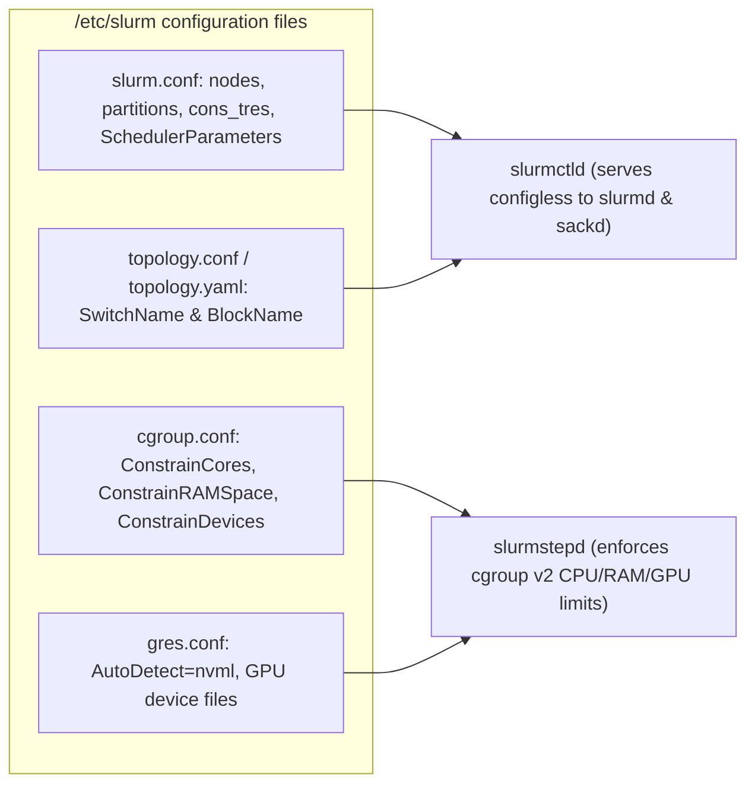

# 6.8 Slurm configuration: nodes, partitions and cgroups

| Field | Value |
|---|---|
| Level | Intermediate |
| Priority tier | 1 |
| Lab venue | Any machine with Python 3; `slurmconf_lint_lab.py` runs 3 checks locally and live Slurm daemon commands are **untested** here |
| Part | Part 6: HPC and Slurm |
| Status | Drafted |

## Why this matters for AI infrastructure

Most "my GPU job is behaving strangely" tickets on an AI cluster can be traced to a handful of lines in `slurm.conf` and `cgroup.conf`. Picture a researcher who requests 2 GPUs on an 8-GPU node. They still see all 8 GPUs, because `ConstrainDevices=yes` was left out. Another job gets killed by the node kernel's OOM killer. That takes down three neighboring jobs on the same server, because `SelectTypeParameters` omitted `_Memory`. A newly provisioned DGX node may register with the controller and flip straight to `drain` (`invalid`). The cause is that `RealMemory` in `slurm.conf` was set higher than the memory the kernel reports after BIOS reservations.

Getting these settings right is what turns a fragile cluster into a predictable production appliance. That covers node definitions, partition policies, `cons_tres` resource tracking, and cgroup containment. It also covers switch topology, which runs through `topology.conf` or `topology.yaml` and `SwitchAsNodeRank`.

## Prerequisites and outcomes

Before you start, you need Chapters 6.2 and 6.7, along with the Linux cgroups basics from Part 1. By the end of this chapter, you will be able to do the following.

- Write accurate `NodeName` definitions from the output of `slurmd -C`. That includes `NodeSet` aliases, reserved system cores and memory (`CoreSpecCount`, `MemSpecLimit`), boolean `Features`, scheduling `Weight`, and `Gres`.
- Explain the node states (`IDLE`, `MIXED`, `ALLOCATED`, `DRAINING`, `DRAINED`, `DOWN`, `FUTURE`), the state suffix symbols (`*`, `$`, `~`, `#`, `!`, `%`, `@`, `^`), and automatic recovery with `ReturnToService`.
- Design overlapping and hardware-isolated `PartitionName` queues. You will use `PriorityTier`, `PriorityJobFactor`, `OverSubscribe`, `DefMemPerGPU`, `DefCpuPerGPU`, and `MaxCPUsPerNode`, and you will change them live with `scontrol`.
- Configure `SelectType=select/cons_tres`, `SelectTypeParameters=CR_Core_Memory`, and `cgroup.conf` (`ConstrainCores`, `ConstrainRAMSpace`, `ConstrainDevices`), so the Linux kernel enforces every scheduler allocation.
- Configure network topology with `topology.conf` or `topology.yaml`, using the `block` and `tree` plugins and `TopologyParam=SwitchAsNodeRank`. You will also set advanced `slurm.conf` parameters (`PrologFlags`, `SchedulerParameters`, `HealthCheckInterval`, `PrivateData`) covered in Chapter 15 of *Supercomputers for Linux SysAdmins*.

## 1. How Slurm configuration is organized

Before you change any parameter, you need to know which file feeds which daemon. The diagram below shows the four configuration files and the process that reads each one.



Slurm reads `slurm.conf` and its companion files from `/etc/slurm`. The companions are `cgroup.conf`, `gres.conf`, `topology.conf` or `topology.yaml`, `plugstack.conf`, and `slurmdbd.conf`. The rules here come from the `slurm.conf(5)` man page at commit `521370b`, and from Chapter 15 of Zhumatiy's *Supercomputers for Linux SysAdmins*.

Parameter names are case-insensitive, and `#` starts a comment. Use `Include <filename>` to pull in sub-files. That lets you keep node and partition definitions in modular files, which Ansible or BCM can manage.

Permissions matter as well. `slurm.conf` must be world-readable (`0644`), because user CLI tools such as `sbatch`, `squeue`, and `sinfo` parse it directly. Never put database passwords in `slurm.conf`. Keep those credentials in `slurmdbd.conf`, which should be `0600` and owned by `SlurmUser`.

Consistency across nodes is the next concern. You can distribute identical copies of `/etc/slurm/*` to every node, but a hash mismatch drains the affected node. The alternative is configless mode, enabled with `SlurmctldParameters=enable_configless` and covered in Chapter 6.7. In that mode, `slurmctld` serves the configuration files directly to `slurmd` and `sackd`.

Slurm uses compact bracket ranges everywhere, such as `node[1-10]`, `gpu[01-04,07]`, and `n[15-33]`. As Zhumatiy notes in Chapter 15, Slurm itself does not ship a standalone CLI tool that converts bracket notation into plain host lists, or back. The command `scontrol show hostnames gpu[01-04]` does expand the brackets. External tools such as `cluset`, from the ClusterShell package, convert in both directions.

**Keep `slurm.conf` modular with `Include` files, never store secrets in it, and lint every edit before you run `scontrol reconfigure`.**

> **In one minute:**
> - Slurm combines `slurm.conf`, `cgroup.conf`, `gres.conf`, and `topology.conf` or `topology.yaml`, all of which live in `/etc/slurm`.
> - Enable `SlurmctldParameters=enable_configless` so that `slurmctld` serves one authoritative config to every node.

## 2. Nodes: hardware discovery (`slurmd -C`), `DEFAULT`, `NodeSet`, and states

### Describing node hardware (`slurmd -C` and *Supercomputers for Linux Sysadmins* Chapter 15 attributes)

Do not guess CPU counts or RAM from a server datasheet. The Linux kernel reserves several gigabytes of RAM for page tables and kernel structures, so `MemTotal` always comes in slightly below the nominal DIMM capacity. Run `slurmd -C` on each node class to print the exact hardware topology that `slurmd` detects (**untested** here).

```bash
# (untested here)
slurmd -C
# NodeName=gpu01 CPUs=64 Boards=1 SocketsPerBoard=2 CoresPerSocket=16 ThreadsPerCore=2 RealMemory=515000 ...
```

In `slurm.conf`, nodes are declared on `NodeName=...` lines. Do not write one line per node. Group identical nodes with bracket notation, such as `NodeName=gpu[01-32] ...`. Use **`NodeName=DEFAULT`** to set shared attributes for every later `NodeName` line, until the next `DEFAULT` line appears. You can also define a **`NodeSet`** alias to shorten node lists inside partition definitions. *Supercomputers for Linux SysAdmins* shows this form in Chapter 15:

```ini
NodeSet=Set1 Nodes=n[10-20],n[55,66,77]
```

Each attribute in the table below has its own rule, so read the table before you write a node line.

| Node attribute | Purpose and operational rules (`slurm.conf(5)` & *Supercomputers for Linux Sysadmins* Ch. 15) |
|---|---|
| `NodeName`, `NodeHostname`, `NodeAddr` | `NodeName` is Slurm's logical name; set `NodeHostname` or `NodeAddr` if the DNS hostname or management/fabric IP differs |
| `Boards`, `Sockets` / `SocketsPerBoard`, `CoresPerSocket`, `ThreadsPerCore`, `CPUs` | Hardware CPU hierarchy; `CPUs` must equal `Boards * SocketsPerBoard * CoresPerSocket * ThreadsPerCore` (or set `CPUs` to physical cores when hiding HyperThreading; Chapter 6.2) |
| `RealMemory` | Physical RAM in MiB available to Slurm (defaults to `1` MiB if omitted). Set `RealMemory` slightly below `slurmd -C` (`~97%`) so the node never drains with `Low RealMemory`, and enable `CR_*_Memory` |
| `MemSpecLimit`, `CoreSpecCount` / `CpuSpecList` | Reserves MiB of `RealMemory` (`MemSpecLimit`) and CPU cores (`CoreSpecCount` or `CpuSpecList`) for the OS and `slurmd` daemon so user jobs cannot starve system services |
| `Features` | Comma-separated boolean labels (`Features=h100,nvlink,lustre_fast`) that users request with `sbatch -C/--constraint=h100`; partitions can also select nodes via `Nodes=feature{h100}` |
| `Gres` | Generic measurable resources on the node, formatted as `<name>[:<type>][:no_consume]:<number>[K\|M\|G]`. Must be declared in global `GresTypes` first (`GresTypes=gpu,fastfs` -> `Gres=gpu:volta:8,fastfs:lustre:no_consume:100G`; `:no_consume` means Slurm checks availability without decrementing the count per job) |
| `Weight` | Scheduling preference integer: Slurm allocates the **lowest-weight** nodes that satisfy a job first. Assign higher `Weight` to large-RAM or special-feature nodes so ordinary jobs leave them free |
| `State` | Set `State=UNKNOWN` in `slurm.conf` (never hardcode `IDLE` or `BUSY` in the config file) |

As you read the table, notice that `CPUs` has to match the hardware arithmetic, and that `RealMemory` should sit below the RAM that `slurmd -C` reports. Take the `gpu01` line above, which reports `RealMemory=515000`. Keeping about 97 percent of that leaves Slurm roughly 499,550 MiB (515000 × 0.97 = 499,550), which is the margin the table asks for.

### Node states, state suffix symbols (`*`, `$`, `~`, `#`, `!`, `%`, `@`, `^`), and `ReturnToService`

When you inspect nodes with `sinfo`, you can narrow the output with `-t STATES`, `-n NODES`, `-R` for reasons, `-s` for a summary, `-h` for no header, or `--json` and `--yaml`. The format codes come from Tables 15-3 and 15-4 of *Supercomputers for Linux SysAdmins*. They include `%a`, `%A` (busy and free), `%C` (processors busy, free, other, and total), `%D` (nodes), `%E` (reason), `%F` (nodes busy, free, other, and total), `%P` (partition, with `*` for the default), and `%t` and `%T` (short and long state). Nodes appear in base states such as `IDLE`, `MIXED`, `ALLOCATED`, `DRAIN`, `DRAINING`, `DRAINED`, `DOWN`, `FAIL`, `FAILING`, `COMPLETING`, `MAINT`, `RESERVED`, `FUTURE`, and `UNKNOWN`.

`sinfo` sometimes adds one suffix symbol to a node's state, as in `idle*`, `drain$`, or `idle~`. The table below decodes all eight symbols from Table 15-4 of *Supercomputers for Linux SysAdmins*.

| Suffix symbol | Meaning on node state in `sinfo` (*Supercomputers for Linux Sysadmins* Chapter 15) |
|---|---|
| `*` | The node is currently **not responding** (`slurmd` unreachable) |
| `$` | The node is currently in **maintenance mode** (covered by a maintenance reservation) |
| `~` | The node is currently **powered off** (power-saving state) |
| `#` | The node is currently **being powered up or configured** |
| `!` | The node is **pending power down** |
| `%` | The node is **currently being powered down** |
| `@` | The node is **pending reboot** (for example via `scontrol reboot asap`) |
| `^` | A **node reboot was issued** and is in progress |

The table shows that `*` means the controller cannot reach the node's `slurmd`, while `@` and `^` both belong to reboots, one pending and one under way. Keep the table nearby when you read a `sinfo` line, so you can decode its state quickly.

What happens when a `DOWN` node finishes rebooting and its `slurmd` registers with `slurmctld`? The global **`ReturnToService`** parameter decides.

- **`ReturnToService=0` (default):** A `DOWN` node stays `DOWN` until an administrator inspects it and runs `scontrol update nodename=<node> state=resume`.
- **`ReturnToService=1`:** A `DOWN` node returns to service on valid registration, but only if it was marked `DOWN` because `slurmd` stopped responding (`SlurmdTimeout`).
- **`ReturnToService=2`:** A `DOWN` node returns to service on valid registration, whatever the reason it went `DOWN`. This is safe only when a strict node health check gates it (Chapter 6.14). An explicitly **`DRAIN`**ed node never auto-resumes under `ReturnToService`. An administrator or a health program has to resume it.

**Generate every `NodeName` line from `slurmd -C`, set `RealMemory` slightly below physical RAM, use `Weight` to protect scarce high-memory or multi-GPU nodes, and memorize the `sinfo` suffix symbols.** Start with `*` for an unresponsive node, `$` for maintenance, and `@` or `^` for a reboot.

> **In one minute:**
> - Run `slurmd -C` on real hardware. Never leave `RealMemory` at its default of `1` MiB, and make sure `CPUs = Boards * SocketsPerBoard * CoresPerSocket * ThreadsPerCore`.
> - Use `NodeName=DEFAULT` and `NodeSet` to keep configs concise. Use `Gres=gpu:volta:8,fastfs:lustre:no_consume:100G` with `GresTypes`, and watch the `sinfo` state suffixes (`*`, `$`, `~`, `#`, `!`, `%`, `@`, `^`).

## 3. Partitions: attributes, states, and live `scontrol` updates (*Supercomputers for Linux Sysadmins* Chapter 15)

Suppose your cluster has a debug queue for quick interactive work and a batch queue for long training runs. A partition is the object that keeps them apart. It is a logical queue that wraps a set of nodes (`Nodes=...`), with its own scheduling constraints and access controls. Partitions can be nested, can share the same physical nodes, or can intersect.

The attributes in the table below control who can submit, how long jobs may run, and how partitions compete with each other.

| Partition attribute | Operational meaning (*Supercomputers for Linux Sysadmins* Chapter 15 & `slurm.conf(5)`) |
|---|---|
| `Nodes` | Hostlist or `NodeSet` of nodes in this partition (`Nodes=gpu[01-32]` or `ALL`) |
| `Default=YES` | Makes this the default partition when a user omits `-p` (**must be set on at most 1 partition**) |
| `DefaultTime`, `MaxTime` | Default walltime (when `-t` is omitted) and maximum allowed walltime (`2-00:00:00`) |
| `MaxNodes`, `MinNodes`, `MaxCPUsPerNode` | Per-job node limits and per-node CPU cap (`MaxCPUsPerNode` is handy when sharing nodes between CPU and GPU partitions or hiding hyperthreads) |
| `AllowAccounts`, `DenyAccounts`, `AllowGroups` | Restricts which accounts or Linux groups may submit jobs to the partition |
| `Hidden=YES` | Hides the partition from `sinfo`/`squeue` output for non-admin users unless explicitly requested by name |
| `OverSubscribe` | Controls whether multiple jobs can share a node: `NO` (only 1 job per node, or `EXCLUSIVE`), `YES[:N]` (resources except GRES can be shared/oversubscribed up to `N` times when requested), `FORCE[:N]` (shared by default without `--oversubscribe`) |
| `PriorityTier`, `PriorityJobFactor` | **Crucial distinction:** *any* job in a partition with a higher **`PriorityTier`** is scheduled before jobs in lower-tier partitions (and can preempt them), whereas **`PriorityJobFactor`** is simply the numerical partition weight inside the multifactor priority formula |
| `QOS`, `TRESBillingWeights` | Attaches a partition QoS (only one per partition) and defines TRES billing weights (`GPU=1.0,CPU=0.001,Mem=0.01G`) |
| `DefMemPerGPU`, `DefCpuPerGPU` | Automatically grants a sensible default RAM (`65536` MiB) and CPU count (`8` cores) per requested GPU |

Two attributes in that table look alike but behave differently. `PriorityTier` decides the order between whole partitions, so a higher tier can jump ahead of a lower one. `PriorityJobFactor` only adds weight inside the multifactor priority sum. If you mix these two up, an interactive queue may not jump ahead of batch jobs.

A partition is always in one of four operational states, and each state controls submissions and job starts in its own way. Chapter 15 of *Supercomputers for Linux SysAdmins* describes them this way.

1. **`UP`:** New jobs can be submitted, and queued jobs will start.
2. **`DOWN`:** New jobs can still be submitted to the queue, but no new jobs will start. Jobs that are already running continue to completion.
3. **`DRAIN`:** No new jobs can be submitted, while jobs already queued in the partition continue to start and finish.
4. **`INACTIVE`:** Neither new submissions nor job starts are permitted.

You can modify or create partitions on the fly, without restarting `slurmctld`, by using `scontrol`. The syntax has quirks that Chapter 15 highlights. `update` takes `partitionname=main` as one word and supports `+=` and `-=` on node lists. `create` takes `partition` and `name=new` as two separate arguments. Both commands below are untested here.

```bash
# Modify an existing partition on the fly (untested here)
scontrol update partitionname=main nodes=node[1-29] \
  MaxNodes=5 MaxTime=24:00:00 DefaultTime=12:00:00

# Create a new partition dynamically restricted to accounts acc1 and acc3 (untested here)
scontrol create partition name=new nodes=node[30-32] \
  allowaccounts=acc1,acc3
```

Watch the second command. Its `partition` and `name=new` are separate arguments, unlike the single `partitionname=main` token in the first.

**Set `Default=YES` on exactly one partition, configure `DefCpuPerGPU` and `DefMemPerGPU` on every GPU partition, and use `PriorityTier` rather than `PriorityJobFactor` alone when an interactive or debug queue must jump ahead of batch jobs.**

> **In one minute:**
> - A partition has four states. `UP` accepts submissions and starts jobs. `DOWN` accepts submissions but starts nothing. `DRAIN` accepts no submissions but still starts queued jobs. `INACTIVE` accepts no submissions and starts nothing.
> - `PriorityTier` orders whole partitions ahead of lower tiers. `PriorityJobFactor` only adds points inside the multifactor priority sum.

## 4. Resource selection (`select/cons_tres`) and cgroup containment

A GPU node is only safe when two halves work together. Resource selection happens in `slurmctld`, and cgroup containment happens in `slurmstepd`.

1. **Consumable Trackable Resources (`select/cons_tres`):** In `slurm.conf`, set the following.

   ```ini
   SelectType=select/cons_tres
   SelectTypeParameters=CR_Core_Memory
   GresTypes=gpu
   AccountingStorageTRES=gres/gpu
   ```

   Chapter 15 of *Supercomputers for Linux SysAdmins* notes that Slurm tracks `Billing`, `CPU`, `Energy`, `Mem`, `Node`, `Pages`, `VMem`, and `FS` (which covers `disk` and `lustre`) by default. You can also track `BB` (burst buffers), `GRES` (`gres/gpu`), `IC` (`ic/ofed`), and `License` (`license/cad`). Never omit `_Memory` from `SelectTypeParameters`. Without it, as in `CR_Core_Memory`, Slurm treats RAM as advisory. Jobs can then oversubscribe node memory, and cgroup RAM enforcement is disabled.

2. **Kernel enforcement (`proctrack/cgroup`, `task/cgroup`, and `cgroup.conf`):** In `slurm.conf`, set `ProctrackType=proctrack/cgroup`, `TaskPlugin=task/affinity,task/cgroup`, and `JobAcctGatherType=jobacct_gather/cgroup`. Every `Constrain*` option in `cgroup.conf` defaults to `no`, so you must enable all three explicitly in `/etc/slurm/cgroup.conf`.

   ```ini
   CgroupPlugin=autodetect
   ConstrainCores=yes
   ConstrainRAMSpace=yes
   ConstrainDevices=yes
   ```

   Without `ConstrainDevices=yes`, a user who requests `--gres=gpu:1` can unset `CUDA_VISIBLE_DEVICES` inside the script and use all 8 GPUs on the node.

**Always pair `SelectTypeParameters=CR_Core_Memory` with `ConstrainCores=yes`, `ConstrainRAMSpace=yes`, and `ConstrainDevices=yes` in `cgroup.conf`.**

> **In one minute:**
> - `SelectType=select/cons_tres` with `SelectTypeParameters=CR_Core_Memory` tracks cores, memory, and GPUs on each node.
> - Every `Constrain*` flag in `cgroup.conf` defaults to `no`, so set `ConstrainCores=yes`, `ConstrainRAMSpace=yes`, and `ConstrainDevices=yes` explicitly.

## 5. Topology awareness (`topology.conf` / `topology.yaml` and `SwitchAsNodeRank`)

Consider a 16-node job on an InfiniBand or RoCE fat-tree fabric. If Slurm places all 16 nodes under one leaf switch, their collective traffic stays on that switch, one hop away. It never congests the spine uplinks. In Chapter 15, Zhumatiy shows how to make Slurm aware of this. You set `TopologyPlugin=topology/<type>`, where the type is `default`, `block`, `3d-torus`, or `tree`. The layout goes in `topology.conf`, or in the newer `topology.yaml`.

```ini
# (untested here) — topology/block example in topology.conf
BlockName=block1 Nodes=n[1-32]
BlockName=block2 Nodes=n[33-64]

# (untested here) — topology/tree example in topology.conf (even/odd nodes on different leaf switches)
SwitchName=s0 Nodes=n[0,2,4,6]
SwitchName=s1 Nodes=n[1,3,5,7]
SwitchName=top Switches=s[0-1]
```

Look closely at the `topology/tree` example. Even-numbered nodes, n0, n2, n4, and n6, sit on leaf switch s0. Odd-numbered nodes, n1, n3, n5, and n7, sit on leaf switch s1. Suppose a job receives n0, n1, n2, and n3. Slurm's default alphabetical ordering gives Rank 0 to n0 on s0, Rank 1 to n1 on s1, Rank 2 to n2 on s0, and Rank 3 to n3 on s1. Each nearest-neighbor pair, `0 <-> 1`, `1 <-> 2`, and `2 <-> 3`, now crosses the top spine switch.

Set **`TopologyParam=SwitchAsNodeRank`** in `slurm.conf` to fix this. The `reorder_nodes_switch_as_node_rank()` function in `code/part06/slurmconf_lint_lab.py` models the behavior. Slurm sorts the allocated node list by leaf switch first and then by node name, giving ['n0', 'n2', 'n1', 'n3']. Consecutive ranks then stay on the same leaf switch.

**Warning:** Whenever you add compute nodes to `slurm.conf`, update `topology.conf` or `topology.yaml` in the same change. Any node missing from the topology file will never be scheduled.

Add each new node to the topology file in the same change that adds it to `slurm.conf`.

## 6. Advanced `slurm.conf` parameters (`PrologFlags`, `SchedulerParameters`, `PrivateData`)

Some of the most useful settings in `slurm.conf` handle scale-up bottlenecks. Jobs can start before every node is ready, or the controller can be buried under a flood of submissions. At the end of Chapter 15, Zhumatiy catalogs the high-leverage parameters. They include `PropagateResourceLimits`, `HealthCheckInterval`, `HealthCheckNodeState=ALLOC,ANY,CYCLE,IDLE,NONDRAINED_IDLE,MIXED`, `PrivateData=accounts,events,jobs,nodes,partitions,reservations,usage,users`, `SlurmSchedLogFile`, and `SlurmSchedLogLevel`. Two of them, `PrologFlags` and `SchedulerParameters`, have sub-options that solve these scale-up problems. The table below lists those sub-options.

| Parameter family | Sub-option (*Supercomputers for Linux Sysadmins* Chapter 15) | What it does in production |
|---|---|---|
| **`PrologFlags`** | `Alloc` | Runs `Prolog` at allocation time (even for `salloc`), rather than waiting for the first step launch; required by most other `PrologFlags` |
| **`PrologFlags`** | `Contain` | Uses the `Proctrack` plugin (`cgroup`) to create a job container (`extern` step) on all allocated nodes at allocation time so `pam_slurm_adopt` can place direct user `ssh` sessions inside the job's cgroup |
| **`PrologFlags`** | `DeferBatch` | Waits until `Prolog` finishes on **all** allocated nodes before launching the batch script, preventing unsynchronized MPI job startups |
| **`PrologFlags`** | `RunInJob` vs `Serial` | `RunInJob` runs prolog/epilog inside the `extern` `slurmstepd` container (implies `Contain,Alloc`); `Serial` runs prolog/epilog sequentially instead of in parallel (incompatible with `RunInJob`) |
| **`SchedulerParameters`** | `batch_sched_delay=3`, `default_queue_depth=100`, `sched_max_job_start=0` | Controls main scheduler pacing and how many queued jobs are evaluated per pass (`100` by default) |
| **`SchedulerParameters`** | `defer` / `defer_batch` | Avoids running a scheduling pass on every single `sbatch` submission during a submit storm; batches scheduling into periodic passes (`defer_batch` still schedules interactive `salloc`/`srun` immediately) |
| **`SchedulerParameters`** | `bf_interval=30`, `bf_max_job_test=500`, `bf_max_time`, `bf_max_job_user/part/assoc/start` | Tunes the `sched/backfill` loop: runs every `30` s (`-1` disables), tests up to `500` deep jobs by default, and caps backfill time/starts so backfill never freezes `slurmctld` |
| **`SchedulerParameters`** | `max_rpc_cnt=N`, `max_sched_time`, `max_switch_wait=300` | `max_rpc_cnt` defers scheduling whenever active `slurmctld` RPC threads exceed `N` (`256` max threads note); `max_sched_time` caps scheduler loop duration (keep `< MessageTimeout`); `max_switch_wait` caps `--switches` wait (`300` s default) |
| **`SchedulerParameters`** | `salloc_wait_nodes`, `sbatch_wait_nodes`, `nohold_on_prolog_fail`, `pack_serial_at_end` | Waits for all allocated nodes to finish prolog/boot before starting `salloc`/`sbatch` (`--wait-all-nodes`); requeues jobs without holding them on prolog failure; packs serial jobs at the end of node lists to reduce fragmentation |

The table splits the work in two, so you can see which setting solves which problem. If your controller slows down during a submit storm, you know which rows to read first. If you need every node ready before a job starts, the `PrologFlags` rows are where you look. `PrologFlags` controls when prologs run and how jobs are contained. `SchedulerParameters` controls how often the scheduler runs and how much work each pass does.

**Set `PrologFlags=Alloc,Contain,DeferBatch` on GPU clusters that use `pam_slurm_adopt`, and tune `SchedulerParameters=defer_batch,bf_max_job_test=500,max_rpc_cnt=128` when large queues or submit storms slow down `slurmctld`.**

> **In one minute:**
> - `TopologyParam=SwitchAsNodeRank` orders allocated nodes by leaf switch first, so adjacent MPI ranks stay on the same switch.
> - `PrologFlags=Alloc,Contain,DeferBatch` prepares cgroup containers for `pam_slurm_adopt`, and it waits for every node's prolog before the batch script starts.
> - `SchedulerParameters` settings such as `defer_batch`, `bf_interval=30`, `bf_max_job_test=500`, `max_rpc_cnt`, and `sbatch_wait_nodes` keep `slurmctld` responsive under heavy load.

## 7. Validating configurations: `slurmconf_lint.py` and `gen_slurm_conf.py`

Before you run `scontrol reconfigure` or restart `slurmctld`, check the configuration. A lint script catches the classic mistakes before they can take down a node. Use `code/part06/slurmconf_lint.py` to validate a file. Use `code/part06/gen_slurm_conf.py` to generate clean starter configs from a CSV hardware inventory.

Start with the self-checking Python lab, which runs locally. It expands bracket hostlists, such as `expand("gpu[01-04,07]")`. It runs `slurmconf_lint.py` against a deliberately broken config, which should catch all 5 errors and 3 warnings, and against a valid production GPU config, which should report `0` findings. It also tests `TopologyParam=SwitchAsNodeRank` leaf-switch sorting with `reorder_nodes_switch_as_node_rank`.

```bash
python3 code/part06/slurmconf_lint_lab.py
```

On the broken test configuration, `slurmconf_lint.py` catches every classic mistake:

```text
ERROR: gpu[01-04]: CPUs=64 but Sockets*CoresPerSocket*ThreadsPerCore=32
ERROR: gpu[01-04]: Gres=gpu:8 but GresTypes does not list gpu
ERROR: node gpu04 defined more than once
ERROR: partition gpu: node gpu05 is not defined
ERROR: 2 partitions marked Default=YES (expected exactly 1)
warn:  gpu[01-04]: RealMemory not set (defaults to 1 MB; memory limits will not work)
warn:  SelectTypeParameters has no *_Memory: memory is not a consumable resource, ConstrainRAMSpace has no effect
warn:  TaskPlugin/ProctrackType do not both use cgroup: job cleanup and containment will be weak
```

Each line names the node or partition at fault, so you can correct the file before a reconfigure. Fix the `ERROR` lines first, then work through the `warn` lines.

Treat a clean lint run as the gate before every `scontrol reconfigure`.

## 8. Interview angles

These questions test whether you can connect a symptom to the file and parameter behind it. Try each one against the config before you answer from memory.

- A user submits `sbatch --gres=gpu:1` on an 8-GPU node, yet `nvidia-smi` inside the job lists all 8 GPUs. Which exact file and parameter were missed?
- What separates a partition in state `DOWN` from one in state `DRAIN`? And how does `PriorityTier` differ from `PriorityJobFactor`?
- Why does `SelectTypeParameters=CR_Core` without `_Memory` make `ConstrainRAMSpace=yes` in `cgroup.conf` completely ineffective?
- Walk through what `TopologyParam=SwitchAsNodeRank` does when `n[0,2,4,6]` sit on switch `s0` and `n[1,3,5,7]` sit on switch `s1`.
- What do `PrologFlags=Alloc,Contain,DeferBatch` and `SchedulerParameters=defer_batch,max_rpc_cnt=128,sbatch_wait_nodes` solve on a busy GPU cluster?

## Exercises

Work through each task on paper first, then check your answer against the code or output named in it.

1. Use `lint()` and `expand()` in `code/part06/slurmconf_lint.py` to explain four things. Why does `CPUs=64` fail when the node has `Sockets=2 CoresPerSocket=16 ThreadsPerCore=1`? What happens if `RealMemory` is omitted from a `NodeName` line? Why must `SelectTypeParameters` include `_Memory`? And why should exactly one partition set `Default=YES`?
2. Generate cluster configs from a hardware inventory. If you run `python3 code/part06/gen_slurm_conf.py code/part06/capstone_inputs/hardware.csv /tmp/slurm_out`, then inspect the generated `slurm.conf`, `cgroup.conf`, and `gres.conf`. Explain why `gen_slurm_conf.py` multiplies `mem_mb` by `0.97` for `RealMemory`, and why it sets `DefMemPerGPU=65536` and `DefCpuPerGPU=8` on GPU partitions.
3. Decode the `sinfo` node states `idle*`, `drain$`, `idle~`, `alloc#`, `comp@`, and `down^`. Then contrast `ReturnToService=0`, `1`, and `2`. Finally, write the `scontrol` commands that drain nodes `n[22,25]` with reason `'badmem'`, and that schedule an immediate drain-and-reboot with `scontrol reboot asap nextstate=resume`.
4. Chapter 15 covers partition states, `OverSubscribe`, and `PriorityTier`. Contrast the four partition states, `UP`, `DOWN`, `DRAIN`, and `INACTIVE`, on job submissions and on job starts. Then compare `OverSubscribe=NO`, `YES:4`, `FORCE:4`, and `EXCLUSIVE`. Last, write the `scontrol` commands that update partition `main` and create partition `new`, restricted to `acc1,acc3`.
5. Leaf switch `s0` hosts `n[0,2,4,6]`, and leaf switch `s1` hosts `n[1,3,5,7]`. Use `reorder_nodes_switch_as_node_rank()` in `code/part06/slurmconf_lint_lab.py` to reorder an allocation of `n0, n1, n2, n3`. Show how `TopologyParam=SwitchAsNodeRank` keeps neighboring MPI ranks on the same leaf switch.
6. Suppose you must design the `PrologFlags` and `SchedulerParameters` lines for a 1,000-node GPU cluster. The cluster uses `pam_slurm_adopt`, suffers from synchronized MPI startup failures when one node's prolog runs slowly, and sees `sbatch` submission bursts of 2,000 jobs at a time.

## Checkpoint questions (20)

<details>
<summary>1. Why must `slurm.conf` be world-readable (`0644`), and how do you split a large `slurm.conf` into modular files?</summary>

Client commands such as `sbatch`, `srun`, `squeue`, and `sinfo` parse `slurm.conf` directly, as the user who runs them. So every user must be able to read it, which is why it is `0644`. Keep database credentials in `slurmdbd.conf` instead, with mode `0600`, owned by `SlurmUser`. To split a large file, add `Include <filename>` lines to `slurm.conf`, and move node definitions, partitions, and QoS settings into their own files.
</details>

<details>
<summary>2. What is the default value of `RealMemory` on a `NodeName` line if you omit it, and why should you set `RealMemory` slightly below `slurmd -C`?</summary>

If you omit it, `RealMemory` defaults to `1` MiB. That breaks memory-based scheduling, such as `--mem`. Copy the hardware layout from `slurmd -C`, and set `RealMemory` a little below the reported total, for example at 97% of physical RAM, or use `MemSpecLimit`. That margin keeps a small change in kernel memory reservation, after a reboot or OS patch, from making `slurmctld` drain the node as `invalid` with `Low RealMemory`.
</details>

<details>
<summary>3. What do `MemSpecLimit` and `CoreSpecCount` / `CpuSpecList` do on a compute node?</summary>

- `MemSpecLimit` reserves the stated MiB of `RealMemory` for the operating system and the `slurmd` daemon, so user jobs cannot allocate it. It requires `SelectTypeParameters=CR_*_Memory` and `task/cgroup` with `ConstrainRAMSpace=yes`.
- `CoreSpecCount` or `CpuSpecList` reserves a count, or an explicit list, of CPU cores for system daemons and OS interrupts. That reduces OS jitter on user compute tasks.
</details>

<details>
<summary>4. How are node `Features`, `Weight`, and `NodeSet` used in `slurm.conf` (*Supercomputers for Linux Sysadmins* Chapter 15)?</summary>

- `Features` are boolean tags on a node, such as `Features=h100,nvlink,fast_scratch`. Users request them with `sbatch -C h100&nvlink`, and partitions can refer to them through `Nodes=feature{h100}`.
- `Weight` is the scheduling preference. Slurm allocates the lowest-weight eligible nodes first. A high-memory or multi-GPU node with a higher `Weight` therefore stays free until a job asks for its features.
- `NodeSet` defines a named shorthand group, such as `NodeSet=Set1 Nodes=n[10-20],n[55,66,77]`, that you can reuse in `PartitionName` lines.
</details>

<details>
<summary>5. What is the format of the `Gres` node attribute in *Supercomputers for Linux Sysadmins* Chapter 15, and what does `:no_consume` mean?</summary>

The format is `<name>[:<type>][:no_consume]:<number>[K|M|G]`. You declare `<name>` first in the global `GresTypes`. For example, `GresTypes=gpu,fastfs` lets you write `Gres=gpu:volta:8,fastfs:lustre:no_consume:100G`. The `:no_consume` flag makes Slurm check that the node has at least the requested amount of that generic resource. It does not subtract the job's request from the node's available pool.
</details>

<details>
<summary>6. Decode the eight `sinfo` node-state suffix symbols (`*`, `$`, `~`, `#`, `!`, `%`, `@`, `^`) from *Supercomputers for Linux Sysadmins* Chapter 15.</summary>

A `*` means the node is not responding, so `slurmd` is unreachable. A `$` means the node is in maintenance mode, under a maintenance reservation. A `~` means the node is powered off. A `#` means it is being powered up or configured. A `!` means it is pending power down, and a `%` means it is being powered down now. A `@` means it is pending reboot. A `^` means a reboot was issued and is under way.
</details>

<details>
<summary>7. Compare `ReturnToService=0`, `1`, and `2` when a `DOWN` compute node re-registers with `slurmctld`.</summary>

- With `ReturnToService=0`, the default, the node stays `DOWN` until an administrator resumes it with `scontrol update nodename=... state=resume`.
- With `ReturnToService=1`, the node returns to `IDLE` or `MIXED` on its own. That happens only if it went `DOWN` solely because `slurmd` stopped responding (`SlurmdTimeout`), and it registers with valid hardware.
- With `ReturnToService=2`, the node returns from `DOWN` whatever the reason, provided its registered hardware matches `slurm.conf`. A node that is explicitly `DRAIN`ed stays drained under all three settings.
</details>

<details>
<summary>8. Compare the four Slurm partition states: `UP`, `DOWN`, `DRAIN`, and `INACTIVE` (*Supercomputers for Linux Sysadmins* Chapter 15).</summary>

- `UP`: Jobs can be submitted, and queued jobs start normally.
- `DOWN`: New jobs can still be submitted, but no queued job starts. Running jobs carry on.
- `DRAIN`: No new jobs can be submitted, but jobs already queued keep starting and finish.
- `INACTIVE`: Neither new submissions nor job starts are allowed.
</details>

<details>
<summary>9. What is the difference between `PriorityTier` and `PriorityJobFactor` on a partition (*Supercomputers for Linux Sysadmins* Chapter 15)?</summary>

- `PriorityTier` sets a strict order. Every eligible job in a partition with a higher `PriorityTier` is scheduled before any job in a lower-tier partition, whatever the lower-tier job's numerical priority. It can also trigger `preempt/partition_prio` preemption.
- `PriorityJobFactor` is a numerical weight. It is a normalized factor between 0 and 1, multiplied by `PriorityWeightPartition`, and it is added to a job's multifactor priority score alongside Age, FairShare, JobSize, and QoS.
</details>

<details>
<summary>10. Compare the four `OverSubscribe` settings on a partition (*Supercomputers for Linux Sysadmins* Chapter 15).</summary>

- `NO`, the default, allocates nodes exclusively to one job at a time. Cores or GPUs can also be handed out whole through `cons_tres`, without oversubscribing what is allocated.
- `YES[:N]` lets up to `N` jobs share the resources, except GRES, when users pass `--oversubscribe`.
- `FORCE[:N]` works like `YES[:N]`, but oversubscription applies by default, so users do not need `--oversubscribe`.
- `EXCLUSIVE` allocates whole nodes to a single job, with its own preemption behavior.
</details>

<details>
<summary>11. How do the `scontrol` commands for updating an existing partition versus creating a new partition differ in syntax (*Supercomputers for Linux Sysadmins* Chapter 15)?</summary>

- Updating an existing partition uses `partitionname=<name>` as a single token, and it supports `+=` and `-=` on `nodes`. For example: `scontrol update partitionname=main nodes=node[1-29] MaxNodes=5 MaxTime=24:00:00`
- Creating a new partition uses `partition` and `name=<name>` as two separate tokens. For example: `scontrol create partition name=new nodes=node[30-32] allowaccounts=acc1,acc3`
</details>

<details>
<summary>12. Why must `SelectTypeParameters` include `_Memory` (such as `CR_Core_Memory`) under `SelectType=select/cons_tres`?</summary>

Without a `*_Memory` flag in `SelectTypeParameters`, Slurm tracks only CPU cores, threads, and GRES. It does not treat node RAM as a consumable resource. So several jobs can oversubscribe a node's physical RAM, and `ConstrainRAMSpace=yes` in `cgroup.conf` has no effect.
</details>

<details>
<summary>13. What are the default values of `ConstrainCores`, `ConstrainRAMSpace`, and `ConstrainDevices` in `cgroup.conf`, and what happens if `ConstrainDevices` is left at its default on a GPU cluster?</summary>

All three default to `no`. With `ConstrainDevices` left at `no`, Slurm still sets `CUDA_VISIBLE_DEVICES` in the job's environment. It does not restrict `/dev/nvidia*` access in the kernel device cgroup. So a job allocated 1 GPU can reach all 8 GPUs on the node, simply by ignoring or overriding `CUDA_VISIBLE_DEVICES`.
</details>

<details>
<summary>14. How do you verify from inside a running `srun` step that cgroup CPU, memory, and GPU device isolation are actually working?</summary>

Run this from inside a job step:
`srun --gres=gpu:1 --mem=4G -n1 bash -c 'nvidia-smi -L; cat /proc/self/cgroup; grep Cpus_allowed_list /proc/self/status'`
`nvidia-smi -L` should list only 1 GPU. `/proc/self/cgroup` should show a job or step cgroup slice. `Cpus_allowed_list` should contain only the CPU cores you were allocated.
</details>

<details>
<summary>15. What are the four `TopologyPlugin` types in *Supercomputers for Linux Sysadmins* Chapter 15, and what happens if you add a new compute node to `slurm.conf` but forget to add it to `topology.conf`?</summary>

The four plugin types are `default` (1D), `block` with `BlockName=...`, `3d-torus`, and `tree` with `SwitchName=...`. If you add a compute node to `slurm.conf` but leave it out of `topology.conf`, the scheduler never selects that node for jobs.
</details>

<details>
<summary>16. What problem does `TopologyParam=SwitchAsNodeRank` solve when node names are interleaved across leaf switches (*Supercomputers for Linux Sysadmins* Chapter 15)?</summary>

Suppose even nodes, `n[0,2,4,6]`, sit on switch `s0`, and odd nodes, `n[1,3,5,7]`, sit on switch `s1`. Slurm's default alphabetical ordering puts Rank 0 on `n0`, Rank 1 on `n1`, Rank 2 on `n2`, and Rank 3 on `n3`. That alternates the switches and forces nearest-neighbor MPI traffic across the top spine switch. `TopologyParam=SwitchAsNodeRank` sorts allocated nodes by leaf switch first and then by node name, giving `n0, n2, n1, n3`. Neighboring ranks then stay on the same leaf switch.
</details>

<details>
<summary>17. What do the `PrologFlags` options `Alloc`, `Contain`, `DeferBatch`, `RunInJob`, and `Serial` do (*Supercomputers for Linux Sysadmins* Chapter 15)?</summary>

- `Alloc` runs the `Prolog` script at resource allocation time, including for `salloc`, instead of waiting for the first step launch.
- `Contain` creates an `extern` `slurmstepd` cgroup container on every allocated node at allocation time. That lets `pam_slurm_adopt` place direct SSH sessions inside the job's cgroup.
- `DeferBatch` waits until `Prolog` completes on all allocated nodes before starting the batch script. That prevents unsynchronized multi-node MPI launch failures.
- `RunInJob` runs `Prolog` and `Epilog` inside the job's `extern` `slurmstepd` container, and it implicitly sets `Alloc,Contain`.
- `Serial` runs prolog and epilog one after another rather than in parallel. It cannot be combined with `RunInJob`.
</details>

<details>
<summary>18. What do `defer` / `defer_batch`, `bf_interval`, `bf_max_job_test`, and `max_rpc_cnt` in `SchedulerParameters` control (*Supercomputers for Linux Sysadmins* Chapter 15)?</summary>

- `defer` and `defer_batch` skip a scheduling pass for each individual submission during a submit storm, and batch the scheduling into passes instead. `defer_batch` still schedules interactive `salloc` and `srun` immediately.
- `bf_interval`, default `30` s, sets how often the backfill scheduler runs. `bf_max_job_test`, default `500`, sets how many queued jobs it tests per pass.
- `max_rpc_cnt=N` defers job scheduling whenever the active `slurmctld` RPC threads reach or exceed `N`. That keeps the controller responsive under heavy RPC load.
</details>

<details>
<summary>19. What is the difference between `salloc_wait_nodes` and `sbatch_wait_nodes` in `SchedulerParameters`, and what does `nohold_on_prolog_fail` do (*Supercomputers for Linux Sysadmins* Chapter 15)?</summary>

By default, `salloc` returns as soon as an allocation is made, and `sbatch` starts the batch script as soon as the first allocated node is ready. Setting `salloc_wait_nodes` and `sbatch_wait_nodes`, or passing `--wait-all-nodes`, makes both wait until all allocated nodes have finished their prolog and boot. By default, a nonzero prolog exit drains the node and requeues the job in a `HELD` state. `nohold_on_prolog_fail` requeues the job onto healthy nodes without holding it.
</details>

<details>
<summary>20. How do you schedule a graceful node reboot in Slurm after all currently running jobs on that node finish (*Supercomputers for Linux Sysadmins* Chapter 15)?</summary>

Run `scontrol reboot asap nextstate=resume <nodelist>`. The `asap` flag drains the node so no new job starts. It waits for the last running job on the node to finish, reboots the node, and returns it to `nextstate` (`resume` or `down`) once `slurmd` registers again.
</details>

## Sources and review notes

- **Sources read in full:**
  - `supercomputers-for-linux-sysadmins-managing-modern-hpc-clusters-and-supercomputers-from-software-to-hardware` — Sergey Zhumatiy, *Supercomputers for Linux SysAdmins*, Apress 2025, **Chapter 15: Slurm**. Covered topics include `slurm.conf` setup, bracket hostlists and `cluset` (ClusterShell), `PartitionName` attributes (`AllowAccounts`, `AllowGroups`, `Default`, `DefaultTime`, `MaxTime`, `Hidden`, `MaxCPUsPerNode`, `MaxNodes`, `OverSubscribe` `yes[:N]`/`no`/`force[:N]`/`exclusive`, `PriorityJobFactor`, `PriorityTier`, `QOS`, `TRESBillingWeights`), the 4 partition states (`Up`, `Down`, `Drain`, `Inactive`), `scontrol update partitionname=...` vs `scontrol create partition name=...`, `NodeName=DEFAULT` and `NodeSet`, `GresType` and `Gres=gpu:volta:8,fastfs:lustre:no_consume:100G`, `AutoDetect=nvml` / `rsmi`, default and optional Trackable Resources (`TRES`: `Billing`, `CPU`, `Energy`, `Mem`, `Node`, `Pages`, `VMem`, `FS`, `BB`, `GRES`, `IC`, `License`), `sinfo` `Table 15-3` flags, `Table 15-4` formats, and the 8 node state suffix symbols (`*`, `$`, `~`, `#`, `!`, `%`, `@`, `^`), `topology.conf` (`block`, `tree`, `3d-torus`, `default`, and `TopologyParam=SwitchAsNodeRank`), `scontrol` `Table 15-5` subcommands (`scontrol reboot asap nextstate=STATE`), and advanced `slurm.conf` parameters (`PropagateResourceLimits`, `HealthCheckInterval`, `HealthCheckNodeState`, `PrivateData`, `PrologFlags` `Alloc`/`Contain`/`DeferBatch`/`RunInJob`/`Serial`, and `SchedulerParameters` `batch_sched_delay`, `bf_interval`, `bf_max_job_test`, `default_queue_depth`, `defer`, `defer_batch`, `ignore_prefer_validation`, `max_rpc_cnt`, `max_sched_time`, `max_switch_wait`, `nohold_on_prolog_fail`, `pack_serial_at_end`, `salloc_wait_nodes`, `sbatch_wait_nodes`, `sched_max_job_start`).
  - SchedMD Slurm manual pages (`slurm.conf(5)`, `cgroup.conf(5)`, `topology.yaml(5)`, `slurmd(8)`, shallow clone at commit `521370b`, version `26.11.0rc1`).
- **Run here:** `python3 code/part06/slurmconf_lint.py` and `python3 code/part06/slurmconf_lint_lab.py` (3 passed, 0 failed).
- **Explicitly labelled inferences:** The `expand`, `lint`, and `reorder_nodes_switch_as_node_rank` functions in `code/part06/slurmconf_lint.py` and `code/part06/slurmconf_lint_lab.py` and `code/part06/gen_slurm_conf.py` are deterministic models built on Chapter 15 of *Supercomputers for Linux SysAdmins* and `slurm.conf(5)`.
- **Not verified on live hardware:** Live execution of `slurmd -C`, `scontrol`, `sinfo`, `srun`, `topology.conf` / `TopologyParam=SwitchAsNodeRank`, and cgroup v2 OOM kills on a cluster is marked (`untested here`).
