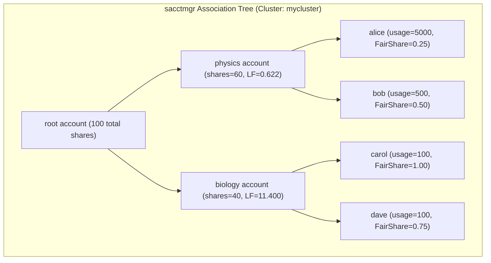

# 6.9 Slurm accounting and scheduling policy: QOS, fair-share, backfill, preemption

| | |
|---|---|
| Level | Intermediate |
| Priority tier | 1 |
| Lab venue | Slurm cluster with accounting (6.7); the simulator needs only Python 3 |
| Part | Part 6: HPC and Slurm |
| Status | Drafted. Formulas, flags and defaults were read from the Slurm documentation and man pages in a shallow clone (SchedMD/slurm commit `521370b`, 2026-10-23, development version 26.11.0rc1); the Fair Tree and priority model in `code/part06/fairtree_sim.py` was run (output shown) and is a teaching re-implementation, not Slurm itself. No Slurm daemon was run; cluster labs are **untested** |

## Why this matters for AI infrastructure

A GPU cluster is a shared, expensive asset, and the scheduler's policy is where organisational decisions become code: who gets priority before a deadline, how a team that bought 64 GPUs is guaranteed them, whether idle capacity can be borrowed, how one user is stopped from queueing 10,000 jobs, and how much each group is charged. Poor policy produces the two classic failures: starvation (large or low-priority jobs never run) and low utilisation (GPUs idle while jobs wait because limits or reservations are mis-set). This chapter explains the mechanisms well enough to design policy and explain to a user why their job is pending.

## Prerequisites and outcomes

Needs 6.7 (accounting database, associations) and 6.8 (partitions, memory/GPU defaults). After this chapter you can:

- Build and inspect an accounting hierarchy with `sacctmgr`, and explain associations, TRES and billing.
- Set and reason about limits (Grp\*, Max\*), `AccountingStorageEnforce`, and QOS flags.
- Compute a job's priority from the multifactor formula and use `sprio` and `sshare` to explain an ordering.
- Explain Fair Tree fair-share, usage decay and what the numbers mean; predict who goes next in a small example.
- Explain backfill, why accurate time limits matter, and the main tuning knobs.
- Choose a preemption design (partition tiers or QOS; cancel, requeue, suspend) and its consequences for AI jobs.
- Design a policy for a multi-team GPU cluster including guaranteed shares, burst, and urgent work.

## 1. The accounting model



With `slurmdbd` and a database (6.7), Slurm records every job and keeps a tree of **associations**. An association is a tuple (cluster, account, user, optionally partition) to which limits, shares and a default QOS attach.

```text
root
 └─ physics (account, shares 60)
     ├─ alice (user association)
     └─ bob
 └─ biology (account, shares 40)
     ├─ carol
     └─ dave
```

Creating and inspecting it (syntax per `sacctmgr(1)`; the man page also documents `modify`, `delete`, `show` and the `where`/`set` form):

```bash
sacctmgr add cluster mycluster
sacctmgr add account physics Description="Physics dept" Organization=sci fairshare=60
sacctmgr add account biology fairshare=40
sacctmgr add user alice account=physics
sacctmgr add user bob   account=physics
sacctmgr show assoc format=cluster,account,user,fairshare,qos,grptres%30 tree
sacctmgr modify user where name=alice set maxjobs=20 defaultaccount=physics
```

Every job runs under an association. If `AccountingStorageEnforce` includes `associations`, a user with no association cannot run; `limits` (implies associations) enforces the limits on associations and QOS; `qos` requires a valid QOS; `safe` only launches jobs that can finish within a TRES-minutes limit; `nojobs`/`nosteps` turn accounting off for jobs/steps. (From the `slurm.conf` man page.) The 6.7 starter config uses `associations,limits,qos`.

### TRES

A **TRES** (trackable resource) is anything Slurm counts: `cpu`, `mem`, `node`, `energy`, `billing`, and GRES such as `gres/gpu` (add `AccountingStorageTRES=gres/gpu` so GPUs are tracked; per-type like `gres/gpu:h100` also possible). Limits and usage are expressed in TRES. **`billing`** is a synthetic TRES computed from per-partition `TRESBillingWeights`. The documentation's example with `TRESBillingWeights=CPU=1.0,Mem=0.25G` on 16-CPU/64-GiB nodes shows why: a 1-CPU job that requests 60 GiB occupies the memory of a whole node but, billed for CPU only, looks cheap. With the default sum, Job1 (1 CPU, 60 GiB) is billed 1 + 15 = 16; Job2 (16 CPU, 1 GiB) 16.25; Job3 (16 CPU, 60 GiB) 31. With the `MAX_TRES` flag the bill is the max of the per-node TRES (15, 15, 16), which tracks "how much of the node did you deny to others". For GPU clusters bill GPUs heavily (for example `GRES/gpu=10`) and use `MAX_TRES_GRES` (added in Slurm 25.05 per the man page) so that GPU hours dominate. Billing drives fair-share usage, reports, chargeback and the TRES priority factor.

### User levels and coordinators

Accounting also defines who may change policy. A user's `AdminLevel` (set with `sacctmgr modify user ... set adminlevel=...`) is `None`, `Operator` or `Admin` (values from the `sacctmgr` man page); operators can perform most accounting operations, admins everything. A **coordinator** is a regular user designated for an account (`sacctmgr add coordinator account=physics names=alice`) who can add users to, and set limits within, that account but not exceed what the parent allows. Delegating to coordinators keeps routine account management with the teams; Fair Tree (section 4) is designed so that a coordinator reshuffling their own users cannot hurt their account's standing relative to others.

## 2. Limits and QOS

### Association limits

Set on accounts or users with `sacctmgr modify ... set`. The families (names from `sacctmgr(1)`):

| Family | Meaning |
|---|---|
| `GrpTRES`, `GrpJobs`, `GrpSubmit`, `GrpWall` | Aggregate limit for the association **and all its children** at one time (for example `GrpTRES=gres/gpu=64` caps an account's running GPUs) |
| `GrpTRESMins`, `GrpTRESRunMins` | Cumulative TRES-minutes (usage budget) / TRES-minutes currently committed by running jobs |
| `MaxTRES`/`MaxTRESPerJob`, `MaxTRESPerNode`, `MaxTRESPerUser`, `MaxTRESPerAccount` | Per job / node / user / account caps |
| `MaxJobs`, `MaxSubmitJobs`, `MaxWall`, `MaxTRESMins` | Counts and wall-time per job |
| `MaxJobsAccrue*` | Limit how many pending jobs accrue age priority |
| `Fairshare` | Share value used in fair-share |
| `DefaultQOS`, `QOS` | Allowed and default QOS |

Limits are checked when a job is being considered to run. A job above a limit stays pending with a reason such as `AssocGrpGRES`, `AssocMaxJobsLimit`, `QOSMaxCpuPerUserLimit` (shown by `squeue -o "%R"`), unless the QOS has `DenyOnLimit`, in which case it is rejected at submission.

### QOS (Quality of Service)

A **QOS** is a named policy object that jobs request (`--qos=high`). It bundles: a **priority** (integer feeding the QOS factor), **limits** (the same Grp/Max families but at QOS scope), **preemption** relationships and mode, a **usage factor** (scale billing: 0.5 for a cheap scavenger QOS, 2 for an expensive urgent one), a **grace time** for preemption, and **flags**:

| Flag | Effect |
|---|---|
| `DenyOnLimit` | Reject at submit rather than queue when limits are violated |
| `NoReserve` | With backfill, jobs in this QOS do not reserve resources in the future (man page warns this can starve larger jobs) |
| `OverPartQOS` | The job's QOS limits override the partition QOS |
| `NoDecay` | QOS usage (`GrpTRESMins`, `GrpWall`, raw usage) is not decayed |
| `EnforceUsageThreshold` | Jobs rejected if the QOS usage is below a threshold |
| `RelativeTRES`-style options | Interpret limits relative to the partition (see the page) |

Example policy set (sketch):

```bash
sacctmgr add qos normal   priority=10   maxtresperuser=gres/gpu=64
sacctmgr add qos urgent   priority=1000 usagefactor=2   maxwall=12:00:00 preempt=scavenger flags=DenyOnLimit
sacctmgr add qos scavenger priority=0   usagefactor=0   preemptmode=requeue gracetime=120
sacctmgr modify user alice set qos=normal,urgent defaultqos=normal
```

(Option spellings are from the `sacctmgr(1)` QOS section as I read it; verify with `sacctmgr show qos format=...` and the man page on your version.)

Partition-level QOS (`QOS=` on a partition) extends limits for jobs in that partition; where a limit exists in both the partition QOS and the job QOS, the partition QOS wins unless the job QOS has `OverPartQOS` (man page).

### The 6-level QoS and association limit precedence order

Because a single job can inherit limits from a partition, a job QoS, a user association, parent accounts, and the cluster root, Slurm evaluates conflicting limit definitions in a strict **6-level precedence order** (as given in Chapter 15 of *Supercomputers for Linux SysAdmins*):

1. **Partition QOS limit** (if `Flags=OverPartQOS` is set on the Job QoS, this moves after Job QoS)
2. **Job QOS limit**
3. **User association**
4. **Account association(s)**, ascending the hierarchy
5. **Root/cluster association**
6. **Partition limit**

Also note that when Slurm compares whether one job has higher overall scheduling priority (or preemption authority) than another, it checks four levels in order: (1) **Reservation** (jobs with a reservation come first), (2) **Partition priority tier** (`PriorityTier`), (3) **Job priority** (the calculated multifactor integer), and (4) **Job ID** (earlier submissions with a lower job ID win ties).

## 3. Priority: the multifactor formula

With `PriorityType=priority/multifactor` each pending job gets an integer priority (0 to 4,294,967,295; higher runs sooner). From the multifactor documentation:

```text
Job_priority = site_factor
             + PriorityWeightAge       * age_factor
             + PriorityWeightAssoc     * assoc_factor
             + PriorityWeightFairshare * fair-share_factor
             + PriorityWeightJobSize   * job_size_factor
             + PriorityWeightPartition * priority_job_factor
             + PriorityWeightQOS       * QOS_factor
             + SUM(TRES_weight_<type> * TRES_factor_<type>)
             - nice_factor
```

All factors range 0.0 to 1.0 and weights are unsigned 32-bit integers. By default values are **normalised** to the highest in the cluster (a partition factor of 10 against a maximum of 20 with weight 5000 gives 2,500; the `NO_NORMAL_*` flags turn normalisation off per factor). Weights should be large enough to preserve significant digits: with a fair-share weight of 10, factors 0.59534 and 0.50002 both become about 5 and tie, so use weights from about 1000 upward for the factors that should dominate.

| Factor | Meaning |
|---|---|
| **Age** | Time pending while eligible, rising to 1.0 at `PriorityMaxAge` (default 7 days). Dependent or held jobs do not accrue unless `PriorityFlags=ACCRUE_ALWAYS` |
| **Association** | Per-association integer priority, normalised |
| **Fair-share** | Under-service of the user and account (section 4) |
| **Job size** | Larger or smaller job favoured (`PriorityFavorSmall`); `SMALL_RELATIVE_TO_TIME` divides by time limit |
| **Partition** | `PriorityJobFactor` of the partition, normalised |
| **QOS** | QOS priority, normalised |
| **TRES** | Weighted amount of each TRES requested (set `PriorityWeightTRES=gres/gpu=...`) |
| **Site** | Set by `scontrol`, a `job_submit` plugin or a site-factor plugin |
| **Nice** | User-supplied reduction (negative values need privilege) |

Other relevant parameters: `PriorityCalcPeriod`, `PriorityDecayHalfLife` (default 7 days), `PriorityUsageResetPeriod`, `PriorityFlags` (`CALCULATE_RUNNING`, `INCR_ONLY`, `NO_FAIR_TREE`, `DEPTH_OBLIVIOUS`, `MAX_TRES`, ...).

Inspect:

```bash
sprio -l                     # factors of each pending job
sprio -w                     # the configured weights
sshare -al                   # shares, raw usage, effective usage, level FS, fairshare
squeue --start               # expected start times (after backfill planning)
scontrol show job JOBID | grep -i -E "priority|reason|starttime"
```

**Reading `sprio` is the answer to "why is job A ahead of job B".** Compare the columns.

## 4. Priorities and fair-share

Fair-share steers queue order toward under-served groups. It is **not** a hard quota: over-served groups can still run when the machine would otherwise idle (documentation). The inputs: each association's **shares** (assigned fraction) and its **usage** (decayed history of billed TRES). Usage decays exponentially with half-life `PriorityDecayHalfLife` (default 7 days, "half of the original value cleared at age" of the half-life; 0 disables decay and requires `PriorityUsageResetPeriod`).

### Fair Tree (default since 19.05)

Per the documentation, for each association compute **Level Fairshare**

```text
LF = S / U
S = shares / (sum of shares of itself and its siblings)
U = usage  / (sum of usage  of itself and its siblings)
```

LF above 1 means under-served, below 1 over-served. Then sort siblings by LF (descending) at every level, walk the tree depth-first, and rank the **users** in the order met; the final FairShare factor is `rank / number_of_user_associations`, so the best user gets 1.0. Consequence (documented): if account A has a higher LF than sibling account B, **every user under A outranks every user under B**, regardless of individual usage. This prevents a heavy user in a light account from beating a light user in a heavy account, and prevents account coordinators gaming their team's order. (The older **Classic** algorithm computes `F = 2^(-U/S)` per association from effective usage; select it with `PriorityFlags=NO_FAIR_TREE`.)

### The simulator

`code/part06/fairtree_sim.py` implements Level FS, the tree walk, decay and the priority sum. Run on the tree above (physics shares 60, usage alice 5000, bob 500; biology shares 40, usage carol 100, dave 100):

```text
Level fairshare among accounts:
  physics  S=0.60 U=0.965 LF=0.622
  biology  S=0.40 U=0.035 LF=11.400
FairShare (Fair Tree):
  carol  1.00
  dave   0.75
  bob    0.50
  alice  0.25
```

Note bob (usage 500) ranks below dave (usage 100) because **biology as an account outranks physics**; within physics, bob (less usage) ranks above alice. Decay with a 7-day half-life of 8,000 core-hours: 8,000 now, 4,000 at 7 days, 2,000 at 14, 500 at 28. And two jobs under the example weights (age 1000, fair-share 100000, QOS 10000, partition 1000): alice's one-hour-old job with the highest QOS scores 36,005, while carol's three-day-old normal-QOS job scores 102,428 because the fair-share term dominates. The lesson: **with a large fair-share weight a QOS bump does not rescue a heavy user**; if urgent work must jump the queue, give QOS priority a weight comparable to fair-share, or use preemption (section 6).

### Practical fair-share guidance

- Shares express entitlement (what you bought), usage expresses consumption; pick a decay half-life (`PriorityDecayHalfLife=3-6:30` for 3 days, 6 hours, 30 minutes in `SCL` Chapter 15, or `0` to use `PriorityUsageResetPeriod=WEEKLY` / `DAILY` / `MONTHLY` / `QUARTERLY` / `YEARLY` / `NONE` / `NOW`) that matches the planning horizon. Very long half-lives let a past burst punish a group for months.
- `sshare` shows `RawShares`, `NormShares` (allocated shares divided by total shares, in `0..1`), `RawUsage`, `EffectvUsage`, `LevelFS`, and `FairShare` (for example in `SCL` Chapter 15: `root` `RawUsage=694362950`, `abc` `RawShares=2000` `NormShares=0.011481` `RawUsage=28` `FairShare=0.999998`, `foo` `RawShares=3000` `NormShares=0.017221` `RawUsage=45166247` `EffectvUsage=0.065072` `FairShare=0.072870`, `bar` `RawShares=100` `FairShare=1.000000`, `baz` `RawShares=300` `RawUsage=19770` `FairShare=0.988597`).
- New users with no usage get high LF (infinity if no usage), which is intentionally welcoming but can be exploited by creating accounts; control account creation.
- Fair-share needs `slurmdbd` and honest accounting of GPUs (`TRESBillingWeights=GPU=1.0,CPU=0.001,Mem=0.01G` in `SCL` Chapter 15, where a job requesting `2` GPUs, `16` CPUs, and `1024G` memory consumes `2*1.0 + 16*0.001 + 1024*0.01 = 12.256` shares per second, or `max = 10.24` under `PriorityFlags=MAX_TRES`).
- Hard budgets use `GrpTRESMins` with `AccountingStorageEnforce=limits` (and `safe` if you want jobs to finish within the budget). To delete a limit set on an association in `sacctmgr`, set its value to **`-1`** (`SCL` Chapter 15).

## 5. Backfill

The main scheduling pass walks the pending queue in priority order and starts what fits. **Backfill** (`SchedulerType=sched/backfill`) adds look-ahead: it plans a start time for high-priority jobs that cannot start now, then lets lower-priority jobs start immediately **only if they will finish before they delay any planned job** (or fit in resources not needed by the plan). This raises utilisation without starving big jobs.

Backfill relies on **time limits**. A job's `--time` is its promised maximum; the scheduler plans with it. Consequences:

- **Accurate (tight) limits let more jobs backfill.** A user who requests the 2-day maximum for a 2-hour job blocks backfill windows for others and delays their own job's planning.
- Jobs finishing early create gaps that the next scheduling pass refills.
- Without limits, or with a default equal to the partition maximum, backfill is crippled. Set `DefaultTime` low and `MaxTime` where needed (6.8), and consider `--time-min` for flexible jobs.
- Backfill cannot help when all jobs are huge multi-node and uniform; it shines on mixed sizes.

Selected `SchedulerParameters` (defaults from the man page):

| Parameter | Default | Meaning |
|---|---|---|
| `bf_interval` | 30 s | Seconds between backfill iterations (-1 disables) |
| `bf_window` | 1440 min (1 day) | How far ahead to plan; should be at least the longest time limit to avoid starvation |
| `bf_resolution` | 60 s | Time granularity of planning; raise it with a large `bf_window` |
| `bf_max_job_test` | 500 | Maximum jobs considered per cycle (queue depth) |
| `bf_max_job_user` | 0 (none) | Per-user cap on backfill candidates; prevents one user's flood from hiding others |
| `bf_continue` | off | Continue the cycle after releasing locks even if state changed |
| `default_queue_depth` | 100 | Jobs tried in the main scheduling pass |
| `defer`, `sched_interval`, `sched_min_interval`, `partition_job_depth`, `max_rpc_cnt` | | Limit scheduler overhead under heavy load (see page) |

Typical GPU-cluster tuning: raise `bf_window` to cover the longest time limit (for example 7 days), raise `bf_resolution` accordingly (for example 300 s), keep `bf_max_job_test` in the low thousands for large queues, set `bf_max_job_user` to something like 50 to 200, enable `bf_continue`. Monitor with `sdiag` (cycle times, depth reached, queue lengths). **Too deep and too frequent backfill makes the controller unresponsive**; look at `sdiag` before raising numbers. Values quoted as typical are experience-based, not measured here.

Diagnostics: `squeue --start`, `scontrol show job` (`StartTime`, `Reason`), `sprio`. A job pending with reason `Priority` is waiting behind others; `Resources` is next in line but resources are not yet free; `Dependency`, `JobHeldUser`, `BeginTime` are not scheduling problems; limit reasons begin with `Assoc`/`QOS`.

## 6. Preemption

Preemption stops lower-priority jobs to let a higher-priority one run (documentation). Configuration:

- **`PreemptType`**: `preempt/none` (default), `preempt/partition_prio` (decided by partition `PriorityTier`), `preempt/qos` (decided by the QOS `Preempt` list).
- **`PreemptMode`** (cluster default; per partition with partition_prio or per QOS with qos): `OFF` (default), `CANCEL`, `REQUEUE`, `SUSPEND` (requires `GANG`), and the modifier `GANG` (gang scheduling/time-slicing, per partition). `PRIORITY` limits preemption to cases where the preemptor's job priority is higher; `WITHIN` lets jobs of the same QOS preempt each other.
- **`GraceTime`** (partition or QOS): seconds the preempted job has to finish after being selected; it gets SIGCONT and SIGTERM immediately and SIGKILL at the end. Default 0 (no delay). A job that exits within the grace time is handled according to the preempt mode regardless of why it exited.
- Memory: suspended jobs keep their memory, so with `SUSPEND,GANG` make memory a consumable resource (6.8) or nodes will swap.
- `REQUEUE` works only for jobs submitted with `--requeue` or when cluster-wide `JobRequeue=1`; otherwise the job is cancelled.

### What preemption means for AI work

- **Suspend** is unsuitable for GPU training: suspended jobs hold GPU memory, and NCCL jobs across nodes time out. Use `REQUEUE` or `CANCEL`.
- **Requeue** only helps if the job **checkpoints and resumes** (Part 14); otherwise the work is lost. Train with periodic checkpoints and an automatic resume path (`--requeue`, `--signal=B:USR1@120` to get a warning, handle SIGTERM during `GraceTime`).
- A scavenger QOS (usage factor 0, lowest priority, requeue) turns idle GPUs into free throughput for groups with resumable work, while guaranteeing owners instant access.
- Preemption interacts with fair-share: preempted GPU time is charged, so use a low `UsageFactor` for scavenger usage.

## 7. A policy design for a multi-team GPU cluster

Requirements: three teams with purchased shares (50/30/20), research bursts allowed, a monthly deadline crunch, protection against floods, easy auditability.

1. **Accounts** per team with `fairshare` proportional to purchase; Fair Tree (default); decay half-life 14 days.
2. **Partitions**: `gpu` (all nodes, default, `MaxTime=2-00:00:00`, `DefMemPerGPU`, `DefCpuPerGPU`), `debug` (few nodes, 30 minutes, high tier), `long` (restricted to approved accounts, `MaxTime=14-00:00:00`, lower weight).
3. **QOS**: `normal` (priority 100, `MaxTRESPerUser=gres/gpu=64`, `MaxSubmitJobsPerUser=500`), `urgent` (priority 1000, usage factor 2, approval by `AllowQos`, preempts `scavenger`), `scavenger` (priority 0, usage factor 0 or 0.1, requeue, grace 120 s, `NoReserve` so it never blocks planning).
4. **Hard budgets** only where contractually required (`GrpTRESMins` plus `safe`); otherwise rely on fair-share.
5. **Weights**: `PriorityWeightFairshare=100000`, `PriorityWeightQOS=50000`, `PriorityWeightAge=1000` (`PriorityMaxAge=7-0`), `PriorityWeightPartition=10000`, `PriorityWeightJobSize=0` (do not distort), `PriorityWeightTRES=gres/gpu=100`. Check with `sprio` that an urgent QOS job of a heavy user outranks a normal job of a light user if that is the intent.
6. **Scheduler**: `sched/backfill`, `bf_window` at the longest limit, `bf_max_job_user=100`, `bf_continue`.
7. **Billing**: `TRESBillingWeights=GRES/gpu=10,CPU=1,Mem=0.1G` and `PriorityFlags=MAX_TRES_GRES` so GPUs dominate cost.
8. **Reporting**: `sreport cluster AccountUtilizationByUser`, `sreport cluster utilization`, `sacct -X --format=...` for monthly chargeback; review wait time per QOS.
9. **Review loop**: monthly policy review comparing waiting times and utilisation; avoid tuning weights ad hoc during a crunch.

### Accounting and Statistics: Concrete `sacct` and `sreport` reporting commands

Once accounting is active, `sacct` queries per-job accounting and statistics records (and `sstat` queries live running-job CPU, memory, and disk utilization when `jobacct_gather` is enabled), while `sreport` aggregates utilization statistics across three top-level report classes: `cluster` (total utilization), `job` (task size classes by CPU count, grouped by account), and `user` (top users by resource consumption). The book's Chapter 15 (*Accounting and Statistics*) provides four ready-to-use reporting invocations (`(untested here)`):

```bash
# (untested here) — 1. One-day job summary: JobID, Partition, User, core-seconds (CPUTimeRAW), State
sacct -S 2024-01-01 -E 2024-01-02 \
  -o JobID,Partition,User%16,CPUTimeRAW,State%20 -X

# (untested here) — 2. Weekly job size breakdown by account (0–16 cores, 17–1024 cores, and >1024 cores, in minutes)
sreport job SizesByAccount grouping=0-16,17-1024 \
  start=2024-01-01 end=2024-01-07

# (untested here) — 3. Monthly cluster utilization percentages (Allocated, Down, PLND Down, Idle, Planned, Reported)
sreport cluster utilization Start=2024-11-01 End=2024-12-01 -t percent

# (untested here) — 4. Top 5 users by resource utilization over a month (reported in TRES Minutes and Energy)
sreport user topusage topcount=5 start=2024-01-10 \
  end=2024-02-10
```

Alternatives: reservations (`scontrol create reservation`) for guaranteed windows (training runs, exams, demos); hard partitions per team (simple, wasteful); dedicated nodes via `AllowAccounts`; a Kubernetes layer with Kueue where quota/borrowing semantics are expressed as ClusterQueue and cohort (Part 11, 14).

## 8. Why is my job pending: a decision list

1. `squeue -j JOB -o "%i %T %r %S"` for reason and estimated start.
2. Reason starts with `Assoc` or `QOS`: a limit; `sacctmgr show assoc where user=...` and `sacctmgr show qos`.
3. `Priority`: compare `sprio -j JOB` with the jobs ahead; `sshare -u USER`.
4. `Resources`: wait for free nodes; check the request (GPU type? memory default? constraint?) for something no node can satisfy; `scontrol show job` `Features`, `Gres`, `MinMemoryNode`.
5. `ReqNodeNotAvail`: nodes down/drained/reserved (`sinfo -R`, `scontrol show reservation`).
6. `PartitionConfig`, `PartitionTimeLimit`, `PartitionNodeLimit`: request exceeds partition limits.
7. `BeginTime`, `Dependency`, `JobHeldUser/Admin`: not a scheduling issue.
8. `BadConstraints`/`InvalidQOS`/`InvalidAccount`: fix the request.

## 9. Lab (simulator tested; cluster parts untested)

First, run the self-checking Python lab (`code/part06/fairtree_sim_lab.py`) locally. It verifies the Fair Tree `Level Fairshare` (`LF = S / U`) and depth-first user ranking (`fair_tree`), the 7-day half-life exponential usage decay and multifactor job priority formula (`decay`, `priority`), and the `TRESBillingWeights` additive vs `MAX_TRES` billing calculation from `SCL` Chapter 15 (`compute_tres_billing`):

```bash
python3 code/part06/fairtree_sim_lab.py
```

Next, work through these steps:

1. Run `python3 code/part06/fairtree_sim.py`; change usage so that physics has less usage than biology; predict, then verify the ranking.
2. Add a third account with no usage and observe LF (infinity) and its users' rank. Discuss the incentive problem.
3. Change the decay half-life; compute how long until a one-off burst stops mattering.
4. Modify the priority weights and find the QOS weight at which an urgent job of a heavy user beats a normal job of a light user.
5. Cluster: create the accounts, users, QOS from section 7; set weights; submit jobs under different users with `--test-only`/`--hold` and examine `sprio -l`.
6. Cluster: run a backfill experiment: queue a large job requiring all nodes behind running small jobs; then submit short jobs with accurate `--time` and long jobs with a loose `--time`; observe which backfill (`squeue --start`).
7. Cluster: configure `scavenger` with requeue; run a checkpointing toy job, preempt it with an `urgent` job, confirm requeue and resume.
8. Read `sdiag` output before and after changing `bf_window`/`bf_max_job_test`.

## 10. Interview angles

- Explain associations, accounts, QOS, and TRES. What is `billing`?
- How is a job's priority computed? How would you explain the order of two jobs?
- What does Fair Tree guarantee about users in sibling accounts?
- What does usage decay do? How do you choose the half-life?
- Why do accurate time limits matter for backfill?
- Describe a preemption setup for GPU training with checkpoints. Why not suspend?
- How would you give a team a guaranteed share but let others borrow idle GPUs?
- A user says their job is stuck "Priority". What do you do?
- What breaks if `PriorityWeightFairshare` is 10?
- Difference between Grp and Max limits.

## Exercises

1. **Fair Tree Level Fairshare (`LF = S / U`) and Sibling Account Ranking (`code/part06/fairtree_sim.py`):** Using `level_fs()` and `fair_tree()` in `code/part06/fairtree_sim.py`, compute `S`, `U`, and `LF` for `physics` (`60` shares, `alice=5000`, `bob=500`) and `biology` (`40` shares, `carol=100`, `dave=100`). Explain why `bob` (`usage=500`) ranks below `dave` (`usage=100`), and explain how `PriorityFlags=NO_FAIR_TREE` changes the algorithm.
2. **Multifactor Priority Weights and Usage Half-Life Decay (`code/part06/fairtree_sim.py`):** Using `decay(8000, elapsed_days, 7.0)` and `priority()` in `code/part06/fairtree_sim.py`, compute the remaining usage after `7`, `14`, and `28` days, and calculate the priority score of `alice`'s 1-hour-old urgent-QoS job (`36,005`) versus `carol`'s 3-day-old normal-QoS job (`102,428`). What `PriorityWeightQOS` value is needed if an `urgent` QoS job (`qos_prio=10`) from `alice` (`fairshare=0.25`) must beat a `normal` QoS job (`qos_prio=1`) from `carol` (`fairshare=1.00`)?
3. **`TRESBillingWeights` Sum vs. `MAX_TRES` Billing (`SCL` Chapter 15 & `fairtree_sim_lab.py`):** Given `TRESBillingWeights=GPU=1.0,CPU=0.001,Mem=0.01G` from `SCL` Chapter 15, use `compute_tres_billing()` in `code/part06/fairtree_sim_lab.py` to compute the billed shares per second for a job requesting `2` GPUs, `16` CPUs, and `1024G` memory under (a) default additive billing (`12.256`) and (b) `PriorityFlags=MAX_TRES` (`10.24`).
4. **The 6-Level Limit Precedence Order and `Grp*` vs. `Max*` Limits (`SCL` Chapter 15):** State the 6-level precedence order Slurm uses when enforcing limits across Partition QoS, Job QoS (`OverPartQOS`), User association, Account hierarchy, Root association, and Partition limits. Contrast `GrpTRES=gres/gpu=64` with `MaxTRESPerUser=gres/gpu=64`, and state how to remove a limit in `sacctmgr` (`set maxjobs=-1`).
5. **Backfill Look-Ahead (`sched/backfill`) and Preemption for AI Workloads:** Explain why inaccurate `--time` requests break backfill scheduling, why `bf_window` must cover the longest partition `MaxTime`, and why GPU training clusters use `PreemptMode=REQUEUE` (with `--requeue` and checkpointing) rather than `SUSPEND,GANG`.
6. **Accounting & Utilization Reporting (`sacct`, `sstat`, and `sreport`, `SCL` Chapter 15):** Write the exact `sacct` and `sreport` commands from `SCL` Chapter 15 to report (a) a 1-day job summary (`JobID,Partition,User%16,CPUTimeRAW,State%20 -X`), (b) weekly job sizes by account (`SizesByAccount grouping=0-16,17-1024`), (c) monthly cluster utilization percentage (`cluster utilization -t percent`), and (d) the top 5 users by monthly TRES usage (`user topusage topcount=5`).

## Checkpoint questions (20)

<details>
<summary>1. What is an association in Slurm accounting, and what does `AccountingStorageEnforce=associations,limits,qos,safe` enforce?</summary>

An **association** is the 4-tuple `(cluster, account, user, [optional partition])` in `slurmdbd` to which shares, limits, and QoS permissions attach.
- `associations`: rejects jobs from users lacking a valid association.
- `limits` (implies `associations`): enforces `Grp*` and `Max*` resource/job/time limits.
- `qos`: requires every job to use an allowed QoS.
- `safe`: only starts a job if its remaining cumulative `GrpTRESMins` / `MaxTRESMins` budget is large enough for the job to run for its full requested `--time`.
</details>

<details>
<summary>2. What is the `billing` TRES, and how does `TRESBillingWeights` prevent a 1-CPU, 500-GiB RAM job from being under-charged?</summary>

**`billing`** is a synthetic TRES calculated from a partition's `TRESBillingWeights` (for example, `TRESBillingWeights="CPU=1.0,Mem=0.25G,GRES/gpu=10.0"`). Without billing weights, usage is billed purely by CPU-seconds, so a 1-CPU job consuming 100% of a node's RAM (or 8 GPUs) looks almost free. With `TRESBillingWeights`, Slurm bills either the **weighted sum** of requested resources (default) or the **maximum single weighted resource** (`PriorityFlags=MAX_TRES` / `MAX_TRES_GRES`).
</details>

<details>
<summary>3. Using the `SCL` Chapter 15 example `TRESBillingWeights=GPU=1.0,CPU=0.001,Mem=0.01G`, how many billing units per second does a job requesting `2` GPUs, `16` CPUs, and `1024G` RAM consume under default sum vs. `MAX_TRES`?</summary>

- **Default sum:** $2 \times 1.0 + 16 \times 0.001 + 1024 \times 0.01 = 2.0 + 0.016 + 10.24 = \mathbf{12.256}$ units/s.
- **`PriorityFlags=MAX_TRES`:** $\max(2.0,\ 0.016,\ 10.24) = \mathbf{10.24}$ units/s.
</details>

<details>
<summary>4. What is the difference between `Grp*` limits (`GrpTRES`, `GrpJobs`, `GrpSubmitJobs`) and `Max*` limits (`MaxTRESPerUser`, `MaxJobsPerUser`, `MaxTRESPerJob`), and how do you delete a limit in `sacctmgr` (`SCL` Chapter 15)?</summary>

- **`Grp*` limits:** Aggregate ceiling summed across **all running (or submitted) jobs sharing that association/account (including subaccounts) or QoS simultaneously** (for example, `GrpTRES=gres/gpu=64` on an account caps the entire team's combined running GPUs at 64).
- **`Max*` limits:** Cap applied **per individual user, per individual job, or per node** within that association or QoS.
- **Deleting a limit in `sacctmgr`:** Set the limit value to **`-1`** (for example, `sacctmgr modify assoc where user=user1 account=acc1 set maxjobs=-1`).
</details>

<details>
<summary>5. What is Slurm's 6-level precedence order when conflicting limit definitions exist across Partition, QoS, User, and Account (`SCL` Chapter 15)?</summary>

From highest (1) to lowest (6) precedence:
1. **Partition QoS limit** (unless the Job QoS has `Flags=OverPartQOS`, in which case Job QoS wins).
2. **Job QoS limit**.
3. **User association limit**.
4. **Account association limit(s)** (ascending the account hierarchy).
5. **Root / cluster association limit**.
6. **Partition limit**.
</details>

<details>
<summary>6. What do the QoS flags `DenyOnLimit`, `OverPartQOS`, `NoReserve`, and `NoDecay` do?</summary>

- **`DenyOnLimit`:** Rejects a job immediately at `sbatch`/`srun` submission time if it violates a `Max*` limit, rather than letting it sit pending in the queue.
- **`OverPartQOS`:** Allows the job's QoS limits to override the partition's QoS limits.
- **`NoReserve`:** Prevents jobs in this QoS from creating future backfill reservations (used for low-priority `scavenger` queues so they never delay large jobs).
- **`NoDecay`:** Prevents historical usage accumulated under this QoS from decaying over time (used for fixed-term allocation grants).
</details>

<details>
<summary>7. What is the 4-level overall order Slurm uses to decide which pending job has higher scheduling priority (`SCL` Chapter 15)?</summary>

1. **Reservation:** Jobs holding an active reservation on the nodes go first.
2. **Partition `PriorityTier`:** Jobs in a partition with a higher `PriorityTier` strictly precede jobs in lower-tier partitions.
3. **Job priority (`priority/multifactor`):** Higher calculated multifactor integer priority wins within the same tier.
4. **Job ID:** Earlier submissions (lower Job ID) break ties.
</details>

<details>
<summary>8. Write the multifactor job priority formula (`priority/multifactor`), and explain why dominant `PriorityWeight*` values should be at least `1,000` (`10,000–100,000`).</summary>

$$\text{Priority} = \text{Site} + W_{\text{Age}} F_{\text{Age}} + W_{\text{Assoc}} F_{\text{Assoc}} + W_{\text{FS}} F_{\text{FS}} + W_{\text{Size}} F_{\text{Size}} + W_{\text{Part}} F_{\text{Part}} + W_{\text{QOS}} F_{\text{QOS}} + \sum W_{\text{TRES}} F_{\text{TRES}} - \text{Nice}$$
Each factor $F \in [0.0, 1.0]$ is multiplied by its integer weight $W$ and truncated to an integer. If `PriorityWeightFairshare=10`, two users with fair-share factors `0.595` and `0.501` both truncate to `5` and tie. Using weights of `1,000` to `100,000` preserves 3–5 significant digits.
</details>

<details>
<summary>9. How does **Fair Tree** compute **Level Fairshare (`LF`)** at each level of the account tree, and what does it guarantee about sibling accounts?</summary>

$$\text{LF} = \frac{S}{U}, \qquad S = \frac{\text{shares}}{\sum \text{sibling shares}}, \qquad U = \frac{\text{usage}}{\sum \text{sibling usage}}$$
At every level of the tree, sibling accounts/users are sorted by `LF` descending (`LF > 1.0` means under-served; `LF < 1.0` means over-served), and the tree is walked depth-first to assign each user `rank / N_users`. **Guarantee:** If Account A has a higher `LF` than sibling Account B, **every user in Account A receives a higher FairShare factor than every user in Account B**, regardless of individual user usage.
</details>

<details>
<summary>10. In the `fairtree_sim.py` example (`physics` `60` shares with `alice=5000, bob=500`; `biology` `40` shares with `carol=100, dave=100`), why does `bob` (`500` usage) rank below `dave` (`100` usage) even though `physics` has more shares?</summary>

Together `alice` and `bob` used $5500 / 5700 = 96.5\%$ of the cluster's recent usage while owning $60\%$ of the shares, giving `physics` $\text{LF} = 0.60 / 0.965 = \mathbf{0.622}$ (over-served). `biology` used only $3.5\%$ of the cluster while owning $40\%$ of the shares ($\text{LF} = 0.40 / 0.035 = \mathbf{11.400}$, under-served). Because `biology` outranks `physics` at the account level, Fair Tree ranks all `biology` users (`carol=1.00`, `dave=0.75`) above all `physics` users (`bob=0.50`, `alice=0.25`).
</details>

<details>
<summary>11. How do `PriorityDecayHalfLife` and `PriorityUsageResetPeriod` manage historical fair-share usage (`SCL` Chapter 15)?</summary>

- **`PriorityDecayHalfLife` (default `7` days; e.g., `3-6:30` for 3d 6h 30m):** Exponentially decays historical usage so half of an account's accumulated usage disappears every half-life period ($U(t) = U_0 \cdot 2^{-t / T_{1/2}}$).
- **`PriorityUsageResetPeriod` (`NONE` default, or `DAILY`, `WEEKLY`, `MONTHLY`, `QUARTERLY`, `YEARLY`, `NOW`):** Hard-resets accumulated usage to zero at midnight on the first day of the period (used when `PriorityDecayHalfLife=0`).
</details>

<details>
<summary>12. How do you decode the columns of `sshare` (`RawShares`, `NormShares`, `RawUsage`, `EffectvUsage`, `FairShare`) (`SCL` Chapter 15)?</summary>

- **`RawShares`:** Integer shares assigned to the account/user in `sacctmgr`.
- **`NormShares`:** Normalized share fraction ($0.0 \dots 1.0$) relative to the cluster total.
- **`RawUsage`:** Decayed TRES-seconds consumed by the account/user.
- **`EffectvUsage`:** Normalized share of cluster usage ($0.0 \dots 1.0$).
- **`FairShare`:** Final fair-share factor ($0.0 \dots 1.0$) multiplied by `PriorityWeightFairshare` in `sprio`.
</details>

<details>
<summary>13. How does the backfill scheduler (`sched/backfill`) prevent starvation of large multi-node jobs while filling idle GPU gaps?</summary>

When the highest-priority pending job cannot start immediately because enough nodes are not yet free, `sched/backfill` looks at the running jobs' remaining `--time` limits, computes the **earliest future start time** for that large job, and reserves those nodes from that timestamp onward (`PLANNED` state). It then scans down the queue and starts smaller/shorter jobs **only if their requested `--time` finishes before the reserved start time of every higher-priority planned job**.
</details>

<details>
<summary>14. Why does setting an overly loose `--time` limit on small jobs hurt both the user and cluster utilization under backfill?</summary>

If a job that only needs 30 minutes is submitted with `--time=2-00:00:00` (48 hours), the backfill scheduler must assume the job will occupy the GPUs for a full 48 hours. As a result, the job cannot fit into a 4-hour backfill window ahead of a planned 64-node training run—so the user's job stays `PENDING` while the GPUs sit `IDLE`.
</details>

<details>
<summary>15. What are the default values and meanings of `bf_interval`, `bf_window`, `bf_resolution`, `bf_max_job_test`, and `bf_max_job_user` in `SchedulerParameters`?</summary>

- **`bf_interval` (default `30` s):** Pause between backfill scheduling passes.
- **`bf_window` (default `1440` min = 1 day):** Look-ahead horizon for planning future job reservations (must be $\ge$ the longest partition `MaxTime`).
- **`bf_resolution` (default `60` s):** Time-step bucket resolution inside the backfill window (increase to `300` s when `bf_window` is 7–14 days).
- **`bf_max_job_test` (default `500`):** Maximum depth of pending jobs evaluated per backfill pass.
- **`bf_max_job_user` (default `0` = unlimited):** Maximum pending jobs per user evaluated per backfill pass (set to `50–200` so one user's 5,000-job sweep cannot block other users from backfilling).
</details>

<details>
<summary>16. Compare the `PreemptMode` options `OFF`, `CANCEL`, `REQUEUE`, and `SUSPEND,GANG`, and explain why `SUSPEND` fails for multi-node GPU jobs (`SCL` Chapter 15).</summary>

- **`OFF`:** Preemption disabled.
- **`CANCEL`:** Preempted job is killed permanently.
- **`REQUEUE`:** Preempted job is terminated (after optional `GraceTime` `SIGTERM`) and placed back into the `PENDING` queue (if submitted with `--requeue` or `JobRequeue=1`).
- **`SUSPEND,GANG`:** Preempted job processes are frozen with `SIGSTOP` in memory while the preempting job runs, then resumed with `SIGCONT`. **Why `SUSPEND` fails on GPUs:** Suspended processes do not release GPU VRAM (`HBM`), causing the preempting GPU job to OOM immediately, and freezing multi-node `NCCL` ranks triggers RDMA queue-pair and watchdog timeouts.
</details>

<details>
<summary>17. How do `GraceTime` and `--signal=B:USR1@120` allow a preempted or time-limited LLM training job to save a checkpoint before dying?</summary>

When a job is selected for preemption, Slurm grants it `GraceTime` seconds (for example `120` s on the `scavenger` QoS), sending `SIGTERM` at the start of the grace period and `SIGKILL` only when `GraceTime` expires (or sending a custom warning signal like `SIGUSR1` 120 seconds before walltime via `--signal=B:USR1@120`). The training framework traps the signal, flushes an asynchronous checkpoint to Lustre/object storage, exits cleanly, and resumes automatically from the latest checkpoint when `REQUEUE`d.
</details>

<details>
<summary>18. Write the three `sreport` commands from `SCL` Chapter 15 to audit weekly job sizes by account, monthly cluster utilization percentage, and top 5 users.</summary>

1. **Weekly job sizes by account (`0–16`, `17–1024`, `>1024` CPUs):**
   `sreport job SizesByAccount grouping=0-16,17-1024 start=2024-01-01 end=2024-01-07`
2. **Monthly cluster utilization in percent (`Allocated`, `Down`, `Idle`, `Planned`):**
   `sreport cluster utilization Start=2024-11-01 End=2024-12-01 -t percent`
3. **Top 5 users by monthly TRES consumption:**
   `sreport user topusage topcount=5 start=2024-01-10 end=2024-02-10`
</details>

<details>
<summary>19. A researcher complains their job is stuck `PENDING`. How do you distinguish `Priority`, `Resources`, `AssocGrpGRES`, `ReqNodeNotAvail`, and `PartitionTimeLimit`?</summary>

Run `squeue -j <jobid> -o "%i %T %r %S"` to read the pending **Reason (`%r`)**:
- **`Priority`:** Higher-priority jobs are ahead of it in the queue (inspect `sprio -l` and `sshare -al`).
- **`Resources`:** This job is at the top of the queue waiting for currently busy nodes/GPUs to free up (`squeue --start` shows the planned start time).
- **`AssocGrpGRES` / `QOSMaxGRESPerUser`:** The user or their account has hit a running GPU quota limit (`sacctmgr show assoc` / `show qos`).
- **`ReqNodeNotAvail`:** Requested nodes are `DOWN`, `DRAIN`, or covered by an active maintenance/user reservation (`sinfo -R`, `scontrol show reservation`).
- **`PartitionTimeLimit` / `PartitionNodeLimit`:** Job requested more `--time` or `--nodes` than the partition's `MaxTime` or `MaxNodes` permits.
</details>

<details>
<summary>20. How do you design a 3-QoS policy (`normal`, `urgent`, `scavenger`) so teams get their purchased GPU shares, urgent deadlines can jump the queue at a cost, and idle GPUs are never wasted?</summary>

1. **`normal` QoS (default):** `Priority=100`, `UsageFactor=1.0`, standard per-user/per-account `GrpTRES`/`MaxTRES` caps; ordered by Fair Tree fair-share (`PriorityWeightFairshare=100000`).
2. **`urgent` QoS (restricted via `AllowQos`):** `Priority=1000` (with `PriorityWeightQOS=50000` so it can jump ahead), **`UsageFactor=2.0`** (charges double fair-share usage so teams cannot abuse it without lowering their subsequent FairShare), `Preempt=scavenger`, `Flags=DenyOnLimit`.
3. **`scavenger` QoS (open to all for Spot/preemptible work):** `Priority=0`, **`UsageFactor=0.0`** (free idle cycles), `PreemptMode=REQUEUE`, `GraceTime=120`, and **`Flags=NoReserve`** (so scavenger jobs fill backfill holes immediately without ever delaying `normal` or `urgent` jobs).
</details>

## Sources and review notes

- Accounting concepts, the 6-level QoS/association limit precedence order, the 4-level overall priority order (`Reservation -> PriorityTier -> Job priority -> Job ID`), `TRESBillingWeights=GPU=1.0,CPU=0.001,Mem=0.01G` (`2*1.0 + 16*0.001 + 1024*0.01` vs `MAX_TRES`), `PriorityDecayHalfLife=3-6:30` and `PriorityUsageResetPeriod=WEEKLY`, `sshare` decoding (`abc`/`foo`/`bar`/`baz`), setting `-1` to delete limits in `sacctmgr`, `sacct` and `sreport` commands (`sreport job SizesByAccount`, `sreport cluster utilization`, `sreport user topusage`), partitions, GRES, backfill and preemption (read in full: `supercomputers-for-linux-sysadmins-managing-modern-hpc-clusters-and-supercomputers-from-software-to-hardware`, "15. Slurm").
- Priority formula, factor descriptions, normalisation, TRES billing examples, Fair Tree and Level FS, decay: Slurm documentation pages `priority_multifactor`, `fair_tree`, `classic_fair_share`, `preempt`, `qos`, and man pages `slurm.conf(5)`, `sacctmgr(1)`, from SchedMD/slurm commit `521370b` (development version).
- Migrated from `nvidia-devops`: `volume-10/06-slurm-administration-ha-accounting-and-upgrades.md` and `volume-10/14-senior-deep-dive-2-slurm-ha-and-accounting-internals.md` (fairshare, TRES billing weights, QoS preemption, and accounting policy).
- Run here: `python3 code/part06/fairtree_sim.py` and `python3 code/part06/fairtree_sim_lab.py` (3 passed, 0 failed).
- Explicitly labelled inferences: The `fairtree_sim.py` and `compute_tres_billing` (`12.256` sum vs `10.24` `MAX_TRES`) models are deterministic teaching implementations built on SchedMD's Fair Tree documentation and `SCL` Chapter 15.
- Not verified on live hardware: `sacctmgr`, `sacct`, `sreport`, `sprio`, `sshare`, `squeue` commands, sacctmgr option spellings in the examples (checked against the man page headings only), typical backfill tuning values, and behaviour on releases older than the documentation read (`untested here`).
