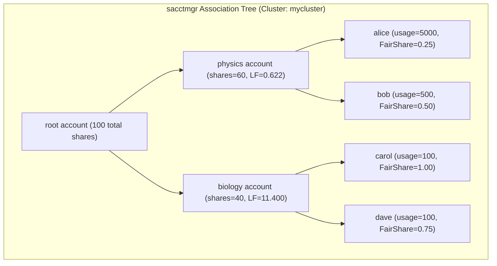

# 6.9 Slurm accounting and scheduling policy: QOS, fair-share, backfill, preemption

| | |
|---|---|
| Level | Intermediate |
| Priority tier | 1 |
| Lab venue | Slurm cluster with accounting (6.7); the simulator needs only Python 3 |
| Part | Part 6: HPC and Slurm |
| Status | Drafted. Formulas, flags and defaults were read from the Slurm documentation and man pages in a shallow clone (SchedMD/slurm commit `521370b`, 2026-10-23, development version 26.11.0rc1); the Fair Tree and priority model in `code/part06/fairtree_sim.py` was run (output shown) and is a teaching re-implementation, not Slurm itself. No Slurm daemon was run; cluster labs are **untested** |

## Why this matters for AI infrastructure

A GPU cluster is shared and expensive, so somebody has to decide who gets it next. That decision is the scheduler's policy, and it is where organisational choices become code. The policy decides who gets priority before a deadline. It decides how a team that bought 64 GPUs is guaranteed them, and whether idle capacity can be borrowed. It also decides how one user is stopped from queueing 10,000 jobs, and how much each group is charged.

Poor policy produces two classic failures. Large or low-priority jobs can starve and never run. Or limits and reservations are set wrongly, so GPUs sit idle while jobs wait and utilisation drops. This chapter explains the mechanisms well enough for you to design a policy, and to explain to a user why their job is pending.

## Prerequisites and outcomes

This chapter builds on 6.7, which covers the accounting database and associations, and on 6.8, which covers partitions and memory and GPU defaults. When you finish, you should be able to do the following.

- Build and inspect an accounting hierarchy with `sacctmgr`, and explain associations, TRES and billing.
- Set and reason about Grp and Max limits, `AccountingStorageEnforce`, and QOS flags.
- Compute a job's priority from the multifactor formula, and use `sprio` and `sshare` to explain an ordering.
- Explain Fair Tree fair-share and usage decay, and predict who goes next in a small example.
- Explain backfill, why accurate time limits matter, and the main tuning knobs.
- Choose a preemption design (partition tiers or QOS; cancel, requeue or suspend) and its consequences for AI jobs.
- Design a policy for a multi-team GPU cluster that includes guaranteed shares, burst and urgent work.

## 1. The accounting model

Suppose a user asks why their job waited longer than a colleague's job on the same cluster. To answer, you need a record of who belongs to which group. Slurm keeps that record as a tree.



With `slurmdbd` and a database (6.7), Slurm records every job. It also keeps a tree of **associations**. An association is a tuple of cluster, account, user and, optionally, partition. Limits, shares and a default QOS attach to it.

```text
root
 └─ physics (account, shares 60)
     ├─ alice (user association)
     └─ bob
 └─ biology (account, shares 40)
     ├─ carol
     └─ dave
```

You create and inspect that tree with `sacctmgr`. The syntax follows the `sacctmgr(1)` man page, which also documents `modify`, `delete`, `show` and the `where`/`set` form.

```bash
sacctmgr add cluster mycluster
sacctmgr add account physics Description="Physics dept" Organization=sci fairshare=60
sacctmgr add account biology fairshare=40
sacctmgr add user alice account=physics
sacctmgr add user bob   account=physics
sacctmgr show assoc format=cluster,account,user,fairshare,qos,grptres%30 tree
sacctmgr modify user where name=alice set maxjobs=20 defaultaccount=physics
```

Every job runs under an association, and `AccountingStorageEnforce` decides how strictly Slurm checks that. If it includes `associations`, a user with no association cannot run. `limits` implies associations and enforces the limits on associations and QOS. `qos` requires a valid QOS. `safe` launches a job only if it can finish within a TRES-minutes limit. `nojobs` and `nosteps` turn accounting off for jobs and steps, according to the `slurm.conf` man page. The 6.7 starter config uses `associations,limits,qos`.

### TRES

A **TRES** (trackable resource) is anything Slurm counts. That includes `cpu`, `mem`, `node`, `energy`, `billing`, and GRES such as `gres/gpu`. Limits and usage are both expressed in TRES. To track GPUs, add `AccountingStorageTRES=gres/gpu`. You can also track one GPU type, such as `gres/gpu:h100`.

**`billing`** is a synthetic TRES, which means Slurm computes it from each partition's `TRESBillingWeights`. The documentation gives a clear case for why this matters. Suppose `TRESBillingWeights=CPU=1.0,Mem=0.25G` on nodes with 16 CPUs and 64 GiB. A 1-CPU job that requests 60 GiB occupies the memory of a whole node. Billed for CPU alone, though, it looks cheap.

With the default sum, Job1 (1 CPU, 60 GiB) is billed 1 + 15 = 16. Job2 (16 CPU, 1 GiB) is billed 16.25. Job3 (16 CPU, 60 GiB) is billed 31. With the `MAX_TRES` flag, the bill is the largest per-node TRES instead, and those maximums are 15, 15 and 16. That figure tracks how much of the node you denied to others.

On GPU clusters, bill GPUs heavily, for example `GRES/gpu=10`. Then add `MAX_TRES_GRES`, which the man page says arrived in Slurm 25.05, so that GPU hours dominate the bill. Billing feeds fair-share usage, reports, chargeback and the TRES priority factor.

### User levels and coordinators

Accounting also decides who may change policy. A user's `AdminLevel` is set with `sacctmgr modify user ... set adminlevel=...`. It can be `None`, `Operator` or `Admin`, according to the `sacctmgr` man page. Operators can perform most accounting operations, and admins can perform all of them.

A **coordinator** is a regular user designated for an account, for example with `sacctmgr add coordinator account=physics names=alice`. A coordinator can add users to that account and set limits within it, but cannot exceed what the parent allows. Delegating to coordinators keeps routine account management with the teams. Fair Tree (section 4) is designed so that a coordinator reshuffling their own users cannot hurt their account's standing relative to others.

Give coordinators the routine work for their own team. Keep the limits they cannot exceed in your hands.

## 2. Limits and QOS

### Association limits

You set limits on accounts or users with `sacctmgr modify ... set`. The table lists the limit families, using the names from `sacctmgr(1)`.

| Family | Meaning |
|---|---|
| `GrpTRES`, `GrpJobs`, `GrpSubmit`, `GrpWall` | Aggregate limit for the association **and all its children** at one time (for example `GrpTRES=gres/gpu=64` caps an account's running GPUs) |
| `GrpTRESMins`, `GrpTRESRunMins` | Cumulative TRES-minutes (usage budget) / TRES-minutes currently committed by running jobs |
| `MaxTRES`/`MaxTRESPerJob`, `MaxTRESPerNode`, `MaxTRESPerUser`, `MaxTRESPerAccount` | Per job / node / user / account caps |
| `MaxJobs`, `MaxSubmitJobs`, `MaxWall`, `MaxTRESMins` | Counts and wall-time per job |
| `MaxJobsAccrue*` | Limit how many pending jobs accrue age priority |
| `Fairshare` | Share value used in fair-share |
| `DefaultQOS`, `QOS` | Allowed and default QOS |

When you look at the families, notice that the `Grp` ones cap a whole group, while the `Max` ones cap a single job, node, user or account. Slurm checks limits when it considers a job for running. Suppose a job is above a limit. It stays pending with a reason such as `AssocGrpGRES`, `AssocMaxJobsLimit` or `QOSMaxCpuPerUserLimit`, which `squeue -o "%R"` shows. The exception is a QOS with `DenyOnLimit`. That job is rejected at submission instead of waiting.

### QOS (Quality of Service)

A **QOS** is a named policy object that a job requests, for example with `--qos=high`. A QOS bundles several things. It has a **priority**, an integer that feeds the QOS factor. It has **limits**, which use the same Grp and Max families at QOS scope. It defines **preemption** relationships and mode, a **usage factor** that scales billing, and a **grace time** for preemption. It also carries **flags**. The usage factor works like this: 0.5 suits a cheap scavenger QOS, and 2 suits an expensive urgent one.

| Flag | Effect |
|---|---|
| `DenyOnLimit` | Reject at submit rather than queue when limits are violated |
| `NoReserve` | With backfill, jobs in this QOS do not reserve resources in the future (man page warns this can starve larger jobs) |
| `OverPartQOS` | The job's QOS limits override the partition QOS |
| `NoDecay` | QOS usage (`GrpTRESMins`, `GrpWall`, raw usage) is not decayed |
| `EnforceUsageThreshold` | Jobs rejected if the QOS usage is below a threshold |
| `RelativeTRES`-style options | Interpret limits relative to the partition (see the page) |

Each flag changes when a job is held back, or how its usage is counted. The man page warns that NoReserve can starve larger jobs. Here is a sketch of a policy set you can adapt:

```bash
sacctmgr add qos normal   priority=10   maxtresperuser=gres/gpu=64
sacctmgr add qos urgent   priority=1000 usagefactor=2   maxwall=12:00:00 preempt=scavenger flags=DenyOnLimit
sacctmgr add qos scavenger priority=0   usagefactor=0   preemptmode=requeue gracetime=120
sacctmgr modify user alice set qos=normal,urgent defaultqos=normal
```

The option spellings come from the `sacctmgr(1)` QOS section, as I read it. You can verify them with `sacctmgr show qos format=...` and the man page for your version.

If you put a QOS on a partition, written as `QOS=` on that partition, Its limits then apply to jobs in that partition. When a partition QOS and a job QOS both set a limit, the partition QOS wins, unless the job QOS has `OverPartQOS`, according to the man page.

### The 6-level QoS and association limit precedence order

A single job can inherit limits from several places: its partition, its job QOS, a user association, parent accounts and the cluster root. When those limits conflict, Slurm applies a strict 6-level precedence order. The order below comes from Chapter 15 of *Supercomputers for Linux SysAdmins*.

1. **Partition QOS limit.** This moves after the job QOS if `Flags=OverPartQOS` is set on the job QOS.
2. **Job QOS limit.**
3. **User association.**
4. **Account association(s)**, moving up the hierarchy.
5. **Root or cluster association.**
6. **Partition limit.**

Overall scheduling priority follows a separate check. When Slurm compares two jobs for priority or preemption authority, it checks four levels in order. First comes the **Reservation**, where jobs with a reservation go first. Next is the **partition priority tier** (`PriorityTier`), then the **job priority**, which is the calculated multifactor integer. Ties go to the **Job ID**, so an earlier submission with a lower job ID wins.

When a limit surprises you, work down this list to find the level that set it.

## 3. Priority: the multifactor formula

Suppose two jobs are both waiting, and you need to know which one starts first. With `PriorityType=priority/multifactor`, each pending job gets an integer priority. Higher numbers run sooner, and the range runs from 0 to 4,294,967,295. The multifactor documentation gives the formula.

```text
Job_priority = site_factor
             + PriorityWeightAge       * age_factor
             + PriorityWeightAssoc     * assoc_factor
             + PriorityWeightFairshare * fair-share_factor
             + PriorityWeightJobSize   * job_size_factor
             + PriorityWeightPartition * priority_job_factor
             + PriorityWeightQOS       * QOS_factor
             + SUM(TRES_weight_<type> * TRES_factor_<type>)
             - nice_factor
```

Each factor runs from 0.0 to 1.0, and each weight is an unsigned 32-bit integer. By default, the values are **normalised** to the highest value in the cluster. Take a partition factor of 10 against a maximum of 20, with weight 5000. That gives 2,500. The `NO_NORMAL_*` flags switch off normalisation for each factor.

Weights need enough room to keep significant digits. With a fair-share weight of 10, the factors 0.59534 and 0.50002 both become about 5, so they tie. Use weights from about 1000 upward for the factors that should dominate.

Each row of the table below is one ingredient of that sum. A large weight on any row lets that ingredient decide the order.

| Factor | Meaning |
|---|---|
| **Age** | Time pending while eligible, rising to 1.0 at `PriorityMaxAge` (default 7 days). Dependent or held jobs do not accrue unless `PriorityFlags=ACCRUE_ALWAYS` |
| **Association** | Per-association integer priority, normalised |
| **Fair-share** | Under-service of the user and account (section 4) |
| **Job size** | Larger or smaller job favoured (`PriorityFavorSmall`); `SMALL_RELATIVE_TO_TIME` divides by time limit |
| **Partition** | `PriorityJobFactor` of the partition, normalised |
| **QOS** | QOS priority, normalised |
| **TRES** | Weighted amount of each TRES requested (set `PriorityWeightTRES=gres/gpu=...`) |
| **Site** | Set by `scontrol`, a `job_submit` plugin or a site-factor plugin |
| **Nice** | User-supplied reduction (negative values need privilege) |

Other parameters also shape the calculation: `PriorityCalcPeriod`, `PriorityDecayHalfLife` (default 7 days), `PriorityUsageResetPeriod`, and `PriorityFlags` (`CALCULATE_RUNNING`, `INCR_ONLY`, `NO_FAIR_TREE`, `DEPTH_OBLIVIOUS`, `MAX_TRES`, ...). To see the factors on a live system, run these commands.

```bash
sprio -l                     # factors of each pending job
sprio -w                     # the configured weights
sshare -al                   # shares, raw usage, effective usage, level FS, fairshare
squeue --start               # expected start times (after backfill planning)
scontrol show job JOBID | grep -i -E "priority|reason|starttime"
```

**Reading `sprio` answers the question "why is job A ahead of job B?"** Put the two rows side by side and compare the columns.

## 4. Priorities and fair-share

Fair-share pulls the queue toward groups that have received less than their share. It is **not** a hard quota. According to the documentation, an over-served group can still run when the machine would otherwise sit idle.

Two inputs drive it. Each association has **shares**, which are its assigned fraction of the cluster. Each association also has **usage**, a decayed history of billed TRES. Usage fades exponentially with the half-life set by `PriorityDecayHalfLife`, which defaults to 7 days. After one half-life, half of the original value has cleared. Setting the half-life to 0 turns decay off, but then you must set `PriorityUsageResetPeriod`.

### Fair Tree (default since 19.05)

The documentation describes Level Fairshare for each association. You compute it like this.

```text
LF = S / U
S = shares / (sum of shares of itself and its siblings)
U = usage  / (sum of usage  of itself and its siblings)
```

An LF above 1 means the association is under-served. Below 1, it is over-served. At every level, sort the siblings by LF in descending order. Then walk the tree depth-first, and rank the **users** in the order you meet them. The final FairShare factor is `rank / number_of_user_associations`, so the best user scores 1.0.

The documentation spells out one consequence. If account A has a higher LF than its sibling B, **every user under A outranks every user under B**, whatever each user has consumed. That stops a heavy user in a light account from beating a light user in a heavy account. It also stops account coordinators from gaming their team's order. The older **Classic** algorithm works differently. It computes `F = 2^(-U/S)` per association from effective usage, and you select it with `PriorityFlags=NO_FAIR_TREE`.

### The simulator

`code/part06/fairtree_sim.py` implements Level FS, the tree walk, decay and the priority sum. Run it on the tree above. Physics has 60 shares, with alice at usage 5000 and bob at usage 500. Biology has 40 shares, with carol and dave each at usage 100. The output looks like this.

```text
Level fairshare among accounts:
  physics  S=0.60 U=0.965 LF=0.622
  biology  S=0.40 U=0.035 LF=11.400
FairShare (Fair Tree):
  carol  1.00
  dave   0.75
  bob    0.50
  alice  0.25
```

Look at bob first. He has more usage than dave, yet he ranks below him, because biology as an account outranks physics. Within physics, bob has less usage than alice, so he ranks above her.

Decay follows the same logic. With a 7-day half-life, 8,000 core-hours becomes 8,000 now, 4,000 at 7 days, 2,000 at 14 days and 500 at 28 days. Next, compare two jobs under the example weights: age 1000, fair-share 100000, QOS 10000 and partition 1000. alice's one-hour-old job, which has the highest QOS, scores 36,005. carol's three-day-old job at normal QOS scores 102,428, because the fair-share term dominates.

**With a large fair-share weight, a QOS bump does not rescue a heavy user.** If urgent work must jump the queue, give QOS priority a weight comparable to fair-share, or use preemption (section 6).

### Practical fair-share guidance

- Shares express entitlement, meaning what a group bought. Usage expresses consumption. Pick a decay half-life that matches your planning horizon. The example in Supercomputers for Linux SysAdmins, chapter 15, uses `PriorityDecayHalfLife=3-6:30`, which is 3 days, 6 hours and 30 minutes. The alternative is `0`, combined with `PriorityUsageResetPeriod` set to `WEEKLY`, `DAILY`, `MONTHLY`, `QUARTERLY`, `YEARLY`, `NONE` or `NOW`. Very long half-lives let a past burst punish a group for months.
- `sshare` shows `RawShares`, `NormShares`, `RawUsage`, `EffectvUsage`, `LevelFS` and `FairShare`. `NormShares` is the allocated shares divided by total shares, a value between `0..1`. The chapter's example output from that same book reads: `root` `RawUsage=694362950`; `abc` `RawShares=2000` `NormShares=0.011481` `RawUsage=28` `FairShare=0.999998`; `foo` `RawShares=3000` `NormShares=0.017221` `RawUsage=45166247` `EffectvUsage=0.065072` `FairShare=0.072870`; `bar` `RawShares=100` `FairShare=1.000000`; `baz` `RawShares=300` `RawUsage=19770` `FairShare=0.988597`.
- New users with no usage get a high LF, which is infinity when they have no usage. That is intentionally welcoming, but people can exploit it by creating accounts, so control account creation.
- Fair-share needs `slurmdbd` and honest accounting of GPUs. Supercomputers for Linux SysAdmins, chapter 15, uses `TRESBillingWeights=GPU=1.0,CPU=0.001,Mem=0.01G`. A job that requests 2 GPUs, 16 CPUs and 1024G of memory consumes `2*1.0 + 16*0.001 + 1024*0.01 = 12.256` shares per second. Under `PriorityFlags=MAX_TRES`, the same job consumes `max = 10.24`.
- Hard budgets use `GrpTRESMins` with `AccountingStorageEnforce=limits`. Add `safe` if you want jobs to finish within the budget. To delete a limit on an association in `sacctmgr`, set its value to **`-1`**.

Match the shares to what each group bought, and pick a half-life that matches how far ahead you plan.

## 5. Backfill

Picture a large job that needs every node in the cluster, waiting behind small jobs that are still running. The main scheduling pass walks the pending queue in priority order and starts whatever fits. **Backfill** (`SchedulerType=sched/backfill`) adds a look-ahead. It plans a start time for each high-priority job that cannot start now. Lower-priority jobs may then start immediately, but only if they finish before they delay any planned job, or if they fit in resources the plan does not need. That raises utilisation without starving big jobs.

Backfill depends on **time limits**. A job's `--time` is its promised maximum, and the scheduler plans with it. Three consequences follow for you.

- Accurate, tight limits let more jobs backfill. A user who requests the 2-day maximum for a 2-hour job blocks backfill windows for others, and delays their own job's planning.
- If your job finishes early, it leaves a gap, and the next scheduling pass refills that gap.
- Without limits, or with a default equal to the partition maximum, backfill is crippled. Set `DefaultTime` low and `MaxTime` where needed (6.8), and consider `--time-min` for flexible jobs. Backfill also cannot help when every job is huge, multi-node and uniform. It works best on mixed sizes.

The table lists selected `SchedulerParameters`, with defaults from the man page. Each row answers a different question: how often the planner runs, how far ahead it looks, how fine its time steps are, and how deep it searches.

| Parameter | Default | Meaning |
|---|---|---|
| `bf_interval` | 30 s | Seconds between backfill iterations (-1 disables) |
| `bf_window` | 1440 min (1 day) | How far ahead to plan; should be at least the longest time limit to avoid starvation |
| `bf_resolution` | 60 s | Time granularity of planning; raise it with a large `bf_window` |
| `bf_max_job_test` | 500 | Maximum jobs considered per cycle (queue depth) |
| `bf_max_job_user` | 0 (none) | Per-user cap on backfill candidates; prevents one user's flood from hiding others |
| `bf_continue` | off | Continue the cycle after releasing locks even if state changed |
| `default_queue_depth` | 100 | Jobs tried in the main scheduling pass |
| `defer`, `sched_interval`, `sched_min_interval`, `partition_job_depth`, `max_rpc_cnt` | | Limit scheduler overhead under heavy load (see page) |

On a GPU cluster, a typical tuning raises `bf_window` to cover the longest time limit, for example 7 days. It raises `bf_resolution` to match, for example 300 s. It keeps `bf_max_job_test` in the low thousands for large queues, sets `bf_max_job_user` to something like 50 to 200, and enables `bf_continue`. Watch `sdiag` for cycle times, the depth reached and queue lengths. Too deep and too frequent backfill makes the controller unresponsive, so read `sdiag` before you raise these numbers. The values quoted as typical come from experience and were not measured here.

To diagnose a waiting job, use `squeue --start`, `scontrol show job` (`StartTime`, `Reason`) and `sprio`. A job with reason `Priority` is waiting behind others. `Resources` means the job is next in line, but its resources are not yet free. `Dependency`, `JobHeldUser` and `BeginTime` are not scheduling problems. Limit reasons begin with `Assoc` or `QOS`.

Tighten the time limits your users request first, because accurate limits are the cheapest way to let backfill work.

## 6. Preemption

When a high-priority job arrives and the cluster is full, preemption stops lower-priority jobs so the new one can run, according to the documentation. You control it with four settings.

- **`PreemptType`** chooses how preemption is decided. `preempt/none` is the default. `preempt/partition_prio` decides by partition `PriorityTier`, and `preempt/qos` decides by the QOS `Preempt` list.
- **`PreemptMode`** can be set cluster-wide, per partition when you use `partition_prio`, or per QOS when you use `qos`. Its values are `OFF` (the default), `CANCEL`, `REQUEUE`, and `SUSPEND`, which requires `GANG`. The modifier `GANG` enables gang scheduling (time-slicing) per partition. `PRIORITY` limits preemption to cases where the preemptor's job priority is higher. `WITHIN` lets jobs in the same QOS preempt each other.
- **`GraceTime`** (per partition or QOS) is the number of seconds a preempted job has to finish after it is selected. It receives SIGCONT and SIGTERM straight away, and SIGKILL at the end. The default is 0, which means no delay. A job that exits within the grace time is handled according to the preempt mode, whatever the reason for its exit.
- Suspended jobs keep their memory. With `SUSPEND,GANG`, make memory a consumable resource (6.8), or the nodes will swap.
- `REQUEUE` works only for jobs submitted with `--requeue`, or when cluster-wide `JobRequeue=1` is set. Otherwise the job is cancelled.

### What preemption means for AI work

Each mode carries a different cost for AI work, so pick the mode deliberately.

- Suspend is unsuitable for GPU training. Suspended jobs hold GPU memory, and NCCL jobs across nodes time out. Use `REQUEUE` or `CANCEL` instead.
- Requeue helps only if the job checkpoints and resumes (Part 14). Otherwise the work is lost. Train with periodic checkpoints and an automatic resume path, using `--requeue`, `--signal=B:USR1@120` for a warning, and a handler for SIGTERM during `GraceTime`.
- A scavenger QOS, with usage factor 0, the lowest priority and requeue, turns idle GPUs into free throughput for groups with resumable work. It also guarantees the owners instant access.
- Preemption interacts with fair-share, because preempted GPU time is still charged. Use a low `UsageFactor` for scavenger usage.

For GPU training, choose `REQUEUE` with checkpoints, and reserve a scavenger QOS for work that can resume.

## 7. A policy design for a multi-team GPU cluster

Suppose three teams have bought 50, 30 and 20 percent of a shared GPU cluster. They want research bursts, the cluster faces a monthly deadline crunch, and everyone needs protection against floods of jobs. The policy must cover all of that, and it must be easy to audit. These are the nine steps.

1. Create one account per team, with `fairshare` set in proportion to what it bought. Use Fair Tree, the default, with a decay half-life of 14 days.
2. Define three partitions. `gpu` covers all nodes, is the default, and has `MaxTime=2-00:00:00`, `DefMemPerGPU` and `DefCpuPerGPU`. `debug` covers a few nodes, has a 30 minute limit, and sits in a high tier. `long` is limited to approved accounts, has `MaxTime=14-00:00:00`, and carries a lower weight.
3. Define three QOS. `normal` has priority 100, `MaxTRESPerUser=gres/gpu=64` and `MaxSubmitJobsPerUser=500`. `urgent` has priority 1000 and usage factor 2. It is approved through `AllowQos`, and it preempts `scavenger`. `scavenger` has priority 0, a usage factor of 0 or 0.1, requeue, a grace time of 120 s, and `NoReserve`, so it never blocks planning.
4. Impose hard budgets only where a contract requires them, using `GrpTRESMins` with `safe`. Otherwise, rely on fair-share.
5. Set the weights: `PriorityWeightFairshare=100000`, `PriorityWeightQOS=50000`, `PriorityWeightAge=1000` (with `PriorityMaxAge=7-0`), `PriorityWeightPartition=10000`, `PriorityWeightJobSize=0` so that job size does not distort the order, and `PriorityWeightTRES=gres/gpu=100`. Use `sprio` to check that an urgent job from a heavy user outranks a normal job from a light user, if that is the intent.
6. Use `sched/backfill`, set `bf_window` to the longest limit, set `bf_max_job_user=100`, and enable `bf_continue`.
7. Bill with `TRESBillingWeights=GRES/gpu=10,CPU=1,Mem=0.1G` and `PriorityFlags=MAX_TRES_GRES`, so that GPUs dominate the cost.
8. Report with `sreport cluster AccountUtilizationByUser`, `sreport cluster utilization` and `sacct -X --format=...` for the monthly chargeback. Review the wait time for each QOS.
9. Run a monthly policy review that compares waiting times and utilisation. Do not tune weights ad hoc during a crunch.

### Accounting and Statistics: Concrete `sacct` and `sreport` reporting commands

Once accounting is active, `sacct` queries per-job accounting and statistics records. `sstat` queries live CPU, memory and disk use for running jobs, provided `jobacct_gather` is enabled. `sreport` aggregates utilization across three top-level report classes: `cluster` (total utilization), `job` (task size classes by CPU count, grouped by account) and `user` (top users by resource consumption).

Chapter 15 of *Supercomputers for Linux SysAdmins*, titled *Accounting and Statistics*, provides four ready-to-use reporting commands. Each is marked untested here.

```bash
# (untested here) — 1. One-day job summary: JobID, Partition, User, core-seconds (CPUTimeRAW), State
sacct -S 2024-01-01 -E 2024-01-02 \
  -o JobID,Partition,User%16,CPUTimeRAW,State%20 -X

# (untested here) — 2. Weekly job size breakdown by account (0–16 cores, 17–1024 cores, and >1024 cores, in minutes)
sreport job SizesByAccount grouping=0-16,17-1024 \
  start=2024-01-01 end=2024-01-07

# (untested here) — 3. Monthly cluster utilization percentages (Allocated, Down, PLND Down, Idle, Planned, Reported)
sreport cluster utilization Start=2024-11-01 End=2024-12-01 -t percent

# (untested here) — 4. Top 5 users by resource utilization over a month (reported in TRES Minutes and Energy)
sreport user topusage topcount=5 start=2024-01-10 \
  end=2024-02-10
```

Check the output against your own cluster before you rely on any of these commands.

Other designs exist alongside this one. Reservations (`scontrol create reservation`) guarantee a window for a training run, an exam or a demo. Hard partitions per team are simple but wasteful. Dedicated nodes can be fenced off with `AllowAccounts`. A Kubernetes layer with Kueue expresses quota and borrowing as a ClusterQueue and a cohort (Part 11, 14).

If you choose hard partitions, accept that they are simple and that they waste capacity.

## 8. Why is my job pending: a decision list

A job has been pending for hours. Read the reason first, then run only the checks for it.

1. Run `squeue -j JOB -o "%i %T %r %S"` to see the reason and the estimated start.
2. If the reason starts with `Assoc` or `QOS`, a limit is holding the job. Check `sacctmgr show assoc where user=...` and `sacctmgr show qos`.
3. If the reason is `Priority`, compare `sprio -j JOB` with the jobs ahead, and check `sshare -u USER`.
4. If the reason is `Resources`, the job is waiting for free nodes. Check the request for anything no node can satisfy, such as the GPU type or a constraint. `scontrol show job` shows `Features`, `Gres` and `MinMemoryNode`.
5. If the reason is `ReqNodeNotAvail`, the nodes are down, drained or reserved. Check `sinfo -R` and `scontrol show reservation`.
6. `PartitionConfig`, `PartitionTimeLimit` and `PartitionNodeLimit` mean your request exceeds the partition's limits.
7. `BeginTime`, `Dependency` and `JobHeldUser/Admin` are not scheduling issues.
8. `BadConstraints`, `InvalidQOS` and `InvalidAccount` mean you need to fix the request.

## 9. Lab (simulator tested; cluster parts untested)

Start with the self-checking Python lab, which you can run on your own machine with no cluster. It checks Fair Tree `Level Fairshare` (`LF = S / U`) and depth-first user ranking (`fair_tree`). It checks the 7-day half-life exponential usage decay and the multifactor job priority formula (`decay`, `priority`). It also checks the `TRESBillingWeights` additive versus `MAX_TRES` billing calculation (`compute_tres_billing`) from Supercomputers for Linux SysAdmins, chapter 15.

```bash
python3 code/part06/fairtree_sim_lab.py
```

When the lab passes, work through the steps below. Steps 1 to 4 use the simulator. Steps 5 to 8 need a cluster.

1. Run `python3 code/part06/fairtree_sim.py`. Change the usage so that physics has less usage than biology. Predict the ranking first, then verify it.
2. Add a third account with no usage. Observe its LF (infinity) and its users' rank, then discuss the incentive problem.
3. Change the decay half-life, and compute how long a one-off burst takes to stop mattering.
4. Modify the priority weights, and find the QOS weight at which an urgent job from a heavy user beats a normal job from a light user.
5. On a cluster, create the accounts, users and QOS from section 7. Set the weights, submit jobs under different users with `--test-only` or `--hold`, and examine `sprio -l`.
6. On a cluster, run a backfill experiment. Queue a large job that needs all nodes behind running small jobs. Then submit short jobs with accurate `--time` values and long jobs with a loose `--time`, and observe which ones backfill (`squeue --start`).
7. On a cluster, configure `scavenger` with requeue. Run a checkpointing toy job, preempt it with an `urgent` job, and confirm that it requeues and resumes.
8. Read the `sdiag` output before and after you change `bf_window` and `bf_max_job_test`.

## 10. Interview angles

- Explain associations, accounts, QOS and TRES. What is `billing`?
- How is a job's priority computed, and how would you explain the order of two jobs?
- What does Fair Tree guarantee about users in sibling accounts?
- What does usage decay do, and how do you choose the half-life?
- Why do accurate time limits matter for backfill?
- How would you set up preemption for GPU training with checkpoints, and why not suspend?
- How would you give a team a guaranteed share while letting others borrow idle GPUs?
- A user says their job is stuck at "Priority". What do you do?
- What breaks if `PriorityWeightFairshare` is 10?
- What is the difference between Grp and Max limits?

## Exercises

Start with exercises 1 and 2. You can run both on the same simulator.

1. Using `level_fs()` and `fair_tree()` in `code/part06/fairtree_sim.py`, compute `S`, `U` and `LF` for `physics` (`60` shares, `alice=5000`, `bob=500`) and `biology` (`40` shares, `carol=100`, `dave=100`). Explain why `bob` (`usage=500`) ranks below `dave` (`usage=100`), and explain how `PriorityFlags=NO_FAIR_TREE` changes the algorithm.
2. Use `decay(8000, elapsed_days, 7.0)` and `priority()` in `code/part06/fairtree_sim.py` to compute the remaining usage after `7`, `14` and `28` days. Then calculate the priority score of `alice`'s 1-hour-old urgent-QoS job (`36,005`) against `carol`'s 3-day-old normal-QoS job (`102,428`). What `PriorityWeightQOS` value does an `urgent` QoS job (`qos_prio=10`) from `alice` (`fairshare=0.25`) need to beat a `normal` QoS job (`qos_prio=1`) from `carol` (`fairshare=1.00`)?
3. Using `TRESBillingWeights=GPU=1.0,CPU=0.001,Mem=0.01G` from Supercomputers for Linux SysAdmins, chapter 15, call `compute_tres_billing()` in `code/part06/fairtree_sim_lab.py` for a job that requests `2` GPUs, `16` CPUs and `1024G` of memory. Compute the billed shares per second under (a) default additive billing (`12.256`) and (b) `PriorityFlags=MAX_TRES` (`10.24`).
4. State the 6-level precedence order Slurm uses across partition QoS, job QoS (`OverPartQOS`), user association, account hierarchy, root association and partition limits. Then contrast `GrpTRES=gres/gpu=64` with `MaxTRESPerUser=gres/gpu=64`, and state how you remove a limit in `sacctmgr` (`set maxjobs=-1`).
5. Explain why inaccurate `--time` requests break backfill scheduling (`sched/backfill`), why `bf_window` must cover the longest partition `MaxTime`, and why GPU training clusters use `PreemptMode=REQUEUE` (with `--requeue` and checkpointing) rather than `SUSPEND,GANG`.
6. Write the exact `sacct` and `sreport` commands from chapter 15 of Supercomputers for Linux SysAdmins to report (a) a 1-day job summary (`JobID,Partition,User%16,CPUTimeRAW,State%20 -X`), (b) weekly job sizes by account (`SizesByAccount grouping=0-16,17-1024`), (c) the monthly cluster utilization percentage (`cluster utilization -t percent`), and (d) the top 5 users by monthly TRES usage (`user topusage topcount=5`).

## Checkpoint questions (20)

<details>
<summary>1. What is an association in Slurm accounting, and what does `AccountingStorageEnforce=associations,limits,qos,safe` enforce?</summary>

An **association** is the 4-tuple `(cluster, account, user, [optional partition])` in `slurmdbd` that shares, limits and QoS permissions attach to. In plain terms, you can think of it as the record that ties a user to an account on a cluster.
- `associations` rejects jobs from users who have no valid association.
- `limits` implies `associations` and enforces the `Grp*` and `Max*` resource, job and time limits.
- `qos` requires every job to use an allowed QoS.
- `safe` starts a job only if its remaining cumulative `GrpTRESMins` or `MaxTRESMins` budget is large enough to run the job for its full requested `--time`.
</details>

<details>
<summary>2. What is the `billing` TRES, and how does `TRESBillingWeights` prevent a 1-CPU, 500-GiB RAM job from being under-charged?</summary>

**`billing`** is a synthetic TRES. Slurm calculates it from a partition's `TRESBillingWeights`, for example `TRESBillingWeights="CPU=1.0,Mem=0.25G,GRES/gpu=10.0"`. If you set no billing weights, usage is billed purely in CPU-seconds. A 1-CPU job that uses all of a node's RAM, or 8 GPUs, then looks almost free. With `TRESBillingWeights`, Slurm bills either the **weighted sum** of the requested resources, which is the default, or the **largest single weighted resource**, when you set `PriorityFlags=MAX_TRES` or `MAX_TRES_GRES`.
</details>

<details>
<summary>3. Using the Supercomputers for Linux SysAdmins, chapter 15 example `TRESBillingWeights=GPU=1.0,CPU=0.001,Mem=0.01G`, how many billing units per second does a job requesting `2` GPUs, `16` CPUs, and `1024G` RAM consume under default sum vs. `MAX_TRES`?</summary>

- **Default sum:** $2 \times 1.0 + 16 \times 0.001 + 1024 \times 0.01 = 2.0 + 0.016 + 10.24 = \mathbf{12.256}$ units per second.
- **`PriorityFlags=MAX_TRES`:** $\max(2.0,\ 0.016,\ 10.24) = \mathbf{10.24}$ units per second.
</details>

<details>
<summary>4. What is the difference between `Grp*` limits (`GrpTRES`, `GrpJobs`, `GrpSubmitJobs`) and `Max*` limits (`MaxTRESPerUser`, `MaxJobsPerUser`, `MaxTRESPerJob`), and how do you delete a limit in `sacctmgr` (Supercomputers for Linux SysAdmins, chapter 15)?</summary>

- **`Grp*` limits:** An aggregate ceiling summed across all running (or submitted) jobs that share an association, account (including subaccounts) or QoS at the same time. For example, `GrpTRES=gres/gpu=64` on an account caps the team's combined running GPUs at 64.
- **`Max*` limits:** A cap applied to a single user, a single job or a single node within that association or QoS.
- **Deleting a limit in `sacctmgr`:** Set the limit value to **`-1`**, for example `sacctmgr modify assoc where user=user1 account=acc1 set maxjobs=-1`.
</details>

<details>
<summary>5. What is Slurm's 6-level precedence order when conflicting limit definitions exist across Partition, QoS, User, and Account (Supercomputers for Linux SysAdmins, chapter 15)?</summary>

When you compare limits, the precedence runs from highest (1) to lowest (6):
1. **Partition QoS limit**, unless the job QoS has `Flags=OverPartQOS`, in which case the job QoS wins.
2. **Job QoS limit.**
3. **User association limit.**
4. **Account association limit(s)**, moving up the account hierarchy.
5. **Root or cluster association limit.**
6. **Partition limit.**
</details>

<details>
<summary>6. What do the QoS flags `DenyOnLimit`, `OverPartQOS`, `NoReserve`, and `NoDecay` do?</summary>

- **`DenyOnLimit`** rejects a job at `sbatch` or `srun` submission if it breaks a `Max*` limit, instead of leaving it pending in the queue.
- **`OverPartQOS`** lets the job's QoS limits override the partition's QoS limits.
- **`NoReserve`** stops jobs in this QoS from creating future backfill reservations. It is used for low-priority `scavenger` queues, so they never delay large jobs.
- **`NoDecay`** stops the historical usage recorded under this QoS from decaying. It is used for fixed-term allocation grants.
</details>

<details>
<summary>7. What is the 4-level overall order Slurm uses to decide which pending job has higher scheduling priority (Supercomputers for Linux SysAdmins, chapter 15)?</summary>

1. **Reservation:** Jobs holding an active reservation on the nodes go first.
2. **Partition `PriorityTier`:** Jobs in a partition with a higher `PriorityTier` always come before jobs in lower-tier partitions.
3. **Job priority (`priority/multifactor`):** Within the same tier, the higher calculated multifactor integer wins.
4. **Job ID:** Earlier submissions, with the lower Job ID, break ties.
</details>

<details>
<summary>8. Write the multifactor job priority formula (`priority/multifactor`), and explain why dominant `PriorityWeight*` values should be at least `1,000` (`10,000–100,000`).</summary>

$$\text{Priority} = \text{Site} + W_{\text{Age}} F_{\text{Age}} + W_{\text{Assoc}} F_{\text{Assoc}} + W_{\text{FS}} F_{\text{FS}} + W_{\text{Size}} F_{\text{Size}} + W_{\text{Part}} F_{\text{Part}} + W_{\text{QOS}} F_{\text{QOS}} + \sum W_{\text{TRES}} F_{\text{TRES}} - \text{Nice}$$

Each factor $F \in [0.0, 1.0]$ is multiplied by its integer weight $W$, and the result is truncated to an integer. If `PriorityWeightFairshare=10`, two users with fair-share factors of `0.595` and `0.501` both truncate to `5`, so they tie. Weights of `1,000` to `100,000` keep 3–5 significant digits.
</details>

<details>
<summary>9. How does **Fair Tree** compute **Level Fairshare (`LF`)** at each level of the account tree, and what does it guarantee about sibling accounts?</summary>

$$\text{LF} = \frac{S}{U}, \qquad S = \frac{\text{shares}}{\sum \text{sibling shares}}, \qquad U = \frac{\text{usage}}{\sum \text{sibling usage}}$$

At every level, sibling accounts or users are sorted by `LF` from highest to lowest. An `LF` above 1.0 means under-served, and below 1.0 means over-served. The tree is then walked depth-first, and each user is assigned `rank / N_users`. **Guarantee:** if Account A has a higher `LF` than sibling Account B, every user in Account A receives a higher FairShare factor than every user in Account B, whatever their individual usage.
</details>

<details>
<summary>10. In the `fairtree_sim.py` example (`physics` `60` shares with `alice=5000, bob=500`; `biology` `40` shares with `carol=100, dave=100`), why does `bob` (`500` usage) rank below `dave` (`100` usage) even though `physics` has more shares?</summary>

Together, `alice` and `bob` used $5500 / 5700 = 96.5\%$ of recent cluster usage, while owning $60\%$ of the shares. That gives `physics` $\text{LF} = 0.60 / 0.965 = \mathbf{0.622}$, so it is over-served. `biology` used only $3.5\%$ of the cluster but owns $40\%$ of the shares, which gives $\text{LF} = 0.40 / 0.035 = \mathbf{11.400}$, so it is under-served. Because `biology` outranks `physics` at the account level, Fair Tree puts both `biology` users (`carol=1.00`, `dave=0.75`) above both `physics` users (`bob=0.50`, `alice=0.25`).
</details>

<details>
<summary>11. How do `PriorityDecayHalfLife` and `PriorityUsageResetPeriod` manage historical fair-share usage (Supercomputers for Linux SysAdmins, chapter 15)?</summary>

- **`PriorityDecayHalfLife`** (default `7` days; for example `3-6:30` for 3 days, 6 hours and 30 minutes) decays historical usage exponentially. Half of an account's accumulated usage disappears every half-life period, following $U(t) = U_0 \cdot 2^{-t / T_{1/2}}$.
- **`PriorityUsageResetPeriod`** (default `NONE`, or `DAILY`, `WEEKLY`, `MONTHLY`, `QUARTERLY`, `YEARLY`, `NOW`) resets accumulated usage to zero at midnight on the first day of the period. You use it when `PriorityDecayHalfLife=0`.
</details>

<details>
<summary>12. How do you decode the columns of `sshare` (`RawShares`, `NormShares`, `RawUsage`, `EffectvUsage`, `FairShare`) (Supercomputers for Linux SysAdmins, chapter 15)?</summary>

- **`RawShares`:** The integer shares assigned to the account or user in `sacctmgr`.
- **`NormShares`:** The normalized share fraction, from 0.0 to 1.0, relative to the cluster total.
- **`RawUsage`:** The decayed TRES-seconds the account or user has consumed.
- **`EffectvUsage`:** The account's or user's share of cluster usage, from 0.0 to 1.0.
- **`FairShare`:** The final fair-share factor, from 0.0 to 1.0, which `sprio` multiplies by `PriorityWeightFairshare`.
</details>

<details>
<summary>13. How does the backfill scheduler (`sched/backfill`) prevent starvation of large multi-node jobs while filling idle GPU gaps?</summary>

When the highest-priority pending job cannot start because not enough nodes are free, `sched/backfill` checks the remaining `--time` limits of the running jobs. From those it works out the earliest future start for the large job, and reserves its nodes from that time on (`PLANNED` state). It then scans the queue for smaller or shorter jobs. Your job starts only if its requested `--time` finishes before the reserved start of every higher-priority planned job.
</details>

<details>
<summary>14. Why does setting an overly loose `--time` limit on small jobs hurt both the user and cluster utilization under backfill?</summary>

Say you submit a job that needs only 30 minutes, but ask for `--time=2-00:00:00`, which is 48 hours. The backfill scheduler must assume the job occupies the GPUs for the full 48 hours. The job then cannot fit into a 4-hour backfill window ahead of a planned 64-node training run. The user's job stays `PENDING` while the GPUs sit `IDLE`, so the user waits and the cluster loses use of the GPUs.
</details>

<details>
<summary>15. What are the default values and meanings of `bf_interval`, `bf_window`, `bf_resolution`, `bf_max_job_test`, and `bf_max_job_user` in `SchedulerParameters`?</summary>

- **`bf_interval`** (default `30` s) sets the pause between backfill scheduling passes.
- **`bf_window`** (default `1440` min, which is 1 day) sets how far ahead Slurm plans future job reservations. It must be at least the longest partition `MaxTime`.
- **`bf_resolution`** (default `60` s) sets the time-step size inside the backfill window. Raise it to `300` s when `bf_window` is 7–14 days.
- **`bf_max_job_test`** (default `500`) sets the maximum number of pending jobs evaluated per backfill pass.
- **`bf_max_job_user`** (default `0`, meaning unlimited) sets the maximum number of pending jobs per user evaluated per pass. Set it to `50–200` so that one user's 5,000-job sweep cannot block other users from backfilling.
</details>

<details>
<summary>16. Compare the `PreemptMode` options `OFF`, `CANCEL`, `REQUEUE`, and `SUSPEND,GANG`, and explain why `SUSPEND` fails for multi-node GPU jobs (Supercomputers for Linux SysAdmins, chapter 15).</summary>

- **`OFF`** turns preemption off.
- **`CANCEL`** kills the preempted job permanently.
- **`REQUEUE`** terminates the preempted job, after the optional `GraceTime` `SIGTERM`, and puts it back in the `PENDING` queue. This needs `--requeue` or `JobRequeue=1`.
- **`SUSPEND,GANG`** freezes the preempted job's processes with `SIGSTOP`, leaving them in memory while the preempting job runs. The processes resume with `SIGCONT` afterwards.

**Why `SUSPEND` fails on GPUs:** A suspended process does not release its GPU memory (HBM), so the preempting GPU job can hit an out-of-memory error at once. Freezing the ranks of a multi-node NCCL job also triggers RDMA queue-pair and watchdog timeouts.
</details>

<details>
<summary>17. How do `GraceTime` and `--signal=B:USR1@120` allow a preempted or time-limited LLM training job to save a checkpoint before dying?</summary>

When Slurm selects a job for preemption, it gives the job `GraceTime` seconds, for example `120` s on the `scavenger` QoS. Slurm sends `SIGTERM` at the start of that period, and `SIGKILL` only when `GraceTime` runs out. Alternatively, `--signal=B:USR1@120` sends a custom warning, such as `SIGUSR1`, 120 seconds before the walltime limit. The training framework traps the signal, flushes an asynchronous checkpoint to Lustre or object storage, and exits cleanly. When your job is `REQUEUE`d, it resumes automatically from the latest checkpoint.
</details>

<details>
<summary>18. Write the three `sreport` commands from Supercomputers for Linux SysAdmins, chapter 15 to audit weekly job sizes by account, monthly cluster utilization percentage, and top 5 users.</summary>

1. **Weekly job sizes by account (`0–16`, `17–1024`, `>1024` CPUs):**
   `sreport job SizesByAccount grouping=0-16,17-1024 start=2024-01-01 end=2024-01-07`
2. **Monthly cluster utilization in percent (`Allocated`, `Down`, `Idle`, `Planned`):**
   `sreport cluster utilization Start=2024-11-01 End=2024-12-01 -t percent`
3. **Top 5 users by monthly TRES consumption:**
   `sreport user topusage topcount=5 start=2024-01-10 end=2024-02-10`
</details>

<details>
<summary>19. A researcher complains their job is stuck `PENDING`. How do you distinguish `Priority`, `Resources`, `AssocGrpGRES`, `ReqNodeNotAvail`, and `PartitionTimeLimit`?</summary>

Run `squeue -j <jobid> -o "%i %T %r %S"` to read the pending **Reason (`%r`)**, then match the reason you see:
- **`Priority`:** Higher-priority jobs are ahead of it in the queue. Inspect `sprio -l` and `sshare -al`.
- **`Resources`:** The job is at the top of the queue, waiting for busy nodes or GPUs to free up. `squeue --start` shows the planned start time.
- **`AssocGrpGRES` / `QOSMaxGRESPerUser`:** The user or their account has hit a running GPU quota. Check `sacctmgr show assoc` and `sacctmgr show qos`.
- **`ReqNodeNotAvail`:** The requested nodes are `DOWN`, `DRAIN`, or covered by an active maintenance or user reservation. Check `sinfo -R` and `scontrol show reservation`.
- **`PartitionTimeLimit` / `PartitionNodeLimit`:** The job asked for more `--time` or `--nodes` than the partition's `MaxTime` or `MaxNodes` allows.
</details>

<details>
<summary>20. How do you design a 3-QoS policy (`normal`, `urgent`, `scavenger`) so teams get their purchased GPU shares, urgent deadlines can jump the queue at a cost, and idle GPUs are never wasted?</summary>

1. **`normal` QoS (default):** `Priority=100`, `UsageFactor=1.0`, and standard per-user and per-account `GrpTRES` and `MaxTRES` caps. Jobs are ordered by Fair Tree fair-share, with `PriorityWeightFairshare=100000`.
2. **`urgent` QoS (restricted through `AllowQos`):** `Priority=1000`, with `PriorityWeightQOS=50000` so that it can jump ahead. Its **`UsageFactor=2.0`** charges double the fair-share usage, so teams cannot abuse it without lowering their later FairShare. It sets `Preempt=scavenger` and `Flags=DenyOnLimit`.
3. **`scavenger` QoS (open to all, for Spot or preemptible work):** `Priority=0`, with **`UsageFactor=0.0`** so it uses idle cycles for free, `PreemptMode=REQUEUE`, `GraceTime=120`, and **`Flags=NoReserve`**. With `NoReserve`, scavenger jobs fill backfill gaps at once without ever delaying `normal` or `urgent` jobs.
</details>

## Sources and review notes

- Accounting concepts, the 6-level QoS/association limit precedence order, the 4-level overall priority order (`Reservation -> PriorityTier -> Job priority -> Job ID`), `TRESBillingWeights=GPU=1.0,CPU=0.001,Mem=0.01G` (`2*1.0 + 16*0.001 + 1024*0.01` vs `MAX_TRES`), `PriorityDecayHalfLife=3-6:30` and `PriorityUsageResetPeriod=WEEKLY`, `sshare` decoding (`abc`/`foo`/`bar`/`baz`), setting `-1` to delete limits in `sacctmgr`, `sacct` and `sreport` commands (`sreport job SizesByAccount`, `sreport cluster utilization`, `sreport user topusage`), partitions, GRES, backfill and preemption (read in full: `supercomputers-for-linux-sysadmins-managing-modern-hpc-clusters-and-supercomputers-from-software-to-hardware`, "15. Slurm").
- Priority formula, factor descriptions, normalisation, TRES billing examples, Fair Tree and Level FS, decay: Slurm documentation pages `priority_multifactor`, `fair_tree`, `classic_fair_share`, `preempt`, `qos`, and man pages `slurm.conf(5)`, `sacctmgr(1)`, from SchedMD/slurm commit `521370b` (development version).
- Migrated from `nvidia-devops`: `volume-10/06-slurm-administration-ha-accounting-and-upgrades.md` and `volume-10/14-senior-deep-dive-2-slurm-ha-and-accounting-internals.md` (fairshare, TRES billing weights, QoS preemption, and accounting policy).
- Run here: `python3 code/part06/fairtree_sim.py` and `python3 code/part06/fairtree_sim_lab.py` (3 passed, 0 failed).
- Explicitly labelled inferences: The `fairtree_sim.py` and `compute_tres_billing` (`12.256` sum vs `10.24` `MAX_TRES`) models are deterministic teaching implementations built on SchedMD's Fair Tree documentation and *Supercomputers for Linux Sysadmins* Chapter 15.
- Not verified on live hardware: `sacctmgr`, `sacct`, `sreport`, `sprio`, `sshare`, `squeue` commands, sacctmgr option spellings in the examples (checked against the man page headings only), typical backfill tuning values, and behaviour on releases older than the documentation read (`untested here`).
