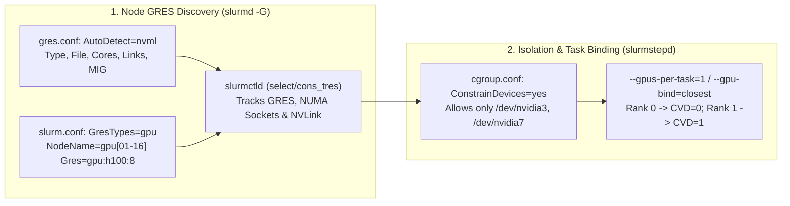

# 6.10 Slurm GPU scheduling: GRES, NVML autodetect, MIG and device constraints

| | |
|---|---|
| Level | Intermediate |
| Priority tier | 1 |
| Lab venue | Slurm with one or more GPU nodes; CPU-only VMs can practise with fake device files |
| Part | Part 6: HPC and Slurm |
| Status | Drafted. Options, defaults and semantics were checked against the man pages and the `gres` documentation from SchedMD/slurm commit `521370b` (2026-10-23, development version 26.11.0rc1; AutoDetect values `nvidia` and `amd` are version-specific). The helper script was run on a machine without GPUs (output only shows the unset case). No Slurm daemon was run; cluster labs are **untested** |

## Why this matters for AI infrastructure

GPU scheduling is the main reason Slurm configuration for AI differs from classic HPC. Users must get exactly the GPUs they asked for, close to the right CPU cores and memory, isolated from other jobs, and counted in accounting. Mistakes look like: a job that sees all 8 GPUs, two jobs that collide on one GPU, training that is 30 percent slower because its CPU threads are on the wrong NUMA node, or a 4-GPU job that waits forever because the request cannot be satisfied by any node. This chapter covers configuration (6.8's `Gres`/`ConstrainDevices` in depth), request syntax, binding and sharing, and diagnosis.

## Prerequisites and outcomes

Needs 6.8, 6.9, Part 9/10 for GPU topology basics (NVLink, PCIe, NUMA). After this chapter you can:

- Configure GPUs as GRES manually and with AutoDetect, with types, device files, `Cores` and `Links`.
- Verify what Slurm thinks the node has (`slurmd -G`, `scontrol show node`) and what a job actually sees.
- Request GPUs correctly using the right option for the situation, including per-GPU CPU and memory.
- Explain and use GPU-to-task binding and CPU-GPU affinity (`--gpu-bind`, `--gres-flags`).
- Isolate devices with cgroups and explain what `CUDA_VISIBLE_DEVICES` does and does not guarantee.
- Choose between whole GPUs, MIG, MPS and sharding for sharing, and configure each.
- Account for GPU usage in TRES, billing and limits.

## 1. Generic resources (GRES)



A **GRES** is a consumable resource other than CPU and memory: GPUs, but also licences, network devices, burst buffers, bandwidth tokens. Each has a **name** (`gpu`), an optional **type** (`h100`, `a100_3g.20gb`), a **count** per node, and optionally device files and topology. Configuration lives in two places:

1. **`slurm.conf`**: declare the GRES *types of resource* cluster-wide and the node counts.

```ini
GresTypes=gpu,shard
AccountingStorageTRES=gres/gpu,gres/gpu:h100
NodeName=gpu[01-16] ... Gres=gpu:h100:8
```

2. **`gres.conf`**: describe the devices on the node: device files, types, CPU affinity, links. Per the man page, if the `Gres` information in `slurm.conf` fully describes the resources (names and counts only), `gres.conf` may be minimal; for GPUs with device files and topology you need it, or `AutoDetect`.

### AutoDetect

`AutoDetect` in `gres.conf` asks slurmd to discover hardware. Values listed in the man page (current development version): `nvml` (NVIDIA GPUs through the NVIDIA Management Library; needs Slurm built with NVML support and the library present), `nvidia` (NVIDIA GPUs without a library, "doesn't detect MIGs or NVlinks"; added in 24.11), `rsmi`/`amd` (AMD), `oneapi` (Intel), `nrt` (AWS Trainium/Inferentia), `full` (try all in order), `off`. For NVIDIA data-centre nodes **use `AutoDetect=nvml`**: it fills in `Type`, `File`, `Cores` (CPU affinity), `Links` (NVLink connectivity) and `UUID` for each GPU, and is the only mode that handles MIG devices. Verify with `slurmd -G`, which "prints GRES configuration (based upon `slurm.conf` GRES merged with `gres.conf` contents for this node) and exit":

```bash
slurmd -G        # run on the GPU node; check type, file, cores, links for each device
```

Different node groups can use different settings (per the man page examples): `NodeName=tux[0-7] AutoDetect=nvml`, `NodeName=tux[8-11] AutoDetect=rsmi`, `NodeName=tux[12-15] Name=gpu File=/dev/nvidia[0-3]`, and a per-node `AutoDetect=off` override for a node with a manual definition.

### Manual definition

When you cannot autodetect, or to override:

```ini
# gres.conf
NodeName=gpu[01-16] Name=gpu Type=h100 File=/dev/nvidia[0-3] Cores=0-31  Links=-1,18,18,18,0,0,0,0
NodeName=gpu[01-16] Name=gpu Type=h100 File=/dev/nvidia[4-7] Cores=32-63
```

(Illustrative; real `Links` lists need one entry per device of that name, one device per record when `Links` is given.) Parameters from the man page:

| Parameter | Meaning |
|---|---|
| `Name`, `Type`, `Count` | Resource name, optional model/type label, number (default 1 per File) |
| `File` | Device files (`/dev/nvidia[0-7]`). Required for cgroup device constraint and for `CUDA_VISIBLE_DEVICES` |
| `Cores` | **Logical core indices** (as in `lstopo -l` "Core L#", not physical OS numbering) that are close to the device; whole sockets (or NUMA nodes with `SlurmdParameters=numa_node_as_socket`) must be specified together because Slurm co-allocates GRES and CPUs at socket granularity. A restart of `slurmctld` is needed after changing `Cores` |
| `Links` | Connection counts to other devices of the same name (`-1` self, `0` none), used to prefer well-connected GPUs; usually autodetected. Note the `/dev/nvidiaN` minor number may differ from the GPU index, which is sorted by PCI bus ID |
| `MultipleFiles` | Several device files per card |
| `UUID` | Device UUID; with `Flags=env_uuid`, `CUDA_VISIBLE_DEVICES` carries UUIDs instead of indices |
| `Flags` | `CountOnly` (count-only resource with no device plugin), `explicit` (not allocated to whole-node jobs unless explicitly requested), `env_uuid`, `one_sharing`/`all_sharing` for MPS |
| `ChunkSizes`/`ChunkOrder` | Restrict how GPU counts are granted (advanced topologies) |

**Types**: set `Type` to the product (`h100`, `a100`, `l40s`) so users can ask for a specific model (`--gres=gpu:h100:4`) and so mixed clusters stay schedulable. Keep type strings short and stable; once they appear in accounting and user scripts they are hard to rename. A type may be requested as a substring-compatible token according to the docs for MIG profiles.

## 2. Requesting GPUs

Options from the `sbatch`/`srun`/`salloc` man pages:

| Option | Meaning |
|---|---|
| `--gres=gpu:N` or `gpu:type:N` | **Per node** count (`name[[:type]:count]`). In a multi-node job this is per node |
| `--gpus=N` (`-G`) | **Total** GPUs for the job (Slurm decides the per-node split) |
| `--gpus-per-node=N` | Per node |
| `--gpus-per-socket=N` | Per socket (requires a socket-count request) |
| `--gpus-per-task=N` | Per task; requires an explicit task count; **implicitly sets** `--tres-bind=gres/gpu:per_task:N` |
| `--cpus-per-gpu=N` | CPUs per allocated GPU (not compatible with `--cpus-per-task`) |
| `--mem-per-gpu=SIZE` | Memory per GPU; mutually exclusive with `--mem` and `--mem-per-cpu`; default is the partition's `DefMemPerGPU` |
| `--gpu-bind=[verbose,]TYPE` | Same as `--tres-bind=gres/gpu:TYPE` |
| `--gpu-freq=...` | Request GPU (and memory) clocks `low`, `medium`, `high`, `highm1` or MHz; applied per regular step, not in the batch script itself |
| `--gres-flags=...` | `enforce-binding`, `disable-binding`, `enforce-links`, `ignore-links`, `one-task-per-sharing`, `multiple-tasks-per-sharing` and others |

Which to use:

- **Single-node training**, all GPUs of a node: `--gres=gpu:8` (or `--gpus-per-node=8`) with `--exclusive` if the whole node should be dedicated (note `Flags=explicit` and partition `Exclusive` interplay).
- **Multi-node, one process per GPU** (the standard PyTorch layout): `--nodes=N --ntasks-per-node=8 --gpus-per-node=8` (or `--gres=gpu:8`), and `--cpus-per-gpu` or `--cpus-per-task` for data-loader threads. This yields N x 8 ranks, one GPU each. Prefer `--gpus-per-node` over `--gpus` when the job needs a regular shape.
- **Flexible total**: `--gpus=16` lets Slurm pack 16 GPUs across fewer or more nodes, which can fragment placement and hurt NCCL performance; use only for tolerant jobs.
- **Several independent tasks in one allocation**: `--gpus-per-task=1` (explicit `-n`), so each task gets its own GPU.
- **Interactive**: `salloc --gres=gpu:1 --cpus-per-gpu=8 --mem-per-gpu=64G --time=1:00:00` then `srun --pty bash` (6.11).

Defaults make life easier: partition `DefCpuPerGPU` and `DefMemPerGPU` (6.8) give a sane share when users type only `--gres=gpu:1`. A job asking for GPUs without CPUs on a node where CPUs are scarce can otherwise block, or get a starved allocation.

### Portable resource allocation rules (`DAI` Chapter 8)

As emphasized in *Distributed AI Systems* (`DAI` Chapter 8, *Best practices: Resource allocation*), relying on implicit cluster defaults is one of the most common causes of silent training failures when moving batch scripts between a lab cluster and a shared production HPC system. Make every GPU batch script portable and self-documenting by specifying all five core resource dimensions explicitly:

1. **Always specify `--nodes`, `--gres`, `--cpus-per-task` (or `--cpus-per-gpu`), `--mem` (or `--mem-per-cpu` / `--mem-per-gpu`), and `--time`:** Different clusters configure very different defaults (such as 1 CPU core or 2 GiB of host RAM per task), which causes PyTorch `DataLoader` workers (`num_workers > 0`) to exhaust host memory and get killed by the Linux OOM killer even while GPU VRAM has plenty of headroom.
2. **Use `--exclusive` for large multi-node training:** Requesting `--exclusive` guarantees that no other jobs share your allocated nodes, eliminating PCIe, NUMA memory-bandwidth, and shared-filesystem page-cache interference even if your job does not request every CPU core on the node.

### What the job sees

Slurm sets (per the `sbatch` man page environment list): `SLURM_JOB_GPUS` (GPU indices allocated to the job on the node), `SLURM_GPUS_ON_NODE`, `SLURM_GPUS_PER_NODE`, `SLURM_GPUS_PER_SOCKET`, `SLURM_GPUS` (total requested), `SLURM_GPU_BIND`, and for each task `CUDA_VISIBLE_DEVICES` (and `ROCR_VISIBLE_DEVICES`/`ZE_AFFINITY_MASK`/`GPU_DEVICE_ORDINAL` for other vendors) with indices **relative to the job's allocation** (the first allocated GPU is `0`, even if its physical index is 3), when device constraints are on. The helper `code/part06/gpu_env_check.py` prints all of these plus `nvidia-smi -L`; run it as the job step to compare request variants:

```bash
srun --gpus-per-node=2 --ntasks-per-node=2 python gpu_env_check.py
srun --gpus-per-node=2 --ntasks-per-node=2 --gpus-per-task=1 python gpu_env_check.py     # one GPU each
srun --gpus-per-node=2 --ntasks-per-node=2 --gpu-bind=none python gpu_env_check.py       # no per-task binding
```

Run on a machine with no Slurm and no GPUs it prints each key as `<unset>` and `nvidia-smi not found`, confirming the script runs; the interesting output appears on the cluster.

## 3. Binding GPUs to tasks and CPUs

Two separate binding questions:

1. **Which GPU does each task get?** `--gpu-bind` / `--tres-bind=gres/gpu:...`. From the `srun` man page: `closest` binds each task to the closest GRES (in a NUMA environment possibly several), `map:<list>` assigns GPU ids to tasks (`map:0,1,2,3` or `map:0*4,1*4`), `mask:<list>` uses hexadecimal masks per task, `none` turns off binding (including the implicit binding of `--gpus-per-task`), plus `per_task:N`, `single:N`, and a `verbose` prefix. With `task/cgroup` and `ConstrainDevices=yes` the ids are zero-based indexes relative to the job's allocation; without it they are global ids and predictable results need whole-node allocation.
2. **Which CPUs may a task use relative to its GPU?** Governed by `Cores=` in `gres.conf` and `--gres-flags`. By default the cores near a GPU are *preferred*. `--gres-flags=enforce-binding` restricts the job to the cores bound to its GRES (better performance, possibly longer waits: the man page's example is a 2-GPU/1-CPU job delayed until both GPUs on one socket are free). `disable-binding` allows any core (needed when a job needs more CPUs than are bound to its GPUs). Remember the socket granularity: you cannot prefer different cores of the same socket for different GPUs.

For a typical 8-GPU, 2-socket HGX node: GPUs 0 to 3 on socket 0 (NUMA 0), GPUs 4 to 7 on socket 1. Eight tasks with `--gpus-per-task=1 --cpus-per-gpu=N --gpu-bind=closest` put each rank on a GPU with CPUs from the same NUMA node, which matters for host-to-device bandwidth and for NIC proximity (the NIC also hangs off a socket; Part 9, 12). Verify with `nvidia-smi topo -m` (affinity columns) and per-rank `taskset -pc $$` (6.12 goes through launch details).

## 4. Isolation: what actually stops a job from using other GPUs

Environment variables are advisory. A process can ignore `CUDA_VISIBLE_DEVICES` and open `/dev/nvidia3`. Real isolation comes from **cgroup device control**: with `TaskPlugin=task/cgroup` and `ConstrainDevices=yes` (default `no`!) in `cgroup.conf` (6.8) the job's cgroup is only allowed the device files of its allocated GRES; opening another fails with a permission error and `nvidia-smi` lists only the allocated GPUs. This requires that GRES have `File=` entries (or autodetect supplied them). Also:

- The control files `/dev/nvidiactl`, `/dev/nvidia-uvm` and `/dev/nvidia-caps/*` (for MIG) are shared and allowed.
- Containers (6.13) need the device nodes and driver libraries injected (enroot/pyxis, `nvidia-container-toolkit`); the cgroup limits still apply to the container's processes.
- Test it every time you change drivers, kernel, systemd, container runtime: a systemd update (`systemctl daemon-reload`) or a cgroup v2 mismatch has historically reset device permissions and broken isolation on running nodes (an operations lesson; verify against your versions).

Verification script:

```bash
srun --gres=gpu:1 bash -c 'nvidia-smi -L; ls /dev/nvidia*'          # one GPU listed
srun --gres=gpu:1 bash -c 'CUDA_VISIBLE_DEVICES=1 nvidia-smi -L'    # should not reveal GPUs outside the allocation
```

## 5. Sharing a GPU: MIG, MPS and sharding

Whole-GPU allocation is the default and the right default for training. For small workloads (inference, notebooks, debugging) one job per 80 GB GPU wastes capacity. Slurm supports three mechanisms (from the `gres` documentation):

### MIG (Multi-Instance GPU)

NVIDIA A100/H100-class GPUs can be hardware-partitioned into up to seven isolated instances, each with its own SMs, memory and bandwidth. Slurm treats each MIG instance as a GPU, "complete with cgroup isolation and task binding". Configuration: `AutoDetect=nvml` in `gres.conf` and the instances declared in `slurm.conf`, optionally with types that must be a substring of the profile string reported at `debug2` log level:

```ini
AccountingStorageTRES=gres/gpu,gres/gpu:a100,gres/gpu:a100_3g.20gb
GresTypes=gpu
NodeName=tux[1-16] Gres=gpu:a100:1,gpu:a100_3g.20gb:2
```

Key points: **Slurm does not partition the GPU; MIG instances must already exist** (created by `nvidia-smi mig` or the GPU Operator's MIG manager before slurmd starts; "does not support dynamic MIG partitioning"). The sanity-check AutoDetect mode is not supported for MIG. Changing the layout means draining the node, reconfiguring MIG, restarting slurmd. Pros: strong isolation and predictable performance. Cons: static, fragmentation (a 3g.20gb instance cannot be merged), no NVLink/multi-GPU for MIG, some CUDA features limited.

### MPS (Multi-Process Service)

Lets several processes share a GPU concurrently, each allocated a **percentage** of its resources, via the `gres/mps` count. Declare in `slurm.conf` (`Gres=gpu:2,mps:200`, i.e. 100 per GPU) and optionally in `gres.conf`; the count is translated to a percentage, so use multiples of 100 per GPU. The `Cores` parameter for mps is ignored (copied from the GPU). By default only one sharing job is allowed per GPU (`one_sharing`), and the documentation says MPS requires `select/cons_tres`. No memory isolation: one client can exhaust GPU memory.

### Sharding

`gres/shard` is a generic mechanism for **time-shared** use of a GPU by several jobs ("by default it does not fence the processes running on the GPU nor constrain its device memory"). Declare `Gres=gpu:2,shard:64` (32 shards per GPU). It suits homogeneous small jobs; the documentation recommends limiting shards per node to the maximum number of simultaneous jobs. Newer versions add opt-in shard device-memory enforcement (see the page).

### Choosing

| Need | Use |
|---|---|
| Training, multi-GPU, performance-sensitive | Whole GPUs, never share |
| Many small inference/dev jobs, isolation required | MIG |
| Many cooperating small processes, throughput | MPS (trusted users) |
| Maximum density, trusted workloads, simple | Sharding |
| Fractional GPUs for notebooks/serving across a platform | Consider Kubernetes (time-slicing, MIG, DRA; Part 11) |

Mixing MIG and whole-GPU nodes in one cluster is common: a `mig` partition for interactive work, a whole-GPU partition for training. Keep them separate to avoid surprising users.

## 6. Accounting and limits for GPUs

- Add `AccountingStorageTRES=gres/gpu` (and typed variants) so usage appears in `sacct`/`sreport`: `sacct -X --format=JobID,AllocTRES%60`.
- Limit with `GrpTRES=gres/gpu=64` on accounts, `MaxTRESPerUser=gres/gpu=32` on QOS (6.9).
- Weight GPUs in billing: `TRESBillingWeights=GRES/gpu=10,...` on the partition, and `PriorityFlags=MAX_TRES_GRES` (Slurm 25.05 and later per the man page) so GPU hours dominate cost and fair-share.
- Typed TRES (`gres/gpu:h100`) allow per-model limits and reports.
- GPU hours consumed by idle jobs are the real cost problem; combine accounting with utilisation monitoring (DCGM; Part 17) and `sstat`/`sacct` GPU usage fields where `AccountingStorageTRES` includes `gres/gpuutil`/`gres/gpumem` (enabled by `JobAcctGatherParams` and the `acct_gather_energy`/`gpu` plugin; exact spelling version-specific).

## 7. Operational notes

- **Health and drain**: a GPU falling off the bus, Xid errors, ECC failures, or NVLink faults should drain the node (6.14). Slurm does not know GPU health by itself; use a node health check, prolog or `NHC`, DCGM diagnostics (`dcgmi diag`).
- **GPU reset between jobs**: an epilog can reset GPU state, kill leftover processes (`fuser -k /dev/nvidia*` carefully), and clear persistent mode issues (6.14).
- **Persistence mode and MIG state** must be consistent across reboots (systemd units set before slurmd starts).
- **Driver updates**: rolling upgrades need the node empty; consider `Reason` strings and reservations (6.15).
- **Heterogeneous types**: avoid a request like `--gres=gpu:1` landing on an old GPU when the user needs an H100: use types, partitions, features, or a job submit plugin default.
- **Changing GRES counts**: drain first (man page note), then restart `slurmctld`/`slurmd` as required.
- **Containers**: pyxis/enroot exposes GPUs according to the Slurm allocation (6.13).

### Live GPU job monitoring and distributed profiling (`DAI` Chapter 8)

Once a multi-node GPU job is running, you need to verify that every allocated GPU is actively computing rather than stalling on data loading or a hung collective (`DAI` Chapter 8, *Monitoring and debugging*):

1. **Live queue and GPU inspection without SSH:**
   - Watch job state transitions in real time with `watch -n 1 squeue -u $USER` and `watch -n 1 scontrol show job <job_id>`.
   - Attach directly to a running job's allocation to inspect `nvidia-smi` across nodes—even on clusters where direct `ssh` to compute nodes is disabled—using `srun --jobid=<job_id> nvidia-smi` (or `srun -N 2 nvidia-smi` inside an interactive `salloc` shell), and stream stdout via `tail -f slurm-<job_id>.out`.
   - Query historical CPU and memory footprint after completion with `sacct -j <job_id> --format=JobID,JobName,Elapsed,MaxRSS,MaxVMSize,State` and `sacct -u $USER --starttime=2024-01-01`.

2. **Automated multi-node GPU utilization and anomaly polling (`SLURMJobMonitor`):**
   You can poll per-GPU compute utilization and VRAM consumption across every node in a job (`squeue -j <job_id> -o "%N" -h`) by running `srun -w <node> nvidia-smi --query-gpu=utilization.gpu,memory.used,memory.total --format=csv,noheader,nounits` and flagging two classic anomalies (`DAI` Chapter 8):
   - **Straggler / stalled rank (`utilization < 50%`):** Indicates CPU data-loader starvation, a slow storage read, or a rank waiting at a barrier.
   - **Imminent VRAM OOM (`memory_used_gb / memory_total_gb > 0.95`):** Warns that CUDA caching allocator fragmentation or activation spikes are within 5% of exhausting HBM.

3. **Profiling GPU compute vs `ncclAllReduce` communication with `torch.profiler`:**
   When GPU utilization looks high (because NCCL polling loops spin CUDA kernels at 100% utilization!) yet step throughput is slow, wrap 5 training steps in `torch.profiler.profile(activities=[ProfilerActivity.CPU, ProfilerActivity.CUDA], record_shapes=True, profile_memory=True, with_stack=True)` with `record_function("forward")`, `record_function("backward")`, and `record_function("optimizer")` context managers (`DAI` Chapter 8). Export the Chrome trace **only on rank 0** (`if dist.get_rank() == 0: prof.export_chrome_trace("trace.json")`) and print `prof.key_averages().table(sort_by="cuda_time_total", row_limit=10)`. If `ncclAllReduce` dominates `cuda_time_total`, you have an inter-node communication bottleneck (remedied by increasing micro-batch size, gradient accumulation, or communication-computation overlap). For lower-level transport diagnostics, selectively enable `export NCCL_DEBUG=INFO`, `export NCCL_DEBUG_SUBSYS=ALL`, and `export TORCH_DISTRIBUTED_DEBUG=DETAIL`.

## 8. Troubleshooting

When diagnosing GPU allocation or node availability issues on a Slurm cluster (`DAI` Chapter 8, *Troubleshooting common issues*), start with four fast triage commands:
- Check node states across the cluster: `sinfo -N -l` (`idle`, `alloc`, `down`, `drain`), and resume virtual or recovered test nodes with `scontrol update NodeName=node[6-7] State=RESUME`.
- Verify that `slurmctld` registered the GPUs on each node: `scontrol show nodes | grep Gres`.
- Test single-GPU allocation directly outside your training script: `srun -N 1 --gres=gpu:1 nvidia-smi -L`. If this fails, the fault is in Slurm's `gres.conf` / cgroup setup rather than your PyTorch code.

| Symptom | Likely cause | Check |
|---|---|---|
| `Invalid generic resource (gres) specification` | Type or name not in `GresTypes`/node `Gres` | `scontrol show node`, `slurmd -G`, typo in type |
| Job pending `Resources` / `ReqNodeNotAvail` for GPUs | Request not satisfiable (type, count, memory per GPU, sockets with `enforce-binding`), nodes drained | `scontrol show job`, `sinfo -o "%N %G %t"` |
| Node DRAIN `gres/gpu count too low (0 < 8)` | NVML/driver failed to load, GPU missing; slurmd saw fewer devices than configured | `nvidia-smi`, slurmd log, `slurmd -G`, dmesg Xid |
| `CUDA_VISIBLE_DEVICES` empty or unset in job | No `File=` / device constraint config, `--gres` not requested, `--gpu-bind=none` interplay | `gres.conf`, `scontrol show job` `TresPerNode` |
| Job sees all GPUs | `ConstrainDevices=no` | `cgroup.conf` (6.8) |
| Two ranks use one GPU | No per-task binding; `--gpus-per-task` missing; sharing configured | `gpu_env_check.py` output per rank |
| Slow host-device copies / data loading | CPUs on wrong NUMA node | `--gres-flags=enforce-binding`, `Cores=`, `taskset`, `nvidia-smi topo -m` |
| NVLink-poor GPU pairs allocated | `Links` missing | `slurmd -G`, `--gres-flags=enforce-links` |
| MIG count wrong after reboot | MIG layout not recreated before slurmd | systemd ordering, `nvidia-smi -L` |
| `slurmd` fails: "unable to load NVML" | Slurm built without NVML, or library missing | build config, `ldconfig -p \| grep nvidia-ml` |

## 9. Lab (self-checking simulator tested; live GPU cluster parts untested)

First, run the self-checking Python lab (`code/part06/gpu_env_check_lab.py`) locally. It verifies that `code/part06/gpu_env_check.py` prints all 15 GPU/Slurm environment variables, simulates `ConstrainDevices=yes` vs `ConstrainDevices=no` cgroup `/dev/nvidia*` device fencing and task-relative `CUDA_VISIBLE_DEVICES` remapping (`[3, 7] -> 0, 1`), and tests the `SLURMJobMonitor` `nvidia-smi` CSV parser and anomaly detector (`< 50%` GPU utilization stragglers and `> 95%` VRAM OOM risk) from `DAI` Chapter 8:

```bash
python3 code/part06/gpu_env_check_lab.py
```

Next, on a GPU cluster or test VM, work through these steps:

1. On a GPU node run `slurmd -C` and `slurmd -G` with `AutoDetect=nvml`; record types, files, cores, links for each GPU; compare with `nvidia-smi topo -m`.
2. Write `slurm.conf`/`gres.conf` for the node; restart; `scontrol show node` should show `Gres=gpu:h100:8` (or your type).
3. Run `code/part06/gpu_env_check.py` under the three `srun` variants in section 2. Record environment and `nvidia-smi -L` per rank.
4. Toggle `ConstrainDevices` and prove the difference with the isolation script.
5. Compare `--gpu-bind=closest`, `map:0,1,2,3`, `none` with 4 tasks: print `taskset -pc` and GPU per rank.
6. Request more CPUs than bound to a GPU with and without `--gres-flags=disable-binding`; observe the pending reason.
7. Create two MIG instances (`nvidia-smi mig`), configure Slurm for them, and run two simultaneous jobs.
8. Practise without GPUs: `Name=gpu File=/dev/null Count=4`-style fake devices (document limits) and check that requests, binding variables and accounting TRES behave.
9. Add `gres/gpu` to `AccountingStorageTRES`; run a job; check `sacct -X --format=JobID,AllocTRES`.

## 10. Interview angles

- How does Slurm know how many GPUs a node has, and how do you verify it?
- What is the difference between `--gres=gpu:4`, `--gpus=4`, `--gpus-per-node=4` and `--gpus-per-task=1`?
- How do you guarantee a job cannot touch GPUs it did not request?
- What are `Cores` and `Links` in `gres.conf` for? What does `enforce-binding` trade off?
- MIG vs MPS vs sharding: isolation, flexibility, use cases. Can Slurm create MIG slices?
- A multi-node PyTorch job is 25 percent slower than last week. What scheduler-side causes would you check?
- How do you bill GPU hours fairly in fair-share?
- Describe what happens when a GPU falls off the bus mid-job.

## Exercises

1. **Verifying `gpu_env_check.py` and `CUDA_VISIBLE_DEVICES` Remapping (`code/part06/gpu_env_check_lab.py`):** Run `python3 code/part06/gpu_env_check_lab.py`. Using `simulate_gpu_binding_and_isolation([3, 7], ntasks=2, constrain_devices=True, gpu_bind="per_task:1")`, verify why Task 0 sees `CUDA_VISIBLE_DEVICES=0` and Task 1 sees `CUDA_VISIBLE_DEVICES=1` (even though `SLURM_JOB_GPUS=3,7` and the cgroup exposes `/dev/nvidia3,/dev/nvidia7`), whereas setting `constrain_devices=False` and `gpu_bind="none"` exposes all 8 `/dev/nvidia0..7` devices and `CUDA_VISIBLE_DEVICES=3,7` to both tasks.
2. **Writing `slurm.conf` and `gres.conf` for Mixed H100 + MIG Nodes (`SCL` Chapter 15 & Slurm `gres` docs):** Write the `GresTypes`, `AccountingStorageTRES`, `NodeName`, and `gres.conf` (`AutoDetect=nvml`) entries for a cluster with 16 whole-GPU nodes (`gpu[01-16]`, 8 `h100` GPUs per node) and 4 interactive MIG nodes (`mig[01-04]`, each with 1 whole `a100` GPU and 2 `a100_3g.20gb` MIG instances). Explain how to verify the merged configuration on a node before starting `slurmd`.
3. **Writing a Portable Multi-Node PyTorch Batch Script (`DAI` Chapter 8):** Following the `DAI` Chapter 8 resource-allocation and exercise guidelines, write a complete `#SBATCH` header for a 2-node, 4-GPU-per-node DDP training job (`--nodes=2`, `--ntasks-per-node=4`, `--gres=gpu:4`, `--cpus-per-task=8`, `--mem=128G`, `--time=04:00:00`, `--exclusive`), and explain why `--gpus-per-node=4` (or `--gres=gpu:4`) is preferred over `--gpus=8` for multi-node NCCL collectives.
4. **NUMA Socket Affinity (`Cores=`) and NVLink Topology (`Links=`):** On a 2-socket, 64-core, 8-GPU HGX node (`Cores=0-31` on Socket 0 for GPUs `0–3`; `Cores=32-63` on Socket 1 for GPUs `4–7`), compare what happens when a 2-GPU job is submitted with default binding vs `--gres-flags=enforce-binding` vs `--gres-flags=disable-binding`, and how `Links=-1,18,18,18,0,0,0,0` helps `select/cons_tres` avoid allocating poorly connected GPU pairs.
5. **Automated Multi-Node GPU Straggler and OOM Detection (`DAI` Chapter 8 `SLURMJobMonitor`):** Using `parse_nvidia_smi_csv_and_detect_anomalies()` in `code/part06/gpu_env_check_lab.py`, feed `nvidia-smi --query-gpu=utilization.gpu,memory.used,memory.total --format=csv,noheader,nounits` output (`94, 65536, 81920` on GPU 0; `32, 79872, 81920` on GPU 1) and verify that GPU 1 triggers both the straggler alert (`< 50%` utilization: `32%`) and the high-memory alert (`> 95%` VRAM: `78.0 / 80.0 GiB`).
6. **Profiling `ncclAllReduce` vs Compute Bottlenecks on Slurm (`DAI` Chapter 8):** Show how to instrument 5 steps of a multi-node Slurm training job with `torch.profiler.profile(activities=[ProfilerActivity.CPU, ProfilerActivity.CUDA], record_shapes=True, profile_memory=True, with_stack=True)`, why `prof.export_chrome_trace("trace.json")` must be guarded by `if dist.get_rank() == 0:`, and which three environment variables (`NCCL_DEBUG=INFO`, `NCCL_DEBUG_SUBSYS=ALL`, `TORCH_DISTRIBUTED_DEBUG=DETAIL`) diagnose low-level NCCL ring/tree stalls.

## Checkpoint

<details>
<summary>1. What is a Slurm GRES, and which two configuration files define GPUs on a cluster (`SCL` Chapter 15 & `gres.conf(5)`)?</summary>

A **GRES (Generic Resource)** is any consumable node resource beyond CPU and memory (such as GPUs, MIG slices, MPS shares, shards, or fast local storage).
1. **`slurm.conf`** (cluster-wide): Declares `GresTypes=gpu`, `AccountingStorageTRES=gres/gpu,...`, and each node's inventory (`NodeName=gpu[01-16] Gres=gpu:h100:8`).
2. **`gres.conf`** (node-level): Declares `AutoDetect=nvml` or manual device attributes (`Name`, `Type`, `File=/dev/nvidia[0-7]`, `Cores`, `Links`, `Flags`).
</details>

<details>
<summary>2. Compare `AutoDetect=nvml` vs `AutoDetect=nvidia` vs `AutoDetect=rsmi` in `gres.conf`, and how do you verify what `slurmd` detected?</summary>

- **`AutoDetect=nvml`:** Queries NVIDIA's Management Library (`libnvidia-ml.so`) to automatically populate `Type`, `File`, `Cores` (NUMA CPU affinity), `Links` (NVLink connectivity), `UUID`, and **MIG instances**. Always use `nvml` on NVIDIA data-center nodes.
- **`AutoDetect=nvidia`:** Lightweight fallback that discovers `/dev/nvidia*` device files without linking against NVML, but **does not detect MIG instances or NVLink links**.
- **`AutoDetect=rsmi` / `amd`:** Queries AMD ROCm SMI for Instinct GPUs.
Verify on the compute node by running **`slurmd -G`**, which prints the merged `slurm.conf` + `gres.conf` + NVML-discovered GRES records and exits.
</details>

<details>
<summary>3. What core numbering does `Cores=` in `gres.conf` use, and why must `Cores=` cover whole sockets (or NUMA nodes)?</summary>

`Cores=` uses **abstract logical core indices** (matching `lstopo -l` `"Core L#"`, not physical OS `/proc/cpuinfo` processor IDs). Because Slurm co-allocates GRES and CPUs at **socket granularity**, `Cores=` must specify all cores belonging to the GPU's attached socket(s) (or NUMA node when `SlurmdParameters=numa_node_as_socket` is enabled). Changing `Cores=` requires a `slurmctld` restart.
</details>

<details>
<summary>4. What does `Links=` in `gres.conf` represent, and how does `slurmctld` use it?</summary>

`Links=` is a comma-separated vector of integer link weights between a GPU and every GPU on the node (`-1` for self, `0` for no direct link, or higher integers such as `18` for NVLink bonds). `slurmctld` uses `Links` (auto-populated by `AutoDetect=nvml`) to co-allocate strongly connected GPU pairs/quads when a job requests a subset of a node's GPUs.
</details>

<details>
<summary>5. What do `Flags=explicit` and `Flags=env_uuid` do in `gres.conf`?</summary>

- **`Flags=explicit`:** Prevents the GRES from being automatically granted to `--exclusive` whole-node jobs unless the user explicitly requests that GRES (`--gres=...`).
- **`Flags=env_uuid`:** Populates `CUDA_VISIBLE_DEVICES` with GPU/MIG `UUID` strings (`GPU-...` or `MIG-...`) instead of integer device indices.
</details>

<details>
<summary>6. Compare `--gres=gpu:4`, `--gpus-per-node=4`, `--gpus=8`, and `--gpus-per-task=1` for a 2-node PyTorch job.</summary>

- **`--gres=gpu:4` / `--gpus-per-node=4`:** Allocates **4 GPUs on each node** (8 GPUs total across 2 nodes), guaranteeing a symmetric topology for multi-node `NCCL` collectives.
- **`--gpus=8` (`-G 8`):** Requests **8 GPUs total across the job**, allowing Slurm to pack them asymmetrically (e.g., 6 GPUs on node A and 2 GPUs on node B), which degrades collective balance.
- **`--gpus-per-task=1`:** Allocates 1 GPU per task (`-n`) and **implicitly enables `--tres-bind=gres/gpu:per_task:1`**, binding each task to its own distinct GPU.
</details>

<details>
<summary>7. Why should batch scripts explicitly specify `--nodes`, `--gres`, `--cpus-per-task`, `--mem`, and `--time` (`DAI` Chapter 8), and how do `DefCpuPerGPU` and `DefMemPerGPU` protect users who forget?</summary>

Different clusters configure different defaults (often 1 CPU and minimal RAM), causing multi-worker PyTorch `DataLoader` processes to OOM on host memory or starve GPU kernels (`DAI` Chapter 8). On the administrator side, setting partition-level **`DefCpuPerGPU`** (e.g., `8` or `16`) and **`DefMemPerGPU`** (e.g., `65536` for 64 GiB) automatically scales CPU and RAM allocations proportionally whenever a user only writes `--gres=gpu:N`.
</details>

<details>
<summary>8. Suppose a 2-task job is allocated physical GPUs `3` and `7` (`SLURM_JOB_GPUS=3,7`). What does `CUDA_VISIBLE_DEVICES` equal for each task when `ConstrainDevices=yes` and `--gpus-per-task=1`?</summary>

When `TaskPlugin=task/cgroup` and `ConstrainDevices=yes` are active, cgroup device fencing hides `/dev/nvidia0,1,2,4,5,6` so only the two allocated GPUs exist inside the job's device namespace as relative indices `0` and `1`. With `--gpus-per-task=1`, **Task 0 receives `CUDA_VISIBLE_DEVICES=0`** (physical GPU 3) and **Task 1 receives `CUDA_VISIBLE_DEVICES=1`** (physical GPU 7).
</details>

<details>
<summary>9. Why is `CUDA_VISIBLE_DEVICES` alone insufficient for multi-tenant GPU isolation, and what enforces real hardware isolation?</summary>

`CUDA_VISIBLE_DEVICES` is merely an user-space environment variable that any process can `unset` or override (or bypass by opening `/dev/nvidia*` directly). True kernel-level isolation requires **`TaskPlugin=task/cgroup`** in `slurm.conf` and **`ConstrainDevices=yes`** in `cgroup.conf` (whose default is `no`!), which configures the Linux cgroup device controller (`devices.allow` / eBPF device program in cgroup v2) so opening any unallocated `/dev/nvidiaN` fails with `EPERM`.
</details>

<details>
<summary>10. Which `/dev/nvidia*` control devices must remain accessible to all GPU jobs even when `ConstrainDevices=yes` is enabled?</summary>

The shared driver control nodes **`/dev/nvidiactl`**, **`/dev/nvidia-uvm`** (Unified Virtual Memory), **`/dev/nvidia-uvm-tools`**, and **`/dev/nvidia-caps/*`** (required for MIG capability access).
</details>

<details>
<summary>11. Compare `--gpu-bind=closest`, `--gpu-bind=map:0,1,2,3`, and `--gpu-bind=none`.</summary>

- **`--gpu-bind=closest`:** Binds each task to the GPU(s) closest to its allocated CPU cores/NUMA domain.
- **`--gpu-bind=map:0,1,2,3`:** Explicitly maps task 0 to job GPU 0, task 1 to job GPU 1, task 2 to job GPU 2, and task 3 to job GPU 3.
- **`--gpu-bind=none`:** Disables per-task GPU binding (overriding the implicit binding of `--gpus-per-task`) so every task sees all GPUs allocated to the job on that node.
</details>

<details>
<summary>12. What is the trade-off between `--gres-flags=enforce-binding` and `--gres-flags=disable-binding`?</summary>

- **`--gres-flags=enforce-binding`:** Forces Slurm to allocate CPUs strictly from the socket/NUMA cores listed in `Cores=` for the allocated GPUs. This guarantees optimal PCIe/NVLink/NUMA locality but may increase queue wait time until co-located CPUs and GPUs are simultaneously free.
- **`--gres-flags=disable-binding`:** Allows Slurm to pair a GPU with CPU cores from *any* socket on the node. Required when a job requests more CPUs per GPU than exist on the GPU's attached socket.
</details>

<details>
<summary>13. How does Slurm schedule NVIDIA MIG (Multi-Instance GPU) slices, and can Slurm dynamically partition a GPU into MIG instances?</summary>

With `AutoDetect=nvml` in `gres.conf` and typed `Gres=gpu:a100_3g.20gb:2` entries in `slurm.conf`, Slurm schedules each MIG slice as an independent GPU with full cgroup isolation and task binding. **Slurm cannot dynamically create or destroy MIG partitions**—the MIG instances must already be created (via `nvidia-smi mig` or systemd/GPU Operator scripts) *before* `slurmd` starts.
</details>

<details>
<summary>14. Compare MIG, MPS (`gres/mps`), and Sharding (`gres/shard`) for sharing a single GPU across multiple Slurm jobs.</summary>

- **MIG (`gpu:<profile>`):** Hardware partitioning of SMs, L2 cache, and HBM bandwidth (up to 7 instances on A100/H100). Provides hardware fault and memory isolation, but static layout and no multi-GPU NVLink across slices.
- **MPS (`gres/mps`, e.g., `mps:200` for 2 GPUs = 100% per GPU):** Concurrent spatial sharing of SM compute percentages via the CUDA MPS daemon (`select/cons_tres` required). High throughput for cooperative small processes, but **no hardware memory isolation** (one process can OOM the GPU).
- **Sharding (`gres/shard`, e.g., `shard:64`):** Generic Slurm token for time-sliced GPU sharing across jobs. Simple and flexible, though by default it does not fence GPU processes or memory unless opt-in shard memory enforcement is configured.
</details>

<details>
<summary>15. How do you track per-GPU-model usage in `slurmdbd` and ensure GPUs dominate fair-share billing?</summary>

1. Add both generic and typed GPU TRES to `slurm.conf`: `AccountingStorageTRES=gres/gpu,gres/gpu:h100,gres/gpu:a100`.
2. Configure high GPU billing weights on the partition (`TRESBillingWeights="GRES/gpu=10,CPU=1,Mem=0.1G"`) and optionally set `PriorityFlags=MAX_TRES` (or `MAX_TRES_GRES` in Slurm 25.05+) so GPU hours determine fair-share billing.
</details>

<details>
<summary>16. Why does a compute node enter `DRAIN` state with reason `gres/gpu count too low (0 < 8)` after a reboot, and how do you fix it (`DAI` Chapter 8 & `gres.conf(5)`)?</summary>

`slurmd` started before the NVIDIA kernel module (`nvidia.ko`), NVML library, or MIG partition layout was ready, or a GPU fell off the PCIe bus (`Xid` hardware fault in `dmesg`). Verify all 8 GPUs appear in `nvidia-smi` and `slurmd -G`, ensure the systemd service orders `slurmd.service` after `nvidia-persistenced` / MIG setup, and clear the drain with `scontrol update NodeName=<node> State=RESUME`.
</details>

<details>
<summary>17. How can you inspect live `nvidia-smi` metrics across all nodes of a running batch job when direct SSH to compute nodes is disabled (`DAI` Chapter 8)?</summary>

Attach a diagnostic step directly into the running job's allocation using **`srun --jobid=<job_id> nvidia-smi`** (or query a specific allocated node with `srun --jobid=<job_id> -w <node> nvidia-smi --query-gpu=utilization.gpu,memory.used,memory.total --format=csv,noheader,nounits`).
</details>

<details>
<summary>18. In the `SLURMJobMonitor` tool (`DAI` Chapter 8), what two thresholds detect straggler ranks and imminent VRAM OOM across allocated GPUs?</summary>

- **Low GPU utilization (`utilization < 50%`):** Flags a straggler or stalled GPU caused by CPU `DataLoader` bottlenecks, slow storage reads, or a rank blocked on a collective barrier.
- **High GPU memory usage (`memory_used_gb / memory_total_gb > 0.95`):** Flags a GPU using more than 95% of its total HBM, warning of imminent OOM crashes.
</details>

<details>
<summary>19. Why can `nvidia-smi` report `100%` GPU utilization even when a distributed job is stalled or bottlenecked on communication, and how do you confirm the real bottleneck (`DAI` Chapter 8)?</summary>

Active `NCCL` spin-wait polling kernels keep CUDA streaming multiprocessors busy (`100%` `utilization.gpu` in `nvidia-smi`) while waiting for network packets. Wrapping 5 training steps in `torch.profiler.profile(activities=[ProfilerActivity.CPU, ProfilerActivity.CUDA], ...)` and inspecting `prof.key_averages().table(sort_by="cuda_time_total")` (or Chrome `trace.json` exported on rank 0) reveals whether `ncclAllReduce` communication kernels dominate actual CUDA execution time.
</details>

<details>
<summary>20. What three quick Slurm commands isolate whether a GPU launch failure is caused by unavailable nodes, missing GRES registration, or the user's training script (`DAI` Chapter 8)?</summary>

1. **`sinfo -N -l`:** Checks whether target nodes are `idle`, `alloc`, `down`, or `drain`.
2. **`scontrol show nodes | grep Gres`:** Verifies that `slurmctld` sees the expected `Gres=gpu:...` inventory on each node.
3. **`srun -N 1 --gres=gpu:1 nvidia-smi -L`:** Tests raw Slurm GPU allocation and cgroup device visibility independent of Python/PyTorch.
</details>

## Sources and review notes

- GRES and GPU scheduling concepts, partitions and operations: *Supercomputers for Linux SysAdmins* (`supercomputers-for-linux-sysadmins-managing-modern-hpc-clusters-and-supercomputers-from-software-to-hardware`, `SCL`) Chapter 15 ("15. Slurm": generic and trackable resources), restated in our words.
- Distributed-training GPU resource allocation best practices (`--nodes`, `--gres`, `--cpus-per-task`, `--mem`, `--time`, `--exclusive`), live job monitoring (`srun --jobid=<job_id> nvidia-smi`, `SLURMJobMonitor` CSV polling and `<50%` util / `>95%` memory anomaly detection), distributed GPU profiling (`torch.profiler`, `ncclAllReduce`, `NCCL_DEBUG=INFO`, `NCCL_DEBUG_SUBSYS=ALL`, `TORCH_DISTRIBUTED_DEBUG=DETAIL`), and GPU allocation troubleshooting (`sinfo -N -l`, `scontrol show nodes | grep Gres`, `srun -N 1 --gres=gpu:1 nvidia-smi -L`): read in full from *Distributed AI Systems* (`distributed-ai-systems`, `DAI`) Chapter 8 ("Chapter 8: Running Distributed Training with SLURM").
- Parameters and semantics: Slurm man pages `gres.conf(5)`, `slurm.conf(5)`, `cgroup.conf(5)`, `sbatch(1)`, `srun(1)`, `slurmd(8)` and the `gres` documentation page (MIG, MPS, sharding), SchedMD/slurm commit `521370b`. Several AutoDetect values and shard memory enforcement belong to very recent releases.
- Run here: `python3 code/part06/gpu_env_check.py` and `python3 code/part06/gpu_env_check_lab.py` (3 passed, 0 failed).
- Explicitly labelled inferences: `simulate_gpu_binding_and_isolation` and `parse_nvidia_smi_csv_and_detect_anomalies` in `code/part06/gpu_env_check_lab.py` are deterministic teaching models of Slurm `ConstrainDevices=yes` remapping and `DAI` Chapter 8's `SLURMJobMonitor`.
- Not verified on live hardware: NVSwitch/HGX socket-to-GPU layout statement (typical, check `nvidia-smi topo -m`); the systemd/cgroup device-reset incident remark; accounting field names for GPU utilisation; all live GPU cluster behaviour (`untested here`).
