# 6.10 Slurm GPU scheduling: GRES, NVML autodetect, MIG and device constraints

| | |
|---|---|
| Level | Intermediate |
| Priority tier | 1 |
| Lab venue | Slurm with one or more GPU nodes; CPU-only VMs can practise with fake device files |
| Part | Part 6: HPC and Slurm |
| Status | Drafted. Options, defaults and semantics were checked against the man pages and the `gres` documentation from SchedMD/slurm commit `521370b` (2026-10-23, development version 26.11.0rc1; AutoDetect values `nvidia` and `amd` are version-specific). The helper script was run on a machine without GPUs (output only shows the unset case). No Slurm daemon was run; cluster labs are **untested** |

## Why this matters for AI infrastructure

Suppose a job asks for one GPU and then sees all 8 GPUs on the node. Or two jobs land on the same GPU, and both slow to a crawl. These are the symptoms that make GPU scheduling a separate topic from ordinary HPC scheduling. Users must get exactly the GPUs they asked for, close to the right CPU cores and memory, isolated from other jobs, and counted in accounting. When any of these fails, the symptoms are easy to miss. Training can run 30 percent slower because its CPU threads sit on the wrong NUMA node, which is the part of the server that owns a group of CPU cores and the memory attached to them. Nothing crashes, and the training log looks normal. A 4-GPU job can also wait forever, because no node can satisfy its request, and the queue shows only a vague pending reason.

GPU scheduling is also where the cost shows up most clearly. An idle GPU that a job reserved but never used is money spent on nothing. A GPU that two jobs share by accident can corrupt the timing of both. The fixes live in a few configuration files and in the batch script, so the work is less about deep GPU knowledge and more about being precise about what you ask for.

This chapter builds on the `Gres` and `ConstrainDevices` settings from 6.8 and goes deeper into them. It then covers request syntax, binding and sharing, and diagnosis.

## Prerequisites and outcomes

A new GPU node has just been added to the cluster, and the first job on it reports the wrong number of devices. You need to know where to look. Finish 6.8 and 6.9 before you start. Parts 9 and 10 cover the GPU topology basics you need here, which are NVLink, PCIe and NUMA. NVLink is the high-speed link between GPUs, PCIe is the general bus that connects devices to the CPU, and NUMA describes which CPU and memory are close to which device.

This section walks through setting up GPUs as GRES, either by hand or with AutoDetect, including their types, device files, `Cores` and `Links`. Next you check what Slurm believes a node has with `slurmd -G` and `scontrol show node`, and then you check what a job actually sees. The chapter then covers requesting GPUs with the right option for each situation, including the CPUs and memory each GPU needs. It explains GPU-to-task binding and CPU-GPU affinity, set with `--gpu-bind` and `--gres-flags`, and it shows how cgroups isolate devices, along with what `CUDA_VISIBLE_DEVICES` does and does not guarantee. After that comes the choice among whole GPUs, MIG, MPS and sharding. The last part covers accounting for GPU usage in TRES, billing and limits.

## 1. Generic resources (GRES)

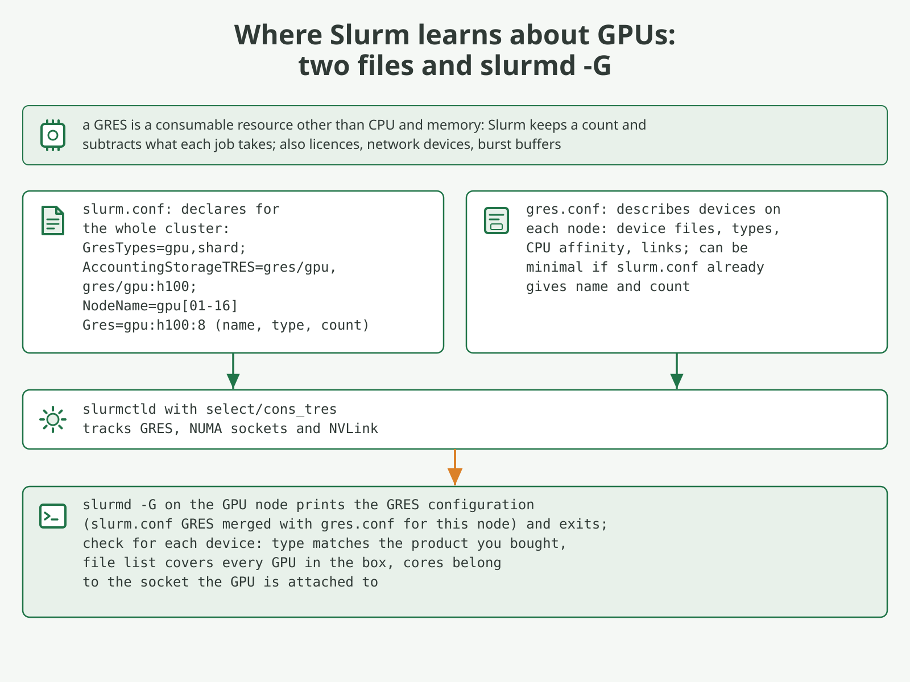

*Figure 6.10.1. slurmd -G on the node shows the merged GRES configuration to check type, files and cores.*

Your first GPU node is on the rack, and the controller has never heard of its GPUs. Before Slurm can place a job on a GPU, it needs to know that the GPU exists. The diagram below shows how that knowledge gets built up from two files and then applied at launch time.

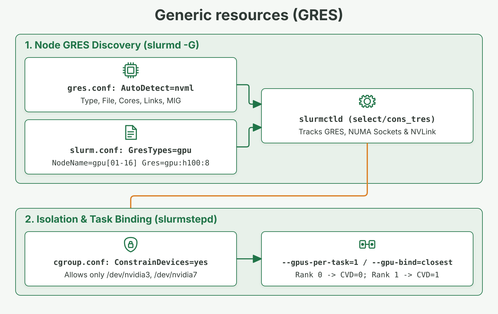

*Figure 6.10.2. Generic resources (GRES), as a diagram.*

That knowledge lives in configuration. A GRES, or generic resource, is a consumable resource other than CPU and memory. Consumable means that Slurm keeps a count and subtracts what each job takes. GPUs are the common case, but licences, network devices, burst buffers and bandwidth tokens also count as GRES. Each one has a name, such as `gpu`. It can also have a type, such as `h100` or `a100_3g.20gb`, a count per node, and optionally device files and topology. The configuration is split across two files. The first one lives with the controller and describes the whole cluster. The second one lives on each GPU node and describes the hardware in front of it. Keeping those two views separate means the controller can plan without needing to probe every device, while each node still reports exactly what it has.

The configuration is split across two files.

Start with `slurm.conf`. Here you declare the GRES types for the whole cluster, along with the node counts.

```ini
GresTypes=gpu,shard
AccountingStorageTRES=gres/gpu,gres/gpu:h100
NodeName=gpu[01-16] ... Gres=gpu:h100:8
```

The second file is `gres.conf`. It describes the devices on each node, including their device files, types, CPU affinity and links. According to the man page, if the `Gres` information in `slurm.conf` already describes the resources by name and count alone, `gres.conf` can be minimal. For GPUs with device files and topology, though, you need `gres.conf`, or you need `AutoDetect`.

### AutoDetect

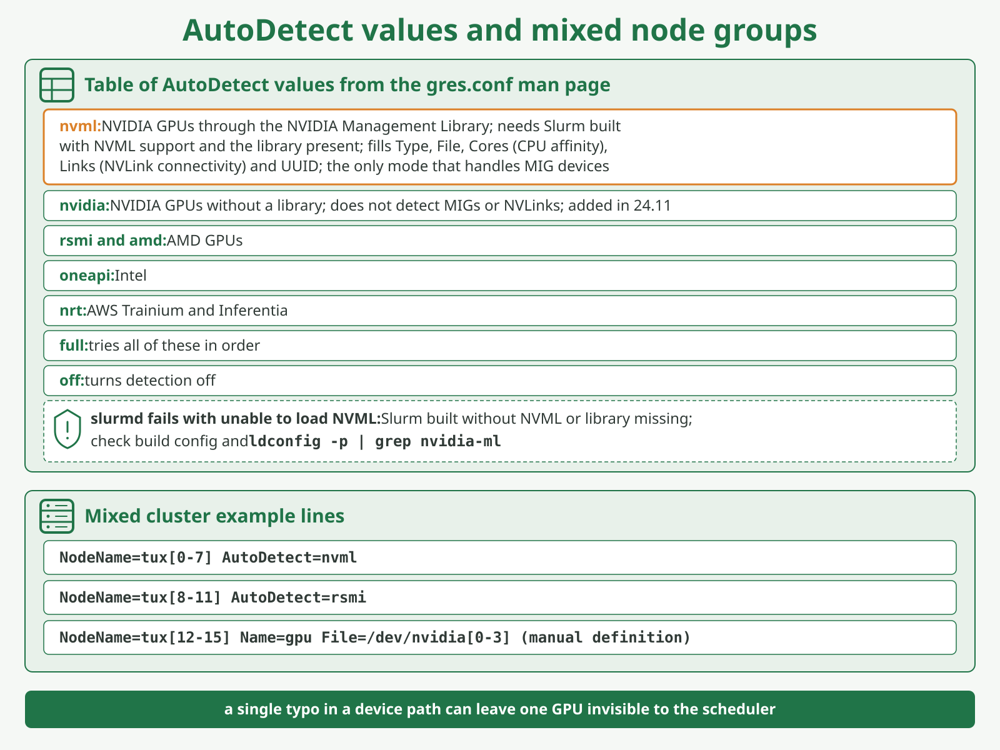

*Figure 6.10.3. Use AutoDetect=nvml on NVIDIA data-centre nodes and verify with slurmd -G.*

Typing out every device by hand is slow and easy to get wrong. A single typo in a device path can leave one GPU invisible to the scheduler until someone notices. `AutoDetect` in `gres.conf` asks slurmd to discover the hardware for you. The man page lists these values for the current development version. `nvml` covers NVIDIA GPUs through the NVIDIA Management Library, and it needs Slurm built with NVML support and the library present. `nvidia` covers NVIDIA GPUs without a library. It "doesn't detect MIGs or NVlinks", and it was added in 24.11. `rsmi` and `amd` cover AMD GPUs. `oneapi` covers Intel. `nrt` covers AWS Trainium and Inferentia. `full` tries all of these in order, and `off` turns detection off.

For NVIDIA data-centre nodes, use `AutoDetect=nvml`. It fills in `Type`, `File`, `Cores` (the CPU affinity), `Links` (the NVLink connectivity) and `UUID` for each GPU. It is also the only mode that handles MIG devices. To check the result, run `slurmd -G`. When you read its output, check three things for each device. Confirm that the type matches the product you bought, that the file list covers every GPU in the box, and that the cores belong to the socket the GPU is attached to. A mistake in any of the three shows up later as a job that gets the wrong GPU or the wrong CPUs. The man page says it "prints GRES configuration (based upon `slurm.conf` GRES merged with `gres.conf` contents for this node) and exit":

```bash
slurmd -G        # run on the GPU node; check type, file, cores, links for each device
```

A cluster can use different settings for different node groups. The man page examples include `NodeName=tux[0-7] AutoDetect=nvml` and `NodeName=tux[8-11] AutoDetect=rsmi`. They also show `NodeName=tux[12-15] Name=gpu File=/dev/nvidia[0-3]` for nodes with a manual definition. A single node can set `AutoDetect=off` to override its group. This matters in a mixed cluster, where an older AMD node and a newer NVIDIA node share one config.

### Manual definition

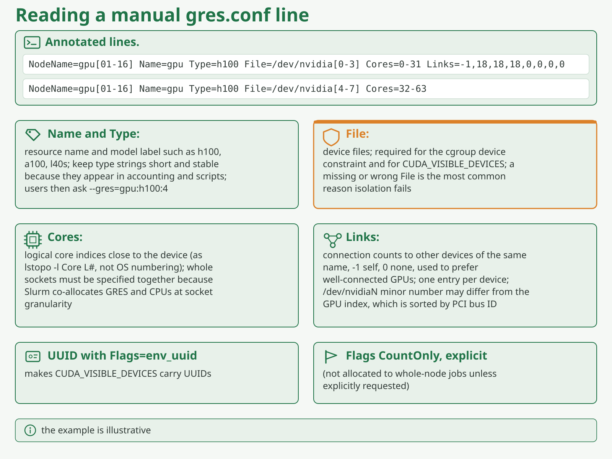

*Figure 6.10.4. The File field turns a name into a real device that the cgroup can allow or deny.*

Sometimes autodetection is not possible, or you want to override what it finds. In that case you write the definitions yourself. Imagine a driver update that stops the detection library from loading. Your manual lines keep the scheduler correct until the library is back.

```ini
# gres.conf
NodeName=gpu[01-16] Name=gpu Type=h100 File=/dev/nvidia[0-3] Cores=0-31  Links=-1,18,18,18,0,0,0,0
NodeName=gpu[01-16] Name=gpu Type=h100 File=/dev/nvidia[4-7] Cores=32-63
```

This example is illustrative. A real `Links` list needs one entry per device of that name, and when you give `Links`, each record covers one device. The `File` entry is what turns a name into an actual device the cgroup can allow or deny, so a missing or wrong file is the most common reason that isolation fails. The `Cores` entry is what lets Slurm keep a GPU's CPUs close to it. The table below explains each parameter, as the man page defines it. `Cores` and `Links` shape scheduling the most, so read those rows carefully.

| Parameter | Meaning |
|---|---|
| `Name`, `Type`, `Count` | Resource name, optional model/type label, number (default 1 per File) |
| `File` | Device files (`/dev/nvidia[0-7]`). Required for cgroup device constraint and for `CUDA_VISIBLE_DEVICES` |
| `Cores` | **Logical core indices** (as in `lstopo -l` "Core L#", not physical OS numbering) that are close to the device; whole sockets (or NUMA nodes with `SlurmdParameters=numa_node_as_socket`) must be specified together because Slurm co-allocates GRES and CPUs at socket granularity. A restart of `slurmctld` is needed after changing `Cores` |
| `Links` | Connection counts to other devices of the same name (`-1` self, `0` none), used to prefer well-connected GPUs; usually autodetected. Note the `/dev/nvidiaN` minor number may differ from the GPU index, which is sorted by PCI bus ID |
| `MultipleFiles` | Several device files per card |
| `UUID` | Device UUID; with `Flags=env_uuid`, `CUDA_VISIBLE_DEVICES` carries UUIDs instead of indices |
| `Flags` | `CountOnly` (count-only resource with no device plugin), `explicit` (not allocated to whole-node jobs unless explicitly requested), `env_uuid`, `one_sharing`/`all_sharing` for MPS |
| `ChunkSizes`/`ChunkOrder` | Restrict how GPU counts are granted (advanced topologies) |

Set `Type` to the product name, such as `h100`, `a100` or `l40s`. Users can then ask for a specific model with `--gres=gpu:h100:4`, and mixed clusters stay schedulable. Keep type strings short and stable. Once they appear in accounting and user scripts, they are hard to rename. The MIG profile docs say a type may be requested as a substring-compatible token.

## 2. Requesting GPUs

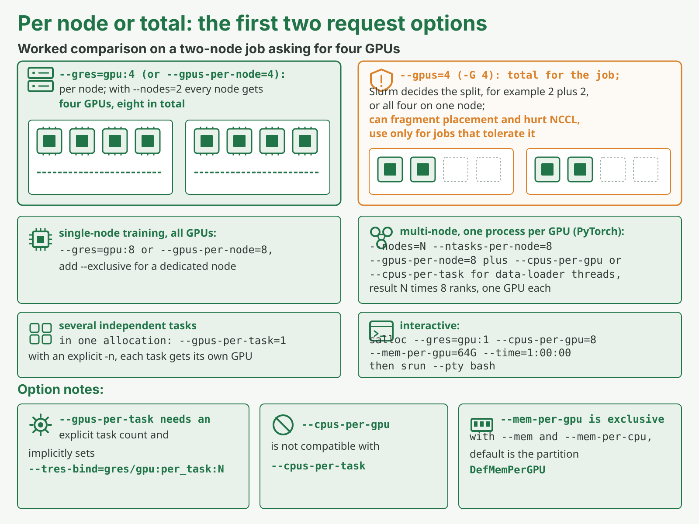

*Figure 6.10.5. --gres counts per node while --gpus counts for the whole job.*

Many users type `--gres=gpu:1` and expect something sensible. Whether they get it depends on which request option they use, so it helps to know the differences. A user who asks for four GPUs per node in a two-node job and a user who asks for four GPUs in total have asked for very different allocations. The table lists the main options from the `sbatch`, `srun` and `salloc` man pages.

| Option | Meaning |
|---|---|
| `--gres=gpu:N` or `gpu:type:N` | **Per node** count (`name[[:type]:count]`). In a multi-node job this is per node |
| `--gpus=N` (`-G`) | **Total** GPUs for the job (Slurm decides the per-node split) |
| `--gpus-per-node=N` | Per node |
| `--gpus-per-socket=N` | Per socket (requires a socket-count request) |
| `--gpus-per-task=N` | Per task; requires an explicit task count; **implicitly sets** `--tres-bind=gres/gpu:per_task:N` |
| `--cpus-per-gpu=N` | CPUs per allocated GPU (not compatible with `--cpus-per-task`) |
| `--mem-per-gpu=SIZE` | Memory per GPU; mutually exclusive with `--mem` and `--mem-per-cpu`; default is the partition's `DefMemPerGPU` |
| `--gpu-bind=[verbose,]TYPE` | Same as `--tres-bind=gres/gpu:TYPE` |
| `--gpu-freq=...` | Request GPU (and memory) clocks `low`, `medium`, `high`, `highm1` or MHz; applied per regular step, not in the batch script itself |
| `--gres-flags=...` | `enforce-binding`, `disable-binding`, `enforce-links`, `ignore-links`, `one-task-per-sharing`, `multiple-tasks-per-sharing` and others |

The first two rows cause the most confusion. `--gres=gpu:N` counts GPUs per node, so in a multi-node job it applies to every node. `--gpus=N` counts the total for the whole job, and Slurm decides how to split it. Choose the option that matches the shape of your job.

- Single-node training, all GPUs of a node: Use `--gres=gpu:8` or `--gpus-per-node=8`. Add `--exclusive` if the whole node should be dedicated. Watch how `Flags=explicit` and the partition's `Exclusive` setting interact.
- Multi-node, one process per GPU: This is the standard PyTorch layout. Use `--nodes=N --ntasks-per-node=8 --gpus-per-node=8`, or `--gres=gpu:8`. Add `--cpus-per-gpu` or `--cpus-per-task` for the data-loader threads. The result is N x 8 ranks, one GPU each. When the job needs a regular shape, prefer `--gpus-per-node` over `--gpus`.
- Flexible total: `--gpus=16` lets Slurm pack 16 GPUs across fewer or more nodes. That can fragment placement and hurt NCCL performance, so use it only for jobs that tolerate it.
- Several independent tasks in one allocation: Add `--gpus-per-task=1` with an explicit `-n`. Each task then gets its own GPU.
- Interactive: Request a GPU with `salloc --gres=gpu:1 --cpus-per-gpu=8 --mem-per-gpu=64G --time=1:00:00`, then run `srun --pty bash`. See 6.11 for the rest of the workflow.

Defaults protect users who type only `--gres=gpu:1`. Think of the defaults as the rule that fills in the blanks on a form. The user writes the GPU count, and the partition writes the CPU and memory lines that the user forgot. The partition settings `DefCpuPerGPU` and `DefMemPerGPU` (see 6.8) give each GPU a sensible share of CPUs and memory. Without them, a job that asks for GPUs but no CPUs can block on a node where CPUs are scarce, or it can get a starved allocation. The defaults are a safety net, though. They are not a substitute for asking for what you need in the script.

### Portable resource allocation rules (*Distributed AI Systems* Chapter 8)

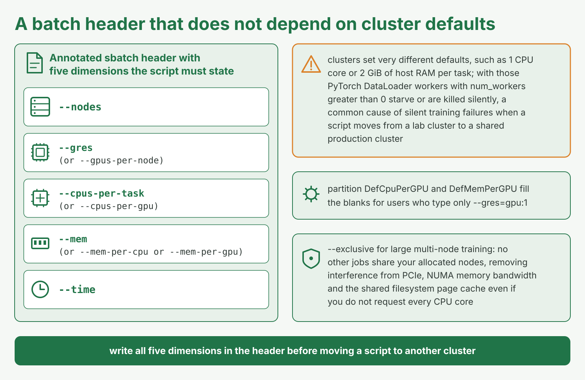

*Figure 6.10.6. State nodes, GPUs, CPUs, memory and time explicitly so cluster defaults cannot surprise the job.*

*Distributed AI Systems* (chapter 8, *Best practices: Resource allocation*) makes a point that matters here. Relying on implicit cluster defaults is one of the most common causes of silent training failures. The failures usually appear when batch scripts move from a lab cluster to a shared production HPC system. A script that worked on the lab cluster quietly inherits different defaults on the production system, and the training run fails somewhere far from the cause. The fix is to make every GPU batch script portable and self-documenting. You do that by naming all five core resource dimensions explicitly.

1. Always specify `--nodes`, `--gres`, `--cpus-per-task` (or `--cpus-per-gpu`), `--mem` (or `--mem-per-cpu` / `--mem-per-gpu`), and `--time`. Clusters set very different defaults, such as 1 CPU core or 2 GiB of host RAM per task. With those defaults, PyTorch `DataLoader` workers (`num_workers > 0`) can exhaust host memory and get killed by the Linux OOM killer, even while GPU VRAM has plenty of headroom.
2. Use `--exclusive` for large multi-node training. It guarantees that no other jobs share your allocated nodes. That removes interference from PCIe, NUMA memory bandwidth and the shared filesystem page cache, even if your job does not request every CPU core on the node.

Before you move a batch script to another cluster, write down all five dimensions in its header. That header is the first thing the next person will read, and it saves them from guessing what the cluster used to supply by default.

### What the job sees

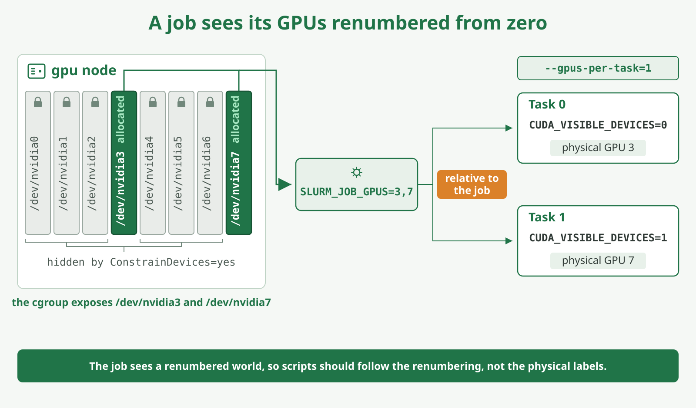

*Figure 6.10.7. Inside a job, the allocated GPUs are renumbered from zero, so physical GPU 3 can appear as device 0.*

Once the job starts, it needs to know which GPUs it received. Slurm sets a group of environment variables for this, and the `sbatch` man page lists them. `SLURM_JOB_GPUS` holds the GPU indices allocated to the job on the node. The others are `SLURM_GPUS_ON_NODE`, `SLURM_GPUS_PER_NODE`, `SLURM_GPUS_PER_SOCKET`, `SLURM_GPUS` (the total requested) and `SLURM_GPU_BIND`. Each task also gets `CUDA_VISIBLE_DEVICES`. For other vendors, the matching variables are `ROCR_VISIBLE_DEVICES`, `ZE_AFFINITY_MASK` and `GPU_DEVICE_ORDINAL`. When device constraints are on, the indices are relative to the job's allocation. The first allocated GPU is `0`, even if its physical index is 3. That is why a script that hard-codes `CUDA_VISIBLE_DEVICES=3` breaks on one node and works on another. The job sees a renumbered world, and the scripts should follow the renumbering rather than the physical labels.

The helper `code/part06/gpu_env_check.py` prints all of these, plus the output of `nvidia-smi -L`. Run it as the job step to compare request variants:

```bash
srun --gpus-per-node=2 --ntasks-per-node=2 python gpu_env_check.py
srun --gpus-per-node=2 --ntasks-per-node=2 --gpus-per-task=1 python gpu_env_check.py     # one GPU each
srun --gpus-per-node=2 --ntasks-per-node=2 --gpu-bind=none python gpu_env_check.py       # no per-task binding
```

On a machine with no Slurm and no GPUs, the script prints each key as `<unset>` and `nvidia-smi not found`. That confirms the script runs, but the useful output appears only on the cluster. Run all three variants there and compare which GPUs each rank receives before you pick a request style for a real job. The three lines differ in one way each, so the comparison tells you exactly what each option changes.

## 3. Binding GPUs to tasks and CPUs

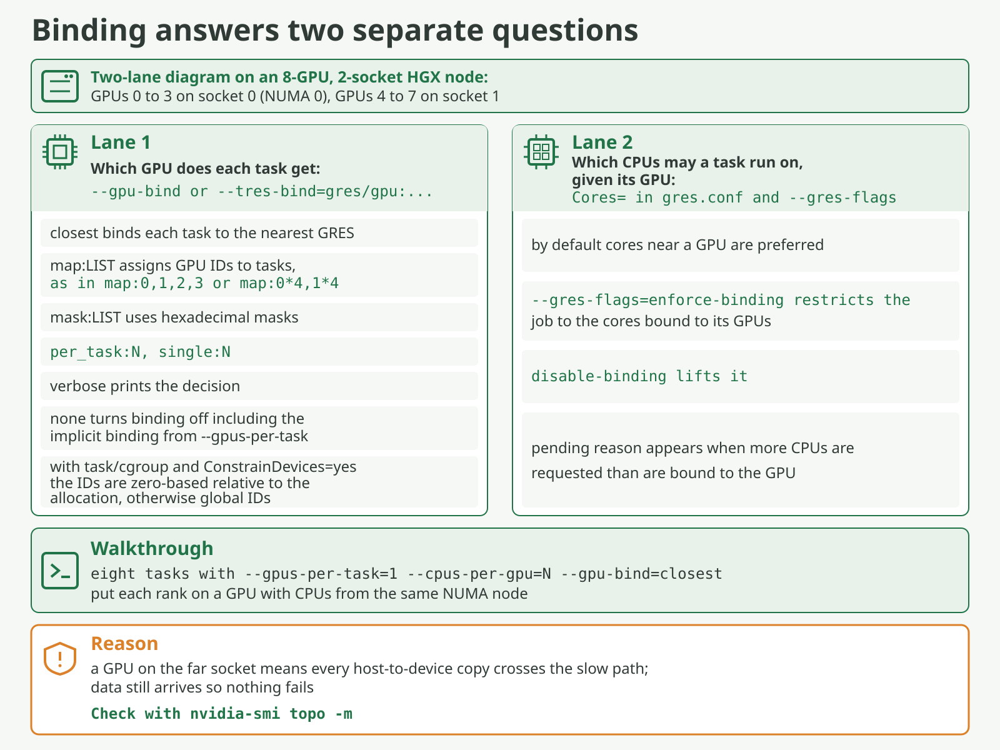

*Figure 6.10.8. Bind both questions so a rank's CPUs and GPU sit on the same socket.*

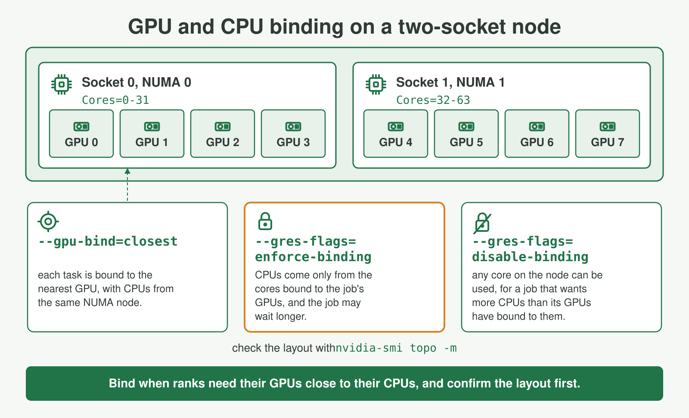

*Figure 6.10.9. On a two-socket node, each GPU has a local socket, so binding keeps a rank's CPUs and GPU on the same side.*

Binding answers two separate questions. The first is which GPU each task gets. The second is which CPUs a task may use, given its GPU. Picture four ranks on one node. If rank 2 gets a GPU that sits on the other side of the machine from its CPU cores, every host-to-device copy crosses the slow path. The data still arrives, so nothing fails, but each copy takes the long way round. Binding is how you prevent that. It is a promise made at launch, and it costs nothing when the layout is already right.

The first question is answered by `--gpu-bind` or `--tres-bind=gres/gpu:...`. The `srun` man page describes the options. `closest` binds each task to the nearest GRES, which may be several in a NUMA environment. `map:<list>` assigns GPU IDs to tasks, as in `map:0,1,2,3` or `map:0*4,1*4`. `mask:<list>` uses hexadecimal masks per task. `none` turns binding off, including the implicit binding from `--gpus-per-task`.

The same man page also lists `per_task:N`, `single:N` and a `verbose` prefix. With `task/cgroup` and `ConstrainDevices=yes`, the IDs are zero-based indexes relative to the job's allocation. Without that setting, they are global IDs, and you need a whole-node allocation to get predictable results. A `verbose` prefix prints the binding decision, which is useful the first time you test a request.

The first question decides which GPU a rank uses. The second question decides which CPUs that rank may run on, and it is controlled by `Cores=` in `gres.conf` and by `--gres-flags`. By default, the cores near a GPU are preferred. `--gres-flags=enforce-binding` restricts the job to the cores bound to its GRES. That gives better performance, but the job may wait longer. The man page example is a 2-GPU, 1-CPU job that is delayed until both GPUs on one socket are free. `disable-binding` allows any core, which you need when a job wants more CPUs than its GPUs have bound to them. Keep the socket granularity in mind as well. You cannot prefer different cores of the same socket for different GPUs.

A short walkthrough makes the idea concrete. Take a typical 8-GPU, 2-socket HGX node. GPUs 0 to 3 sit on socket 0 (NUMA 0), and GPUs 4 to 7 sit on socket 1. Eight tasks run with `--gpus-per-task=1 --cpus-per-gpu=N --gpu-bind=closest` put each rank on a GPU, with CPUs from the same NUMA node. That matters for host-to-device bandwidth and for NIC proximity, because the NIC also hangs off a socket. Parts 9 and 12 cover the NIC side. To verify the layout, use `nvidia-smi topo -m` for the affinity columns, and `taskset -pc $$` on each rank. 6.12 goes through the launch details.

Before you choose a `--gpu-bind` mode, decide whether your ranks need their GPUs placed near their CPUs, and confirm the layout with `nvidia-smi topo -m`. If the answer is yes, bind. If your ranks do not share data much, a looser setting may be fine. A common mistake is to copy a binding flag from a forum post without checking the topology of the node you are on. The flag is correct for one layout and wrong for another.

## 4. Isolation: what actually stops a job from using other GPUs

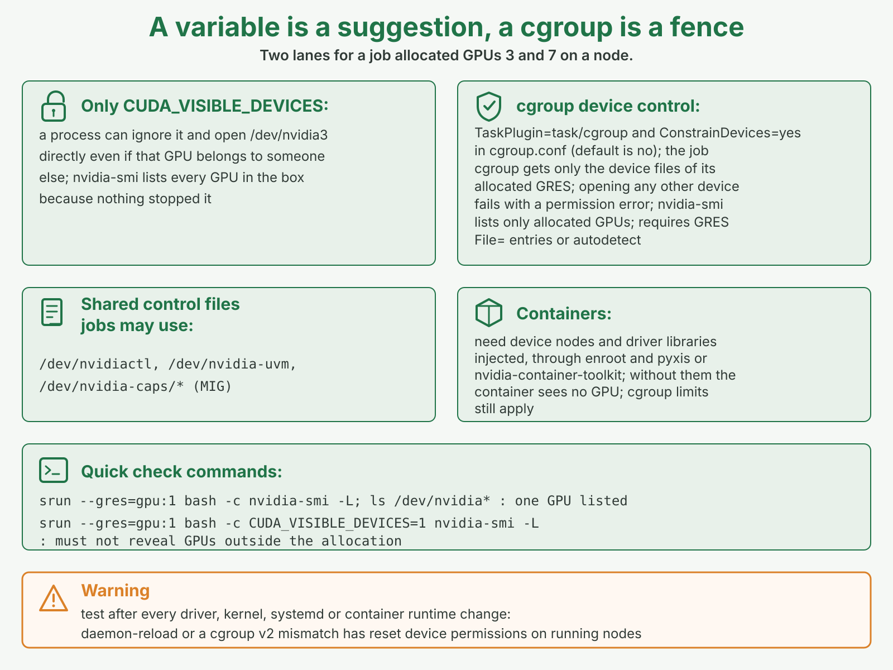

*Figure 6.10.10. Only ConstrainDevices=yes physically stops a job from opening other GPUs.*

An environment variable is only a suggestion. A user's job runs `nvidia-smi` and lists every GPU in the box, and the reason is that nothing stopped it. A process can ignore `CUDA_VISIBLE_DEVICES` and open `/dev/nvidia3` directly, even if that GPU belongs to someone else. Real isolation comes from cgroup device control. Set `TaskPlugin=task/cgroup` and `ConstrainDevices=yes` in `cgroup.conf` (6.8). The default for `ConstrainDevices` is `no`, so you have to turn it on. With it on, the job's cgroup gets only the device files of its allocated GRES. Opening any other device then fails with a permission error, and `nvidia-smi` lists only the GPUs you were allocated. This requires that GRES have `File=` entries, or that autodetect supplied them.

Three details matter in practice. The control files `/dev/nvidiactl`, `/dev/nvidia-uvm` and `/dev/nvidia-caps/*` (the last one for MIG) are shared, and jobs are allowed to use them. Containers (6.13) run the same risk in a different package. A container that starts without the device nodes or the driver libraries will see no GPU at all, which looks like a broken node even when the node is fine. Containers (6.13) need the device nodes and driver libraries injected, through enroot and pyxis or `nvidia-container-toolkit`, but the cgroup limits still apply to the container's processes. Finally, test isolation every time you change drivers, the kernel, systemd or the container runtime. A systemd update, run with `systemctl daemon-reload`, or a cgroup v2 mismatch has historically reset device permissions and broken isolation on running nodes. Treat that as an operations lesson, and verify it against your own versions. A short incident story shows why. A node runs fine for weeks. Then a routine systemd update runs, and the next job on that node sees every GPU, because the device permissions were reset. Nobody changed the Slurm config, so the team has to check the isolation after every update to be sure.

Two commands make a quick check. The first should list one GPU. The second should not reveal any GPU outside the allocation.

```bash
srun --gres=gpu:1 bash -c 'nvidia-smi -L; ls /dev/nvidia*'          # one GPU listed
srun --gres=gpu:1 bash -c 'CUDA_VISIBLE_DEVICES=1 nvidia-smi -L'    # should not reveal GPUs outside the allocation
```

Run these checks after every driver or runtime change, before you trust the node with jobs again. A check that takes a minute is far cheaper than a job that quietly shares a GPU with someone else. Read the output with a specific question in mind. The first command should show exactly one GPU in the list. The second should show no GPU that the job was not given.

## 5. Sharing a GPU: MIG, MPS and sharding

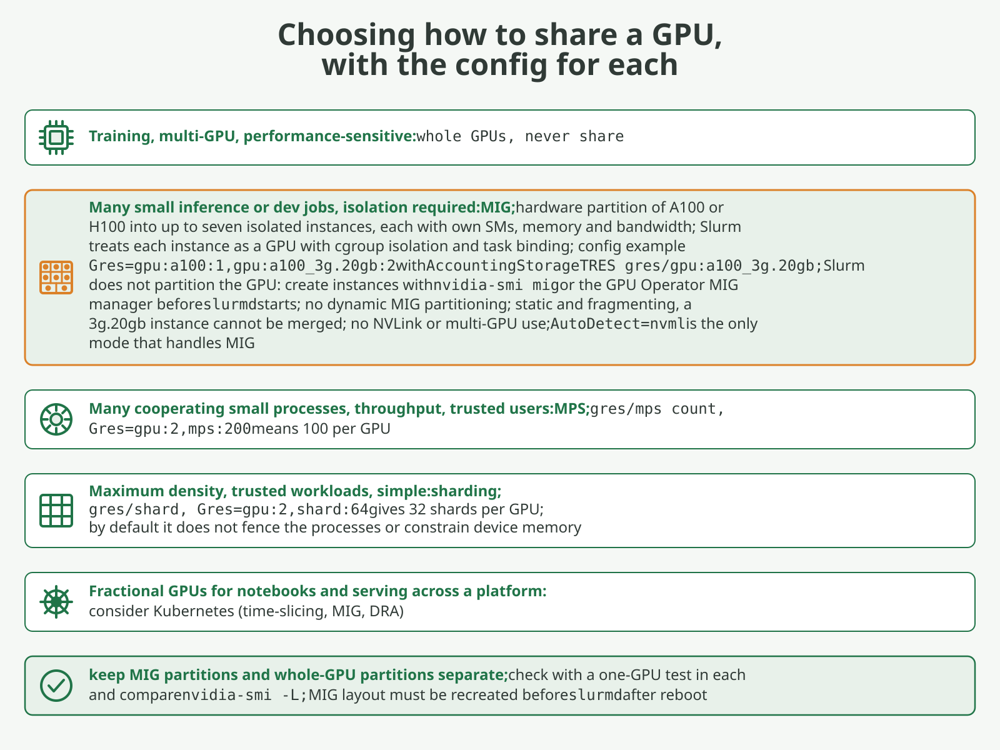

*Figure 6.10.11. MIG instances must exist before slurmd starts because Slurm does not partition GPUs dynamically.*

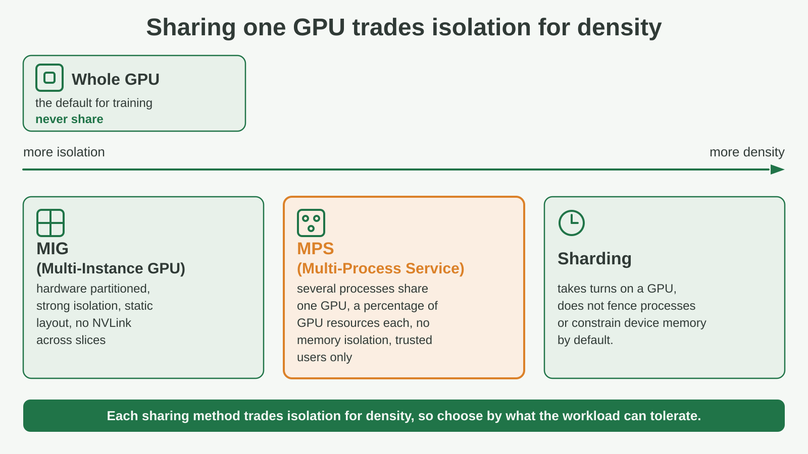

*Figure 6.10.12. Each way of sharing a GPU gives up some isolation to fit more jobs on one device.*

Whole-GPU allocation is the default, and it is the right default for training. Small workloads such as inference, notebooks and debugging are different. If each one takes a whole 80 GB GPU, the rest of that capacity goes unused. Slurm offers three mechanisms for sharing, and the `gres` documentation describes each of them. Each one trades isolation for density, so choose by what the workload can tolerate.

### MIG (Multi-Instance GPU)

NVIDIA A100 and H100-class GPUs can be partitioned in hardware into up to seven isolated instances. Each instance gets its own compute units (SMs), memory and bandwidth. Slurm treats each MIG instance as a GPU, "complete with cgroup isolation and task binding." Configuration takes two parts. You turn on `AutoDetect=nvml` in `gres.conf`, and you declare the instances in `slurm.conf`. You can give them types, which must be a substring of the profile string reported at the `debug2` log level:

```ini
AccountingStorageTRES=gres/gpu,gres/gpu:a100,gres/gpu:a100_3g.20gb
GresTypes=gpu
NodeName=tux[1-16] Gres=gpu:a100:1,gpu:a100_3g.20gb:2
```

The key point is that Slurm does not partition the GPU. The MIG instances must already exist. You create them with `nvidia-smi mig` or the GPU Operator's MIG manager, before slurmd starts. The docs say Slurm "does not support dynamic MIG partitioning." The sanity-check AutoDetect mode is also not supported for MIG. To change the layout, you drain the node, reconfigure MIG and restart slurmd. Think of the MIG layout as part of the node's hardware setup, not as something the scheduler can change between jobs. A practical sequence for a layout change is to drain the node, wait for its jobs to finish, recreate the instances, restart `slurmd`, and then resume the node and run a single-GPU test job.

MIG gives you strong isolation and predictable performance. The costs are that it is static, and that it fragments. A 3g.20gb instance, for example, cannot be merged with another instance. MIG instances also have no NVLink or multi-GPU use, and some CUDA features are limited. A MIG slice is a good home for a notebook. It is a poor home for a job that needs to talk to its neighbors over NVLink. Matching the workload to the mechanism is most of the decision, and the table in this section is a quick way to check your choice.

### MPS (Multi-Process Service)

MPS lets several processes share one GPU at the same time. Each process gets a percentage of the GPU's resources, requested through the `gres/mps` count. In `slurm.conf` you declare it as `Gres=gpu:2,mps:200`, which means 100 per GPU. You can also declare it in `gres.conf`. The count is translated into a percentage, so use multiples of 100 per GPU. The `Cores` parameter is ignored for MPS, because it is copied from the GPU. By default, only one sharing job is allowed per GPU, which is the `one_sharing` setting. The docs say MPS requires `select/cons_tres`. MPS does not isolate memory, so one client can exhaust the GPU's memory. Use it only among users you trust. Picture a notebook fleet where one user loads a large model. Every other user on that GPU can start to see out-of-memory errors, even though their own code did nothing wrong.

### Sharding

`gres/shard` lets several jobs take turns on a GPU. The docs say that "by default it does not fence the processes running on the GPU nor constrain its device memory." You declare it as `Gres=gpu:2,shard:64`, which gives 32 shards per GPU. Sharding suits homogeneous small jobs. The docs recommend limiting shards per node to the maximum number of simultaneous jobs. Newer versions add opt-in shard device-memory enforcement, which the same docs page describes. If you enable that enforcement, read the docs for your version before you count on it.

### Choosing

Match your need to a mechanism with the table below. Read down the first column and find the workload that looks like yours.

| Need | Use |
|---|---|
| Training, multi-GPU, performance-sensitive | Whole GPUs, never share |
| Many small inference/dev jobs, isolation required | MIG |
| Many cooperating small processes, throughput | MPS (trusted users) |
| Maximum density, trusted workloads, simple | Sharding |
| Fractional GPUs for notebooks/serving across a platform | Consider Kubernetes (time-slicing, MIG, DRA; Part 11) |

Mixing MIG and whole-GPU nodes in one cluster is common. A MIG partition serves interactive work, and a whole-GPU partition serves training. Keep them separate so users are not surprised. A quick way to check the split is to submit a one-GPU test to each partition and compare the `nvidia-smi -L` output, because the device names make the difference obvious. A user who lands a training job on a MIG slice will see a slow run and assume their code is at fault, when the real cause is the partition they were sent to.

## 6. Accounting and limits for GPUs

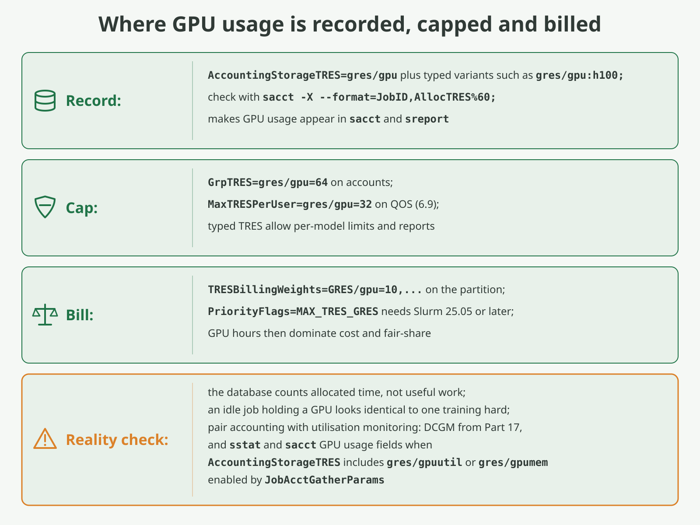

*Figure 6.10.13. Accounting counts allocated GPU hours, so pair it with utilisation monitoring to see wasted time.*

Someone will always ask who used the GPUs and how much. A manager wants to know which team used the most H100 hours last month. Accounting answers that question, and limits cap what any one account can take. When the question arrives, you want the answer to come from the database, not from a spreadsheet that someone updated by hand. Start by adding `AccountingStorageTRES=gres/gpu` and any typed variants. That makes GPU usage appear in `sacct` and `sreport`. You can check it with `sacct -X --format=JobID,AllocTRES%60`.

For limits, `GrpTRES=gres/gpu=64` goes on accounts, and `MaxTRESPerUser=gres/gpu=32` goes on QOS (see 6.9). For billing, give GPUs a high weight with `TRESBillingWeights=GRES/gpu=10,...` on the partition. Add `PriorityFlags=MAX_TRES_GRES`, which the man page says needs Slurm 25.05 or later. That way GPU hours dominate cost and fair-share. Typed TRES, such as `gres/gpu:h100`, let you set per-model limits and reports.

The real cost problem is GPU hours consumed by idle jobs. A job that holds a GPU for hours while doing nothing looks identical in the accounting database to a job that is training hard. The database counts allocated time, not useful work. When you read a GPU-hours report, ask whether the hours came from a job that computed or from a job that waited. Those two numbers can look identical in the report and differ completely in cost. Pair accounting with utilisation monitoring. That means DCGM from Part 17, and the `sstat` and `sacct` GPU usage fields. Those fields appear when `AccountingStorageTRES` includes `gres/gpuutil` or `gres/gpumem`, and they are enabled by `JobAcctGatherParams` and the `acct_gather_energy`/`gpu` plugin. The exact spelling depends on the version.

## 7. Operational notes

Slurm does not know GPU health by itself, so the faults you care about have to be caught elsewhere. Think of Slurm as the scheduler that trusts the node until something tells it otherwise. A GPU that falls off the bus, or that reports Xid, ECC or NVLink faults, should drain its node (see 6.14). A node health check, a prolog or NHC, and DCGM diagnostics (`dcgmi diag`) can all help you find these faults.

An epilog can reset GPU state between jobs. It can kill leftover processes, though `fuser -k /dev/nvidia*` needs care, and it can clear persistent mode problems (see 6.14). Persistence mode and MIG state must stay consistent across reboots. Set them in systemd units that run before slurmd starts. If they run after, the node comes up with a layout that does not match the config, and the scheduler sees the wrong devices.

Rolling driver upgrades need an empty node. Use `Reason` strings and reservations to manage that (see 6.15). A short incident helps here. A GPU on one node fails, and the node stays in service, because the failure is quiet. A training job then runs slowly for hours and nobody knows why. The fault is a GPU that dropped off the bus, and the check that would have caught it is a health check that runs between jobs. Heterogeneous clusters need care too. Avoid letting `--gres=gpu:1` land on an old GPU when the user needs an H100. Use types, partitions, features or a job submit plugin default to prevent it. When you change GRES counts, drain the node first, as the man page notes. Then restart `slurmctld` or `slurmd` as required. Pyxis and enroot expose GPUs according to the Slurm allocation (see 6.13).

Decide now who drains a node when a GPU fails. That decision is much easier before the page arrives. Write the name of the person or the rotation on the runbook, and write the exact command they run. A runbook that says drain the node, with the command next to it, saves a lot of time in the middle of an incident.

### Live GPU job monitoring and distributed profiling (*Distributed AI Systems* Chapter 8)

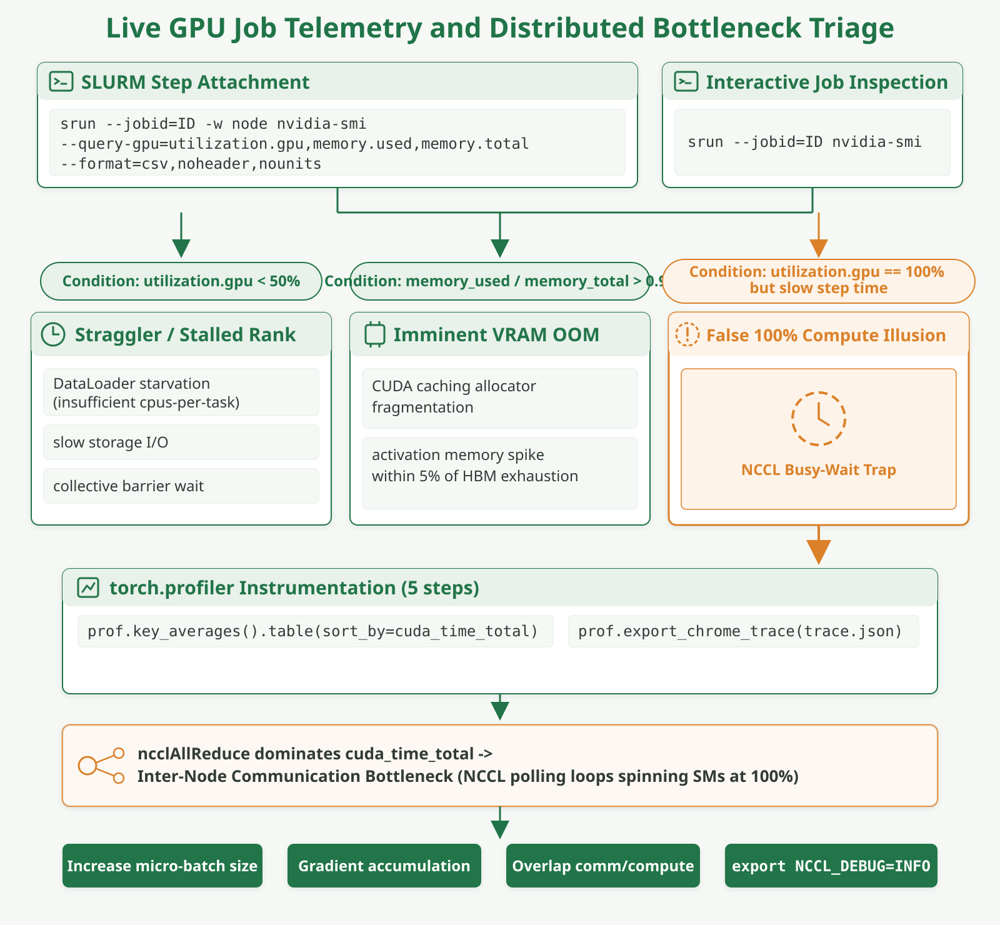

*Figure 6.0.0. Live GPU telemetry reveals true bottlenecks by distinguishing idle stragglers, VRAM exhaustion, and false 100 percent utilization from NCCL spin loops.*

Once a multi-node GPU job is running, you need to confirm that every allocated GPU is actually computing. A GPU can look idle because it is waiting on data loading or on a hung collective. A collective is an operation, such as an all-reduce, in which every rank in the job must take part before any of them can continue. *Distributed AI Systems*, chapter 8, covers monitoring and debugging. Three approaches help.

1. You can inspect the queue and the GPUs without SSH. Watch job state change in real time with `watch -n 1 squeue -u $USER` and `watch -n 1 scontrol show job <job_id>`. Even on clusters where direct `ssh` to compute nodes is disabled, you can attach to a running job's allocation. Use `srun --jobid=<job_id> nvidia-smi`, or `srun -N 2 nvidia-smi` inside an interactive `salloc` shell, to see `nvidia-smi` across nodes. Stream the output with `tail -f slurm-<job_id>.out`. After a job finishes, query its CPU and memory footprint with `sacct -j <job_id> --format=JobID,JobName,Elapsed,MaxRSS,MaxVMSize,State` and `sacct -u $USER --starttime=2024-01-01`.

2. The SLURMJobMonitor approach polls per-GPU utilisation and VRAM across every node in a job. List the nodes with `squeue -j <job_id> -o "%N" -h`. Then run `srun -w <node> nvidia-smi --query-gpu=utilization.gpu,memory.used,memory.total --format=csv,noheader,nounits` on each one. The chapter flags two classic anomalies. A straggler or stalled rank shows `utilization < 50%`. That can mean CPU data-loader starvation, a slow storage read, or a rank waiting at a barrier. Imminent VRAM OOM shows as `memory_used_gb / memory_total_gb > 0.95`. That means CUDA caching allocator fragmentation or activation spikes are within 5 percent of exhausting HBM.

3. You can profile GPU compute against `ncclAllReduce` communication. When GPU utilisation looks high but step throughput is slow, the cause may be NCCL polling loops, which spin CUDA kernels at 100% utilization. Wrap 5 training steps in `torch.profiler.profile(activities=[ProfilerActivity.CPU, ProfilerActivity.CUDA], record_shapes=True, profile_memory=True, with_stack=True)`. Put `record_function("forward")`, `record_function("backward")` and `record_function("optimizer")` around the matching parts. Export the Chrome trace only on rank 0, with `if dist.get_rank() == 0: prof.export_chrome_trace("trace.json")`. Then print `prof.key_averages().table(sort_by="cuda_time_total", row_limit=10)`. If `ncclAllReduce` dominates `cuda_time_total`, you have an inter-node communication bottleneck. The remedies are a larger micro-batch size, gradient accumulation, or overlapping communication with computation. For lower-level transport diagnostics, enable `export NCCL_DEBUG=INFO`, `export NCCL_DEBUG_SUBSYS=ALL` and `export TORCH_DISTRIBUTED_DEBUG=DETAIL` selectively. Run this profile before you change the model code, because it shows whether the time goes to compute or to communication.

## 8. Troubleshooting

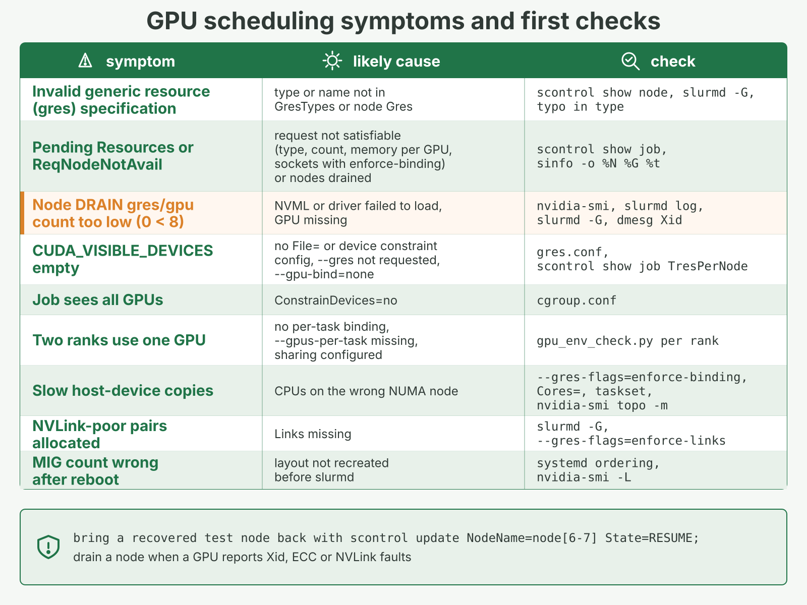

*Figure 6.10.14. Run the single check in the row that matches before changing any configuration.*

A job stays pending, or a node sits in drain, and it is not clear whether the fault is in Slurm or in the training script. Picture the page at two in the morning. The training script looks fine, and the queue is not moving. The checks below separate the two, so you know which team needs to look first. Start with the three quick triage commands, because they take seconds and rule out whole categories at once.

Check node states across the cluster with `sinfo -N -l`. The output shows states such as `idle`, `alloc`, `down` or `drain`. To bring a virtual or recovered test node back, run `scontrol update NodeName=node[6-7] State=RESUME`. Next, verify that `slurmctld` registered the GPUs on each node with `scontrol show nodes | grep Gres`. Last, test single-GPU allocation outside your training script with `srun -N 1 --gres=gpu:1 nvidia-smi -L`. If this fails, the fault is in Slurm's `gres.conf` or cgroup setup, not in your PyTorch code.

The table maps common symptoms to their likely causes and to the place to look first.

| Symptom | Likely cause | Check |
|---|---|---|
| `Invalid generic resource (gres) specification` | Type or name not in `GresTypes`/node `Gres` | `scontrol show node`, `slurmd -G`, typo in type |
| Job pending `Resources` / `ReqNodeNotAvail` for GPUs | Request not satisfiable (type, count, memory per GPU, sockets with `enforce-binding`), nodes drained | `scontrol show job`, `sinfo -o "%N %G %t"` |
| Node DRAIN `gres/gpu count too low (0 < 8)` | NVML/driver failed to load, GPU missing; slurmd saw fewer devices than configured | `nvidia-smi`, slurmd log, `slurmd -G`, dmesg Xid |
| `CUDA_VISIBLE_DEVICES` empty or unset in job | No `File=` / device constraint config, `--gres` not requested, `--gpu-bind=none` interplay | `gres.conf`, `scontrol show job` `TresPerNode` |
| Job sees all GPUs | `ConstrainDevices=no` | `cgroup.conf` (6.8) |
| Two ranks use one GPU | No per-task binding; `--gpus-per-task` missing; sharing configured | `gpu_env_check.py` output per rank |
| Slow host-device copies / data loading | CPUs on wrong NUMA node | `--gres-flags=enforce-binding`, `Cores=`, `taskset`, `nvidia-smi topo -m` |
| NVLink-poor GPU pairs allocated | `Links` missing | `slurmd -G`, `--gres-flags=enforce-links` |
| MIG count wrong after reboot | MIG layout not recreated before slurmd | systemd ordering, `nvidia-smi -L` |
| `slurmd` fails: "unable to load NVML" | Slurm built without NVML, or library missing | build config, `ldconfig -p \| grep nvidia-ml` |

Match the symptom to the message you see, then work through the check column for that row. Most of the checks are a single command. Keep the table open while you work, because the first two or three rows cover most of the tickets you will see. When a row matches, run its check before you change any configuration. Changing the config first can hide the evidence you needed. Start with the message, because the same symptom can have a different cause on a different cluster, and the message tells you which branch of the table you are on.

## 9. Lab (self-checking simulator tested; live GPU cluster parts untested)

Start on your own machine. The Python lab checks the logic without any GPU, so you can run it on a laptop during a commute. It is a model of the logic, not a replacement for the cluster. It verifies that `code/part06/gpu_env_check.py` prints all 15 GPU and Slurm environment variables. It simulates `ConstrainDevices=yes` against `ConstrainDevices=no`, which is cgroup fencing of `/dev/nvidia*` devices. It also simulates task-relative `CUDA_VISIBLE_DEVICES` remapping (`[3, 7] -> 0, 1`). Finally, it tests the SLURMJobMonitor `nvidia-smi` CSV parser and its anomaly detector, which flag `< 50%` GPU utilization stragglers and `> 95%` VRAM OOM risk. Both come from *Distributed AI Systems*, chapter 8.

```bash
python3 code/part06/gpu_env_check_lab.py
```

The steps after the lab need a GPU cluster or a test VM. They were not run on a live cluster, so read each one as a plan to carry out. Once the simulator passes, move to a GPU cluster or a test VM and work through these steps.

1. On a GPU node, run `slurmd -C` and `slurmd -G` with `AutoDetect=nvml`. Record the type, file, cores and links for each GPU, then compare them with `nvidia-smi topo -m`.
2. Write `slurm.conf` and `gres.conf` for the node, then restart. `scontrol show node` should then show `Gres=gpu:h100:8`, or the type you chose.
3. Run `code/part06/gpu_env_check.py` under the three `srun` variants from section 2. Record the environment and the `nvidia-smi -L` output for each rank.
4. Toggle `ConstrainDevices`, and use the isolation script to prove the difference.
5. With 4 tasks, compare `--gpu-bind=closest`, `map:0,1,2,3` and `none`. Print `taskset -pc` and the GPU for each rank.
6. Request more CPUs than are bound to a GPU, first with and then without `--gres-flags=disable-binding`. Observe the pending reason each time.
7. Create two MIG instances with `nvidia-smi mig`, configure Slurm for them, and run two simultaneous jobs.
8. Practise without GPUs by using fake devices in the style of `Name=gpu File=/dev/null Count=4`. Write down the limits you hit. Then check that requests, binding variables and accounting TRES behave as expected.
9. Add `gres/gpu` to `AccountingStorageTRES`, run a job, and check the result with `sacct -X --format=JobID,AllocTRES`.

Finish the simulator first, so that cluster time goes to the parts that only a real node can show. Each simulator check that passes is one less surprise on the node, and each surprise on the node costs a slot that other people wanted.

## 10. Interview angles

Interviewers ask these questions to see whether you can reason about a GPU cluster, not just recite flags. Talk through the trade-off first, and then name the setting that implements it. Each one starts from a symptom or a trade-off, so picture the node or the job behind it. Answer them in your own words.

- How does Slurm know how many GPUs a node has, and how do you verify it?
- What is the difference between `--gres=gpu:4`, `--gpus=4`, `--gpus-per-node=4` and `--gpus-per-task=1`?
- How do you guarantee a job cannot touch GPUs it did not request?
- What are `Cores` and `Links` in `gres.conf` for? What does `enforce-binding` trade off?
- Compare MIG, MPS and sharding on isolation, flexibility and use cases. Can Slurm create MIG slices?
- A multi-node PyTorch job is 25 percent slower than last week. What scheduler-side causes would you check?
- How do you bill GPU hours fairly in fair-share?
- Describe what happens when a GPU falls off the bus mid-job.

## Exercises

The exercises use the lab code and the configuration from this chapter. Each one starts from a situation and then asks you to run something, check a result, or write a configuration. Ask one question at a time as you work, and write down each answer before you check it. Compare your answer with the code or the output named in each exercise. If the two differ, find out which one is wrong before you move on.

1. A user says that Task 0 and Task 1 seem to use the wrong GPUs. Check the `gpu_env_check.py` remapping logic by running the lab with `python3 code/part06/gpu_env_check_lab.py`. Then use `simulate_gpu_binding_and_isolation([3, 7], ntasks=2, constrain_devices=True, gpu_bind="per_task:1")` to see why Task 0 gets `CUDA_VISIBLE_DEVICES=0` and Task 1 gets `CUDA_VISIBLE_DEVICES=1`. Even though `SLURM_JOB_GPUS=3,7` and the cgroup exposes `/dev/nvidia3,/dev/nvidia7`, the indices are relative to the job. Next, set `constrain_devices=False` and `gpu_bind="none"`. Both tasks should then see all 8 `/dev/nvidia0..7` devices and `CUDA_VISIBLE_DEVICES=3,7`.
2. You are building the config for a new cluster with 16 whole-GPU nodes and 4 interactive MIG nodes. Write the `GresTypes`, `AccountingStorageTRES` and `NodeName` entries for `slurm.conf`. The whole-GPU nodes are `gpu[01-16]`, and each has 8 `h100` GPUs. Then write the `gres.conf` entry with `AutoDetect=nvml`. The MIG nodes are `mig[01-04]`. Each one has a whole `a100` GPU and 2 `a100_3g.20gb` MIG instances. This exercise draws on Supercomputers for Linux SysAdmins, chapter 15, and the Slurm `gres` docs. Start with the GPU counts, because every other line depends on them. Then explain how to verify the merged configuration on a node before you start `slurmd`.
3. You are writing the header of a training batch script. It needs 2 nodes, with 4 GPUs on each node. Write a complete `#SBATCH` header with `--nodes=2`, `--ntasks-per-node=4`, `--gres=gpu:4`, `--cpus-per-task=8`, `--mem=128G`, `--time=04:00:00` and `--exclusive`. Follow the resource-allocation guidance in *Distributed AI Systems*, chapter 8. Write each line on its own, and say what it protects against. Then explain why `--gpus-per-node=4` (or `--gres=gpu:4`) is preferred over `--gpus=8` for multi-node NCCL collectives. Think about how many GPUs each node contributes to the collective.
4. A user's 2-GPU job is slow to copy data to the GPUs. The node is a 2-socket, 64-core, 8-GPU HGX node. The `Cores=0-31` entry covers socket 0, which holds GPUs `0–3`. The `Cores=32-63` entry covers socket 1, which holds GPUs `4–7`. Read those two entries as the layout that `gres.conf` describes. Compare what happens with default binding, with `--gres-flags=enforce-binding`, and with `--gres-flags=disable-binding`. Then explain how `Links=-1,18,18,18,0,0,0,0` helps `select/cons_tres` avoid allocating poorly connected GPU pairs.
5. The SLURMJobMonitor anomaly detector is flagging a GPU, and you want to confirm the alert. Feed this output to `parse_nvidia_smi_csv_and_detect_anomalies()` in `code/part06/gpu_env_check_lab.py`. The command is `nvidia-smi --query-gpu=utilization.gpu,memory.used,memory.total --format=csv,noheader,nounits`. Its output is `94, 65536, 81920` for GPU 0 and `32, 79872, 81920` for GPU 1. Check that GPU 1 triggers both alerts. Explain which alert would have fired on GPU 0 as well, if its values were lower. The straggler alert fires for `< 50%` utilization at `32%`. The high-memory alert fires for `> 95%` VRAM at `78.0 / 80.0 GiB`.
6. You want to see where the time goes in a multi-node training job. The question you are answering is whether compute or communication, and specifically `ncclAllReduce`, takes most of the step. Show how you would instrument 5 steps with `torch.profiler.profile(activities=[ProfilerActivity.CPU, ProfilerActivity.CUDA], record_shapes=True, profile_memory=True, with_stack=True)`. Explain why `prof.export_chrome_trace("trace.json")` must be guarded by `if dist.get_rank() == 0:`. Then name the three environment variables that help diagnose low-level NCCL ring and tree stalls: `NCCL_DEBUG=INFO`, `NCCL_DEBUG_SUBSYS=ALL` and `TORCH_DISTRIBUTED_DEBUG=DETAIL`.

## Checkpoint

<details>
<summary>1. What is a Slurm GRES, and which two configuration files define GPUs on a cluster (Supercomputers for Linux SysAdmins, chapter 15, and `gres.conf(5)`)?</summary>

A GRES, or generic resource, is any consumable node resource beyond CPU and memory. GPUs are the usual example, but MIG slices, MPS shares, shards and fast local storage count too. Two files define the GPUs. In `slurm.conf`, which applies cluster-wide, you declare `GresTypes=gpu`, `AccountingStorageTRES=gres/gpu,...` and each node's inventory, such as `NodeName=gpu[01-16] Gres=gpu:h100:8`. In `gres.conf`, which is node-level, you set `AutoDetect=nvml` or give the device attributes by hand, such as `Name`, `Type`, `File=/dev/nvidia[0-7]`, `Cores`, `Links` and `Flags`.
</details>

<details>
<summary>2. Compare `AutoDetect=nvml` vs `AutoDetect=nvidia` vs `AutoDetect=rsmi` in `gres.conf`, and how do you verify what `slurmd` detected?</summary>

- **`AutoDetect=nvml`:** It asks NVIDIA's Management Library, `libnvidia-ml.so`, for the details. It fills in `Type`, `File`, `Cores` (the NUMA CPU affinity), `Links` (the NVLink connectivity), `UUID` and MIG instances. Use `nvml` on every NVIDIA data-center node.
- **`AutoDetect=nvidia`:** This is a lightweight fallback. It finds the `/dev/nvidia*` device files without linking against NVML. It does not detect MIG instances or NVLink links.
- **`AutoDetect=rsmi` / `amd`:** These query AMD ROCm SMI for Instinct GPUs.

To check what `slurmd` found, run `slurmd -G` on the compute node. It prints the merged `slurm.conf`, `gres.conf` and NVML-discovered GRES records, then exits.
</details>

<details>
<summary>3. What core numbering does `Cores=` in `gres.conf` use, and why must `Cores=` cover whole sockets (or NUMA nodes)?</summary>

`Cores=` uses abstract logical core indices. They match `lstopo -l` "Core L#", not the physical OS processor IDs in `/proc/cpuinfo`. Slurm co-allocates GRES and CPUs at socket granularity, so `Cores=` must list every core on the GPU's attached socket. If `SlurmdParameters=numa_node_as_socket` is enabled, it must list the cores of the NUMA node instead. Changing `Cores=` requires a `slurmctld` restart.
</details>

<details>
<summary>4. What does `Links=` in `gres.conf` represent, and how does `slurmctld` use it?</summary>

`Links=` is a comma-separated vector of integer link weights, one entry for each GPU on the node. The value `-1` marks the GPU itself, `0` means no direct link, and higher integers such as `18` stand for NVLink bonds. `slurmctld` uses these weights, which `AutoDetect=nvml` fills in automatically, to group strongly connected GPUs. It does this when a job asks for only some of a node's GPUs.
</details>

<details>
<summary>5. What do `Flags=explicit` and `Flags=env_uuid` do in `gres.conf`?</summary>

- **`Flags=explicit`:** It keeps the GRES out of whole-node `--exclusive` jobs. Users must request it by name with `--gres=...`.
- **`Flags=env_uuid`:** It fills `CUDA_VISIBLE_DEVICES` with GPU or MIG `UUID` strings, such as `GPU-...` or `MIG-...`, instead of integer device indices.
</details>

<details>
<summary>6. Compare `--gres=gpu:4`, `--gpus-per-node=4`, `--gpus=8`, and `--gpus-per-task=1` for a 2-node PyTorch job.</summary>

- **`--gres=gpu:4` and `--gpus-per-node=4`:** These allocate 4 GPUs on each node, so 8 in total across 2 nodes. The layout is symmetric, which suits multi-node NCCL collectives.
- **`--gpus=8` (`-G 8`):** This requests 8 GPUs across the whole job. Slurm can pack them unevenly, such as 6 on one node and 2 on the other, which hurts collective balance.
- **`--gpus-per-task=1`:** This gives each task (`-n`) one GPU. It also turns on `--tres-bind=gres/gpu:per_task:1` implicitly, so each task is bound to its own GPU.
</details>

<details>
<summary>7. Why should batch scripts explicitly specify `--nodes`, `--gres`, `--cpus-per-task`, `--mem`, and `--time` (Distributed AI Systems, chapter 8), and how do `DefCpuPerGPU` and `DefMemPerGPU` protect users who forget?</summary>

Clusters set different defaults, and they often give 1 CPU and very little RAM. Then multi-worker PyTorch `DataLoader` processes can run out of host memory or starve the GPU kernels. Administrators can protect users who forget. At the partition level, set `DefCpuPerGPU`, for example to `8` or `16`, and `DefMemPerGPU`, for example to `65536` for 64 GiB. Then CPU and RAM scale with the number of GPUs whenever a user writes only `--gres=gpu:N`.
</details>

<details>
<summary>8. Suppose a 2-task job is allocated physical GPUs `3` and `7` (`SLURM_JOB_GPUS=3,7`). What does `CUDA_VISIBLE_DEVICES` equal for each task when `ConstrainDevices=yes` and `--gpus-per-task=1`?</summary>

With `TaskPlugin=task/cgroup` and `ConstrainDevices=yes`, cgroup device fencing hides `/dev/nvidia0,1,2,4,5,6`. Only the two allocated GPUs remain, and inside the job they appear as relative indices `0` and `1`. With `--gpus-per-task=1`, Task 0 gets `CUDA_VISIBLE_DEVICES=0`, which is physical GPU 3. Task 1 gets `CUDA_VISIBLE_DEVICES=1`, which is physical GPU 7.
</details>

<details>
<summary>9. Why is `CUDA_VISIBLE_DEVICES` alone insufficient for multi-tenant GPU isolation, and what enforces real hardware isolation?</summary>

`CUDA_VISIBLE_DEVICES` is only an environment variable in user space. Any process can unset or override it, or open `/dev/nvidia*` directly. Real kernel-level isolation needs `TaskPlugin=task/cgroup` in `slurm.conf` and `ConstrainDevices=yes` in `cgroup.conf`. Note that the default for `ConstrainDevices` is `no`. With it turned on, the Linux cgroup device controller (`devices.allow`, or an eBPF device program under cgroup v2) makes any unallocated `/dev/nvidiaN` fail with `EPERM`.
</details>

<details>
<summary>10. Which `/dev/nvidia*` control devices must remain accessible to all GPU jobs even when `ConstrainDevices=yes` is enabled?</summary>

Some shared driver control devices must stay open to every GPU job, even with `ConstrainDevices=yes`. They are `/dev/nvidiactl`, `/dev/nvidia-uvm` (Unified Virtual Memory), `/dev/nvidia-uvm-tools` and `/dev/nvidia-caps/*`. The last group is required for MIG capability access.
</details>

<details>
<summary>11. Compare `--gpu-bind=closest`, `--gpu-bind=map:0,1,2,3`, and `--gpu-bind=none`.</summary>

- **`--gpu-bind=closest`:** It binds each task to the GPUs nearest its allocated CPU cores or NUMA domain.
- **`--gpu-bind=map:0,1,2,3`:** It maps task 0 to job GPU 0, task 1 to job GPU 1, task 2 to job GPU 2, and task 3 to job GPU 3.
- **`--gpu-bind=none`:** It turns off per-task binding, including the implicit binding from `--gpus-per-task`. Every task then sees all GPUs allocated to the job on that node.
</details>

<details>
<summary>12. What is the trade-off between `--gres-flags=enforce-binding` and `--gres-flags=disable-binding`?</summary>

- **`--gres-flags=enforce-binding`:** Slurm takes CPUs only from the socket or NUMA cores listed in `Cores=` for the allocated GPUs. That keeps PCIe, NVLink and NUMA locality as good as possible. The cost is that the job may wait longer until matching CPUs and GPUs are free together.
- **`--gres-flags=disable-binding`:** Slurm can pair a GPU with cores from any socket on the node. You need it when a job wants more CPUs per GPU than the GPU's own socket holds.
</details>

<details>
<summary>13. How does Slurm schedule NVIDIA MIG (Multi-Instance GPU) slices, and can Slurm dynamically partition a GPU into MIG instances?</summary>

With `AutoDetect=nvml` in `gres.conf` and typed `Gres=gpu:a100_3g.20gb:2` entries in `slurm.conf`, Slurm schedules each MIG slice as its own GPU. Each slice gets cgroup isolation and task binding. Slurm cannot create or destroy MIG partitions itself. You create the instances first, with `nvidia-smi mig` or with systemd or GPU Operator scripts, and they must exist before `slurmd` starts.
</details>

<details>
<summary>14. Compare MIG, MPS (`gres/mps`), and Sharding (`gres/shard`) for sharing a single GPU across multiple Slurm jobs.</summary>

- **MIG (`gpu:<profile>`):** It partitions the GPU in hardware, covering SMs, L2 cache and HBM bandwidth. Up to 7 instances fit on A100 and H100. You get hardware fault and memory isolation, but the layout is static, and there is no multi-GPU NVLink across slices.
- **MPS (`gres/mps`, such as `mps:200` for 2 GPUs, which is 100 percent per GPU):** It shares SM compute percentages spatially, through the CUDA MPS daemon. It needs `select/cons_tres`. It suits high throughput from cooperating small processes. It has no hardware memory isolation, so one process can run the GPU out of memory.
- **Sharding (`gres/shard`, such as `shard:64`):** It is a generic token for time-sliced sharing across jobs. It is simple and flexible. By default it does not fence GPU processes or their memory, unless you turn on opt-in shard memory enforcement.
</details>

<details>
<summary>15. How do you track per-GPU-model usage in `slurmdbd` and ensure GPUs dominate fair-share billing?</summary>

1. Add both generic and typed GPU TRES to `slurm.conf`: `AccountingStorageTRES=gres/gpu,gres/gpu:h100,gres/gpu:a100`.
2. Configure high GPU billing weights on the partition (`TRESBillingWeights="GRES/gpu=10,CPU=1,Mem=0.1G"`), and optionally set `PriorityFlags=MAX_TRES` (or `MAX_TRES_GRES` in Slurm 25.05 and later) so GPU hours determine fair-share billing.
</details>

<details>
<summary>16. Why does a compute node enter `DRAIN` state with reason `gres/gpu count too low (0 < 8)` after a reboot, and how do you fix it (Distributed AI Systems, chapter 8, and `gres.conf(5)`)?</summary>

`slurmd` may have started before the NVIDIA kernel module (`nvidia.ko`), the NVML library or the MIG partition layout was ready. Or a GPU may have fallen off the PCIe bus, which shows up as an `Xid` hardware fault in `dmesg`. To check, confirm that all 8 GPUs appear in `nvidia-smi` and in `slurmd -G`. Make sure the systemd service starts `slurmd.service` after `nvidia-persistenced` and the MIG setup. Then clear the drain with `scontrol update NodeName=<node> State=RESUME`.
</details>

<details>
<summary>17. How can you inspect live `nvidia-smi` metrics across all nodes of a running batch job when direct SSH to compute nodes is disabled (Distributed AI Systems, chapter 8)?</summary>

Attach a diagnostic step to the running job's allocation with **`srun --jobid=<job_id> nvidia-smi`**. To query one allocated node, add `-w <node>` and the query flags: `srun --jobid=<job_id> -w <node> nvidia-smi --query-gpu=utilization.gpu,memory.used,memory.total --format=csv,noheader,nounits`.
</details>

<details>
<summary>18. In the SLURMJobMonitor tool (Distributed AI Systems, chapter 8), what two thresholds detect straggler ranks and imminent VRAM OOM across allocated GPUs?</summary>

- **Low GPU utilization (`utilization < 50%`):** It flags a straggler or stalled GPU. Common causes are a CPU `DataLoader` bottleneck, a slow storage read, or a rank blocked at a collective barrier.
- **High GPU memory usage (`memory_used_gb / memory_total_gb > 0.95`):** It flags a GPU using more than 95% of its total HBM, which warns of an imminent OOM crash.
</details>

<details>
<summary>19. Why can `nvidia-smi` report `100%` GPU utilization even when a distributed job is stalled or bottlenecked on communication, and how do you confirm the real bottleneck (Distributed AI Systems, chapter 8)?</summary>

Active NCCL spin-wait kernels keep the CUDA streaming multiprocessors busy while they wait for network packets. So `nvidia-smi` can show `100%` `utilization.gpu` even when the job is stalled on communication. To confirm the real bottleneck, wrap 5 training steps in `torch.profiler.profile(activities=[ProfilerActivity.CPU, ProfilerActivity.CUDA], ...)`. Then inspect `prof.key_averages().table(sort_by="cuda_time_total")`, or open the Chrome `trace.json` exported on rank 0. Those show whether `ncclAllReduce` communication kernels dominate the CUDA execution time.
</details>

<details>
<summary>20. What three quick Slurm commands isolate whether a GPU launch failure is caused by unavailable nodes, missing GRES registration, or the user's training script (Distributed AI Systems, chapter 8)?</summary>

1. **`sinfo -N -l`:** It shows whether the target nodes are `idle`, `alloc`, `down` or `drain`.
2. **`scontrol show nodes | grep Gres`:** It confirms that `slurmctld` sees the expected `Gres=gpu:...` inventory on each node.
3. **`srun -N 1 --gres=gpu:1 nvidia-smi -L`:** It tests the raw Slurm GPU allocation and cgroup device visibility, without Python or PyTorch involved.
</details>

## Sources and review notes

- GRES and GPU scheduling concepts, partitions and operations: *Supercomputers for Linux SysAdmins* (`supercomputers-for-linux-sysadmins-managing-modern-hpc-clusters-and-supercomputers-from-software-to-hardware`, *Supercomputers for Linux Sysadmins*) Chapter 15 ("15. Slurm": generic and trackable resources), restated in our words.
- Distributed-training GPU resource allocation best practices (`--nodes`, `--gres`, `--cpus-per-task`, `--mem`, `--time`, `--exclusive`), live job monitoring (`srun --jobid=<job_id> nvidia-smi`, `SLURMJobMonitor` CSV polling and `<50%` util / `>95%` memory anomaly detection), distributed GPU profiling (`torch.profiler`, `ncclAllReduce`, `NCCL_DEBUG=INFO`, `NCCL_DEBUG_SUBSYS=ALL`, `TORCH_DISTRIBUTED_DEBUG=DETAIL`), and GPU allocation troubleshooting (`sinfo -N -l`, `scontrol show nodes | grep Gres`, `srun -N 1 --gres=gpu:1 nvidia-smi -L`): read in full from *Distributed AI Systems* Chapter 8 ("Chapter 8: Running Distributed Training with SLURM").
- Parameters and semantics: Slurm man pages `gres.conf(5)`, `slurm.conf(5)`, `cgroup.conf(5)`, `sbatch(1)`, `srun(1)`, `slurmd(8)` and the `gres` documentation page (MIG, MPS, sharding), SchedMD/slurm commit `521370b`. Several AutoDetect values and shard memory enforcement belong to very recent releases.
- Run here: `python3 code/part06/gpu_env_check.py` and `python3 code/part06/gpu_env_check_lab.py` (3 passed, 0 failed).
- Explicitly labelled inferences: `simulate_gpu_binding_and_isolation` and `parse_nvidia_smi_csv_and_detect_anomalies` in `code/part06/gpu_env_check_lab.py` are deterministic teaching models of Slurm `ConstrainDevices=yes` remapping and *Distributed AI Systems* Chapter 8's `SLURMJobMonitor`.
- Not verified on live hardware: NVSwitch/HGX socket-to-GPU layout statement (typical, check `nvidia-smi topo -m`); the systemd/cgroup device-reset incident remark; accounting field names for GPU utilisation; all live GPU cluster behaviour (`untested here`).

