# 6.11 Submitting and launching jobs: sbatch, srun, salloc, arrays, dependencies

| | |
|---|---|
| Level | Intermediate |
| Priority tier | 1 |
| Lab venue | Slurm cluster; the linter script needs only Python 3 |
| Part | Part 6: HPC and Slurm |
| Status | Drafted. Option names, defaults, patterns and environment variables were checked against the `sbatch`, `srun`, `salloc`, `scontrol` and `slurm.conf` man pages (SchedMD/slurm commit `521370b`, 2026-10-23, development version 26.11.0rc1; older releases lack some options). `code/part06/sbatch_lint.py` was run on two test scripts (output shown). No Slurm daemon was run; cluster examples are **untested** |

## Why this matters for AI infrastructure

Picture a researcher who submits a training job on Friday evening, goes home, and comes back on Monday to an empty log file. The job either ran for hours and left nothing useful behind, or it never ran at all. Nothing in the training code was wrong. The mistake was in how the job was asked for, and the cluster did exactly what the script said.

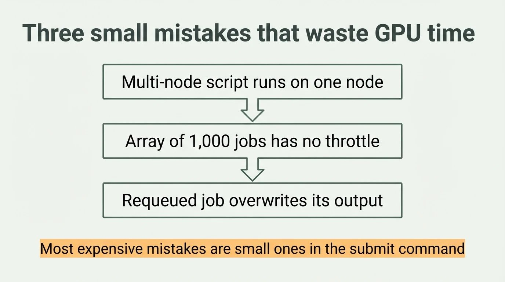
*Figure 6.11.V. Small mistakes in the submit command can waste a whole run, so check the launcher, throttle, and output paths.*


The user-facing side of a GPU cluster is a handful of commands, so most of the expensive mistakes are small. A multi-node script runs everything on one node, because one line is missing its launcher. An array of 1,000 jobs has no throttle, so it floods the shared file system with reads at the same moment. A requeued job overwrites its own log, and that erases the only evidence of the crash. A training run is killed at its time limit without a checkpoint, so the GPUs spent the night and left nothing behind. And `mpirun` is launched inside a batch script without binding, so the processes may land on cores in a way the scheduler did not plan for.

Operators write the documentation, the templates, the `job_submit` plugins and the wrapper scripts that prevent these mistakes. They also answer the tickets when the mistakes happen anyway. A `job_submit` plugin is a small hook in the scheduler that can check or change a job at the moment it is submitted. This chapter gives you the working vocabulary for both sides, so you can write the script yourself and read the support ticket from the other end.

## Prerequisites and outcomes

You need 6.2 and 6.7 to 6.10 first. This chapter follows a job from the moment you type a command to the moment the job ends. It starts with the difference between an allocation, a batch script and a job step, and it shows which command creates each one. Then it moves to batch scripts for single-GPU, multi-GPU, multi-node and array work, covering directives, environment handling, signals and requeue. After that come `srun` inside an allocation, including `--overlap` and `--exact`, interactive work with `salloc`, dependencies and pipelines, and the Slurm environment variables that set rank and world size. Near the end you will monitor and cancel jobs with `squeue`, `scontrol`, `sacct` and `scancel`, then read a linter for batch scripts and a set of submission patterns for AI work.

## 1. Allocations, batch jobs and steps

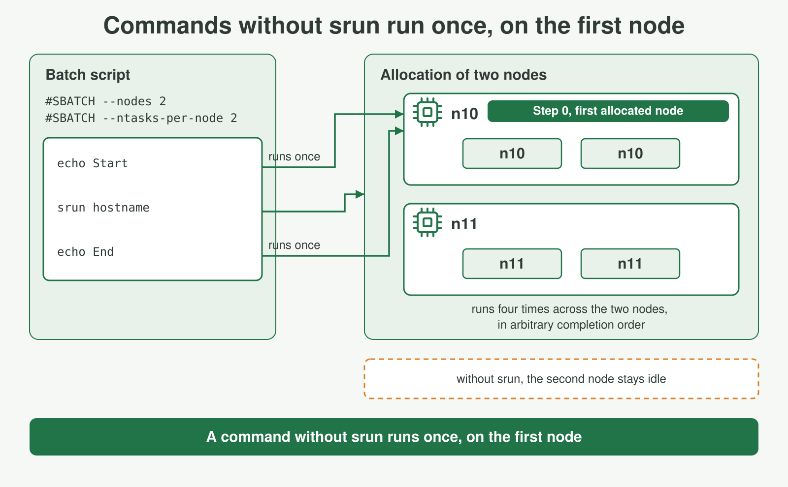

*Figure 6.11.1. In a multi-node batch script, only the lines that start with srun reach the second node.*

Picture a script that works perfectly on your workstation. You copy it to the cluster, ask for two nodes, and find that only one of them did any work. The GPU graphs on the second node are flat. Nothing crashed, and the scheduler reports success. The reason is almost always where each command runs, so that is where this section starts.

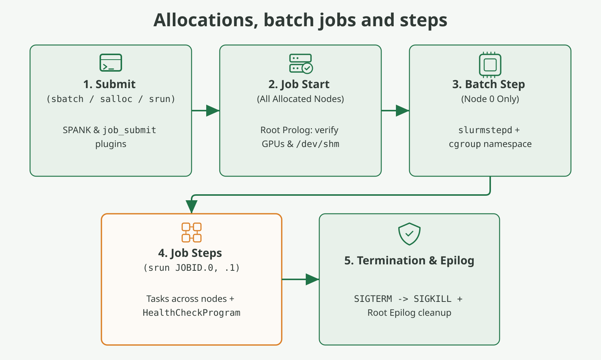

*Figure 6.11.2. Allocations, batch jobs and steps, as a diagram.*

Slurm separates three ideas, and you need all three to predict what a script will do. A useful way to hold them is a restaurant booking. The reservation is the table and the chairs you hold for the evening. The note you leave with the host says what should happen at that table. Each dish the kitchen sends out to the table is a separate event. In Slurm, the reservation is the allocation, the note is the batch script, and each dish is a job step.

An allocation is a set of resources: nodes, CPUs, GPUs and memory. Slurm holds them for a time limit under one job ID. Nothing runs on them yet. They are simply yours until the limit ends or you release them.

A batch job is a request you queue with `sbatch script`. When resources are free, Slurm runs your script on the first allocated node, as the batch step. Commands in the script run only on that node, unless you launch them across the allocation. This is why a plain `python train.py` line in a two-node script still uses only one node.

A job step is started by `srun ...`. It launches tasks across all or part of the allocation. A batch script usually contains one or more `srun` steps. Each step gets an ID such as `JOBID.0` or `JOBID.1`, and accounting records every step. When you later look at a job in `sacct`, the steps are the lines that show how the time and memory were spent.

The commands below create allocations, launch steps and manage jobs. Notice that `srun` behaves differently depending on whether an allocation already exists. Outside an allocation, it asks for one and waits. Inside an allocation, it simply starts a step.

| Command | Does |
|---|---|
| `sbatch script.sh` | Submit a batch script; returns the job ID immediately |
| `salloc ...` | Obtain an allocation and start a shell (or command) with the allocation environment; you then run `srun` steps interactively |
| `srun ...` | Inside an allocation: launch a step. Outside one: create an allocation **and** run the command (blocking) |
| `scancel`, `squeue`, `sinfo`, `scontrol`, `sacct`, `sstat`, `sprio`, `sshare`, `sreport` | Control and query |

In a multi-node batch script, a command without `srun` runs once, on the first node. The linter in section 9 warns about multi-node scripts that contain neither `srun` nor `mpirun`, and that warning exists for exactly this reason. Here is a small test that makes the point. Suppose the script requests `#SBATCH --nodes 2` and `#SBATCH --ntasks-per-node 2`, and then runs `echo Start; srun hostname; echo End`. The two `echo` lines run once, on the first allocated node, which is Step 0. The `srun hostname` line runs four times across the two nodes (`n10`, `n11`, `n11`, `n10`, in arbitrary completion order). The `srun` prefix is what spreads the work across the nodes. Remove it, and the same script runs its commands once, on the first node, while the second node stays idle.

You can even launch multiple `srun` steps in parallel inside a single allocation. Sometimes you want two different jobs side by side, such as a small data preparation step and a larger trainer, sharing the same reservation. For example, inside a 4-CPU allocation, you can run `srun -n 1 ... &` alongside `srun -n 3 ... &`. The `&` sends each step to the background, so the script continues without waiting. Section 3 explains what happens when two steps want the same CPUs.

### The 6-stage Slurm job life cycle (*Supercomputers for Linux Sysadmins* Chapter 15)

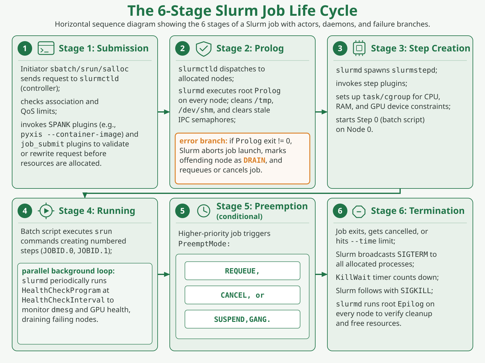

*Figure 6.0.0. The 6-stage Slurm job life cycle moves from controller validation through root node preparation, cgroup containment, step execution, and cleanup.*

Slurm carries out a sequence of steps behind the scenes for every job. You never type these steps, but they explain a lot of what you see. They explain why a job is rejected at submit time, why a broken node drains right after launch, and how stray processes get reaped at the end. The sequence below comes from *Supercomputers for Linux SysAdmins*, Chapter 15, *Job Life Cycle*.

Stage 1 is submission, through `sbatch`, `srun` or `salloc`. The controller, `slurmctld`, checks whether your association and QoS allow the job to queue. A QoS is a quality-of-service policy that sets limits and priorities for a class of jobs or users. The controller then invokes registered SPANK plugins. SPANK plugins are small add-ons that can add custom flags to `sbatch` and `srun`, such as NVIDIA `pyxis` adding `--container-image`. It also invokes `job_submit` plugins, which validate or rewrite job requests. If a request is going to be wrong, this is the stage where it should be caught, because nothing has been spent yet.

Stage 2 runs the `Prolog` script or scripts. A Prolog is a script that the administrator runs before user code starts. Before your code runs, Slurm executes them as `root` on every allocated compute node. They verify hardware readiness and clean `/tmp`, `/dev/shm` and leftover IPC semaphores. Shared memory and semaphores are how processes on one node coordinate, so stale ones from an earlier job can confuse a new one. Remember that `Prolog` execution time is bounded. If a `Prolog` script returns a non-zero exit code, Slurm aborts the job launch, drains the offending node, and requeues or cancels the job. Draining means the node stops taking new work until someone checks it.

Stage 3 creates the job step. `slurmd` spawns `slurmstepd`, which invokes step plugin hooks. The step daemon creates the Linux cgroup namespace (`task/cgroup`), applies CPU, RAM and GPU device constraints, and starts Step `0`. Step 0 is the batch script itself, running on the first node. This is where the limits you asked for become real, so a process that exceeds its memory request is stopped here by the kernel, not by Slurm polling it.

Stage 4 is the running phase. Each `srun` you issue launches a numbered step, such as `JOBID.0` or `JOBID.1`. At every `HealthCheckInterval`, `slurmd` runs the configured `HealthCheckProgram`. That program must be fast and completely non-intrusive, because it runs often and must not slow down your job. It checks for kernel `dmesg` or GPU hardware errors, and it drains unhealthy nodes. A node that starts throwing GPU errors in the middle of a run is caught here, before the next job lands on it.

Stage 5 is preemption, and it happens only when triggered. Higher-priority jobs preempt running jobs according to `PreemptType` and `PreemptMode`. The modes are `REQUEUE`, `CANCEL` and `SUSPEND,GANG`. Requeue puts your job back in the queue, cancel ends it, and suspend with gang scheduling pauses it so that another job can use the same resources for a while. Chapter 6.9 covers them.

Stage 6 is the end of the job. The batch script may exit, be cancelled, or hit its `--time` limit. In every case, Slurm sends `SIGTERM` to all job processes across the allocated nodes. `SIGTERM` is a polite request to stop, and a well-written program can use it to save its state. After `KillWait`, Slurm follows with `SIGKILL`, which cannot be caught and ends the process at once. Then it runs the `Epilog` script as `root` on every allocated node, to verify cleanup. The Epilog is the mirror image of the Prolog. It is where stray processes are removed and the node is made ready for the next job.

### Simulating a multi-node GPU cluster on a single physical machine (*Distributed AI Systems* Chapter 8)

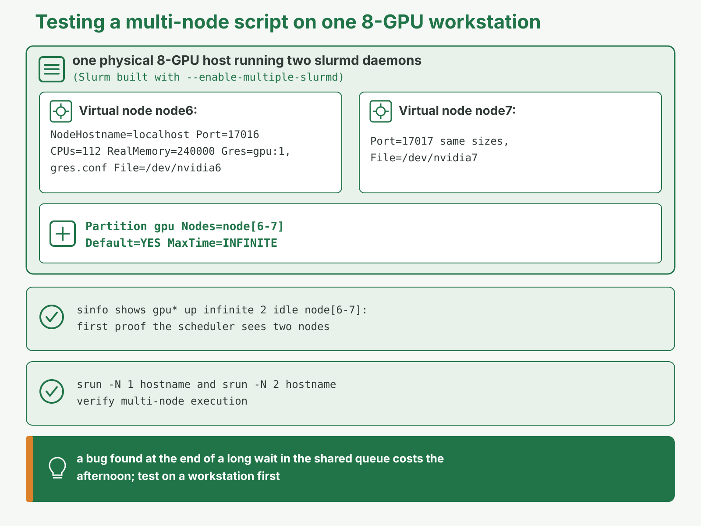

*Figure 6.11.3. Two slurmd daemons on different ports let you test multi-node scripts without queue waits.*

You have written a multi-node training script, and the shared production queue is busy. Each test submission can wait for hours before it even starts, and a bug found at the end of that wait costs the whole afternoon. A faster way is to test the script on one multi-GPU workstation first. You can run several `slurmd` daemons, each on its own TCP port, so that they act as separate nodes. The scheduler sees two machines, and your script sees two nodes, even though only one physical box is involved.

This technique is covered in *Distributed AI Systems*, Chapter 8, under *Simulating a Multi-Node cluster*. It requires Slurm built with `--enable-multiple-slurmd`. The configuration below creates two virtual nodes on one 8-GPU host. Each virtual node gets its own port, and each one is mapped to its own physical GPU device, so that the two nodes do not fight over the same card.

```ini
# slurm.conf — two virtual nodes (node6, node7) on one 8-GPU host
NodeName=node6 NodeHostname=localhost Port=17016 CPUs=112 RealMemory=240000 Gres=gpu:1 State=UNKNOWN
NodeName=node7 NodeHostname=localhost Port=17017 CPUs=112 RealMemory=240000 Gres=gpu:1 State=UNKNOWN
PartitionName=gpu Nodes=node[6-7] Default=YES MaxTime=INFINITE State=UP

# gres.conf — map each virtual node to a dedicated physical GPU (/dev/nvidia6 and /dev/nvidia7)
NodeName=node6 Name=gpu File=/dev/nvidia6
NodeName=node7 Name=gpu File=/dev/nvidia7
```

Once the daemons start, `sinfo` reports `gpu* up infinite 2 idle node[6-7]`. That line is your first proof that the scheduler sees two nodes. You can then verify multi-node execution with `srun -N 1 hostname` and `srun -N 2 hostname`, or with a quick smoke test such as `srun -N 2 --gres=gpu:1 --cpus-per-task=4 python code/train.py`. The first command should print one hostname, and the second should print two. Run these checks before you move the script to production, because a mistake that is cheap to find here is expensive to find in the shared queue.

## 2. A batch script

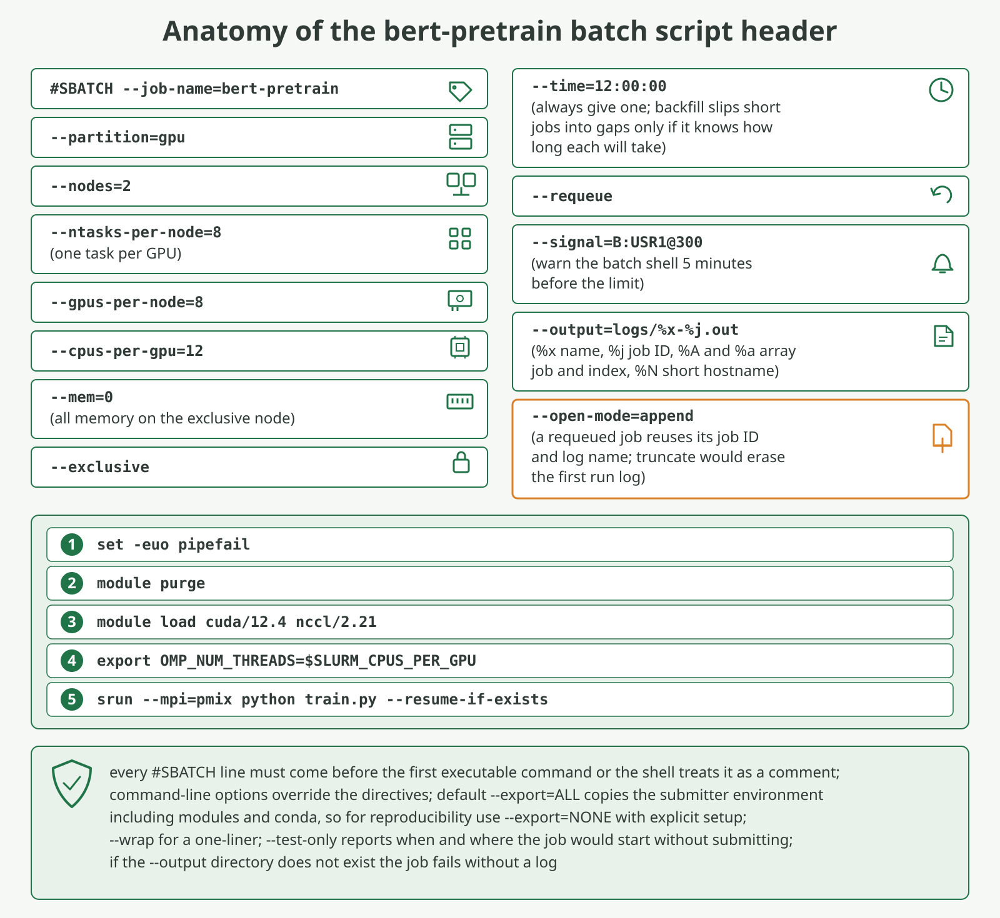

*Figure 6.11.4. A batch script puts every setting in one reviewable file, and options on the command line override it.*

It is Monday morning, and you want to start a BERT pretraining run across two nodes that have eight GPUs each. You could type every setting at the prompt, but then nobody can repeat the run next week. A batch script puts all the settings in one file that you can read, review and submit again. The script below requests a two-node job named `bert-pretrain`. Read it from top to bottom, because each `#SBATCH` line sets a resource or a behaviour before the job starts.

```bash
#!/bin/bash
#SBATCH --job-name=bert-pretrain
#SBATCH --partition=gpu
#SBATCH --nodes=2
#SBATCH --ntasks-per-node=8          # one task per GPU
#SBATCH --gpus-per-node=8
#SBATCH --cpus-per-gpu=12
#SBATCH --mem=0                      # all memory on the (exclusive) node
#SBATCH --exclusive
#SBATCH --time=12:00:00
#SBATCH --requeue
#SBATCH --signal=B:USR1@300          # warn the batch shell 5 minutes before the limit
#SBATCH --output=logs/%x-%j.out
#SBATCH --open-mode=append

set -euo pipefail
module purge
module load cuda/12.4 nccl/2.21
export OMP_NUM_THREADS=$SLURM_CPUS_PER_GPU   # see section 7; set per your site
srun --mpi=pmix python train.py --resume-if-exists
```

The details below come from the `sbatch(1)` man page. Every `#SBATCH` line must come before the first executable command, because the shell treats those lines as comments once real commands start. Command-line options override them, so you can change a value for one run without editing the file. The script must also start with `#!`, which tells the system which interpreter to use. A script that skips the `#!` line is the first error the linter in section 9 catches.

Set the time with `--time=D-HH:MM:SS` or `HH:MM:SS`. Always provide one, because backfill works best with an accurate limit. Backfill is the scheduler's habit of slipping short jobs into the gaps in front of bigger ones, and it can only do that if it knows how long each job will take. Chapter 6.9 covers backfill. A flexible job can use `--time-min` to start with less time, which gives the scheduler more room to fit it in.

By default, stdout and stderr go to `slurm-%j.out` in the submission directory. For arrays, the default is `slurm-%A_%a.out`. The filename patterns include `%j` for the job ID, `%A` and `%a` for the array job and index, `%x` for the job name, `%N` for the short hostname (one file per node), `%u` for the user, `%t` for the `srun` task ID, and `%%` for a literal percent sign. **The directory in `--output` must exist before the job starts.** If it does not, the job fails silently with no log. Create it in a wrapper script, or submit from a directory that already has it. It is an easy mistake to make, and it hides the cause of the failure.

The `--open-mode` option accepts `append` or `truncate`, and its default comes from the cluster's `JobFileAppend` setting. A requeued job reuses its job ID, so its log filename is the same as before. With truncate mode, the second run erases the first run's log, including the traceback that explains the crash. Use `append`, or include something unique in the filename, so the history of every attempt is kept.

The default for `--export` is `ALL`, which copies the submitter's environment into the job. That includes loaded modules and conda environments, so the job depends on whatever the shell happened to have when you submitted. For reproducibility, use `--export=NONE` with an explicit `module purge` and `module load`, or with `source`, inside the script. With `NONE`, you must also use absolute paths or set `PATH` yourself. On some sites, `--export=NONE` with `sbatch` also needs `--get-user-env` or login-shell tricks, so check your local documentation before you rely on it.

`--container` is available in recent releases (OCI). OCI means the Open Container Initiative, the standard that container images follow. Sites that use pyxis add `--container-image` and similar options. Chapter 6.13 covers that path. Use `--constraint="h100&ib"` to select nodes by feature, as explained in Chapter 6.8. A feature is a label that the administrator puts on nodes, such as a GPU model or a fast network, so your job can ask for exactly the hardware it needs.

Use `--wrap="command"` to submit a one-line command without a script file. This is handy for a quick test, but a script file is better for anything you will repeat. Use `--test-only` to check a request, which reports when and where the job would start without submitting it. Use `--parsable` in scripts, because it prints only the job ID, which makes the next submission in a chain easy to write. Set `--mail-type=END,FAIL --mail-user=...` for notifications, but only if the site runs mail. The options `--begin=now+1hour`, `--deadline=...`, `--hold`, `--nice`, `--reservation`, `--qos` and `--account` control scheduling, and Chapter 6.9 covers them.

### Summary of primary `sbatch` / `srun` keys (*Supercomputers for Linux Sysadmins* Chapter 15 `Table 15-1`)

The table below lists the primary `sbatch` and `srun` keys and what each one means. Keep it open the first few weeks you write scripts, because most of the options you need are in it.

| Key | Meaning |
|---|---|
| `-p partition` / `--partition` | Target partition name |
| `-n NUMBER` / `--ntasks` | Total number of tasks (processes) |
| `-N NUMBER` / `--nodes` | Number of compute nodes |
| `--ntasks-per-node N` | Number of tasks launched on each node (combined with `-n`/`-N`) |
| `-A account` / `--account` | Charge resource usage to the specified account |
| `--gres=NAME:NUMBER[,...]` | Request Generic Resources per node (e.g., `--gres=gpu:8`) |
| `-C` / `--constraint=...` | Require node feature expressions (e.g., `--constraint="h100&ib"`) |
| `-d condition` / `--dependency` | Defer job start until dependency condition holds (e.g., `afterok:123`) |
| `-i` / `-o` / `-e file` | Standard input, output, and error file paths (default `slurm-%j.out`) |
| `-J name` / `--job-name` | Job name (defaults to script filename or command) |
| `--requeue` / `--no-requeue` | Allow or forbid automatic requeuing on node failure or preemption |
| `-t` / `--time=TIME` | Maximum wall-clock limit (`D-HH:MM:SS`); job is terminated on expiration |
| `-w nodelist` / `--nodelist` | Request specific node hostnames |
| `-x nodelist` / `--exclude` | Exclude specific broken or slow nodes |
| `--qos=NAME` | Request a specific Quality of Service (`QoS`) |

Read the table as a quick reference. Options such as `--dependency` and `--requeue` are the ones this chapter returns to in later sections. The `-x` option is worth remembering too. When one node keeps failing your jobs, you can exclude it for a single submission while the administrator looks at it.

### Rank-specific logging vs interleaved stdout (*Distributed AI Systems* Chapter 8)

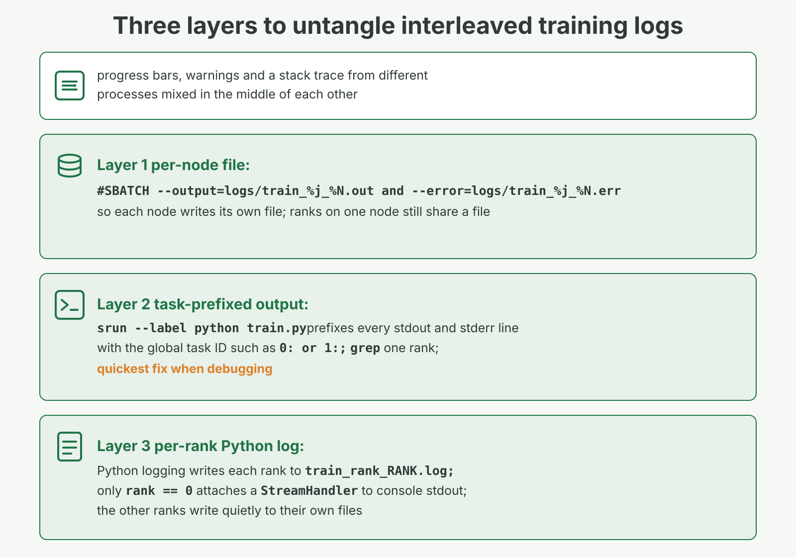

*Figure 6.11.5. Separate logs by node, then by task label, then by rank to read a distributed run.*

Imagine a multi-rank training job that has been running for a while. You open the log to check the loss, and you find progress bars, warnings and a stack trace all mixed together, with lines from different processes in the middle of each other. In multi-node distributed training, every rank writes to the same `slurm-%j.out` file by default, so this is what you get. *Distributed AI Systems*, Chapter 8, under *Logging and output*, covers this. You have three clean layers of control, and each one fixes a different part of the problem.

Layer 1 is a per-node log file. Use `#SBATCH --output=logs/train_%j_%N.out` and `#SBATCH --error=logs/train_%j_%N.err`, so that each node (`%N`) writes to its own file. This keeps the nodes apart, but the ranks on one node still share a file.

Layer 2 is task-prefixed output. Running `srun --label python train.py` prefixes every stdout and stderr line with the global task ID, such as `0: ...` or `1: ...`. Now you can grep for one rank and see only its lines. This is the quickest fix when you are debugging.

Layer 3 is a per-rank Python log. Configure Python's `logging` module so that every rank logs to `train_rank_{rank}.log`. Only `rank == 0` attaches a `logging.StreamHandler()` to console stdout. The other ranks write quietly to their own files, and the console shows the progress of the one rank that matters most for a human reading along.

### Environment variables

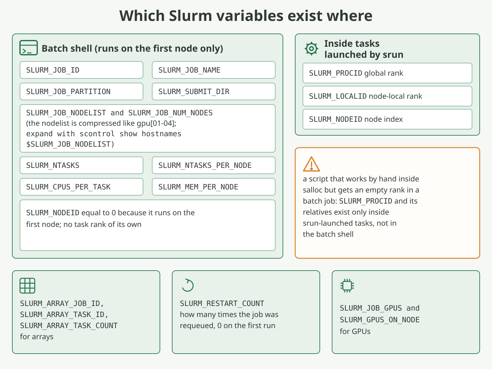

*Figure 6.11.6. Rank variables exist only inside tasks started by srun, never in the batch shell.*

Slurm sets many environment variables, and the man pages list them all. The ones below are the ones you will use constantly. Picture a script that works when you test it by hand inside `salloc`, then fails inside a batch job with an empty rank. The fix is almost always to know which variable exists in which context, so the table is worth a careful read.

| Variable | Meaning |
|---|---|
| `SLURM_JOB_ID`, `SLURM_JOB_NAME`, `SLURM_JOB_PARTITION`, `SLURM_SUBMIT_DIR` | Job identity and where you submitted from |
| `SLURM_JOB_NODELIST` (`SLURM_NODELIST`), `SLURM_JOB_NUM_NODES` (`SLURM_NNODES`) | Nodes of the allocation; the nodelist is compressed (`gpu[01-04]`): expand with `scontrol show hostnames "$SLURM_JOB_NODELIST"` |
| `SLURM_NTASKS`, `SLURM_NTASKS_PER_NODE`, `SLURM_TASKS_PER_NODE`, `SLURM_CPUS_PER_TASK`, `SLURM_CPUS_ON_NODE`, `SLURM_MEM_PER_NODE` | Shape of the allocation |
| `SLURM_PROCID`, `SLURM_LOCALID`, `SLURM_NODEID` | Set **per task by srun**: global rank, node-local rank, node index |
| `SLURM_ARRAY_JOB_ID`, `SLURM_ARRAY_TASK_ID`, `SLURM_ARRAY_TASK_COUNT` | Array identity |
| `SLURM_RESTART_COUNT` | How many times the job was requeued (0 on the first run) |
| `SLURM_JOB_GPUS`, `SLURM_GPUS_ON_NODE`, ... | GPU information (6.10) |

`SLURM_PROCID` and its relatives exist only inside tasks launched by `srun`, not in the batch shell. The batch script itself has `SLURM_NODEID=0`, because it runs on the first node, but it has no task rank of its own. This is the usual cause of an empty variable. If you need the rank in your code, make sure the code runs under `srun`, and that the variable is read inside that `srun` command, not earlier in the script.

### Distributed-training rendezvous from Slurm variables

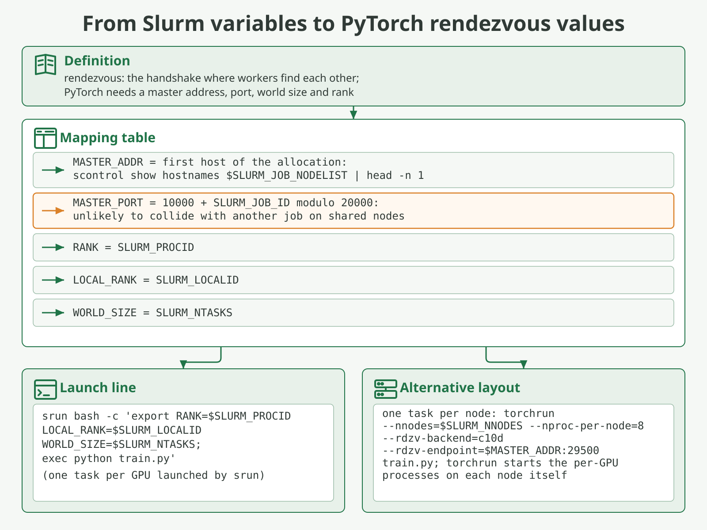

*Figure 6.11.7. Build all four rendezvous values from Slurm variables instead of hard-coding them.*

Think of a group of workers that start on four nodes at the same moment. Each one needs to find the others before any training can begin. PyTorch needs a master address, a port, a world size and a rank before its workers can find each other. This handshake is called rendezvous, which simply means a meeting point that everyone agrees on in advance. If the address is wrong, the workers wait forever, with no error message, because each one is still looking for the master.

With one task per GPU launched by `srun`, you can build all four values from Slurm variables. The first line picks the first host in the allocation as the master. The second line picks a port that is unlikely to collide with another job on the same nodes. The `srun` line then sets the rank and world size for each task, from Slurm's own counters.

```bash
MASTER_ADDR=$(scontrol show hostnames "$SLURM_JOB_NODELIST" | head -n 1)
MASTER_PORT=$((10000 + SLURM_JOB_ID % 20000))   # avoid collisions between jobs on shared nodes
export MASTER_ADDR MASTER_PORT
srun bash -c 'export RANK=$SLURM_PROCID LOCAL_RANK=$SLURM_LOCALID WORLD_SIZE=$SLURM_NTASKS; exec python train.py'
```

A different option is one task per node, which launches `torchrun --nnodes=$SLURM_NNODES --nproc-per-node=8 --rdzv-backend=c10d --rdzv-endpoint=$MASTER_ADDR:29500 train.py`. In that layout, torchrun starts the per-GPU processes on each node itself. Chapter 6.12 compares the two approaches. The `MASTER_PORT` formula is a convenience, not a guarantee. Two jobs can still pick the same port by chance, and some sites provide port management through `--resv-ports` or through MPI and PMIx plugins. Choose your launcher first, then check what port management your site provides.

## 3. srun

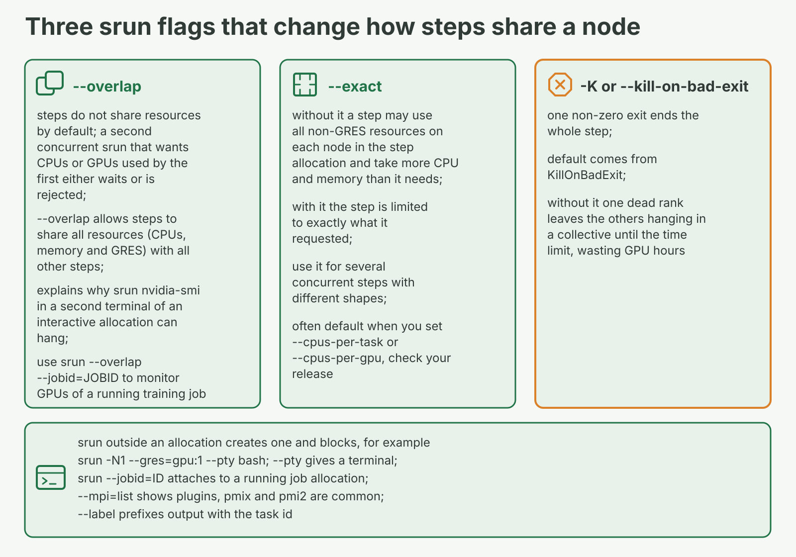

*Figure 6.11.8. Steps do not share resources by default, so diagnostic steps need --overlap.*

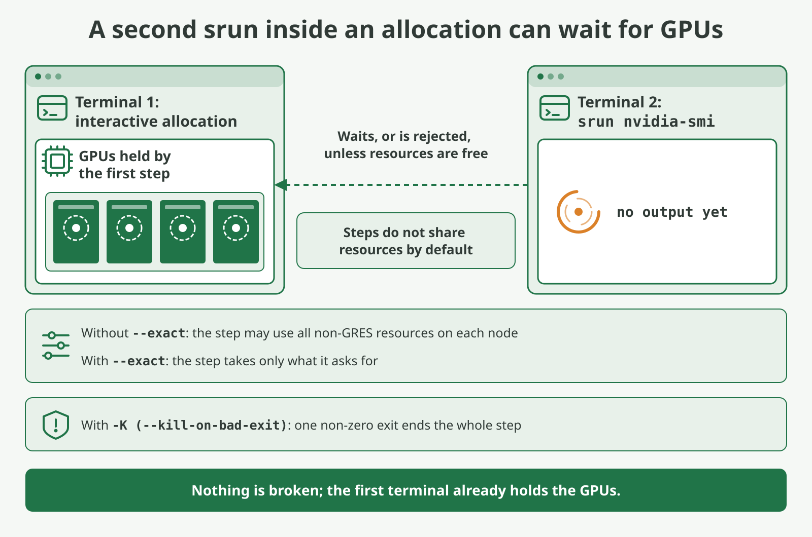

*Figure 6.11.9. A second srun inside the same allocation waits for GPUs held by the first step, and --exact stops a step taking more than it asks for.*

Picture a colleague who opens a second terminal on their interactive allocation, types `srun nvidia-smi` to check the GPUs, and sees the prompt sit there with no output. Nothing is broken. The first terminal already holds the GPUs, and a second step has to wait for them. Understanding why that happens is the key to using `srun` well.

`srun` launches a step, which is one parallel run inside an allocation. It connects to the allocation, or creates one if none exists. It starts the requested number of tasks on the nodes, forwards stdin, stdout and stderr, and returns the exit status. The key options come from the `srun(1)` man page. They include `-n/--ntasks`, `-N/--nodes`, `--ntasks-per-node`, `-c/--cpus-per-task`, `--cpu-bind`, `--mem-bind`, `--gpu-bind` and `--gpus-per-task`. Others include `--mpi=<type>`, where `list` shows plugins and `pmix` and `pmi2` are common, plus `--export`, `-K/--kill-on-bad-exit`, `--label` (which prefixes output with the task id), `--output/--error` per-step patterns, `--time`, `--wait` and `--pty`.

Steps inside an allocation behave in a few specific ways, and these are the ones that surprise people. Steps do not share resources by default. A second concurrent `srun` that wants CPUs or GPUs already used by the first step either waits or is rejected, unless you pass `--overlap`. The man page says `--overlap` "allows steps to share all resources (CPUs, memory, and GRES) with all other steps." This explains why `srun nvidia-smi` in a second terminal of an interactive allocation can hang. It also explains why you monitor a running training job's GPUs with `srun --overlap --jobid=JOBID ...`. The overlap flag is a deliberate choice, because it lets a diagnostic step borrow resources that the training step is already using. Chapter 6.14 returns to this.

Without `--exact`, a step may use "all non-GRES resources on each node in the step allocation." GRES means Generic Resources, the counted devices such as GPUs that Slurm tracks. So a step without `--exact` can take more CPU and memory than it needs. With `--exact`, it is limited to exactly what it requested. If you run several concurrent steps with different shapes, use `--exact`. In current versions it is often the default when you set `--cpus-per-task` or `--cpus-per-gpu`, so check your release before you assume either way.

With `-K`, or `--kill-on-bad-exit`, a single non-zero exit ends the whole step. The default comes from the cluster's `KillOnBadExit` setting. For tightly coupled jobs, you want this. Without it, one dead rank leaves the others hanging in a collective until the time limit. A collective is an operation where every rank must take part, such as an all-reduce that sums gradients across GPUs. If one rank has died, the rest wait for it forever, and that is a classic way to waste GPU hours.

Run `srun` without an allocation and it creates one for the command. For example, `srun -N1 --gres=gpu:1 --pty bash` gives you an interactive session in a single command. The `--pty` flag asks for a terminal, so the shell behaves as if you had logged in directly. Use `srun --jobid=<id>` to attach to a running job's allocation. This works for your own job, and it is the usual way to look inside a job that is already running.

### MPI and launching

Imagine a launch script that calls `mpirun` on a two-node job, and the ranks land on the wrong cores. Nobody notices until the throughput is half of what the benchmark promised. `srun --mpi=pmix` hands rank wire-up to Slurm's PMIx plugin. Wire-up is the step where each process learns where its peers are. Chapters 6.4 and 6.12 cover that path. Running `mpirun` inside a script also works with Open MPI's Slurm integration. The catch is that `mpirun` does its own launching and binding. Binding is the decision about which cores each process uses. Prefer `srun`, because then Slurm sets the binding through `--cpu-bind` and `--gpu-bind`, tracks processes in the job cgroup, and accounts usage per step.

## 4. Interactive jobs

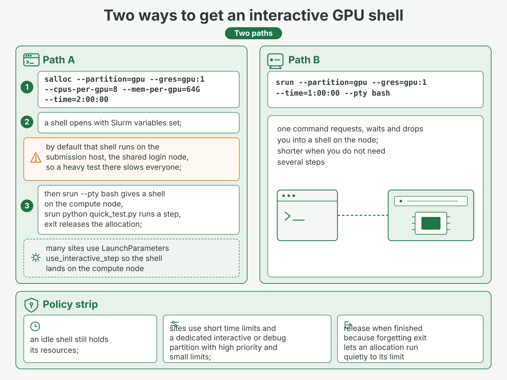

*Figure 6.11.10. Release interactive allocations with exit because an idle shell still holds its GPU.*

Suppose you have written a new data loader and want to check it on a real GPU before you commit a long batch run. You need a shell on a compute node, with the GPU attached, for an hour or two. `salloc` and interactive steps give you that shell.

```bash
salloc --partition=gpu --gres=gpu:1 --cpus-per-gpu=8 --mem-per-gpu=64G --time=2:00:00
# a shell opens; Slurm variables are set; then:
srun --pty bash                # a shell on the compute node
srun python quick_test.py      # or run a step
exit                           # releases the allocation
```

If you want it in one step, use `srun --partition=gpu --gres=gpu:1 --time=1:00:00 --pty bash`. That single command requests the resources, waits for them and drops you into a shell on the node. It is the shorter path when you do not need to run several steps in the same session.

By default, `salloc` runs its own shell on the submission host, which is the login node. That is a shared machine, and a heavy test there can slow down everyone else. Many sites prefer a shell on the compute node instead. The current way to get one is `LaunchParameters=use_interactive_step` in `slurm.conf`. With it, `salloc` starts `srun` with `InteractiveStepOptions`, so you land on a node of the allocation. The default for `InteractiveStepOptions` is `--interactive --preserve-env --pty $SHELL`, according to the man page. The interactive step consumes no resources, so other steps can run in parallel with it. The old `SallocDefaultCommand` parameter no longer appears in the `slurm.conf` man page, so older guides that mention it may be out of date.

Interactive policy matters, because an idle shell still holds its resources. Think about a GPU reserved all afternoon for a session that only ran a few commands. Sites typically use short time limits, and a dedicated `interactive` or `debug` partition with high priority and small size. Notebooks can use MIG or shared GPUs, covered in 6.10. MIG means Multi-Instance GPU, a way to split one physical GPU into smaller pieces. Idle jobs can be reaped, which means the scheduler or an admin ends them after a period of inactivity. Open OnDemand, covered in 6.25, serves Jupyter and VS Code. An idle `salloc` holding 8 GPUs for a day is an expensive nap. Consider a `job_submit` plugin or an epilog that kills idle interactive allocations.

Give every interactive allocation a short time limit, and release it when you finish. The `exit` line in the example above is the release. Forgetting it is how an allocation quietly runs until its limit.

## 5. Job arrays

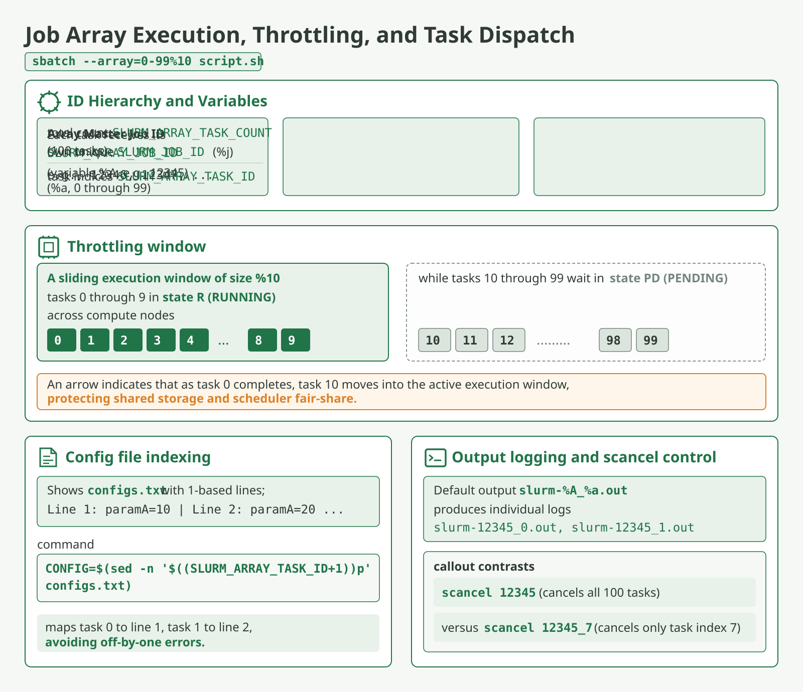

*Figure 6.0.0. A job array manages many identical requests under one master job ID, using a throttle window to protect storage and sed indexing to dispatch configurations.*

You have 100 learning-rate and batch-size settings to try before the morning standup. Submitting 100 near-identical scripts by hand is slow, and it is easy to lose track of which one wrote which result. A hyperparameter sweep is the usual reason to reach for a job array. Instead of submitting many near-identical jobs by hand, you submit one array, and each task picks its own configuration from its index.

The command `sbatch --array=0-99%10 script.sh` creates 100 tasks, with indices 0 to 99. At most 10 of them run at once, because of the `%10` throttle. Without the throttle, all 100 would compete for the GPUs and the file system at once. You can also write the indices as `0-15`, `0,6,16-32` or `0-15:4`, where the last form uses a step of 4, so it picks indices 0, 4, 8 and 12. Each index must stay below `MaxArraySize`. The total count is limited by `max_array_tasks` in `SchedulerParameters`. Heterogeneous jobs cannot be arrays, so every task in an array must have the same kind of request.

Each task is an independent job with its own `SLURM_JOB_ID` and its own `SLURM_ARRAY_TASK_ID`. All tasks share a `SLURM_ARRAY_JOB_ID`, which is the first task's ID. Slurm calls that first task the array's master. By default, output goes to `slurm-%A_%a.out`, so each task writes its own file. You can manage the array as a whole, with `scancel 12345` to cancel every task, or one task at a time, with `scancel 12345_7`. The `squeue` command condenses pending arrays into one line, and `-r` expands them again so you can see each task.

Arrays suit hyperparameter sweeps, per-shard preprocessing and evaluation over checkpoints. A per-shard job runs the same preprocessing on each piece of a large dataset, so the pieces are handled in parallel.

```bash
#SBATCH --array=0-31%8
CONFIG=$(sed -n "$((SLURM_ARRAY_TASK_ID+1))p" configs.txt)
srun python train.py $CONFIG
```

Each task reads its own line of `configs.txt`, selected by its index plus one. The `sed` line uses the index to pick a row, and the `+1` exists because `sed` line numbers start at 1 while array indices start at 0. That small detail is an easy source of an off-by-one error, so check it with one small test run before you submit the full array.

Always throttle with `%N`, because the throttle protects shared storage and fair-share scheduling. Fair-share is the scheduler's way of giving less priority to users who have already used more than their share. Keep tasks reasonably long. Arrays of 5-second tasks overload the controller, which has to record every start and finish, so batch them instead. Write the results for each task into a separate directory, so two tasks never write to the same file. For very large sweeps, use a workflow tool, or run `srun --multi-prog` or GNU parallel inside one allocation.

### 2D hyperparameter grid search with job arrays (*Distributed AI Systems* Chapter 8)

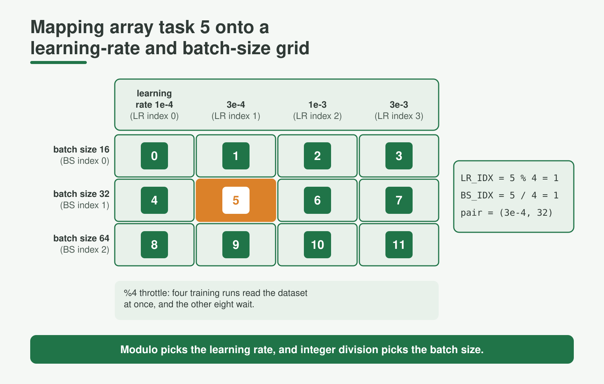

*Figure 6.11.11. Each array task index maps to one learning rate and one batch size, so task 5 runs 3e-4 with batch size 32.*

Imagine you want all 12 combinations of 4 learning rates and 3 batch sizes. You could write 12 config files, but then the files and the array can drift apart. Instead of keeping an external config file, you can map `SLURM_ARRAY_TASK_ID` straight onto a 2D grid. In bash, integer modulo (`%`) selects the learning rate, and integer division (`/`) selects the batch size. Modulo gives the remainder after dividing by the number of learning rates, and integer division gives the whole part. Together they turn one number into a pair of indices. The method comes from *Distributed AI Systems*, Chapter 8, under *Job arrays for hyperparameter tuning* and *Implement job array for hyperparameter search*.

```bash
#!/bin/bash
#SBATCH --job-name=hp-search
#SBATCH --array=0-11%4
#SBATCH --nodes=1
#SBATCH --gres=gpu:1
#SBATCH --time=01:00:00
#SBATCH --output=logs/hp_%A_%a.out

LEARNING_RATES=(1e-4 3e-4 1e-3 3e-3)
BATCH_SIZES=(16 32 64)
NUM_LR=${#LEARNING_RATES[@]}
LR_IDX=$((SLURM_ARRAY_TASK_ID % NUM_LR))
BS_IDX=$((SLURM_ARRAY_TASK_ID / NUM_LR))
LR=${LEARNING_RATES[$LR_IDX]}
BS=${BATCH_SIZES[$BS_IDX]}

python train.py --lr "$LR" --batch-size "$BS" --output-dir "results/hp_${SLURM_ARRAY_TASK_ID}"
```

Walk through one task to see the arithmetic work. Task 5 has `LR_IDX` equal to 5 modulo 4, which is 1, so it takes the second learning rate, `3e-4`. Its `BS_IDX` is 5 divided by 4, rounded down, which is 1, so it takes the second batch size, 32. That is the pair `(3e-4, 32)`, and the same pair appears in exercise 4 at the end of this chapter.

Once all 12 tasks finish, a lightweight Python collector gathers the results. The collector is `collect_hp_results("results")` from *Distributed AI Systems*, Chapter 8. It globs `results/hp_*/metrics.json`, and it sorts the dictionary list by `val_loss` with `results.sort(key=lambda x: x["val_loss"])`. Then it prints the top 5 `(lr, batch_size, val_loss)` configurations. Because each task wrote into its own `results/hp_` directory, the collector never has to untangle files that tasks wrote together.

Pick the throttle before you submit, because it caps how many tasks hit shared storage at once. In this grid, `%4` means four training runs read the dataset at the same time, and the other eight wait their turn.

## 6. Dependencies and pipelines

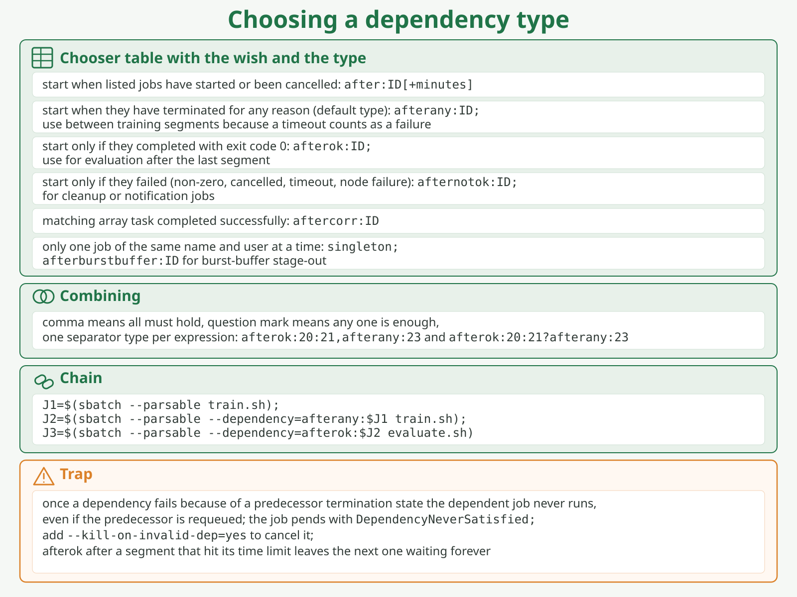

*Figure 6.11.12. Use afterany between training segments because a timeout counts as a failure.*

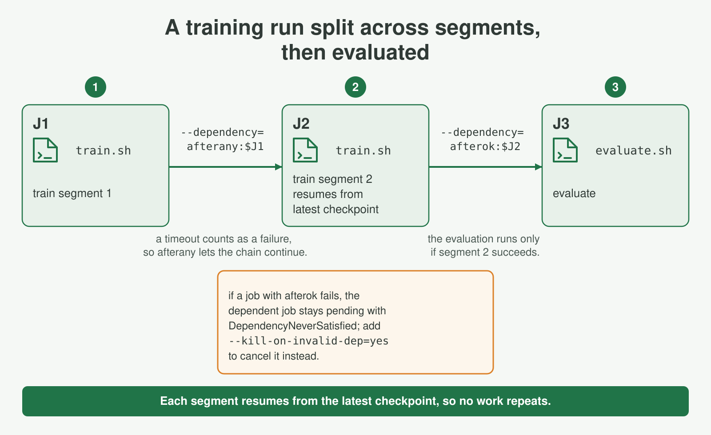

*Figure 6.11.13. Dependencies chain training segments and an evaluation job so the run continues past one time limit.*

A training run can need more wall-clock time than one batch job is allowed. You could submit the next segment by hand after each one finishes, but that means you must be awake at the right moment. Dependencies let the next segment start when the previous one ends, so the run continues without you resubmitting it by hand. The same idea lets an evaluation wait for training, and a cleanup job run only when something went wrong.

`--dependency=<type>:<jobid>[:<jobid>...]` defers a job until conditions on other jobs are met, according to the man page. The types are listed in the table below. The table is a lookup, so read the row that matches what you want to happen after the previous job.

| Type | Starts when |
|---|---|
| `after:ID[+minutes]` | Listed jobs have started or been cancelled (plus optional delay) |
| `afterany:ID` | They have terminated for any reason (**default type**) |
| `afterok:ID` | They completed successfully (exit code 0) |
| `afternotok:ID` | They failed (non-zero, cancelled, timeout, node failure): for cleanup or notification jobs |
| `aftercorr:ID` | The matching task of an array completed successfully |
| `afterburstbuffer:ID`, `singleton` | After burst-buffer stage-out; only one job of the same name/user at a time |

You can combine conditions with a comma, which means all must hold, or with a question mark, which means any one is enough. Use only one separator type in each expression. For example, `afterok:20:21,afterany:23` uses commas, and `afterok:20:21?afterany:23` uses question marks. Read the first one as "job 20 and job 21 must succeed, and job 23 must finish." Read the second as "either job 20 and job 21 succeed, or job 23 finishes."

Failure behaviour matters most here. The man page says that "once a job dependency fails due to the termination state of a preceding job, the dependent job will never be run, even if the preceding job is requeued and has a different termination state in a subsequent execution". By default, such a job stays pending forever, with the reason `DependencyNeverSatisfied`. Setting `--kill-on-invalid-dep=yes`, or the cluster's `kill_invalid_depend`, cancels it instead. Pipelines can leave zombie pending jobs behind, so always clean up after them. A zombie pending job sits in the queue, looks alive, and will never run.

The following chain lets you continue training past one time limit. Each segment waits for the one before it, and the evaluation waits for the last segment to succeed. Notice that the first line saves each job ID, so the next line can refer to it.

```bash
J1=$(sbatch --parsable train.sh)
J2=$(sbatch --parsable --dependency=afterany:$J1 train.sh)      # resume run 2
J3=$(sbatch --parsable --dependency=afterok:$J2 evaluate.sh)
```

Use `afterany` between training segments, because a timeout counts as a failure. If you used `afterok` there, a segment that stopped cleanly at its time limit would leave the next one waiting forever. Each segment should resume from the latest checkpoint, so that the second segment picks up where the first one stopped and does not repeat the work. For a self-resubmitting job, trap the warning signal, checkpoint, and run `scontrol requeue $SLURM_JOB_ID`.

## 7. Time limits, signals, checkpoints, requeue

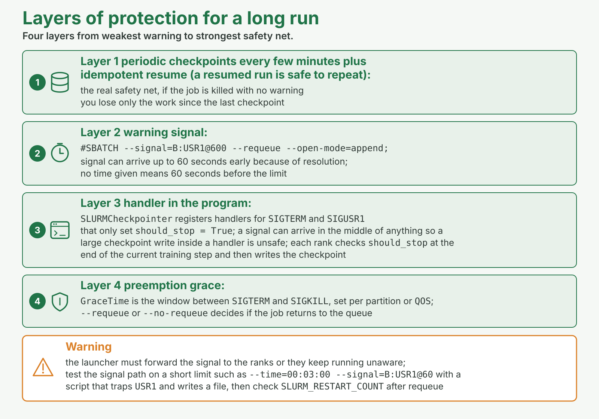

*Figure 6.11.14. Periodic checkpoints are the real safety net and signals only reduce lost work.*

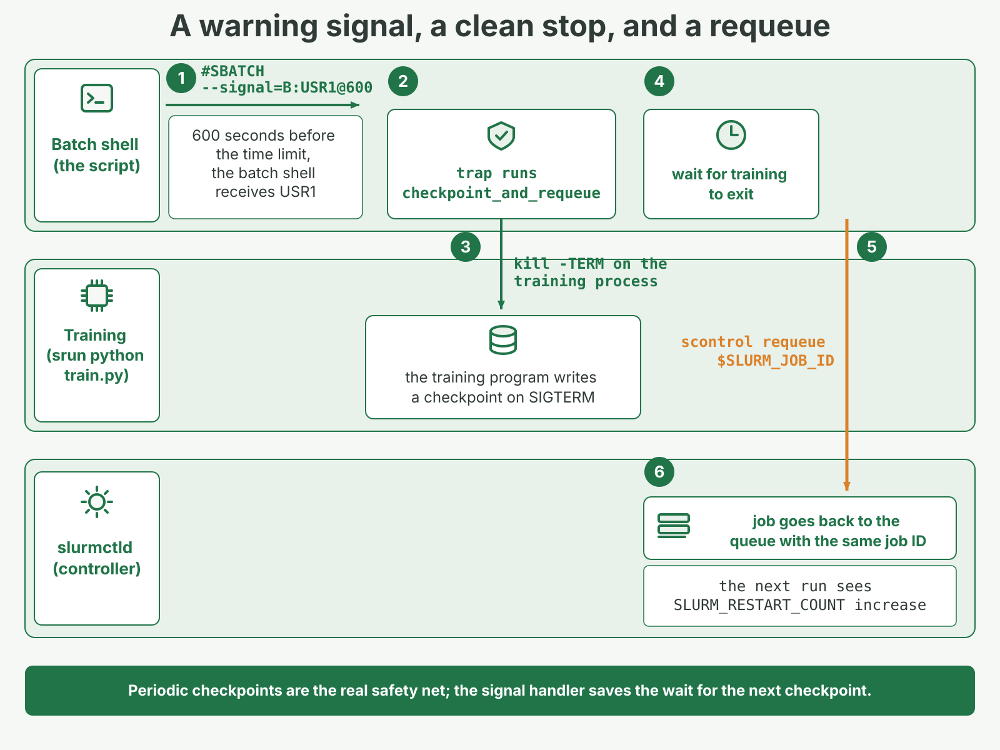

*Figure 6.11.15. A warning signal lets the batch script stop training cleanly and requeue the job under the same ID.*

At three in the morning, a node fails in the middle of a long run. Or the job reaches its time limit, one minute before the last checkpoint. Either way, the training must survive the interruption and continue from where it stopped. Training must survive the time limit, preemption and node failures. Slurm provides a tool for each. Chapter 6.9 covers preemption.

The `--signal=[R:|B:]<sig>[@seconds]` option sends a signal a set number of seconds before the limit. The signal gives your program a chance to save its state. Slurm can send it up to 60 seconds early, because of its resolution. If you give no time, the signal goes 60 seconds before the limit. By default, only job steps are signalled, not the batch shell. Use `B:` to signal the batch shell, which is the script itself, so that a bash trap can react to it. `R:` allows overlap with a reservation that has a start delay.

On preemption, `GraceTime` sets the window between `SIGTERM` and `SIGKILL`. It is set per partition or per QOS, and Chapter 6.9 covers it. The grace window is the time your program has to save before it is killed outright. The `--requeue` and `--no-requeue` options decide whether the job restarts from the beginning of the script, with the same job ID, after a node failure, an admin action or preemption. The script can read `SLURM_RESTART_COUNT` to learn which attempt it is. Run `scontrol requeue JOBID` to requeue explicitly.

A robust pattern looks like this:

```bash
#!/bin/bash
#SBATCH --signal=B:USR1@600 --requeue --open-mode=append
checkpoint_and_requeue() { scancel --signal=USR1 --batch-only ${SLURM_JOB_ID} 2>/dev/null || true; kill -TERM "$PID"; wait "$PID"; scontrol requeue "$SLURM_JOB_ID"; }
trap checkpoint_and_requeue USR1
srun python train.py --resume-latest &
PID=$!
wait "$PID"
```

Read the script in this order. The `#SBATCH` line asks Slurm to send `USR1` to the batch shell at the time set after `@`, before the limit, and to allow requeue. The function is the handler that runs when that signal arrives. It sends `USR1` to the training program, stops the training process, and requeues the job. The `trap` line connects the signal to the function. Then the `srun` line starts the training in the background, and `wait` keeps the batch shell alive until the training finishes. The `2>/dev/null || true` part hides the error when `scancel` cannot send the signal, so the handler carries on.

This is the commonly used pattern, but the exact signal plumbing varies. Your training program should handle SIGTERM and SIGUSR1 by writing a checkpoint, and the launcher must forward the signal to the ranks. A launcher that does not forward it leaves the ranks running and unaware. Test the whole path end to end before you rely on it. Part 14 covers checkpointing strategy, and Chapter 6.12 covers launcher details.

The simplest dependable approach is **periodic checkpoints plus idempotent resume**, which means a resumed run is safe to repeat. If the job is killed with no warning at all, you still lose only the work since the last checkpoint, so a checkpoint every few minutes is the real safety net. The signal handler is an optimisation on top of that. It saves you the wait for the next scheduled checkpoint when the warning arrives in time.

In Python, you can wrap signal handling in a `SLURMCheckpointer` class. The example comes from *Distributed AI Systems*, Chapter 8, under *Checkpointing and job resumption* and *Implement automatic checkpointing with SLURM*. The class registers a handler for `signal.SIGUSR1`, which `#SBATCH --signal=SIGUSR1@90` sends 90 seconds before `--time` expires. It also registers a handler for `signal.SIGTERM`, which `scancel`, a node drain or QoS preemption sends.

```python
import os, signal

class SLURMCheckpointer:
    def __init__(self, checkpoint_dir: str, model, optimizer):
        self.checkpoint_dir = checkpoint_dir
        self.model = model
        self.optimizer = optimizer
        self.step = 0
        self.should_stop = False
        signal.signal(signal.SIGTERM, self._handle_signal)
        signal.signal(signal.SIGUSR1, self._handle_signal)

    def _handle_signal(self, signum, frame):
        self.should_stop = True
```

The handler does very little on purpose. It only sets a flag, because a signal can arrive in the middle of almost anything, and writing a large checkpoint from inside a handler is unsafe. Each rank checks `if checkpointer.should_stop:` at the end of the current training step. When the flag is set, the checkpoint gets written, at a point where the model is in a consistent state. For replicated DDP state, rank 0 writes it. DDP means DistributedDataParallel, where every GPU holds a full copy of the model. For FSDP or Megatron, all ranks write it through `torch.distributed.checkpoint`, because each rank holds only a slice of the state. Then rank 0, identified by `int(os.environ.get("SLURM_PROCID", 0)) == 0`, either calls `scontrol requeue $SLURM_JOB_ID` or submits a continuation job with `sbatch --dependency=singleton train.slurm`.

Test the signal path on a short time limit before you rely on it in a long run. Section 12 gives you a short test for exactly this.

## 8. Monitoring, modifying, cancelling

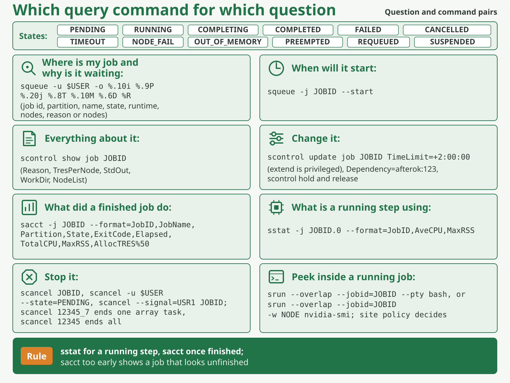

*Figure 6.11.16. Use sstat for running steps and sacct after they finish.*

Once a job is queued or running, you will ask two questions again and again. Where is it, and what is it doing? A job that has been pending since lunch makes the first question urgent, and a job that is running but quiet makes the second one urgent. Slurm's query commands answer both.

`squeue` supports short (`-o`) and long (`-O`) format specifiers, as shown in *Supercomputers for Linux SysAdmins*, Chapter 15, `Table 15-2`. The default format is `"%.18i %.9P %.8j %.8u %.2t %.10M %.6D %R"`, where a dot right-aligns the column. You can change the format to show exactly the columns you care about, which is much easier to read than the default when you have many jobs.

The identity and placement fields are `%i` (`taskid`), `%j` (`name`), `%P` (`partition`), `%u` (`username`), `%U` (`userid`), `%a` (`account`), `%v` (`reservation`) and `%o` (`command`). For resources and nodes, use `%C` (`numcpus`), `%D` (`numnodes`), `%N` (`nodes`, or nodes not yet released during `COMPLETING`) and `%r` (`reason`). The reason field is the one to read first when a job is pending, because it tells you what the scheduler is waiting for.

For time and status, `%V` gives `submittime`, `%M` gives `eligiletime` or runtime, `%l` gives `timelimit`, `%L` gives `timeleft`, `%e` gives `endtime`, and `%T` gives the state expanded. The `%t` field prints a compact state: `PD` pending, `R` running, `CA` canceled, `CF` configuring, `CG` completing, `CD` completed, `F` failed, `TO` timeout, `NF` node failure, and `SE` special exit.

The commands below cover the common cases. The comments on the right say what each line does. Read them as a short menu. Each line answers one question, such as where a job is, why it is waiting, or what it cost.

```bash
squeue -u $USER -o "%.10i %.9P %.20j %.8T %.10M %.6D %R"      # job id, partition, name, state, runtime, nodes, reason/nodes
squeue -j JOBID --start                                         # estimated start
scontrol show job JOBID                                         # everything (Reason, TresPerNode, StdOut, WorkDir, NodeList...)
scontrol update job JOBID TimeLimit=+2:00:00                    # extend (privileged) or reduce
scontrol update job JOBID Dependency=afterok:123
scontrol hold JOBID ; scontrol release JOBID
sacct -j JOBID --format=JobID,JobName,Partition,State,ExitCode,Elapsed,TotalCPU,MaxRSS,AllocTRES%50
sacct -X -u $USER -S now-7days --format=JobID,State,Elapsed,NodeList
sstat -j JOBID.0 --format=JobID,AveCPU,MaxRSS                  # running steps
scancel JOBID ; scancel -u $USER --state=PENDING ; scancel --signal=USR1 JOBID
```

Know these states: `PENDING`, `RUNNING`, `COMPLETING`, `COMPLETED`, `FAILED`, `CANCELLED`, `TIMEOUT`, `NODE_FAIL`, `OUT_OF_MEMORY`, `PREEMPTED`, `REQUEUED` and `SUSPENDED`. Reasons for a pending job are in section 8 of Chapter 6.9. The `scontrol show job` output reports the exit code and signal together, as in `ExitCode=0:15`. The first number is the exit code, and the second is the signal that ended the job, so `0:15` means the job was stopped by signal 15, which is `SIGTERM`. After a job completes, use `sacct`, because the controller forgets completed jobs after `MinJobAge`.

To peek into a running job, use `srun --overlap --jobid=JOBID --pty bash`. That lands you on the first node and shares its resources. Or run `srun --overlap --jobid=JOBID -w NODE nvidia-smi` to check one node's GPUs. Site policy decides whether this is allowed, so ask before you try it on a shared cluster. The `pam_slurm_adopt` module also allows SSH to nodes where you hold a job, which is another way to look around without a new step.

Use `sstat` for a step that is still running, and `sacct` once it has finished. Running `sacct` too early shows a job that looks unfinished, and running `sstat` after a step has ended returns nothing useful. Knowing which tool to reach for saves a lot of confusion.

## 9. A linter for batch scripts

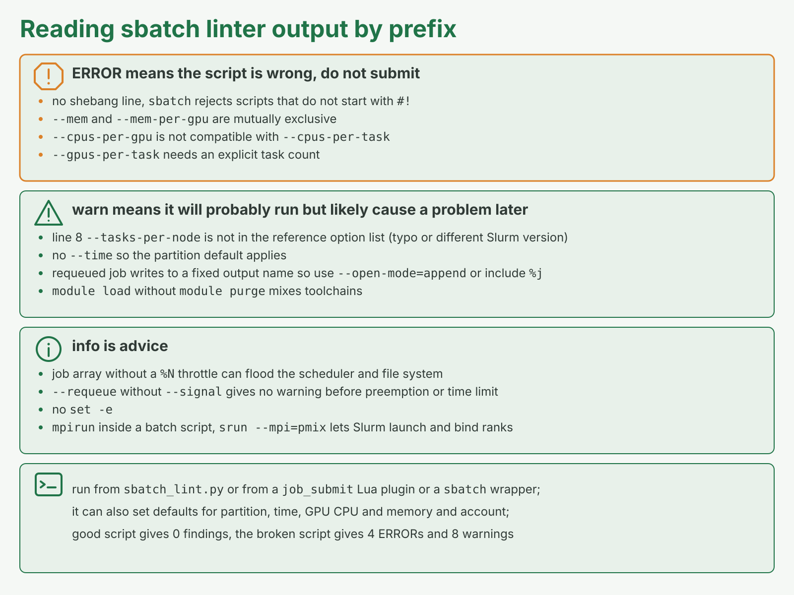

*Figure 6.11.17. Catch directive mistakes before the script waits in the queue.*

A colleague's script has a small typo in a directive, and it sits in the queue for two hours before it fails with a message nobody understands. A linter catches that kind of mistake before the script ever reaches the queue. The script `code/part06/sbatch_lint.py` reads the `#SBATCH` lines in a batch script. It checks each option against a list taken from the `sbatch` man page. It also checks the rules that the man page states, along with standard practice. Here is the output for one clean script and one broken script.

```text
== good.sbatch
no findings
== bad.sbatch
ERROR no shebang line; sbatch rejects scripts that do not start with #!
warn  line 8: --tasks-per-node is not in the reference option list (typo, or a different Slurm version?)
warn  no --time: the partition default applies; backfill works best with an accurate limit (6.9)
ERROR --mem, --mem-per-gpu are mutually exclusive
ERROR --cpus-per-gpu is not compatible with --cpus-per-task
ERROR --gpus-per-task needs an explicit task count (-n/--ntasks or --ntasks-per-node with --nodes)
info  job array without a %N throttle can flood the scheduler and the file system
warn  requeued job writes to a fixed output name; use --open-mode=append or include %j
info  --requeue without --signal: the job gets no warning before preemption/time limit; checkpoint on SIGTERM/USR1
warn  module load without module purge: inherited modules can mix toolchains (6.6)
info  no 'set -e'/errexit: a failed setup step will not stop the script
info  mpirun inside a batch script: srun --mpi=pmix lets Slurm launch and bind the ranks (6.12)
```

Read the output by its prefix. An `ERROR` means the script is wrong and should not be submitted. A `warn` means the script will probably run, but it is likely to cause a problem later. An `info` line is advice. The typo on line 8 is the kind of thing the linter is good at. The `--tasks-per-node` option is a near-miss for `--ntasks-per-node`, and a person reading quickly would likely miss it.

You can run a linter from a `job_submit` plugin, which is written in Lua, or from a wrapper around `sbatch`. Either one can reject or warn about bad requests. Either one can also set defaults for the partition, the time, the GPU CPU and memory settings, and the account, and route jobs. Keep the policy visible. A clear message is better than a silent rewrite, because a silently changed request surprises the person who submitted it.

## 10. Submission patterns for AI workloads

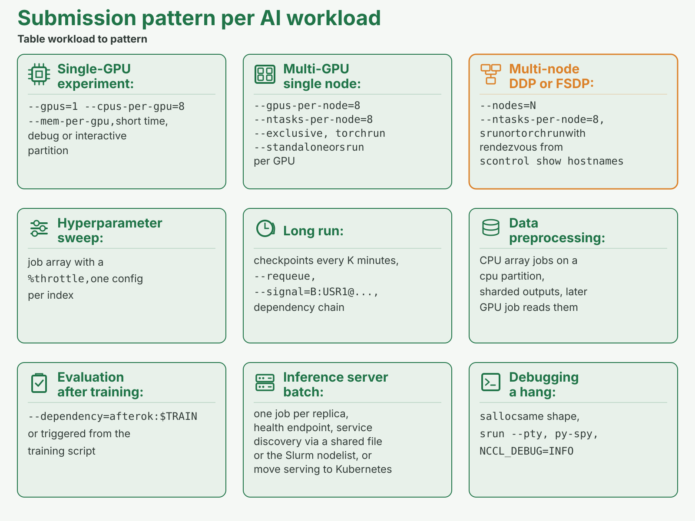

*Figure 6.11.18. Recognise the kind of work first and reuse the pattern that already works for it.*

Most of the time you do not need to invent a submission. You need to recognise which kind of work you have, and then use the pattern that already works for it. Each row of the table pairs a common AI workload with the submission pattern that suits it.

| Workload | Pattern |
|---|---|
| Single-GPU experiment | `--gpus=1 --cpus-per-gpu=8 --mem-per-gpu=...`, short time, `debug` or `interactive` partition |
| Multi-GPU single node | `--gpus-per-node=8 --ntasks-per-node=8 --exclusive`, `torchrun --standalone` or `srun` per GPU |
| Multi-node DDP/FSDP | `--nodes=N --ntasks-per-node=8`, `srun` or `torchrun` with rendezvous from `scontrol show hostnames` (6.12) |
| Hyperparameter sweep | Job array with `%throttle`, one config per index |
| Long run | Checkpoints every K minutes, `--requeue`, `--signal=B:USR1@...`, dependency chain |
| Data preprocessing | CPU array jobs on a cpu partition; write sharded outputs; later GPU job reads them |
| Evaluation after training | `--dependency=afterok:$TRAIN` or triggered from the training script |
| Inference server batch | One job per replica; health endpoint; service discovery via a shared file or the Slurm nodelist (or move serving to Kubernetes) |
| Debugging a hang | `salloc` same shape, `srun --pty`, `py-spy`, `NCCL_DEBUG=INFO` (6.12, 6.14) |

Long runs combine several of these patterns at once: checkpoints, requeue, a signal and a dependency chain. Match your job to a row first. Then check the long run row before you submit anything that might hit its time limit. A debugging hang is the row you will reach for most often, so keep it close. The `salloc` line gives you the same shape as the failing job, and `py-spy` shows what each Python process is doing.

## 11. Common mistakes

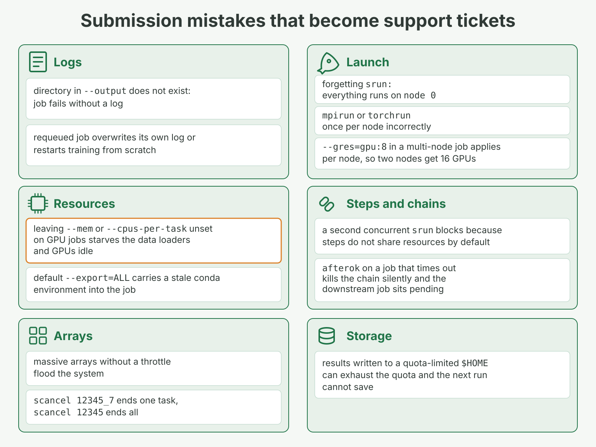

*Figure 6.11.19. Most submission tickets come from a missing srun, unset memory or a dependency on a timeout.*

These are the mistakes that turn into support tickets. They are grouped below by what they break, so you can spot the pattern when a job misbehaves.

If the directory in `--output` does not exist, the job fails without a log. A requeued job can overwrite its own log, or restart training from scratch. Both problems hide the evidence you need to understand the failure, so they feel worse than they are.

Using `mpirun` or `torchrun` once per node incorrectly is one slip. Forgetting `srun` is another, and it leaves everything running on node 0. Asking for `--gres=gpu:8` in a multi-node job is a third, and it is easy to forget that the request applies per node. Across two nodes, that request asks for twice as many GPUs as you may have meant.

Leaving `--mem` or `--cpus-per-task` unset on GPU jobs starves the data loaders. The loaders are the processes that feed the GPUs, so a starved loader leaves the GPUs idle while they wait. The default `--export=ALL` can carry a stale conda environment into your jobs, and then the job runs with libraries you did not intend.

A second concurrent `srun` blocks, because steps do not share resources by default. A dependency on a job that times out, using `afterok`, makes the chain die silently. Nothing errors, and the downstream job just sits pending.

Massive arrays without a throttle can flood the system. Confusing `scancel` on a pending array element with `scancel` on the whole array is another mistake. The command `scancel 12345_7` ends one task, while `scancel 12345` ends all of them, so check the ID before you press enter.

Writing results to `$HOME` on a quota-limited file system can exhaust the quota. A training run that writes checkpoints to the home directory can stop the next run from saving anything at all.

Run through this list before you submit a new script, since these are the mistakes that become support tickets.

## 12. Lab (self-checking linter lab tested; cluster parts untested)

Picture a new team member who has just received a set of batch scripts and a cluster account. They want to know whether their scripts are safe before they touch the shared queue. The lab below gives them that safety net in two parts. The Python part runs on any laptop. The cluster part needs a real Slurm system, or a single-host virtual cluster.

The Python part of the lab was run on a workstation and passed. The cluster steps that follow were not run on a live cluster, so run them on a real cluster or on a single-host virtual cluster, and check the results yourself.

Start with the self-checking Python lab, `code/part06/sbatch_lint_lab.py`, which you run locally. It verifies `code/part06/sbatch_lint.py` against a clean multi-node GPU script, which should give `0` findings. It also checks a broken script, which should give `4` `ERROR`s and `8` warnings or infos. The lab tests the 12-task 2D hyperparameter job-array mapping, where `SLURM_ARRAY_TASK_ID` runs from `0..11` across 4 learning rates × 3 batch sizes. Finally, it verifies `SLURMCheckpointer` signal handling for `SIGUSR1` and `SIGTERM`, from *Distributed AI Systems*, Chapter 8.

```bash
python3 code/part06/sbatch_lint_lab.py
```

Then work through these steps on a cluster, or on a single-host virtual cluster. Each step names one situation and one thing to check.

1. Run `sbatch_lint.py` on your own scripts, and fix every ERROR and warn. Keep the linter output next to each script, so you can see what changed.
2. Write a 2-node, 16-rank hello script that prints `hostname`, `SLURM_PROCID`, `SLURM_LOCALID` and `SLURM_NODEID` via `srun`. Then run the same commands without `srun`. Compare the two results, and notice which variables are empty.
3. Submit with `--test-only` first, then submit for real. Use `squeue --start`, `scontrol show job` and `sacct` to follow the job. Ask which command tells you the estimated start time.
4. Submit an array with a `%2` throttle over 6 indices. Inspect the output files, and use `squeue -r` to see the tasks. Count how many tasks run at the same time.
5. Build a dependency chain: train, then evaluate with `afterok`. Make the first job fail and watch for `DependencyNeverSatisfied`. Then add `--kill-on-invalid-dep=yes`. Check whether the second job is cancelled.
6. Start an interactive session with `salloc`, then `srun --pty bash`. Run a second `srun nvidia-smi` and observe the blocking. Retry it with `--overlap`. Write down what changed.
7. Rehearse the time limit with `--time=00:03:00 --signal=B:USR1@60`, using a script that traps USR1 and writes a "checkpoint" file. Verify that the signal fires before TIMEOUT. Then add requeue and check `SLURM_RESTART_COUNT`.
8. Write a site template repository with scripts for the patterns in section 10, plus a README. Keep each script short, so a new user can read it in one sitting.

Finish step 1 before you submit anything, so that lint errors never reach the queue.

## 13. Interview angles

Interviewers use these questions to check whether you can explain the layers, not just recall flags. A good answer names the layer first, then the command, then the behaviour you would see.

- Explain allocation, batch step, job step. What runs where in a multi-node batch script?
- What is the difference between `sbatch`, `srun` and `salloc`?
- What does `--overlap` do and when do you need it?
- How do you get rank, world size and master address inside a Slurm job?
- How do you make a job survive its time limit?
- What does `afterok` do if the first job is requeued after failing?
- Why throttle arrays? What limits array size?
- A user's job log is empty. What are three causes?
- How would you design a `job_submit` plugin policy for a GPU cluster?
- How do you attach to a running job to look at GPUs?

## Exercises

Work through these exercises on your own machine. Explain each answer in your own words, because the explanation is where the learning sticks.

1. Run `python3 code/part06/sbatch_lint_lab.py` first. Then open `code/part06/sbatch_lint.py` and find the four hard ERRORs that the linter reports on `bad.sbatch`. Explain the missing `#!` shebang. Explain why `--mem` and `--mem-per-gpu` cannot appear together. Explain why `--cpus-per-gpu` clashes with `--cpus-per-task`. Explain why `--gpus-per-task` needs a task count. Finally, explain why `--requeue` needs `--open-mode=append` or `%j` in `--output`.
2. Simulate a 2-node GPU cluster on one workstation, following *Distributed AI Systems*, Chapter 8. Write the `slurm.conf` entries for `node6` on `Port=17016` and `node7` on `Port=17017`. Write the matching `gres.conf` entries that map them to `/dev/nvidia6` and `/dev/nvidia7`. Then write the `sinfo` command and one `srun` command for 1-node execution and one for 2-node execution.
3. Derive the PyTorch rendezvous variables from Slurm. Write the bash line that exports `MASTER_ADDR` from `SLURM_JOB_NODELIST`, using `scontrol show hostnames "$SLURM_JOB_NODELIST" | head -n 1`. Randomize `MASTER_PORT` with `MASTER_PORT=$((29500 + RANDOM % 1000))`. Write the second option with `10000 + SLURM_JOB_ID % 20000`. Then map `WORLD_SIZE`, `RANK` and `LOCAL_RANK` inside `srun`. Explain why `SLURM_PROCID` and `SLURM_LOCALID` are empty in the top-level batch shell.
4. Map an array onto a 2D hyperparameter grid. Use `map_array_task_to_hp()` in `code/part06/sbatch_lint_lab.py` to map `--array=0-11%4` across `LEARNING_RATES=(1e-4 3e-4 1e-3 3e-3)` and `BATCH_SIZES=(16 32 64)`. Check which `(lr, batch_size)` pair runs on `SLURM_ARRAY_TASK_ID=5`. The answer should be `(3e-4, 32)`. Then explain why the `%4` throttle protects shared storage and fair-share.
5. Write a preemption-safe checkpoint handler with `SLURMCheckpointer`. Implement the `SIGUSR1` and `SIGTERM` handler pattern from *Distributed AI Systems*, Chapter 8. Add the matching `#SBATCH --signal=B:USR1@300` line, or the `--signal=SIGUSR1@90` line. Then explain the difference between `--signal=USR1@300`, which signals job steps only, and `--signal=B:USR1@300`, which signals the batch shell.
6. Chain multi-segment training and evaluation with `--dependency`. Write a three-job pipeline. Make `J1` and `J2` back-to-back training segments, and make `J3` run evaluation only if `J2` succeeds. Explain why `J2` must use `afterany:$J1` rather than `afterok:$J1` when `J1` exits on wall-clock timeout. Then explain how `--kill-on-invalid-dep=yes` prevents zombie `DependencyNeverSatisfied` jobs.

## Checkpoint

<details>
<summary>1. Distinguish between a Slurm **allocation**, a **batch step**, and a **job step**, and state where commands without `srun` run in a multi-node batch script (*Supercomputers for Linux SysAdmins*, Chapter 15).</summary>

- An allocation is the set of nodes, CPUs, GPUs and RAM reserved under a `SLURM_JOB_ID` for a wall-clock limit.
- The batch step, called Step 0, is the shell script you submit with `sbatch`. It runs only on the first allocated node, Node 0. Any command in the script that is not prefixed with `srun` (or `mpirun`) runs once, on Node 0 only.
- A job step, such as `JOBID.0` or `JOBID.1`, is a parallel task launch that `srun` creates across all or a subset of the allocation's nodes.
</details>

<details>
<summary>2. What are the 6 stages of the Slurm job life cycle (*Supercomputers for Linux SysAdmins*, Chapter 15), and what happens if a root `Prolog` script exits with a non-zero code?</summary>

There are six stages. First, you submit with `sbatch`, `srun` or `salloc`. Slurm checks eligibility and runs the SPANK and `job_submit` plugins. Second, the root `Prolog` runs on all allocated nodes to check the hardware and clean `/tmp` and `/dev/shm`. If `Prolog` exits non-zero, Slurm aborts the job startup, drains the offending node, and requeues or cancels the job. Third, `slurmstepd` starts, creates the cgroup container and launches Step 0. Fourth, the job runs `srun` steps while `HealthCheckProgram` runs periodic, non-intrusive node health checks. Fifth, preemption is optional, and higher-priority work can evict or requeue the job. Sixth, when the job ends, Slurm sends `SIGTERM` and then `SIGKILL` to all job processes across the nodes, and runs the root `Epilog` cleanup script.
</details>

<details>
<summary>3. How does `srun` behave when called *outside* an existing allocation versus *inside* an `sbatch` or `salloc` allocation?</summary>

Outside an allocation, `srun` first requests a new one from `slurmctld`. It waits in the queue until resources are granted, then launches the step across the allocated nodes. Inside an existing `sbatch` or `salloc` allocation, `srun` launches a job step, `JOBID.N`, at once, using the resources you already hold.
</details>

<details>
<summary>4. How can you simulate a 2-node GPU cluster on a single 8-GPU machine for testing distributed scripts (*Distributed AI Systems*, Chapter 8)?</summary>

Build Slurm with `--enable-multiple-slurmd`. Then define two virtual nodes in `slurm.conf`. Both share the local hostname, but each uses its own port, as in `NodeName=node6 Port=17016 Gres=gpu:1` and `NodeName=node7 Port=17017 Gres=gpu:1`. Finally, map each virtual node in `gres.conf` to its own physical GPU, as in `NodeName=node6 Name=gpu File=/dev/nvidia6` and `NodeName=node7 Name=gpu File=/dev/nvidia7`.
</details>

<details>
<summary>5. What placement and syntax rules apply to `#SBATCH` directives, and what happens if the directory in `--output=logs/%x-%j.out` does not exist?</summary>

The batch script must begin with a `#!` shebang on line 1. Every `#SBATCH` directive must appear before the first executable shell command. Command-line flags passed to `sbatch` override the `#SBATCH` lines. If the parent directory, `logs/`, does not exist when the job starts, the job fails immediately and produces no log file.
</details>

<details>
<summary>6. Name six filename pattern symbols supported in `--output` / `--error` and explain how to avoid interleaved multi-rank logs (*Distributed AI Systems*, Chapter 8).</summary>

The symbols include `%j` for job ID, `%x` for job name, `%N` for short node hostname, `%u` for username, `%A` for array master job ID, `%a` for array task index, and `%t` for task rank ID in `srun`. To avoid interleaved logs from many ranks, you have three options. Use `#SBATCH --output=logs/train_%j_%N.out` to write one file per node. Pass `srun --label` to prefix each line with its rank ID. Or configure Python's `logging` module to write per-rank `train_rank_{rank}.log` files, while only `rank == 0` logs to stdout.
</details>

<details>
<summary>7. Why must a job that uses `--requeue` also specify `--open-mode=append` (or a unique retry filename)?</summary>

A requeued job keeps the same `SLURM_JOB_ID`, which is `%j`, and increments `SLURM_RESTART_COUNT`. With `--open-mode=truncate`, the restarted run truncates `slurm-%j.out`. That erases the crash traceback and the training progress from the previous run.
</details>

<details>
<summary>8. Why is `--export=ALL` (the default) hazardous for reproducibility, and what is the clean alternative?</summary>

`--export=ALL` copies every variable from your login shell into the batch job. That includes stale `PATH` and `LD_LIBRARY_PATH` values, `PYTHONPATH`, and any activated Conda environment, so runs stop being reproducible. The clean alternative is `--export=NONE`, or to start the script with `module purge` and explicit `module load` or `conda activate` commands. Either way, the script becomes self-contained.
</details>

<details>
<summary>9. How do you expand Slurm's compressed `SLURM_JOB_NODELIST` (`gpu[01-04]`) into individual hostnames and map Slurm variables to PyTorch `env://` variables (*Distributed AI Systems*, Chapter 8)?</summary>

Expand the nodelist with `scontrol show hostnames "$SLURM_JOB_NODELIST"`. Then export `MASTER_ADDR=$(scontrol show hostnames "$SLURM_JOB_NODELIST" | head -n 1)`. Export `MASTER_PORT=$((29500 + RANDOM % 1000))`, or use `10000 + SLURM_JOB_ID % 20000`. Inside the `srun` task environment, set `WORLD_SIZE=$SLURM_NTASKS`, `RANK=$SLURM_PROCID` and `LOCAL_RANK=$SLURM_LOCALID`.
</details>

<details>
<summary>10. Why are `SLURM_PROCID` and `SLURM_LOCALID` unset (or `0`) in the top-level batch script, and where are they populated?</summary>

The batch script runs as one shell process on Node 0, before any parallel tasks exist. So those variables are unset there, or `0`. Slurm populates `SLURM_PROCID` and `SLURM_LOCALID` per task, when `srun` (`slurmstepd`) launches a job step. `SLURM_PROCID` is the global rank, from `0..NTASKS-1`. `SLURM_LOCALID` is the node-local rank, from `0..NTASKS_PER_NODE-1`.
</details>

<details>
<summary>11. Why does running a second concurrent `srun` inside an allocation hang by default, and what do `--overlap` and `--exact` do?</summary>

By default, a job step claims the CPUs and GPUs allocated on its nodes exclusively. A second parallel `srun` therefore waits until the first step finishes. `--overlap` lets the new step share CPUs, memory and GRES with steps already running. That is essential for diagnostics such as `srun --overlap --jobid=JOBID nvidia-smi`. `--exact` restricts a step to the exact CPU and memory slice it requested, so several sub-node steps can run side by side inside one allocation.
</details>

<details>
<summary>12. What does `srun -K` (`--kill-on-bad-exit`) do, and why is it critical for multi-node GPU training?</summary>

`-K`, or `--kill-on-bad-exit=1`, ends all tasks in the step as soon as any single task exits with a non-zero status. Without it, suppose rank 5 crashes with an exception. The remaining 63 GPUs then sit idle, spinning in `NCCL` collective barriers. They wait until the job hits its 24-hour wall-clock timeout.
</details>

<details>
<summary>13. Where does `salloc`'s shell run by default, and how does `LaunchParameters=use_interactive_step` change it?</summary>

By default, `salloc` starts a new shell on the submission or login node, with `SLURM_*` variables exported. You then run `srun --pty bash` to land on a compute node. Setting `LaunchParameters=use_interactive_step` in `slurm.conf` changes this. `salloc` then launches an interactive `srun` step, `--interactive --preserve-env --pty $SHELL`, directly on the first allocated compute node.
</details>

<details>
<summary>14. How does `sbatch --array=0-11%4` work, what environment variables identify each array task, and how do you map `SLURM_ARRAY_TASK_ID` to a 2D hyperparameter grid (*Distributed AI Systems*, Chapter 8)?</summary>

The command submits 12 independent tasks, numbered `0` through `11`. The `%4` throttle allows at most 4 of them to run at once. Each task gets `SLURM_ARRAY_JOB_ID`, which is `%A` and is the master ID. It also gets `SLURM_ARRAY_TASK_ID`, which is `%a` and runs from `0` to `11`, and its own `SLURM_JOB_ID`, which is `%j`. For a grid of `NUM_LR` learning rates and a set of batch sizes, set `LR_IDX=$((SLURM_ARRAY_TASK_ID % NUM_LR))` and `BS_IDX=$((SLURM_ARRAY_TASK_ID / NUM_LR))`.
</details>

<details>
<summary>15. Compare `--dependency=afterok:ID`, `afterany:ID`, `afternotok:ID`, `aftercorr:ID`, and `singleton`.</summary>

- `afterok:ID` starts only if job `ID` finished with exit code `0`, meaning success.
- `afterany:ID` starts once job `ID` terminates for any reason. That suits multi-segment training chains that hit the walltime limit.
- `afternotok:ID` starts only if job `ID` failed or timed out. Use it for cleanup or alerting.
- `aftercorr:ID` starts array task $k$ as soon as task $k$ of job `ID` succeeds.
- `singleton` starts only when no other job with the same `--job-name` and user is running or queued earlier.
</details>

<details>
<summary>16. What is the `DependencyNeverSatisfied` trap with `afterok`, and what flag fixes it?</summary>

Imagine that job `J1` fails or times out, any job `J2` waiting on `afterok:$J1` fails its dependency check for good. That stays true even if `J1` is later requeued and succeeds. By default, `J2` sits in `PENDING (DependencyNeverSatisfied)` forever. Submitting it with `--kill-on-invalid-dep=yes` fixes that. The cluster-wide setting `SchedulerParameters=kill_invalid_depend` does the same job for every submission.
</details>

<details>
<summary>17. What is the difference between `#SBATCH --signal=USR1@300` and `#SBATCH --signal=B:USR1@300`, and why should training code trap both `SIGUSR1` and `SIGTERM` (*Distributed AI Systems*, Chapter 8)?</summary>

Without `B:`, Slurm sends `SIGUSR1` 300 seconds before `--time` expires, to the running `srun` job steps. With `B:`, Slurm sends `SIGUSR1` to the batch shell itself, which lets a bash `trap` coordinate checkpointing and `scontrol requeue`. Training code, such as the `SLURMCheckpointer` class in *Distributed AI Systems*, Chapter 8, should trap both `SIGUSR1`, which warns about the time limit, and `SIGTERM`. Slurm sends `SIGTERM` immediately on `scancel`, on a node drain, or during QoS preemption, within `GraceTime`.
</details>

<details>
<summary>18. Decode the `squeue` compact state codes `PD`, `R`, `CG`, `CD`, `CA`, `TO`, `NF`, and `F`, and explain why `CG` (`COMPLETING`) sticking is a warning sign (*Supercomputers for Linux SysAdmins*, Chapter 15, `Table 15-2`).</summary>

`PD` means `PENDING`, `R` means `RUNNING`, `CG` means `COMPLETING`, `CD` means `COMPLETED`, `CA` means `CANCELLED`, `TO` means `TIMEOUT`, `NF` means `NODE_FAIL`, and `F` means `FAILED`. Picture a job stuck in `CG`. It means `slurmstepd` sent `SIGKILL` to the job's processes on the nodes listed in `%N`, but a process is still wedged in uninterruptible kernel sleep. That `D` state usually points to a hung Lustre/NFS mount or a GPU driver bug. The `Epilog` script may also be hanging. Either way, a job that stays in `CG` is a warning sign.
</details>

<details>
<summary>19. How do you inspect the estimated start time of a pending job, extend a running job's walltime, and view `MaxRSS` of a completed or running job?</summary>

- Estimated start time: `squeue -j <jobid> --start`
- Extend walltime, as an operator or admin: `scontrol update job <jobid> TimeLimit=+2:00:00`
- Memory usage, `MaxRSS`: use `sstat -j <jobid>.0 --format=JobID,AveCPU,MaxRSS` while the job runs, or `sacct -j <jobid> --format=JobID,State,ExitCode,Elapsed,MaxRSS,AllocTRES%50` after it completes.
</details>

<details>
<summary>20. What four hard `ERROR`s does `code/part06/sbatch_lint.py` reject before a script ever reaches the cluster?</summary>

The linter rejects four hard errors.

1. A missing `#!` shebang on line 1, because `sbatch` rejects scripts without one.
2. Mutually exclusive memory flags, `--mem`, `--mem-per-cpu` and `--mem-per-gpu`.
3. Incompatible CPU flags, `--cpus-per-gpu` combined with `--cpus-per-task`.
4. `--gpus-per-task` without an explicit task count, meaning `-n` or `--ntasks`, or `--ntasks-per-node` with `--nodes`.
</details>

## Sources and review notes

- User-level behaviour, `Table 15-1` primary `sbatch`/`srun` keys, `Table 15-2` `squeue` format symbols, and the 6-stage allocation/step/job life cycle (`Prolog`, `slurmstepd`, `HealthCheckProgram`, `Epilog`): read in full from *Supercomputers for Linux SysAdmins* (`supercomputers-for-linux-sysadmins-managing-modern-hpc-clusters-and-supercomputers-from-software-to-hardware`, *Supercomputers for Linux Sysadmins*) Chapter 15 ("15. Slurm": User Experience, Job Life Cycle, `scontrol`, Accounting and Statistics).
- Virtual multi-node cluster simulation on a single host (`node6`/`node7` on ports `17016`/`17017`), batch submission, environment variables (`MASTER_ADDR`, `MASTER_PORT`, `WORLD_SIZE`, `RANK`, `LOCAL_RANK`), rank-specific logging (`srun --label`, `train_rank_{rank}.log`), 2D hyperparameter job arrays (`0-11` over 4 LRs × 3 batch sizes + `collect_hp_results`), interactive `salloc` jobs, job dependencies, and `SLURMCheckpointer` (`SIGUSR1@90` + `SIGTERM`): read in full from *Distributed AI Systems* Chapter 8 ("Chapter 8: Running Distributed Training with SLURM").
- Options and semantics: man pages `sbatch(1)`, `srun(1)`, `salloc(1)` (via the shared option text), `scontrol(1)`, `slurm.conf(5)` from SchedMD/slurm commit `521370b`.
- Run here: `python3 code/part06/sbatch_lint.py` and `python3 code/part06/sbatch_lint_lab.py` (3 passed, 0 failed).
- Explicitly labelled inferences: `map_array_task_to_hp` and `SLURMCheckpointerSim` in `code/part06/sbatch_lint_lab.py` are deterministic teaching models based on *Distributed AI Systems* Chapter 8.
- Not verified on live hardware: exact behaviour of `--export=NONE` with `sbatch` on your site, whether `--exact` is the default for your release, the signal-forwarding plumbing in the requeue example, and all live cluster behaviour (`untested here`).
