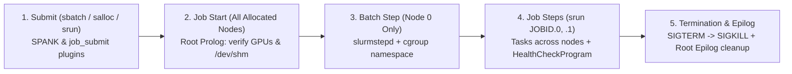

# 6.11 Submitting and launching jobs: sbatch, srun, salloc, arrays, dependencies

| | |
|---|---|
| Level | Intermediate |
| Priority tier | 1 |
| Lab venue | Slurm cluster; the linter script needs only Python 3 |
| Part | Part 6: HPC and Slurm |
| Status | Drafted. Option names, defaults, patterns and environment variables were checked against the `sbatch`, `srun`, `salloc`, `scontrol` and `slurm.conf` man pages (SchedMD/slurm commit `521370b`, 2026-10-23, development version 26.11.0rc1; older releases lack some options). `code/part06/sbatch_lint.py` was run on two test scripts (output shown). No Slurm daemon was run; cluster examples are **untested** |

## Why this matters for AI infrastructure

The user-facing interface to a GPU cluster is a handful of commands. Researchers lose hours to avoidable mistakes, such as these. A multi-node script runs everything on one node. An array of 1,000 jobs has no throttle, so it floods the file system. A requeued job overwrites its own log. A training run is killed at the time limit without a checkpoint. And `mpirun` is launched inside a batch script without binding. Operators write the documentation, templates, `job_submit` plugins and wrapper scripts that prevent these, and they answer the tickets when the mistakes happen anyway. This chapter gives you the working vocabulary for both sides.

## Prerequisites and outcomes

You need 6.2 and 6.7 to 6.10 first. By the end of this chapter, you can do the following:

- Explain the difference between an allocation, a batch script and job steps, and say which command creates which.
- Write correct batch scripts for single-GPU, multi-GPU, multi-node and array workloads, including directives, environment handling, signals and requeue.
- Use `srun` inside allocations (steps, `--exact`, `--overlap`), `salloc` for interactive work, and understand `--pty` and interactive steps.
- Build array, dependency and pipeline workflows, and know the failure behaviour of dependencies.
- Read and use the SLURM environment variables for rank, world-size and rendezvous set-up.
- Monitor, inspect, modify and cancel jobs with `squeue`, `scontrol`, `sacct` and `scancel`.
- Lint scripts for common mistakes, and write submission templates for a site.

## 1. Allocations, batch jobs and steps



A script that works on one machine can behave very differently on a cluster. The reason is almost always where each command runs. Slurm separates three ideas, and you need all three to predict what a script will do.

An allocation is a set of resources: nodes, CPUs, GPUs and memory. Slurm holds them for a time limit under one job ID.

A batch job is a request you queue with `sbatch script`. When resources are free, Slurm runs your script on the first allocated node, as the batch step. Commands in the script run only on that node, unless you launch them across the allocation.

A job step is started by `srun ...`. It launches tasks across all or part of the allocation. A batch script usually contains one or more `srun` steps. Each step gets an ID such as `JOBID.0` or `JOBID.1`, and accounting records every step.

The commands below create allocations, launch steps and manage jobs. Notice that `srun` behaves differently depending on whether an allocation already exists.

| Command | Does |
|---|---|
| `sbatch script.sh` | Submit a batch script; returns the job ID immediately |
| `salloc ...` | Obtain an allocation and start a shell (or command) with the allocation environment; you then run `srun` steps interactively |
| `srun ...` | Inside an allocation: launch a step. Outside one: create an allocation **and** run the command (blocking) |
| `scancel`, `squeue`, `sinfo`, `scontrol`, `sacct`, `sstat`, `sprio`, `sshare`, `sreport` | Control and query |

In a multi-node batch script, a command without `srun` runs once, on the first node. The linter in section 9 warns about multi-node scripts that contain neither `srun` nor `mpirun`. Take a script that requests `#SBATCH --nodes 2` and `#SBATCH --ntasks-per-node 2`, and runs `echo Start; srun hostname; echo End`. The two `echo` lines run once, on the first allocated node, which is Step 0. The `srun hostname` line runs four times across the two nodes (`n10`, `n11`, `n11`, `n10`, in arbitrary completion order). The `srun` prefix is what spreads the work across the nodes.

You can even launch multiple `srun` steps in parallel inside a single allocation. For example, inside a 4-CPU allocation, you can run `srun -n 1 ... &` alongside `srun -n 3 ... &`.

### The 6-stage Slurm job life cycle (`SCL` Chapter 15)

Slurm carries out a sequence of steps behind the scenes for every job. Knowing that sequence explains why jobs get rejected at submit time, why a broken node drains on launch, and how stray processes are reaped. The sequence below comes from *Supercomputers for Linux SysAdmins*, Chapter 15, *Job Life Cycle*.

Stage 1 is submission, through `sbatch`, `srun` or `salloc`. `slurmctld` checks whether your association and QoS allow the job to queue. It then invokes registered SPANK plugins, which can add custom CLI flags to `sbatch` and `srun`, such as NVIDIA `pyxis` adding `--container-image`. It also invokes `job_submit` plugins, which validate or rewrite job requests.

Stage 2 runs the `Prolog` script or scripts. Before user code runs, Slurm executes them as `root` on every allocated compute node. They verify hardware readiness and clean `/tmp`, `/dev/shm` and leftover IPC semaphores. Remember that `Prolog` execution time is bounded. If a `Prolog` script returns a non-zero exit code, Slurm aborts the job launch, drains the offending node, and requeues or cancels the job.

Stage 3 creates the job step. `slurmd` spawns `slurmstepd`, which invokes step plugin hooks. It creates the Linux cgroup namespace (`task/cgroup`), applies CPU, RAM and GPU device constraints, and starts Step `0`. Step 0 is the batch script itself, running on the first node.

Stage 4 is the running phase. Each `srun` you issue launches a numbered step, such as `JOBID.0` or `JOBID.1`. At every `HealthCheckInterval`, `slurmd` runs the configured `HealthCheckProgram`. That program must be fast and completely non-intrusive. It checks for kernel `dmesg` or GPU hardware errors, and it drains unhealthy nodes.

Stage 5 is preemption, and it happens only when triggered. Higher-priority jobs preempt running jobs according to `PreemptType` and `PreemptMode`. The modes are `REQUEUE`, `CANCEL` and `SUSPEND,GANG`. Chapter 6.9 covers them.

Stage 6 is the end of the job. The batch script may exit, be cancelled, or hit its `--time` limit. In every case, Slurm sends `SIGTERM` to all job processes across the allocated nodes. After `KillWait`, it follows with `SIGKILL`. Then it runs the `Epilog` script as `root` on every allocated node, to verify cleanup.

### Simulating a multi-node GPU cluster on a single physical machine (`DAI` Chapter 8)

Before you submit a complex multi-node script to a shared production queue, you can test it on one multi-GPU workstation. Run several `slurmd` daemons, each on its own TCP port, so that they act as separate nodes. This technique is covered in *Distributed AI Systems*, Chapter 8, under *Simulating a Multi-Node cluster*. It requires Slurm built with `--enable-multiple-slurmd`. The configuration below creates two virtual nodes on one 8-GPU host.

```ini
# slurm.conf — two virtual nodes (node6, node7) on one 8-GPU host
NodeName=node6 NodeHostname=localhost Port=17016 CPUs=112 RealMemory=240000 Gres=gpu:1 State=UNKNOWN
NodeName=node7 NodeHostname=localhost Port=17017 CPUs=112 RealMemory=240000 Gres=gpu:1 State=UNKNOWN
PartitionName=gpu Nodes=node[6-7] Default=YES MaxTime=INFINITE State=UP

# gres.conf — map each virtual node to a dedicated physical GPU (/dev/nvidia6 and /dev/nvidia7)
NodeName=node6 Name=gpu File=/dev/nvidia6
NodeName=node7 Name=gpu File=/dev/nvidia7
```

Once the daemons start, `sinfo` reports `gpu* up infinite 2 idle node[6-7]`. You can then verify multi-node execution with `srun -N 1 hostname` and `srun -N 2 hostname`, or with a quick smoke test such as `srun -N 2 --gres=gpu:1 --cpus-per-task=4 python code/train.py`. Run these checks before you move the script to production.

## 2. A batch script

The script below requests a two-node job named `bert-pretrain`. Read it from top to bottom, because each `#SBATCH` line sets a resource or a behaviour before the job starts.

```bash
#!/bin/bash
#SBATCH --job-name=bert-pretrain
#SBATCH --partition=gpu
#SBATCH --nodes=2
#SBATCH --ntasks-per-node=8          # one task per GPU
#SBATCH --gpus-per-node=8
#SBATCH --cpus-per-gpu=12
#SBATCH --mem=0                      # all memory on the (exclusive) node
#SBATCH --exclusive
#SBATCH --time=12:00:00
#SBATCH --requeue
#SBATCH --signal=B:USR1@300          # warn the batch shell 5 minutes before the limit
#SBATCH --output=logs/%x-%j.out
#SBATCH --open-mode=append

set -euo pipefail
module purge
module load cuda/12.4 nccl/2.21
export OMP_NUM_THREADS=$SLURM_CPUS_PER_GPU   # see section 7; set per your site
srun --mpi=pmix python train.py --resume-if-exists
```

The details below come from the `sbatch(1)` man page. Every `#SBATCH` line must come before the first executable command, because the shell treats those lines as comments. Command-line options override them. The script must also start with `#!`.

Set the time with `--time=D-HH:MM:SS` or `HH:MM:SS`. Always provide one, because backfill works best with an accurate limit. Chapter 6.9 covers backfill. A flexible job can use `--time-min` to start with less time.

By default, stdout and stderr go to `slurm-%j.out` in the submission directory. For arrays, the default is `slurm-%A_%a.out`. The filename patterns include `%j` for the job ID, `%A` and `%a` for the array job and index, `%x` for the job name, `%N` for the short hostname (one file per node), `%u` for the user, `%t` for the `srun` task ID, and `%%` for a literal percent sign. **The directory in `--output` must exist before the job starts.** If it does not, the job fails silently with no log. Create it in a wrapper script, or submit from a directory that already has it.

The `--open-mode` option accepts `append` or `truncate`, and its default comes from the cluster's `JobFileAppend` setting. A requeued job reuses its job ID. With truncate mode, the second run erases the first run's log. Use `append`, or include something unique in the filename.

The default for `--export` is `ALL`, which copies the submitter's environment into the job. That includes loaded modules and conda environments, so the job depends on whatever the shell had. For reproducibility, use `--export=NONE` with an explicit `module purge` and `module load`, or with `source`, inside the script. With `NONE`, you must also use absolute paths or set `PATH` yourself. On some sites, `--export=NONE` with `sbatch` also needs `--get-user-env` or login-shell tricks, so check your local documentation.

`--container` is available in recent releases (OCI). Sites that use pyxis add `--container-image` and similar options. Chapter 6.13 covers that path. Use `--constraint="h100&ib"` to select nodes by feature, as explained in Chapter 6.8.

Use `--wrap="command"` to submit a one-line command without a script file. Use `--test-only` to check a request, which reports when and where the job would start without submitting it. Use `--parsable` in scripts, because it prints only the job ID. Set `--mail-type=END,FAIL --mail-user=...` for notifications, but only if the site runs mail. The options `--begin=now+1hour`, `--deadline=...`, `--hold`, `--nice`, `--reservation`, `--qos` and `--account` control scheduling, and Chapter 6.9 covers them.

### Summary of primary `sbatch` / `srun` keys (`SCL` Chapter 15 `Table 15-1`)

The table below lists the primary `sbatch` and `srun` keys and what each one means.

| Key | Meaning |
|---|---|
| `-p partition` / `--partition` | Target partition name |
| `-n NUMBER` / `--ntasks` | Total number of tasks (processes) |
| `-N NUMBER` / `--nodes` | Number of compute nodes |
| `--ntasks-per-node N` | Number of tasks launched on each node (combined with `-n`/`-N`) |
| `-A account` / `--account` | Charge resource usage to the specified account |
| `--gres=NAME:NUMBER[,...]` | Request Generic Resources per node (e.g., `--gres=gpu:8`) |
| `-C` / `--constraint=...` | Require node feature expressions (e.g., `--constraint="h100&ib"`) |
| `-d condition` / `--dependency` | Defer job start until dependency condition holds (e.g., `afterok:123`) |
| `-i` / `-o` / `-e file` | Standard input, output, and error file paths (default `slurm-%j.out`) |
| `-J name` / `--job-name` | Job name (defaults to script filename or command) |
| `--requeue` / `--no-requeue` | Allow or forbid automatic requeuing on node failure or preemption |
| `-t` / `--time=TIME` | Maximum wall-clock limit (`D-HH:MM:SS`); job is terminated on expiration |
| `-w nodelist` / `--nodelist` | Request specific node hostnames |
| `-x nodelist` / `--exclude` | Exclude specific broken or slow nodes |
| `--qos=NAME` | Request a specific Quality of Service (`QoS`) |

Read the table as a quick reference. Options such as `--dependency` and `--requeue` are the ones this chapter returns to in later sections.

### Rank-specific logging vs interleaved stdout (`DAI` Chapter 8)

In multi-node distributed training, every rank writes to the same `slurm-%j.out` file by default. Stack traces and progress bars end up interleaved in that one file. *Distributed AI Systems*, Chapter 8, under *Logging and output*, covers this. You have three clean layers of control.

Layer 1 is a per-node log file. Use `#SBATCH --output=logs/train_%j_%N.out` and `#SBATCH --error=logs/train_%j_%N.err`, so that each node (`%N`) writes to its own file.

Layer 2 is task-prefixed output. Running `srun --label python train.py` prefixes every stdout and stderr line with the global task ID, such as `0: ...` or `1: ...`.

Layer 3 is a per-rank Python log. Configure Python's `logging` module so that every rank logs to `train_rank_{rank}.log`. Only `rank == 0` attaches a `logging.StreamHandler()` to console stdout.

### Environment variables

Slurm sets many environment variables, and the man pages list them all. The ones below are the ones you will use constantly.

| Variable | Meaning |
|---|---|
| `SLURM_JOB_ID`, `SLURM_JOB_NAME`, `SLURM_JOB_PARTITION`, `SLURM_SUBMIT_DIR` | Job identity and where you submitted from |
| `SLURM_JOB_NODELIST` (`SLURM_NODELIST`), `SLURM_JOB_NUM_NODES` (`SLURM_NNODES`) | Nodes of the allocation; the nodelist is compressed (`gpu[01-04]`): expand with `scontrol show hostnames "$SLURM_JOB_NODELIST"` |
| `SLURM_NTASKS`, `SLURM_NTASKS_PER_NODE`, `SLURM_TASKS_PER_NODE`, `SLURM_CPUS_PER_TASK`, `SLURM_CPUS_ON_NODE`, `SLURM_MEM_PER_NODE` | Shape of the allocation |
| `SLURM_PROCID`, `SLURM_LOCALID`, `SLURM_NODEID` | Set **per task by srun**: global rank, node-local rank, node index |
| `SLURM_ARRAY_JOB_ID`, `SLURM_ARRAY_TASK_ID`, `SLURM_ARRAY_TASK_COUNT` | Array identity |
| `SLURM_RESTART_COUNT` | How many times the job was requeued (0 on the first run) |
| `SLURM_JOB_GPUS`, `SLURM_GPUS_ON_NODE`, ... | GPU information (6.10) |

`SLURM_PROCID` and its relatives exist only inside tasks launched by `srun`, not in the batch shell. The batch script itself has `SLURM_NODEID=0`. This is the usual cause of an empty variable.

### Distributed-training rendezvous from Slurm variables

PyTorch needs a master address, a port, a world size and a rank before its workers can find each other. This handshake is called rendezvous. With one task per GPU launched by `srun`, you can build all four values from Slurm variables:

```bash
MASTER_ADDR=$(scontrol show hostnames "$SLURM_JOB_NODELIST" | head -n 1)
MASTER_PORT=$((10000 + SLURM_JOB_ID % 20000))   # avoid collisions between jobs on shared nodes
export MASTER_ADDR MASTER_PORT
srun bash -c 'export RANK=$SLURM_PROCID LOCAL_RANK=$SLURM_LOCALID WORLD_SIZE=$SLURM_NTASKS; exec python train.py'
```

A different option is one task per node, which launches `torchrun --nnodes=$SLURM_NNODES --nproc-per-node=8 --rdzv-backend=c10d --rdzv-endpoint=$MASTER_ADDR:29500 train.py`. Chapter 6.12 compares the two approaches. The `MASTER_PORT` formula is a convenience, not a guarantee. Some sites provide port management through `--resv-ports` or through MPI and PMIx plugins. Choose your launcher first, then check what port management your site provides.

## 3. srun

`srun` launches a step, which is one parallel run inside an allocation. It connects to the allocation, or creates one if none exists. It starts the requested number of tasks on the nodes, forwards stdin, stdout and stderr, and returns the exit status. The key options come from the `srun(1)` man page. They include `-n/--ntasks`, `-N/--nodes`, `--ntasks-per-node`, `-c/--cpus-per-task`, `--cpu-bind`, `--mem-bind`, `--gpu-bind` and `--gpus-per-task`. Others include `--mpi=<type>`, where `list` shows plugins and `pmix` and `pmi2` are common, plus `--export`, `-K/--kill-on-bad-exit`, `--label` (which prefixes output with the task id), `--output/--error` per-step patterns, `--time`, `--wait` and `--pty`.

Steps inside an allocation behave in a few specific ways. Steps do not share resources by default. A second concurrent `srun` that wants CPUs or GPUs already used by the first step either waits or is rejected, unless you pass `--overlap`. The man page says `--overlap` "allows steps to share all resources (CPUs, memory, and GRES) with all other steps." This explains why `srun nvidia-smi` in a second terminal of an interactive allocation can hang. It also explains why you monitor a running training job's GPUs with `srun --overlap --jobid=JOBID ...`. Chapter 6.14 returns to this.

Without `--exact`, a step may use "all non-GRES resources on each node in the step allocation." With `--exact`, it is limited to exactly what it requested. If you run several concurrent steps with different shapes, use `--exact`. In current versions it is often the default when you set `--cpus-per-task` or `--cpus-per-gpu`, so check your release.

With `-K`, or `--kill-on-bad-exit`, a single non-zero exit ends the whole step. The default comes from the cluster's `KillOnBadExit` setting. For tightly coupled jobs, you want this. Without it, one dead rank leaves the others hanging in a collective until the time limit. That is a classic way to waste GPU hours.

Run `srun` without an allocation and it creates one for the command. For example, `srun -N1 --gres=gpu:1 --pty bash` gives you an interactive session in a single command. Use `srun --jobid=<id>` to attach to a running job's allocation. This works for your own job.

### MPI and launching

`srun --mpi=pmix` hands rank wire-up to Slurm's PMIx plugin. Chapters 6.4 and 6.12 cover that path. Running `mpirun` inside a script also works with Open MPI's Slurm integration. The catch is that `mpirun` does its own launching and binding. Prefer `srun`, because then Slurm sets the binding through `--cpu-bind` and `--gpu-bind`, tracks processes in the job cgroup, and accounts usage per step.

## 4. Interactive jobs

Sometimes you need a shell on a compute node, to test code or check a GPU before you commit to a full batch run. `salloc` and interactive steps give you that shell.

```bash
salloc --partition=gpu --gres=gpu:1 --cpus-per-gpu=8 --mem-per-gpu=64G --time=2:00:00
# a shell opens; Slurm variables are set; then:
srun --pty bash                # a shell on the compute node
srun python quick_test.py      # or run a step
exit                           # releases the allocation
```

If you want it in one step, use `srun --partition=gpu --gres=gpu:1 --time=1:00:00 --pty bash`.

By default, `salloc` runs its own shell on the submission host, which is the login node. Many sites prefer a shell on the compute node instead. The current way to get one is `LaunchParameters=use_interactive_step` in `slurm.conf`. With it, `salloc` starts `srun` with `InteractiveStepOptions`, so you land on a node of the allocation. The default for `InteractiveStepOptions` is `--interactive --preserve-env --pty $SHELL`, according to the man page. The interactive step consumes no resources, so other steps can run in parallel with it. The old `SallocDefaultCommand` parameter no longer appears in the `slurm.conf` man page.

Interactive policy matters, because an idle shell still holds its resources. Sites typically use short time limits, and a dedicated `interactive` or `debug` partition with high priority and small size. Notebooks can use MIG or shared GPUs, covered in 6.10. Idle jobs can be reaped. Open OnDemand, covered in 6.25, serves Jupyter and VS Code. An idle `salloc` holding 8 GPUs for a day is an expensive nap. Consider a `job_submit` plugin or an epilog that kills idle interactive allocations.

Give every interactive allocation a short time limit, and release it when you finish.

## 5. Job arrays

A hyperparameter sweep is the usual reason to reach for a job array. Instead of submitting many near-identical jobs by hand, you submit one array, and each task picks its own configuration.

The command `sbatch --array=0-99%10 script.sh` creates 100 tasks, with indices 0 to 99. At most 10 of them run at once, because of the `%10` throttle. You can also write the indices as `0-15`, `0,6,16-32` or `0-15:4`, where the last form uses a step of 4. Each index must stay below `MaxArraySize`. The total count is limited by `max_array_tasks` in `SchedulerParameters`. Heterogeneous jobs cannot be arrays.

Each task is an independent job with its own `SLURM_JOB_ID` and its own `SLURM_ARRAY_TASK_ID`. All tasks share a `SLURM_ARRAY_JOB_ID`, which is the first task's ID. Slurm calls that first task the array's master. By default, output goes to `slurm-%A_%a.out`. You can manage the array as a whole, with `scancel 12345` to cancel every task, or one task at a time, with `scancel 12345_7`. The `squeue` command condenses pending arrays into one line, and `-r` expands them again.

Arrays suit hyperparameter sweeps, per-shard preprocessing and evaluation over checkpoints.

```bash
#SBATCH --array=0-31%8
CONFIG=$(sed -n "$((SLURM_ARRAY_TASK_ID+1))p" configs.txt)
srun python train.py $CONFIG
```

Each task reads its own line of `configs.txt`, selected by its index plus one.

Always throttle with `%N`, because the throttle protects shared storage and fair-share scheduling. Keep tasks reasonably long. Arrays of 5-second tasks overload the controller, so batch them instead. Write the results for each task into a separate directory. For very large sweeps, use a workflow tool, or run `srun --multi-prog` or GNU parallel inside one allocation.

### 2D hyperparameter grid search with job arrays (`DAI` Chapter 8)

Instead of keeping an external config file, you can map `SLURM_ARRAY_TASK_ID` straight onto a 2D grid. In bash, integer modulo (`%`) selects the learning rate, and integer division (`/`) selects the batch size. The method comes from *Distributed AI Systems*, Chapter 8, under *Job arrays for hyperparameter tuning* and *Implement job array for hyperparameter search*.

```bash
#!/bin/bash
#SBATCH --job-name=hp-search
#SBATCH --array=0-11%4
#SBATCH --nodes=1
#SBATCH --gres=gpu:1
#SBATCH --time=01:00:00
#SBATCH --output=logs/hp_%A_%a.out

LEARNING_RATES=(1e-4 3e-4 1e-3 3e-3)
BATCH_SIZES=(16 32 64)
NUM_LR=${#LEARNING_RATES[@]}
LR_IDX=$((SLURM_ARRAY_TASK_ID % NUM_LR))
BS_IDX=$((SLURM_ARRAY_TASK_ID / NUM_LR))
LR=${LEARNING_RATES[$LR_IDX]}
BS=${BATCH_SIZES[$BS_IDX]}

python train.py --lr "$LR" --batch-size "$BS" --output-dir "results/hp_${SLURM_ARRAY_TASK_ID}"
```

Once all 12 tasks finish, a lightweight Python collector gathers the results. The collector is `collect_hp_results("results")` from *Distributed AI Systems*, Chapter 8. It globs `results/hp_*/metrics.json`, and it sorts the dictionary list by `val_loss` with `results.sort(key=lambda x: x["val_loss"])`. Then it prints the top 5 `(lr, batch_size, val_loss)` configurations.

Pick the throttle before you submit, because it caps how many tasks hit shared storage at once.

## 6. Dependencies and pipelines

A training run can be longer than one time limit. Dependencies let the next segment start when the previous one ends, so the run continues without you resubmitting it by hand.

`--dependency=<type>:<jobid>[:<jobid>...]` defers a job until conditions on other jobs are met, according to the man page. The types are listed in the table below.

| Type | Starts when |
|---|---|
| `after:ID[+minutes]` | Listed jobs have started or been cancelled (plus optional delay) |
| `afterany:ID` | They have terminated for any reason (**default type**) |
| `afterok:ID` | They completed successfully (exit code 0) |
| `afternotok:ID` | They failed (non-zero, cancelled, timeout, node failure): for cleanup or notification jobs |
| `aftercorr:ID` | The matching task of an array completed successfully |
| `afterburstbuffer:ID`, `singleton` | After burst-buffer stage-out; only one job of the same name/user at a time |

You can combine conditions with a comma, which means all must hold, or with a question mark, which means any one is enough. Use only one separator type in each expression. For example, `afterok:20:21,afterany:23` uses commas, and `afterok:20:21?afterany:23` uses question marks.

Failure behaviour matters most here. The man page says that "once a job dependency fails due to the termination state of a preceding job, the dependent job will never be run, even if the preceding job is requeued and has a different termination state in a subsequent execution". By default, such a job stays pending forever, with the reason `DependencyNeverSatisfied`. Setting `--kill-on-invalid-dep=yes`, or the cluster's `kill_invalid_depend`, cancels it instead. Pipelines can leave zombie pending jobs behind, so always clean up after them.

The following chain lets you continue training past one time limit. Each segment waits for the one before it, and the evaluation waits for the last segment to succeed.

```bash
J1=$(sbatch --parsable train.sh)
J2=$(sbatch --parsable --dependency=afterany:$J1 train.sh)      # resume run 2
J3=$(sbatch --parsable --dependency=afterok:$J2 evaluate.sh)
```

Use `afterany` between training segments, because a timeout counts as a failure. Each segment should resume from the latest checkpoint. For a self-resubmitting job, trap the warning signal, checkpoint, and run `scontrol requeue $SLURM_JOB_ID`.

## 7. Time limits, signals, checkpoints, requeue

Training must survive the time limit, preemption and node failures. Slurm provides a tool for each. Chapter 6.9 covers preemption.

The `--signal=[R:|B:]<sig>[@seconds]` option sends a signal a set number of seconds before the limit. Slurm can send it up to 60 seconds early, because of its resolution. If you give no time, the signal goes 60 seconds before the limit. By default, only job steps are signalled, not the batch shell. Use `B:` to signal the batch shell. `R:` allows overlap with a reservation that has a start delay.

On preemption, `GraceTime` sets the window between `SIGTERM` and `SIGKILL`. It is set per partition or per QOS, and Chapter 6.9 covers it. The `--requeue` and `--no-requeue` options decide whether the job restarts from the beginning of the script, with the same job ID, after a node failure, an admin action or preemption. The script can read `SLURM_RESTART_COUNT` to learn which attempt it is. Run `scontrol requeue JOBID` to requeue explicitly.

A robust pattern looks like this:

```bash
#!/bin/bash
#SBATCH --signal=B:USR1@600 --requeue --open-mode=append
checkpoint_and_requeue() { scancel --signal=USR1 --batch-only ${SLURM_JOB_ID} 2>/dev/null || true; kill -TERM "$PID"; wait "$PID"; scontrol requeue "$SLURM_JOB_ID"; }
trap checkpoint_and_requeue USR1
srun python train.py --resume-latest &
PID=$!
wait "$PID"
```

This is the commonly used pattern, but the exact signal plumbing varies. Your training program should handle SIGTERM and SIGUSR1 by writing a checkpoint, and the launcher must forward the signal to the ranks. Test the whole path end to end before you rely on it. Part 14 covers checkpointing strategy, and Chapter 6.12 covers launcher details.

The simplest dependable approach is **periodic checkpoints plus idempotent resume**, which means a resumed run is safe to repeat. The signal handler is an optimisation on top of that.

In Python, you can wrap signal handling in a `SLURMCheckpointer` class. The example comes from *Distributed AI Systems*, Chapter 8, under *Checkpointing and job resumption* and *Implement automatic checkpointing with SLURM*. The class registers a handler for `signal.SIGUSR1`, which `#SBATCH --signal=SIGUSR1@90` sends 90 seconds before `--time` expires. It also registers a handler for `signal.SIGTERM`, which `scancel`, a node drain or QoS preemption sends.

```python
import os, signal

class SLURMCheckpointer:
    def __init__(self, checkpoint_dir: str, model, optimizer):
        self.checkpoint_dir = checkpoint_dir
        self.model = model
        self.optimizer = optimizer
        self.step = 0
        self.should_stop = False
        signal.signal(signal.SIGTERM, self._handle_signal)
        signal.signal(signal.SIGUSR1, self._handle_signal)

    def _handle_signal(self, signum, frame):
        self.should_stop = True
```

Each rank checks `if checkpointer.should_stop:` at the end of the current training step. When the flag is set, the checkpoint gets written. For replicated DDP state, rank 0 writes it. For FSDP or Megatron, all ranks write it through `torch.distributed.checkpoint`. Then rank 0, identified by `int(os.environ.get("SLURM_PROCID", 0)) == 0`, either calls `scontrol requeue $SLURM_JOB_ID` or submits a continuation job with `sbatch --dependency=singleton train.slurm`.

Test the signal path on a short time limit before you rely on it in a long run.

## 8. Monitoring, modifying, cancelling

Once a job is queued or running, you will ask two questions again and again. Where is it, and what is it doing? Slurm's query commands answer both.

`squeue` supports short (`-o`) and long (`-O`) format specifiers, as shown in *Supercomputers for Linux SysAdmins*, Chapter 15, `Table 15-2`. The default format is `"%.18i %.9P %.8j %.8u %.2t %.10M %.6D %R"`, where a dot right-aligns the column.

The identity and placement fields are `%i` (`taskid`), `%j` (`name`), `%P` (`partition`), `%u` (`username`), `%U` (`userid`), `%a` (`account`), `%v` (`reservation`) and `%o` (`command`). For resources and nodes, use `%C` (`numcpus`), `%D` (`numnodes`), `%N` (`nodes`, or nodes not yet released during `COMPLETING`) and `%r` (`reason`).

For time and status, `%V` gives `submittime`, `%M` gives `eligiletime` or runtime, `%l` gives `timelimit`, `%L` gives `timeleft`, `%e` gives `endtime`, and `%T` gives the state expanded. The `%t` field prints a compact state: `PD` pending, `R` running, `CA` canceled, `CF` configuring, `CG` completing, `CD` completed, `F` failed, `TO` timeout, `NF` node failure, and `SE` special exit.

The commands below cover the common cases. The comments on the right say what each line does.

```bash
squeue -u $USER -o "%.10i %.9P %.20j %.8T %.10M %.6D %R"      # job id, partition, name, state, runtime, nodes, reason/nodes
squeue -j JOBID --start                                         # estimated start
scontrol show job JOBID                                         # everything (Reason, TresPerNode, StdOut, WorkDir, NodeList...)
scontrol update job JOBID TimeLimit=+2:00:00                    # extend (privileged) or reduce
scontrol update job JOBID Dependency=afterok:123
scontrol hold JOBID ; scontrol release JOBID
sacct -j JOBID --format=JobID,JobName,Partition,State,ExitCode,Elapsed,TotalCPU,MaxRSS,AllocTRES%50
sacct -X -u $USER -S now-7days --format=JobID,State,Elapsed,NodeList
sstat -j JOBID.0 --format=JobID,AveCPU,MaxRSS                  # running steps
scancel JOBID ; scancel -u $USER --state=PENDING ; scancel --signal=USR1 JOBID
```

Know these states: `PENDING`, `RUNNING`, `COMPLETING`, `COMPLETED`, `FAILED`, `CANCELLED`, `TIMEOUT`, `NODE_FAIL`, `OUT_OF_MEMORY`, `PREEMPTED`, `REQUEUED` and `SUSPENDED`. Reasons for a pending job are in section 8 of Chapter 6.9. The `scontrol show job` output reports the exit code and signal together, as in `ExitCode=0:15`. After a job completes, use `sacct`, because the controller forgets completed jobs after `MinJobAge`.

To peek into a running job, use `srun --overlap --jobid=JOBID --pty bash`. That lands you on the first node and shares its resources. Or run `srun --overlap --jobid=JOBID -w NODE nvidia-smi` to check one node's GPUs. Site policy decides whether this is allowed. The `pam_slurm_adopt` module also allows SSH to nodes where you hold a job.

Use `sstat` for a step that is still running, and `sacct` once it has finished.

## 9. A linter for batch scripts

The script `code/part06/sbatch_lint.py` reads the `#SBATCH` lines in a batch script. It checks each option against a list taken from the `sbatch` man page. It also checks the rules that the man page states, along with standard practice. Here is the output for one clean script and one broken script.

```text
== good.sbatch
no findings
== bad.sbatch
ERROR no shebang line; sbatch rejects scripts that do not start with #!
warn  line 8: --tasks-per-node is not in the reference option list (typo, or a different Slurm version?)
warn  no --time: the partition default applies; backfill works best with an accurate limit (6.9)
ERROR --mem, --mem-per-gpu are mutually exclusive
ERROR --cpus-per-gpu is not compatible with --cpus-per-task
ERROR --gpus-per-task needs an explicit task count (-n/--ntasks or --ntasks-per-node with --nodes)
info  job array without a %N throttle can flood the scheduler and the file system
warn  requeued job writes to a fixed output name; use --open-mode=append or include %j
info  --requeue without --signal: the job gets no warning before preemption/time limit; checkpoint on SIGTERM/USR1
warn  module load without module purge: inherited modules can mix toolchains (6.6)
info  no 'set -e'/errexit: a failed setup step will not stop the script
info  mpirun inside a batch script: srun --mpi=pmix lets Slurm launch and bind the ranks (6.12)
```

You can run a linter from a `job_submit` plugin, which is written in Lua, or from a wrapper around `sbatch`. Either one can reject or warn about bad requests. Either one can also set defaults for the partition, the time, the GPU CPU and memory settings, and the account, and route jobs. Keep the policy visible. A clear message is better than a silent rewrite.

## 10. Submission patterns for AI workloads

Each row of the table pairs a common AI workload with the submission pattern that suits it.

| Workload | Pattern |
|---|---|
| Single-GPU experiment | `--gpus=1 --cpus-per-gpu=8 --mem-per-gpu=...`, short time, `debug` or `interactive` partition |
| Multi-GPU single node | `--gpus-per-node=8 --ntasks-per-node=8 --exclusive`, `torchrun --standalone` or `srun` per GPU |
| Multi-node DDP/FSDP | `--nodes=N --ntasks-per-node=8`, `srun` or `torchrun` with rendezvous from `scontrol show hostnames` (6.12) |
| Hyperparameter sweep | Job array with `%throttle`, one config per index |
| Long run | Checkpoints every K minutes, `--requeue`, `--signal=B:USR1@...`, dependency chain |
| Data preprocessing | CPU array jobs on a cpu partition; write sharded outputs; later GPU job reads them |
| Evaluation after training | `--dependency=afterok:$TRAIN` or triggered from the training script |
| Inference server batch | One job per replica; health endpoint; service discovery via a shared file or the Slurm nodelist (or move serving to Kubernetes) |
| Debugging a hang | `salloc` same shape, `srun --pty`, `py-spy`, `NCCL_DEBUG=INFO` (6.12, 6.14) |

Long runs combine several of these patterns at once: checkpoints, requeue, a signal and a dependency chain. Match your job to a row first. Then check the long run row before you submit anything that might hit its time limit.

## 11. Common mistakes

The mistakes below come up again and again. They are grouped by what they break.

If the directory in `--output` does not exist, the job fails without a log. A requeued job can overwrite its own log, or restart training from scratch.

Using `mpirun` or `torchrun` once per node incorrectly is one slip. Forgetting `srun` is another, and it leaves everything running on node 0. Asking for `--gres=gpu:8` in a multi-node job is a third, and it is easy to forget that the request applies per node.

Leaving `--mem` or `--cpus-per-task` unset on GPU jobs starves the data loaders. The default `--export=ALL` can carry a stale conda environment into your jobs.

A second concurrent `srun` blocks, because steps do not share resources by default. A dependency on a job that times out, using `afterok`, makes the chain die silently.

Massive arrays without a throttle can flood the system. Confusing `scancel` on a pending array element with `scancel` on the whole array is another mistake.

Writing results to `$HOME` on a quota-limited file system can exhaust the quota.

Run through this list before you submit a new script, since these are the mistakes that become support tickets.

## 12. Lab (self-checking linter lab tested; cluster parts untested)

The self-checking linter lab was tested here. The cluster steps were not, so run them on a real cluster or on a single-host virtual cluster, and check the results yourself.

Start with the self-checking Python lab, `code/part06/sbatch_lint_lab.py`, which you run locally. It verifies `code/part06/sbatch_lint.py` against a clean multi-node GPU script, which should give `0` findings. It also checks a broken script, which should give `4` `ERROR`s and `8` warnings or infos. The lab tests the 12-task 2D hyperparameter job-array mapping, where `SLURM_ARRAY_TASK_ID` runs from `0..11` across 4 learning rates $\times$ 3 batch sizes. Finally, it verifies `SLURMCheckpointer` signal handling for `SIGUSR1` and `SIGTERM`, from *Distributed AI Systems*, Chapter 8.

```bash
python3 code/part06/sbatch_lint_lab.py
```

Then work through these steps on a cluster, or on a single-host virtual cluster.

1. Run `sbatch_lint.py` on your own scripts, and fix every ERROR and warn.
2. Write a 2-node, 16-rank hello script that prints `hostname`, `SLURM_PROCID`, `SLURM_LOCALID` and `SLURM_NODEID` via `srun`. Then run the same commands without `srun` and compare the results.
3. Submit with `--test-only` first, then submit for real. Use `squeue --start`, `scontrol show job` and `sacct` to follow the job.
4. Submit an array with a `%2` throttle over 6 indices. Inspect the output files, and use `squeue -r` to see the tasks.
5. Build a dependency chain: train, then evaluate with `afterok`. Make the first job fail and watch for `DependencyNeverSatisfied`. Then add `--kill-on-invalid-dep=yes`.
6. Start an interactive session with `salloc`, then `srun --pty bash`. Run a second `srun nvidia-smi` and observe the blocking. Retry it with `--overlap`.
7. Rehearse the time limit with `--time=00:03:00 --signal=B:USR1@60`, using a script that traps USR1 and writes a "checkpoint" file. Verify that the signal fires before TIMEOUT. Then add requeue and check `SLURM_RESTART_COUNT`.
8. Write a site template repository with scripts for the patterns in section 10, plus a README.

Finish step 1 before you submit anything, so that lint errors never reach the queue.

## 13. Interview angles

Use these questions to check whether you can explain the layers, not just recall flags.

- Explain allocation, batch step, job step. What runs where in a multi-node batch script?
- What is the difference between `sbatch`, `srun` and `salloc`?
- What does `--overlap` do and when do you need it?
- How do you get rank, world size and master address inside a Slurm job?
- How do you make a job survive its time limit?
- What does `afterok` do if the first job is requeued after failing?
- Why throttle arrays? What limits array size?
- A user's job log is empty. What are three causes?
- How would you design a `job_submit` plugin policy for a GPU cluster?
- How do you attach to a running job to look at GPUs?

## Exercises

Work through these exercises on your own machine, and explain each answer in your own words.

1. Run `python3 code/part06/sbatch_lint_lab.py`, then work with the linter in `code/part06/sbatch_lint.py`. Explain the four hard ERRORs that the linter catches on `bad.sbatch`: the missing `#!` shebang, the mutually exclusive `--mem` and `--mem-per-gpu`, the incompatible `--cpus-per-gpu` and `--cpus-per-task`, and `--gpus-per-task` without an explicit task count. Then explain why `--requeue` requires `--open-mode=append` or `%j` in `--output`.
2. Simulate a 2-node GPU cluster on one workstation, following *Distributed AI Systems*, Chapter 8. Write the `slurm.conf` and `gres.conf` entries that run two virtual nodes on a single 8-GPU host: `node6` on `Port=17016` with `/dev/nvidia6`, and `node7` on `Port=17017` with `/dev/nvidia7`. Then write the `sinfo` and `srun` commands that you would use to verify 1-node and 2-node execution.
3. Derive the PyTorch rendezvous variables from Slurm. Write the bash lines that export `MASTER_ADDR` from `SLURM_JOB_NODELIST`, using `scontrol show hostnames "$SLURM_JOB_NODELIST" | head -n 1`. Randomize `MASTER_PORT` with `MASTER_PORT=$((29500 + RANDOM % 1000))`, or use `10000 + SLURM_JOB_ID % 20000`. Map `WORLD_SIZE`, `RANK` and `LOCAL_RANK` inside `srun`. Then explain why `SLURM_PROCID` and `SLURM_LOCALID` are empty in the top-level batch shell.
4. Map an array onto a 2D hyperparameter grid. Use `map_array_task_to_hp()` in `code/part06/sbatch_lint_lab.py` to map `--array=0-11%4` across `LEARNING_RATES=(1e-4 3e-4 1e-3 3e-3)` and `BATCH_SIZES=(16 32 64)`. Verify which `(lr, batch_size)` pair runs on `SLURM_ARRAY_TASK_ID=5`, which should be `(3e-4, 32)`. Then explain why the `%4` throttle protects shared storage and fair-share.
5. Write a preemption-safe checkpoint handler with `SLURMCheckpointer`. Implement the `SIGUSR1` and `SIGTERM` handler pattern from *Distributed AI Systems*, Chapter 8, with `#SBATCH --signal=B:USR1@300` or `--signal=SIGUSR1@90`. Then explain the difference between `--signal=USR1@300`, which signals job steps only, and `--signal=B:USR1@300`, which signals the batch shell.
6. Chain multi-segment training and evaluation with `--dependency`. Write a 3-job submission pipeline in which `J1` and `J2` run back-to-back training segments, and `J3` runs evaluation only if `J2` succeeds. Explain why `J2` must use `afterany:$J1` rather than `afterok:$J1` when `J1` exits on wall-clock timeout. Then explain how `--kill-on-invalid-dep=yes` prevents zombie `DependencyNeverSatisfied` jobs.

## Checkpoint

<details>
<summary>1. Distinguish between a Slurm **allocation**, a **batch step**, and a **job step**, and state where commands without `srun` run in a multi-node batch script (*Supercomputers for Linux SysAdmins*, Chapter 15).</summary>

- An allocation is the set of nodes, CPUs, GPUs and RAM reserved under a `SLURM_JOB_ID` for a wall-clock limit.
- The batch step, called Step 0, is the shell script you submit with `sbatch`. It runs only on the first allocated node, Node 0. Any command in the script that is not prefixed with `srun` (or `mpirun`) runs once, on Node 0 only.
- A job step, such as `JOBID.0` or `JOBID.1`, is a parallel task launch that `srun` creates across all or a subset of the allocation's nodes.
</details>

<details>
<summary>2. What are the 6 stages of the Slurm job life cycle (*Supercomputers for Linux SysAdmins*, Chapter 15), and what happens if a root `Prolog` script exits with a non-zero code?</summary>

There are six stages. First, you submit with `sbatch`, `srun` or `salloc`. Slurm checks eligibility and runs the SPANK and `job_submit` plugins. Second, the root `Prolog` runs on all allocated nodes to check the hardware and clean `/tmp` and `/dev/shm`. If `Prolog` exits non-zero, Slurm aborts the job startup, drains the offending node, and requeues or cancels the job. Third, `slurmstepd` starts, creates the cgroup container and launches Step 0. Fourth, the job runs `srun` steps while `HealthCheckProgram` runs periodic, non-intrusive node health checks. Fifth, preemption is optional, and higher-priority work can evict or requeue the job. Sixth, when the job ends, Slurm sends `SIGTERM` and then `SIGKILL` to all job processes across the nodes, and runs the root `Epilog` cleanup script.
</details>

<details>
<summary>3. How does `srun` behave when called *outside* an existing allocation versus *inside* an `sbatch` or `salloc` allocation?</summary>

Outside an allocation, `srun` first requests a new one from `slurmctld`. It waits in the queue until resources are granted, then launches the step across the allocated nodes. Inside an existing `sbatch` or `salloc` allocation, `srun` launches a job step, `JOBID.N`, at once, using the resources you already hold.
</details>

<details>
<summary>4. How can you simulate a 2-node GPU cluster on a single 8-GPU machine for testing distributed scripts (*Distributed AI Systems*, Chapter 8)?</summary>

Build Slurm with `--enable-multiple-slurmd`. Then define two virtual nodes in `slurm.conf`. Both share the local hostname, but each uses its own port, as in `NodeName=node6 Port=17016 Gres=gpu:1` and `NodeName=node7 Port=17017 Gres=gpu:1`. Finally, map each virtual node in `gres.conf` to its own physical GPU, as in `NodeName=node6 Name=gpu File=/dev/nvidia6` and `NodeName=node7 Name=gpu File=/dev/nvidia7`.
</details>

<details>
<summary>5. What placement and syntax rules apply to `#SBATCH` directives, and what happens if the directory in `--output=logs/%x-%j.out` does not exist?</summary>

The batch script must begin with a `#!` shebang on line 1. Every `#SBATCH` directive must appear before the first executable shell command. Command-line flags passed to `sbatch` override the `#SBATCH` lines. If the parent directory, `logs/`, does not exist when the job starts, the job fails immediately and produces no log file.
</details>

<details>
<summary>6. Name six filename pattern symbols supported in `--output` / `--error` and explain how to avoid interleaved multi-rank logs (*Distributed AI Systems*, Chapter 8).</summary>

The symbols include `%j` for job ID, `%x` for job name, `%N` for short node hostname, `%u` for username, `%A` for array master job ID, `%a` for array task index, and `%t` for task rank ID in `srun`. To avoid interleaved logs from many ranks, you have three options. Use `#SBATCH --output=logs/train_%j_%N.out` to write one file per node. Pass `srun --label` to prefix each line with its rank ID. Or configure Python's `logging` module to write per-rank `train_rank_{rank}.log` files, while only `rank == 0` logs to stdout.
</details>

<details>
<summary>7. Why must a job that uses `--requeue` also specify `--open-mode=append` (or a unique retry filename)?</summary>

A requeued job keeps the same `SLURM_JOB_ID`, which is `%j`, and increments `SLURM_RESTART_COUNT`. With `--open-mode=truncate`, the restarted run truncates `slurm-%j.out`. That erases the crash traceback and the training progress from the previous run.
</details>

<details>
<summary>8. Why is `--export=ALL` (the default) hazardous for reproducibility, and what is the clean alternative?</summary>

`--export=ALL` copies every variable from your login shell into the batch job. That includes stale `PATH` and `LD_LIBRARY_PATH` values, `PYTHONPATH`, and any activated Conda environment, so runs stop being reproducible. The clean alternative is `--export=NONE`, or to start the script with `module purge` and explicit `module load` or `conda activate` commands. Either way, the script becomes self-contained.
</details>

<details>
<summary>9. How do you expand Slurm's compressed `SLURM_JOB_NODELIST` (`gpu[01-04]`) into individual hostnames and map Slurm variables to PyTorch `env://` variables (*Distributed AI Systems*, Chapter 8)?</summary>

Expand the nodelist with `scontrol show hostnames "$SLURM_JOB_NODELIST"`. Then export `MASTER_ADDR=$(scontrol show hostnames "$SLURM_JOB_NODELIST" | head -n 1)`. Export `MASTER_PORT=$((29500 + RANDOM % 1000))`, or use `10000 + SLURM_JOB_ID % 20000`. Inside the `srun` task environment, set `WORLD_SIZE=$SLURM_NTASKS`, `RANK=$SLURM_PROCID` and `LOCAL_RANK=$SLURM_LOCALID`.
</details>

<details>
<summary>10. Why are `SLURM_PROCID` and `SLURM_LOCALID` unset (or `0`) in the top-level batch script, and where are they populated?</summary>

The batch script runs as one shell process on Node 0, before any parallel tasks exist. So those variables are unset there, or `0`. Slurm populates `SLURM_PROCID` and `SLURM_LOCALID` per task, when `srun` (`slurmstepd`) launches a job step. `SLURM_PROCID` is the global rank, from `0..NTASKS-1`. `SLURM_LOCALID` is the node-local rank, from `0..NTASKS_PER_NODE-1`.
</details>

<details>
<summary>11. Why does running a second concurrent `srun` inside an allocation hang by default, and what do `--overlap` and `--exact` do?</summary>

By default, a job step claims the CPUs and GPUs allocated on its nodes exclusively. A second parallel `srun` therefore waits until the first step finishes. `--overlap` lets the new step share CPUs, memory and GRES with steps already running. That is essential for diagnostics such as `srun --overlap --jobid=JOBID nvidia-smi`. `--exact` restricts a step to the exact CPU and memory slice it requested, so several sub-node steps can run side by side inside one allocation.
</details>

<details>
<summary>12. What does `srun -K` (`--kill-on-bad-exit`) do, and why is it critical for multi-node GPU training?</summary>

`-K`, or `--kill-on-bad-exit=1`, ends all tasks in the step as soon as any single task exits with a non-zero status. Without it, suppose rank 5 crashes with an exception. The remaining 63 GPUs then sit idle, spinning in `NCCL` collective barriers. They wait until the job hits its 24-hour wall-clock timeout.
</details>

<details>
<summary>13. Where does `salloc`'s shell run by default, and how does `LaunchParameters=use_interactive_step` change it?</summary>

By default, `salloc` starts a new shell on the submission or login node, with `SLURM_*` variables exported. You then run `srun --pty bash` to land on a compute node. Setting `LaunchParameters=use_interactive_step` in `slurm.conf` changes this. `salloc` then launches an interactive `srun` step, `--interactive --preserve-env --pty $SHELL`, directly on the first allocated compute node.
</details>

<details>
<summary>14. How does `sbatch --array=0-11%4` work, what environment variables identify each array task, and how do you map `SLURM_ARRAY_TASK_ID` to a 2D hyperparameter grid (*Distributed AI Systems*, Chapter 8)?</summary>

The command submits 12 independent tasks, numbered `0` through `11`. The `%4` throttle allows at most 4 of them to run at once. Each task gets `SLURM_ARRAY_JOB_ID`, which is `%A` and is the master ID. It also gets `SLURM_ARRAY_TASK_ID`, which is `%a` and runs from `0` to `11`, and its own `SLURM_JOB_ID`, which is `%j`. For a grid of `NUM_LR` learning rates and a set of batch sizes, set `LR_IDX=$((SLURM_ARRAY_TASK_ID % NUM_LR))` and `BS_IDX=$((SLURM_ARRAY_TASK_ID / NUM_LR))`.
</details>

<details>
<summary>15. Compare `--dependency=afterok:ID`, `afterany:ID`, `afternotok:ID`, `aftercorr:ID`, and `singleton`.</summary>

- `afterok:ID` starts only if job `ID` finished with exit code `0`, meaning success.
- `afterany:ID` starts once job `ID` terminates for any reason. That suits multi-segment training chains that hit the walltime limit.
- `afternotok:ID` starts only if job `ID` failed or timed out. Use it for cleanup or alerting.
- `aftercorr:ID` starts array task $k$ as soon as task $k$ of job `ID` succeeds.
- `singleton` starts only when no other job with the same `--job-name` and user is running or queued earlier.
</details>

<details>
<summary>16. What is the `DependencyNeverSatisfied` trap with `afterok`, and what flag fixes it?</summary>

Imagine that job `J1` fails or times out, any job `J2` waiting on `afterok:$J1` fails its dependency check for good. That stays true even if `J1` is later requeued and succeeds. By default, `J2` sits in `PENDING (DependencyNeverSatisfied)` forever. Submitting it with `--kill-on-invalid-dep=yes` fixes that. The cluster-wide setting `SchedulerParameters=kill_invalid_depend` does the same job for every submission.
</details>

<details>
<summary>17. What is the difference between `#SBATCH --signal=USR1@300` and `#SBATCH --signal=B:USR1@300`, and why should training code trap both `SIGUSR1` and `SIGTERM` (*Distributed AI Systems*, Chapter 8)?</summary>

Without `B:`, Slurm sends `SIGUSR1` 300 seconds before `--time` expires, to the running `srun` job steps. With `B:`, Slurm sends `SIGUSR1` to the batch shell itself, which lets a bash `trap` coordinate checkpointing and `scontrol requeue`. Training code, such as the `SLURMCheckpointer` class in *Distributed AI Systems*, Chapter 8, should trap both `SIGUSR1`, which warns about the time limit, and `SIGTERM`. Slurm sends `SIGTERM` immediately on `scancel`, on a node drain, or during QoS preemption, within `GraceTime`.
</details>

<details>
<summary>18. Decode the `squeue` compact state codes `PD`, `R`, `CG`, `CD`, `CA`, `TO`, `NF`, and `F`, and explain why `CG` (`COMPLETING`) sticking is a warning sign (*Supercomputers for Linux SysAdmins*, Chapter 15, `Table 15-2`).</summary>

`PD` means `PENDING`, `R` means `RUNNING`, `CG` means `COMPLETING`, `CD` means `COMPLETED`, `CA` means `CANCELLED`, `TO` means `TIMEOUT`, `NF` means `NODE_FAIL`, and `F` means `FAILED`. Picture a job stuck in `CG`. It means `slurmstepd` sent `SIGKILL` to the job's processes on the nodes listed in `%N`, but a process is still wedged in uninterruptible kernel sleep. That `D` state usually points to a hung Lustre/NFS mount or a GPU driver bug. The `Epilog` script may also be hanging. Either way, a job that stays in `CG` is a warning sign.
</details>

<details>
<summary>19. How do you inspect the estimated start time of a pending job, extend a running job's walltime, and view `MaxRSS` of a completed or running job?</summary>

- Estimated start time: `squeue -j <jobid> --start`
- Extend walltime, as an operator or admin: `scontrol update job <jobid> TimeLimit=+2:00:00`
- Memory usage, `MaxRSS`: use `sstat -j <jobid>.0 --format=JobID,AveCPU,MaxRSS` while the job runs, or `sacct -j <jobid> --format=JobID,State,ExitCode,Elapsed,MaxRSS,AllocTRES%50` after it completes.
</details>

<details>
<summary>20. What four hard `ERROR`s does `code/part06/sbatch_lint.py` reject before a script ever reaches the cluster?</summary>

The linter rejects four hard errors.

1. A missing `#!` shebang on line 1, because `sbatch` rejects scripts without one.
2. Mutually exclusive memory flags, `--mem`, `--mem-per-cpu` and `--mem-per-gpu`.
3. Incompatible CPU flags, `--cpus-per-gpu` combined with `--cpus-per-task`.
4. `--gpus-per-task` without an explicit task count, meaning `-n` or `--ntasks`, or `--ntasks-per-node` with `--nodes`.
</details>

## Sources and review notes

- User-level behaviour, `Table 15-1` primary `sbatch`/`srun` keys, `Table 15-2` `squeue` format symbols, and the 6-stage allocation/step/job life cycle (`Prolog`, `slurmstepd`, `HealthCheckProgram`, `Epilog`): read in full from *Supercomputers for Linux SysAdmins* (`supercomputers-for-linux-sysadmins-managing-modern-hpc-clusters-and-supercomputers-from-software-to-hardware`, `SCL`) Chapter 15 ("15. Slurm": User Experience, Job Life Cycle, `scontrol`, Accounting and Statistics).
- Virtual multi-node cluster simulation on a single host (`node6`/`node7` on ports `17016`/`17017`), batch submission, environment variables (`MASTER_ADDR`, `MASTER_PORT`, `WORLD_SIZE`, `RANK`, `LOCAL_RANK`), rank-specific logging (`srun --label`, `train_rank_{rank}.log`), 2D hyperparameter job arrays (`0-11` over 4 LRs $\times$ 3 batch sizes + `collect_hp_results`), interactive `salloc` jobs, job dependencies, and `SLURMCheckpointer` (`SIGUSR1@90` + `SIGTERM`): read in full from *Distributed AI Systems* (`distributed-ai-systems`, `DAI`) Chapter 8 ("Chapter 8: Running Distributed Training with SLURM").
- Options and semantics: man pages `sbatch(1)`, `srun(1)`, `salloc(1)` (via the shared option text), `scontrol(1)`, `slurm.conf(5)` from SchedMD/slurm commit `521370b`.
- Run here: `python3 code/part06/sbatch_lint.py` and `python3 code/part06/sbatch_lint_lab.py` (3 passed, 0 failed).
- Explicitly labelled inferences: `map_array_task_to_hp` and `SLURMCheckpointerSim` in `code/part06/sbatch_lint_lab.py` are deterministic teaching models based on `DAI` Chapter 8.
- Not verified on live hardware: exact behaviour of `--export=NONE` with `sbatch` on your site, whether `--exact` is the default for your release, the signal-forwarding plumbing in the requeue example, and all live cluster behaviour (`untested here`).
