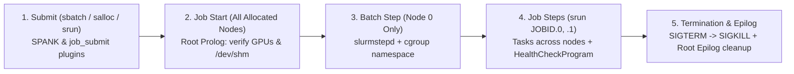

# 6.11 Submitting and launching jobs: sbatch, srun, salloc, arrays, dependencies

| | |
|---|---|
| Level | Intermediate |
| Priority tier | 1 |
| Lab venue | Slurm cluster; the linter script needs only Python 3 |
| Part | Part 6: HPC and Slurm |
| Status | Drafted. Option names, defaults, patterns and environment variables were checked against the `sbatch`, `srun`, `salloc`, `scontrol` and `slurm.conf` man pages (SchedMD/slurm commit `521370b`, 2026-10-23, development version 26.11.0rc1; older releases lack some options). `code/part06/sbatch_lint.py` was run on two test scripts (output shown). No Slurm daemon was run; cluster examples are **untested** |

## Why this matters for AI infrastructure

The user-facing interface to a GPU cluster is a handful of commands. Researchers lose hours to avoidable mistakes: a multi-node script that runs everything on one node, an array of 1,000 jobs with no throttle that floods the file system, a requeued job that overwrites its own log, a training run killed at the time limit without a checkpoint, `mpirun` launched inside a batch script without binding. Operators write the documentation, templates, `job_submit` plugins and wrapper scripts that prevent these, and answer the tickets when they happen. This chapter is the working vocabulary for both sides.

## Prerequisites and outcomes

Needs 6.2, 6.7 to 6.10. After this chapter you can:

- Explain the difference between an allocation, a batch script, and job steps, and which command creates which.
- Write correct batch scripts for single-GPU, multi-GPU, multi-node and array workloads, including directives, environment handling, signals and requeue.
- Use `srun` inside allocations (steps, `--exact`, `--overlap`), `salloc` for interactive work, and understand `--pty` and interactive steps.
- Build array, dependency and pipeline workflows; know the failure behaviour of dependencies.
- Read and use the SLURM environment variables for rank/world-size/rendezvous set-up.
- Monitor, inspect, modify and cancel jobs with `squeue`, `scontrol`, `sacct`, `scancel`.
- Lint scripts for common mistakes and write submission templates for a site.

## 1. Allocations, batch jobs and steps



Three concepts:

- An **allocation** is a set of resources (nodes, CPUs, GPUs, memory) held for a time limit under a job ID.
- A **batch job** (`sbatch script`) queues a request; when resources are available, Slurm runs the script on the **first allocated node** as the "batch step". Commands in the script run only there unless launched across the allocation.
- A **job step** (`srun ...`) launches tasks across (part of) the allocation. A batch script typically contains one or more `srun` steps; each gets an ID `JOBID.0`, `JOBID.1`, etc. Accounting records each step.

Commands:

| Command | Does |
|---|---|
| `sbatch script.sh` | Submit a batch script; returns the job ID immediately |
| `salloc ...` | Obtain an allocation and start a shell (or command) with the allocation environment; you then run `srun` steps interactively |
| `srun ...` | Inside an allocation: launch a step. Outside one: create an allocation **and** run the command (blocking) |
| `scancel`, `squeue`, `sinfo`, `scontrol`, `sacct`, `sstat`, `sprio`, `sshare`, `sreport` | Control and query |

Rule: in a **multi-node** batch script, commands without `srun` execute once, on the first node. The linter (section 9) warns about multi-node scripts that contain neither `srun` nor `mpirun`. For example (`SCL` Chapter 15, *User Experience*), if a script requests `#SBATCH --nodes 2` and `#SBATCH --ntasks-per-node 2` and runs `echo Start; srun hostname; echo End`, then `echo Start` and `echo End` execute **once** on the first allocated node (Step 0), while `srun hostname` executes **four times** across the two nodes (`n10`, `n11`, `n11`, `n10`, in arbitrary completion order). You can even launch multiple `srun` steps in parallel inside a single allocation—for example, inside a 4-CPU allocation, running `srun -n 1 ... &` alongside `srun -n 3 ... &`.

### The 6-stage Slurm job life cycle (`SCL` Chapter 15)

Understanding what Slurm executes behind the scenes at each stage of a job's life cycle explains why jobs get rejected at submit time, why a broken node drains on launch, and how stray processes are reaped (`SCL` Chapter 15, *Job Life Cycle*):

1. **Submit (`sbatch` / `srun` / `salloc`):** `slurmctld` validates whether the user's association/QoS is allowed to queue the job and invokes registered **SPANK plugins** (which can add custom CLI flags to `sbatch`/`srun`, such as NVIDIA `pyxis` adding `--container-image`) and **`job_submit` plugins** (which validate or rewrite job requests).
2. **Job start (`Prolog`):** Before user code runs, Slurm executes the **`Prolog`** script(s) as `root` on **every allocated compute node** to verify hardware readiness and clean `/tmp`, `/dev/shm`, and leftover IPC semaphores. **Critical rule:** `Prolog` execution time is bounded; if a `Prolog` script returns a non-zero exit code, Slurm aborts the job launch, **drains the offending node**, and requeues or cancels the job.
3. **Creating the job step (`slurmstepd`):** `slurmd` spawns `slurmstepd`, invokes step plugin hooks, creates the Linux **cgroup** namespace (`task/cgroup`), applies CPU/RAM/GPU device constraints, and starts Step `0` (the batch script itself on the first node).
4. **Running (`srun` steps and `HealthCheckProgram`):** User `srun` invocations launch numbered steps (`JOBID.0`, `JOBID.1`, ...). Periodically (at `HealthCheckInterval`), `slurmd` runs the configured **`HealthCheckProgram`**—which must be fast and completely non-intrusive—to check for kernel `dmesg` or GPU hardware errors and drain unhealthy nodes.
5. **Preemption (if triggered):** Higher-priority jobs preempt running jobs according to `PreemptType` and `PreemptMode` (`REQUEUE`, `CANCEL`, `SUSPEND,GANG`; Chapter 6.9).
6. **Job end (`SIGTERM` $\to$ `SIGKILL` and `Epilog`):** When the batch script exits, is cancelled, or hits its `--time` limit, Slurm sends `SIGTERM` followed (after `KillWait`) by `SIGKILL` to all job processes across all allocated nodes, and then runs the **`Epilog`** script as `root` on every allocated node to verify cleanup.

### Simulating a multi-node GPU cluster on a single physical machine (`DAI` Chapter 8)

Before submitting complex multi-node scripts to a shared production queue, you can test multi-node `sbatch` and `srun` scripts on a single multi-GPU workstation by running multiple `slurmd` daemons on different TCP ports (`DAI` Chapter 8, *Simulating a Multi-Node cluster*, requiring Slurm built with `--enable-multiple-slurmd`):

```ini
# slurm.conf — two virtual nodes (node6, node7) on one 8-GPU host
NodeName=node6 NodeHostname=localhost Port=17016 CPUs=112 RealMemory=240000 Gres=gpu:1 State=UNKNOWN
NodeName=node7 NodeHostname=localhost Port=17017 CPUs=112 RealMemory=240000 Gres=gpu:1 State=UNKNOWN
PartitionName=gpu Nodes=node[6-7] Default=YES MaxTime=INFINITE State=UP

# gres.conf — map each virtual node to a dedicated physical GPU (/dev/nvidia6 and /dev/nvidia7)
NodeName=node6 Name=gpu File=/dev/nvidia6
NodeName=node7 Name=gpu File=/dev/nvidia7
```

Once started, `sinfo` reports `gpu* up infinite 2 idle node[6-7]`, and you can verify multi-node execution with `srun -N 1 hostname` and `srun -N 2 hostname` or a quick smoke test `srun -N 2 --gres=gpu:1 --cpus-per-task=4 python code/train.py` before moving to production (`DAI` Chapter 8).

## 2. A batch script

```bash
#!/bin/bash
#SBATCH --job-name=bert-pretrain
#SBATCH --partition=gpu
#SBATCH --nodes=2
#SBATCH --ntasks-per-node=8          # one task per GPU
#SBATCH --gpus-per-node=8
#SBATCH --cpus-per-gpu=12
#SBATCH --mem=0                      # all memory on the (exclusive) node
#SBATCH --exclusive
#SBATCH --time=12:00:00
#SBATCH --requeue
#SBATCH --signal=B:USR1@300          # warn the batch shell 5 minutes before the limit
#SBATCH --output=logs/%x-%j.out
#SBATCH --open-mode=append

set -euo pipefail
module purge
module load cuda/12.4 nccl/2.21
export OMP_NUM_THREADS=$SLURM_CPUS_PER_GPU   # see section 7; set per your site
srun --mpi=pmix python train.py --resume-if-exists
```

Details (from `sbatch(1)`):

- `#SBATCH` lines must precede the first executable command; they are comments to the shell. Command-line options override them. The script must start with `#!`.
- Time: `--time=D-HH:MM:SS` or `HH:MM:SS`. Provide it (6.9 on backfill). `--time-min` lets a flexible job start with less.
- **Output**: by default stdout and stderr go to `slurm-%j.out` (`slurm-%A_%a.out` for arrays) in the submission directory. Filename patterns include `%j` job ID, `%A`/`%a` array job/index, `%x` job name, `%N` short hostname (one file per node), `%u` user, `%t` task id (srun), `%%`. **The directory in `--output` must exist before the job starts**, or the job fails silently with no log; create it in a wrapper or submit from a directory that has it.
- `--open-mode=append|truncate`: default from the cluster's `JobFileAppend`. A **requeued** job reuses the job ID; with truncate mode the second run erases the first run's log, so use `append` or include something unique.
- `--export`: default `ALL` propagates the submitter's environment into the job. That includes loaded modules and conda environments, which makes jobs depend on whatever the user's shell had. For reproducibility use `--export=NONE` plus an explicit `module purge`/`module load` or `source` in the script (note `NONE` also means you must use absolute paths or set `PATH` yourself; `--export=NONE` with `sbatch` also needs `--get-user-env` or login-shell tricks on some sites, check local docs).
- **Containers**: `--container` is available in recent releases (OCI), and sites using pyxis add `--container-image` etc. (6.13).
- **Constraints**: `--constraint="h100&ib"` selects nodes by feature (6.8).
- `--wrap="command"` submits a one-liner without a script file.
- `--test-only` validates and reports when and where the job would start, without submitting. `--parsable` prints only the job ID for scripting.
- Mail: `--mail-type=END,FAIL --mail-user=...` (only if the site runs mail).
- `--begin=now+1hour`, `--deadline=...`, `--hold`, `--nice`, `--reservation`, `--qos`, `--account`: scheduling controls (6.9).

### Summary of primary `sbatch` / `srun` keys (`SCL` Chapter 15 `Table 15-1`)

| Key | Meaning |
|---|---|
| `-p partition` / `--partition` | Target partition name |
| `-n NUMBER` / `--ntasks` | Total number of tasks (processes) |
| `-N NUMBER` / `--nodes` | Number of compute nodes |
| `--ntasks-per-node N` | Number of tasks launched on each node (combined with `-n`/`-N`) |
| `-A account` / `--account` | Charge resource usage to the specified account |
| `--gres=NAME:NUMBER[,...]` | Request Generic Resources per node (e.g., `--gres=gpu:8`) |
| `-C` / `--constraint=...` | Require node feature expressions (e.g., `--constraint="h100&ib"`) |
| `-d condition` / `--dependency` | Defer job start until dependency condition holds (e.g., `afterok:123`) |
| `-i` / `-o` / `-e file` | Standard input, output, and error file paths (default `slurm-%j.out`) |
| `-J name` / `--job-name` | Job name (defaults to script filename or command) |
| `--requeue` / `--no-requeue` | Allow or forbid automatic requeuing on node failure or preemption |
| `-t` / `--time=TIME` | Maximum wall-clock limit (`D-HH:MM:SS`); job is terminated on expiration |
| `-w nodelist` / `--nodelist` | Request specific node hostnames |
| `-x nodelist` / `--exclude` | Exclude specific broken or slow nodes |
| `--qos=NAME` | Request a specific Quality of Service (`QoS`) |

### Rank-specific logging vs interleaved stdout (`DAI` Chapter 8)

In multi-node distributed training, all ranks write to the same `slurm-%j.out` file by default, interleaving stack traces and progress bars (`DAI` Chapter 8, *Logging and output*). You have three clean layers of control:
1. **Per-node log files via `#SBATCH` patterns:** Use `#SBATCH --output=logs/train_%j_%N.out` and `#SBATCH --error=logs/train_%j_%N.err` so each node (`%N`) writes to its own file.
2. **Task-prefixed stdout via `srun --label`:** Running `srun --label python train.py` prefixes every stdout/stderr line with the global task ID (`0: ...`, `1: ...`).
3. **Per-rank Python log files:** Configure Python's `logging` module inside your training script so every rank logs to `train_rank_{rank}.log` while only `rank == 0` attaches a `logging.StreamHandler()` to console stdout.

### Environment variables

Slurm sets many; those you will use constantly (all present in the man pages):

| Variable | Meaning |
|---|---|
| `SLURM_JOB_ID`, `SLURM_JOB_NAME`, `SLURM_JOB_PARTITION`, `SLURM_SUBMIT_DIR` | Job identity and where you submitted from |
| `SLURM_JOB_NODELIST` (`SLURM_NODELIST`), `SLURM_JOB_NUM_NODES` (`SLURM_NNODES`) | Nodes of the allocation; the nodelist is compressed (`gpu[01-04]`): expand with `scontrol show hostnames "$SLURM_JOB_NODELIST"` |
| `SLURM_NTASKS`, `SLURM_NTASKS_PER_NODE`, `SLURM_TASKS_PER_NODE`, `SLURM_CPUS_PER_TASK`, `SLURM_CPUS_ON_NODE`, `SLURM_MEM_PER_NODE` | Shape of the allocation |
| `SLURM_PROCID`, `SLURM_LOCALID`, `SLURM_NODEID` | Set **per task by srun**: global rank, node-local rank, node index |
| `SLURM_ARRAY_JOB_ID`, `SLURM_ARRAY_TASK_ID`, `SLURM_ARRAY_TASK_COUNT` | Array identity |
| `SLURM_RESTART_COUNT` | How many times the job was requeued (0 on the first run) |
| `SLURM_JOB_GPUS`, `SLURM_GPUS_ON_NODE`, ... | GPU information (6.10) |

`SLURM_PROCID` and friends exist only inside tasks launched by `srun`, not in the batch shell (the batch script itself has `SLURM_NODEID=0`). This is the usual "variable is empty" confusion.

### Distributed-training rendezvous from Slurm variables

PyTorch needs a master address, port, world size and rank. With one task per GPU launched by `srun`:

```bash
MASTER_ADDR=$(scontrol show hostnames "$SLURM_JOB_NODELIST" | head -n 1)
MASTER_PORT=$((10000 + SLURM_JOB_ID % 20000))   # avoid collisions between jobs on shared nodes
export MASTER_ADDR MASTER_PORT
srun bash -c 'export RANK=$SLURM_PROCID LOCAL_RANK=$SLURM_LOCALID WORLD_SIZE=$SLURM_NTASKS; exec python train.py'
```

Alternative: one task per node launching `torchrun --nnodes=$SLURM_NNODES --nproc-per-node=8 --rdzv-backend=c10d --rdzv-endpoint=$MASTER_ADDR:29500 train.py` (6.12 compares the two). The `MASTER_PORT` formula is a convenience, not a guarantee; some sites provide port management (`--resv-ports`, MPI/PMIx plugins).

## 3. srun

`srun` launches a **step**: it connects to the allocation (or creates one), starts the requested number of tasks on the nodes, forwards stdin/stdout/stderr, and returns the exit status. Key options (from `srun(1)`): `-n/--ntasks`, `-N/--nodes`, `--ntasks-per-node`, `-c/--cpus-per-task`, `--cpu-bind`, `--mem-bind`, `--gpu-bind`, `--gpus-per-task`, `--mpi=<type>` (`list` shows plugins, `pmix` and `pmi2` common), `--export`, `-K/--kill-on-bad-exit`, `--label` (prefix output with the task id), `--output/--error` per-step patterns, `--time`, `--wait`, `--pty`.

Steps inside an allocation:

- **Steps do not share resources by default** with other parallel steps. A second concurrent `srun` that wants CPUs/GPUs already used by the first step **waits or is rejected** unless `--overlap` is given ("allows steps to share all resources (CPUs, memory, and GRES) with all other steps"). This is why `srun nvidia-smi` in a second terminal of an interactive allocation can hang, and why monitoring a running training job's GPUs is done with `srun --overlap --jobid=JOBID ...` (6.14).
- `--exact` limits a step to exactly the resources it requested; without it a step may use "all non-GRES resources on each node in the step allocation". For several concurrent steps with different shapes use `--exact` (often the default behaviour in current versions through `--cpus-per-task`/`--cpus-per-gpu`; check yours).
- `-K/--kill-on-bad-exit`: terminate the whole step if any task exits non-zero. Default from the cluster's `KillOnBadExit`. For tightly coupled jobs you want this; otherwise one dead rank leaves the others hanging in a collective until the time limit (a classic waste of GPU hours).
- `srun` without an allocation creates one for the command: `srun -N1 --gres=gpu:1 --pty bash` is an interactive session in a single command.
- `srun --jobid=<id>` attaches to a running job's allocation (permission: the user's own job).

### MPI and launching

`srun --mpi=pmix` hands rank wire-up to Slurm's PMIx plugin (6.4, 6.12); `mpirun` inside a script works with Open MPI's Slurm integration but does its own launching and binding. Prefer `srun` so that Slurm sets binding (`--cpu-bind`, `--gpu-bind`), tracks processes in the job cgroup, and accounts usage per step.

## 4. Interactive jobs

```bash
salloc --partition=gpu --gres=gpu:1 --cpus-per-gpu=8 --mem-per-gpu=64G --time=2:00:00
# a shell opens; Slurm variables are set; then:
srun --pty bash                # a shell on the compute node
srun python quick_test.py      # or run a step
exit                           # releases the allocation
```

Or in one step: `srun --partition=gpu --gres=gpu:1 --time=1:00:00 --pty bash`.

Where does `salloc`'s own shell run? By default on the submission host (the login node). Many sites want it on the compute node: the current mechanism is `LaunchParameters=use_interactive_step` in `slurm.conf`, which makes `salloc` start `srun` with `InteractiveStepOptions` (default `--interactive --preserve-env --pty $SHELL`, per the man page) so you land on a node of the allocation. The "interactive step" consumes no resources, so other steps can run in parallel. (The old `SallocDefaultCommand` parameter is no longer in the `slurm.conf` man page.)

Interactive etiquette and policy: short time limits, a dedicated `interactive`/`debug` partition with high priority and small size, MIG or shared GPUs for notebooks (6.10), idle-job reaping, and Open OnDemand for Jupyter and VS Code (6.25). An idle `salloc` holding 8 GPUs for a day is an expensive nap; consider a `job_submit` plugin or epilog that kills idle interactive allocations.

## 5. Job arrays

`sbatch --array=0-99%10 script.sh` creates 100 tasks (indices 0 to 99), at most 10 running at once. Forms: `0-15`, `0,6,16-32`, `0-15:4` (step), `%N` throttle. Indices must be below `MaxArraySize`, and the count is limited by `max_array_tasks` in `SchedulerParameters` (man page). Heterogeneous jobs cannot be arrays.

Each task is an independent job with `SLURM_ARRAY_TASK_ID`, `SLURM_ARRAY_JOB_ID` (the first task's ID, "the array's master") and its own `SLURM_JOB_ID`. Default output is `slurm-%A_%a.out`. Manage collectively (`scancel 12345` cancels all; `scancel 12345_7` one) or individually; `squeue` condenses pending arrays (`-r` expands).

Typical use: hyperparameter sweeps, per-shard preprocessing, evaluation over checkpoints.

```bash
#SBATCH --array=0-31%8
CONFIG=$(sed -n "$((SLURM_ARRAY_TASK_ID+1))p" configs.txt)
srun python train.py $CONFIG
```

Good practice: always throttle (`%N`) to protect shared storage and fair-share; keep tasks reasonably long (arrays of 5-second tasks overload the controller; batch them); write results per task into separate directories; for very large sweeps use a workflow tool or `srun --multi-prog`/GNU parallel inside one allocation.

### 2D hyperparameter grid search with job arrays (`DAI` Chapter 8)

Instead of maintaining an external config file, you can map `SLURM_ARRAY_TASK_ID` directly into a 2D hyperparameter grid using integer modulo (`%`) and division (`/`) in bash (`DAI` Chapter 8, *Job arrays for hyperparameter tuning* and *Implement job array for hyperparameter search*):

```bash
#!/bin/bash
#SBATCH --job-name=hp-search
#SBATCH --array=0-11%4
#SBATCH --nodes=1
#SBATCH --gres=gpu:1
#SBATCH --time=01:00:00
#SBATCH --output=logs/hp_%A_%a.out

LEARNING_RATES=(1e-4 3e-4 1e-3 3e-3)
BATCH_SIZES=(16 32 64)
NUM_LR=${#LEARNING_RATES[@]}
LR_IDX=$((SLURM_ARRAY_TASK_ID % NUM_LR))
BS_IDX=$((SLURM_ARRAY_TASK_ID / NUM_LR))
LR=${LEARNING_RATES[$LR_IDX]}
BS=${BATCH_SIZES[$BS_IDX]}

python train.py --lr "$LR" --batch-size "$BS" --output-dir "results/hp_${SLURM_ARRAY_TASK_ID}"
```

Once all 12 tasks complete, a lightweight Python collector (`collect_hp_results("results")` in `DAI` Chapter 8) globs `results/hp_*/metrics.json`, sorts the dictionary list by `val_loss` (`results.sort(key=lambda x: x["val_loss"])`), and prints the top 5 `(lr, batch_size, val_loss)` configurations.

## 6. Dependencies and pipelines

`--dependency=<type>:<jobid>[:<jobid>...]` defers a job until conditions on other jobs are met (man page):

| Type | Starts when |
|---|---|
| `after:ID[+minutes]` | Listed jobs have started or been cancelled (plus optional delay) |
| `afterany:ID` | They have terminated for any reason (**default type**) |
| `afterok:ID` | They completed successfully (exit code 0) |
| `afternotok:ID` | They failed (non-zero, cancelled, timeout, node failure): for cleanup or notification jobs |
| `aftercorr:ID` | The matching task of an array completed successfully |
| `afterburstbuffer:ID`, `singleton` | After burst-buffer stage-out; only one job of the same name/user at a time |

Combine with `,` (all must hold) or `?` (any); only one separator type per expression: `afterok:20:21,afterany:23` versus `afterok:20:21?afterany:23`.

**Failure semantics matter**: "once a job dependency fails due to the termination state of a preceding job, the dependent job will never be run, even if the preceding job is requeued and has a different termination state in a subsequent execution". By default such a job stays pending forever with reason `DependencyNeverSatisfied`; `--kill-on-invalid-dep=yes` (or the cluster's `kill_invalid_depend`) cancels it. Pipelines can therefore leave zombie pending jobs; always clean up.

Pattern for a training chain that continues past the time limit:

```bash
J1=$(sbatch --parsable train.sh)
J2=$(sbatch --parsable --dependency=afterany:$J1 train.sh)      # resume run 2
J3=$(sbatch --parsable --dependency=afterok:$J2 evaluate.sh)
```

Use `afterany` between training segments (a timeout is a "failure") and have each segment resume from the latest checkpoint. For a self-resubmitting job, trap the warning signal, checkpoint, and `scontrol requeue $SLURM_JOB_ID`.

## 7. Time limits, signals, checkpoints, requeue

Training must survive the time limit, preemption (6.9) and node failures. Slurm tools:

- `--signal=[R:|B:]<sig>[@seconds]`: send a signal that many seconds before the limit (up to 60 seconds early due to resolution; if no time is given, 60 seconds). **By default only job steps are signalled, not the batch shell; use `B:` to signal the batch shell.** `R:` allows overlap with a reservation that has a start delay.
- On preemption, `GraceTime` (partition or QOS; 6.9) gives the SIGTERM-to-SIGKILL window.
- `--requeue` / `--no-requeue`: whether the job may be restarted from the beginning of the script, with the same job ID, after node failure, admin action or preemption. `SLURM_RESTART_COUNT` tells the script which attempt it is. `scontrol requeue JOBID` requeues explicitly.

A robust pattern:

```bash
#!/bin/bash
#SBATCH --signal=B:USR1@600 --requeue --open-mode=append
checkpoint_and_requeue() { scancel --signal=USR1 --batch-only ${SLURM_JOB_ID} 2>/dev/null || true; kill -TERM "$PID"; wait "$PID"; scontrol requeue "$SLURM_JOB_ID"; }
trap checkpoint_and_requeue USR1
srun python train.py --resume-latest &
PID=$!
wait "$PID"
```

(The pattern is the commonly used one; the exact signalling plumbing varies. The training program should handle SIGTERM/SIGUSR1 by writing a checkpoint, and the launcher must forward the signal to the ranks. Test it end to end before relying on it; Part 14 covers checkpointing strategy, and 6.12 launcher details.) The simplest dependable approach is **periodic checkpoints plus idempotent resume**, with the signal handler as an optimisation.

In Python (`DAI` Chapter 8, *Checkpointing and job resumption* and *Implement automatic checkpointing with SLURM*), you can encapsulate signal handling inside a `SLURMCheckpointer` class that registers handlers for both **`signal.SIGUSR1`** (sent by `#SBATCH --signal=SIGUSR1@90` 90 seconds before `--time` expiration) and **`signal.SIGTERM`** (sent by `scancel`, node drain, or QoS preemption):

```python
import os, signal

class SLURMCheckpointer:
    def __init__(self, checkpoint_dir: str, model, optimizer):
        self.checkpoint_dir = checkpoint_dir
        self.model = model
        self.optimizer = optimizer
        self.step = 0
        self.should_stop = False
        signal.signal(signal.SIGTERM, self._handle_signal)
        signal.signal(signal.SIGUSR1, self._handle_signal)

    def _handle_signal(self, signum, frame):
        self.should_stop = True
```

At the end of the current training step, every rank checks `if checkpointer.should_stop:`, writes the checkpoint (on rank 0 for replicated DDP state, or across all ranks via `torch.distributed.checkpoint` for FSDP/Megatron), and rank 0 (`int(os.environ.get("SLURM_PROCID", 0)) == 0`) either calls `scontrol requeue $SLURM_JOB_ID` or submits a continuation job (`sbatch --dependency=singleton train.slurm`).

## 8. Monitoring, modifying, cancelling

`squeue` supports both short (`-o`) and long (`-O`) format specifiers (`SCL` Chapter 15 `Table 15-2`), where the default format is `"%.18i %.9P %.8j %.8u %.2t %.10M %.6D %R"` (a dot `.` right-aligns the column):
- **Identity & placement:** `%i` (`taskid`), `%j` (`name`), `%P` (`partition`), `%u` (`username`), `%U` (`userid`), `%a` (`account`), `%v` (`reservation`), `%o` (`command`).
- **Resources & nodes:** `%C` (`numcpus`), `%D` (`numnodes`), `%N` (`nodes`, or nodes not yet released during `COMPLETING`), `%r` (`reason`).
- **Time & status:** `%V` (`submittime`), `%M` (`eligiletime`/runtime), `%l` (`timelimit`), `%L` (`timeleft`), `%e` (`endtime`), `%t` (`statecompact`: `PD` pending, `R` running, `CA` canceled, `CF` configuring, `CG` completing, `CD` completed, `F` failed, `TO` timeout, `NF` node failure, `SE` special exit), and `%T` (`state` expanded).

```bash
squeue -u $USER -o "%.10i %.9P %.20j %.8T %.10M %.6D %R"      # job id, partition, name, state, runtime, nodes, reason/nodes
squeue -j JOBID --start                                         # estimated start
scontrol show job JOBID                                         # everything (Reason, TresPerNode, StdOut, WorkDir, NodeList...)
scontrol update job JOBID TimeLimit=+2:00:00                    # extend (privileged) or reduce
scontrol update job JOBID Dependency=afterok:123
scontrol hold JOBID ; scontrol release JOBID
sacct -j JOBID --format=JobID,JobName,Partition,State,ExitCode,Elapsed,TotalCPU,MaxRSS,AllocTRES%50
sacct -X -u $USER -S now-7days --format=JobID,State,Elapsed,NodeList
sstat -j JOBID.0 --format=JobID,AveCPU,MaxRSS                  # running steps
scancel JOBID ; scancel -u $USER --state=PENDING ; scancel --signal=USR1 JOBID
```

States to know: `PENDING`, `RUNNING`, `COMPLETING`, `COMPLETED`, `FAILED`, `CANCELLED`, `TIMEOUT`, `NODE_FAIL`, `OUT_OF_MEMORY`, `PREEMPTED`, `REQUEUED`, `SUSPENDED`. Reasons for pending are in 6.9 section 8. `scontrol show job` shows `ExitCode=0:15` as exit code and signal. After completion, `sacct` is the source (the controller forgets completed jobs after `MinJobAge`).

Peek into a running job: `srun --overlap --jobid=JOBID --pty bash` (lands on the first node, sharing resources), or `srun --overlap --jobid=JOBID -w NODE nvidia-smi`; check allowed by site policy (`pam_slurm_adopt` also allows SSH to nodes where you have a job).

## 9. A linter for batch scripts

`code/part06/sbatch_lint.py` parses `#SBATCH` lines and checks them against an option list extracted from the `sbatch` man page and against rules stated there or standard practice. Output for a good and a bad script:

```text
== good.sbatch
no findings
== bad.sbatch
ERROR no shebang line; sbatch rejects scripts that do not start with #!
warn  line 8: --tasks-per-node is not in the reference option list (typo, or a different Slurm version?)
warn  no --time: the partition default applies; backfill works best with an accurate limit (6.9)
ERROR --mem, --mem-per-gpu are mutually exclusive
ERROR --cpus-per-gpu is not compatible with --cpus-per-task
ERROR --gpus-per-task needs an explicit task count (-n/--ntasks or --ntasks-per-node with --nodes)
info  job array without a %N throttle can flood the scheduler and the file system
warn  requeued job writes to a fixed output name; use --open-mode=append or include %j
info  --requeue without --signal: the job gets no warning before preemption/time limit; checkpoint on SIGTERM/USR1
warn  module load without module purge: inherited modules can mix toolchains (6.6)
info  no 'set -e'/errexit: a failed setup step will not stop the script
info  mpirun inside a batch script: srun --mpi=pmix lets Slurm launch and bind the ranks (6.12)
```

Sites can run a linter from a `job_submit` plugin (Lua) or a wrapper around `sbatch`, rejecting or warning on bad requests, setting defaults (partition, time, GPU CPU/memory defaults, account) and routing jobs. Keep the policy visible: a clear message beats a silent rewrite.

## 10. Submission patterns for AI workloads

| Workload | Pattern |
|---|---|
| Single-GPU experiment | `--gpus=1 --cpus-per-gpu=8 --mem-per-gpu=...`, short time, `debug` or `interactive` partition |
| Multi-GPU single node | `--gpus-per-node=8 --ntasks-per-node=8 --exclusive`, `torchrun --standalone` or `srun` per GPU |
| Multi-node DDP/FSDP | `--nodes=N --ntasks-per-node=8`, `srun` or `torchrun` with rendezvous from `scontrol show hostnames` (6.12) |
| Hyperparameter sweep | Job array with `%throttle`, one config per index |
| Long run | Checkpoints every K minutes, `--requeue`, `--signal=B:USR1@...`, dependency chain |
| Data preprocessing | CPU array jobs on a cpu partition; write sharded outputs; later GPU job reads them |
| Evaluation after training | `--dependency=afterok:$TRAIN` or triggered from the training script |
| Inference server batch | One job per replica; health endpoint; service discovery via a shared file or the Slurm nodelist (or move serving to Kubernetes) |
| Debugging a hang | `salloc` same shape, `srun --pty`, `py-spy`, `NCCL_DEBUG=INFO` (6.12, 6.14) |

## 11. Common mistakes

- Output directory in `--output` does not exist: job fails without a log.
- Using `mpirun` or `torchrun` once per node incorrectly, or forgetting `srun` so everything runs on node 0.
- Asking `--gres=gpu:8` for a multi-node job and forgetting that it is per node.
- `--mem` or `--cpus-per-task` unset on GPU jobs: starved data loaders.
- `--export=ALL` default carrying a stale conda environment into jobs.
- A second concurrent `srun` that blocks because steps do not share resources.
- Dependencies on a job that times out with `afterok`: the chain dies silently.
- A requeued job overwriting its own log or restarting training from scratch.
- Massive arrays without throttle.
- `scancel` of a pending array element vs the whole array.
- Writing results to `$HOME` on a quota-limited file system.

## 12. Lab (self-checking linter lab tested; cluster parts untested)

First, run the self-checking Python lab (`code/part06/sbatch_lint_lab.py`) locally. It verifies `code/part06/sbatch_lint.py` against a clean multi-node GPU script (`0` findings) and a broken script (`4` `ERROR`s and `8` warnings/infos), tests the 12-task 2D hyperparameter job-array mapping (`SLURM_ARRAY_TASK_ID` `0..11` over 4 learning rates $\times$ 3 batch sizes), and verifies `SLURMCheckpointer` signal handling (`SIGUSR1` / `SIGTERM`) from `DAI` Chapter 8:

```bash
python3 code/part06/sbatch_lint_lab.py
```

Next, work through these steps on a cluster or single-host virtual cluster:

1. Run `sbatch_lint.py` on your own scripts. Fix every ERROR and warn.
2. Write a 2-node, 16-rank hello script that prints `hostname`, `SLURM_PROCID`, `SLURM_LOCALID`, `SLURM_NODEID` via `srun`; compare the same commands run without `srun`.
3. Submit `--test-only`, then real; use `squeue --start`, `scontrol show job`, `sacct`.
4. Array with `%2` throttle over 6 indices; inspect output files and `squeue -r`.
5. Dependency chain train, evaluate with `afterok`; make the first fail and observe `DependencyNeverSatisfied`; add `--kill-on-invalid-dep=yes`.
6. Interactive: `salloc` then `srun --pty bash`; run a second `srun nvidia-smi` and observe blocking; retry with `--overlap`.
7. Time-limit rehearsal: `--time=00:03:00 --signal=B:USR1@60` with a script that traps USR1 and writes a "checkpoint" file; verify it fires before TIMEOUT, then add requeue and check `SLURM_RESTART_COUNT`.
8. Write a site template repository with scripts for the patterns in section 10 and a README.

## 13. Interview angles

- Explain allocation, batch step, job step. What runs where in a multi-node batch script?
- What is the difference between `sbatch`, `srun` and `salloc`?
- What does `--overlap` do and when do you need it?
- How do you get rank, world size and master address inside a Slurm job?
- How do you make a job survive its time limit?
- What does `afterok` do if the first job is requeued after failing?
- Why throttle arrays? What limits array size?
- A user's job log is empty. What are three causes?
- How would you design a `job_submit` plugin policy for a GPU cluster?
- How do you attach to a running job to look at GPUs?

## Exercises

1. **Linting `#SBATCH` Scripts for Resource Conflicts and Anti-Patterns (`code/part06/sbatch_lint.py` & `sbatch_lint_lab.py`):** Run `python3 code/part06/sbatch_lint_lab.py`. Explain the four hard `ERROR`s caught by `sbatch_lint.py` on `bad.sbatch` (missing `#!` shebang, mutually exclusive `--mem` and `--mem-per-gpu`, incompatible `--cpus-per-gpu` and `--cpus-per-task`, and `--gpus-per-task` without an explicit task count) as well as why `--requeue` requires `--open-mode=append` or `%j` in `--output`.
2. **Simulating a 2-Node GPU Cluster on One Workstation (`DAI` Chapter 8):** Write the `slurm.conf` and `gres.conf` entries to run two virtual nodes (`node6` on `Port=17016` with `/dev/nvidia6` and `node7` on `Port=17017` with `/dev/nvidia7`) on a single 8-GPU host, and write the `sinfo` and `srun` commands to verify 1-node and 2-node execution.
3. **Deriving PyTorch Rendezvous Variables from Slurm (`DAI` Chapter 8):** Write the bash lines to export `MASTER_ADDR` from `SLURM_JOB_NODELIST` (`scontrol show hostnames "$SLURM_JOB_NODELIST" | head -n 1`), randomize `MASTER_PORT=$((29500 + RANDOM % 1000))` (or `10000 + SLURM_JOB_ID % 20000`), and map `WORLD_SIZE`, `RANK`, and `LOCAL_RANK` inside `srun`. Explain why `SLURM_PROCID` and `SLURM_LOCALID` are empty in the top-level batch shell.
4. **2D Hyperparameter Grid Search with Job Arrays (`DAI` Chapter 8 & `sbatch_lint_lab.py`):** Using `map_array_task_to_hp()` in `code/part06/sbatch_lint_lab.py`, map `--array=0-11%4` across `LEARNING_RATES=(1e-4 3e-4 1e-3 3e-3)` and `BATCH_SIZES=(16 32 64)`, verify which `(lr, batch_size)` pair runs on `SLURM_ARRAY_TASK_ID=5` (`(3e-4, 32)`), and explain why `%4` throttling protects shared storage and fair-share.
5. **Preemption-Safe Checkpointing with `SLURMCheckpointer` (`DAI` Chapter 8):** Implement the `SIGUSR1` (`#SBATCH --signal=B:USR1@300` or `--signal=SIGUSR1@90`) and `SIGTERM` signal handler pattern from `DAI` Chapter 8, explaining the difference between `--signal=USR1@300` (signals job steps only) and `--signal=B:USR1@300` (signals the batch shell).
6. **Chaining Multi-Segment Training and Evaluation Pipelines (`--dependency`):** Write a 3-job submission pipeline where `J1` and `J2` run back-to-back training segments and `J3` runs evaluation only if `J2` succeeds. Explain why `J2` must use `afterany:$J1` rather than `afterok:$J1` when `J1` exits on wall-clock timeout, and how `--kill-on-invalid-dep=yes` prevents zombie `DependencyNeverSatisfied` jobs.

## Checkpoint

<details>
<summary>1. Distinguish between a Slurm **allocation**, a **batch step**, and a **job step**, and state where commands without `srun` run in a multi-node batch script (`SCL` Chapter 15).</summary>

- **Allocation:** The set of nodes, CPUs, GPUs, and RAM reserved under a `SLURM_JOB_ID` for a wall-clock limit.
- **Batch step (Step 0):** The shell script submitted to `sbatch`, which executes **only on the first allocated node (Node 0)**. Any command inside the script that is not prefixed with `srun` (or `mpirun`) runs once on Node 0 only.
- **Job step (`JOBID.0`, `JOBID.1`, ...):** A parallel task launch created by `srun` across all (or a subset of) the allocation's nodes.
</details>

<details>
<summary>2. What are the 6 stages of the Slurm job life cycle (`SCL` Chapter 15), and what happens if a root `Prolog` script exits with a non-zero code?</summary>

1. **Submit (`sbatch`/`srun`/`salloc`):** Eligibility check + SPANK and `job_submit` plugins.
2. **Job start (`Prolog`):** Root `Prolog` runs on all allocated nodes to verify hardware and clean `/tmp` and `/dev/shm`. **If `Prolog` exits non-zero, Slurm aborts job startup, drains the offending node, and requeues or cancels the job.**
3. **Create job step (`slurmstepd`):** Starts `slurmstepd`, creates the cgroup container, and launches Step 0.
4. **Running (`srun` steps & `HealthCheckProgram`):** Launches parallel steps and runs periodic non-intrusive node health checks.
5. **Preemption:** Optional eviction/requeue by higher-priority work.
6. **Job end (`SIGTERM` $\to$ `SIGKILL` & `Epilog`):** Terminates all job processes across nodes and runs the root `Epilog` cleanup script.
</details>

<details>
<summary>3. How does `srun` behave when called *outside* an existing allocation versus *inside* an `sbatch` or `salloc` allocation?</summary>

- **Outside an allocation:** `srun` first requests a new job allocation from `slurmctld` (blocking in the queue until resources are granted) and then immediately launches the step across the allocated nodes.
- **Inside an existing allocation:** `srun` launches a job step (`JOBID.N`) immediately inside the already-held resources.
</details>

<details>
<summary>4. How can you simulate a 2-node GPU cluster on a single 8-GPU machine for testing distributed scripts (`DAI` Chapter 8)?</summary>

Build Slurm with `--enable-multiple-slurmd`, define two virtual nodes in `slurm.conf` sharing the local hostname on distinct ports (`NodeName=node6 Port=17016 Gres=gpu:1` and `NodeName=node7 Port=17017 Gres=gpu:1`), and map each virtual node in `gres.conf` to its own physical GPU device (`NodeName=node6 Name=gpu File=/dev/nvidia6` and `NodeName=node7 Name=gpu File=/dev/nvidia7`).
</details>

<details>
<summary>5. What placement and syntax rules apply to `#SBATCH` directives, and what happens if the directory in `--output=logs/%x-%j.out` does not exist?</summary>

The batch script must begin with a `#!` shebang on line 1, and all `#SBATCH` directives must appear **before the first executable shell command** (CLI flags passed to `sbatch` override `#SBATCH` lines). If the parent directory (`logs/`) in `--output` does not exist when the job starts, the job **fails immediately with no log file produced**.
</details>

<details>
<summary>6. Name six filename pattern symbols supported in `--output` / `--error` and explain how to avoid interleaved multi-rank logs (`DAI` Chapter 8).</summary>

- `%j` (job ID), `%x` (job name), `%N` (short node hostname), `%u` (username), `%A` (array master job ID), `%a` (array task index), and `%t` (task rank ID in `srun`).
- To prevent interleaved multi-rank output (`DAI` Chapter 8): use `#SBATCH --output=logs/train_%j_%N.out` for per-node files, pass `srun --label` to prefix every line with its rank ID, or configure Python's `logging` module to write per-rank `train_rank_{rank}.log` files while only `rank == 0` logs to stdout.
</details>

<details>
<summary>7. Why must a job that uses `--requeue` also specify `--open-mode=append` (or a unique retry filename)?</summary>

When a job is requeued, it keeps the **same `SLURM_JOB_ID` (`%j`)** and increments `SLURM_RESTART_COUNT`. If `--open-mode=truncate` is active, the restarted run truncates `slurm-%j.out`, erasing the crash traceback and training progress logs from the previous run.
</details>

<details>
<summary>8. Why is `--export=ALL` (the default) hazardous for reproducibility, and what is the clean alternative?</summary>

`--export=ALL` copies every environment variable from the user's interactive login shell (including stale `PATH`, `LD_LIBRARY_PATH`, `PYTHONPATH`, or activated Conda environments) into the batch job. Using `--export=NONE` (or starting the script with `module purge` and explicit `module load` / `conda activate` commands) makes the script self-contained and reproducible.
</details>

<details>
<summary>9. How do you expand Slurm's compressed `SLURM_JOB_NODELIST` (`gpu[01-04]`) into individual hostnames and map Slurm variables to PyTorch `env://` variables (`DAI` Chapter 8)?</summary>

Expand the nodelist with **`scontrol show hostnames "$SLURM_JOB_NODELIST"`** and export:
- `MASTER_ADDR=$(scontrol show hostnames "$SLURM_JOB_NODELIST" | head -n 1)`
- `MASTER_PORT=$((29500 + RANDOM % 1000))` (or `10000 + SLURM_JOB_ID % 20000`)
- `WORLD_SIZE=$SLURM_NTASKS`, `RANK=$SLURM_PROCID`, and `LOCAL_RANK=$SLURM_LOCALID` (inside the `srun` task environment).
</details>

<details>
<summary>10. Why are `SLURM_PROCID` and `SLURM_LOCALID` unset (or `0`) in the top-level batch script, and where are they populated?</summary>

The batch script itself runs as a single shell process on Node 0 before any parallel tasks exist. **`SLURM_PROCID`** (global rank `0..NTASKS-1`) and **`SLURM_LOCALID`** (node-local rank `0..NTASKS_PER_NODE-1`) are populated per task by **`srun`** (`slurmstepd`) when a job step is launched.
</details>

<details>
<summary>11. Why does running a second concurrent `srun` inside an allocation hang by default, and what do `--overlap` and `--exact` do?</summary>

By default, a job step exclusively claims the CPUs/GPUs allocated on its nodes, so a second parallel `srun` waits for the first step to finish.
- **`--overlap`:** Allows the new step to share CPUs, memory, and GRES with already-running steps (essential for `srun --overlap --jobid=JOBID nvidia-smi` diagnostics).
- **`--exact`:** Restricts a step to only the exact CPU/memory slice it requested so multiple sub-node steps can run side-by-side inside one allocation.
</details>

<details>
<summary>12. What does `srun -K` (`--kill-on-bad-exit`) do, and why is it critical for multi-node GPU training?</summary>

`-K` (`--kill-on-bad-exit=1`) immediately terminates all tasks in the job step as soon as **any single task exits with a non-zero status**. Without it, if rank 5 crashes with an exception, the remaining 63 GPUs sit idle spinning in `NCCL` collective barriers until the job hits its 24-hour wall-clock timeout.
</details>

<details>
<summary>13. Where does `salloc`'s shell run by default, and how does `LaunchParameters=use_interactive_step` change it?</summary>

By default, `salloc` spawns a new shell **on the submission/login node** with `SLURM_*` variables exported (requiring the user to run `srun --pty bash` to land on a compute node). Setting `LaunchParameters=use_interactive_step` in `slurm.conf` causes `salloc` to automatically launch an interactive `srun` step (`--interactive --preserve-env --pty $SHELL`) directly on the first allocated compute node.
</details>

<details>
<summary>14. How does `sbatch --array=0-11%4` work, what environment variables identify each array task, and how do you map `SLURM_ARRAY_TASK_ID` to a 2D hyperparameter grid (`DAI` Chapter 8)?</summary>

It submits 12 independent tasks (`0` through `11`) with a concurrency throttle of at most **4 tasks running simultaneously** (`%4`). Each task receives `SLURM_ARRAY_JOB_ID` (`%A`, master ID), `SLURM_ARRAY_TASK_ID` (`%a`, index `0..11`), and its own `SLURM_JOB_ID` (`%j`). For a grid of `NUM_LR` learning rates and `BATCH_SIZES`, use `LR_IDX=$((SLURM_ARRAY_TASK_ID % NUM_LR))` and `BS_IDX=$((SLURM_ARRAY_TASK_ID / NUM_LR))`.
</details>

<details>
<summary>15. Compare `--dependency=afterok:ID`, `afterany:ID`, `afternotok:ID`, `aftercorr:ID`, and `singleton`.</summary>

- **`afterok:ID`:** Starts only if job `ID` finished with exit code `0` (success).
- **`afterany:ID`:** Starts after job `ID` terminates for *any* reason (success, timeout, failure—ideal for multi-segment training chains that hit walltime).
- **`afternotok:ID`:** Starts only if job `ID` failed or timed out (used for cleanup/alerting).
- **`aftercorr:ID`:** Array task $k$ starts as soon as corresponding array task $k$ of job `ID` succeeds.
- **`singleton`:** Starts only when no other job with the same `--job-name` and user is running or queued earlier.
</details>

<details>
<summary>16. What is the `DependencyNeverSatisfied` trap with `afterok`, and what flag fixes it?</summary>

If job `J1` fails (or times out), any job `J2` waiting on `afterok:$J1` permanently fails its dependency check—even if `J1` is subsequently requeued and succeeds. By default `J2` sits in `PENDING (DependencyNeverSatisfied)` forever unless submitted with **`--kill-on-invalid-dep=yes`** (or cluster-wide `SchedulerParameters=kill_invalid_depend`).
</details>

<details>
<summary>17. What is the difference between `#SBATCH --signal=USR1@300` and `#SBATCH --signal=B:USR1@300`, and why should training code trap both `SIGUSR1` and `SIGTERM` (`DAI` Chapter 8)?</summary>

- Without `B:`, Slurm sends `SIGUSR1` 300 seconds before `--time` expiration to **running `srun` job steps**.
- With **`B:`**, Slurm sends `SIGUSR1` to the **batch shell** itself (allowing a bash `trap` to coordinate checkpointing and `scontrol requeue`).
- Training scripts (`SLURMCheckpointer` in `DAI` Chapter 8) should trap both **`SIGUSR1`** (wall-clock time-limit warning) and **`SIGTERM`** (sent immediately on `scancel`, node drain, or QoS preemption during `GraceTime`).
</details>

<details>
<summary>18. Decode the `squeue` compact state codes `PD`, `R`, `CG`, `CD`, `CA`, `TO`, `NF`, and `F`, and explain why `CG` (`COMPLETING`) sticking is a warning sign (`SCL` Chapter 15 `Table 15-2`).</summary>

- `PD` = `PENDING`, `R` = `RUNNING`, `CG` = `COMPLETING`, `CD` = `COMPLETED`, `CA` = `CANCELLED`, `TO` = `TIMEOUT`, `NF` = `NODE_FAIL`, `F` = `FAILED`.
- A job stuck in **`CG` (`COMPLETING`)** means `slurmstepd` sent `SIGKILL` to the job's processes on the nodes listed in `%N`, but a process is wedged in uninterruptible kernel sleep (`D` state, typically due to a hung Lustre/NFS mount or GPU driver bug) or the `Epilog` script is hanging.
</details>

<details>
<summary>19. How do you inspect the estimated start time of a pending job, extend a running job's walltime, and view `MaxRSS` of a completed or running job?</summary>

- **Estimated start time:** `squeue -j <jobid> --start`
- **Extend walltime (operator/admin):** `scontrol update job <jobid> TimeLimit=+2:00:00`
- **Memory usage (`MaxRSS`):** `sstat -j <jobid>.0 --format=JobID,AveCPU,MaxRSS` while running, or `sacct -j <jobid> --format=JobID,State,ExitCode,Elapsed,MaxRSS,AllocTRES%50` after completion.
</details>

<details>
<summary>20. What four hard `ERROR`s does `code/part06/sbatch_lint.py` reject before a script ever reaches the cluster?</summary>

1. Missing `#!` shebang on line 1 (`sbatch` rejects scripts without `#!`).
2. Mutually exclusive memory flags (`--mem`, `--mem-per-cpu`, `--mem-per-gpu`).
3. Incompatible CPU flags (`--cpus-per-gpu` combined with `--cpus-per-task`).
4. Requesting `--gpus-per-task` without an explicit task count (`-n` / `--ntasks` or `--ntasks-per-node` + `--nodes`).
</details>

## Sources and review notes

- User-level behaviour, `Table 15-1` primary `sbatch`/`srun` keys, `Table 15-2` `squeue` format symbols, and the 6-stage allocation/step/job life cycle (`Prolog`, `slurmstepd`, `HealthCheckProgram`, `Epilog`): read in full from *Supercomputers for Linux SysAdmins* (`supercomputers-for-linux-sysadmins-managing-modern-hpc-clusters-and-supercomputers-from-software-to-hardware`, `SCL`) Chapter 15 ("15. Slurm": User Experience, Job Life Cycle, `scontrol`, Accounting and Statistics).
- Virtual multi-node cluster simulation on a single host (`node6`/`node7` on ports `17016`/`17017`), batch submission, environment variables (`MASTER_ADDR`, `MASTER_PORT`, `WORLD_SIZE`, `RANK`, `LOCAL_RANK`), rank-specific logging (`srun --label`, `train_rank_{rank}.log`), 2D hyperparameter job arrays (`0-11` over 4 LRs $\times$ 3 batch sizes + `collect_hp_results`), interactive `salloc` jobs, job dependencies, and `SLURMCheckpointer` (`SIGUSR1@90` + `SIGTERM`): read in full from *Distributed AI Systems* (`distributed-ai-systems`, `DAI`) Chapter 8 ("Chapter 8: Running Distributed Training with SLURM").
- Options and semantics: man pages `sbatch(1)`, `srun(1)`, `salloc(1)` (via the shared option text), `scontrol(1)`, `slurm.conf(5)` from SchedMD/slurm commit `521370b`.
- Run here: `python3 code/part06/sbatch_lint.py` and `python3 code/part06/sbatch_lint_lab.py` (3 passed, 0 failed).
- Explicitly labelled inferences: `map_array_task_to_hp` and `SLURMCheckpointerSim` in `code/part06/sbatch_lint_lab.py` are deterministic teaching models based on `DAI` Chapter 8.
- Not verified on live hardware: exact behaviour of `--export=NONE` with `sbatch` on your site, whether `--exact` is the default for your release, the signal-forwarding plumbing in the requeue example, and all live cluster behaviour (`untested here`).
