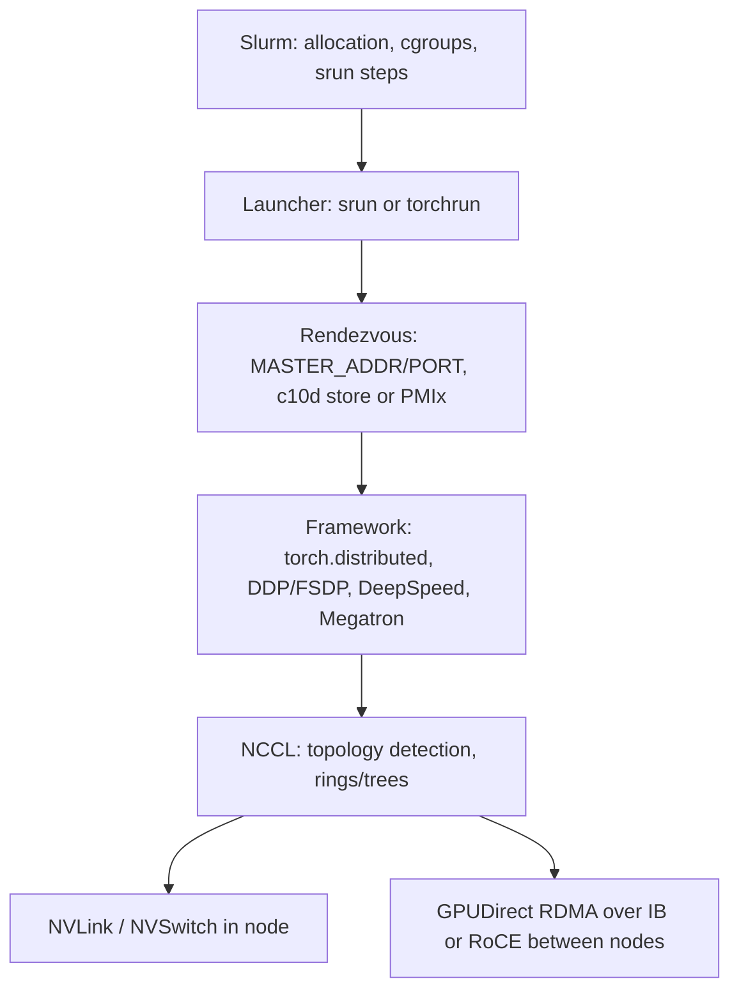

# 6.12 Multi-node training on Slurm: PMIx, torchrun, NCCL environment, binding

| | |
|---|---|
| Level | Intermediate |
| Priority tier | 1 |
| Lab venue | Slurm cluster with a fabric; the harness runs on a laptop (CPU, gloo) |
| Part | Part 6: HPC and Slurm |
| Status | Drafted. The Slurm-to-PyTorch glue was **run**: `code/part06/fake_srun.py` started 4 local processes with the `SLURM_*` variables a real `srun` sets, and `ddp_toy.py` (PyTorch 2.14.1, gloo backend, CPU) completed an all-reduce, a DDP step with identical weights on all ranks, a rank-0 checkpoint and a resumed second run. NCCL variable descriptions were read from `docs/userguide/source/env.rst` in a shallow clone of NVIDIA/nccl (commit `3e46c08`, 2026-10-08). Real multi-node GPU runs are **untested** |

## Why this matters for AI infrastructure

Picture a 64-GPU job that hangs at start, a job that scales badly, or a job where one rank crashed and the other ranks sat waiting for six hours. Most tickets like these are launch-layer problems, not model problems. The rendezvous address may be wrong. Ranks may sit on the wrong NUMA node, which is the group of cores and memory attached to one CPU socket. NCCL may choose the management NIC, a `-K` may be missing, or library versions may not match. An engineer who can read a launch script and predict how it will fail is worth a great deal on an AI cluster.

## Prerequisites and outcomes

You need 6.4, 6.10 and 6.11, along with the basics of Part 10 and Part 12, which cover NCCL and the fabric. When you finish this chapter, you should be able to do the following.

- Separate the control plane, made of Slurm, PMIx and rendezvous, from the data plane, which is NCCL running over NVLink, IB or RoCE.
- Launch one task per GPU with `srun`, or one `torchrun` per node, and choose between them.
- Derive `RANK`, `LOCAL_RANK`, `WORLD_SIZE`, `MASTER_ADDR` and `MASTER_PORT` from Slurm, and test that glue without a cluster.
- Set NCCL environment variables on purpose (interfaces, HCAs, GDR and debug), and know which ones are risky.
- Bind CPUs, GPUs and NICs correctly, and run FSDP, DeepSpeed and Megatron-LM style jobs.
- Triage hangs, slow collectives and partial failures.

## 1. Layers

When a multi-node job hangs at startup, the first question is which layer is waiting. The diagram shows the stack from the scheduler down to the hardware.



Slurm decides *where* processes run and constrains them. The launcher then starts them. Rendezvous is how ranks find each other. For MPI programs, PMIx performs the wire-up through the Slurm step daemons. For PyTorch, the `env://` method uses a TCP store at `MASTER_ADDR:MASTER_PORT`, and that same store distributes NCCL's unique id.

After rendezvous, NCCL talks directly over the fabric, so Slurm and PMIx are out of the data path. PyTorch does not use PMIx at all. It needs the four variables below.

Know which layer owns each variable before you change it.

## 2. Two launch styles

The launch style decides how much control Slurm keeps and how much work your training script has to do. There are two common styles.

**A. `srun`, one task per GPU.** Slurm starts every rank.

```bash
#SBATCH --nodes=4 --ntasks-per-node=8 --gpus-per-node=8 --cpus-per-gpu=12 --exclusive
export MASTER_ADDR=$(scontrol show hostnames "$SLURM_JOB_NODELIST" | head -n1)
export MASTER_PORT=$((10000 + SLURM_JOB_ID % 20000))
srun --kill-on-bad-exit=1 --cpu-bind=cores --gpu-bind=closest python train.py   # train.py derives RANK etc. from SLURM_*
```

Slurm keeps control of binding, cgroups, accounting per step, signals and failure handling, and no per-node launcher process is needed. The cost is that the training script must read `SLURM_PROCID`, `SLURM_LOCALID` and `SLURM_NTASKS`, or you must wrap it.

**B. `torchrun`, one task per node.** torchrun starts the 8 local ranks.

```bash
#SBATCH --nodes=4 --ntasks-per-node=1 --gpus-per-node=8 --cpus-per-task=96 --exclusive
srun torchrun --nnodes=$SLURM_NNODES --nproc-per-node=8 \
  --rdzv-backend=c10d --rdzv-endpoint=$MASTER_ADDR:29500 --rdzv-id=$SLURM_JOB_ID train.py
```

Slurm sees one task per node in this style, and torchrun starts the eight local ranks. The benefit is that torchrun adds elastic features, such as restart on failure and rendezvous. It also sets all the variables, so the script does not depend on the launcher. The costs are coarser per-rank binding and GPU isolation, because Slurm sees one task per node. Process monitoring belongs to torchrun, and `--cpus-per-task` must cover all 8 ranks.

Use **srun-per-GPU** for tightly controlled bare-metal clusters with strong binding requirements. Use **torchrun** when portability or elasticity matters, for example across a laptop, Kubernetes and Slurm. Both styles appear in NVIDIA reference setups. Frameworks add launchers of their own. DeepSpeed has its `deepspeed` launcher, which can use pdsh, mpirun or Slurm runners. Megatron-LM scripts are built on `torchrun`, and NeMo launchers generate `sbatch` for you.

Choose the launch style before you write the batch script, because the training code has to match it.

## 3. The glue, tested

Your training script needs a rendezvous set before it can join a process group. Slurm already holds most of the values, so a small function can turn them into that set. The file `code/part06/slurm_dist_init.py` does exactly this.

```python
def dist_env(env=None, port_base=10000):
    e = os.environ if env is None else env
    job = int(e.get("SLURM_JOB_ID", "0"))
    return {
        "RANK": e["SLURM_PROCID"], "LOCAL_RANK": e["SLURM_LOCALID"], "WORLD_SIZE": e["SLURM_NTASKS"],
        "MASTER_ADDR": e.get("MASTER_ADDR") or first_host(e["SLURM_JOB_NODELIST"]),
        "MASTER_PORT": e.get("MASTER_PORT") or str(port_base + job % 20000),
    }
```

`first_host` calls `scontrol show hostnames` and falls back to a local hostlist expander. That expander was unit-checked, and `gpu[01-03,07],cpu1,x[9-10]` expands correctly. `ddp_toy.py` calls it, initialises `torch.distributed` with `env://`, and checks an all-reduce against `world*(world+1)/2`. It then runs one DDP step with different data on each rank. Finally, it verifies that the resulting weights are identical on all ranks, which shows that gradient averaging works. It saves a checkpoint from rank 0 and resumes from that checkpoint.

The fake launcher, `fake_srun.py 2 2 python ddp_toy.py`, started 4 processes with `SLURM_PROCID=0..3`, `SLURM_LOCALID`, `SLURM_NODEID`, `SLURM_NTASKS=4` and `SLURM_JOB_NODELIST=node[01-02]`. The output looked like this:

```text
rank 0/4 local=0 master=127.0.0.1:14242 allreduce_ok weights_identical=True start_step=0
rank 1/4 local=1 ... weights_identical=True start_step=0
rank 2/4 local=0 ... start_step=0
rank 3/4 local=1 ... start_step=0
(second run) ... start_step=1   # resumed from the rank-0 checkpoint
```

The port came out as 14242 from job ID 4242, which matches the formula. `MASTER_ADDR` was overridden to 127.0.0.1 because `node01` does not resolve on a laptop. On a GPU cluster, set `BACKEND=nccl` and move tensors to `cuda:LOCAL_RANK`. With `ConstrainDevices`, each task sees its GPUs renumbered from 0, as covered in 6.10. Also pass `device_ids=[local_rank]`. This is a **logic test of the glue**, not of fabric behaviour.

An environment lesson came out of the same session. Installing PyTorch with pip into a conda environment that already provided LLVM's OpenMP produced `OMP: Error #15: Initializing libomp.dylib, but found libomp.dylib already initialized` and an abort. That is the "two OpenMP runtimes in one process" hazard from 6.5. The unsafe workaround `KMP_DUPLICATE_LIB_OK=TRUE` exists. The right fix is one environment with one runtime, and the clean venv I used did that.

Run this glue test on a laptop before you trust a new launch script, because it checks the variable mapping without a cluster.

## 4. Rendezvous gotchas

A job that stalls before training starts often fails at rendezvous. These are the gotchas to check first.

- `MASTER_ADDR` must resolve and be reachable from every node, on the interface you intend to use. The first hostname in the nodelist is usually the management name. If the management and fabric networks differ, torch's TCP store uses whichever address `MASTER_ADDR` resolves to, and that is fine. NCCL's bootstrap, however, uses `NCCL_SOCKET_IFNAME`, covered below.
- Ports can collide on shared nodes. Derive the port from the job ID, or ask the site which ports are free. Firewalls must allow the port range between compute nodes.
- With torchrun's c10d rendezvous, the endpoint host must be reachable, and `--rdzv-id` must be unique for each job.
- Only one job should use a given port on a given node at a time. `--exclusive` helps with that.
- If ranks start at different times, for example after a slow image pull or a slow module load, the rendezvous timeout may fire. Increase the timeout, and fix the slow start as well.

When your job stalls at rendezvous, check the port first, derived from the job ID, and make sure the firewall allows that range between compute nodes.

## 5. NCCL environment variables

Many NCCL problems come from one variable set to the wrong value. The table lists the variables covered here, taken from the NCCL user guide (`env.rst`, verified in the clone).

| Variable | Meaning and notes |
|---|---|
| `NCCL_DEBUG` | `VERSION`, `WARN`, `INFO` (and more detail via subsystems); first tool for any hang. `NCCL_DEBUG_SUBSYS` selects subsystems (`INIT,NET,GRAPH,ENV`...); `NCCL_DEBUG_FILE=file.%h.%p` writes per host/process |
| `NCCL_SOCKET_IFNAME` | Interfaces for NCCL's bootstrap and socket transport: prefixes, comma-separated, `^` excludes, `=` exact names. Typical use: `^lo,docker` or an explicit fabric/Ethernet NIC |
| `NCCL_IB_HCA` | Which IB/RoCE adapters: comma list of `hca[:port[:rail[:plane]]]`, `^` exclude, `=` exact names (otherwise prefixes). Example `mlx5_0,mlx5_1,...` |
| `NCCL_IB_DISABLE` | Disable the IB transport (falls back to sockets; a performance cliff, used to test) |
| `NCCL_IB_GID_INDEX` | GID index for RoCE (default -1); find it with `show_gids` |
| `NCCL_IB_TIMEOUT` | Verbs timeout, 4.096 µs x 2^value; raise on very large networks if you see `ibv_poll_cq` error 12 |
| `NCCL_CROSS_NIC` | Whether rings may use different NICs on different nodes; depends on whether the fabric is rail-optimised |
| `NCCL_NET_GDR_LEVEL` (formerly `NCCL_IB_GDR_LEVEL`) | Maximum GPU-NIC distance for GPUDirect RDMA |
| `NCCL_P2P_LEVEL`, `NCCL_P2P_DISABLE`, `NCCL_SHM_DISABLE` | Limit or disable intra-node transports (diagnosis) |
| `NCCL_ALGO`, `NCCL_PROTO` | Force algorithm (ring, tree, ...) or protocol; override NCCL's tuning (use only to test) |
| `NCCL_TOPO_DUMP_FILE` / `NCCL_TOPO_FILE` | Dump the detected topology XML / supply one (virtualised or unusual hosts) |
| `NCCL_BUFFSIZE` | Size of internal NCCL communication buffer in bytes; if tuning for large all-reduce operations, start at `4 MB` (`4194304`) and increase stepwise while watching GPU memory pressure |
| `NCCL_NSOCKS_PERTHREAD`, `NCCL_SOCKET_NTHREADS` | Socket/TCP transport threads and sockets per thread; `NCCL_NSOCKS_PERTHREAD` × `NCCL_SOCKET_NTHREADS` cannot exceed `64` sockets total per communicator |
| `NCCL_MIN_NCHANNELS`, `NCCL_MAX_NCHANNELS` | Minimum and maximum number of communication channels (subrings); each channel uses one CUDA block, so leave at default unless tested |
| `NCCL_MNNVL_ENABLE` | Enable multi-node NVLink (`MNNVL`) on systems with multi-node NVLink switches (such as NVL72 GB200/GB300) |
| `NCCL_SHARP_DISABLE` | Set `NCCL_SHARP_DISABLE=1` to disable in-network SHARP aggregation for A/B testing or troubleshooting |
| `NCCL_IGNORE_CPU_AFFINITY` | Set `NCCL_IGNORE_CPU_AFFINITY=1` so NCCL ignores a narrow inherited CPU affinity mask and spreads its proxy/worker threads across cores in the local NUMA domain |
| `NCCL_RAS_ENABLE` etc. | The reliability/availability/serviceability subsystem (newer) |

Set only the minimum. Default detection is usually right on a well-built node. Put site-wide settings in one file, either `NCCL_CONF_FILE` or `/etc/nccl.conf`, or in the module, so users do not paste folklore into their scripts. Re-verify every variable against the NCCL version you run. The guide gives a "since" note for each variable, and some variables have been renamed.

Record `NCCL_DEBUG=INFO` output from a healthy run as your baseline. It shows the transports NCCL chose (`NET/IB`, `P2P/CUMEM`, `NVLS`), the rings, the channels and the HCAs in use. An `INFO` line that says `NET/Socket` on an IB cluster is the classic misconfiguration.

PyTorch adds variables of its own: `TORCH_NCCL_ASYNC_ERROR_HANDLING`, `TORCH_NCCL_BLOCKING_WAIT`, process-group timeouts (`init_process_group(timeout=...)`), and flight-recorder settings. Their names vary by version, so check them. A short timeout turns a silent hang into a crash with a stack trace, which is what you want in production.

Save that healthy baseline before you change any NCCL variable, so you have something to compare against.

## 6. Binding for training jobs

Binding decides which CPU cores each rank may use. The target is simple. Each rank runs on cores in the socket or NUMA node closest to its GPU and NIC. Data-loader workers stay inside the same cpuset, and nothing is oversubscribed.

On Slurm, you control binding with `--cpus-per-gpu`, `--cpu-bind=cores` (or `rank` or `map_cpu`), `--gpu-bind=closest` and `--gres-flags=enforce-binding`. Set `CoreSpecCount` to reserve cores for the system, as covered in 6.8 and 6.10.

Set `OMP_NUM_THREADS` to the CPUs per rank minus the share used by data-loader workers. You can also set `torch.set_num_threads` and `MKL_NUM_THREADS`.

Run `srun ... bash -c 'echo $SLURM_PROCID $(taskset -pc $$) $CUDA_VISIBLE_DEVICES'`, then check `nvidia-smi topo -m`, `numactl -s` and NCCL's INFO output. The lines `GPU Direct RDMA Enabled for GPU x / HCA y` show which NIC each GPU uses.

A typical 8-GPU HGX node has two NUMA domains with four GPUs each. Its NICs are often distributed, usually one per GPU, in a layout called "rail-optimised". Rank i should use NIC i. NCCL maps this automatically when topology detection works. Containers and VMs can break that detection, and `NCCL_TOPO_FILE` is the setting to check.

The `--bind-to none` flag in `mpirun` examples, covered in 6.4, is for PyTorch cases with workers. Under Slurm, use `--cpu-bind` instead.

Under Slurm, set binding with `--cpu-bind`, and check it on every node before you trust the throughput numbers.

## 7. Framework patterns

Each framework expects its launcher to set up variables in a slightly different way. The table below comes from *Distributed AI Systems*, chapter 8, and compares how the four major distributed training stacks work with Slurm environment variables and launchers.

| Framework | Launcher under `srun` | Distributed Init | Slurm Environment Handling |
|---|---|---|---|
| **PyTorch DDP** | `torchrun` or direct `srun python` | Manual (`dist.init_process_group(backend="nccl")`) | Export `MASTER_ADDR`, `MASTER_PORT`, `WORLD_SIZE`, `RANK`, `LOCAL_RANK` |
| **PyTorch FSDP** | `torchrun` | Manual (`dist.init_process_group(backend="nccl")`) | Same as DDP (`--cpus-per-task=28`, `--mem=200G` for sharded CPU offload) |
| **DeepSpeed (ZeRO-1/2/3)** | `srun --label bash -c "... python train.py --deepspeed ..."` | Automatic (`deepspeed.init_distributed()`) | Reads Slurm vars directly, but requires explicit `export LOCAL_RANK=$SLURM_LOCALID`, `RANK=$SLURM_PROCID`, `CUDA_VISIBLE_DEVICES=$SLURM_LOCALID` |
| **Megatron-LM** | `srun --label bash -c "... torchrun ... pretrain_gpt.py ..."` | Automatic (via `megatron.training`) | Reads Slurm/torchrun vars directly; requires `CUDA_DEVICE_MAX_CONNECTIONS=1` and `OMP_NUM_THREADS=$SLURM_CPUS_PER_TASK` |

DDP replicates the entire model on each GPU, with `DDP(model, device_ids=[local_rank])`, and all-reduces the gradients. You can launch one `torchrun` per node with `srun torchrun --nproc_per_node=1 --nnodes=$SLURM_JOB_NUM_NODES --node_rank=$SLURM_NODEID --master_addr=$MASTER_ADDR --master_port=$MASTER_PORT code/train_ddp.py`. Or you can launch `srun python code/train_ddp.py` directly, after exporting `WORLD_SIZE=$SLURM_NTASKS`, `RANK=$SLURM_PROCID` and `LOCAL_RANK=$SLURM_LOCALID`. Set `find_unused_parameters` only if you need it, because it has a cost. The example files are `code/train_ddp.py` and `code/train_ddp.sh` in *Distributed AI Systems*, chapter 8.

FSDP shards parameters, gradients and optimizer states across GPUs. It uses `FullyShardedDataParallel` with `size_based_auto_wrap_policy` and `CPUOffload(offload_params=True)` in FSDP1, or `fully_shard()` and `CPUOffloadPolicy` in PyTorch 2.4+ FSDP2. All-gather and reduce-scatter dominate its traffic. Use `--ntasks-per-node=8` with consistent block ordering, where `--distribution=block` is the default, so that adjacent ranks share a node. Use `torch.distributed.checkpoint` so each rank writes its own shard without gathering the full model on rank 0. The example files are `code/train_fsdp.py` and `code/train_fsdp.sh` in *Distributed AI Systems*, chapter 8.

DeepSpeed is different from DDP and FSDP. It calls `deepspeed.init_distributed()`, and then `model_engine, optimizer, _, _ = deepspeed.initialize(model=model, model_parameters=model.parameters(), config="ds_zero3_offload.json")`. Your loop then calls `model_engine.backward(loss)` and `model_engine.step()`. In `ds_zero3_offload.json`, `"stage": 3` shards parameters across GPUs. The two offload entries, `"offload_param": {"device": "cpu", "pin_memory": true}` and `"offload_optimizer": {"device": "cpu", "pin_memory": true}`, move states into pinned host RAM. Validate the NCCL and Slurm wiring with ZeRO stage `1` or `2` first. In `run.slurm`, always derive `MASTER_ADDR` with `scontrol show hostnames "$SLURM_JOB_NODELIST" | head -n 1`, never `127.0.0.1`. That address silently creates isolated 1-node process groups on each host. Exclude virtual and loopback interfaces with `export NCCL_SOCKET_IFNAME=^docker,lo`, and set `export GLOO_SOCKET_IFNAME=eth0`. Finally, export `LOCAL_RANK=\$SLURM_LOCALID` inside the `srun --chdir="$SLURM_SUBMIT_DIR" --label bash -c "..."` subshell. The example files are `code/deepspeed/train.py`, `ds_zero3_offload.json` and `run.slurm` in *Distributed AI Systems*, chapter 8.

Megatron-LM builds tensor, pipeline, context or sequence, and data parallelism from the ranks, using `--tensor-model-parallel-size` and `--pipeline-model-parallel-size`. Tensor-parallel groups must stay inside a node over NVLink. The PyPI `megatron-core` package ships only the `megatron.core` building blocks. To run `pretrain_gpt.py`, you clone `NVIDIA/Megatron-LM` and install from source with `pip install --no-build-isolation '.[mlm,dev]'`. Set `export CUDA_DEVICE_MAX_CONNECTIONS=1` and `export OMP_NUM_THREADS=$SLURM_CPUS_PER_TASK`. The example files are `code/megatron/run.slurm` and `convert_megatron_checkpoint.py` in *Distributed AI Systems*, chapter 8.

Megatron-LM checkpoints are large, so size them before you plan storage. For an `8B` GPT model with `8.03B` parameters, the layout flags are `--num-layers 32 --hidden-size 4096 --num-attention-heads 32 --vocab-size 128256`. Its `bf16` model weights take $8.03\text{B} \times 2\text{ bytes} = \mathbf{16.06\text{ GB}}$. Its `fp32` Adam momentum and variance states take $8.03\text{B} \times 8\text{ bytes} = \mathbf{64.24\text{ GB}}$. Together that is $\mathbf{80.30\text{ GB}}$ in theory, but the checkpoint takes **$\sim\mathbf{108\text{ GB}}$ on disk**. The gap comes from distributed optimizer metadata and alignment padding across four `27G` distributed checkpoint shards (`__0_0.distcp`, `__0_1.distcp`, `__1_0.distcp`, `__1_1.distcp`), plus `24K common.pt` and `4.0K metadata.json`. Control the storage footprint with `--save-interval` and checkpoint rotation. To serve the model, convert the `.distcp` shards into standalone weight-only PyTorch checkpoints (`model.pt`) for vLLM or SGLang with `convert_megatron_checkpoint.py`, or use `NVIDIA-NeMo/Megatron-Bridge` for HuggingFace format.

Checkpointing and resume need their own plan. Write periodic async checkpoints. Key the resume logic on `SLURM_RESTART_COUNT`, or on whether the latest checkpoint exists. The toy script shows that pattern. Coordinate it with `--signal` and `--requeue`, covered in 6.11, section 7.

Containers are the last piece. Use pyxis or enroot with `--container-image` and `--container-mounts`. NCCL and CUDA come from the image, while the host provides the driver and the IB device nodes, covered in 6.13.

Before you port a script to a new framework, check which variables that framework expects the launcher to export.

## 8. Failure and diagnosis

A job that hangs, runs slowly or loses one rank leaves you a few clues. The table pairs each symptom with its likely causes and the first checks to run.

| Symptom | Likely causes | First checks |
|---|---|---|
| Hangs at `init_process_group` | Wrong `MASTER_ADDR`/port, firewall, a rank failed to start, version mismatch, one node's image pull slow | Per-rank logs, `ss -ltnp` on master, `srun -l hostname`, compare environment per node |
| Hangs at first collective | NCCL cannot connect (wrong interface/HCA, `NCCL_SOCKET_IFNAME` picked docker0), IB link down, GID/RoCE misconfiguration | `NCCL_DEBUG=INFO`, `ibstat`, `NCCL_IB_HCA`, `show_gids` |
| Runs but slow | Fell back to sockets, no GDR, wrong NIC mapping, cross-NIC on a rail fabric, CPU bound data loader, oversubscribed threads, throttled GPU | INFO transports, `nccl-tests` all_reduce_perf on the allocation, `nvidia-smi dmon`, `top` |
| One rank dies, others hang until time limit | No `-K`/`--kill-on-bad-exit`, no NCCL async error handling or timeout | `srun -K`, set timeouts, flight recorder |
| Sporadic hangs at scale | A flapping link or sick node; congestion; rank desync | Fabric error counters (Part 12), per-node GPU/XID errors, rerun excluding nodes (`--exclude`) |
| `NCCL WARN ... unhandled system error` | Verbs errors, memlock limits, missing devices in container | `ulimit -l unlimited` (limits in slurm/systemd), device nodes, `dmesg` |
| OOM only at larger scale | Memory per rank, cache allocator fragmentation, NCCL buffers | per-rank memory logs |
| Different speed per rerun | Placement/topology variance, noisy neighbours | `--switches`, exclusive nodes, topology config (6.8) |

Work from small to large. If you can reproduce the problem on 1 node, try 2 nodes next. Run `nccl-tests` with `srun` on the same allocation, using `all_reduce_perf -b 8 -e 8G -f 2 -g 1` (untested here). That separates fabric problems from application problems, covered in 6.28. Compare the result with the baseline bus bandwidth for your node type, and bisect by node subsets.

In addition to `nccl-tests`, *Distributed AI Systems*, chapter 8, titled *Configure Multi-Node NCCL communication*, provides a pure-PyTorch `diagnose_nccl()` script. You can launch it directly under `srun` to check connectivity, ring and tree collective bandwidth, and point-to-point latency across nodes. It has three steps.

1. Verify basic IP reachability first with `srun -N 2 bash -c 'echo "$(hostname): $(ping -c 1 node6 | grep time=)"'` (untested here).
2. Sweep AllReduce tensor sizes over `sizes_mb = [1, 10, 100, 500]`. For each size, allocate `torch.randn(int(size_mb * 1e6 / 4)).cuda()`. Run 3 warmup `dist.all_reduce(tensor)` calls, followed by `torch.cuda.synchronize()`. Time 10 benchmark iterations as `elapsed`, then compute the effective Ring AllReduce bandwidth as `(size_mb * 2 * 10) / elapsed`.
3. Measure point-to-point latency from rank 0 to the target. Loop over 100 round-trip `dist.send(tensor, dst=target)` and `dist.recv(tensor, src=target)` pairs on a 1-element tensor, `torch.zeros(1).cuda()`. Compute the one-way latency in microseconds as `(elapsed / 200) * 1e6`.

### 8.1 Six multinode communication pitfalls

*AI Systems Performance Engineering*, chapter 4, describes six host and launch-level communication pitfalls. Most multinode slowdowns and stalls trace back to them.

1. Using a CPU-bound `gloo` backend instead of `nccl`. If `dist.init_process_group(backend="gloo")` runs, or falls back, instead of `backend="nccl"`, collectives go through host CPU memory and TCP sockets rather than GPUDirect RDMA. In the book's example, a 400 MB (`100M` float32 elements) all-reduce across 8 GPUs takes `~200 ms` over a `2 GB/s` TCP path, which the book writes as `200.00 ms`. The same all-reduce over `100 GB/s` InfiniBand, which is `800 Gb/s`, takes `~4 ms`, written as `4.00 ms`, with `nccl`. You can check the active backend with `torch.distributed.get_backend()` (untested here).
2. Mismatched NCCL versions across nodes or libraries. Running PyTorch's bundled NCCL against a different system `libnccl` (`nvidia-nccl-cu*`), or running different versions on different nodes, causes hangs or silent fallbacks. You can inspect `torch.cuda.nccl.version()` on every rank at startup (untested here).
3. TCP port exhaustion during NCCL bootstrap. NCCL uses ephemeral TCP ports for its out-of-band setup handshake. If the host range is too narrow, the handshakes stall or fail. Widen `/proc/sys/net/ipv4/ip_local_port_range`, or set `net.ipv4.ip_local_port_range="50000 51000"` in `/etc/sysctl.conf` (untested here). Do this alongside an explicit `NCCL_SOCKET_IFNAME` and `MASTER_PORT`.
4. Insufficient network bandwidth, or a silent fallback to `eth0`, `docker0` or `lo` instead of `ib0`. Missing `/dev/infiniband` device mounts in containers, mismatched RoCE GID indices, or unconfigured interfaces make NCCL fall back from InfiniBand or RoCE to slower management Ethernet. Check `NCCL_DEBUG=INFO`, and set `NCCL_IB_DISABLE=0` and `NCCL_SOCKET_IFNAME=ib0` (untested here). Confirm `lsmod | grep nvidia_peermem` (untested here). Monitor NIC bytes with `nvidia-smi dmon`, `ethtool -S <iface>` or `ip -s link show <iface>` (untested here).
5. Straggler nodes or processes. In synchronous collectives, the slowest node or GPU sets the step time for every rank. Enable `TORCH_NCCL_ENABLE_MONITORING=1` and `TORCH_NCCL_HEARTBEAT_TIMEOUT_SEC`, along with `torch.distributed.monitored_barrier` and `TORCH_NCCL_ASYNC_ERROR_HANDLING=1` (untested here). Use them to detect and abort stalled ranks instead of hanging the allocation.
6. GPU memory fragmentation under UCX and RDMA. PyTorch's caching allocator keeps freed blocks in its cache. It does not return them to the OS or the UCX registration pool. In the book's 10-iteration example, the code pre-allocates a `0.800 GB` buffer (`torch.empty(int(2e8))`) and repeatedly allocates and frees `~40 MB` and `~200 MB` tensors. After freeing, `torch.cuda.memory_allocated()` reads `0.000 GB`. Meanwhile `torch.cuda.memory_reserved()` grows from `0.800 GB` at iter 0 to `1.040 GB` at iter 1, and it stays at `1.240 GB` from iter 2 through iter 10. Mitigate fragmentation with `PYTORCH_ALLOC_CONF="max_split_size_mb:128,expandable_segments:True"` (untested here).

### 8.2 Six `NCCL` communicator lifecycle and environment gotchas

1. Creating NCCL communicators too often, inside the training loop. `dist.init_process_group("nccl")`, or `ncclCommInitRank` in C++, performs all-to-all handshakes, exchanges unique IDs, builds rings and trees, and allocates GPU buffers. Creating 32 separate communicators across 32 GPUs can take `2–3 minutes` instead of `2–3 seconds`. In *AI Systems Performance Engineering*, chapter 4, Table 4-3, calling `init_process_group` and `destroy_process_group` inside the iteration loop costs `48.0 ms` per iteration. The 1-element `dist.all_reduce` itself takes `0.5 ms`. So the total is `48.5 ms` per iteration before the fix, and `0.5 ms` after initialization moves outside the loop. That saves `>98%` of the per-step time.
2. Recreating subcommunicators on every step. For tensor or pipeline parallelism subgroups, create the subcommunicators once at startup with `torch.distributed.new_group()`. Alternatively, batch C++ initializations inside `ncclGroupStart()`, `ncclCommInitRank(...)` and `ncclGroupEnd()`, which is untested here. Reuse the subcommunicators across iterations. All participating ranks must call creation and destruction in lockstep.
3. Overtuning, or leaving diagnostic environment variables on. Never leave `NCCL_P2P_DISABLE=1` or `NCCL_SHM_DISABLE=1` set in production after debugging. They force intranode GPU traffic through host-staged memory or network paths. That raises latency from a few microseconds to tens of microseconds, and it cuts bandwidth from hundreds of GB/s to tens of GB/s. Similarly, after troubleshooting, lower `NCCL_DEBUG` from `INFO` or `DEBUG` to `WARN` or `VERSION`. When you tune socket transport, `NCCL_NSOCKS_PERTHREAD` × `NCCL_SOCKET_NTHREADS` cannot exceed `64` sockets in total. When you tune `NCCL_BUFFSIZE`, start at `4 MB` (`4194304`) and monitor VRAM. Leave `NCCL_MIN_NCHANNELS` and `NCCL_MAX_NCHANNELS` at their defaults unless you have tested a change. Use `NCCL_TOPO_FILE`, captured via `NCCL_TOPO_DUMP_FILE`, `NCCL_MNNVL_ENABLE` and `NCCL_SHARP_DISABLE` deliberately.
4. Collapsed CPU-GPU NUMA affinity for NCCL proxy threads. When a launcher pins a rank to a very narrow CPU mask, NCCL's background network-polling and kernel-dispatch threads can collapse onto a single core. Bind each rank to its GPU's local NUMA domain. For example, GPUs 0–3 go on NUMA node 0, and GPUs 4–7 go on NUMA node 1. Then set `NCCL_IGNORE_CPU_AFFINITY=1` (untested here), so NCCL ignores the narrow inherited mask and spreads its worker threads across cores in the local NUMA node.
5. Ignoring NCCL warnings in logs. Warnings such as `"unable to enable P2P, falling back to copy"` mean GPUs sit across unsupported PCIe root complexes and stage through host RAM. Another warning, `NCCL INFO NET/Socket: using Ethernet interface eth0`, means the job used `eth0` where `ib0` was expected. Warnings like these explain major throughput losses. Fix them through GPU placement, or with `NCCL_SOCKET_IFNAME=ib0`.
6. Unhandled NCCL communicator hangs and hardware failure rates at scale. When one rank crashes or hits a hardware fault, collectives on the surviving ranks hang unless asynchronous abort is enabled. Set `TORCH_NCCL_ASYNC_ERROR_HANDLING=1` or `NCCL_ASYNC_ERROR_HANDLING=1`. At scale, hardware interruptions are routine. In Meta's Llama 3 405B pretraining run, 54 days on `16,384` H100 GPUs, the job saw `419` unexpected interruptions, about `~7.8` per day, while keeping `>90%` effective training time. In the book's Table 4-4, faulty GPUs caused `148` of them (`30.1%`). GPU HBM3 memory caused `72` (`17.2%`), and software bugs caused `54` (`12.9%`). Network switch or cable issues caused `35` (`8.4%`), and unplanned host maintenance caused `32` (`7.6%`). GPU SRAM memory caused `19` (`4.5%`), and the GPU system processor caused `17` (`4.1%`). The NIC caused `7` (`1.7%`), and NCCL watchdog timeouts caused `7` (`1.7%`).

## 9. Lab

Work through this lab on your laptop before you book any cluster time. Start with the self-checking Python lab, `code/part06/slurm_dist_init_lab.py`. It verifies `expand_hostlist()` and `dist_env()` in `code/part06/slurm_dist_init.py`, where `SLURM_JOB_ID=4242` gives `MASTER_PORT=14242`. It also checks the Megatron-LM `8.03B` parameter distributed checkpoint math. There, `16.06 GB` of `bf16` weights plus `64.24 GB` of `fp32` Adam states makes `80.30 GB` in theory, against `4 * 27G = 108.0 GB` of `.distcp` shards. Next it checks the `gloo` (`200.0 ms`) and `nccl` (`4.0 ms`) timings from *AI Systems Performance Engineering*, chapter 4. Last, it tests the `diagnose_nccl()` AllReduce bandwidth and point-to-point latency formulas from *Distributed AI Systems*, chapter 8.

```bash
python3 code/part06/slurm_dist_init_lab.py
```

The tested part runs on a laptop. Start by creating a venv with CPU-only PyTorch. Then run `python code/part06/fake_srun.py 2 2 python code/part06/ddp_toy.py` twice, and confirm that `start_step` goes from 0 to 1. Change the world to 2 nodes x 4 tasks, and confirm that the all-reduce assertion still holds. Finally, unset `MASTER_ADDR` in `fake_srun.py`, and observe that the node name does not resolve. Those are the tested steps 1 to 4.

The untested part needs a cluster. Step 5 runs the `srun` style and the `torchrun` style on 2 nodes with `NCCL_DEBUG=INFO`. Save the logs, and find the transport lines. Step 6 runs `all_reduce_perf` across 2 nodes, and you record the bus bandwidth. Step 7 deliberately sets `NCCL_IB_DISABLE=1`, and you compare. Step 8 kills one rank mid-run, once with `-K` and once without it. Step 9 prints `taskset -pc` and the GPU for each rank, with and without `--gpu-bind=closest`. Step 10 writes the site's standard multi-node template.

Run the tested steps first, so the cluster time goes only to what the laptop cannot check.

## 10. Interview angles

Use these questions to test yourself before an interview. You will know the material well if you can answer each one by naming the layer it belongs to: Slurm, the launcher, rendezvous or NCCL.

- Walk through what happens from `sbatch` to the first all-reduce on 32 nodes.
- `srun` per GPU versus `torchrun` per node: what are the trade-offs?
- Where do `RANK` and `WORLD_SIZE` come from under Slurm? How is `MASTER_ADDR` chosen?
- A 128-GPU job hangs at start, while 16 GPUs work fine. What do you check?
- Which NCCL variables do you set, and why? Which do you avoid?
- How would you prove the job is using InfiniBand and GPUDirect RDMA?
- Why do tensor-parallel groups stay inside a node?
- What happens when one rank crashes? How do you make the job fail fast?

## Exercises

The exercises check your understanding by running the lab code and writing the launch blocks yourself.

1. Test the Slurm-to-PyTorch rendezvous glue without a cluster, using `code/part06/slurm_dist_init.py` and `slurm_dist_init_lab.py`. Run `python3 code/part06/slurm_dist_init_lab.py`. Verify that `expand_hostlist("gpu[01-03,07],cpu1,x[9-10]")` expands both zero-padded and unpadded bracket ranges correctly, and that `dist_env()` maps `SLURM_JOB_ID=4242` and `SLURM_JOB_NODELIST="gpu[01-03,07]"` to `MASTER_ADDR=gpu01` and `MASTER_PORT=14242`.
2. Compare `srun`-per-GPU with `torchrun`-per-node launch scripts, using *Distributed AI Systems*, chapter 8. Write both `#SBATCH` and `srun` launch blocks for a 4-node training job with 8 GPUs per node, which is `32` GPUs in total. Pattern A uses `--ntasks-per-node=8 --gpus-per-node=8 --cpus-per-gpu=12` with `srun --kill-on-bad-exit=1 --cpu-bind=cores --gpu-bind=closest python train.py`. Pattern B uses `--ntasks-per-node=1 --gpus-per-node=8 --cpus-per-task=96` with `srun torchrun --nnodes=$SLURM_NNODES --nproc-per-node=8 ...`. Then explain the trade-offs you see between cgroup CPU and GPU binding and elasticity.
3. Write a DeepSpeed ZeRO-3 launch and look at the `127.0.0.1` trap, using *Distributed AI Systems*, chapter 8. Write the `srun --chdir="$SLURM_SUBMIT_DIR" --label bash -c "..."` block that launches `python train.py --deepspeed --deepspeed_config ds_zero3_offload.json` across 2 nodes. Explain why you must export `LOCAL_RANK=$SLURM_LOCALID` manually for `deepspeed.init_distributed()`. Also explain what happens on a 2-node cluster if `MASTER_ADDR` defaults to `127.0.0.1`.
4. Work out the Megatron-LM 8B checkpoint footprint, and learn how to convert `.distcp` shards. Use `megatron_checkpoint_gb(8.03, 4, 27.0)` in `code/part06/slurm_dist_init_lab.py`. Calculate the exact `bf16` parameter size (`16.06 GB`), the `fp32` Adam optimizer state size (`64.24 GB`), the theoretical total (`80.30 GB`), and the 4-shard `.distcp` disk footprint (`108.0 GB`) for an `8.03B` parameter GPT model. Then explain how you would convert `.distcp` shards into a standalone PyTorch checkpoint for vLLM or SGLang inference.
5. Quantify `gloo` against `nccl` bandwidth and communicator init overhead, using *AI Systems Performance Engineering*, chapter 4. Calculate the all-reduce time for a `400 MB` (`100M` `fp32`) gradient tensor over `2 GB/s` TCP with `gloo`, which takes `200.0 ms`. Then do the same over `100 GB/s` InfiniBand, which is `800 Gb/s`, with `nccl`, which takes `4.0 ms`. Explain why calling `dist.init_process_group("nccl")` inside the training step loop adds `48.0 ms` per step on top of a `0.5 ms` collective. That makes `48.5 ms` against `0.5 ms`, a `>98%` slowdown.
6. Benchmark multi-node NCCL with the diagnostic metrics. Using `nccl_diag_metrics()` in `code/part06/slurm_dist_init_lab.py`, compute the effective Ring AllReduce bandwidth, `(size_mb * 2 * 10) / elapsed`. For `100 MB` over 10 iterations, the result is `100.0 GB/s`, in `20.0` units. Then compute the one-way point-to-point latency, `(elapsed / 200) * 1e6`. For 100 round-trips taking `0.004 s`, the result is `20.0 us`.

Work the arithmetic by hand first, then check your answers against the lab script.

## Checkpoint

Try each question before you open its answer. Many of them ask you to name the layer that owns a setting, so start there.

<details>
<summary>1. Separate the responsibilities of **Slurm**, the **launcher (`srun`/`torchrun`)**, **rendezvous (`env://` / PMIx)**, and **`NCCL`** during a multi-node training job.</summary>

- **Slurm (`slurmctld` / `slurmd`):** Slurm allocates the nodes and GPUs, creates Linux cgroups (`ConstrainDevices=yes`), and spawns `slurmstepd`.
- **Launcher (`srun` or `torchrun`):** The launcher spawns the per-GPU rank processes and fills in their rank environment variables.
- **Rendezvous (`c10d` TCP store at `MASTER_ADDR:MASTER_PORT` or PMIx):** Ranks discover each other out of band, and they exchange NCCL's `ncclUniqueId`.
- **NCCL (data plane):** NCCL detects intra-node topology (NVLink or NVSwitch) and inter-node topology (GPUDirect RDMA over InfiniBand or RoCE). It runs collectives directly over the fabric, without involving Slurm.
</details>

<details>
<summary>2. Does PyTorch `torch.distributed` use PMIx for collective communication, and which five environment variables does `init_method="env://"` require?</summary>

No. PyTorch does not use PMIx for data-plane collectives. It uses `c10d` TCP rendezvous, followed by NCCL (or `gloo`). With `init_method="env://"`, you need **`MASTER_ADDR`**, **`MASTER_PORT`**, **`WORLD_SIZE`**, **`RANK`**, and, for GPU device selection, **`LOCAL_RANK`**.
</details>

<details>
<summary>3. Compare Launch Style A (`srun` with 1 task per GPU) and Launch Style B (`srun` with 1 `torchrun` per node).</summary>

- **Style A (`--ntasks-per-node=8`, `srun python train.py`):** Slurm launches and tracks every GPU process directly. You get fine-grained per-rank `--cpu-bind` and `--gpu-bind=closest`, cgroup accounting, and `-K` (`--kill-on-bad-exit=1`) failure handling. The cost is that `train.py`, or a wrapper, must translate `SLURM_PROCID`, `SLURM_LOCALID` and `SLURM_NTASKS`.
- **Style B (`--ntasks-per-node=1`, `srun torchrun --nproc-per-node=8 ...`):** torchrun starts the 8 local workers. It exports `RANK`, `LOCAL_RANK` and `WORLD_SIZE` automatically, and it adds elastic restart features. Slurm, however, sees only one coarse task per node.
</details>

<details>
<summary>4. How do `code/part06/fake_srun.py`, `slurm_dist_init.py`, and `ddp_toy.py` test Slurm-to-PyTorch DDP glue on a laptop without a cluster?</summary>

On a laptop, `fake_srun.py 2 2` starts 4 local processes. It sets `SLURM_JOB_ID=4242`, `SLURM_JOB_NODELIST=node[01-02]`, `SLURM_PROCID=0..3`, `SLURM_LOCALID=0..1`, `SLURM_NTASKS=4`, and `MASTER_ADDR=127.0.0.1`. Then `slurm_dist_init.py` maps those values to `RANK`, `LOCAL_RANK`, `WORLD_SIZE`, and `MASTER_PORT=14242`. `ddp_toy.py` checks `dist.all_reduce` (`world*(world+1)/2`). It checks that the DDP weights are identical across all ranks after a step (`weights_identical=True`), and it checks rank-0 checkpoint save and resume (`start_step=0 -> 1`).
</details>

<details>
<summary>5. What causes `OMP: Error #15: Initializing libomp.dylib, but found libomp.dylib already initialized`, and what is the proper fix?</summary>

Two incompatible OpenMP runtime libraries end up in the same Python process. For example, Intel `libiomp5` from Conda or MKL can collide with LLVM `libomp`, or with GNU `libgomp` from a pip wheel, as covered in chapter 6.5. The setting `KMP_DUPLICATE_LIB_OK=TRUE` suppresses the abort, but it does so unsafely. The proper fix is a clean virtual environment with one consistent OpenMP runtime.
</details>

<details>
<summary>6. How do DDP, FSDP, DeepSpeed, and Megatron-LM differ in how they initialize distributed state under Slurm (*Distributed AI Systems*, chapter 8)?</summary>

- **DDP & FSDP:** You initialize manually with `dist.init_process_group(backend="nccl")`. The code reads the standard `RANK`, `LOCAL_RANK`, `WORLD_SIZE`, `MASTER_ADDR` and `MASTER_PORT` variables, which `torchrun` or your batch script exports.
- **DeepSpeed:** `deepspeed.init_distributed()` reads the Slurm variables directly. The exception is `LOCAL_RANK`, which you must export from `SLURM_LOCALID` inside the `srun` subshell.
- **Megatron-LM:** `megatron.training` initializes automatically when you launch with `srun ... torchrun ... pretrain_gpt.py`. It requires `CUDA_DEVICE_MAX_CONNECTIONS=1` and `OMP_NUM_THREADS=$SLURM_CPUS_PER_TASK`.
</details>

<details>
<summary>7. Why does setting `MASTER_ADDR=127.0.0.1` in a multi-node DeepSpeed or DDP script cause a dangerous silent bug (*Distributed AI Systems*, chapter 8)?</summary>

If `MASTER_ADDR` is `127.0.0.1` across two physical nodes, each node talks only to its own loopback interface. Each node then forms an independent 1-node process group. Training appears to run without crashing, but gradients are never synchronized across nodes. Always derive `MASTER_ADDR=$(scontrol show hostnames "$SLURM_JOB_NODELIST" | head -n 1)` instead.
</details>

<details>
<summary>8. Why does an `8.03B` parameter Megatron-LM GPT model produce a `~108 GB` distributed checkpoint directory (*Distributed AI Systems*, chapter 8), and how do you export it for inference?</summary>

- **Theoretical size (`80.30 GB`):** `bf16` model weights take $8.03\text{B} \times 2\text{ B} = \mathbf{16.06\text{ GB}}$. The `fp32` Adam states use 4 bytes for momentum and 4 bytes for variance, so they take $8.03\text{B} \times 8\text{ B} = \mathbf{64.24\text{ GB}}$.
- **On-disk size (`~108 GB` = $4 \times 27\text{ GB}$ `.distcp` shards):** The checkpoint is four shards of 27 GB each. Distributed optimizer metadata and parallel I/O alignment padding add $\sim 28\text{ GB}$.
- **Export for inference:** Run `convert_megatron_checkpoint.py`, or use `Megatron-Bridge`, to strip the optimizer states and merge the `.distcp` shards. The result is a standalone PyTorch `model.pt` or a HuggingFace checkpoint.
</details>

<details>
<summary>9. What do `NCCL_DEBUG=INFO`, `NCCL_DEBUG_SUBSYS`, and `NCCL_DEBUG_FILE=file.%h.%p` do, and what log line reveals an InfiniBand fallback?</summary>

`NCCL_DEBUG=INFO` logs NCCL's topology discovery, its ring and tree channels, HCA selection, and the transport layer. `NCCL_DEBUG_SUBSYS=INIT,NET,GRAPH,ENV` filters the subsystems. `NCCL_DEBUG_FILE=file.%h.%p` writes separate logs for each hostname (`%h`) and PID (`%p`). A line reading **`NCCL INFO NET/Socket`** instead of **`NCCL INFO NET/IB`** on an InfiniBand or RoCE cluster shows that NCCL fell back to slow TCP sockets.
</details>

<details>
<summary>10. How do `NCCL_SOCKET_IFNAME` and `NCCL_IB_HCA` interpret prefix lists, `^`, and `=`?</summary>

By default, comma-separated entries match as **prefixes**. For example, `eth` matches `eth0` and `eth1`, and `mlx5_` matches all `mlx5_*` HCAs. A leading **`^`** **excludes** the matches, so `NCCL_SOCKET_IFNAME=^lo,docker` ignores loopback and Docker bridges. A leading **`=`** forces **exact** matching.
</details>

<details>
<summary>11. What do `NCCL_IB_GID_INDEX`, `NCCL_IB_TIMEOUT`, and `NCCL_NET_GDR_LEVEL` control?</summary>

- **`NCCL_IB_GID_INDEX`:** Selects the RoCE v2 Global Identifier index, which you inspect with `show_gids`. The index decides whether RDMA traffic uses the correct VLAN, DSCP and PFC priority queue.
- **`NCCL_IB_TIMEOUT`:** Sets the InfiniBand Verbs queue-pair timeout to $4.096\ \mu\text{s} \times 2^{\text{value}}$. On large fabrics, increase it if congestion triggers `ibv_poll_cq` error `12`.
- **`NCCL_NET_GDR_LEVEL`:** Sets the maximum PCIe or NUMA topological distance between a GPU and a NIC at which GPUDirect RDMA (`GDR`) stays enabled.
</details>

<details>
<summary>12. What constraint applies to `NCCL_NSOCKS_PERTHREAD` and `NCCL_SOCKET_NTHREADS`, and how should `NCCL_BUFFSIZE` be tuned (*AI Systems Performance Engineering*, chapter 4)?</summary>

When you tune TCP socket transport, the product **`NCCL_NSOCKS_PERTHREAD` $\times$ `NCCL_SOCKET_NTHREADS` cannot exceed `64` sockets** per communicator. When you tune `NCCL_BUFFSIZE` for large collectives, start at **`4 MB` (`4194304` bytes)** and increase it step by step, while you watch GPU VRAM pressure.
</details>

<details>
<summary>13. Why is leaving `NCCL_P2P_DISABLE=1` or `NCCL_SHM_DISABLE=1` in a production batch script disastrous (*AI Systems Performance Engineering*, chapter 4)?</summary>

Those diagnostic flags turn off intra-node peer-to-peer (`P2P`) transfers over NVLink or PCIe, and they turn off host shared-memory (`SHM`) transfers. Same-node GPUs then have to stage all collective data through host RAM or network interfaces. Latency rises from a few microseconds to tens of microseconds. Intra-node bandwidth drops from hundreds of GB/s to tens of GB/s.
</details>

<details>
<summary>14. How do you bind each rank to the right CPU cores, GPU, and NIC under Slurm, and when is `NCCL_IGNORE_CPU_AFFINITY=1` needed (*AI Systems Performance Engineering*, chapter 4)?</summary>

Pin the ranks with `srun --cpus-per-gpu=12 --cpu-bind=cores --gpu-bind=closest`, together with `--gres-flags=enforce-binding`. Then check the result with `taskset -pc $$`, `nvidia-smi topo -m`, and the `GPU Direct RDMA Enabled for GPU x / HCA y` lines in NCCL's log. If a launcher pins a rank to a single CPU core, or to an overly narrow mask, set **`NCCL_IGNORE_CPU_AFFINITY=1`**. That lets NCCL's background proxy threads spread across cores within the GPU's local NUMA domain.
</details>

<details>
<summary>15. Compare the time to all-reduce a `400 MB` (`100M` `fp32`) buffer across 8 GPUs using CPU `gloo` over `2 GB/s` TCP versus GPU `nccl` over `800 Gb/s` (`100 GB/s`) InfiniBand (*AI Systems Performance Engineering*, chapter 4).</summary>

- **`gloo` over `2 GB/s` TCP:** $\approx \mathbf{200.00\text{ ms}}$. The data is copied from the GPU to host RAM, sent over TCP sockets, and copied back from host RAM to the GPU.
- **`nccl` over `100 GB/s` InfiniBand (GPUDirect RDMA):** $\approx \mathbf{4.00\text{ ms}}$. That is a **$50\times$ speedup**.
</details>

<details>
<summary>16. Why does PyTorch's CUDA caching allocator cause UCX/RDMA memory pressure across iterations, and which `PYTORCH_ALLOC_CONF` setting fixes it (*AI Systems Performance Engineering*, chapter 4)?</summary>

PyTorch's caching allocator keeps freed blocks in its pool. It does not return them to the OS or to the UCX registration pool, and that causes memory pressure across iterations. In the 10-iteration test from *AI Systems Performance Engineering*, chapter 4, the code makes a `0.800 GB` initial allocation, then alternates `40 MB` and `200 MB` temporaries. After each free, `memory_allocated()` reads `0.000 GB`. But `memory_reserved()` ratchets up from `0.800 GB` to `1.040 GB`, and then to **`1.240 GB`**. Setting **`PYTORCH_ALLOC_CONF="max_split_size_mb:128,expandable_segments:True"`** prevents large blocks from being split, and it enables expandable virtual-memory segments.
</details>

<details>
<summary>17. How much overhead does calling `dist.init_process_group("nccl")` inside the training loop add (*AI Systems Performance Engineering*, chapter 4, Table 4-3), and how should TP/PP subcommunicators be managed?</summary>

In Table 4-3, initializing and destroying the `nccl` process group inside the step loop costs **`48.0 ms` per iteration**. The `all_reduce` itself takes just **`0.5 ms`**. So the total is `48.5 ms` against `0.5 ms`, which wastes **`>98%`** of the step time. Initialize the global process group once before the training loop. Do the same for any `torch.distributed.new_group()` TP or PP subcommunicators. You can also batch C++ `ncclCommInitRank` calls inside `ncclGroupStart()` and `ncclGroupEnd()`.
</details>

<details>
<summary>18. What did Meta's 54-day Llama 3 405B pretraining run on `16,384` H100 GPUs reveal about hardware failure rates at scale (*AI Systems Performance Engineering*, chapter 4, Table 4-4)?</summary>

The run saw **`419` unexpected interruptions, or about `~7.8` per day**, while it kept `>90%` effective training time. The causes were:
- **Faulty GPUs / NVLink:** `148` (`30.1%`)
- **GPU HBM3 memory:** `72` (`17.2%`)
- **Software bugs:** `54` (`12.9%`)
- **Network switch / cable:** `35` (`8.4%`)
- **Unplanned host maintenance:** `32` (`7.6%`)
- **GPU SRAM (`19`, `4.5%`), GPU GSP (`17`, `4.1%`), NIC (`7`, `1.7%`), and `NCCL` watchdog (`7`, `1.7%`).**
</details>

<details>
<summary>19. Which PyTorch and Slurm settings ensure that when one rank crashes or stalls, the remaining 63 GPUs fail fast with a diagnostic stack trace instead of hanging for hours?</summary>

Three settings do the work.
1. Pass **`srun -K` (`--kill-on-bad-exit=1`)**, so Slurm tears down the step as soon as any task exits non-zero.
2. Pass an explicit **`timeout`** to `dist.init_process_group(..., timeout=timedelta(minutes=10))`.
3. Enable **`TORCH_NCCL_ASYNC_ERROR_HANDLING=1`**, **`TORCH_NCCL_ENABLE_MONITORING=1`**, and **`TORCH_NCCL_HEARTBEAT_TIMEOUT_SEC`**, so that stuck collectives abort cleanly.
</details>

<details>
<summary>20. How do you separate an underlying InfiniBand/RoCE fabric fault from an application bug on a multi-node Slurm allocation (*Distributed AI Systems*, chapter 8, and nccl-tests)?</summary>

Run `nccl-tests` with `srun all_reduce_perf -b 8 -e 8G -f 2 -g 1`, or run the standalone `diagnose_nccl()` script from *Distributed AI Systems*, chapter 8, on the exact same node allocation. That script measures AllReduce bus bandwidth across `[1, 10, 100, 500]` MB using `(size_mb * 2 * 10) / elapsed`, and point-to-point send and receive latency using `(elapsed / 200) * 1e6`. If `all_reduce_perf` hits the expected wire speed, the fault is in the application or the dataloader. If it stalls or reports low bandwidth, bisect the node list with `--exclude`.
</details>

## Sources and review notes

- Launch layering, PMIx and torchrun/srun patterns, NCCL tuning discussion: migrated from `nvidia-devops` (`volume-10-hpc-foundations-cluster-management/07-mpi-fundamentals-for-hpc-ai-workloads.md` sections 3 to 6), and read in full from *Distributed AI Systems* (`distributed-ai-systems`, `DAI`) Chapter 8 ("Chapter 8: Running Distributed Training with SLURM": DDP, FSDP, DeepSpeed `ds_zero3_offload.json`, Megatron-LM 8B `16.06 GB` + `64.24 GB` = `80.30 GB` vs `108 GB` `.distcp` checkpoints and `convert_megatron_checkpoint.py`, environment variables, `diagnose_nccl()`, and failure handling).
- `ai-systems-performance-engineering` — Chris Fregly, *AI Systems Performance Engineering* (`ASP`), "Chapter 4. Tuning Distributed Networking Communication" (read in full): the 6 multinode communication pitfalls (`gloo` `~200 ms` at `2 GB/s` TCP vs `nccl` `~4 ms` at `100 GB/s` / 800 Gbps IB for a 400 MB all-reduce; mismatched `NCCL` versions via `torch.cuda.nccl.version()`; TCP port exhaustion `net.ipv4.ip_local_port_range="50000 51000"`, `NCCL_SOCKET_IFNAME`, `MASTER_PORT`; fallback to `eth0`/`docker0`/`lo` vs `ib0` with `NCCL_DEBUG=INFO` and `NCCL_IB_DISABLE=0`; straggler monitoring with `TORCH_NCCL_ENABLE_MONITORING=1` and `TORCH_NCCL_HEARTBEAT_TIMEOUT_SEC`; GPU memory fragmentation under UCX/RDMA where `0.800 GB` allocated reserves `1.240 GB` without `PYTORCH_ALLOC_CONF="max_split_size_mb:128,expandable_segments:True"`) and the 6 `NCCL` communicator lifecycle and environment gotchas (Table 4-3 `init_process_group` `48.0 ms` + `0.5 ms` `all_reduce` = `48.5 ms` vs `0.5 ms` initialized once saving `>98%`; `NCCL_NSOCKS_PERTHREAD` × `NCCL_SOCKET_NTHREADS` ≤ `64`, `NCCL_BUFFSIZE` starting at `4 MB` / `4194304`, `NCCL_MIN_NCHANNELS`/`NCCL_MAX_NCHANNELS`, `NCCL_TOPO_FILE`, `NCCL_MNNVL_ENABLE`, `NCCL_SHARP_DISABLE`; `NCCL_IGNORE_CPU_AFFINITY=1`; Table 4-4 Llama 3 405B 54-day run on `16,384` H100 GPUs with `419` unexpected interruptions, `~7.8`/day, `>90%` effective training time). Deep NCCL internals, SHARP/NVLS, and NIXL are covered in Part 12 and Part 15.
- NCCL variable semantics: NVIDIA/nccl `docs/userguide/source/env.rst` (commit `3e46c08`).
- Slurm options: man pages as in 6.10 and 6.11 (`521370b`).
- Run here: `slurm_dist_init.py`, `ddp_toy.py`, `fake_srun.py` (PyTorch 2.14.1, gloo, macOS) and `python3 code/part06/slurm_dist_init_lab.py` (3 passed, 0 failed).
- Explicitly labelled inferences: `megatron_checkpoint_gb` and `nccl_diag_metrics` in `code/part06/slurm_dist_init_lab.py` are deterministic teaching checks of the formulas in `DAI` Chapter 8 and `ASP` Chapter 4.
- Not verified on live hardware: multi-node NCCL behaviour, DeepSpeed/Megatron launch flags on live clusters, PyTorch NCCL environment variable names across releases, and live HGX topology layout (`untested here`).
