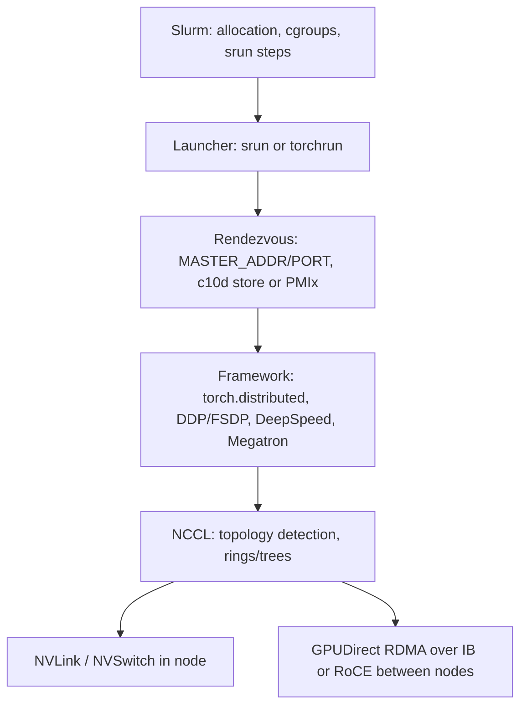

# 6.12 Multi-node training on Slurm: PMIx, torchrun, NCCL environment, binding

| | |
|---|---|
| Level | Intermediate |
| Priority tier | 1 |
| Lab venue | Slurm cluster with a fabric; the harness runs on a laptop (CPU, gloo) |
| Part | Part 6: HPC and Slurm |
| Status | Drafted. The Slurm-to-PyTorch glue was **run**: `code/part06/fake_srun.py` started 4 local processes with the `SLURM_*` variables a real `srun` sets, and `ddp_toy.py` (PyTorch 2.14.1, gloo backend, CPU) completed an all-reduce, a DDP step with identical weights on all ranks, a rank-0 checkpoint and a resumed second run. NCCL variable descriptions were read from `docs/userguide/source/env.rst` in a shallow clone of NVIDIA/nccl (commit `3e46c08`, 2026-10-08). Real multi-node GPU runs are **untested** |

## Why this matters for AI infrastructure

This is the chapter where scheduler, fabric and framework meet. Most "my 64-GPU job hangs at start", "scaling is bad", "one rank crashed and the rest sat there for six hours" tickets are launch-layer problems: wrong rendezvous address, ranks on the wrong NUMA node, NCCL choosing the management NIC, a missing `-K`, mismatched library versions. An engineer who can read a launch script and predict its failure modes is worth a great deal on an AI cluster.

## Prerequisites and outcomes

Needs 6.4, 6.10, 6.11, and Part 10/12 basics (NCCL, fabric). After this chapter you can:

- Separate control plane (Slurm, PMIx, rendezvous) from data plane (NCCL over NVLink/IB/RoCE).
- Launch one task per GPU with `srun`, or one `torchrun` per node, and choose between them.
- Derive `RANK`, `LOCAL_RANK`, `WORLD_SIZE`, `MASTER_ADDR`, `MASTER_PORT` from Slurm and test that glue without a cluster.
- Set NCCL environment variables deliberately (interfaces, HCAs, GDR, debug) and know which are risky.
- Bind CPUs, GPUs and NICs correctly; run FSDP, DeepSpeed and Megatron-LM style jobs.
- Triage hangs, slow collectives and partial failures.

## 1. Layers



Slurm decides *where* processes run and constrains them. The launcher starts them. Rendezvous lets ranks find each other: for MPI programs PMIx performs wire-up through the Slurm step daemons; for PyTorch the `env://` method uses a TCP store at `MASTER_ADDR:MASTER_PORT` which also distributes NCCL's unique id. After that NCCL talks directly over the fabric; Slurm and PMIx are out of the data path. PyTorch does not use PMIx; it needs the four variables below.

## 2. Two launch styles

**A. `srun`, one task per GPU** (Slurm starts every rank):

```bash
#SBATCH --nodes=4 --ntasks-per-node=8 --gpus-per-node=8 --cpus-per-gpu=12 --exclusive
export MASTER_ADDR=$(scontrol show hostnames "$SLURM_JOB_NODELIST" | head -n1)
export MASTER_PORT=$((10000 + SLURM_JOB_ID % 20000))
srun --kill-on-bad-exit=1 --cpu-bind=cores --gpu-bind=closest python train.py   # train.py derives RANK etc. from SLURM_*
```

Pros: Slurm controls binding, cgroups, accounting per step, signals and failure handling; no per-node launcher process. Cons: the training script must read `SLURM_PROCID`, `SLURM_LOCALID`, `SLURM_NTASKS` (or you wrap it).

**B. `torchrun`, one task per node** (torchrun starts the 8 local ranks):

```bash
#SBATCH --nodes=4 --ntasks-per-node=1 --gpus-per-node=8 --cpus-per-task=96 --exclusive
srun torchrun --nnodes=$SLURM_NNODES --nproc-per-node=8 \
  --rdzv-backend=c10d --rdzv-endpoint=$MASTER_ADDR:29500 --rdzv-id=$SLURM_JOB_ID train.py
```

Pros: torchrun provides elastic features (restart on failure, rendezvous), sets all variables, and the script is launcher-agnostic. Cons: Slurm sees one task per node, so per-rank binding and GPU isolation are coarser; process monitoring is torchrun's; `--cpus-per-task` must cover all 8 ranks.

Choice: **srun-per-GPU** for tightly controlled bare-metal clusters with strong binding requirements; **torchrun** when portability (laptop, Kubernetes, Slurm) or elasticity matters. Both appear in NVIDIA reference setups. Frameworks add their own: DeepSpeed's `deepspeed` launcher (pdsh/mpirun/Slurm runners), Megatron-LM scripts built on `torchrun`, NeMo launchers that generate `sbatch` for you.

## 3. The glue, tested

`code/part06/slurm_dist_init.py` turns Slurm variables into the rendezvous set:

```python
def dist_env(env=None, port_base=10000):
    e = os.environ if env is None else env
    job = int(e.get("SLURM_JOB_ID", "0"))
    return {
        "RANK": e["SLURM_PROCID"], "LOCAL_RANK": e["SLURM_LOCALID"], "WORLD_SIZE": e["SLURM_NTASKS"],
        "MASTER_ADDR": e.get("MASTER_ADDR") or first_host(e["SLURM_JOB_NODELIST"]),
        "MASTER_PORT": e.get("MASTER_PORT") or str(port_base + job % 20000),
    }
```

`first_host` calls `scontrol show hostnames` and falls back to a local hostlist expander (unit-checked: `gpu[01-03,07],cpu1,x[9-10]` expands correctly). `ddp_toy.py` calls it, initialises `torch.distributed` with `env://`, checks an all-reduce (`world*(world+1)/2`), runs one DDP step with different data per rank, verifies the resulting weights are identical on all ranks (gradient averaging works), saves a checkpoint from rank 0 and resumes from it. `fake_srun.py 2 2 python ddp_toy.py` started 4 processes with `SLURM_PROCID=0..3`, `SLURM_LOCALID`, `SLURM_NODEID`, `SLURM_NTASKS=4`, `SLURM_JOB_NODELIST=node[01-02]`. Result:

```text
rank 0/4 local=0 master=127.0.0.1:14242 allreduce_ok weights_identical=True start_step=0
rank 1/4 local=1 ... weights_identical=True start_step=0
rank 2/4 local=0 ... start_step=0
rank 3/4 local=1 ... start_step=0
(second run) ... start_step=1   # resumed from the rank-0 checkpoint
```

The port came out as 14242 from job id 4242, as the formula says. `MASTER_ADDR` was overridden to 127.0.0.1 because `node01` does not resolve on a laptop. On a GPU cluster use `BACKEND=nccl`, move tensors to `cuda:LOCAL_RANK` (with `ConstrainDevices` each task sees its GPUs renumbered from 0, 6.10) and pass `device_ids=[local_rank]`. This is a **logic test of the glue**, not of fabric behaviour.

An environment lesson from this same session: installing PyTorch via pip into a conda environment that already provided LLVM's OpenMP produced `OMP: Error #15: Initializing libomp.dylib, but found libomp.dylib already initialized` and an abort. That is exactly the "two OpenMP runtimes in one process" hazard from 6.5. The unsafe workaround `KMP_DUPLICATE_LIB_OK=TRUE` exists; the right fix is one environment with one runtime (I used a clean venv).

## 4. Rendezvous gotchas

- `MASTER_ADDR` must be resolvable and reachable from every node on the interface you intend; the first hostname of the nodelist is usually the management name. If the management and fabric networks differ, torch's TCP store uses the one `MASTER_ADDR` resolves to, which is fine, but NCCL's bootstrap uses `NCCL_SOCKET_IFNAME` (below).
- Port collisions on shared nodes: derive from the job ID or ask the site. Firewalls must allow the port range between compute nodes.
- With torchrun's c10d rendezvous the endpoint host must be reachable; `--rdzv-id` must be unique per job.
- Only one job should use a given port on a given node at a time; `--exclusive` helps.
- If ranks start at different times (slow image pull, slow module load) the rendezvous timeout may fire; increase it, and fix the slow start.

## 5. NCCL environment variables

From the NCCL user guide (`env.rst`, verified in the clone): 

| Variable | Meaning and notes |
|---|---|
| `NCCL_DEBUG` | `VERSION`, `WARN`, `INFO` (and more detail via subsystems); first tool for any hang. `NCCL_DEBUG_SUBSYS` selects subsystems (`INIT,NET,GRAPH,ENV`...); `NCCL_DEBUG_FILE=file.%h.%p` writes per host/process |
| `NCCL_SOCKET_IFNAME` | Interfaces for NCCL's bootstrap and socket transport: prefixes, comma-separated, `^` excludes, `=` exact names. Typical use: `^lo,docker` or an explicit fabric/Ethernet NIC |
| `NCCL_IB_HCA` | Which IB/RoCE adapters: comma list of `hca[:port[:rail[:plane]]]`, `^` exclude, `=` exact names (otherwise prefixes). Example `mlx5_0,mlx5_1,...` |
| `NCCL_IB_DISABLE` | Disable the IB transport (falls back to sockets; a performance cliff, used to test) |
| `NCCL_IB_GID_INDEX` | GID index for RoCE (default -1); find it with `show_gids` |
| `NCCL_IB_TIMEOUT` | Verbs timeout, 4.096 µs x 2^value; raise on very large networks if you see `ibv_poll_cq` error 12 |
| `NCCL_CROSS_NIC` | Whether rings may use different NICs on different nodes; depends on whether the fabric is rail-optimised |
| `NCCL_NET_GDR_LEVEL` (formerly `NCCL_IB_GDR_LEVEL`) | Maximum GPU-NIC distance for GPUDirect RDMA |
| `NCCL_P2P_LEVEL`, `NCCL_P2P_DISABLE`, `NCCL_SHM_DISABLE` | Limit or disable intra-node transports (diagnosis) |
| `NCCL_ALGO`, `NCCL_PROTO` | Force algorithm (ring, tree, ...) or protocol; override NCCL's tuning (use only to test) |
| `NCCL_TOPO_DUMP_FILE` / `NCCL_TOPO_FILE` | Dump the detected topology XML / supply one (virtualised or unusual hosts) |
| `NCCL_BUFFSIZE` | Size of internal NCCL communication buffer in bytes; if tuning for large all-reduce operations, start at `4 MB` (`4194304`) and increase stepwise while watching GPU memory pressure |
| `NCCL_NSOCKS_PERTHREAD`, `NCCL_SOCKET_NTHREADS` | Socket/TCP transport threads and sockets per thread; `NCCL_NSOCKS_PERTHREAD` × `NCCL_SOCKET_NTHREADS` cannot exceed `64` sockets total per communicator |
| `NCCL_MIN_NCHANNELS`, `NCCL_MAX_NCHANNELS` | Minimum and maximum number of communication channels (subrings); each channel uses one CUDA block, so leave at default unless tested |
| `NCCL_MNNVL_ENABLE` | Enable multi-node NVLink (`MNNVL`) on systems with multi-node NVLink switches (such as NVL72 GB200/GB300) |
| `NCCL_SHARP_DISABLE` | Set `NCCL_SHARP_DISABLE=1` to disable in-network SHARP aggregation for A/B testing or troubleshooting |
| `NCCL_IGNORE_CPU_AFFINITY` | Set `NCCL_IGNORE_CPU_AFFINITY=1` so NCCL ignores a narrow inherited CPU affinity mask and spreads its proxy/worker threads across cores in the local NUMA domain |
| `NCCL_RAS_ENABLE` etc. | The reliability/availability/serviceability subsystem (newer) |

Practices: set the minimum; default detection is usually right on a well-built node. Put site-wide settings in one file (`NCCL_CONF_FILE` or `/etc/nccl.conf`) or the module, so users do not paste folklore. Re-verify every variable against the NCCL version (the guide has per-variable "since" notes; some are renamed). Record `NCCL_DEBUG=INFO` output from a healthy run as the baseline: it prints the chosen transports (`NET/IB`, `P2P/CUMEM`, `NVLS`), rings, channels, and the HCAs used. An `INFO` line that says `NET/Socket` on an IB cluster is the classic misconfiguration.

PyTorch adds its own: `TORCH_NCCL_ASYNC_ERROR_HANDLING`, `TORCH_NCCL_BLOCKING_WAIT`, process-group timeouts (`init_process_group(timeout=...)`), flight-recorder settings (names vary by version; check). A short timeout turns a silent hang into a crash with a stack, which is what you want in production.

## 6. Binding for training jobs

Targets: each rank on cores of the socket/NUMA node closest to its GPU and NIC; data-loader workers inside the same cpuset; no oversubscription.

- Slurm: `--cpus-per-gpu`, `--cpu-bind=cores` (or `rank`/`map_cpu`), `--gpu-bind=closest`, `--gres-flags=enforce-binding`, and `CoreSpecCount` for the system (6.8, 6.10).
- Threads: `OMP_NUM_THREADS` equals CPUs per rank minus data-loader workers' share; `torch.set_num_threads`; `MKL_NUM_THREADS`.
- Verify: `srun ... bash -c 'echo $SLURM_PROCID $(taskset -pc $$) $CUDA_VISIBLE_DEVICES'`, `nvidia-smi topo -m`, `numactl -s`, and NCCL's INFO output (`GPU Direct RDMA Enabled for GPU x / HCA y` lines show NIC affinity).
- Typical 8-GPU HGX node: two NUMA domains, four GPUs each, NICs distributed (often one per GPU, "rail-optimised"). Rank i should use NIC i; NCCL maps this automatically if topology detection works (containers and VMs can break it: see `NCCL_TOPO_FILE`).
- `--bind-to none` in `mpirun` examples (6.4) is for PyTorch-with-workers cases; under Slurm use `--cpu-bind` instead.

## 7. Framework patterns

*Distributed AI Systems* (`DAI` Chapter 8, *Launching distributed training frameworks with SLURM*) contrasts how the four major distributed training stacks integrate with Slurm environment variables and launchers:

| Framework | Launcher under `srun` | Distributed Init | Slurm Environment Handling |
|---|---|---|---|
| **PyTorch DDP** | `torchrun` or direct `srun python` | Manual (`dist.init_process_group(backend="nccl")`) | Export `MASTER_ADDR`, `MASTER_PORT`, `WORLD_SIZE`, `RANK`, `LOCAL_RANK` |
| **PyTorch FSDP** | `torchrun` | Manual (`dist.init_process_group(backend="nccl")`) | Same as DDP (`--cpus-per-task=28`, `--mem=200G` for sharded CPU offload) |
| **DeepSpeed (ZeRO-1/2/3)** | `srun --label bash -c "... python train.py --deepspeed ..."` | Automatic (`deepspeed.init_distributed()`) | Reads Slurm vars directly, but requires explicit `export LOCAL_RANK=$SLURM_LOCALID`, `RANK=$SLURM_PROCID`, `CUDA_VISIBLE_DEVICES=$SLURM_LOCALID` |
| **Megatron-LM** | `srun --label bash -c "... torchrun ... pretrain_gpt.py ..."` | Automatic (via `megatron.training`) | Reads Slurm/torchrun vars directly; requires `CUDA_DEVICE_MAX_CONNECTIONS=1` and `OMP_NUM_THREADS=$SLURM_CPUS_PER_TASK` |

- **DDP (`code/train_ddp.py` & `code/train_ddp.sh` in `DAI` Chapter 8)**: Replicates the entire model on each GPU (`DDP(model, device_ids=[local_rank])`) and all-reduces gradients. You can either launch one `torchrun` per node (`srun torchrun --nproc_per_node=1 --nnodes=$SLURM_JOB_NUM_NODES --node_rank=$SLURM_NODEID --master_addr=$MASTER_ADDR --master_port=$MASTER_PORT code/train_ddp.py`) or launch `srun python code/train_ddp.py` directly after exporting `WORLD_SIZE=$SLURM_NTASKS`, `RANK=$SLURM_PROCID`, and `LOCAL_RANK=$SLURM_LOCALID`. Set `find_unused_parameters` only if needed (cost).
- **FSDP (`code/train_fsdp.py` & `code/train_fsdp.sh` in `DAI` Chapter 8)**: Shards parameters, gradients, and optimizer states across GPUs (`FullyShardedDataParallel` with `size_based_auto_wrap_policy` and `CPUOffload(offload_params=True)` in FSDP1, or `fully_shard()` and `CPUOffloadPolicy` in PyTorch 2.4+ FSDP2). All-gather and reduce-scatter dominate; use `--ntasks-per-node=8` with consistent block ordering (`--distribution=block` default) so adjacent ranks share a node, and use `torch.distributed.checkpoint` so each rank writes its own shard without gathering the full model on rank 0.
- **DeepSpeed (`code/deepspeed/train.py`, `ds_zero3_offload.json`, & `run.slurm` in `DAI` Chapter 8)**: Unlike DDP/FSDP, DeepSpeed calls `deepspeed.init_distributed()` and `model_engine, optimizer, _, _ = deepspeed.initialize(model=model, model_parameters=model.parameters(), config="ds_zero3_offload.json")` (`model_engine.backward(loss)` and `model_engine.step()`). In `ds_zero3_offload.json`, `"stage": 3` shards parameters across GPUs while `"offload_param": {"device": "cpu", "pin_memory": true}` and `"offload_optimizer": {"device": "cpu", "pin_memory": true}` offload states to pinned host RAM (validate NCCL/Slurm wiring with ZeRO stage `1` or `2` first). In `run.slurm`, always derive `MASTER_ADDR` via `scontrol show hostnames "$SLURM_JOB_NODELIST" | head -n 1` (never `127.0.0.1`, which silently creates isolated 1-node process groups on each host), exclude virtual/loopback interfaces with `export NCCL_SOCKET_IFNAME=^docker,lo` and `export GLOO_SOCKET_IFNAME=eth0`, and export `LOCAL_RANK=\$SLURM_LOCALID` inside the `srun --chdir="$SLURM_SUBMIT_DIR" --label bash -c "..."` subshell.
- **Megatron-LM (`code/megatron/run.slurm` & `convert_megatron_checkpoint.py` in `DAI` Chapter 8)**: Tensor, pipeline, context/sequence, and data parallelism (`--tensor-model-parallel-size`, `--pipeline-model-parallel-size`) are built from the ranks; tensor-parallel groups must stay inside a node over NVLink. Note that the PyPI `megatron-core` package only ships `megatron.core` building blocks; running `pretrain_gpt.py` requires cloning `NVIDIA/Megatron-LM` and installing from source (`pip install --no-build-isolation '.[mlm,dev]'`). Set `export CUDA_DEVICE_MAX_CONNECTIONS=1` and `export OMP_NUM_THREADS=$SLURM_CPUS_PER_TASK`.
  - **Megatron-LM checkpoint sizing and conversion (`DAI` Chapter 8):** For an `8B` (`8.03B` parameter) GPT model (`--num-layers 32 --hidden-size 4096 --num-attention-heads 32 --vocab-size 128256`), `bf16` model weights consume $8.03\text{B} \times 2\text{ bytes} = \mathbf{16.06\text{ GB}}$ and `fp32` Adam momentum + variance states consume $8.03\text{B} \times 8\text{ bytes} = \mathbf{64.24\text{ GB}}$, totaling $\mathbf{80.30\text{ GB}}$ theoretically and **$\sim\mathbf{108\text{ GB}}$ on disk** across four `27G` distributed checkpoint shards (`__0_0.distcp`, `__0_1.distcp`, `__1_0.distcp`, `__1_1.distcp`, plus `24K common.pt` and `4.0K metadata.json`) due to distributed optimizer metadata and alignment padding. Control storage footprint with `--save-interval` and checkpoint rotation, and convert `.distcp` shards to standalone weight-only PyTorch checkpoints (`model.pt`) for vLLM/SGLang inference using `convert_megatron_checkpoint.py` (or `NVIDIA-NeMo/Megatron-Bridge` for HuggingFace format).
- **Checkpointing and resume**: periodic async checkpoints; resume logic keyed on `SLURM_RESTART_COUNT` or on the existence of the latest checkpoint (the toy script shows the pattern); coordinate with `--signal` and `--requeue` (6.11 section 7).
- **Containers**: pyxis/enroot `--container-image` with `--container-mounts`; NCCL and CUDA come from the image; the host provides the driver and the IB device nodes (6.13).

## 8. Failure and diagnosis

| Symptom | Likely causes | First checks |
|---|---|---|
| Hangs at `init_process_group` | Wrong `MASTER_ADDR`/port, firewall, a rank failed to start, version mismatch, one node's image pull slow | Per-rank logs, `ss -ltnp` on master, `srun -l hostname`, compare environment per node |
| Hangs at first collective | NCCL cannot connect (wrong interface/HCA, `NCCL_SOCKET_IFNAME` picked docker0), IB link down, GID/RoCE misconfiguration | `NCCL_DEBUG=INFO`, `ibstat`, `NCCL_IB_HCA`, `show_gids` |
| Runs but slow | Fell back to sockets, no GDR, wrong NIC mapping, cross-NIC on a rail fabric, CPU bound data loader, oversubscribed threads, throttled GPU | INFO transports, `nccl-tests` all_reduce_perf on the allocation, `nvidia-smi dmon`, `top` |
| One rank dies, others hang until time limit | No `-K`/`--kill-on-bad-exit`, no NCCL async error handling or timeout | `srun -K`, set timeouts, flight recorder |
| Sporadic hangs at scale | A flapping link or sick node; congestion; rank desync | Fabric error counters (Part 12), per-node GPU/XID errors, rerun excluding nodes (`--exclude`) |
| `NCCL WARN ... unhandled system error` | Verbs errors, memlock limits, missing devices in container | `ulimit -l unlimited` (limits in slurm/systemd), device nodes, `dmesg` |
| OOM only at larger scale | Memory per rank, cache allocator fragmentation, NCCL buffers | per-rank memory logs |
| Different speed per rerun | Placement/topology variance, noisy neighbours | `--switches`, exclusive nodes, topology config (6.8) |

Method: reproduce small first (1 node, then 2), run `nccl-tests` (`all_reduce_perf -b 8 -e 8G -f 2 -g 1`, untested here) with `srun` on the same allocation to separate fabric problems from application problems (6.28), compare to baseline bus bandwidth for the node type, and bisect by node subsets.

In addition to `nccl-tests`, *Distributed AI Systems* (`DAI` Chapter 8, *Configure Multi-Node NCCL communication*) provides a pure-PyTorch `diagnose_nccl()` diagnostic script that you can launch directly under `srun` to verify connectivity, ring/tree collective bandwidth, and point-to-point latency across nodes:
1. **Verify basic IP reachability first:** `srun -N 2 bash -c 'echo "$(hostname): $(ping -c 1 node6 | grep time=)"'` (`(untested here)`).
2. **Sweep AllReduce tensor sizes (`sizes_mb = [1, 10, 100, 500]`):** Allocate `torch.randn(int(size_mb * 1e6 / 4)).cuda()`, run 3 warmup `dist.all_reduce(tensor)` calls followed by `torch.cuda.synchronize()`, time 10 benchmark iterations (`elapsed`), and compute effective Ring AllReduce bandwidth as `(size_mb * 2 * 10) / elapsed`.
3. **Measure point-to-point rank-0-to-target latency:** Loop 100 round-trip `dist.send(tensor, dst=target)` / `dist.recv(tensor, src=target)` pairs on a 1-element tensor (`torch.zeros(1).cuda()`) and compute one-way latency in microseconds as `(elapsed / 200) * 1e6`.

### 8.1 Six multinode communication pitfalls

From *AI Systems Performance Engineering* (Chapter 4), six host- and launch-level communication pitfalls account for most multinode slowdowns and stalls:

1. **Using a CPU-bound `gloo` backend instead of `nccl`:** If `dist.init_process_group(backend="gloo")` is used (or fallen back to) instead of `backend="nccl"`, collectives run through host CPU memory and TCP sockets instead of GPUDirect RDMA. In the book's 400 MB (`100M` float32 elements) all-reduce example across 8 GPUs on `800 Gb/s` (`100 GB/s`) InfiniBand, `gloo` over a `2 GB/s` TCP path takes `~200 ms` (`200.00 ms`), whereas `nccl` over `100 GB/s` InfiniBand takes `~4 ms` (`4.00 ms`). Verify the active backend with `torch.distributed.get_backend()` (untested here).
2. **Mismatched `NCCL` versions across nodes or libraries:** Running PyTorch's bundled `NCCL` against a different system `libnccl` (`nvidia-nccl-cu*`), or running different versions across nodes, causes hangs or silent fallbacks. Inspect `torch.cuda.nccl.version()` (untested here) on every rank at startup.
3. **TCP port exhaustion during `NCCL` bootstrap:** `NCCL` uses ephemeral TCP ports for its out-of-band setup handshake. If the host range is too narrow, handshakes stall or fail. Widen `/proc/sys/net/ipv4/ip_local_port_range` (or set `net.ipv4.ip_local_port_range="50000 51000"` in `/etc/sysctl.conf`, untested here) alongside explicit `NCCL_SOCKET_IFNAME` and `MASTER_PORT`.
4. **Insufficient network bandwidth or falling back to `eth0` / `docker0` / `lo` instead of `ib0`:** Missing `/dev/infiniband` device mounts in containers, mismatched RoCE GID indices, or unconfigured interfaces cause `NCCL` to silently fall back from InfiniBand/RoCE to slower management Ethernet. Check `NCCL_DEBUG=INFO`, set `NCCL_IB_DISABLE=0` and `NCCL_SOCKET_IFNAME=ib0` (untested here), confirm `lsmod | grep nvidia_peermem` (untested here), and monitor NIC bytes with `nvidia-smi dmon`, `ethtool -S <iface>`, or `ip -s link show <iface>` (untested here).
5. **Straggler nodes or processes:** In synchronous collectives, the slowest node or GPU sets the step time for every rank. Enable `TORCH_NCCL_ENABLE_MONITORING=1` and `TORCH_NCCL_HEARTBEAT_TIMEOUT_SEC` (alongside `torch.distributed.monitored_barrier` and `TORCH_NCCL_ASYNC_ERROR_HANDLING=1`, untested here) to detect and abort stalled ranks instead of hanging the allocation.
6. **GPU memory fragmentation under UCX/RDMA:** PyTorch's caching allocator holds freed blocks in its cache without returning them to the OS or UCX registration pool. In the book's 10-iteration example, pre-allocating a `0.800 GB` buffer (`torch.empty(int(2e8))`) and repeatedly allocating and freeing `~40 MB` and `~200 MB` tensors leaves `torch.cuda.memory_allocated()` at `0.000 GB` after freeing, while `torch.cuda.memory_reserved()` grows from `0.800 GB` at iter 0 to `1.040 GB` at iter 1 and `1.240 GB` from iter 2 through iter 10. Mitigate fragmentation with `PYTORCH_ALLOC_CONF="max_split_size_mb:128,expandable_segments:True"` (untested here).

### 8.2 Six `NCCL` communicator lifecycle and environment gotchas

1. **Creating `NCCL` communicators too often (inside the training loop):** `dist.init_process_group("nccl")` (or `ncclCommInitRank` in C++) performs all-to-all handshakes, exchanges unique IDs, builds rings/trees, and allocates GPU buffers. Creating 32 separate communicators across 32 GPUs can take `2–3 minutes` instead of `2–3 seconds`. In the book's Table 4-3 example, calling `init_process_group` and `destroy_process_group` inside the iteration loop costs `48.0 ms` per iteration versus `0.5 ms` for the 1-element `dist.all_reduce` itself (`48.5 ms` total per iteration before fix versus `0.5 ms` after moving initialization outside the loop, saving `>98%` per-step time).
2. **Recreating subcommunicators on every step:** For tensor or pipeline parallelism subgroups, create subcommunicators once at startup with `torch.distributed.new_group()` (or batch C++ initializations inside `ncclGroupStart()`, `ncclCommInitRank(...)`, and `ncclGroupEnd()`, untested here) and reuse them across iterations; all participating ranks must call creation and destruction in lockstep.
3. **Overtuning or leaving diagnostic environment variables enabled:** Never leave `NCCL_P2P_DISABLE=1` or `NCCL_SHM_DISABLE=1` set in production after debugging, because they force intranode GPU traffic through host-staged memory or network paths, raising latency from a few microseconds to tens of microseconds and cutting bandwidth from hundreds of GB/s to tens of GB/s; similarly, lower `NCCL_DEBUG` from `INFO`/`DEBUG` to `WARN` or `VERSION` after troubleshooting. When tuning socket transport, `NCCL_NSOCKS_PERTHREAD` × `NCCL_SOCKET_NTHREADS` cannot exceed `64` sockets total; when tuning `NCCL_BUFFSIZE`, start at `4 MB` (`4194304`) and monitor VRAM; leave `NCCL_MIN_NCHANNELS` / `NCCL_MAX_NCHANNELS` at defaults unless needed; use `NCCL_TOPO_FILE` (captured via `NCCL_TOPO_DUMP_FILE`), `NCCL_MNNVL_ENABLE`, and `NCCL_SHARP_DISABLE` deliberately.
4. **Collapsed CPU-GPU NUMA affinity for `NCCL` proxy threads:** When a launcher pins a rank to a very narrow CPU mask, `NCCL`'s background network-polling and kernel-dispatch threads can collapse onto a single core. Bind each rank to its GPU's local NUMA domain (for example GPUs 0–3 on NUMA node 0 and GPUs 4–7 on NUMA node 1) and set `NCCL_IGNORE_CPU_AFFINITY=1` (untested here) so `NCCL` ignores the narrow inherited CPU mask and spreads its worker threads across cores in the local NUMA node.
5. **Ignoring `NCCL` warnings in logs:** Warnings such as `"unable to enable P2P, falling back to copy"` (GPUs across unsupported PCIe root complexes staging through host RAM) or `NCCL INFO NET/Socket: using Ethernet interface eth0` instead of `ib0` explain major throughput losses and must be fixed via GPU placement or `NCCL_SOCKET_IFNAME=ib0`.
6. **Unhandled `NCCL` communicator hangs and hardware failure rates at scale:** When one rank crashes or hits a hardware fault, collectives on surviving ranks hang unless asynchronous abort is enabled (`TORCH_NCCL_ASYNC_ERROR_HANDLING=1` / `NCCL_ASYNC_ERROR_HANDLING=1`). At scale, hardware interruptions are routine: in Meta's Llama 3 405B 54-day pretraining run on `16,384` H100 GPUs, the job experienced `419` unexpected interruptions (`~7.8`/day) while maintaining `>90%` effective training time. In the book's Table 4-4 breakdown of those interruptions, faulty GPUs caused `148` (`30.1%`), GPU HBM3 memory caused `72` (`17.2%`), software bugs caused `54` (`12.9%`), network switch/cable issues caused `35` (`8.4%`), unplanned host maintenance caused `32` (`7.6%`), GPU SRAM memory caused `19` (`4.5%`), GPU system processor caused `17` (`4.1%`), NIC caused `7` (`1.7%`), and `NCCL` watchdog timeouts caused `7` (`1.7%`).

## 9. Lab

First, run the self-checking Python lab (`code/part06/slurm_dist_init_lab.py`) locally. It verifies `expand_hostlist()` and `dist_env()` in `code/part06/slurm_dist_init.py` (`SLURM_JOB_ID=4242 -> MASTER_PORT=14242`), checks the Megatron-LM `8.03B` parameter distributed checkpoint math (`16.06 GB` `bf16` weights + `64.24 GB` `fp32` Adam states = `80.30 GB` theoretical vs `4 * 27G = 108.0 GB` `.distcp` shards) and `ASP` Chapter 4 `gloo` (`200.0 ms`) vs `nccl` (`4.0 ms`) timings, and tests the `diagnose_nccl()` AllReduce bandwidth and point-to-point latency formulas from `DAI` Chapter 8:

```bash
python3 code/part06/slurm_dist_init_lab.py
```

Tested part (laptop): 1) Create a venv with PyTorch (CPU). 2) Run `python code/part06/fake_srun.py 2 2 python code/part06/ddp_toy.py` twice and confirm `start_step` goes from 0 to 1. 3) Change the world to 2 nodes x 4 tasks; confirm the all-reduce assertion. 4) Break it: unset `MASTER_ADDR` in `fake_srun.py` and observe that the node name does not resolve.

Untested part (cluster): 5) Run the `srun` style and the `torchrun` style on 2 nodes with `NCCL_DEBUG=INFO`; save logs; find the transport lines. 6) Run `all_reduce_perf` across 2 nodes and record bus bandwidth. 7) Deliberately set `NCCL_IB_DISABLE=1` and compare. 8) Kill one rank mid-run with and without `-K`. 9) Print `taskset -pc` and GPU per rank with and without `--gpu-bind=closest`. 10) Write the site's standard multi-node template.

## 10. Interview angles

- Walk through what happens from `sbatch` to the first all-reduce on 32 nodes.
- `srun` per GPU versus `torchrun` per node: trade-offs?
- Where do `RANK` and `WORLD_SIZE` come from under Slurm? How is `MASTER_ADDR` chosen?
- A 128-GPU job hangs at start; 16 GPUs fine. What do you check?
- Which NCCL variables do you set and why? Which do you avoid?
- How would you prove the job is using InfiniBand and GPUDirect RDMA?
- Why do tensor-parallel groups stay inside a node?
- What happens when one rank crashes? How do you make the job fail fast?

## Exercises

1. **Testing Slurm-to-PyTorch Rendezvous Glue Without a Cluster (`code/part06/slurm_dist_init.py` & `slurm_dist_init_lab.py`):** Run `python3 code/part06/slurm_dist_init_lab.py`. Verify that `expand_hostlist("gpu[01-03,07],cpu1,x[9-10]")` expands zero-padded and unpadded bracket ranges accurately and that `dist_env()` maps `SLURM_JOB_ID=4242` and `SLURM_JOB_NODELIST="gpu[01-03,07]"` to `MASTER_ADDR=gpu01` and `MASTER_PORT=14242`.
2. **Comparing `srun`-per-GPU vs `torchrun`-per-Node Launch Scripts (`DAI` Chapter 8):** Write both `#SBATCH` + `srun` launch blocks for a 4-node, 8-GPU-per-node (`32` GPUs total) training job: Pattern A (`--ntasks-per-node=8 --gpus-per-node=8 --cpus-per-gpu=12` with `srun --kill-on-bad-exit=1 --cpu-bind=cores --gpu-bind=closest python train.py`) and Pattern B (`--ntasks-per-node=1 --gpus-per-node=8 --cpus-per-task=96` with `srun torchrun --nnodes=$SLURM_NNODES --nproc-per-node=8 ...`). Explain the trade-offs in cgroup CPU/GPU binding vs elasticity.
3. **DeepSpeed ZeRO-3 Slurm Launch and the `127.0.0.1` Trap (`DAI` Chapter 8):** Write the `srun --chdir="$SLURM_SUBMIT_DIR" --label bash -c "..."` block for launching `python train.py --deepspeed --deepspeed_config ds_zero3_offload.json` across 2 nodes (`DAI` Chapter 8). Explain why `LOCAL_RANK=$SLURM_LOCALID` must be exported manually for `deepspeed.init_distributed()`, and what happens on a 2-node cluster if `MASTER_ADDR` defaults to `127.0.0.1`.
4. **Megatron-LM 8B Checkpoint Footprint and `.distcp` Conversion (`DAI` Chapter 8 & `slurm_dist_init_lab.py`):** Using `megatron_checkpoint_gb(8.03, 4, 27.0)` in `code/part06/slurm_dist_init_lab.py`, calculate the exact `bf16` parameter size (`16.06 GB`), `fp32` Adam optimizer state size (`64.24 GB`), theoretical total (`80.30 GB`), and 4-shard `.distcp` disk footprint (`108.0 GB`) for an `8.03B` parameter GPT model, and explain how to convert `.distcp` shards into a standalone PyTorch checkpoint for vLLM/SGLang inference.
5. **Quantifying `gloo` vs `nccl` Bandwidth and Communicator Init Overhead (`ASP` Chapter 4):** Calculate the all-reduce time for a `400 MB` (`100M` `fp32`) gradient tensor over `2 GB/s` TCP (`gloo`, `200.0 ms`) versus `100 GB/s` (`800 Gb/s`) InfiniBand (`nccl`, `4.0 ms`), and explain why calling `dist.init_process_group("nccl")` inside the training step loop adds `48.0 ms` per step on top of a `0.5 ms` collective (`48.5 ms` vs `0.5 ms`, a `>98%` slowdown).
6. **Multi-Node `NCCL` Diagnostic Benchmarking (`DAI` Chapter 8 `diagnose_nccl()`):** Using `nccl_diag_metrics()` in `code/part06/slurm_dist_init_lab.py`, compute the effective Ring AllReduce bandwidth `(size_mb * 2 * 10) / elapsed` (`100.0 GB/s` for `100 MB` over 10 iterations in `20.0` units) and one-way point-to-point latency `(elapsed / 200) * 1e6` (`20.0 us` for 100 round-trips taking `0.004 s`).

## Checkpoint

<details>
<summary>1. Separate the responsibilities of **Slurm**, the **launcher (`srun`/`torchrun`)**, **rendezvous (`env://` / PMIx)**, and **`NCCL`** during a multi-node training job.</summary>

- **Slurm (`slurmctld` / `slurmd`):** Allocates nodes/GPUs, creates Linux cgroups (`ConstrainDevices=yes`), and spawns `slurmstepd`.
- **Launcher (`srun` or `torchrun`):** Spawns the per-GPU rank processes and populates rank environment variables.
- **Rendezvous (`c10d` TCP store at `MASTER_ADDR:MASTER_PORT` or PMIx):** Lets ranks discover each other out-of-band and exchange `NCCL`'s `ncclUniqueId`.
- **`NCCL` (Data Plane):** Detects intra-node (`NVLink`/`NVSwitch`) and inter-node (`GPUDirect RDMA` over InfiniBand/RoCE) topology and executes collectives directly over the fabric without involving Slurm.
</details>

<details>
<summary>2. Does PyTorch `torch.distributed` use PMIx for collective communication, and which five environment variables does `init_method="env://"` require?</summary>

No—PyTorch does not use PMIx for data-plane collectives; it uses `c10d` TCP rendezvous followed by `NCCL` (or `gloo`). `init_method="env://"` requires **`MASTER_ADDR`**, **`MASTER_PORT`**, **`WORLD_SIZE`**, **`RANK`**, and (for GPU device selection) **`LOCAL_RANK`**.
</details>

<details>
<summary>3. Compare Launch Style A (`srun` with 1 task per GPU) and Launch Style B (`srun` with 1 `torchrun` per node).</summary>

- **Style A (`--ntasks-per-node=8`, `srun python train.py`):** Slurm directly launches and tracks every GPU process, giving fine-grained per-rank `--cpu-bind`, `--gpu-bind=closest`, cgroup accounting, and `-K` (`--kill-on-bad-exit=1`) failure handling, at the cost of requiring `train.py` (or a wrapper) to translate `SLURM_PROCID`/`SLURM_LOCALID`/`SLURM_NTASKS`.
- **Style B (`--ntasks-per-node=1`, `srun torchrun --nproc-per-node=8 ...`):** `torchrun` spawns the 8 local workers and automatically exports `RANK`, `LOCAL_RANK`, and `WORLD_SIZE` (plus elastic restart features), but Slurm only sees 1 coarse task per node.
</details>

<details>
<summary>4. How do `code/part06/fake_srun.py`, `slurm_dist_init.py`, and `ddp_toy.py` test Slurm-to-PyTorch DDP glue on a laptop without a cluster?</summary>

`fake_srun.py 2 2` spawns 4 local processes with `SLURM_JOB_ID=4242`, `SLURM_JOB_NODELIST=node[01-02]`, `SLURM_PROCID=0..3`, `SLURM_LOCALID=0..1`, `SLURM_NTASKS=4`, and `MASTER_ADDR=127.0.0.1`. `slurm_dist_init.py` maps those to `RANK`, `LOCAL_RANK`, `WORLD_SIZE`, and `MASTER_PORT=14242`, and `ddp_toy.py` verifies `dist.all_reduce` (`world*(world+1)/2`), identical post-step DDP weights across all ranks (`weights_identical=True`), and rank-0 checkpoint save/resume (`start_step=0 -> 1`).
</details>

<details>
<summary>5. What causes `OMP: Error #15: Initializing libomp.dylib, but found libomp.dylib already initialized`, and what is the proper fix?</summary>

Two incompatible OpenMP runtime libraries (for example Intel `libiomp5` from Conda/MKL and LLVM `libomp` / GNU `libgomp` from a pip wheel) are linked into the same Python process (Chapter 6.5). While `KMP_DUPLICATE_LIB_OK=TRUE` suppresses the abort unsafely, the proper fix is using a clean virtual environment with a single consistent OpenMP runtime.
</details>

<details>
<summary>6. How do DDP, FSDP, DeepSpeed, and Megatron-LM differ in how they initialize distributed state under Slurm (`DAI` Chapter 8)?</summary>

- **DDP & FSDP:** Manual initialization (`dist.init_process_group(backend="nccl")`), reading standard `RANK`, `LOCAL_RANK`, `WORLD_SIZE`, `MASTER_ADDR`, `MASTER_PORT` variables exported by `torchrun` or your batch script.
- **DeepSpeed:** Automatic initialization via `deepspeed.init_distributed()`, which reads Slurm variables directly—**except `LOCAL_RANK`**, which must be explicitly exported from `SLURM_LOCALID` inside the `srun` subshell.
- **Megatron-LM:** Automatic initialization inside `megatron.training` launched via `srun ... torchrun ... pretrain_gpt.py`, requiring `CUDA_DEVICE_MAX_CONNECTIONS=1` and `OMP_NUM_THREADS=$SLURM_CPUS_PER_TASK`.
</details>

<details>
<summary>7. Why does setting `MASTER_ADDR=127.0.0.1` in a multi-node DeepSpeed or DDP script cause a dangerous silent bug (`DAI` Chapter 8)?</summary>

If `MASTER_ADDR` is `127.0.0.1` across two physical nodes, each node connects only to its own local loopback interface and forms an **independent 1-node process group**—so training appears to run without crashing, but gradients are never synchronized across nodes. Always derive `MASTER_ADDR=$(scontrol show hostnames "$SLURM_JOB_NODELIST" | head -n 1)`.
</details>

<details>
<summary>8. Why does an `8.03B` parameter Megatron-LM GPT model produce a `~108 GB` distributed checkpoint directory (`DAI` Chapter 8), and how do you export it for inference?</summary>

- **Theoretical size (`80.30 GB`):** `bf16` model weights take $8.03\text{B} \times 2\text{ B} = \mathbf{16.06\text{ GB}}$, and `fp32` Adam states (4 bytes momentum + 4 bytes variance) take $8.03\text{B} \times 8\text{ B} = \mathbf{64.24\text{ GB}}$.
- **On-disk size (`~108 GB` = $4 \times 27\text{ GB}$ `.distcp` shards):** Distributed optimizer metadata and parallel I/O alignment padding add $\sim 28\text{ GB}$.
- **Export for inference:** Run `convert_megatron_checkpoint.py` (or `Megatron-Bridge`) to strip optimizer states and merge `.distcp` shards into a standalone PyTorch `model.pt` or HuggingFace checkpoint.
</details>

<details>
<summary>9. What do `NCCL_DEBUG=INFO`, `NCCL_DEBUG_SUBSYS`, and `NCCL_DEBUG_FILE=file.%h.%p` do, and what log line reveals an InfiniBand fallback?</summary>

`NCCL_DEBUG=INFO` logs `NCCL`'s topology discovery, ring/tree channels, HCA selection, and transport layer (`NCCL_DEBUG_SUBSYS=INIT,NET,GRAPH,ENV` filters subsystems, and `NCCL_DEBUG_FILE=file.%h.%p` writes separate logs per hostname `%h` and PID `%p`). Seeing **`NCCL INFO NET/Socket`** instead of **`NCCL INFO NET/IB`** on an InfiniBand/RoCE cluster proves that `NCCL` fell back to slow TCP sockets.
</details>

<details>
<summary>10. How do `NCCL_SOCKET_IFNAME` and `NCCL_IB_HCA` interpret prefix lists, `^`, and `=`?</summary>

By default, comma-separated entries are matched as **prefixes** (e.g., `eth` matches `eth0,eth1`; `mlx5_` matches all `mlx5_*` HCAs).
- Prefixing the list with **`^`** **excludes** matching interfaces/HCAs (e.g., `NCCL_SOCKET_IFNAME=^lo,docker` ignores loopback and Docker bridges).
- Prefixing with **`=`** forces **exact** string matching.
</details>

<details>
<summary>11. What do `NCCL_IB_GID_INDEX`, `NCCL_IB_TIMEOUT`, and `NCCL_NET_GDR_LEVEL` control?</summary>

- **`NCCL_IB_GID_INDEX`:** Selects the RoCE v2 Global Identifier index (inspected via `show_gids`) so RDMA traffic uses the correct VLAN/DSCP/PFC priority queue.
- **`NCCL_IB_TIMEOUT`:** Sets the InfiniBand Verbs queue-pair timeout to $4.096\ \mu\text{s} \times 2^{\text{value}}$ (increase on large fabrics if congestion triggers `ibv_poll_cq` error `12`).
- **`NCCL_NET_GDR_LEVEL`:** Sets the maximum PCIe/NUMA topological distance between a GPU and NIC at which GPUDirect RDMA (`GDR`) remains enabled.
</details>

<details>
<summary>12. What constraint applies to `NCCL_NSOCKS_PERTHREAD` and `NCCL_SOCKET_NTHREADS`, and how should `NCCL_BUFFSIZE` be tuned (`ASP` Chapter 4)?</summary>

When tuning TCP socket transport, the product **`NCCL_NSOCKS_PERTHREAD` $\times$ `NCCL_SOCKET_NTHREADS` cannot exceed `64` sockets** per communicator. When tuning `NCCL_BUFFSIZE` for large collectives, start at **`4 MB` (`4194304` bytes)** and increase stepwise while monitoring GPU VRAM pressure.
</details>

<details>
<summary>13. Why is leaving `NCCL_P2P_DISABLE=1` or `NCCL_SHM_DISABLE=1` in a production batch script disastrous (`ASP` Chapter 4)?</summary>

Those diagnostic flags disable intra-node NVLink/PCIe peer-to-peer (`P2P`) and host shared-memory (`SHM`) transfers, forcing same-node GPUs to stage all collective data through host RAM or network interfaces—increasing latency from a few microseconds to tens of microseconds and slashing intra-node bandwidth from hundreds of GB/s to tens of GB/s.
</details>

<details>
<summary>14. How do you bind each rank to the right CPU cores, GPU, and NIC under Slurm, and when is `NCCL_IGNORE_CPU_AFFINITY=1` needed (`ASP` Chapter 4)?</summary>

Use `srun --cpus-per-gpu=12 --cpu-bind=cores --gpu-bind=closest` with `--gres-flags=enforce-binding` (and verify via `taskset -pc $$`, `nvidia-smi topo -m`, and `NCCL`'s `GPU Direct RDMA Enabled for GPU x / HCA y` log lines). If a launcher pins a rank to a single CPU core or overly narrow mask, set **`NCCL_IGNORE_CPU_AFFINITY=1`** so `NCCL`'s background proxy threads can spread across cores within the GPU's local NUMA domain.
</details>

<details>
<summary>15. Compare the time to all-reduce a `400 MB` (`100M` `fp32`) buffer across 8 GPUs using CPU `gloo` over `2 GB/s` TCP versus GPU `nccl` over `800 Gb/s` (`100 GB/s`) InfiniBand (`ASP` Chapter 4).</summary>

- **`gloo` over `2 GB/s` TCP:** $\approx \mathbf{200.00\text{ ms}}$ (copies GPU $\to$ host RAM, traverses TCP sockets, copies host RAM $\to$ GPU).
- **`nccl` over `100 GB/s` InfiniBand (GPUDirect RDMA):** $\approx \mathbf{4.00\text{ ms}}$ (a **$50\times$ speedup**).
</details>

<details>
<summary>16. Why does PyTorch's CUDA caching allocator cause UCX/RDMA memory pressure across iterations, and which `PYTORCH_ALLOC_CONF` setting fixes it (`ASP` Chapter 4)?</summary>

PyTorch's caching allocator retains freed blocks in its pool without returning them to the OS/UCX registration pool (in `ASP` Chapter 4's 10-iteration test, a `0.800 GB` initial allocation plus alternating `40 MB` and `200 MB` temporaries leaves `memory_allocated()` at `0.000 GB` after free while `memory_reserved()` ratchets from `0.800 GB` to `1.040 GB` and **`1.240 GB`**). Setting **`PYTORCH_ALLOC_CONF="max_split_size_mb:128,expandable_segments:True"`** prevents large block splitting and enables virtual-memory expandable segments.
</details>

<details>
<summary>17. How much overhead does calling `dist.init_process_group("nccl")` inside the training loop add (`ASP` Chapter 4 Table 4-3), and how should TP/PP subcommunicators be managed?</summary>

In `ASP` Chapter 4 Table 4-3, initializing and destroying the `nccl` process group inside the step loop costs **`48.0 ms` per iteration** compared to just **`0.5 ms`** for the `all_reduce` itself (`48.5 ms` vs `0.5 ms`, wasting **`>98%`** of step time). Always initialize the global process group and any `torch.distributed.new_group()` TP/PP subcommunicators **once before the training loop** (or batch C++ `ncclCommInitRank` calls inside `ncclGroupStart()` / `ncclGroupEnd()`).
</details>

<details>
<summary>18. What did Meta's 54-day Llama 3 405B pretraining run on `16,384` H100 GPUs reveal about hardware failure rates at scale (`ASP` Chapter 4 Table 4-4)?</summary>

The run experienced **`419` unexpected interruptions (`~7.8` per day)** while achieving `>90%` effective training time:
- **Faulty GPUs / NVLink:** `148` (`30.1%`)
- **GPU HBM3 memory:** `72` (`17.2%`)
- **Software bugs:** `54` (`12.9%`)
- **Network switch / cable:** `35` (`8.4%`)
- **Unplanned host maintenance:** `32` (`7.6%`)
- **GPU SRAM (`19`, `4.5%`), GPU GSP (`17`, `4.1%`), NIC (`7`, `1.7%`), and `NCCL` watchdog (`7`, `1.7%`).**
</details>

<details>
<summary>19. Which PyTorch and Slurm settings ensure that when one rank crashes or stalls, the remaining 63 GPUs fail fast with a diagnostic stack trace instead of hanging for hours?</summary>

1. Pass **`srun -K` (`--kill-on-bad-exit=1`)** so Slurm tears down the step as soon as any task exits non-zero.
2. Pass an explicit **`timeout`** to `dist.init_process_group(..., timeout=timedelta(minutes=10))`.
3. Enable **`TORCH_NCCL_ASYNC_ERROR_HANDLING=1`**, **`TORCH_NCCL_ENABLE_MONITORING=1`**, and **`TORCH_NCCL_HEARTBEAT_TIMEOUT_SEC`** so stuck collectives abort cleanly.
</details>

<details>
<summary>20. How do you separate an underlying InfiniBand/RoCE fabric fault from an application bug on a multi-node Slurm allocation (`DAI` Chapter 8 & `nccl-tests`)?</summary>

Run `nccl-tests` (`srun all_reduce_perf -b 8 -e 8G -f 2 -g 1`) or `DAI` Chapter 8's standalone `diagnose_nccl()` script (measuring `[1, 10, 100, 500]` MB AllReduce bus bandwidth `(size_mb * 2 * 10) / elapsed` and point-to-point send/recv latency `(elapsed / 200) * 1e6`) on the exact same node allocation. If `all_reduce_perf` hits expected wire speed, the fault is in the application/dataloader; if it stalls or reports low bandwidth, bisect the node list with `--exclude`.
</details>

## Sources and review notes

- Launch layering, PMIx and torchrun/srun patterns, NCCL tuning discussion: migrated from `nvidia-devops` (`volume-10-hpc-foundations-cluster-management/07-mpi-fundamentals-for-hpc-ai-workloads.md` sections 3 to 6), and read in full from *Distributed AI Systems* (`distributed-ai-systems`, `DAI`) Chapter 8 ("Chapter 8: Running Distributed Training with SLURM": DDP, FSDP, DeepSpeed `ds_zero3_offload.json`, Megatron-LM 8B `16.06 GB` + `64.24 GB` = `80.30 GB` vs `108 GB` `.distcp` checkpoints and `convert_megatron_checkpoint.py`, environment variables, `diagnose_nccl()`, and failure handling).
- `ai-systems-performance-engineering` — Chris Fregly, *AI Systems Performance Engineering* (`ASP`), "Chapter 4. Tuning Distributed Networking Communication" (read in full): the 6 multinode communication pitfalls (`gloo` `~200 ms` at `2 GB/s` TCP vs `nccl` `~4 ms` at `100 GB/s` / 800 Gbps IB for a 400 MB all-reduce; mismatched `NCCL` versions via `torch.cuda.nccl.version()`; TCP port exhaustion `net.ipv4.ip_local_port_range="50000 51000"`, `NCCL_SOCKET_IFNAME`, `MASTER_PORT`; fallback to `eth0`/`docker0`/`lo` vs `ib0` with `NCCL_DEBUG=INFO` and `NCCL_IB_DISABLE=0`; straggler monitoring with `TORCH_NCCL_ENABLE_MONITORING=1` and `TORCH_NCCL_HEARTBEAT_TIMEOUT_SEC`; GPU memory fragmentation under UCX/RDMA where `0.800 GB` allocated reserves `1.240 GB` without `PYTORCH_ALLOC_CONF="max_split_size_mb:128,expandable_segments:True"`) and the 6 `NCCL` communicator lifecycle and environment gotchas (Table 4-3 `init_process_group` `48.0 ms` + `0.5 ms` `all_reduce` = `48.5 ms` vs `0.5 ms` initialized once saving `>98%`; `NCCL_NSOCKS_PERTHREAD` × `NCCL_SOCKET_NTHREADS` ≤ `64`, `NCCL_BUFFSIZE` starting at `4 MB` / `4194304`, `NCCL_MIN_NCHANNELS`/`NCCL_MAX_NCHANNELS`, `NCCL_TOPO_FILE`, `NCCL_MNNVL_ENABLE`, `NCCL_SHARP_DISABLE`; `NCCL_IGNORE_CPU_AFFINITY=1`; Table 4-4 Llama 3 405B 54-day run on `16,384` H100 GPUs with `419` unexpected interruptions, `~7.8`/day, `>90%` effective training time). Deep NCCL internals, SHARP/NVLS, and NIXL are covered in Part 12 and Part 15.
- NCCL variable semantics: NVIDIA/nccl `docs/userguide/source/env.rst` (commit `3e46c08`).
- Slurm options: man pages as in 6.10 and 6.11 (`521370b`).
- Run here: `slurm_dist_init.py`, `ddp_toy.py`, `fake_srun.py` (PyTorch 2.14.1, gloo, macOS) and `python3 code/part06/slurm_dist_init_lab.py` (3 passed, 0 failed).
- Explicitly labelled inferences: `megatron_checkpoint_gb` and `nccl_diag_metrics` in `code/part06/slurm_dist_init_lab.py` are deterministic teaching checks of the formulas in `DAI` Chapter 8 and `ASP` Chapter 4.
- Not verified on live hardware: multi-node NCCL behaviour, DeepSpeed/Megatron launch flags on live clusters, PyTorch NCCL environment variable names across releases, and live HGX topology layout (`untested here`).
