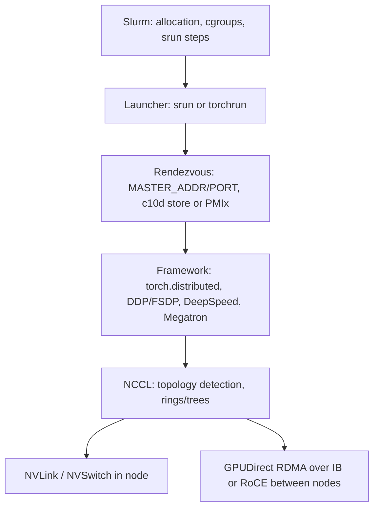

# 6.12 Multi-node training on Slurm: PMIx, torchrun, NCCL environment, binding

| | |
|---|---|
| Level | Intermediate |
| Priority tier | 1 |
| Lab venue | Slurm cluster with a fabric; the harness runs on a laptop (CPU, gloo) |
| Part | Part 6: HPC and Slurm |
| Status | Drafted. The Slurm-to-PyTorch glue was **run**: `code/part06/fake_srun.py` started 4 local processes with the `SLURM_*` variables a real `srun` sets, and `ddp_toy.py` (PyTorch 2.14.1, gloo backend, CPU) completed an all-reduce, a DDP step with identical weights on all ranks, a rank-0 checkpoint and a resumed second run. NCCL variable descriptions were read from `docs/userguide/source/env.rst` in a shallow clone of NVIDIA/nccl (commit `3e46c08`, 2026-10-08). Real multi-node GPU runs are **untested** |

## Why this matters for AI infrastructure

This is the chapter where scheduler, fabric and framework meet. Most "my 64-GPU job hangs at start", "scaling is bad", "one rank crashed and the rest sat there for six hours" tickets are launch-layer problems: wrong rendezvous address, ranks on the wrong NUMA node, NCCL choosing the management NIC, a missing `-K`, mismatched library versions. An engineer who can read a launch script and predict its failure modes is worth a great deal on an AI cluster.

## Prerequisites and outcomes

Needs 6.4, 6.10, 6.11, and Part 10/12 basics (NCCL, fabric). After this chapter you can:

- Separate control plane (Slurm, PMIx, rendezvous) from data plane (NCCL over NVLink/IB/RoCE).
- Launch one task per GPU with `srun`, or one `torchrun` per node, and choose between them.
- Derive `RANK`, `LOCAL_RANK`, `WORLD_SIZE`, `MASTER_ADDR`, `MASTER_PORT` from Slurm and test that glue without a cluster.
- Set NCCL environment variables deliberately (interfaces, HCAs, GDR, debug) and know which are risky.
- Bind CPUs, GPUs and NICs correctly; run FSDP, DeepSpeed and Megatron-LM style jobs.
- Triage hangs, slow collectives and partial failures.

## 1. Layers



Slurm decides *where* processes run and constrains them. The launcher starts them. Rendezvous lets ranks find each other: for MPI programs PMIx performs wire-up through the Slurm step daemons; for PyTorch the `env://` method uses a TCP store at `MASTER_ADDR:MASTER_PORT` which also distributes NCCL's unique id. After that NCCL talks directly over the fabric; Slurm and PMIx are out of the data path. PyTorch does not use PMIx; it needs the four variables below.

## 2. Two launch styles

**A. `srun`, one task per GPU** (Slurm starts every rank):

```bash
#SBATCH --nodes=4 --ntasks-per-node=8 --gpus-per-node=8 --cpus-per-gpu=12 --exclusive
export MASTER_ADDR=$(scontrol show hostnames "$SLURM_JOB_NODELIST" | head -n1)
export MASTER_PORT=$((10000 + SLURM_JOB_ID % 20000))
srun --kill-on-bad-exit=1 --cpu-bind=cores --gpu-bind=closest python train.py   # train.py derives RANK etc. from SLURM_*
```

Pros: Slurm controls binding, cgroups, accounting per step, signals and failure handling; no per-node launcher process. Cons: the training script must read `SLURM_PROCID`, `SLURM_LOCALID`, `SLURM_NTASKS` (or you wrap it).

**B. `torchrun`, one task per node** (torchrun starts the 8 local ranks):

```bash
#SBATCH --nodes=4 --ntasks-per-node=1 --gpus-per-node=8 --cpus-per-task=96 --exclusive
srun torchrun --nnodes=$SLURM_NNODES --nproc-per-node=8 \
  --rdzv-backend=c10d --rdzv-endpoint=$MASTER_ADDR:29500 --rdzv-id=$SLURM_JOB_ID train.py
```

Pros: torchrun provides elastic features (restart on failure, rendezvous), sets all variables, and the script is launcher-agnostic. Cons: Slurm sees one task per node, so per-rank binding and GPU isolation are coarser; process monitoring is torchrun's; `--cpus-per-task` must cover all 8 ranks.

Choice: **srun-per-GPU** for tightly controlled bare-metal clusters with strong binding requirements; **torchrun** when portability (laptop, Kubernetes, Slurm) or elasticity matters. Both appear in NVIDIA reference setups. Frameworks add their own: DeepSpeed's `deepspeed` launcher (pdsh/mpirun/Slurm runners), Megatron-LM scripts built on `torchrun`, NeMo launchers that generate `sbatch` for you.

## 3. The glue, tested

`code/part06/slurm_dist_init.py` turns Slurm variables into the rendezvous set:

```python
def dist_env(env=None, port_base=10000):
    e = os.environ if env is None else env
    job = int(e.get("SLURM_JOB_ID", "0"))
    return {
        "RANK": e["SLURM_PROCID"], "LOCAL_RANK": e["SLURM_LOCALID"], "WORLD_SIZE": e["SLURM_NTASKS"],
        "MASTER_ADDR": e.get("MASTER_ADDR") or first_host(e["SLURM_JOB_NODELIST"]),
        "MASTER_PORT": e.get("MASTER_PORT") or str(port_base + job % 20000),
    }
```

`first_host` calls `scontrol show hostnames` and falls back to a local hostlist expander (unit-checked: `gpu[01-03,07],cpu1,x[9-10]` expands correctly). `ddp_toy.py` calls it, initialises `torch.distributed` with `env://`, checks an all-reduce (`world*(world+1)/2`), runs one DDP step with different data per rank, verifies the resulting weights are identical on all ranks (gradient averaging works), saves a checkpoint from rank 0 and resumes from it. `fake_srun.py 2 2 python ddp_toy.py` started 4 processes with `SLURM_PROCID=0..3`, `SLURM_LOCALID`, `SLURM_NODEID`, `SLURM_NTASKS=4`, `SLURM_JOB_NODELIST=node[01-02]`. Result:

```text
rank 0/4 local=0 master=127.0.0.1:14242 allreduce_ok weights_identical=True start_step=0
rank 1/4 local=1 ... weights_identical=True start_step=0
rank 2/4 local=0 ... start_step=0
rank 3/4 local=1 ... start_step=0
(second run) ... start_step=1   # resumed from the rank-0 checkpoint
```

The port came out as 14242 from job id 4242, as the formula says. `MASTER_ADDR` was overridden to 127.0.0.1 because `node01` does not resolve on a laptop. On a GPU cluster use `BACKEND=nccl`, move tensors to `cuda:LOCAL_RANK` (with `ConstrainDevices` each task sees its GPUs renumbered from 0, 6.10) and pass `device_ids=[local_rank]`. This is a **logic test of the glue**, not of fabric behaviour.

An environment lesson from this same session: installing PyTorch via pip into a conda environment that already provided LLVM's OpenMP produced `OMP: Error #15: Initializing libomp.dylib, but found libomp.dylib already initialized` and an abort. That is exactly the "two OpenMP runtimes in one process" hazard from 6.5. The unsafe workaround `KMP_DUPLICATE_LIB_OK=TRUE` exists; the right fix is one environment with one runtime (I used a clean venv).

## 4. Rendezvous gotchas

- `MASTER_ADDR` must be resolvable and reachable from every node on the interface you intend; the first hostname of the nodelist is usually the management name. If the management and fabric networks differ, torch's TCP store uses the one `MASTER_ADDR` resolves to, which is fine, but NCCL's bootstrap uses `NCCL_SOCKET_IFNAME` (below).
- Port collisions on shared nodes: derive from the job ID or ask the site. Firewalls must allow the port range between compute nodes.
- With torchrun's c10d rendezvous the endpoint host must be reachable; `--rdzv-id` must be unique per job.
- Only one job should use a given port on a given node at a time; `--exclusive` helps.
- If ranks start at different times (slow image pull, slow module load) the rendezvous timeout may fire; increase it, and fix the slow start.

## 5. NCCL environment variables

From the NCCL user guide (`env.rst`, verified in the clone): 

| Variable | Meaning and notes |
|---|---|
| `NCCL_DEBUG` | `VERSION`, `WARN`, `INFO` (and more detail via subsystems); first tool for any hang. `NCCL_DEBUG_SUBSYS` selects subsystems (`INIT,NET,GRAPH,ENV`...); `NCCL_DEBUG_FILE=file.%h.%p` writes per host/process |
| `NCCL_SOCKET_IFNAME` | Interfaces for NCCL's bootstrap and socket transport: prefixes, comma-separated, `^` excludes, `=` exact names. Typical use: `^lo,docker` or an explicit fabric/Ethernet NIC |
| `NCCL_IB_HCA` | Which IB/RoCE adapters: comma list of `hca[:port[:rail[:plane]]]`, `^` exclude, `=` exact names (otherwise prefixes). Example `mlx5_0,mlx5_1,...` |
| `NCCL_IB_DISABLE` | Disable the IB transport (falls back to sockets; a performance cliff, used to test) |
| `NCCL_IB_GID_INDEX` | GID index for RoCE (default -1); find it with `show_gids` |
| `NCCL_IB_TIMEOUT` | Verbs timeout, 4.096 µs x 2^value; raise on very large networks if you see `ibv_poll_cq` error 12 |
| `NCCL_CROSS_NIC` | Whether rings may use different NICs on different nodes; depends on whether the fabric is rail-optimised |
| `NCCL_NET_GDR_LEVEL` (formerly `NCCL_IB_GDR_LEVEL`) | Maximum GPU-NIC distance for GPUDirect RDMA |
| `NCCL_P2P_LEVEL`, `NCCL_P2P_DISABLE`, `NCCL_SHM_DISABLE` | Limit or disable intra-node transports (diagnosis) |
| `NCCL_ALGO`, `NCCL_PROTO` | Force algorithm (ring, tree, ...) or protocol; override NCCL's tuning (use only to test) |
| `NCCL_TOPO_DUMP_FILE` / `NCCL_TOPO_FILE` | Dump the detected topology XML / supply one (virtualised or unusual hosts) |
| `NCCL_RAS_ENABLE` etc. | The reliability/availability/serviceability subsystem (newer) |

Practices: set the minimum; default detection is usually right on a well-built node. Put site-wide settings in one file (`NCCL_CONF_FILE` or `/etc/nccl.conf`) or the module, so users do not paste folklore. Re-verify every variable against the NCCL version (the guide has per-variable "since" notes; some are renamed). Record `NCCL_DEBUG=INFO` output from a healthy run as the baseline: it prints the chosen transports (`NET/IB`, `P2P/CUMEM`, `NVLS`), rings, channels, and the HCAs used. An `INFO` line that says `NET/Socket` on an IB cluster is the classic misconfiguration.

PyTorch adds its own: `TORCH_NCCL_ASYNC_ERROR_HANDLING`, `TORCH_NCCL_BLOCKING_WAIT`, process-group timeouts (`init_process_group(timeout=...)`), flight-recorder settings (names vary by version; check). A short timeout turns a silent hang into a crash with a stack, which is what you want in production.

## 6. Binding for training jobs

Targets: each rank on cores of the socket/NUMA node closest to its GPU and NIC; data-loader workers inside the same cpuset; no oversubscription.

- Slurm: `--cpus-per-gpu`, `--cpu-bind=cores` (or `rank`/`map_cpu`), `--gpu-bind=closest`, `--gres-flags=enforce-binding`, and `CoreSpecCount` for the system (6.8, 6.10).
- Threads: `OMP_NUM_THREADS` equals CPUs per rank minus data-loader workers' share; `torch.set_num_threads`; `MKL_NUM_THREADS`.
- Verify: `srun ... bash -c 'echo $SLURM_PROCID $(taskset -pc $$) $CUDA_VISIBLE_DEVICES'`, `nvidia-smi topo -m`, `numactl -s`, and NCCL's INFO output (`GPU Direct RDMA Enabled for GPU x / HCA y` lines show NIC affinity).
- Typical 8-GPU HGX node: two NUMA domains, four GPUs each, NICs distributed (often one per GPU, "rail-optimised"). Rank i should use NIC i; NCCL maps this automatically if topology detection works (containers and VMs can break it: see `NCCL_TOPO_FILE`).
- `--bind-to none` in `mpirun` examples (6.4) is for PyTorch-with-workers cases; under Slurm use `--cpu-bind` instead.

## 7. Framework patterns

- **DDP**: replicate model, all-reduce gradients; launch as above. Set `find_unused_parameters` only if needed (cost).
- **FSDP/ZeRO**: shard parameters, gradients and optimiser state; all-gather and reduce-scatter dominate; sensitive to fabric bandwidth and to rank placement within nodes (shard groups). Use `--ntasks-per-node=8` with consistent ordering (`--distribution=block` default) so that adjacent ranks share a node.
- **DeepSpeed**: its launcher can use `mpirun` or `pdsh`; on Slurm prefer launching with `srun` and `deepspeed` in `--no_ssh`-style or the Slurm runner, configured with a hostfile derived from `scontrol show hostnames`. Verify against the version.
- **Megatron-LM / NeMo**: tensor and pipeline parallel groups are built from the ranks; tensor-parallel groups should fit inside a node (NVLink). Rank-to-node ordering therefore matters; keep Slurm's default block distribution and the framework's expected order consistent (Part 14).
- **Checkpointing and resume**: periodic async checkpoints; resume logic keyed on `SLURM_RESTART_COUNT` or on the existence of the latest checkpoint (the toy script shows the pattern); coordinate with `--signal` and `--requeue` (6.11 section 7).
- **Containers**: pyxis/enroot `--container-image` with `--container-mounts`; NCCL and CUDA come from the image; the host provides the driver and the IB device nodes (6.13).

## 8. Failure and diagnosis

| Symptom | Likely causes | First checks |
|---|---|---|
| Hangs at `init_process_group` | Wrong `MASTER_ADDR`/port, firewall, a rank failed to start, version mismatch, one node's image pull slow | Per-rank logs, `ss -ltnp` on master, `srun -l hostname`, compare environment per node |
| Hangs at first collective | NCCL cannot connect (wrong interface/HCA, `NCCL_SOCKET_IFNAME` picked docker0), IB link down, GID/RoCE misconfiguration | `NCCL_DEBUG=INFO`, `ibstat`, `NCCL_IB_HCA`, `show_gids` |
| Runs but slow | Fell back to sockets, no GDR, wrong NIC mapping, cross-NIC on a rail fabric, CPU bound data loader, oversubscribed threads, throttled GPU | INFO transports, `nccl-tests` all_reduce_perf on the allocation, `nvidia-smi dmon`, `top` |
| One rank dies, others hang until time limit | No `-K`/`--kill-on-bad-exit`, no NCCL async error handling or timeout | `srun -K`, set timeouts, flight recorder |
| Sporadic hangs at scale | A flapping link or sick node; congestion; rank desync | Fabric error counters (Part 12), per-node GPU/XID errors, rerun excluding nodes (`--exclude`) |
| `NCCL WARN ... unhandled system error` | Verbs errors, memlock limits, missing devices in container | `ulimit -l unlimited` (limits in slurm/systemd), device nodes, `dmesg` |
| OOM only at larger scale | Memory per rank, cache allocator fragmentation, NCCL buffers | per-rank memory logs |
| Different speed per rerun | Placement/topology variance, noisy neighbours | `--switches`, exclusive nodes, topology config (6.8) |

Method: reproduce small first (1 node, then 2), run `nccl-tests` (`all_reduce_perf -b 8 -e 8G -f 2 -g 1`) with `srun` on the same allocation to separate fabric problems from application problems (6.28), compare to baseline bus bandwidth for the node type, and bisect by node subsets.

## 9. Lab

Tested part (laptop): 1) Create a venv with PyTorch (CPU). 2) Run `python fake_srun.py 2 2 python ddp_toy.py` twice and confirm `start_step` goes from 0 to 1. 3) Change the world to 2 nodes x 4 tasks; confirm the all-reduce assertion. 4) Break it: unset `MASTER_ADDR` in `fake_srun.py` and observe that the node name does not resolve.

Untested part (cluster): 5) Run the `srun` style and the `torchrun` style on 2 nodes with `NCCL_DEBUG=INFO`; save logs; find the transport lines. 6) Run `all_reduce_perf` across 2 nodes and record bus bandwidth. 7) Deliberately set `NCCL_IB_DISABLE=1` and compare. 8) Kill one rank mid-run with and without `-K`. 9) Print `taskset -pc` and GPU per rank with and without `--gpu-bind=closest`. 10) Write the site's standard multi-node template.

## 10. Interview angles

- Walk through what happens from `sbatch` to the first all-reduce on 32 nodes.
- `srun` per GPU versus `torchrun` per node: trade-offs?
- Where do `RANK` and `WORLD_SIZE` come from under Slurm? How is `MASTER_ADDR` chosen?
- A 128-GPU job hangs at start; 16 GPUs fine. What do you check?
- Which NCCL variables do you set and why? Which do you avoid?
- How would you prove the job is using InfiniBand and GPUDirect RDMA?
- Why do tensor-parallel groups stay inside a node?
- What happens when one rank crashes? How do you make the job fail fast?

## 11. Checkpoint questions (25)

1. What does Slurm do versus the framework versus NCCL?
2. Does PyTorch use PMIx?
3. What variables does `env://` need?
4. How do you obtain `MASTER_ADDR` from Slurm?
5. Why derive `MASTER_PORT` from the job id?
6. Compare srun-per-GPU and torchrun-per-node.
7. What does `--kill-on-bad-exit` do?
8. What does `SLURM_LOCALID` map to?
9. Why does the harness set `MASTER_ADDR=127.0.0.1`?
10. What did `weights_identical=True` prove?
11. What is the OpenMP runtime clash and its fix?
12. What does `NCCL_DEBUG=INFO` show?
13. How are `NCCL_SOCKET_IFNAME` prefixes and `^` interpreted?
14. What format does `NCCL_IB_HCA` take?
15. What is `NCCL_IB_GID_INDEX` for?
16. How is `NCCL_IB_TIMEOUT` computed?
17. When use `NCCL_ALGO`?
18. What is `NCCL_CROSS_NIC` about?
19. How do you verify CPU/GPU binding?
20. Why does rank placement matter for FSDP and tensor parallelism?
21. Why set a process-group timeout?
22. How do you separate fabric problems from application problems?
23. What does a `NET/Socket` line on an IB cluster mean?
24. Why exclusive nodes for benchmarks?
25. What resume logic should a training script have?

## 12. Sources and review notes

- Launch layering, PMIx and torchrun/srun patterns, NCCL tuning discussion: the author's NVIDIA-DevOps volume-10 chapter 7 (sections 3 to 6), and *Distributed AI Systems* chapter 8 (DDP, FSDP, DeepSpeed, Megatron-LM with Slurm; environment variables; failure handling), restated in my words with version caveats added.
- NCCL variable semantics: NVIDIA/nccl `docs/userguide/source/env.rst` (commit `3e46c08`).
- Slurm options: man pages as in 6.10 and 6.11.
- Original and run: `slurm_dist_init.py`, `ddp_toy.py`, `fake_srun.py` (PyTorch 2.14.1, gloo, macOS) with the output above.
- Unverified: multi-node NCCL behaviour, DeepSpeed/Megatron launch flags for current versions, PyTorch NCCL environment variable names, topology layout of HGX nodes.
