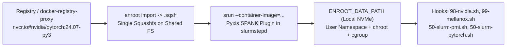

# 6.13 Containers on Slurm: enroot and pyxis

| | |
|---|---|
| Level | Intermediate |
| Priority tier | 1 |
| Lab venue | Linux GPU nodes with Slurm, enroot and pyxis |
| Part | Part 6: HPC and Slurm |
| Status | Drafted. Read from the source repositories (NVIDIA/enroot commit `0bb3810`, 2026-10-21, docs and default configuration; NVIDIA/pyxis commit `1075199`, 2026-05-11, README and option text). Nothing was executed: enroot needs Linux user namespaces and pyxis needs a Slurm build, neither available here. Labs **untested** |

## Why this matters for AI infrastructure

Almost every serious GPU cluster runs its AI jobs from container images, such as NGC PyTorch or NeMo images, vendor stacks and team images. The framework, the CUDA libraries, NCCL and the Python packages must match each other. You cannot install all of them by hand on every node.

On Slurm clusters, the reference solution is a pair from NVIDIA. enroot is an unprivileged container runtime. pyxis is a Slurm plugin that exposes enroot through `srun`. You will find this pair on DGX SuperPOD-style systems and on many neoclouds.

Docker daemons and root-owned containers are poor fits for shared HPC nodes. enroot and pyxis run containerised steps with the same Slurm behaviour as bare-metal steps. cgroups, accounting, signals and binding all still apply. Understanding them is expected for an AI-infrastructure role.

## Prerequisites and outcomes

This chapter builds on 6.6, which covers software strategy, on 6.10 to 6.12, and on the container basics in Part 5.1 to 5.4. When you finish it, you should be able to:

- Explain why Docker is not used on shared compute nodes and what enroot does instead.
- Use `srun`/`sbatch` with `--container-image`, `--container-mounts`, `--container-workdir`, `--container-name`, `--container-save`, and other pyxis options.
- Describe the image flow: registry, import, squashfs, container root, caching, and where each lives.
- Explain the hooks that give containers GPUs, InfiniBand and Slurm/PMIx/PyTorch variables, and the standard security posture.
- Authenticate to registries and use mirrors/caches, and plan image distribution for thousands of nodes.
- Install and configure enroot and pyxis at a high level, and troubleshoot common failures.

## 1. Why not Docker on compute nodes

Suppose a user asks you to run Docker on the compute nodes of a shared GPU cluster. Before you agree, you should know why most HPC sites say no. The diagram below shows the path a container image takes with enroot and pyxis instead.



Chapter 16 of *Supercomputers for Linux SysAdmins* explains what a container really is. A Linux container is not a virtual machine with hardware emulation. It is a set of real host processes, and three Linux kernel features isolate them.

1. cgroups, or control groups, limit what a set of processes can consume. They can cap a container at `20%` of node RAM, or at `1` CPU core. They also control network use and access to `/dev` device nodes.
2. Kernel namespaces isolate process IDs (PIDs), user IDs (UIDs), mounts and, optionally, network interfaces. A process inside one namespace cannot see processes outside it. It can also hold virtual UID and PID numbers.
3. `chroot`, along with `pivot_root`, changes the root directory (`/`) of the process tree. That root becomes a mounted container filesystem with its own binaries, shared libraries and `libc`. `--bind` mounts then expose host data directories inside the container.

Docker adds a layered filesystem on top of these features. It stores almost every line of a `Dockerfile` as a cached, read-only layer on local storage. A rebuild after an edit therefore starts from the changed line, not from the top. The same chapter describes this layering.

Even so, running Docker directly on shared HPC compute nodes in 2025–2026 fails for five architectural reasons.

| Concern | Docker daemon model | enroot/pyxis |
|---|---|---|
| Privilege | Root daemon; `docker` group is effectively root | Unprivileged: user namespaces and `chroot`-like environment; runs as the user |
| Scheduler integration | Containers are children of the daemon, outside Slurm's cgroup and accounting | The container process is the Slurm task: cgroups, signals, accounting, GPU isolation apply |
| Isolation goals | Strong isolation between containers | Intentionally minimal: same PID/network namespace as host by default, to preserve HPC behaviour (RDMA, shared memory) |
| Image storage | Layered storage per node, daemon-managed | Converted to a squashfs/rootfs; can live on shared storage; cache per user |
| Multi-node MPI/NCCL | Needs network plumbing | Works with the host network and IB devices directly |

Each row is one of the five reasons. The right-hand column shows what enroot and pyxis do instead.

The enroot README calls enroot a "simple, yet powerful tool to turn traditional container/OS images into unprivileged sandboxes". That is close to a fancy `chroot`. enroot drops the features HPC does not need, such as daemons, network isolation and image layering at runtime. It keeps what matters: importing Docker and OCI images, and running them unprivileged with host GPU and InfiniBand integration. Apptainer and Singularity are the other HPC options, covered in 6.29.

### Where Docker runs into trouble in HPC

Docker is the most popular container technology, but it has many limits on a cluster. By default, it needs a special service that runs with root privileges. It does not let jobs use InfiniBand and GPUs directly, and it integrates badly with job managers. The book's view is that in 2025 you almost cannot use Docker directly in HPC. Some of these issues can be worked around. Other technologies already run containers, and even prebuilt Docker images, on clusters.

Docker daemons are poor fits for shared nodes, so enroot and pyxis are the reference pair here.

## 2. enroot

Your first job on a new cluster usually starts with one question: how does the PyTorch image get from the registry onto the node? The workflow below answers that question one command at a time.

### Workflow

```bash
enroot import docker://nvcr.io#nvidia/pytorch:24.07-py3     # pull layers, build a squashfs: nvidia+pytorch+24.07-py3.sqsh
enroot create --name pt nvidia+pytorch+24.07-py3.sqsh        # unpack into a container root under ENROOT_DATA_PATH
enroot list
enroot start --rw pt python -c "import torch; print(torch.cuda.is_available())"
enroot export --output pt-modified.sqsh pt                   # save changes back to an image
enroot remove pt
```

The enroot usage documentation lists these commands: `batch`, `bundle`, `create`, `exec`, `export`, `import`, `list`, `remove`, `start` and `version`. Notice the URI form `docker://REGISTRY#IMAGE:TAG`. The `#` separates the registry from the image, because `/` and `:` are ambiguous on their own. For NGC, the URI is `nvcr.io#nvidia/pytorch:TAG`. `enroot start --root --rw` gives you a writable container in which you appear as root. That is a user-namespace mapping, not real privilege. You use it to install packages and then run `export`.

The output of `import` is a squashfs image, which is a compressed, read-only filesystem. The sample config sets the default options to `-comp lzo -noD -exit-on-error`, and `ENROOT_MAX_PROCESSORS` controls how many compression threads run. `create` then unpacks the image into a directory tree, called the container root, in per-user storage. A squashfs image is a single file, so it is easy to distribute: one large file instead of thousands of small ones. You can place it on shared or node-local storage.

### Paths and configuration

The `configuration.md` file in the enroot documentation describes how the settings work. Configuration comes from `enroot.conf`, which lives in `/etc/enroot` by default, or from environment variables. The environment takes precedence. enroot also reads `enroot.conf.d/*.conf`. The table lists the standard paths and their defaults.

| Setting | Default | Meaning |
|---|---|---|
| `ENROOT_RUNTIME_PATH` | `${XDG_RUNTIME_DIR}/enroot` | Working directory at runtime (must be local, writable) |
| `ENROOT_CONFIG_PATH` | `${XDG_CONFIG_HOME}/enroot` | User configuration |
| `ENROOT_CACHE_PATH` | `${XDG_CACHE_HOME}/enroot` | Layer cache and credentials |
| `ENROOT_DATA_PATH` | `${XDG_DATA_HOME}/enroot` | User container storage (unpacked roots) |
| `ENROOT_TEMP_PATH` | `${TMPDIR}` | Temporary files (large during import) |
| `ENROOT_SQUASH_OPTIONS`, `ENROOT_MAX_PROCESSORS`, `ENROOT_ROOTFS_WRITABLE`, `ENROOT_REMAP_ROOT`, `ENROOT_TRANSFER_RETRIES` | see sample config | Compression, threads, default writability, root remapping, retries |

The last row lists five settings, and you find all of them in the sample config. On a cluster, point the runtime and data paths at node-local fast storage, such as NVMe, `/raid` or `/tmp`. The cache can sit on a shared location, but only if you accept the metadata load that brings. Home directories on NFS are a poor default. Unpacking and running containers from them is slow, and it hammers the server. This is why the install step sets `enroot.conf` with paths on local NVMe, as section 6 explains.

### Hooks, mounts, environment

Containers are customised through directories. `ENROOT_SYSCONF_PATH` is the system directory, and `ENROOT_CONFIG_PATH` is the user directory. `environ.d/*.env` sets environment variables inside the container. `mounts.d/*.fstab` adds mounts. `hooks.d/*.sh` holds pre-start bash scripts. A hook is a script that runs at container start, and these run with full capabilities before the container switches to its final root. A hook can read `ENROOT_PID`, `ENROOT_ROOTFS`, `ENROOT_MOUNTS` and `ENROOT_ENVIRON`. The standard hooks are described in `standard-hooks.md` and live in `conf/hooks`.

| Hook | Role |
|---|---|
| `10-cgroups.sh` | Mount cgroup controllers in a new cgroup namespace (always on) |
| `10-devices.sh` | Restrict `/dev` to a minimal set (`ENROOT_RESTRICT_DEV`, default `no`) |
| `10-home.sh` | Mount the user's home (`ENROOT_MOUNT_HOME`, default `no`) |
| `10-shadow.sh` | Add entries for the current user/group to `/etc/passwd` and `/etc/group`; create the home directory (always on) |
| `10-localtime.sh`, `10-aptfix.sh` | Time zone; apt compatibility |
| **`98-nvidia.sh`** | GPU support via `libnvidia-container`; controlled by `NVIDIA_VISIBLE_DEVICES`, `NVIDIA_DRIVER_CAPABILITIES`, etc. (the nvidia-container-runtime variables). It injects the host driver libraries and device nodes matching the host driver version |
| **`99-mellanox.sh`** | InfiniBand/RDMA: injects MOFED from the host, controlled by `MELLANOX_VISIBLE_DEVICES` |
| `extra/50-slurm-pmi.sh` | Passes `SLURM_*` and `PMIX_*` variables and PMIx sockets into the container for MPI launches |
| `extra/50-slurm-pytorch.sh` | Sets PyTorch distributed variables from Slurm |
| `extra/50-sharp.sh`, `50-mig-config.sh` | SHARP and MIG support |

The `extra` hooks are provided but not enabled by default. The site copies them into `hooks.d`, usually through the DGX or cluster software image. The hooks explain two key behaviours. First, GPU libraries inside the container come from the host driver, not from the image. The image supplies the CUDA user-space libraries, and the hook supplies `libcuda`, so the image's CUDA version must be compatible with the host driver (see Part 10). Second, InfiniBand and RDMA work because the hook injects the host MOFED into the container. If `nvidia-smi` works inside the container but NCCL runs on sockets, check the Mellanox hook and device visibility.

So the image's CUDA version and the host driver must agree.

## 3. pyxis

Suppose you run `srun` with a container image option. pyxis is the piece that makes this work, and it takes over the container work for you.

pyxis is a SPANK plugin. SPANK is Slurm's extension point for adding command-line options and running code when a task launches. pyxis adds options to `srun` and `sbatch`. It imports or creates the container with enroot on the compute node, and then it runs each task inside that container. The container therefore *is* the Slurm task. The README sets two requirements. enroot must be version 3.1.0 or later. pyxis must be built against the Slurm version in use, which has been required since Slurm 21.08. It is installed on the compute nodes, and on any node where `srun` is used. You enable it with a `plugstack.conf` entry, for example by symlinking `pyxis.conf` into `/etc/slurm/plugstack.conf.d/` and restarting slurmd.

### Why enroot and pyxis come as a pair

enroot is a lightweight container implementation. It does not need Docker or another container engine installed. When you run a container with enroot, it extracts the squashfs image into the local filesystem. Then it runs the application with cgroups, namespaces and `chroot` set up around it.

pyxis is the complementary Slurm plugin. It adds useful flags to `srun`, and it runs the container through enroot for you, so you never call enroot yourself. Both projects come from NVIDIA, so only NVIDIA GPUs are well managed when you use them. The book calls this technology really easy to use. It adds minimum overhead compared with the other options.

The table lists the pyxis options, as the README text describes them. The `--container-name` row matters most, because it decides whether a container survives the task.

| Option | Meaning |
|---|---|
| `--container-image=[USER@][REGISTRY#]IMAGE[:TAG]` or `PATH` | Image to use: an enroot/Docker URI or a path to a squashfs file on the host filesystem |
| `--container-mounts=SRC:DST[:FLAGS][,...]` | Bind mounts; flags joined with `+` (e.g. `ro+rprivate`) |
| `--container-workdir=PATH` | Working directory |
| `--container-name=NAME` | Name to save/load the container. **Unnamed containers are removed when the task completes; named ones persist, and an existing named container is reused with the import skipped** |
| `--container-save=PATH` | Save the container state to a squashfs file |
| `--container-mount-home` / `--no-container-mount-home` | Bind mount the user's home (system enroot settings may already mount it) |
| `--container-remap-root` / `--no-container-remap-root` | Appear as root inside (does not grant elevated permissions) |
| `--container-entrypoint` / `--no-container-entrypoint`, `--container-entrypoint-log` | Run or skip the image's entrypoint; show its output |
| `--container-writable` / `--container-readonly` | Writability of the container filesystem |
| `--container-env=NAME[,...]` | Variables whose host values override the image's (set before the entrypoint). By default host variables are set after the entrypoint but **do not override values in the image** |
| `--container-unshare=NS[,...]` | Create new namespaces: `net`, `ipc`, `uts` |

The README shows two examples. The first command imports the image on demand, because `srun` starts the import when it sees the image option. The second mounts the host's `/etc/os-release` at `/host/os-release` and reads it from there.

```console
$ srun --container-image=almalinux:9 grep PRETTY /etc/os-release
pyxis: importing docker image: almalinux:9
pyxis: imported docker image: almalinux:9
PRETTY_NAME="AlmaLinux 9.7 (Moss Jungle Cat)"

$ srun --container-image=almalinux:9 --container-mounts=/etc/os-release:/host/os-release grep PRETTY /host/os-release
```

In `sbatch`, the option can be a directive. The `#` in the image URI must be escaped, because a bare `#` starts a comment: `#SBATCH --container-image nvcr.io\#nvidia/pytorch:21.12-py3`.

### A training job

Here is a training job that uses everything above. It requests four nodes, with eight tasks and eight GPUs on each node. It starts PyTorch inside the container.

```bash
#!/bin/bash
#SBATCH --nodes=4 --ntasks-per-node=8 --gpus-per-node=8 --cpus-per-gpu=12 --exclusive --time=12:00:00
IMG=/shared/images/nvidia+pytorch+24.07-py3.sqsh        # pre-imported squashfs on fast shared storage
export MASTER_ADDR=$(scontrol show hostnames "$SLURM_JOB_NODELIST" | head -n1)
export MASTER_PORT=$((10000 + SLURM_JOB_ID % 20000))
srun --kill-on-bad-exit=1 --cpu-bind=cores --gpu-bind=closest \
     --container-image="$IMG" \
     --container-mounts=/data:/data:ro,/scratch/$USER:/scratch,$PWD:/workspace \
     --container-workdir=/workspace \
     python train.py
```

Read the script with a few points in mind. The container starts for every task on every node, so startup cost multiplies across the job. That is why the script uses a squashfs path. The image is read from shared storage, and nothing is pulled from a registry at job time. Mount datasets and output directories explicitly. Keep `/dev/shm` large enough for data-loader workers, because the container's shm is the host's. Slurm binding and GPU isolation still apply, since enroot runs inside the step. The `SLURM_*` and `PMIX_*` variables reach the container through the Slurm hooks. To check, run `env | grep -E "SLURM|PMIX"` inside the container.

Point `IMG` at a squashfs file that is already imported, not at a registry URI.

### Multi-node MPI/NCCL in containers

Use `srun --mpi=pmix` with a container whose MPI is PMIx-aware and compatible with the host's PMIx and Slurm. The pyxis README notes that support for PMI2 and PMIx "requires Slurm support". The `50-slurm-pmi.sh` hook forwards the PMIx variables and socket into the container. NGC images ship HPC-X with PMIx support. A mismatch between the container's PMIx and the host's causes launch failures at `MPI_Init`. Section 11 of chapter 6.4 covers that failure. NCCL inside the container uses the injected host IB libraries and devices.

The PMIx version in the container and on the host therefore have to match.

## 4. Images: sources, caching, distribution

### Why caching matters at job start

Each process downloads its container before it starts, then prepares it by unpacking or converting it. That takes time. Many processes also download the same image, often at the same moment. The book calls this inefficient, and its advice has three parts. First, encourage your users to load containers onto the shared file system and reuse them. Second, use the caching options that Charliecloud and enroot give you. Third, run a caching proxy, such as the docker-registry-proxy project.

A regular proxy may not be a good fit. Registries often require authorization, and you should not cache image manifests for long periods.

Images come from several sources: NGC (`nvcr.io#nvidia/...`, which needs an API key for some images), Docker Hub, GitHub Container Registry and private registries. You build images from NGC bases with a normal Docker, Podman or Buildah build, outside the cluster. Then you push the image to a registry and import it into squashfs.

enroot reads registry credentials from `$ENROOT_CONFIG_PATH/.credentials`, which uses netrc format. A line looks like `machine nvcr.io login $oauthtoken password <NGC API key>`. The user name `$oauthtoken` is the NGC convention. Protect the file with mode 600, and never put keys in job scripts.

The layer cache in `ENROOT_CACHE_PATH` makes repeat imports fast and lets layers be shared efficiently. Consider a registry pull at job start on thousands of nodes. Every node pulls at once, which is a thundering herd. You will saturate the registry or the uplink, and you will hit rate limits.

The preferred pattern at scale is to import once, centrally, into a squashfs file on shared parallel storage or an image distribution service. Jobs then use `--container-image=/path/to/image.sqsh`. A squashfs file is one big, mostly read-only file. That makes it a good fit for caching on Lustre/GPFS/VAST/WEKA, and for node-local copies. You can pre-stage a copy to NVMe with `sbcast`/`pdcp`, or with a prolog, before large jobs. Version images by digest or dated tag, and never use `:latest` for production runs.

A local registry mirror or pull-through cache is the next option. Harbor, Artifactory, a registry:2 mirror, or the docker-registry-proxy project can fill this role. The docker-registry-proxy project is the one recommended in chapter 16 of *Supercomputers for Linux SysAdmins*, under Caching. Here is why a mirror matters. When processes start a container directly from a registry, every node downloads, unpacks and converts the layers at the same time. Take 64 nodes pulling a 15 GB image. Over a 10 GB/s uplink, that takes 96.0 s. A single central import takes 1.5 s. A generic HTTP proxy is a poor fit, because Docker registries require token authorization, and you must not cache mutable image manifests for long periods. The docker-registry-proxy project handles registry authentication. It caches immutable layer blobs and keeps manifest checks fresh. Pair this with encouraging users to pre-import `.sqsh` images onto the shared filesystem, and turn on the Enroot/Charliecloud layer caches.

PyTorch NGC images are many gigabytes. Unpacked roots also use `ENROOT_DATA_PATH`. Unnamed pyxis containers are cleaned up after tasks, but named ones need housekeeping. Record the image digest in the job's accounting comment or log, so you can reproduce the run later.

For a large job, import once and point every node at the squashfs file.

## 5. Security and policy

Containers on a shared cluster raise two questions: what privilege they carry, and which images users may run.

- enroot runs as the invoking user, inside user namespaces. The container "root" is that same user, with remapping only. enroot does not grant privilege escalation by itself. The hooks, however, run with capabilities during setup. Hook scripts and enroot configuration are therefore privileged, security-sensitive files, and they must stay root-owned.
- The namespace choices favour HPC. By default there is no network namespace, so the container shares the host network. `--container-unshare=net` is available, but it breaks RDMA unless you set it up.
- The kernel prerequisites come from `requirements.md`. You need Linux 3.10 or later, with `CONFIG_NAMESPACES`, `CONFIG_USER_NS`, `CONFIG_SECCOMP_FILTER` and `CONFIG_OVERLAY_FS` to import Docker images. Run `enroot-check` to verify them. Some distributions restrict unprivileged user namespaces. Recent Ubuntu releases use an AppArmor profile for this, and the repository ships an `apparmor.profile` that you may need to allow enroot to use.
- Image trust is a real risk. Users can run arbitrary images, including ones that exfiltrate data from mounted paths. Mount only what is needed, and use `:ro` for datasets. Restrict registries by using a mirror, scan images, and treat user-supplied images as untrusted code. Such code runs with the user's own file permissions, which is what they have anyway.
- Writable containers change only the user's own copy. Created with `--container-writable` or `enroot start --rw`, they are not shared unless you export them.

Treat user-supplied images as untrusted code, and mount only the data they need.

## 6a. Other HPC container runtimes: Singularity, Apptainer, and Charliecloud

You will meet other HPC container runtimes on academic, national-lab and mixed CPU/GPU systems. Chapter 16 of *Supercomputers for Linux SysAdmins* covers three of them, and chapter 6.29 compares them in depth.

- Singularity, from Sylabs Inc., and Apptainer, from the Linux Foundation, package an image into a single `.sif` file. SIF stands for Singularity Image Format, and the file is backed by squashfs. You can build it from a definition file or convert a Docker image into it. Singularity also accepts a `docker://` URI at run time. Doing so makes every task download the Docker layers, convert them into a temporary `.sif` image, run, and then delete the converted image on exit. That wastes massive network and CPU time. Always convert once to `.sif` on shared storage first. With `nvidia-container-toolkit` installed on the host, `--nv` exposes NVIDIA GPUs and InfiniBand transparently. To launch an MPI application inside a Singularity container, run `mpirun -n $NP singularity run app.sif /opt/my-mpi-app`. Under Slurm, prefer `srun singularity run app.sif /opt/my-mpi-app`. Apptainer is the open-source continuation of the original Singularity project, announced at https://apptainer.org/news/community-announcement-20211130/. Nearly all Singularity commands and `.sif` workflows apply to Apptainer directly.
- Charliecloud is a lightweight, uncomplicated, fully unprivileged user-namespace container runtime, designed for auditability. It has four core CLI utilities: `ch-image`, `ch-build`, `ch-convert` and `ch-run`. Together they pull or build Docker images, extract or convert squashfs archives, and execute containers that integrate with batch schedulers through PMIx.

On NVIDIA-centric AI clusters, enroot and pyxis are the default. The reasons are NGC image handling, the hooks for GPUs, InfiniBand and PMIx, and the `--container-*` interface. Apptainer is the common choice where the same cluster serves classic HPC users.

Apptainer therefore fits clusters that serve classic HPC users as well as AI jobs.

## 6. Operating it

Once enroot and pyxis are installed, someone has to keep them running. The table lists the routine tasks.

| Task | Practice |
|---|---|
| Install | Package or `make install` on all compute nodes; set `enroot.conf` (paths on local NVMe), hooks, `plugstack.conf.d/pyxis.conf`; restart slurmd |
| Verify | `enroot version`, `enroot-check`, `srun --container-image=ubuntu:24.04 cat /etc/os-release`, `srun --gres=gpu:1 --container-image=<cuda image> nvidia-smi` |
| Upgrade | Rebuild pyxis whenever Slurm is upgraded (the plugin links against Slurm); roll out enroot and pyxis with the node image |
| Monitor | Import failure rates, time-to-first-output, registry bandwidth, disk use of `ENROOT_DATA_PATH` and cache, `/dev/shm` |
| Housekeeping | Prune named containers and cache older than N days (epilog or cron), clean orphaned runtime dirs after node crashes |
| Support | A short doc: how to get images in, naming, mounts, shm, known gotchas, example scripts |

The upgrade row ties pyxis to Slurm. Every Slurm upgrade means you rebuild pyxis, because the plugin links against Slurm.

As you monitor the cluster, watch import failure rates, time-to-first-output, registry bandwidth, and disk use of the data path and cache.

## 7. Troubleshooting

A job fails inside the container, and the error alone does not tell you why. The table maps common symptoms to likely causes and to the first thing to check.

| Symptom | Likely cause | Check |
|---|---|---|
| `pyxis: unrecognized option --container-image` | Plugin not loaded in `srun`/slurmd, `plugstack.conf` missing, built against the wrong Slurm | `scontrol show config \| grep -i plugstack`, slurmd log, `srun --help \| grep container` |
| Import is slow or fails mid-job | Registry rate limit/auth, no credentials, many nodes pulling at once, `ENROOT_TEMP_PATH` too small | Use squashfs path; check `.credentials` format; local mirror |
| `nvidia-smi: command not found` or no GPU in container | `NVIDIA_VISIBLE_DEVICES` unset by image/hook, `98-nvidia.sh` not installed, driver library mismatch, GPUs not allocated | Hook list, `enroot start` env, Slurm `--gres` |
| CUDA error: driver version insufficient | Image CUDA newer than host driver supports | Update driver or use older image (Part 10) |
| NCCL falls back to sockets inside container | Mellanox hook missing or IB devices not visible (`MELLANOX_VISIBLE_DEVICES`), `NCCL_IB_HCA` wrong | `ls /dev/infiniband`, NCCL INFO (6.12) |
| MPI launch fails in container | PMIx mismatch between host and container | `srun --mpi=list`, MPI/PMIx versions in the image |
| `Operation not permitted` on mount/namespace | Unprivileged user namespaces disabled or AppArmor restriction | `sysctl kernel.unprivileged_userns_clone`, `kernel.apparmor_restrict_unprivileged_userns`, `enroot-check` |
| Out of space | Data path on small `/tmp`; many named containers | `df`, `enroot list`, clean-up |
| Job's environment variables missing in container | Pyxis defaults: host variables do not override image values | `--container-env=NAME` |
| Slow startup of 512 ranks | Each task creates the container; shared FS metadata storm | Squashfs on fast storage, local copy, `--container-name` reuse within a node |

Several rows point to the image import path, so that is the place to look first when you see slow startup.

## 8. Lab (self-checking URI/mount lab tested; live Linux cluster parts untested)

The lab has two halves. The first half runs on your own machine, and it has been tested. The second half needs a live Linux GPU cluster, and it has not been run yet.

Start with the self-checking Python lab, `code/part06/enroot_pyxis_lab.py`. It covers these checks. It verifies the enroot `docker://REGISTRY#REPO:TAG` URI format. It checks the `#` escaping in `#SBATCH --container-image`, written as `nvcr.io\#nvidia/pytorch:24.07-py3`, and the `.sqsh` naming, which gives `nvidia+pytorch+24.07-py3.sqsh`. It also tests the pyxis `--container-mounts=SRC:DST[:FLAGS]` parser, comparing `ro+rprivate` with the default `rw`. Last, it calculates the registry thundering-herd pull penalty: `96.0 s` for 64 nodes pulling 15 GB over 10 GB/s, against `1.5 s` for a single central squashfs import.

```bash
python3 code/part06/enroot_pyxis_lab.py
```

The second half runs on a Linux GPU cluster with Slurm, enroot and pyxis installed. Work through these steps in order.

1. Install enroot on a Linux VM. Run `enroot-check`, then `enroot import docker://ubuntu:24.04`, and create and start the container. Inspect the hooks directory.
2. Configure NGC credentials, then import `nvcr.io#nvidia/pytorch:<tag>`. Record the time and size of the squashfs file, and the size of the unpacked container.
3. Install pyxis on a test Slurm cluster. Run the README examples, then test `--container-mounts`, `--container-name` reuse and `--container-save`.
4. On a GPU node, run `nvidia-smi` and a CUDA sample inside a container. Then rename `98-nvidia.sh` and observe what changes.
5. On two nodes, run the DDP job from 6.12, or an `nccl-tests` container, with `srun --mpi=pmix`. Compare the NCCL transport with and without the Mellanox hook.
6. Run a scale test. Launch the same job from the registry URI, then from a squashfs path on shared storage, on N nodes. Plot the start latency for each.
7. Write the site doc for the image workflow, and a housekeeping script.

Run the local lab first, since it needs no cluster and checks your URI and mount syntax.

## 9. Interview angles

- Why would you choose enroot and pyxis rather than Docker on a Slurm cluster?
- How does a container get GPUs and InfiniBand without privilege?
- What does pyxis add to `srun`, and why is it a SPANK plugin?
- How would you distribute a 20 GB image to 1,000 nodes for a job launch?
- A container job runs, but NCCL uses TCP. What do you check?
- When would you use `--container-name` rather than unnamed containers?
- What are the security implications of letting users run arbitrary images?
- Why must pyxis be rebuilt after a Slurm upgrade?
- How would you compare enroot and pyxis with Apptainer, and with Kubernetes pods for training?

## Exercises

1. Run `python3 code/part06/enroot_pyxis_lab.py`, then call `format_enroot_pyxis_uris("nvcr.io", "nvidia/pytorch", "24.07-py3")`. Explain why enroot uses `#` in `docker://nvcr.io#nvidia/pytorch:24.07-py3` to separate the registry from the image path. Explain why `#SBATCH --container-image nvcr.io\#nvidia/pytorch:24.07-py3` needs a backslash before `#`, and how `enroot import` names the resulting `.sqsh` archive, `nvidia+pytorch+24.07-py3.sqsh`.
2. Set up `enroot.conf` paths for a node with fast local storage. The compute node has a local NVMe scratch array mounted at `/raid/local`, and an NFS home directory at `/home`. Write the `ENROOT_RUNTIME_PATH`, `ENROOT_DATA_PATH`, `ENROOT_TEMP_PATH` and `ENROOT_CACHE_PATH` settings, so that container roots unpack at NVMe speeds instead of hammering the NFS metadata server.
3. Write an `#SBATCH` script for a 4-node, 32-GPU PyTorch training run. Use the pre-imported `/shared/images/nvidia+pytorch+24.07-py3.sqsh` file, mount `/data:/data:ro+rprivate,/scratch/$USER:/scratch,$PWD:/workspace`, and set `--container-workdir=/workspace`. Then explain how `--container-env` differs from the default host-to-container environment propagation. Use `parse_pyxis_mounts` to check the mount string.
4. Trace the roles of the Enroot hooks. Explain the exact role of `98-nvidia.sh`, `99-mellanox.sh`, `50-slurm-pmi.sh` and `50-slurm-pytorch.sh` when a multi-node job launches inside an Enroot container. Suppose `nvidia-smi` sees all 8 GPUs inside the container, but `NCCL_DEBUG=INFO` logs `NET/Socket` instead of `NET/IB`. Which hook and which device path (`/dev/infiniband`) do you inspect?
5. Work out the registry thundering-herd penalty. Use `estimate_pull_time_sec(64, 15.0, 10.0)` in `code/part06/enroot_pyxis_lab.py`. Compare the time when 64 nodes pull a `15 GB` image at once from a registry over a `10 GB/s` uplink, which is `96.0 s` plus decompression and rate limits, with the time to import once into a shared `.sqsh` file, which is `1.5 s`. Then explain why `docker-registry-proxy` is preferred over a standard HTTP proxy, using chapter 16 of *Supercomputers for Linux SysAdmins*.
6. Compare three ways to launch a job. Compare how a multi-node MPI or PyTorch job is launched under pyxis (`srun --container-image=app.sqsh ...`), under Singularity or Apptainer (`srun singularity run --nv app.sif ...`), and under Charliecloud (`ch-image`, `ch-convert`, `ch-run`). Then explain why running `singularity run docker://...` directly, without pre-converting to `.sif`, is an operational anti-pattern.

## Checkpoint

<details>
<summary>1. Which three Linux kernel technologies combine to form a container, as chapter 16 of *Supercomputers for Linux SysAdmins* describes, and why are Docker daemons unsuitable for shared Slurm compute nodes?</summary>

A Linux container combines three things. `cgroups` set resource limits on CPU, RAM and devices. `namespaces` isolate PIDs, UIDs and mounts. `chroot`, with `pivot_root`, changes `/` to the container's root filesystem, and `--bind` mounts bring in host data. Docker daemons do not suit shared HPC nodes for three reasons. The daemon runs as `root`, and `docker` group membership is root-equivalent. Its container processes sit outside Slurm's `slurmstepd` cgroup hierarchy and accounting tree. And its handling of network namespaces gets in the way of direct GPUDirect RDMA and InfiniBand access.
</details>

<details>
<summary>2. What is NVIDIA `enroot`, and what file format does `enroot import` produce?</summary>

enroot is an unprivileged container sandbox runtime. It runs inside user namespaces and needs no background daemon. `enroot import` pulls OCI or Docker image layers and packs them into one flattened, compressed, read-only `squashfs` archive, with the `.sqsh` extension. The default compression is `-comp lzo -noD -exit-on-error`.
</details>

<details>
<summary>3. Why does `enroot import docker://nvcr.io#nvidia/pytorch:24.07-py3` use `#`, and how must you write that URI inside an `#SBATCH` directive?</summary>

enroot uses `#` to separate the registry hostname, `nvcr.io`, from the image repository, `nvidia/pytorch:24.07-py3`, without any ambiguity. Inside a batch script, `#` starts a comment. So you must escape it with a backslash: `#SBATCH --container-image nvcr.io\#nvidia/pytorch:24.07-py3`.
</details>

<details>
<summary>4. What do `ENROOT_RUNTIME_PATH`, `ENROOT_CACHE_PATH`, `ENROOT_DATA_PATH`, and `ENROOT_TEMP_PATH` store, and where should they point on compute nodes?</summary>

- `ENROOT_RUNTIME_PATH` holds active runtime state. It must be a local, writable filesystem.
- `ENROOT_CACHE_PATH` holds the downloaded OCI layer blob cache and the `.credentials` file.
- `ENROOT_DATA_PATH` holds the unpacked, writable container root trees that `enroot create` produces.
- `ENROOT_TEMP_PATH` is the temporary workspace used while `.sqsh` images are built during `enroot import`.

On compute nodes, `ENROOT_DATA_PATH`, `ENROOT_TEMP_PATH` and `ENROOT_RUNTIME_PATH` should point to fast node-local NVMe or tmpfs. You should never point them at an NFS `$HOME` directory.
</details>

<details>
<summary>5. How does an unprivileged Enroot container gain access to host NVIDIA GPUs (`98-nvidia.sh`) and InfiniBand RDMA adapters (`99-mellanox.sh`)?</summary>

- `98-nvidia.sh` calls `libnvidia-container`, which follows `NVIDIA_VISIBLE_DEVICES` and `NVIDIA_DRIVER_CAPABILITIES`. It bind-mounts the allocated `/dev/nvidia*` device nodes. It also injects the host's kernel-matched driver libraries, `libcuda.so` and `nvidia-smi`, while the container keeps using the image's user-space CUDA Toolkit libraries.
- `99-mellanox.sh` injects the host's Mellanox OFED (`MOFED`) user-space InfiniBand verbs libraries and the `/dev/infiniband/*` devices. It is controlled by `MELLANOX_VISIBLE_DEVICES`.
</details>

<details>
<summary>6. What do the `50-slurm-pmi.sh` and `50-slurm-pytorch.sh` extra hooks do?</summary>

- `50-slurm-pmi.sh` passes `SLURM_*` and `PMIX_*` environment variables into the container. It also bind-mounts the host PMIx UNIX domain sockets, so `srun --mpi=pmix` works inside the container.
- `50-slurm-pytorch.sh` automatically turns Slurm task variables, `SLURM_PROCID`, `SLURM_LOCALID`, `SLURM_NTASKS` and `SLURM_JOB_NODELIST`, into PyTorch's `RANK`, `LOCAL_RANK`, `WORLD_SIZE` and `MASTER_ADDR`.
</details>

<details>
<summary>7. What is NVIDIA `pyxis`, how is it loaded into Slurm, and why must it be recompiled when Slurm is upgraded?</summary>

pyxis is a Slurm SPANK plugin. It is registered in `/etc/slurm/plugstack.conf` or in `plugstack.conf.d/pyxis.conf`. It adds `--container-*` flags to `srun` and `sbatch`, and it launches each Slurm task inside an Enroot container. SPANK plugins link dynamically against Slurm's internal ABI headers. So pyxis must be rebuilt after any major or minor Slurm version upgrade.
</details>

<details>
<summary>8. Compare an unnamed Pyxis container (`--container-image=...`) with a named container (`--container-name=NAME`), and what does `--container-save=PATH` do?</summary>

- An unnamed container is created before the step starts. It is deleted from `ENROOT_DATA_PATH` as soon as the step completes.
- A named container, set with `--container-name=NAME`, stays on the node after the step ends. Later steps that use the same name reuse the unpacked root filesystem and skip the import and unpacking. Those containers need periodic cleanup.
- `--container-save=PATH` exports the container's final root filesystem into a `.sqsh` file at `PATH` when the step finishes.
</details>

<details>
<summary>9. By default, what happens when an environment variable is defined both on the host and inside the container image, and what does `--container-env=NAME` change?</summary>

By default, pyxis exports host environment variables after the entrypoint. It does not override variables that the container image already defines in its `ENV`. Passing `--container-env=NAME[,...]` makes the host value of `NAME` override the image's value before the entrypoint runs.
</details>

<details>
<summary>10. How do you configure NGC (`nvcr.io`) registry authentication for Enroot?</summary>

Create `$ENROOT_CONFIG_PATH/.credentials` in **netrc format**, with permissions `0600`. The line reads `machine nvcr.io login $oauthtoken password <NGC_API_KEY>`. Never hardcode API keys inside batch scripts.
</details>

<details>
<summary>11. Why is passing a remote registry URI (`--container-image=nvcr.io#...`) directly to a 64-node job an anti-pattern, and what are the three caching practices from *Supercomputers for Linux SysAdmins*, chapter 16?</summary>

When 64 nodes start tasks from a registry URI at the same time, every node pulls and decompresses the multi-gigabyte layers together. The pull takes `64 * 15 GB / 10 GB/s = 96.0 s` on a 10 GB/s uplink. It saturates the uplink and can hit registry rate limits. Chapter 16 recommends three practices:

1. Import the image once into a `.sqsh` file on shared parallel storage, such as `--container-image=/shared/images/app.sqsh`, or stage it to local NVMe with `sbcast`.
2. Turn on `ENROOT_CACHE_PATH` layer caching.
3. Deploy `docker-registry-proxy`, rather than a generic HTTP proxy. It handles registry authentication and caches immutable layer blobs, without caching mutable image manifests for long periods.
</details>

<details>
<summary>12. Why does Enroot share the host network namespace by default instead of creating an isolated virtual network (`--container-unshare=net`)?</summary>

Sharing the host network namespace gives containerised processes direct, zero-overhead access to host InfiniBand and RoCE RDMA verbs devices, to high-speed Ethernet interfaces, and to node-local IPC sockets. Nothing sits in between, so there is no NAT or bridge translation penalty.
</details>

<details>
<summary>13. What Linux kernel features are required by Enroot (`enroot-check`), and what Ubuntu security setting can block unprivileged user namespaces?</summary>

enroot needs Linux kernel 3.10 or later, with `CONFIG_NAMESPACES`, `CONFIG_USER_NS` (for unprivileged user namespaces), `CONFIG_SECCOMP_FILTER` and `CONFIG_OVERLAY_FS`. On recent Ubuntu releases, `kernel.apparmor_restrict_unprivileged_userns=1` blocks unprivileged user namespaces, unless Enroot's AppArmor profile is loaded.
</details>

<details>
<summary>14. What does `CUDA error: driver version is insufficient for CUDA runtime version` mean inside a container, and how is it fixed?</summary>

The image was built with a newer CUDA Toolkit, such as CUDA 12.6, than the host driver supports. The host's `libcuda.so`, injected by `98-nvidia.sh`, is older than the image needs, and CUDA minor-version compatibility cannot bridge the gap. You can either upgrade the host NVIDIA driver, or use an image built against an older CUDA version that the host driver supports.
</details>

<details>
<summary>15. A containerized PyTorch job runs, `nvidia-smi` works inside the container, but `NCCL_DEBUG=INFO` shows `NET/Socket` instead of `NET/IB`. What should you check?</summary>

You should check three things. First, `99-mellanox.sh` must be installed in `ENROOT_SYSCONF_PATH/hooks.d`. Second, the `/dev/infiniband/uverbs*` devices must be visible inside the container, which `MELLANOX_VISIBLE_DEVICES` controls. Third, the user-space MOFED libraries in the container must match the host kernel RDMA driver.
</details>

<details>
<summary>16. Why can `srun --mpi=pmix --container-image=...` fail inside `MPI_Init`, and how do NGC PyTorch images avoid this?</summary>

A working launch needs two things, and you should check both. The `50-slurm-pmi.sh` hook must mount the host PMIx socket into the container. The container's MPI, such as Open MPI or HPC-X in NGC images, must be built with a PMIx version that is protocol-compatible with the host Slurm PMIx plugin. NGC images ship HPC-X with PMIx support, which covers the container side.
</details>

<details>
<summary>17. Compare Singularity / Apptainer with Enroot + Pyxis on Slurm, using chapter 16 of *Supercomputers for Linux SysAdmins*.</summary>

- Singularity and Apptainer package images into a single `.sif` file, which supports cryptographic signing. They run through `srun apptainer exec --nv app.sif ...`, need no Slurm SPANK plugin, and bind-mount `$HOME` and `/tmp` by default.
- enroot and pyxis use `.sqsh` images, unpacked into node-local `ENROOT_DATA_PATH`. They integrate into `srun` and `sbatch` through the `--container-image` and `--container-mounts` SPANK options. They also come with dedicated hooks for NVIDIA GPUs, Mellanox InfiniBand, Slurm PMIx and PyTorch.
</details>

<details>
<summary>18. Why does chapter 16 of *Supercomputers for Linux SysAdmins* warn against running a Docker container "directly" (`singularity run docker://...`) in Singularity or Apptainer batch jobs?</summary>

With a `docker://` URI, for example, Singularity downloads every layer, converts them into a temporary `.sif` image, runs the command, and deletes the converted image when the command finishes. The full download and squashfs build repeat on every job run.
</details>

<details>
<summary>19. What is Charliecloud, and what are its four primary CLI utilities, according to chapter 16 of *Supercomputers for Linux SysAdmins*?</summary>

Charliecloud is a lightweight, minimal, unprivileged user-namespace container runtime for HPC. It integrates with Slurm through PMIx. Its four main utilities are `ch-image`, which pulls and inspects images, `ch-build`, which builds images, `ch-convert`, which converts between Docker, tar, squashfs and directory formats, and `ch-run`, which runs a command inside the container.
</details>

<details>
<summary>20. Why does launching `--ntasks-per-node=8 --container-image=/shared/app.sqsh` without `--container-name` multiply container startup overhead on each node?</summary>

When you launch 8 tasks per node, pyxis runs once per Slurm task. So 8 tasks per node mean 8 local tasks each unpack `/shared/app.sqsh` into a separate root directory under `ENROOT_DATA_PATH`. Creating a named container once per node, for example in a prolog or step with `--container-name=job_${SLURM_JOB_ID}`, avoids that. Staging the `.sqsh` file to fast local NVMe also removes the repeated unpacking.
</details>

## Sources and review notes

- enroot: repository documentation (`usage.md`, `configuration.md`, `standard-hooks.md`, `requirements.md`, `image-format.md`) and the sample `conf/` hooks (commit `0bb3810`). pyxis: README and option help (commit `1075199`).
- HPC container fundamentals (`cgroups`, `namespaces`, `chroot`, Docker layered `squashfs` and `--bind` mounts), Singularity (`mpirun -n $NP singularity run app.sif /opt/my-mpi-app`, `nvidia-container-toolkit`, why direct `docker://` execution is not recommended), Apptainer (`https://apptainer.org/news/community-announcement-20211130/`), Charliecloud (`ch-image`, `ch-build`, `ch-run`, `ch-convert` with PMIx), Pyxis + Enroot, and Caching (`docker-registry-proxy`): read in full from *Supercomputers for Linux SysAdmins* (`supercomputers-for-linux-sysadmins-managing-modern-hpc-clusters-and-supercomputers-from-software-to-hardware`, *Supercomputers for Linux Sysadmins*) Chapter 16 ("16. Containers") and Chapter 21, *Distributed AI Systems* Chapter 8, and migrated from `nvidia-devops` (`volume-10/08-enroot-and-pyxis-containers-for-hpc.md`).
- Run here: `python3 code/part06/enroot_pyxis_lab.py` (3 passed, 0 failed).
- Explicitly labelled inferences: `format_enroot_pyxis_uris`, `parse_pyxis_mounts`, and `estimate_pull_time_sec` (`96.0 s` vs `1.5 s` for 64 nodes pulling 15 GB over 10 GB/s) in `code/part06/enroot_pyxis_lab.py` are deterministic teaching models of Enroot/Pyxis syntax and registry bandwidth math.
- Not verified on live hardware: exact `98-nvidia.sh` behaviour on your driver version, which `extra/` hooks your distribution enables by default, current Ubuntu AppArmor settings and sysctl names, NGC credential conventions, and live multi-node container startup timings (`untested here`).
