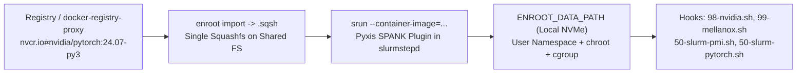

# 6.13 Containers on Slurm: enroot and pyxis

| | |
|---|---|
| Level | Intermediate |
| Priority tier | 1 |
| Lab venue | Linux GPU nodes with Slurm, enroot and pyxis |
| Part | Part 6: HPC and Slurm |
| Status | Drafted. Read from the source repositories (NVIDIA/enroot commit `0bb3810`, 2026-10-21, docs and default configuration; NVIDIA/pyxis commit `1075199`, 2026-05-11, README and option text). Nothing was executed: enroot needs Linux user namespaces and pyxis needs a Slurm build, neither available here. Labs **untested** |

## Why this matters for AI infrastructure

Almost every serious GPU cluster runs AI jobs from container images (NGC PyTorch/NeMo, vendor stacks, team images), because the framework, CUDA libraries, NCCL and Python packages must match each other and cannot be installed on every node by hand. On Slurm clusters NVIDIA's pair **enroot** (an unprivileged container runtime) and **pyxis** (a Slurm plugin exposing it through `srun`) is the reference solution on DGX SuperPOD-style systems and many neoclouds. Docker daemons and root-owned containers are poor fits for shared HPC nodes; enroot and pyxis give containerised steps with the same Slurm semantics (cgroups, accounting, signals, binding) as bare-metal ones. Understanding them is expected for an AI-infrastructure role.

## Prerequisites and outcomes

Needs 6.6 (software strategy), 6.10 to 6.12, and container basics (Part 5.1 to 5.4). After this chapter you can:

- Explain why Docker is not used on shared compute nodes and what enroot does instead.
- Use `srun`/`sbatch` with `--container-image`, `--container-mounts`, `--container-workdir`, `--container-name`, `--container-save`, and other pyxis options.
- Describe the image flow: registry, import, squashfs, container root, caching, and where each lives.
- Explain the hooks that give containers GPUs, InfiniBand and Slurm/PMIx/PyTorch variables, and the standard security posture.
- Authenticate to registries and use mirrors/caches; plan image distribution for thousands of nodes.
- Install and configure enroot and pyxis at a high level and troubleshoot common failures.

## 1. Why not Docker on compute nodes



As explained in *Supercomputers for Linux SysAdmins* (`SCL` Chapter 16, *Containers*), a Linux container is not a virtual machine with hardware emulation; it is a real set of host processes isolated by three Linux kernel primitives:
1. **`cgroups` (Control Groups):** Limit a set of processes in their consumption of memory (for example capping a container at `20%` of node RAM), CPU cores (for example `1` CPU core), network, and `/dev` device nodes.
2. **Kernel `namespaces`:** Isolate process IDs (`PID`s), user IDs (`UID`s), mounts, and optionally network interfaces so processes inside one namespace cannot see external processes and can hold virtual UID/PID numbers.
3. **`chroot` (and `pivot_root`):** Changes the root directory (`/`) of the process tree to a mounted container filesystem containing its own binaries, shared libraries, and `libc`, while `--bind` mounts expose host data directories inside the container.

Docker adds a layered `squashfs`/overlay filesystem on top of these primitives—where almost every line in a `Dockerfile` creates a cached read-only layer on local storage so rebuilding after an edit only rebuilds from the changed line onward (`SCL` Chapter 16). However, directly running Docker on shared HPC compute nodes in 2025–2026 fails for five architectural reasons:

| Concern | Docker daemon model | enroot/pyxis |
|---|---|---|
| Privilege | Root daemon; `docker` group is effectively root | Unprivileged: user namespaces and `chroot`-like environment; runs as the user |
| Scheduler integration | Containers are children of the daemon, outside Slurm's cgroup and accounting | The container process is the Slurm task: cgroups, signals, accounting, GPU isolation apply |
| Isolation goals | Strong isolation between containers | Intentionally minimal: same PID/network namespace as host by default, to preserve HPC behaviour (RDMA, shared memory) |
| Image storage | Layered storage per node, daemon-managed | Converted to a squashfs/rootfs; can live on shared storage; cache per user |
| Multi-node MPI/NCCL | Needs network plumbing | Works with the host network and IB devices directly |

The enroot README describes itself as a "simple, yet powerful tool to turn traditional container/OS images into unprivileged sandboxes", close to a fancy `chroot`. Its design drops features HPC does not need (daemons, network isolation, image layering at runtime) and keeps what it does: importing Docker/OCI images, running them unprivileged with host GPU and IB integration. Other HPC options (Apptainer/Singularity) are in 6.29.

### Where Docker runs into trouble in HPC

Docker is the most popular container tool, but it has many limits on a cluster. By default it needs a special service that runs with root privileges. It does not let jobs use InfiniBand and GPUs directly, and it integrates badly with job managers. The book's view is that in 2025 you almost cannot use Docker directly in HPC. Workarounds exist for some of these issues. Other technologies already run containers, and even prebuilt Docker images, on clusters.

## 2. enroot

### Workflow

```bash
enroot import docker://nvcr.io#nvidia/pytorch:24.07-py3     # pull layers, build a squashfs: nvidia+pytorch+24.07-py3.sqsh
enroot create --name pt nvidia+pytorch+24.07-py3.sqsh        # unpack into a container root under ENROOT_DATA_PATH
enroot list
enroot start --rw pt python -c "import torch; print(torch.cuda.is_available())"
enroot export --output pt-modified.sqsh pt                   # save changes back to an image
enroot remove pt
```

(Commands as listed in the enroot usage documentation: `batch`, `bundle`, `create`, `exec`, `export`, `import`, `list`, `remove`, `start`, `version`.) Note the URI form `docker://REGISTRY#IMAGE:TAG`: **`#` separates registry from image** because `/` and `:` are ambiguous; for NGC it is `nvcr.io#nvidia/pytorch:TAG`. `enroot start --root --rw` gives a writable container where the user appears as root (a user-namespace mapping, no real privilege), used to install packages and then `export`.

The result of `import` is a **squashfs** image (compressed read-only filesystem; default options `-comp lzo -noD -exit-on-error` in the sample config, with `ENROOT_MAX_PROCESSORS` controlling compression threads). `create` unpacks it to a directory tree (the container root) in per-user storage. Squashfs images are single files, so they distribute well (one large file instead of thousands) and can be placed on shared or node-local storage.

### Paths and configuration

From `configuration.md`: configuration comes from `enroot.conf` (default `/etc/enroot`) or environment variables, with environment taking precedence, plus `enroot.conf.d/*.conf`. Standard paths (defaults):

| Setting | Default | Meaning |
|---|---|---|
| `ENROOT_RUNTIME_PATH` | `${XDG_RUNTIME_DIR}/enroot` | Working directory at runtime (must be local, writable) |
| `ENROOT_CONFIG_PATH` | `${XDG_CONFIG_HOME}/enroot` | User configuration |
| `ENROOT_CACHE_PATH` | `${XDG_CACHE_HOME}/enroot` | Layer cache and credentials |
| `ENROOT_DATA_PATH` | `${XDG_DATA_HOME}/enroot` | User container storage (unpacked roots) |
| `ENROOT_TEMP_PATH` | `${TMPDIR}` | Temporary files (large during import) |
| `ENROOT_SQUASH_OPTIONS`, `ENROOT_MAX_PROCESSORS`, `ENROOT_ROOTFS_WRITABLE`, `ENROOT_REMAP_ROOT`, `ENROOT_TRANSFER_RETRIES` | see sample config | Compression, threads, default writability, root remapping, retries |

On clusters set these to **node-local fast storage** (NVMe, `/raid` or `/tmp`) for runtime and data paths, and to an appropriate shared location for caches only if you accept the metadata load; home directories on NFS are a poor default (unpacking and running from them is slow and hammers the server).

### Hooks, mounts, environment

Containers are customised by directories under `ENROOT_SYSCONF_PATH` (system) and `ENROOT_CONFIG_PATH` (user): `environ.d/*.env` (environment variables exported in the container), `mounts.d/*.fstab` (mounts), `hooks.d/*.sh` (pre-start bash scripts run with full capabilities before the container switches to its final root). Hooks see `ENROOT_PID`, `ENROOT_ROOTFS`, `ENROOT_MOUNTS`, `ENROOT_ENVIRON`. The standard hooks (`standard-hooks.md`, `conf/hooks`):

| Hook | Role |
|---|---|
| `10-cgroups.sh` | Mount cgroup controllers in a new cgroup namespace (always on) |
| `10-devices.sh` | Restrict `/dev` to a minimal set (`ENROOT_RESTRICT_DEV`, default `no`) |
| `10-home.sh` | Mount the user's home (`ENROOT_MOUNT_HOME`, default `no`) |
| `10-shadow.sh` | Add entries for the current user/group to `/etc/passwd` and `/etc/group`; create the home directory (always on) |
| `10-localtime.sh`, `10-aptfix.sh` | Time zone; apt compatibility |
| **`98-nvidia.sh`** | GPU support via `libnvidia-container`; controlled by `NVIDIA_VISIBLE_DEVICES`, `NVIDIA_DRIVER_CAPABILITIES`, etc. (the nvidia-container-runtime variables). It injects the host driver libraries and device nodes matching the host driver version |
| **`99-mellanox.sh`** | InfiniBand/RDMA: injects MOFED from the host, controlled by `MELLANOX_VISIBLE_DEVICES` |
| `extra/50-slurm-pmi.sh` | Passes `SLURM_*` and `PMIX_*` variables and PMIx sockets into the container for MPI launches |
| `extra/50-slurm-pytorch.sh` | Sets PyTorch distributed variables from Slurm |
| `extra/50-sharp.sh`, `50-mig-config.sh` | SHARP and MIG support |

(The `extra` hooks are provided but not enabled by default; they are copied into `hooks.d` by the site, usually by the DGX/cluster software image.) The hooks explain two key behaviours: **GPU libraries inside the container come from the host driver**, not the image (the image supplies CUDA user-space libraries, the hook supplies `libcuda`, so the image's CUDA version must be compatible with the host driver, Part 10); and **IB/RDMA works because the hook injects host MOFED** into the container. If `nvidia-smi` works in the container but NCCL runs on sockets, check the Mellanox hook and device visibility.

## 3. pyxis

Pyxis is a **SPANK plugin** (a Slurm extension point for adding command-line options and running code at task launch): it adds options to `srun` and `sbatch`, imports/creates the container using enroot on the compute node, and runs each task inside it, so the container *is* the Slurm task. Requirements per the README: enroot 3.1.0 or later, and pyxis must be built against the Slurm version in use (since Slurm 21.08); it is installed on compute nodes (and where `srun` is used) and enabled with a `plugstack.conf` entry, e.g. symlinking `pyxis.conf` into `/etc/slurm/plugstack.conf.d/` and restarting slurmd.

### Why enroot and pyxis come as a pair

Enroot is a lightweight container tool. It does not need Docker or another container engine installed. When you run a container with enroot, it extracts the squashfs image into the local file system. Then it runs the application with cgroups, namespaces and `chroot` set up around it.

Pyxis is a complementary Slurm plugin. It adds useful flags to `srun` and runs the container through enroot for you, so you do not call enroot yourself. Both projects come from NVIDIA, so only NVIDIA GPUs are well managed when you use them. The book calls this pair easy to use, with minimal overhead compared with the other options.

Options (from the pyxis README text):

| Option | Meaning |
|---|---|
| `--container-image=[USER@][REGISTRY#]IMAGE[:TAG]` or `PATH` | Image to use: an enroot/Docker URI or a path to a squashfs file on the host filesystem |
| `--container-mounts=SRC:DST[:FLAGS][,...]` | Bind mounts; flags joined with `+` (e.g. `ro+rprivate`) |
| `--container-workdir=PATH` | Working directory |
| `--container-name=NAME` | Name to save/load the container. **Unnamed containers are removed when the task completes; named ones persist, and an existing named container is reused with the import skipped** |
| `--container-save=PATH` | Save the container state to a squashfs file |
| `--container-mount-home` / `--no-container-mount-home` | Bind mount the user's home (system enroot settings may already mount it) |
| `--container-remap-root` / `--no-container-remap-root` | Appear as root inside (does not grant elevated permissions) |
| `--container-entrypoint` / `--no-container-entrypoint`, `--container-entrypoint-log` | Run or skip the image's entrypoint; show its output |
| `--container-writable` / `--container-readonly` | Writability of the container filesystem |
| `--container-env=NAME[,...]` | Variables whose host values override the image's (set before the entrypoint). By default host variables are set after the entrypoint but **do not override values in the image** |
| `--container-unshare=NS[,...]` | Create new namespaces: `net`, `ipc`, `uts` |

Examples from the README:

```console
$ srun --container-image=almalinux:9 grep PRETTY /etc/os-release
pyxis: importing docker image: almalinux:9
pyxis: imported docker image: almalinux:9
PRETTY_NAME="AlmaLinux 9.7 (Moss Jungle Cat)"

$ srun --container-image=almalinux:9 --container-mounts=/etc/os-release:/host/os-release grep PRETTY /host/os-release
```

In `sbatch` the option can be a directive, with the `#` escaped because `#` starts a comment: `#SBATCH --container-image nvcr.io\#nvidia/pytorch:21.12-py3`.

### A training job

```bash
#!/bin/bash
#SBATCH --nodes=4 --ntasks-per-node=8 --gpus-per-node=8 --cpus-per-gpu=12 --exclusive --time=12:00:00
IMG=/shared/images/nvidia+pytorch+24.07-py3.sqsh        # pre-imported squashfs on fast shared storage
export MASTER_ADDR=$(scontrol show hostnames "$SLURM_JOB_NODELIST" | head -n1)
export MASTER_PORT=$((10000 + SLURM_JOB_ID % 20000))
srun --kill-on-bad-exit=1 --cpu-bind=cores --gpu-bind=closest \
     --container-image="$IMG" \
     --container-mounts=/data:/data:ro,/scratch/$USER:/scratch,$PWD:/workspace \
     --container-workdir=/workspace \
     python train.py
```

Key points: the container starts for every task on every node, so startup cost multiplies; use a **squashfs path** (no registry pull at job time); mount datasets and output directories explicitly; keep `/dev/shm` large enough for data-loader workers (container shm is the host's); Slurm binding and GPU isolation apply because enroot runs inside the step; environment and the `SLURM_*` and `PMIX_*` variables enter the container through the Slurm hooks (check `env | grep -E "SLURM|PMIX"` inside).

### Multi-node MPI/NCCL in containers

Use `srun --mpi=pmix` with a container whose MPI is PMIx-aware and compatible with the host's PMIx/Slurm (the pyxis README notes support for PMI2 and PMIx "requires Slurm support"; the `50-slurm-pmi.sh` hook forwards the PMIx variables and socket). NGC images ship HPC-X with PMIx support. A mismatch between the container's PMIx and the host's causes launch failures at `MPI_Init` (6.4 section 11). NCCL inside the container uses the injected host IB libraries and devices.

## 4. Images: sources, caching, distribution

### Why caching matters at job start

Each process downloads its container before it starts, then unpacks or converts it. That takes time. It also downloads the same image many times, often at the same moment, which the book calls inefficient. Its advice has three parts. First, encourage users to load containers onto the shared file system and reuse them. Second, use the caching options that Charliecloud and enroot provide. Third, run a caching proxy, such as the docker-registry-proxy project.

A plain proxy is a poor choice for this. Registries often require authorization, and you should not cache image manifests for long.

- **Sources**: NGC (`nvcr.io#nvidia/...`, requires an API key for some images), Docker Hub, GitHub Container Registry, private registries. Build images from NGC bases with a normal Docker/Podman/Buildah build **outside** the cluster, push to a registry, then import into squashfs.
- **Credentials**: enroot reads registry credentials from `$ENROOT_CONFIG_PATH/.credentials` in **netrc format**, e.g. `machine nvcr.io login $oauthtoken password <NGC API key>` (the user name `$oauthtoken` is the NGC convention). Protect the file (mode 600). Do not put keys in job scripts.
- **Cache**: layer cache in `ENROOT_CACHE_PATH` makes repeat imports fast and layer sharing efficient. On thousands of nodes a registry pull at job start is a thundering herd: you will saturate the registry or the uplink and get rate limits.
- **Preferred pattern at scale**: import once, centrally, to a squashfs on shared parallel storage or an image distribution service; jobs use `--container-image=/path/to/image.sqsh`. Squashfs is one big read-mostly file: good for Lustre/GPFS/VAST/WEKA caching, and for node-local copies (pre-stage with `sbcast`/`pdcp`/a prolog to NVMe before large jobs). Version images by digest or dated tag; never use `:latest` for production runs.
- **Local registry mirror/pull-through cache** (Harbor, Artifactory, a registry:2 mirror, or the **`docker-registry-proxy`** project recommended in `SCL` Chapter 16, *Caching*): when processes start a container directly from a registry, every node downloads, unpacks, and converts the layers simultaneously (`64` nodes pulling a `15 GB` image over a `10 GB/s` uplink takes `96.0 s` versus `1.5 s` for a single central import). A generic HTTP proxy is a poor fit because Docker registries require token authorization and you must **not** cache mutable image manifests for long periods; `docker-registry-proxy` handles registry authentication and caches immutable layer blobs while keeping manifest checks fresh (`SCL` Chapter 16).Combine this with stimulating users to pre-import `.sqsh` images onto the shared filesystem and enabling Enroot/Charliecloud layer caches.
- **Storage budget**: PyTorch NGC images are many gigabytes; unpacked roots also consume `ENROOT_DATA_PATH`; unnamed pyxis containers are cleaned up after tasks, named ones need housekeeping.
- **Reproducibility**: record the image digest in the job's accounting comment or log.

## 5. Security and policy

- Enroot runs as the invoking user in user namespaces; the container "root" is the user (remapping only). It does not grant privilege escalation by itself, but the hooks run with capabilities during setup, so hook scripts and enroot configuration are privileged, security-sensitive files (root-owned).
- Namespace choices favour HPC: by default no network namespace, so the container shares the host network. `--container-unshare=net` is available but breaks RDMA unless you set it up.
- Kernel prerequisites (from `requirements.md`): Linux >= 3.10 with `CONFIG_NAMESPACES`, `CONFIG_USER_NS`, `CONFIG_SECCOMP_FILTER`, and `CONFIG_OVERLAY_FS` to import Docker images; `enroot-check` verifies. Some distributions restrict unprivileged user namespaces (AppArmor profile in recent Ubuntu releases): the repository ships an `apparmor.profile`; you may need to allow enroot.
- Image trust: users can run arbitrary images, including ones that exfiltrate data from mounted paths. Mount only what is needed (`:ro` for datasets), restrict registries via mirror, scan images, and treat user-supplied images as untrusted code with the user's file permissions (which is what they are anyway).
- Writable containers (`--container-writable`, `enroot start --rw`) change only the user's own copy; they are not shared unless exported.

## 6a. Other HPC container runtimes: Singularity, Apptainer, and Charliecloud

`SCL` Chapter 16 (*Containers*) covers three additional HPC container runtimes that you will encounter on academic, national-lab, and mixed CPU/GPU systems (Chapter 6.29 compares them in depth):

- **Singularity (Sylabs Inc.) and Apptainer (Linux Foundation):** Singularity packages an image into a single `.sif` (Singularity Image Format, squashfs-backed) file built from a definition file or converted from a Docker image (`SCL` Chapter 16). **Important operational rule (`SCL` Chapter 16):** while Singularity allows passing a `docker://` URI directly at run time, doing so causes every task to download the Docker layers, convert them into a temporary `.sif` image, run, and **delete the converted image upon exit**—wasting massive network and CPU time. Always convert once to `.sif` on shared storage first. With `nvidia-container-toolkit` installed on the host, `--nv` exposes NVIDIA GPUs and InfiniBand transparently. To launch an MPI application inside a Singularity container (`SCL` Chapter 16), run `mpirun -n $NP singularity run app.sif /opt/my-mpi-app` (or under Slurm, prefer `srun singularity run app.sif /opt/my-mpi-app`). **Apptainer** (`https://apptainer.org/news/community-announcement-20211130/`) is the Linux Foundation's open-source continuation of the original Singularity project, so virtually all Singularity commands and `.sif` workflows apply directly to Apptainer.
- **Charliecloud (`SCL` Chapter 16):** A lightweight, uncomplicated, fully unprivileged user-namespace container runtime designed for auditability. It provides four core CLI utilities—**`ch-image`**, **`ch-build`**, **`ch-convert`**, and **`ch-run`**—to pull/build Docker images, extract or convert `squashfs` archives, and execute containers integrated with batch schedulers via **PMIx**.

On NVIDIA-centric AI clusters enroot+pyxis is the default because of NGC image handling, hooks for GPU/IB/PMIx and the `--container-*` UX; Apptainer is the common choice where the same cluster serves classic HPC users.

## 6. Operating it

| Task | Practice |
|---|---|
| Install | Package or `make install` on all compute nodes; set `enroot.conf` (paths on local NVMe), hooks, `plugstack.conf.d/pyxis.conf`; restart slurmd |
| Verify | `enroot version`, `enroot-check`, `srun --container-image=ubuntu:24.04 cat /etc/os-release`, `srun --gres=gpu:1 --container-image=<cuda image> nvidia-smi` |
| Upgrade | Rebuild pyxis whenever Slurm is upgraded (the plugin links against Slurm); roll out enroot and pyxis with the node image |
| Monitor | Import failure rates, time-to-first-output, registry bandwidth, disk use of `ENROOT_DATA_PATH` and cache, `/dev/shm` |
| Housekeeping | Prune named containers and cache older than N days (epilog or cron), clean orphaned runtime dirs after node crashes |
| Support | A short doc: how to get images in, naming, mounts, shm, known gotchas, example scripts |

## 7. Troubleshooting

| Symptom | Likely cause | Check |
|---|---|---|
| `pyxis: unrecognized option --container-image` | Plugin not loaded in `srun`/slurmd, `plugstack.conf` missing, built against the wrong Slurm | `scontrol show config \| grep -i plugstack`, slurmd log, `srun --help \| grep container` |
| Import is slow or fails mid-job | Registry rate limit/auth, no credentials, many nodes pulling at once, `ENROOT_TEMP_PATH` too small | Use squashfs path; check `.credentials` format; local mirror |
| `nvidia-smi: command not found` or no GPU in container | `NVIDIA_VISIBLE_DEVICES` unset by image/hook, `98-nvidia.sh` not installed, driver library mismatch, GPUs not allocated | Hook list, `enroot start` env, Slurm `--gres` |
| CUDA error: driver version insufficient | Image CUDA newer than host driver supports | Update driver or use older image (Part 10) |
| NCCL falls back to sockets inside container | Mellanox hook missing or IB devices not visible (`MELLANOX_VISIBLE_DEVICES`), `NCCL_IB_HCA` wrong | `ls /dev/infiniband`, NCCL INFO (6.12) |
| MPI launch fails in container | PMIx mismatch between host and container | `srun --mpi=list`, MPI/PMIx versions in the image |
| `Operation not permitted` on mount/namespace | Unprivileged user namespaces disabled or AppArmor restriction | `sysctl kernel.unprivileged_userns_clone`, `kernel.apparmor_restrict_unprivileged_userns`, `enroot-check` |
| Out of space | Data path on small `/tmp`; many named containers | `df`, `enroot list`, clean-up |
| Job's environment variables missing in container | Pyxis defaults: host variables do not override image values | `--container-env=NAME` |
| Slow startup of 512 ranks | Each task creates the container; shared FS metadata storm | Squashfs on fast storage, local copy, `--container-name` reuse within a node |

## 8. Lab (self-checking URI/mount lab tested; live Linux cluster parts untested)

First, run the self-checking Python lab (`code/part06/enroot_pyxis_lab.py`) locally. It verifies Enroot `docker://REGISTRY#REPO:TAG` URI formatting, `#SBATCH --container-image` `#`-escaping (`nvcr.io\#nvidia/pytorch:24.07-py3`), and `.sqsh` naming (`nvidia+pytorch+24.07-py3.sqsh`), tests the Pyxis `--container-mounts=SRC:DST[:FLAGS]` parser (`ro+rprivate` vs default `rw`), and calculates the registry thundering-herd pull penalty (`96.0 s` for 64 nodes pulling 15 GB over 10 GB/s vs `1.5 s` for a single central squashfs import):

```bash
python3 code/part06/enroot_pyxis_lab.py
```

Next, on a Linux GPU cluster with Slurm, Enroot, and Pyxis installed, work through these steps:

1. Install enroot on a Linux VM; run `enroot-check`; `enroot import docker://ubuntu:24.04`, create and start it; inspect hooks directory.
2. Configure NGC credentials; import `nvcr.io#nvidia/pytorch:<tag>`; record time and size of the squashfs and the unpacked container.
3. Install pyxis on a test Slurm; run the README examples; test `--container-mounts`, `--container-name` reuse, `--container-save`.
4. GPU node: run `nvidia-smi` and a CUDA sample in a container; break `98-nvidia.sh` (rename) and observe.
5. Two nodes: run the 6.12 DDP or an `nccl-tests` container with `srun --mpi=pmix`; compare NCCL transport with and without the Mellanox hook.
6. Scale test: launch the same job from the registry URI vs a squashfs path on shared storage on N nodes; plot start latency.
7. Write the site doc for image workflow and a housekeeping script.

## 9. Interview angles

- Why enroot and pyxis rather than Docker on a Slurm cluster?
- How does a container get GPUs and InfiniBand without privilege?
- What does pyxis add to `srun`? Why is it a SPANK plugin?
- How would you distribute a 20 GB image to 1,000 nodes for a job launch?
- A container job runs but NCCL uses TCP. What do you check?
- `--container-name` versus unnamed containers: when each?
- What are the security implications of letting users run arbitrary images?
- Why must pyxis be rebuilt after a Slurm upgrade?
- Compare enroot/pyxis with Apptainer and with Kubernetes pods for training.

## Exercises

1. **Enroot & Pyxis Image URI, `#SBATCH` Escaping, and `.sqsh` Naming (`code/part06/enroot_pyxis_lab.py`):** Run `python3 code/part06/enroot_pyxis_lab.py`. Using `format_enroot_pyxis_uris("nvcr.io", "nvidia/pytorch", "24.07-py3")`, explain why Enroot uses `#` (`docker://nvcr.io#nvidia/pytorch:24.07-py3`) to separate the registry from the image path, why `#SBATCH --container-image nvcr.io\#nvidia/pytorch:24.07-py3` requires a backslash before `#`, and how `enroot import` names the resulting `.sqsh` archive (`nvidia+pytorch+24.07-py3.sqsh`).
2. **Configuring `enroot.conf` Paths for NVMe Compute Nodes:** Given a compute node with a local NVMe scratch array mounted at `/raid/local` and an NFS home directory at `/home`, write the `ENROOT_RUNTIME_PATH`, `ENROOT_DATA_PATH`, `ENROOT_TEMP_PATH`, and `ENROOT_CACHE_PATH` settings so container roots unpack at NVMe speeds instead of hammering the NFS metadata server.
3. **Writing a Multi-Node Pyxis Training Script with Mounts (`parse_pyxis_mounts`):** Write an `#SBATCH` script for a 4-node, 32-GPU PyTorch training run using a pre-imported `/shared/images/nvidia+pytorch+24.07-py3.sqsh` file, mounting `/data:/data:ro+rprivate,/scratch/$USER:/scratch,$PWD:/workspace` with `--container-workdir=/workspace`. Explain how `--container-env` differs from default host-to-container environment propagation.
4. **Tracing Enroot Hooks for GPUs, InfiniBand, and PMIx:** Explain the exact role of `98-nvidia.sh`, `99-mellanox.sh`, `50-slurm-pmi.sh`, and `50-slurm-pytorch.sh` when launching a multi-node job inside an Enroot container. If `nvidia-smi` sees all 8 GPUs inside the container but `NCCL_DEBUG=INFO` logs `NET/Socket` instead of `NET/IB`, which hook and device path (`/dev/infiniband`) do you inspect?
5. **Quantifying the Registry Thundering-Herd Penalty and Caching Architecture (`SCL` Chapter 16 & `enroot_pyxis_lab.py`):** Using `estimate_pull_time_sec(64, 15.0, 10.0)` in `code/part06/enroot_pyxis_lab.py`, compare the network transfer time when 64 nodes pull a `15 GB` image simultaneously from a registry over a `10 GB/s` uplink (`96.0 s` plus decompression and rate limits) versus importing once (`1.5 s`) into a shared `.sqsh` file, and explain why `docker-registry-proxy` is preferred over a standard HTTP proxy (`SCL` Chapter 16).
6. **Comparing Enroot + Pyxis, Singularity / Apptainer, and Charliecloud (`SCL` Chapter 16):** Compare how a multi-node MPI/PyTorch job is launched under Pyxis (`srun --container-image=app.sqsh ...`), Singularity/Apptainer (`srun singularity run --nv app.sif ...`), and Charliecloud (`ch-image`, `ch-convert`, `ch-run`), and explain why running `singularity run docker://...` directly without pre-converting to `.sif` is an operational anti-pattern.

## Checkpoint

<details>
<summary>1. Which three Linux kernel technologies combine to form a container (`SCL` Chapter 16), and why are Docker daemons unsuitable for shared Slurm compute nodes?</summary>

A Linux container combines **`cgroups`** (resource limits on CPU, RAM, and devices), **`namespaces`** (isolating PIDs, UIDs, and mounts), and **`chroot`** / `pivot_root` (changing `/` to the container's root filesystem, with `--bind` mounts for host data). Docker daemons are unsuitable on shared HPC nodes because the daemon runs as **`root`** (`docker` group membership is root-equivalent), spawns container processes outside Slurm's `slurmstepd` cgroup hierarchy and accounting tree, and isolates network namespaces in ways that obstruct direct GPUDirect RDMA / InfiniBand access.
</details>

<details>
<summary>2. What is NVIDIA `enroot`, and what file format does `enroot import` produce?</summary>

`enroot` is an unprivileged container sandbox runtime that runs inside user namespaces without a background daemon. `enroot import` pulls OCI/Docker image layers and packs them into a single flattened, compressed read-only **`squashfs` (`.sqsh`)** archive file (default compression `-comp lzo -noD -exit-on-error`).
</details>

<details>
<summary>3. Why does `enroot import docker://nvcr.io#nvidia/pytorch:24.07-py3` use `#`, and how must you write that URI inside an `#SBATCH` directive?</summary>

Enroot uses **`#`** to unambiguously separate the registry hostname (`nvcr.io`) from the image repository (`nvidia/pytorch:24.07-py3`). Inside a batch script `#SBATCH` directive, `#` begins an inline comment, so it must be backslash-escaped: **`#SBATCH --container-image nvcr.io\#nvidia/pytorch:24.07-py3`**.
</details>

<details>
<summary>4. What do `ENROOT_RUNTIME_PATH`, `ENROOT_CACHE_PATH`, `ENROOT_DATA_PATH`, and `ENROOT_TEMP_PATH` store, and where should they point on compute nodes?</summary>

- **`ENROOT_RUNTIME_PATH`:** Active runtime state (must be a local writable filesystem).
- **`ENROOT_CACHE_PATH`:** Downloaded OCI layer blob cache and `.credentials`.
- **`ENROOT_DATA_PATH`:** Unpacked writable container root trees (`enroot create`).
- **`ENROOT_TEMP_PATH`:** Temporary workspace used while building `.sqsh` images during `enroot import`.
On compute nodes, `ENROOT_DATA_PATH`, `ENROOT_TEMP_PATH`, and `ENROOT_RUNTIME_PATH` must point to **fast node-local NVMe or tmpfs**—never an NFS `$HOME` directory.
</details>

<details>
<summary>5. How does an unprivileged Enroot container gain access to host NVIDIA GPUs (`98-nvidia.sh`) and InfiniBand RDMA adapters (`99-mellanox.sh`)?</summary>

- **`98-nvidia.sh`:** Invokes `libnvidia-container` (controlled by `NVIDIA_VISIBLE_DEVICES` and `NVIDIA_DRIVER_CAPABILITIES`) to bind-mount the allocated `/dev/nvidia*` device nodes and inject the **host's kernel-matched driver libraries (`libcuda.so`, `nvidia-smi`)** into the container while using the image's user-space CUDA Toolkit libraries.
- **`99-mellanox.sh`:** Injects the host's Mellanox OFED (`MOFED`) user-space InfiniBand verbs libraries and `/dev/infiniband/*` devices (`MELLANOX_VISIBLE_DEVICES`).
</details>

<details>
<summary>6. What do the `50-slurm-pmi.sh` and `50-slurm-pytorch.sh` extra hooks do?</summary>

- **`50-slurm-pmi.sh`:** Passes `SLURM_*` and `PMIX_*` environment variables and bind-mounts the host PMIx UNIX domain sockets into the container so `srun --mpi=pmix` works seamlessly inside the container.
- **`50-slurm-pytorch.sh`:** Automatically translates Slurm task variables (`SLURM_PROCID`, `SLURM_LOCALID`, `SLURM_NTASKS`, `SLURM_JOB_NODELIST`) into PyTorch's `RANK`, `LOCAL_RANK`, `WORLD_SIZE`, and `MASTER_ADDR`.
</details>

<details>
<summary>7. What is NVIDIA `pyxis`, how is it loaded into Slurm, and why must it be recompiled when Slurm is upgraded?</summary>

`pyxis` is a Slurm **SPANK plugin** registered in `/etc/slurm/plugstack.conf` (or `plugstack.conf.d/pyxis.conf`) that adds `--container-*` flags directly to `srun` and `sbatch` and launches each Slurm task inside an Enroot container. Because SPANK plugins dynamically link against Slurm's internal ABI headers, `pyxis` must be rebuilt whenever Slurm undergoes a major/minor version upgrade.
</details>

<details>
<summary>8. Compare an unnamed Pyxis container (`--container-image=...`) with a named container (`--container-name=NAME`), and what does `--container-save=PATH` do?</summary>

- **Unnamed container:** Created before the step starts and **automatically deleted from `ENROOT_DATA_PATH` as soon as the step completes**.
- **Named container (`--container-name=NAME`):** Persists on the node after the step ends; subsequent steps specifying `--container-name=NAME` reuse the already-unpacked rootfs and skip importing/unpacking (requiring periodic housekeeping cleanup).
- **`--container-save=PATH`:** Exports the container's final root filesystem state back into a `.sqsh` file at `PATH` when the step finishes.
</details>

<details>
<summary>9. By default, what happens when an environment variable is defined both on the host and inside the container image, and what does `--container-env=NAME` change?</summary>

By default, Pyxis exports host environment variables *after* the entrypoint without overriding variables already defined inside the container image's `ENV`. Passing **`--container-env=NAME[,...]`** forces the host's value of `NAME` to override the image's built-in value before the entrypoint runs.
</details>

<details>
<summary>10. How do you configure NGC (`nvcr.io`) registry authentication for Enroot?</summary>

Create `$ENROOT_CONFIG_PATH/.credentials` (with permissions `0600`) in **`netrc` format**:
`machine nvcr.io login $oauthtoken password <NGC_API_KEY>`
Never hardcode API keys inside batch scripts.
</details>

<details>
<summary>11. Why is passing a remote registry URI (`--container-image=nvcr.io#...`) directly to a 64-node job an anti-pattern, and what are the three caching practices from `SCL` Chapter 16?</summary>

When 64 nodes start tasks from a registry URI simultaneously, all 64 nodes pull and decompress the multi-gigabyte layers at once (`64 * 15 GB / 10 GB/s = 96.0 s`), saturating the cluster uplink and hitting registry rate limits. `SCL` Chapter 16 recommends:
1. Pre-importing images once into a **`.sqsh` file on shared parallel storage** (`--container-image=/shared/images/app.sqsh`) or staging to local NVMe with `sbcast`.
2. Enabling `ENROOT_CACHE_PATH` layer caching.
3. Deploying **`docker-registry-proxy`** (rather than a generic HTTP proxy) to handle registry authentication and cache immutable layer blobs without caching mutable image manifests long-term.
</details>

<details>
<summary>12. Why does Enroot share the host network namespace by default instead of creating an isolated virtual network (`--container-unshare=net`)?</summary>

Sharing the host network namespace gives containerized processes direct, zero-overhead access to host InfiniBand/RoCE RDMA verbs devices (`/dev/infiniband/*`), high-speed Ethernet interfaces, and node-local IPC sockets without NAT or bridge translation penalties.
</details>

<details>
<summary>13. What Linux kernel features are required by Enroot (`enroot-check`), and what Ubuntu security setting can block unprivileged user namespaces?</summary>

Linux kernel $\ge 3.10$ with **`CONFIG_NAMESPACES`**, **`CONFIG_USER_NS`** (unprivileged user namespaces), **`CONFIG_SECCOMP_FILTER`**, and **`CONFIG_OVERLAY_FS`**. On recent Ubuntu releases, `kernel.apparmor_restrict_unprivileged_userns=1` blocks unprivileged user namespaces unless Enroot's AppArmor profile is loaded.
</details>

<details>
<summary>14. What does `CUDA error: driver version is insufficient for CUDA runtime version` mean inside a container, and how is it fixed?</summary>

The container image was built with a newer CUDA Toolkit version (e.g., CUDA 12.6) than the host kernel's NVIDIA driver (`libcuda.so` injected by `98-nvidia.sh`) supports (and CUDA minor-version compatibility could not bridge it). Either upgrade the host NVIDIA driver or use a container image built against an older CUDA version compatible with the host driver.
</details>

<details>
<summary>15. A containerized PyTorch job runs, `nvidia-smi` works inside the container, but `NCCL_DEBUG=INFO` shows `NET/Socket` instead of `NET/IB`. What should you check?</summary>

Check that **`99-mellanox.sh`** is installed in `ENROOT_SYSCONF_PATH/hooks.d`, that `/dev/infiniband/uverbs*` devices are visible inside the container (`MELLANOX_VISIBLE_DEVICES`), and that user-space MOFED libraries inside the container match the host kernel RDMA driver.
</details>

<details>
<summary>16. Why can `srun --mpi=pmix --container-image=...` fail inside `MPI_Init`, and how do NGC PyTorch images avoid this?</summary>

`srun --mpi=pmix` requires both the `50-slurm-pmi.sh` hook (to mount the host PMIx socket into the container) and a container MPI build (such as Open MPI / HPC-X in NGC images) compiled with a PMIx version protocol-compatible with the host Slurm's PMIx plugin.
</details>

<details>
<summary>17. Compare **Singularity / Apptainer** with **Enroot + Pyxis** on Slurm (`SCL` Chapter 16).</summary>

- **Singularity / Apptainer:** Packages images into a single `.sif` file (supports cryptographic signing); runs via `srun apptainer exec --nv app.sif ...` without needing a Slurm SPANK plugin, and bind-mounts `$HOME` and `/tmp` by default.
- **Enroot + Pyxis:** Uses `.sqsh` images unpacked to node-local `ENROOT_DATA_PATH`; integrates natively into `srun`/`sbatch` via `--container-image` and `--container-mounts` SPANK options with dedicated hooks for NVIDIA GPUs, Mellanox IB, Slurm PMIx, and PyTorch.
</details>

<details>
<summary>18. Why does `SCL` Chapter 16 warn against running a Docker container "directly" (`singularity run docker://...`) in Singularity/Apptainer batch jobs?</summary>

When given a `docker://` URI directly, Singularity downloads all layers, converts them into a temporary `.sif` image, runs the command, and **deletes the converted image when the command finishes**—repeating the full download and squashfs build on every single job run.
</details>

<details>
<summary>19. What is **Charliecloud**, and what are its four primary CLI utilities (`SCL` Chapter 16)?</summary>

Charliecloud is a lightweight, minimal, unprivileged user-namespace container runtime for HPC that integrates with Slurm via PMIx. Its four primary utilities are **`ch-image`** (pull/inspect images), **`ch-build`** (build images), **`ch-convert`** (convert between Docker/tar/squashfs/directory formats), and **`ch-run`** (execute a command inside the container).
</details>

<details>
<summary>20. Why does launching `--ntasks-per-node=8 --container-image=/shared/app.sqsh` without `--container-name` multiply container startup overhead on each node?</summary>

Because Pyxis runs per Slurm task, launching 8 tasks per node causes all 8 local tasks to independently unpack `/shared/app.sqsh` into 8 separate root directories under `ENROOT_DATA_PATH`. Pre-creating a named container once per node in a prolog/step (`--container-name=job_${SLURM_JOB_ID}`) or staging `.sqsh` to fast local NVMe eliminates redundant unpacking.
</details>

## Sources and review notes

- enroot: repository documentation (`usage.md`, `configuration.md`, `standard-hooks.md`, `requirements.md`, `image-format.md`) and the sample `conf/` hooks (commit `0bb3810`). pyxis: README and option help (commit `1075199`).
- HPC container fundamentals (`cgroups`, `namespaces`, `chroot`, Docker layered `squashfs` and `--bind` mounts), Singularity (`mpirun -n $NP singularity run app.sif /opt/my-mpi-app`, `nvidia-container-toolkit`, why direct `docker://` execution is not recommended), Apptainer (`https://apptainer.org/news/community-announcement-20211130/`), Charliecloud (`ch-image`, `ch-build`, `ch-run`, `ch-convert` with PMIx), Pyxis + Enroot, and Caching (`docker-registry-proxy`): read in full from *Supercomputers for Linux SysAdmins* (`supercomputers-for-linux-sysadmins-managing-modern-hpc-clusters-and-supercomputers-from-software-to-hardware`, `SCL`) Chapter 16 ("16. Containers") and Chapter 21, *Distributed AI Systems* (`distributed-ai-systems`, `DAI`) Chapter 8, and migrated from `nvidia-devops` (`volume-10/08-enroot-and-pyxis-containers-for-hpc.md`).
- Run here: `python3 code/part06/enroot_pyxis_lab.py` (3 passed, 0 failed).
- Explicitly labelled inferences: `format_enroot_pyxis_uris`, `parse_pyxis_mounts`, and `estimate_pull_time_sec` (`96.0 s` vs `1.5 s` for 64 nodes pulling 15 GB over 10 GB/s) in `code/part06/enroot_pyxis_lab.py` are deterministic teaching models of Enroot/Pyxis syntax and registry bandwidth math.
- Not verified on live hardware: exact `98-nvidia.sh` behaviour on your driver version, which `extra/` hooks your distribution enables by default, current Ubuntu AppArmor settings and sysctl names, NGC credential conventions, and live multi-node container startup timings (`untested here`).
