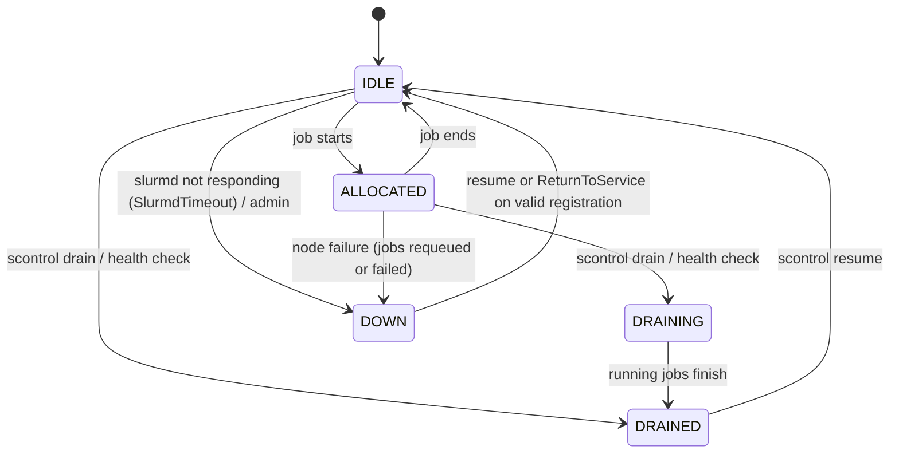

# 6.14 Slurm operations: prolog, epilog, health checks, drain, reason codes, troubleshooting

| | |
|---|---|
| Level | Intermediate |
| Priority tier | 1 |
| Lab venue | Slurm test cluster with GPU nodes (or stubs) |
| Part | Part 6: HPC and Slurm |
| Status | Drafted. Semantics read from the `slurm.conf(5)` man page and the prolog/epilog guide (SchedMD/slurm commit `521370b`, 2026-10-23). `code/part06/node_health.sh` was run against stub `nvidia-smi`, `mountpoint`, `chronyc`, `ibstat` and `dmesg` commands in dry-run mode (output below); it has **not** run on a real node or against a real `scontrol`. Cluster labs **untested** |

## Why this matters for AI infrastructure

In a large GPU cluster something is always broken: a GPU falls off the bus, a link flaps, a mount goes stale, a node runs out of `/tmp`. The difference between a well-run and a badly run cluster is how fast bad nodes leave the pool, how cleanly jobs are cleaned up, and how quickly an operator can say why a job failed. Training jobs spanning hundreds of GPUs make this acute: one sick node wastes the whole job. The tools are prolog and epilog scripts, a periodic health check, automatic draining with a reason, and disciplined diagnosis from logs.

## Prerequisites and outcomes

Needs 6.7 to 6.11. After this chapter you can:

- Explain when prolog and epilog scripts run, what happens when they fail, and what belongs in each.
- Write and test a health-check program; wire it to Slurm and draining.
- Manage node lifecycle: drain, resume, down, reboot, replace, with accurate reason strings.
- Handle unkillable steps, stuck jobs and misbehaving users.
- Read daemon logs, `sdiag`, `scontrol`, `sacct` to diagnose scheduling and node problems.
- Apply a troubleshooting playbook and avoid classic mistakes (undrained reboots, silent failures, thundering herds).

## 1. Prolog and epilog

Slurm can run scripts at job boundaries (the man page's "PROLOG AND EPILOG SCRIPTS" section):

| Script | Where and who | When |
|---|---|---|
| `Prolog` | Every compute node, as root (slurmd) | When the node first sees a job step of a new allocation (not at allocation), unless `PrologFlags=Alloc` |
| `Epilog` | Every node, root | When the allocation is released, **always** on every node |
| `PrologSlurmctld`, `EpilogSlurmctld` | The controller host | Once per job on the controller |
| `TaskProlog`, `TaskEpilog` | As the user, per task | Before/after each task; `TaskProlog` can print `export VAR=val` lines to set the task environment |
| `SrunProlog`/`SrunEpilog`, `BcastParameters`, `ResvProlog`/`ResvEpilog` | Various | Per `srun`, reservations |

Failure behaviour (verbatim in meaning from the man page):

- **Prolog fails (non-zero exit)**: the node is set to DRAIN and the job is requeued; the job is held unless `nohold_on_prolog_fail` is in `SchedulerParameters`.
- **Epilog fails**: the node is set to DRAIN.
- **PrologSlurmctld fails**: the job is requeued to run elsewhere if it is a batch job; interactive jobs are cancelled. **EpilogSlurmctld fails**: only logged.
- Standard output and error of these scripts are **not preserved**: write your own log.
- Scripts have timeouts (`PrologEpilogTimeout`); slow scripts delay job start (prolog) and node release (epilog).

`PrologFlags` (comma list; default none): `Alloc` (run the prolog at allocation, job is CONFIGURING meanwhile; increases start time), `Contain` (create a job container at allocation for processes not launched by Slurm, such as `pam_slurm_adopt` SSH sessions; requires `proctrack/cgroup`; implies Alloc), `DeferBatch` (wait for prolog on all nodes before launching the batch script), `NoHold` (let `salloc` not block), `Serial`, `X11`, and others. Environment variables describing the job (`SLURM_JOB_ID`, `SLURM_JOB_USER`, `SLURM_JOB_GPUS` in prolog/epilog, `SLURM_SCRIPT_CONTEXT` telling which script is running, ...) are passed to the scripts (see the prolog/epilog guide).

### What to put in them

**Prolog** (keep it fast, idempotent, and safe; a failing prolog drains the node): quick sanity checks (GPU count visible, mount present), set up per-job temp directories (`/tmp/slurm-$SLURM_JOB_ID`), clear leftover state from a previous job, set GPU modes (persistence, clocks) if policy says so, log the job start. Avoid long checks (a 30-second DCGM diagnostic in every prolog slows every job start); use the periodic health check for deep tests.

**Epilog** (the cleanup guarantee): kill processes of the job's user that remain (`pkill -u $SLURM_JOB_USER` only if the user has no other job on the node; check with `squeue`), remove per-job temp dirs, drop page cache if policy demands, reset GPU state (compute mode, `nvidia-smi --gpu-reset` only when no process uses the GPU), unmount job-specific mounts, flush logs, sample GPU errors (`dmesg` Xid since job start) and **drain on hardware errors**, record per-job GPU usage summary. Because Epilog runs on every node when the allocation ends it is the right place for leak cleanup; an epilog that fails drains the node, so make it tolerant: use `|| true` for best-effort steps, and exit non-zero only when you want the node drained.

Pitfall: shared nodes. Epilogs that kill "all user processes" harm a user's other job on a shared node. Use cgroups (the job's cgroup cleans itself with `proctrack/cgroup`) and make the epilog check for other jobs.

## 2. Health checks

`HealthCheckProgram` is a script Slurm runs as root periodically on compute nodes (default interval 0 = disabled, set `HealthCheckInterval`), on nodes in states selected by `HealthCheckNodeState` (default `ANY`; other values include `ALLOC`, `IDLE`, `MIXED`, `CYCLE`: with `CYCLE` the runs are spread across the interval instead of all nodes at once, which avoids a thundering herd against shared storage). Crucially, per the man page: **"Any action to be taken must be explicitly performed by the program"**, e.g. `scontrol update NodeName=foo State=drain Reason=tmp_file_system_full`. The program decides; Slurm only runs it. Many sites use the open-source LBNL **NHC** (Node Health Check) or vendor tools (DCGM-based health checks, BCM health checks, Part 8), or custom scripts.

### Design rules

1. **Cheap and frequent for basics, expensive and rare for deep tests.** Every 1 to 5 minutes: GPU count, mounts, free space, time sync, fabric port state, service daemons (slurmd, munge), memory and swap, kernel errors. Hourly or between jobs on idle nodes: DCGM level 2 diagnostics, NCCL bandwidth test between neighbours, disk and memory stress.
2. **Drain, don't kill.** Draining lets running jobs finish (except when the failure is severe: then also `scancel` or `State=down`).
3. **Clear reasons.** The Reason string is the operator's first clue. Include the check name, evidence and time; keep it under the allowed length. Reasons are shown by `sinfo -R`.
4. **Avoid false positives at scale.** A check that flaps 1 percent of the time drains many nodes in a 5,000-node cluster. Require two consecutive failures, or classify transient vs persistent.
5. **Never block forever.** Wrap external commands with `timeout`; a hung `nvidia-smi` is itself a signal (GPU wedged) and must become a failure rather than a hang.
6. **Idempotent and silent when OK.** Output only on failure (or log to syslog); logs per node.
7. **Return-to-service policy.** Combine with `ReturnToService` (6.8): nodes drained by an operator or by the health check stay drained until someone resumes them; only DOWN-for-non-responsiveness nodes auto-return with `ReturnToService=1`. Prefer an explicit "auto-heal" path that re-runs the check and resumes only when green.

### A tested example

`code/part06/node_health.sh` implements six checks: GPU count (`nvidia-smi -L`), serious GPU Xid errors in `dmesg` (codes such as 48, 63, 64, 74, 79, 94, 95: double-bit ECC, row-remap failures, GPU fell off the bus and similar; treat the list as a starting point and verify against NVIDIA's Xid documentation for your driver), free space in `/tmp`, required mounts, clock synchronisation (`chronyc`), and InfiniBand port state (`ibstat`). On any failure it drains the node with a combined reason, or in `DRY_RUN=1` mode prints what it would do. Tested against stub commands simulating a degraded node (seven GPUs, an Xid 79 in the kernel log, `/scratch` unmounted, one IB port down):

```text
FAIL gpu_count: found 7 GPUs, expected 8
FAIL gpu_xid: [1234.5] NVRM: Xid (PCI:0000:3b:00): 79, pid=1, GPU has fallen off the bus.
FAIL tmp_space: only 14462 MB free in /tmp
FAIL mounts: /scratch not mounted
OK   time_sync
FAIL ib_links: 1 IB ports down
DRY_RUN would drain gpu07: health: gpu_count: found 7 GPUs, expected 8; gpu_xid: ...
```

and against stubs for a healthy node (eight GPUs, quiet kernel log, mounts present, one active IB port): all `OK`, exit 0. (The `/tmp` check failed in my first healthy run because the laptop genuinely had only 14 GB free; lowering `MIN_TMP_MB` for the test made it pass.) Limitations to fix before production: use `timeout` around each command, run `nvidia-smi` with a deadline, check `dmesg` only since the last check (offset file) rather than the whole ring buffer so that an old fixed error does not drain a healed node, add DCGM, ECC counters via `nvidia-smi --query-gpu`, NVLink status, PCIe link speed/width (downtrained links are a classic silent slowdown), temperature/throttle reasons, and make thresholds configuration, not code.

## 3. Node lifecycle



Operations:

```bash
sinfo -R -o "%20E %9u %19H %N"            # why nodes are down/drained: reason, who, when, which
sinfo -N -t drain,down -o "%N %T %E"
scontrol update NodeName=gpu[07,12] State=drain Reason="Xid79 GPU3 ticket INC123"
scontrol update NodeName=gpu07 State=resume
scontrol reboot ASAP nextstate=resume reason="kernel update" gpu[01-16]   # drains, reboots when empty, returns to service
scontrol update NodeName=gpu07 State=down Reason="dead PSU"                # jobs on it are requeued/failed
scontrol show node gpu07 | grep -E "State|Reason|Gres|CPULoad|FreeMem"
```

`scontrol reboot` (options `ASAP`, `nextstate=`, `reason=`) is the clean way to patch: it drains, waits for jobs, reboots via `RebootProgram`, and resumes. `ASAP` prevents new jobs immediately. Always include who/why/ticket in the reason; auditors and colleagues rely on it.

**Down vs drain**: `DRAIN` = stop new work, let current finish. `DOWN` = the node is unusable; running jobs are requeued if requeue is allowed or killed. Use `down` only when the node is truly dead; draining a node with healthy jobs is kinder.

**Replacement flow** for a failed node: drain with ticket reference, collect evidence (logs, DCGM report, `nvidia-bug-report.sh`), open vendor case, swap hardware, run burn-in and acceptance tests (6.28) before `resume`. Keep a spare pool and a record of repeated offenders (mean time between failures per node) to catch marginal hardware.

## 4. Unkillable steps and stuck jobs

When a job step's processes ignore SIGKILL (usually blocked in uninterruptible I/O, `D` state, often on a hung network file system or a GPU in a bad state), Slurm waits `UnkillableStepTimeout` (default 60 seconds or five times `MessageTimeout`, whichever is larger) then runs `UnkillableStepProgram` if set and **drains the node** "to prevent future jobs from being scheduled on the node". The program runs as root on that node with the job variables and can collect diagnostics (stack traces from `/proc/PID/stack`, `lsof`, `nvidia-smi`, hung mount info) and alert. Common causes: NFS/Lustre server problem, dead NIC with outstanding RDMA operations, GPU Xid. Fix the underlying cause; the node usually needs a reboot.

Job in `COMPLETING` for a long time: epilog running or hung, unkillable step, node unreachable (`scontrol show job` and `sinfo` for nodes). Job `PENDING` forever: see 6.9 section 8. Job `RUNNING` but no progress: user-side hang; check GPU utilisation (`srun --overlap --jobid=ID nvidia-smi`), NCCL logs, `py-spy dump`.

## 5. Logs and diagnostics

| Source | Use |
|---|---|
| `slurmctld.log` (controller) | Scheduling decisions, node state changes, RPC problems, accounting errors. Increase with `scontrol setdebug debug2` temporarily (and back: verbose logs are huge) |
| `slurmd.log` (each node) | Launch failures, cgroup problems, prolog/epilog results, configuration mismatch on registration |
| `slurmdbd.log` | Accounting writes, database problems |
| `journalctl -u slurmd`, `dmesg -T` | systemd start failures, kernel messages (OOM kills, Xid, IB errors, I/O errors) |
| `sacct -j ID --format=JobID,State,ExitCode,DerivedExitCode,NodeList,Reason` | Final state and exit code (`ExitCode=0:9` means exit code 0, signal 9) |
| `scontrol show job/node/partition/config` | Live state and effective configuration |
| `sdiag` | Scheduler statistics: server thread count, RPC counts and durations by type and user, main scheduler and backfill cycle times, queue lengths, jobs started per cycle |
| `squeue -o ... --start`, `sprio`, `sshare` | Pending analysis (6.9) |
| `sinfo -R`, `sinfo -N -l` | Node reasons and states |
| `strigger` | Event hooks: run a program when a node goes down/up, a job finishes, etc. |

**`sdiag` for controller health**: look at "Server thread count", RPC statistics by type (a single user spamming `squeue` in a loop is the classic cause of a sluggish controller; `RPC statistics by user` points at them), backfill cycle mean/max time and depth (6.9), and `max_rpc_cnt`/`defer` options in `SchedulerParameters` to protect the controller. Educate users: no `watch -n1 squeue`; offer `squeue` caching or a read-only web dashboard.

Controller sizing and state: `StateSaveLocation` on fast local or HA-shared storage (6.15), with enough inodes; large `MaxJobCount`; slurmdbd on a decent database host with regular purge/archiving (`PurgeJobAfter`, etc. in `slurmdbd.conf`).

Time and identity are frequent hidden causes: munge failures from clock skew (`Invalid credential`), missing users on nodes (`Invalid user id`), DNS and `/etc/hosts` inconsistency (`getaddrinfo` errors), firewalls blocking ports 6817 to 6819 or the ephemeral srun ports.

## 6. Troubleshooting playbook

| Symptom | Diagnose | Typical resolution |
|---|---|---|
| Node `DOWN`, reason "Not responding" | `ping`, `ssh`, `systemctl status slurmd`, `journalctl -u munge`, time sync | Restart services; reboot; fix network; resume |
| Node `DRAIN` "Kill task failed" | Unkillable step; `ps -eo pid,stat,wchan \| grep ' D'` | Find the D-state cause (mount, GPU); reboot |
| Node `inval` / "Low RealMemory" or "gres count too low" | `slurmd -C`, `slurmd -G`, `nvidia-smi` | Fix hardware/config; DIMM or GPU lost; correct config (6.8, 6.10) |
| "Prolog error" drain | `slurmd.log` around the time; prolog log | Fix the failing check; resume |
| Jobs fail instantly with `NODE_FAIL` | Node crashed or lost network; `dmesg`, BMC SEL (Part 7) | Hardware triage |
| Jobs fail `OUT_OF_MEMORY` | `sacct MaxRSS`, cgroup OOM events in `dmesg` | User request more memory; check `ConstrainRAMSpace`, memory defaults (6.8) |
| Job killed `TIMEOUT` | `--time` too small | Checkpointing, signals (6.11) |
| Job cannot start: "Requested node configuration is not available" | Request exceeds any node (GPU type, memory) | Correct request or partition |
| Everything slow | `sdiag`, controller CPU, database latency, file system latency | Throttle polling users, tune scheduler, check storage |
| Jobs pending though nodes idle | Reasons (6.9), reservations, `MaxCPUsPerNode`, memory defaults, GRES typos | Fix policy/request |
| Accounting missing | `sacctmgr show assoc`, slurmdbd connection | Create associations; check `AccountingStorageHost` and munge |
| GPU job sees no GPU | `gres.conf`, cgroup devices, driver | 6.10 |
| MPI job fails to launch | `srun --mpi=list`, PMIx versions, firewall | 6.4, 6.12 |
| Scheduler stopped scheduling | `slurmctld` logs, `sdiag`, deadlock after config change, full disk in `StateSaveLocation` | Restart per procedure; fix disk |

**Method**: (1) state the symptom exactly (job id, node, time); (2) read `scontrol show` for the object; (3) find the first error in the relevant log near that time; (4) check the layer below (node health, network, storage, time); (5) change one thing; (6) record cause and fix in the ticket and update the health check so the next occurrence is automatic.

## 7. Operational practices

- **Change management**: config changes via Git and automation; test in a staging cluster; `scontrol reconfigure` rather than restart when possible; never restart `slurmctld` mid-peak without need.
- **Maintenance windows**: use reservations (`scontrol create reservation StartTime=... Duration=... Nodes=... Flags=MAINT,IGNORE_JOBS`) so jobs do not start that cannot finish; `scontrol reboot` for rolling patches.
- **Upgrades**: Slurm has strict rules about upgrade order and version skew (slurmdbd first, then slurmctld, then slurmd, usually at most two major versions apart); see 6.15.
- **User communication**: a status page, MOTD with maintenance notices, clear reason strings and documentation for common errors.
- **Runbooks and on-call**: for each alert, a runbook with commands and escalation. Practise failure drills (kill slurmd, fill a disk, unplug a node).
- **Metrics**: node availability, % drained, mean time to drain/repair, job failure rate by cause (`NODE_FAIL`, OOM, timeout), prolog/epilog durations, queue wait times, controller RPC rates, utilisation per partition (Part 17).
- **Security**: restrict who can run `scontrol update`; log admin actions; protect prolog/epilog and health scripts (root-owned, not world-writable); `pam_slurm_adopt` to prevent ssh to nodes without a job.

### Maintenance and user reservations (`scontrol` reservation lifecycle and flags)

A Slurm **reservation** sets aside a specific node count (`NodeCnt=...`) or explicit node list (`Nodes=...`) for designated users or accounts (`Users=...`, `Accounts=...`) during a future time window (`StartTime=...`, `EndTime=...` or `Duration=...`). Other users' jobs cannot allocate those nodes during the window—or before it if the job's wall-time would cross into the reservation—making reservations the standard tool both for guaranteed user runs and for cluster maintenance windows (where admins can run verification jobs on reserved nodes while regular user jobs wait in the queue).

In the book's Chapter 15 example, creating, using, inspecting, modifying, and deleting a reservation uses `scontrol` (`(untested here)`):

```bash
# (untested here) — 1. Create a 5-hour reservation of 100 nodes for user1 and user2
scontrol create reservation name=important \
  StartTime=2100-06-01T08:00:00 Duration=5:00:00 \
  Users=user1,user2 NodeCnt=100 Flags=IGNORE_JOBS

# (untested here) — 2. Submit a job into the reservation
sbatch --reservation=important -N100 ./my_task

# (untested here) — 3. Inspect existing reservations (or view nodes in a reservation via sinfo -T important)
scontrol show reservation
scontrol show reservation important

# (untested here) — 4. Update a reservation (note 'reservationname=' with no space, and '+=' / '-=' on flags, users, or accounts)
scontrol update reservationname=important \
  duration=14-00:00:00 flags+=STATIC_ALLOC

# (untested here) — 5. Delete a reservation when no longer needed
scontrol delete reservationname=important
```

Key reservation flags from the book:

| Reservation flag | Meaning |
|---|---|
| `IGNORE_JOBS` | Ignore currently running jobs when creating the reservation; if the requested nodes have not finished their running jobs by `StartTime`, the reservation starts with fewer available nodes than requested rather than failing creation |
| `OVERLAP` | Allow the reservation's nodes to overlap with another existing reservation |
| `NO_HOLD_JOBS_AFTER` | By default, jobs submitted to a reservation that have not finished when the reservation ends are placed on hold; this flag leaves them in `PENDING` state instead (note: this flag cannot be removed with `-=`) |
| `DAILY`, `HOURLY`, `WEEKLY` | Automatically repeat the reservation every day, hour, or week (similarly `WEEKDAY` and `WEEKEND` repeat on weekdays or weekends) |
| `STATIC_ALLOC` | When a reservation is created by node count (`NodeCnt`), Slurm normally replaces any reserved node that goes `DOWN` with a healthy spare node; `STATIC_ALLOC` disables automatic node replacement |
| `MAINT` | Maintenance mode shorthand: combines `OVERLAP` and `STATIC_ALLOC` together (and marks nodes with the `$` maintenance state indicator in `sinfo`) |

## 8. Lab (stub test run; rest untested)

1. Run `node_health.sh` with `DRY_RUN=1` using stub commands (as in the status box); change a stub to produce each failure and see the reason string.
2. On a test cluster, set `HealthCheckProgram`, `HealthCheckInterval=300`, `HealthCheckNodeState=ANY,CYCLE`; break a mount on one node; confirm the node drains with your reason.
3. Write a prolog that fails when `/scratch` is missing; observe the node drain and job requeue; then tune `nohold_on_prolog_fail`.
4. Write an epilog that cleans `/tmp/slurm-$SLURM_JOB_ID` and kills stray user processes only when the user has no other job on the node.
5. Create an unkillable step (a process in `D` state is hard to fake; read the code path instead) and configure `UnkillableStepProgram` to collect diagnostics.
6. Use `scontrol reboot ASAP nextstate=resume` on one node; watch states.
7. Run `sdiag` before and after a loop of `squeue` calls from a user.
8. Write the on-call runbook for "node drained: GPU Xid".

## 9. Interview angles

- When do prolog and epilog run, and what happens if they fail?
- Design a health-check strategy for a 2,000-GPU cluster. What do you check, how often, and what do you do on failure?
- What does `HealthCheckNodeState=CYCLE` avoid?
- How do you patch all nodes without disrupting jobs?
- What is an unkillable step and how does Slurm react?
- A user says the cluster is slow. What do you check on the controller?
- Drain versus down?
- How do you avoid false-positive drains at scale?
- How do you find which node killed a multi-node job?

## 10. Checkpoint questions (30)

1. When does `Prolog` run by default?
2. What does `PrologFlags=Alloc` change?
3. What happens when Prolog exits non-zero?
4. What happens when Epilog fails?
5. What happens when PrologSlurmctld fails for batch and interactive jobs?
6. Where does a script's output go?
7. What is `Contain` for?
8. What belongs in a prolog? In an epilog?
9. Why must epilogs be careful on shared nodes?
10. What does `HealthCheckProgram` run as, and who takes action?
11. What does `CYCLE` do?
12. Why is `HealthCheckInterval` zero by default?
13. Give six checks for a GPU node.
14. Why check `dmesg` incrementally?
15. Why wrap commands in `timeout`?
16. What is NHC?
17. Define DRAIN, DRAINING, DOWN.
18. How do you drain with a reason?
19. What does `scontrol reboot ASAP nextstate=resume` do?
20. What does `ReturnToService=1` do?
21. What is an unkillable step and its default timeout?
22. What does `UnkillableStepProgram` receive and do?
23. Which log shows scheduling decisions?
24. What does `sdiag` show?
25. How do you spot a user overloading the controller?
26. What does `ExitCode=0:9` mean?
27. List five causes of munge or registration failures.
28. How do you create, update, show, and delete a Slurm reservation with `scontrol`, and what do the reservation flags `IGNORE_JOBS`, `OVERLAP`, `NO_HOLD_JOBS_AFTER`, `STATIC_ALLOC`, `MAINT`, `DAILY`, and `WEEKLY` do? **A:** Create a reservation with `scontrol create reservation name=... StartTime=... Duration=... Users=... NodeCnt=... Flags=...`, inspect it with `scontrol show reservation`, modify it with `scontrol update reservationname=... duration=... flags+=...`, and remove it with `scontrol delete reservationname=...` (users submit to it with `sbatch --reservation=...`). The flags mean: `IGNORE_JOBS` ignores currently running jobs that would overlap the start of the reservation; `OVERLAP` allows node overlap with other reservations; `NO_HOLD_JOBS_AFTER` keeps unfinished jobs in `PENDING` instead of held after the reservation expires; `STATIC_ALLOC` stops Slurm from replacing a downed reserved node with another node; `MAINT` combines `OVERLAP` and `STATIC_ALLOC` for maintenance windows; and `DAILY`/`WEEKLY` repeat the reservation every day or week.
29. What are the steps of the troubleshooting method?
30. How do you turn an incident into automation?

## 11. Sources and review notes

- Prolog/epilog and health check semantics, `PrologFlags`, unkillable step behaviour, `scontrol` and `sinfo` options: Slurm man pages `slurm.conf(5)`, `sinfo(1)`, `scontrol(1)` and the prolog/epilog guide (SchedMD/slurm commit `521370b`). Operations perspective, `scontrol` reservation lifecycle (`create`, `update`, `show`, `delete`), reservation flags (`IGNORE_JOBS`, `OVERLAP`, `NO_HOLD_JOBS_AFTER`, `STATIC_ALLOC`, `MAINT`, `DAILY`, `WEEKLY`), troubleshooting, and accounting/statistics (read in full: `supercomputers-for-linux-sysadmins-managing-modern-hpc-clusters-and-supercomputers-from-software-to`, "15. Slurm"); and chapters on monitoring and health at scale (6.26).
- Run here: `code/part06/node_health.sh` with stub-based dry-run tests.
- Not verified on live hardware: the list of Xid codes that indicate hardware faults (confirm with NVIDIA documentation and your driver), real-node behaviour of `node_health.sh`, `scontrol` reservation and reboot commands on a live Slurm cluster, `strigger` details, and sizes/timeouts quoted as practice.
