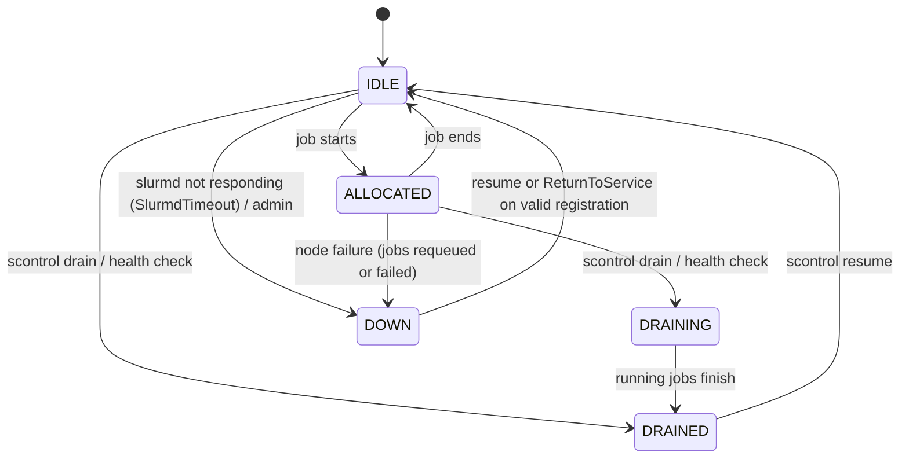

# 6.14 Slurm operations: prolog, epilog, health checks, drain, reason codes, troubleshooting

| | |
|---|---|
| Level | Intermediate |
| Priority tier | 1 |
| Lab venue | Slurm test cluster with GPU nodes (or stubs) |
| Part | Part 6: HPC and Slurm |
| Status | Drafted. Semantics read from the `slurm.conf(5)` man page and the prolog/epilog guide (SchedMD/slurm commit `521370b`, 2026-10-23). `code/part06/node_health.sh` was run against stub `nvidia-smi`, `mountpoint`, `chronyc`, `ibstat` and `dmesg` commands in dry-run mode (output below); it has **not** run on a real node or against a real `scontrol`. Cluster labs **untested** |

## Why this matters for AI infrastructure

In a large GPU cluster something is always broken: a GPU falls off the bus, a link flaps, a mount goes stale, a node runs out of `/tmp`. The difference between a well-run and a badly run cluster is how fast bad nodes leave the pool, how cleanly jobs are cleaned up, and how quickly an operator can say why a job failed. Training jobs spanning hundreds of GPUs make this acute: one sick node wastes the whole job. The tools are prolog and epilog scripts, a periodic health check, automatic draining with a reason, and disciplined diagnosis from logs.

## Prerequisites and outcomes

Needs 6.7 to 6.11. After this chapter you can:

- Explain when prolog and epilog scripts run, what happens when they fail, and what belongs in each.
- Write and test a health-check program; wire it to Slurm and draining.
- Manage node lifecycle: drain, resume, down, reboot, replace, with accurate reason strings.
- Handle unkillable steps, stuck jobs and misbehaving users.
- Read daemon logs, `sdiag`, `scontrol`, `sacct` to diagnose scheduling and node problems.
- Apply a troubleshooting playbook and avoid classic mistakes (undrained reboots, silent failures, thundering herds).

## 1. Prolog and epilog

Slurm can run scripts at job boundaries (the man page's "PROLOG AND EPILOG SCRIPTS" section):

| Script | Where and who | When |
|---|---|---|
| `Prolog` | Every compute node, as root (slurmd) | When the node first sees a job step of a new allocation (not at allocation), unless `PrologFlags=Alloc` |
| `Epilog` | Every node, root | When the allocation is released, **always** on every node |
| `PrologSlurmctld`, `EpilogSlurmctld` | The controller host | Once per job on the controller |
| `TaskProlog`, `TaskEpilog` | As the user, per task | Before/after each task; `TaskProlog` can print `export VAR=val` lines to set the task environment |
| `SrunProlog`/`SrunEpilog`, `BcastParameters`, `ResvProlog`/`ResvEpilog` | Various | Per `srun`, reservations |

Failure behaviour (verbatim in meaning from the man page):

- **Prolog fails (non-zero exit)**: the node is set to DRAIN and the job is requeued; the job is held unless `nohold_on_prolog_fail` is in `SchedulerParameters`.
- **Epilog fails**: the node is set to DRAIN.
- **PrologSlurmctld fails**: the job is requeued to run elsewhere if it is a batch job; interactive jobs are cancelled. **EpilogSlurmctld fails**: only logged.
- Standard output and error of these scripts are **not preserved**: write your own log.
- Scripts have timeouts (`PrologEpilogTimeout`); slow scripts delay job start (prolog) and node release (epilog).

`PrologFlags` (comma list; default none): `Alloc` (run the prolog at allocation, job is CONFIGURING meanwhile; increases start time), `Contain` (create a job container at allocation for processes not launched by Slurm, such as `pam_slurm_adopt` SSH sessions; requires `proctrack/cgroup`; implies Alloc), `DeferBatch` (wait for prolog on all nodes before launching the batch script), `NoHold` (let `salloc` not block), `Serial`, `X11`, and others. Environment variables describing the job (`SLURM_JOB_ID`, `SLURM_JOB_USER`, `SLURM_JOB_GPUS` in prolog/epilog, `SLURM_SCRIPT_CONTEXT` telling which script is running, ...) are passed to the scripts (see the prolog/epilog guide).

### What to put in them

**Prolog** (keep it fast, idempotent, and safe; a failing prolog drains the node): quick sanity checks (GPU count visible, mount present), set up per-job temp directories (`/tmp/slurm-$SLURM_JOB_ID`), clear leftover state from a previous job, set GPU modes (persistence, clocks) if policy says so, log the job start. Avoid long checks (a 30-second DCGM diagnostic in every prolog slows every job start); use the periodic health check for deep tests.

**Epilog** (the cleanup guarantee): kill processes of the job's user that remain (`pkill -u $SLURM_JOB_USER` only if the user has no other job on the node; check with `squeue`), remove per-job temp dirs, drop page cache if policy demands, reset GPU state (compute mode, `nvidia-smi --gpu-reset` only when no process uses the GPU), unmount job-specific mounts, flush logs, sample GPU errors (`dmesg` Xid since job start) and **drain on hardware errors**, record per-job GPU usage summary. Because Epilog runs on every node when the allocation ends it is the right place for leak cleanup; an epilog that fails drains the node, so make it tolerant: use `|| true` for best-effort steps, and exit non-zero only when you want the node drained.

Pitfall: shared nodes. Epilogs that kill "all user processes" harm a user's other job on a shared node. Use cgroups (the job's cgroup cleans itself with `proctrack/cgroup`) and make the epilog check for other jobs.

## 2. Health checks

`HealthCheckProgram` is a script Slurm runs as root periodically on compute nodes (default interval 0 = disabled, set `HealthCheckInterval`), on nodes in states selected by `HealthCheckNodeState` (default `ANY`; other values include `ALLOC`, `IDLE`, `MIXED`, `CYCLE`: with `CYCLE` the runs are spread across the interval instead of all nodes at once, which avoids a thundering herd against shared storage). Crucially, per the man page: **"Any action to be taken must be explicitly performed by the program"**, e.g. `scontrol update NodeName=foo State=drain Reason=tmp_file_system_full`. The program decides; Slurm only runs it. Many sites use the open-source LBNL **NHC** (Node Health Check) or vendor tools (DCGM-based health checks, BCM health checks, Part 8), or custom scripts.

### Design rules

1. **Cheap and frequent for basics, expensive and rare for deep tests.** Every 1 to 5 minutes: GPU count, mounts, free space, time sync, fabric port state, service daemons (slurmd, munge), memory and swap, kernel errors. Hourly or between jobs on idle nodes: DCGM level 2 diagnostics, NCCL bandwidth test between neighbours, disk and memory stress.
2. **Drain, don't kill.** Draining lets running jobs finish (except when the failure is severe: then also `scancel` or `State=down`).
3. **Clear reasons.** The Reason string is the operator's first clue. Include the check name, evidence and time; keep it under the allowed length. Reasons are shown by `sinfo -R`.
4. **Avoid false positives at scale.** A check that flaps 1 percent of the time drains many nodes in a 5,000-node cluster. Require two consecutive failures, or classify transient vs persistent.
5. **Never block forever.** Wrap external commands with `timeout`; a hung `nvidia-smi` is itself a signal (GPU wedged) and must become a failure rather than a hang.
6. **Idempotent and silent when OK.** Output only on failure (or log to syslog); logs per node.
7. **Return-to-service policy.** Combine with `ReturnToService` (6.8): nodes drained by an operator or by the health check stay drained until someone resumes them; only DOWN-for-non-responsiveness nodes auto-return with `ReturnToService=1`. Prefer an explicit "auto-heal" path that re-runs the check and resumes only when green.

### A tested example

`code/part06/node_health.sh` implements six checks: GPU count (`nvidia-smi -L`), serious GPU Xid errors in `dmesg` (codes such as 48, 63, 64, 74, 79, 94, 95: double-bit ECC, row-remap failures, GPU fell off the bus and similar; treat the list as a starting point and verify against NVIDIA's Xid documentation for your driver), free space in `/tmp`, required mounts, clock synchronisation (`chronyc`), and InfiniBand port state (`ibstat`). On any failure it drains the node with a combined reason, or in `DRY_RUN=1` mode prints what it would do. Tested against stub commands simulating a degraded node (seven GPUs, an Xid 79 in the kernel log, `/scratch` unmounted, one IB port down):

```text
FAIL gpu_count: found 7 GPUs, expected 8
FAIL gpu_xid: [1234.5] NVRM: Xid (PCI:0000:3b:00): 79, pid=1, GPU has fallen off the bus.
FAIL tmp_space: only 14462 MB free in /tmp
FAIL mounts: /scratch not mounted
OK   time_sync
FAIL ib_links: 1 IB ports down
DRY_RUN would drain gpu07: health: gpu_count: found 7 GPUs, expected 8; gpu_xid: ...
```

and against stubs for a healthy node (eight GPUs, quiet kernel log, mounts present, one active IB port): all `OK`, exit 0. (The `/tmp` check failed in my first healthy run because the laptop genuinely had only 14 GB free; lowering `MIN_TMP_MB` for the test made it pass.) Limitations to fix before production: use `timeout` around each command, run `nvidia-smi` with a deadline, check `dmesg` only since the last check (offset file) rather than the whole ring buffer so that an old fixed error does not drain a healed node, add DCGM, ECC counters via `nvidia-smi --query-gpu`, NVLink status, PCIe link speed/width (downtrained links are a classic silent slowdown), temperature/throttle reasons, and make thresholds configuration, not code.

## 3. Node lifecycle



Operations:

```bash
sinfo -R -o "%20E %9u %19H %N"            # why nodes are down/drained: reason, who, when, which
sinfo -N -t drain,down -o "%N %T %E"
scontrol update NodeName=gpu[07,12] State=drain Reason="Xid79 GPU3 ticket INC123"
scontrol update NodeName=gpu07 State=resume
scontrol reboot ASAP nextstate=resume reason="kernel update" gpu[01-16]   # drains, reboots when empty, returns to service
scontrol update NodeName=gpu07 State=down Reason="dead PSU"                # jobs on it are requeued/failed
scontrol show node gpu07 | grep -E "State|Reason|Gres|CPULoad|FreeMem"
```

`scontrol reboot` (options `ASAP`, `nextstate=`, `reason=`) is the clean way to patch: it drains, waits for jobs, reboots via `RebootProgram`, and resumes. `ASAP` prevents new jobs immediately. Always include who/why/ticket in the reason; auditors and colleagues rely on it.

**Down vs drain**: `DRAIN` = stop new work, let current finish. `DOWN` = the node is unusable; running jobs are requeued if requeue is allowed or killed. Use `down` only when the node is truly dead; draining a node with healthy jobs is kinder.

**Replacement flow** for a failed node: drain with ticket reference, collect evidence (logs, DCGM report, `nvidia-bug-report.sh`), open vendor case, swap hardware, run burn-in and acceptance tests (6.28) before `resume`. Keep a spare pool and a record of repeated offenders (mean time between failures per node) to catch marginal hardware.

## 4. Unkillable steps and stuck jobs

When a job step's processes ignore SIGKILL (usually blocked in uninterruptible I/O, `D` state, often on a hung network file system or a GPU in a bad state), Slurm waits `UnkillableStepTimeout` (default 60 seconds or five times `MessageTimeout`, whichever is larger) then runs `UnkillableStepProgram` if set and **drains the node** "to prevent future jobs from being scheduled on the node". The program runs as root on that node with the job variables and can collect diagnostics (stack traces from `/proc/PID/stack`, `lsof`, `nvidia-smi`, hung mount info) and alert. Common causes: NFS/Lustre server problem, dead NIC with outstanding RDMA operations, GPU Xid. Fix the underlying cause; the node usually needs a reboot.

Job in `COMPLETING` for a long time: epilog running or hung, unkillable step, node unreachable (`scontrol show job` and `sinfo` for nodes). Job `PENDING` forever: see 6.9 section 8. Job `RUNNING` but no progress: user-side hang; check GPU utilisation (`srun --overlap --jobid=ID nvidia-smi`), NCCL logs, `py-spy dump`.

## 5. Logs and diagnostics

| Source | Use |
|---|---|
| `slurmctld.log` (controller) | Scheduling decisions, node state changes, RPC problems, accounting errors. Increase with `scontrol setdebug debug2` temporarily (and back: verbose logs are huge) |
| `slurmd.log` (each node) | Launch failures, cgroup problems, prolog/epilog results, configuration mismatch on registration |
| `slurmdbd.log` | Accounting writes, database problems |
| `journalctl -u slurmd`, `dmesg -T` | systemd start failures, kernel messages (OOM kills, Xid, IB errors, I/O errors) |
| `sacct -j ID --format=JobID,State,ExitCode,DerivedExitCode,NodeList,Reason` | Final state and exit code (`ExitCode=0:9` means exit code 0, signal 9) |
| `scontrol show job/node/partition/config` | Live state and effective configuration |
| `sdiag` | Scheduler statistics: server thread count, RPC counts and durations by type and user, main scheduler and backfill cycle times, queue lengths, jobs started per cycle |
| `squeue -o ... --start`, `sprio`, `sshare` | Pending analysis (6.9) |
| `sinfo -R`, `sinfo -N -l` | Node reasons and states |
| `strigger` | Event hooks: run a program when a node goes down/up, a job finishes, etc. |

**`sdiag` for controller health (`SCL` Chapter 15, *Troubleshooting*)**: look at `Agent queue size`, "Server thread count", `Remote Procedure Call statistics by message type` (for example `REQUEST_PARTITION_INFO (2009) count:325127 ave_time:183 total_time:5978485`), and `Remote Procedure Call statistics by user` (for example `root (0) count:728986 ave_time:10228 total_time:456422703` and `user1 (25002) count:29784 ave_time:13439 total_time:269036`, where a single user spamming `squeue` in a tight loop is the classic cause of a sluggish controller dying under a request storm), backfill cycle mean/max time and depth (6.9), and `max_rpc_cnt`/`defer` (`salloc_wait_nodes` / `sbatch_wait_nodes`) options in `SchedulerParameters` to protect the controller. Educate users: no `watch -n1 squeue`; offer `squeue` caching or a read-only web dashboard.

When default log verbosity is too terse to diagnose a live incident (`SCL` Chapter 15), you can raise debug levels and toggle specific `DebugFlags` on the fly without restarting daemons:
- `scontrol setdebug LEVEL` (e.g., `debug2`, and `nodes=<nodelist>` to target only specific `slurmd` nodes)
- `scontrol setdebugflags {+|-}FLAG [{+|-}FLAG...]`
- `sacctmgr show stats` (accounting database statistics), `sacctmgr show problem` (potential association/configuration problems), and `sacctmgr show runawayjobs` (identifies orphaned jobs stuck in the database as running after a controller crash and offers to fix them).

Sample `sacct` and `sreport` outputs from `SCL` Chapter 15 (`superhpc` cluster):
- `sacct -S 2024-01-01 -E 2024-01-02 -o JobID,Partition,User%16,CPUTimeRAW,State%20 -X`: shows `522783 test user_12345 7168 COMPLETED`, `523455 compute user_23456 0 CANCELLED by 0` (cancelled by root), `526258 compute user_55436 0 CANCELLED by 10107` (cancelled by UID `10107`), `527646 compute user_11231 1624 FAILED`, `528244 compute user_43546 46125352 NODE_FAIL`, `528479 compute user_12345 10526502 COMPLETED`, and `528480 compute user_12345 15060654 COMPLETED`.
- `sreport job SizesByAccount grouping=0-16,17-1024 start=2024-01-01 end=2024-01-07`: reports `518400 secs` in minutes for account `userst500` (`0-4294967295`: `6678604725`, `0-16 cpus`: `1000612`, `>= 17 cpus`: `6677604113`, `100.00%` of cluster).
- `sreport cluster utilization Start=2024-11-01 End=2024-12-01 -t percent`: reports `superhpc` `Allocated 85.08%`, `Down 8.59%`, `PLND Down 0.00%`, `Idle 2.10%`, `Planned 4.23%`, and `Reported 100.00%`.
- `sreport user topusage topcount=5 start=2024-01-10 end=2024-02-10`: reports top users in TRES Minutes (`user_12`: `43466331`, `user_25`: `35227321`, `user_11`: `35104234`, `user_32`: `30548681`, `user_47`: `27162101` under account `usert500`).

Controller sizing and state: `StateSaveLocation` on fast local or HA-shared storage (6.15), with enough inodes; large `MaxJobCount`; slurmdbd on a decent database host with regular purge/archiving (`PurgeJobAfter`, etc. in `slurmdbd.conf`).

Time and identity are frequent hidden causes: munge failures from clock skew (`Invalid credential`), missing users on nodes (`Invalid user id`), DNS and `/etc/hosts` inconsistency (`getaddrinfo` errors), firewalls blocking ports 6817 to 6819 or the ephemeral srun ports.

## 6. Troubleshooting playbook

| Symptom | Diagnose | Typical resolution |
|---|---|---|
| Node `DOWN`, reason "Not responding" | `ping`, `ssh`, `systemctl status slurmd`, `journalctl -u munge`, time sync | Restart services; reboot; fix network; resume |
| Node `DRAIN` "Kill task failed" | Unkillable step; `ps -eo pid,stat,wchan \| grep ' D'` | Find the D-state cause (mount, GPU); reboot |
| Node `inval` / "Low RealMemory" or "gres count too low" | `slurmd -C`, `slurmd -G`, `nvidia-smi` | Fix hardware/config; DIMM or GPU lost; correct config (6.8, 6.10) |
| "Prolog error" drain | `slurmd.log` around the time; prolog log | Fix the failing check; resume |
| Jobs fail instantly with `NODE_FAIL` | Node crashed or lost network; `dmesg`, BMC SEL (Part 7) | Hardware triage |
| Jobs fail `OUT_OF_MEMORY` | `sacct MaxRSS`, cgroup OOM events in `dmesg` | User request more memory; check `ConstrainRAMSpace`, memory defaults (6.8) |
| Job killed `TIMEOUT` | `--time` too small | Checkpointing, signals (6.11) |
| Job cannot start: "Requested node configuration is not available" | Request exceeds any node (GPU type, memory) | Correct request or partition |
| Everything slow | `sdiag`, controller CPU, database latency, file system latency | Throttle polling users, tune scheduler, check storage |
| Jobs pending though nodes idle | Reasons (6.9), reservations, `MaxCPUsPerNode`, memory defaults, GRES typos | Fix policy/request |
| Accounting missing | `sacctmgr show assoc`, slurmdbd connection | Create associations; check `AccountingStorageHost` and munge |
| GPU job sees no GPU | `gres.conf`, cgroup devices, driver | 6.10 |
| MPI job fails to launch | `srun --mpi=list`, PMIx versions, firewall | 6.4, 6.12 |
| Scheduler stopped scheduling | `slurmctld` logs, `sdiag`, deadlock after config change, full disk in `StateSaveLocation` | Restart per procedure; fix disk |

**Method**: (1) state the symptom exactly (job id, node, time); (2) read `scontrol show` for the object; (3) find the first error in the relevant log near that time; (4) check the layer below (node health, network, storage, time); (5) change one thing; (6) record cause and fix in the ticket and update the health check so the next occurrence is automatic.

### 6.1 GPU hardware and cross-layer failure catalog (Volume 20)

On GPU clusters, node health checks and epilog scripts must map job-level symptoms to specific underlying hardware and firmware faults (`nvidia-zero-to-hero/volume-20` Chapters 1–12 and Labs 1–4):

| Failure Domain | Signature / Evidence | Automated Slurm Action |
|---|---|---|
| **1. GPU Memory Not Detected / Missing GPU** | `slurmd -G` or `nvidia-smi -L` sees fewer GPUs than `EXPECT_GPUS=8`, or `lspci` shows a missing PCIe endpoint | Drain node immediately (`State=drain Reason="gpu_count < 8"`); require cold power cycle / PCIe reseat |
| **2. GPU Driver Crash & Xid Errors** | `dmesg` logs `NVRM: Xid`: `48` (DBE ECC), `63`/`64` (row-remap), `74` (NVLink), `79` (fallen off bus), `94`/`95` (contained/uncontained ECC) | Drain node in `Epilog` / `HealthCheckProgram` with exact `Xid` code and PCI BDF |
| **3. NCCL Timeout & Collective Failures** | `Watchdog caught collective operation timeout` | Check `srun -K`, `dmesg` Xids, IB port counters, and bisect node list |
| **4. NVLink Errors & Topology Issues** | `nvidia-smi nvlink -s` shows inactive links or `nvidia-smi nvlink -e` shows CRC/replay errors (`Xid 74`) | Drain node; run `dcgmi diag -r 3` and fabric link test |
| **5. ECC Errors & Memory Bit Flips** | Uncorrectable double-bit (`DBE`) counters $>0$ or pending row-remap failure in `nvidia-smi -q -d ECC,REMAPPED_ROWS` | Drain node and trigger GPU reset or reboot so pending row remapping takes effect (or RMA if row-remap table is full) |
| **6. Thermal Throttling & Cooling Degradation** | `nvidia-smi -q -d PERFORMANCE` shows `HW Thermal Slowdown: Active` or GPU temp $\ge 83^\circ\text{C}$ | Alert facility cooling / CDU loop; drain node if thermal slowdown persists |
| **7. DMA Engine Failures & PCIe Issues** | `lspci -vv` shows `LnkSta: Speed 16GT/s (downgraded), Width x8 (downgraded)` or AER errors | Drain node; downtrained PCIe Gen5 $\to$ Gen3/x8 silently halves H2D/D2H and GPUDirect RDMA bandwidth |
| **8. Fan Failure & Cooling Degradation** | BMC / Redfish IPMI sensor or `nvidia-smi` fan speed fault | Drain node and dispatch DC technician before thermal trip |
| **9. Power Supply & Brownout Scenarios** | `HW Power Brake Slowdown: Active` or PSU redundancy lost in BMC SEL | Drain or cap power (`nvidia-smi -pl`); replace failed PSU |
| **10. Clock Instability & Frequency Scaling** | SM clocks stuck at base/idle frequency on one GPU across a multi-node job | Lock application clocks in `Prolog` (`nvidia-smi -lgc`) or reset GPU in `Epilog` |
| **11. Multi-GPU Imbalance & Stragglers** | One rank consistently lags step time by $20\text{–}40\%$ | Check CPU NUMA pinning (`--gpu-bind=closest`), PCIe/NVLink downgrade, and thermal throttling on the slow rank's node |
| **12. Cross-Layer Diagnosis (When Metrics Lie)** | `nvidia-smi` reports `100%` `utilization.gpu` while training step progress is zero | `NCCL` spin-wait kernel is pegging SM utilization while waiting on a dead remote rank or dropped IB packet; inspect power draw (low watts at 100% util = spin wait) and `py-spy` / `torch.profiler` |

## 7. Operational practices

- **Change management**: config changes via Git and automation; test in a staging cluster; `scontrol reconfigure` rather than restart when possible; never restart `slurmctld` mid-peak without need.
- **Maintenance windows**: use reservations (`scontrol create reservation StartTime=... Duration=... Nodes=... Flags=MAINT,IGNORE_JOBS`) so jobs do not start that cannot finish; `scontrol reboot` for rolling patches.
- **Upgrades**: Slurm has strict rules about upgrade order and version skew (slurmdbd first, then slurmctld, then slurmd, usually at most two major versions apart); see 6.15.
- **User communication**: a status page, MOTD with maintenance notices, clear reason strings and documentation for common errors.
- **Runbooks and on-call**: for each alert, a runbook with commands and escalation. Practise failure drills (kill slurmd, fill a disk, unplug a node).
- **Metrics**: node availability, % drained, mean time to drain/repair, job failure rate by cause (`NODE_FAIL`, OOM, timeout), prolog/epilog durations, queue wait times, controller RPC rates, utilisation per partition (Part 17).
- **Security**: restrict who can run `scontrol update`; log admin actions; protect prolog/epilog and health scripts (root-owned, not world-writable); `pam_slurm_adopt` to prevent ssh to nodes without a job.

### Maintenance and user reservations (`scontrol` reservation lifecycle and flags)

A Slurm **reservation** sets aside a specific node count (`NodeCnt=...`) or explicit node list (`Nodes=...`) for designated users or accounts (`Users=...`, `Accounts=...`) during a future time window (`StartTime=...`, `EndTime=...` or `Duration=...`). Other users' jobs cannot allocate those nodes during the window—or before it if the job's wall-time would cross into the reservation—making reservations the standard tool both for guaranteed user runs and for cluster maintenance windows (where admins can run verification jobs on reserved nodes while regular user jobs wait in the queue).

In the book's Chapter 15 example, creating, using, inspecting, modifying, and deleting a reservation uses `scontrol` (`(untested here)`):

```bash
# (untested here) — 1. Create a 5-hour reservation of 100 nodes for user1 and user2
scontrol create reservation name=important \
  StartTime=2100-06-01T08:00:00 Duration=5:00:00 \
  Users=user1,user2 NodeCnt=100 Flags=IGNORE_JOBS

# (untested here) — 2. Submit a job into the reservation
sbatch --reservation=important -N100 ./my_task

# (untested here) — 3. Inspect existing reservations (or view nodes in a reservation via sinfo -T important)
scontrol show reservation
scontrol show reservation important

# (untested here) — 4. Update a reservation (note 'reservationname=' with no space, and '+=' / '-=' on flags, users, or accounts)
scontrol update reservationname=important \
  duration=14-00:00:00 flags+=STATIC_ALLOC

# (untested here) — 5. Delete a reservation when no longer needed
scontrol delete reservationname=important
```

Key reservation flags from the book:

| Reservation flag | Meaning |
|---|---|
| `IGNORE_JOBS` | Ignore currently running jobs when creating the reservation; if the requested nodes have not finished their running jobs by `StartTime`, the reservation starts with fewer available nodes than requested rather than failing creation |
| `OVERLAP` | Allow the reservation's nodes to overlap with another existing reservation |
| `NO_HOLD_JOBS_AFTER` | By default, jobs submitted to a reservation that have not finished when the reservation ends are placed on hold; this flag leaves them in `PENDING` state instead (note: this flag cannot be removed with `-=`) |
| `DAILY`, `HOURLY`, `WEEKLY` | Automatically repeat the reservation every day, hour, or week (similarly `WEEKDAY` and `WEEKEND` repeat on weekdays or weekends) |
| `STATIC_ALLOC` | When a reservation is created by node count (`NodeCnt`), Slurm normally replaces any reserved node that goes `DOWN` with a healthy spare node; `STATIC_ALLOC` disables automatic node replacement |
| `MAINT` | Maintenance mode shorthand: combines `OVERLAP` and `STATIC_ALLOC` together (and marks nodes with the `$` maintenance state indicator in `sinfo`) |

## 8. Lab (self-checking stub test run; live cluster parts untested)

First, run the self-checking Python lab (`code/part06/node_health_lab.py`) locally. It executes `code/part06/node_health.sh` against temporary mock binaries (`nvidia-smi`, `dmesg`, `df`, `mountpoint`, `chronyc`, `ibstat`) in `DRY_RUN=1` mode for both a healthy 8-GPU node (`exit 0`) and a degraded node (`7` GPUs, `Xid 79`, `14462 MB` free in `/tmp`, `/scratch` unmounted, `1` IB port down $\to$ `exit 1` with combined `DRY_RUN would drain gpu07:` reason), verifies the `sdiag` RPC storm counters and `sreport` utilization percentages from `SCL` Chapter 15, and checks the critical GPU `Xid` set (`48, 63, 64, 74, 79, 94, 95`):

```bash
python3 code/part06/node_health_lab.py
```

Next, on a test cluster, work through these steps:

1. Run `node_health.sh` with `DRY_RUN=1` using stub commands (as in the status box); change a stub to produce each failure and see the reason string.
2. On a test cluster, set `HealthCheckProgram`, `HealthCheckInterval=300`, `HealthCheckNodeState=ANY,CYCLE`; break a mount on one node; confirm the node drains with your reason.
3. Write a prolog that fails when `/scratch` is missing; observe the node drain and job requeue; then tune `nohold_on_prolog_fail`.
4. Write an epilog that cleans `/tmp/slurm-$SLURM_JOB_ID` and kills stray user processes only when the user has no other job on the node.
5. Create an unkillable step (a process in `D` state is hard to fake; read the code path instead) and configure `UnkillableStepProgram` to collect diagnostics.
6. Use `scontrol reboot ASAP nextstate=resume` on one node; watch states.
7. Run `sdiag` before and after a loop of `squeue` calls from a user.
8. Write the on-call runbook for "node drained: GPU Xid".

## 9. Interview angles

- When do prolog and epilog run, and what happens if they fail?
- Design a health-check strategy for a 2,000-GPU cluster. What do you check, how often, and what do you do on failure?
- What does `HealthCheckNodeState=CYCLE` avoid?
- How do you patch all nodes without disrupting jobs?
- What is an unkillable step and how does Slurm react?
- A user says the cluster is slow. What do you check on the controller?
- Drain versus down?
- How do you avoid false-positive drains at scale?
- How do you find which node killed a multi-node job?

## Exercises

1. **Automated Node Health Gating with Stub Binaries (`code/part06/node_health.sh` & `node_health_lab.py`):** Run `python3 code/part06/node_health_lab.py`. Inspect how `run_node_health_with_stubs(healthy=False)` injects mock `nvidia-smi` (`7` GPUs vs `EXPECT_GPUS=8`), `dmesg` (`Xid 79`), `df` (`14462 MB` vs `MIN_TMP_MB=20480`), `mountpoint` (`/scratch` unmounted), and `ibstat` (`State: Down`) binaries to verify that `node_health.sh` builds a single truncated `Reason` string (`cut -c1-200`) and exits non-zero.
2. **Designing `Prolog` vs `Epilog` vs `HealthCheckProgram` Boundaries:** Classify where each of the following belongs—`Prolog`, `Epilog`, or `HealthCheckProgram` (`ANY,CYCLE`)—and explain why: (a) creating `/tmp/slurm-$SLURM_JOB_ID`, (b) checking `dmesg` for new `Xid` errors after a job finishes and removing `/tmp/slurm-$SLURM_JOB_ID`, (c) running a 2-minute DCGM level-2 diagnostic, and (d) verifying `/scratch` is mounted every 5 minutes across idle and allocated nodes.
3. **Decoding `Xid` Hardware Errors and PCIe/NVLink Degradation (Volume 20):** Given kernel logs and `nvidia-smi` outputs showing `Xid 48`, `Xid 63`, `Xid 74`, `Xid 79`, `HW Power Brake Slowdown: Active`, and `LnkSta: Speed 16GT/s (downgraded), Width x8 (downgraded)`, map each signature to its root hardware subsystem (HBM ECC, row remapper, NVLink, PCIe bus drop, PSU/power brake, PCIe lane downtraining) and state the required remediation before running `scontrol update NodeName=... State=resume`.
4. **Diagnosing "When Metrics Lie" (`100%` GPU Utilization with Zero Progress):** A 64-GPU training job shows `100%` `utilization.gpu` in `nvidia-smi` on all 64 GPUs, yet the training log has not printed a step for 2 hours. Explain why `nvidia-smi` reports `100%` utilization during an `NCCL` collective hang, which secondary `nvidia-smi` metric (power draw in Watts) immediately exposes a spin-waiting GPU, and how `UnkillableStepTimeout` handles processes wedged in kernel `D` state.
5. **Analyzing `sdiag` RPC Storms and `sacctmgr` Database Health (`SCL` Chapter 15):** Given `sdiag` output showing `REQUEST_PARTITION_INFO (2009) count:325127 ave_time:183 total_time:5978485` and `user1 (25002) count:29784 ave_time:13439 total_time:269036`, explain how to identify a user script hammering `slurmctld`, which `SchedulerParameters` flags (`max_rpc_cnt`, `defer`, `batch_sched_delay`) protect the controller, and what `sacctmgr show problem` and `sacctmgr show runawayjobs` fix.
6. **Managing Maintenance Windows with `scontrol` Reservations and Rolling Reboots (`SCL` Chapter 15):** Write the exact `scontrol create reservation`, `scontrol update reservationname=...`, `scontrol reboot ASAP nextstate=resume`, and `scontrol delete reservationname=...` commands to drain and patch a 100-node subcluster, and explain the difference between `IGNORE_JOBS`, `STATIC_ALLOC`, `NO_HOLD_JOBS_AFTER`, and `MAINT`.

## Checkpoint

<details>
<summary>1. Compare when `Prolog`, `Epilog`, `PrologSlurmctld`, `EpilogSlurmctld`, and `TaskProlog` execute, and under which user account (`slurm.conf(5)` & `SCL` Chapter 15).</summary>

- **`Prolog`:** Runs as `root` on each allocated compute node before the first job step launches (or at job allocation time if `PrologFlags=Alloc` is set).
- **`Epilog`:** Runs as `root` on every allocated compute node when the job allocation is released.
- **`PrologSlurmctld` / `EpilogSlurmctld`:** Run once per job on the controller host as `SlurmUser`.
- **`TaskProlog` / `TaskEpilog`:** Run as the **job's user** before and after every individual task (`TaskProlog` can print `export VAR=val` to modify the task's environment).
</details>

<details>
<summary>2. What happens to the compute node and the job when `Prolog`, `Epilog`, or `PrologSlurmctld` exits with a non-zero status?</summary>

- **`Prolog` fails:** `slurmctld` sets the offending compute node to **`DRAIN`** and **requeues** the job (in a held state unless `SchedulerParameters=nohold_on_prolog_fail` is set).
- **`Epilog` fails:** `slurmctld` sets the compute node to **`DRAIN`**.
- **`PrologSlurmctld` fails:** Batch jobs are requeued; interactive jobs (`salloc`/`srun`) are cancelled.
</details>

<details>
<summary>3. What do `PrologFlags=Alloc`, `Contain`, and `DeferBatch` do (`SCL` Chapter 15)?</summary>

- **`Alloc`:** Executes `Prolog` immediately when the allocation is granted (while the job is in `CONFIGURING` state) rather than waiting for the first step.
- **`Contain`:** Uses `proctrack/cgroup` at allocation time to create the `extern` step cgroup container on every allocated node so `pam_slurm_adopt` can place direct user `ssh` sessions inside the job's cgroup.
- **`DeferBatch`:** Waits until `Prolog` finishes on **all** allocated nodes before starting the batch script on Node 0.
</details>

<details>
<summary>4. Why is running `pkill -u $SLURM_JOB_USER` unconditionally in an `Epilog` script dangerous, and how do you make process cleanup safe?</summary>

If nodes are shared (`OverSubscribe=No` with partial-node allocations), a user may have **another active job still running on the same node**. Rely on `ProctrackType=proctrack/cgroup` to automatically reap the finished job's cgroup tree, or check that the user has zero remaining active jobs on the node before running user-level cleanup.
</details>

<details>
<summary>5. How does `HealthCheckProgram` work in Slurm, what does `HealthCheckNodeState=ANY,CYCLE` do, and does Slurm automatically drain a node when `HealthCheckProgram` exits non-zero?</summary>

`slurmd` runs `HealthCheckProgram` as `root` every `HealthCheckInterval` seconds on nodes matching `HealthCheckNodeState`. Adding **`CYCLE`** spreads execution evenly across the interval instead of running on all nodes at the exact same second (preventing thundering-herd spikes against shared storage). **Slurm takes no automatic action on exit code alone**—the script itself must explicitly invoke `scontrol update NodeName=... State=drain Reason="..."`.
</details>

<details>
<summary>6. What six node health checks does `code/part06/node_health.sh` perform, and why should external commands inside a health check always be wrapped in `timeout`?</summary>

1. GPU count (`nvidia-smi -L` == `EXPECT_GPUS`).
2. Critical GPU `Xid` errors in `dmesg` (`48, 63, 64, 74, 79, 94, 95`).
3. Free space in `/tmp` (`df -Pm /tmp` $\ge$ `MIN_TMP_MB`).
4. Required shared mounts (`mountpoint -q` on `/scratch`, `/home`).
5. NTP clock synchronization (`chronyc tracking` `Leap status: Normal`).
6. InfiniBand port state (`ibstat` has `0` `State: Down` ports).
External commands must be wrapped in `timeout` because a wedged GPU driver or hung NFS/Lustre mount will cause `nvidia-smi` or `df` to block indefinitely in kernel `D` state, hanging the health check itself.
</details>

<details>
<summary>7. Decode the seven critical NVIDIA `Xid` errors (`48`, `63`, `64`, `74`, `79`, `94`, `95`) checked by `node_health.sh` (Volume 20 Chapter 2).</summary>

- **`Xid 48`:** Double-Bit ECC Error (`DBE`) in GPU HBM memory.
- **`Xid 63` / `Xid 64`:** Dynamic page retirement / HBM row-remapping recording event (`63`) or row-remapping table exhaustion/failure (`64`).
- **`Xid 74`:** NVLink hardware / link error.
- **`Xid 79`:** GPU has fallen off the PCIe bus (fatal hardware/power/PCIe loss requiring cold reboot or hardware service).
- **`Xid 94` / `Xid 95`:** Contained (`94`) or uncontained (`95`) memory ECC error.
</details>

<details>
<summary>8. Compare the Slurm node states `DRAINING`, `DRAINED`, and `DOWN`, and when should an operator use `State=drain` vs `State=down`?</summary>

- **`DRAINING`:** Node is marked for drain (`scontrol update NodeName=... State=drain Reason=...`), refuses new jobs, and waits for **currently running jobs to finish normally**.
- **`DRAINED`:** All running jobs have completed and the node is empty and offline for scheduling until `State=resume`.
- **`DOWN`:** Node is immediately marked unusable and **all currently running jobs on it are killed/requeued immediately**. Use `drain` whenever running jobs can finish safely; use `down` only when the node has already crashed or suffered a fatal hardware fault.
</details>

<details>
<summary>9. How does `scontrol reboot ASAP nextstate=resume reason="kernel update" gpu[01-16]` orchestrate a rolling maintenance reboot (`SCL` Chapter 15)?</summary>

`ASAP` immediately drains `gpu[01-16]` so no new jobs can start on them. As each node's currently running jobs finish, `slurmctld` invokes `RebootProgram` on that node, waits for `slurmd` to register back up after reboot, and (`nextstate=resume`) automatically returns the node to `IDLE` service.
</details>

<details>
<summary>10. How does `ReturnToService` (`0`, `1`, `2`) interact with nodes drained by `HealthCheckProgram` or an operator?</summary>

Under `ReturnToService=1` (default `0`), a node that went `DOWN` only because `slurmd` stopped responding (`SlurmdTimeout`) automatically returns to service when it registers with a valid configuration. However, **a node explicitly placed in `DRAIN` (by an admin, `Prolog`/`Epilog` failure, or `HealthCheckProgram`) never auto-resumes under `ReturnToService=0` or `1`**—it stays drained until an operator or verified auto-heal script runs `scontrol update NodeName=... State=resume`.
</details>

<details>
<summary>11. What is an **unkillable step** in Slurm, what is the default `UnkillableStepTimeout`, and how does Slurm respond?</summary>

An unkillable step occurs when `slurmstepd` sends `SIGKILL` to a job's processes at termination, but one or more processes remain alive after `UnkillableStepTimeout` (default `60` seconds or $5 \times \text{MessageTimeout}$)—almost always because a thread is stuck in uninterruptible kernel sleep (`D` state) inside a hung Lustre/NFS filesystem call, RDMA driver, or wedged GPU driver. Slurm runs `UnkillableStepProgram` (if configured) to capture `/proc/<pid>/stack` diagnostics and **automatically drains the node**.
</details>

<details>
<summary>12. How do you read `sacct` `ExitCode=0:9` vs `ExitCode=1:0` vs `ExitCode=0:15`?</summary>

Slurm formats `ExitCode` as **`<exit_status>:<signal_number>`**:
- **`0:9`:** Killed by `SIGKILL` (signal `9`, typical of OOM killer or `KillWait` expiration after timeout/cancel).
- **`1:0`:** Process exited normally with non-zero application return code `1` and no signal.
- **`0:15`:** Terminated by `SIGTERM` (signal `15`).
</details>

<details>
<summary>13. How do you use `sdiag` to diagnose a sluggish `slurmctld` controller (`SCL` Chapter 15)?</summary>

Inspect `sdiag` for:
1. **`Agent queue size` and `Server thread count`:** High values indicate `slurmctld` cannot keep up with incoming RPCs or outbound node communication.
2. **`Remote Procedure Call statistics by message type`:** e.g., `REQUEST_PARTITION_INFO` or `REQUEST_JOB_INFO` dominating total time.
3. **`Remote Procedure Call statistics by user`:** Identifies specific UIDs (e.g., `user1 (25002) count:29784`) running tight `while true; do squeue; done` loops.
4. **Main and backfill scheduler cycle times:** Long cycle times require tuning `bf_max_job_test`, `bf_max_job_user`, `defer`, or `max_rpc_cnt`.
</details>

<details>
<summary>14. How do you temporarily change `slurmctld` or `slurmd` log verbosity on the fly, and what do `sacctmgr show problem` and `sacctmgr show runawayjobs` check (`SCL` Chapter 15)?</summary>

- **Live log verbosity:** `scontrol setdebug debug2` (add `nodes=gpu07` to target specific compute nodes) and `scontrol setdebugflags +Backfill`.
- **`sacctmgr show problem`:** Lists inconsistencies in associations, accounts, or clusters.
- **`sacctmgr show runawayjobs`:** Finds orphaned jobs that `slurmdbd` still lists as `RUNNING` even though `slurmctld` no longer has them, and allows reconciling their end state.
</details>

<details>
<summary>15. How do you create, update, inspect, and delete a Slurm reservation with `scontrol` (`SCL` Chapter 15)?</summary>

- **Create:** `scontrol create reservation name=important StartTime=2100-06-01T08:00:00 Duration=5:00:00 Users=user1,user2 NodeCnt=100 Flags=IGNORE_JOBS`
- **Inspect:** `scontrol show reservation important` (or `sinfo -T important`)
- **Update:** `scontrol update reservationname=important duration=14-00:00:00 flags+=STATIC_ALLOC` (note `reservationname=` with no space)
- **Delete:** `scontrol delete reservationname=important`
Users submit jobs into it via `sbatch --reservation=important`.
</details>

<details>
<summary>16. Define the Slurm reservation flags `IGNORE_JOBS`, `OVERLAP`, `NO_HOLD_JOBS_AFTER`, `STATIC_ALLOC`, and `MAINT` (`SCL` Chapter 15).</summary>

- **`IGNORE_JOBS`:** Creates the reservation even if currently running jobs on those nodes will not finish before `StartTime`.
- **`OVERLAP`:** Allows the reservation's nodes to overlap another reservation.
- **`NO_HOLD_JOBS_AFTER`:** Leaves unfinished reservation jobs in `PENDING` state instead of `HELD` when the reservation expires (cannot be removed with `-=`).
- **`STATIC_ALLOC`:** Prevents Slurm from automatically replacing a reserved node that goes `DOWN` with another healthy node.
- **`MAINT`:** Combines `OVERLAP` and `STATIC_ALLOC` for maintenance windows (marks nodes with `$` in `sinfo`).
</details>

<details>
<summary>17. Why can a multi-node job run 40% slower after a hardware hiccup without logging any `Xid` error, and what check catches it (Volume 20 Chapter 7)?</summary>

A transient PCIe signal integrity error can cause a GPU or ConnectX NIC to **downtrain its PCIe link** (for example from PCIe Gen5 `32 GT/s x16` down to Gen3 `8 GT/s x8`), silently cutting host-to-device and GPUDirect RDMA bandwidth without crashing the job. Check `lspci -vv | grep -E "LnkCap|LnkSta"` (or `nvidia-smi -q -d PCIE`) in `HealthCheckProgram` and `Epilog` for `(downgraded)` speed or width.
</details>

<details>
<summary>18. How do you distinguish single-bit ECC errors (`SBE`) from double-bit ECC errors (`DBE`) and row-remapping failures on A100/H100 GPUs (Volume 20 Chapter 5)?</summary>

- **Correctable single-bit errors (`SBE`):** Corrected in hardware without crashing the kernel; high rates trigger dynamic row remapping.
- **Uncorrectable double-bit errors (`DBE`, `Xid 48`/`94`/`95`):** Corrupt memory data and terminate the CUDA context. The node must be drained and the GPU reset/rebooted so HBM row remapping replaces the bad row; if `nvidia-smi -q -d REMAPPED_ROWS` shows `Remapping Failure Occurred: Yes`, the GPU must be RMA'd.
</details>

<details>
<summary>19. Why can `nvidia-smi` report `100%` GPU utilization on a completely hung training job, and how do you prove it is a spin-wait hang (Volume 20 Chapter 12)?</summary>

When one rank dies or drops off the fabric, surviving ranks spin inside an active `NCCL` CUDA polling kernel waiting for collective completion—which keeps SM occupancy at `100%` in `nvidia-smi`. Inspecting **GPU power draw (`nvidia-smi --query-gpu=utilization.gpu,power.draw`)** immediately reveals the lie: a spinning H100 draws only $\sim 120\text{–}180\text{ W}$ at `100%` utilization instead of $600\text{–}700\text{ W}$ under real matrix-multiply load.
</details>

<details>
<summary>20. What are the five most common causes of `munge` or `slurmd` node registration failures when bringing a compute node online?</summary>

1. **Clock skew** between the compute node and `slurmctld` exceeding Munge's TTL (`Invalid credential`—fix `chronyd`).
2. **Mismatched `/etc/munge/munge.key`** or wrong file ownership/permissions (must be `0400`, owned by `munge:munge`).
3. **Hardware inventory lower than `slurm.conf`** (`Low RealMemory`, `Low socket*core*thread count`, or `gres/gpu count too low`).
4. **DNS / `/etc/hosts` mismatch** (`getaddrinfo` failure between `NodeName` and `NodeAddr`).
5. **Firewall blocking TCP ports `6817` (`slurmctld`), `6818` (`slurmd`), or `6819` (`slurmdbd`)**.
</details>

## Sources and review notes

- Prolog/epilog and health check semantics, `PrologFlags`, unkillable step behaviour, `scontrol` and `sinfo` options: Slurm man pages `slurm.conf(5)`, `sinfo(1)`, `scontrol(1)` and the prolog/epilog guide (SchedMD/slurm commit `521370b`).
- Operations perspective, `scontrol` reservation lifecycle (`create`, `update`, `show`, `delete`), reservation flags (`IGNORE_JOBS`, `OVERLAP`, `NO_HOLD_JOBS_AFTER`, `STATIC_ALLOC`, `MAINT`, `DAILY`, `WEEKLY`), `sdiag` RPC statistics (`REQUEST_PARTITION_INFO`, per-user RPC storm detection), `scontrol setdebug` / `setdebugflags`, `sacctmgr show stats` / `problem` / `runawayjobs`, and `sacct` / `sreport` outputs: read in full from *Supercomputers for Linux SysAdmins* (`supercomputers-for-linux-sysadmins-managing-modern-hpc-clusters-and-supercomputers-from-software-to-hardware`, `SCL`) Chapter 15 ("15. Slurm").
- GPU hardware failure catalog, `Xid` taxonomy, ECC/row-remapping, PCIe/NVLink degradation, thermal/power slowdown, and cross-layer incident triage: migrated from `nvidia-devops` (`volume-10/09-job-provisioning-health-gating-and-workflow-orchestration.md`, `nvidia-zero-to-hero/volume-20/index.md`, `nvidia-zero-to-hero/volume-20/chapter-01-gpu-memory-not-detected.md`, `nvidia-zero-to-hero/volume-20/chapter-02-gpu-driver-crash-and-xid-errors.md`, `nvidia-zero-to-hero/volume-20/chapter-03-nccl-timeout-and-collective-communication-failures.md`, `nvidia-zero-to-hero/volume-20/chapter-04-nvlink-errors-and-topology-issues.md`, `nvidia-zero-to-hero/volume-20/chapter-05-ecc-errors-and-memory-bit-flips.md`, `nvidia-zero-to-hero/volume-20/chapter-06-thermal-throttling-and-cooling-degradation.md`, `nvidia-zero-to-hero/volume-20/chapter-07-dma-engine-failures-and-pcie-issues.md`, `nvidia-zero-to-hero/volume-20/chapter-08-fan-failure-and-cooling-system-degradation.md`, `nvidia-zero-to-hero/volume-20/chapter-09-power-supply-issues-and-brownout-scenarios.md`, `nvidia-zero-to-hero/volume-20/chapter-10-clock-instability-and-frequency-scaling-problems.md`, `nvidia-zero-to-hero/volume-20/chapter-11-multi-gpu-imbalance-and-straggler-detection.md`, `nvidia-zero-to-hero/volume-20/chapter-12-cross-layer-diagnosis-when-metrics-lie.md`, `nvidia-zero-to-hero/volume-20/labs/lab-01-symptom-to-evidence-mapping.md`, `nvidia-zero-to-hero/volume-20/labs/lab-02-root-cause-analysis.md`, `nvidia-zero-to-hero/volume-20/labs/lab-03-production-incident-simulation.md`, and `nvidia-zero-to-hero/volume-20/labs/lab-04-postmortem-analysis.md`).
- Run here: `code/part06/node_health.sh` and `python3 code/part06/node_health_lab.py` (3 passed, 0 failed).
- Explicitly labelled inferences: `run_node_health_with_stubs` in `code/part06/node_health_lab.py` is a deterministic stub harness for `node_health.sh`.
- Not verified on live hardware: the list of Xid codes that indicate hardware faults across driver branches (confirm with NVIDIA documentation), real-node behaviour of `node_health.sh`, `scontrol` reservation and reboot commands on a live Slurm cluster, `strigger` details, and sizes/timeouts quoted as practice (`untested here`).
