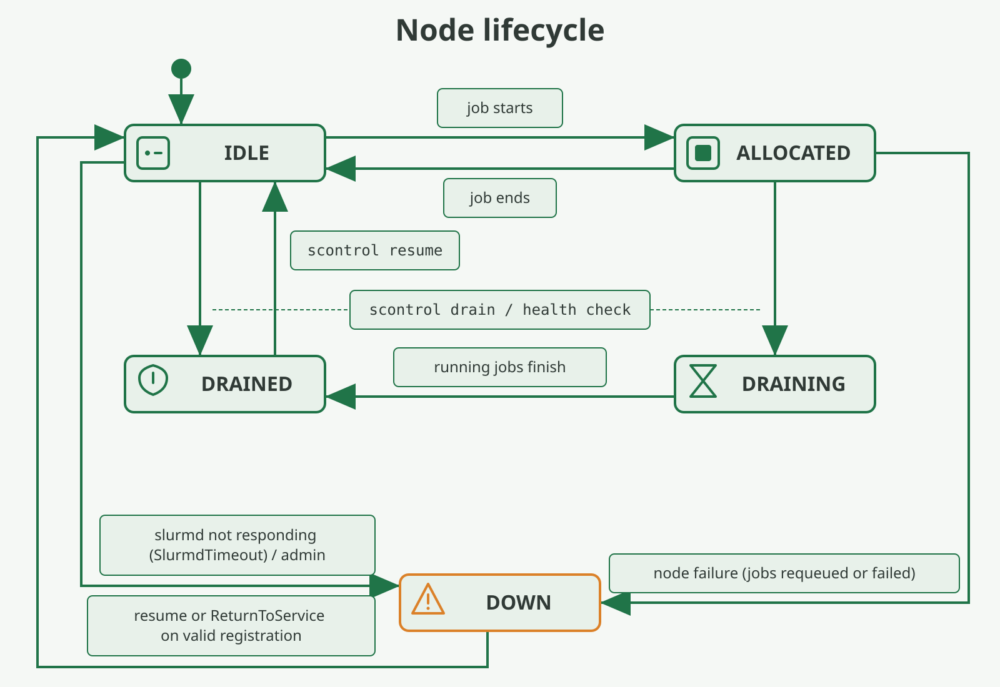

# 6.14 Slurm operations: prolog, epilog, health checks, drain, reason codes, troubleshooting

| | |
|---|---|
| Level | Intermediate |
| Priority tier | 1 |
| Lab venue | Slurm test cluster with GPU nodes (or stubs) |
| Part | Part 6: HPC and Slurm |
| Status | Drafted. Semantics read from the `slurm.conf(5)` man page and the prolog/epilog guide (SchedMD/slurm commit `521370b`, 2026-10-23). `code/part06/node_health.sh` was run against stub `nvidia-smi`, `mountpoint`, `chronyc`, `ibstat` and `dmesg` commands in dry-run mode (output below); it has **not** run on a real node or against a real `scontrol`. Cluster labs **untested** |

## Why this matters for AI infrastructure

Suppose one node in a job that spans hundreds of GPUs starts to fail. A GPU falls off the bus, a link flaps, a mount goes stale, or the node runs out of `/tmp`. None of these failures announces itself with a clear error at the top of the job log. The job just slows down, hangs or dies in a strange way, and everyone waits to find out why.

In a large GPU cluster something is always broken somewhere, so the real question is how you respond. A well-run cluster removes bad nodes from the pool quickly, cleans up after every job, and lets an operator say exactly why a job failed. One sick node wastes the whole job, which is why these habits matter so much at scale. A job that holds four hundred GPUs for a day has a lot to lose if one of them is quietly wrong.

Think about what the on-call engineer sees when the habits are missing. A page arrives saying a training run failed. Nobody knows whether the fault is in the code, the network or one card in one box. The engineer spends an hour reading logs on every node. When the habits are in place, the bad node has already drained itself, its reason names the check that caught the fault, and the job has been requeued to healthy hardware.

The tools for this work are prolog and epilog scripts, a periodic health check, automatic draining with a reason, and disciplined diagnosis from logs. Each one is small. Together they turn a confusing failure into a short, clear action.

## Prerequisites and outcomes

You need 6.7 to 6.11 first. Those chapters cover the cluster configuration, node and partition layout, GPU scheduling, job submission and multi-node runs. The scripts and node states in this chapter sit on top of that material, so the terms will make more sense if you have read it.

This chapter covers when prolog and epilog scripts run, what happens when they fail, and what belongs in each. It shows how to write and test a health-check program, then wire it to Slurm and to draining. It walks through node lifecycle, including drain, resume, down, reboot and replace, and how to write reason strings that another engineer can act on. It also explains how to handle unkillable steps and stuck jobs, how to read daemon logs with `sdiag`, `scontrol` and `sacct`, and how to follow a troubleshooting playbook without skipping steps. The troubleshooting section also names the classic mistakes, such as undrained reboots, silent failures and thundering herds, so you can recognise them early.

## 1. Prolog and epilog

Picture a shared GPU node where one job has just finished. Its temporary files are still on the local disk, a few of its processes may still be holding GPU memory, and the next job is already waiting in the queue. Nobody wants that next job to inherit the mess. Slurm handles this with two scripts that it runs at the edges of every job. A prolog runs on a node before the work starts, and an epilog runs after the allocation is released. An allocation is the set of nodes that Slurm reserved for one job.

Before you write either script, you need to know which machine runs it, as which user, and at which moment. Those three answers decide what the script is allowed to touch and what happens when it fails. The table is a lookup for exactly that.

| Script | Where and who | When |
|---|---|---|
| `Prolog` | Every compute node, as root (slurmd) | When the node first sees a job step of a new allocation (not at allocation), unless `PrologFlags=Alloc` |
| `Epilog` | Every node, root | When the allocation is released, **always** on every node |
| `PrologSlurmctld`, `EpilogSlurmctld` | The controller host | Once per job on the controller |
| `TaskProlog`, `TaskEpilog` | As the user, per task | Before/after each task; `TaskProlog` can print `export VAR=val` lines to set the task environment |
| `SrunProlog`/`SrunEpilog`, `BcastParameters`, `ResvProlog`/`ResvEpilog` | Various | Per `srun`, reservations |

Notice that the prolog and epilog run on every compute node, while `PrologSlurmctld` and `EpilogSlurmctld` run only once per job, on the controller. The node-side scripts touch the hardware, so they carry most of the risk. The controller-side scripts run in one place, which makes them easier to reason about and easier to log.

Failures are where these scripts cause the most trouble, so learn them well. If the prolog exits with a non-zero status, Slurm sets the node to DRAIN and requeues the job. The job is held too, unless `nohold_on_prolog_fail` is set in `SchedulerParameters`. A failing epilog sets the node to DRAIN.

The DRAIN state matters here. A drained node still looks healthy on paper, but Slurm will not give it new work. Someone has to look at the node, fix the cause and resume it by hand. That is the point of the design: a failed prolog is a signal to a human, not a quiet retry on the same bad hardware.

The controller-side scripts behave differently. A failing `PrologSlurmctld` requeues a batch job so it can run elsewhere, but it cancels an interactive job. A failing `EpilogSlurmctld` is only logged. None of these scripts keep their standard output or error, so write your own log. Each script also has a timeout set by `PrologEpilogTimeout`. A slow prolog delays job start, and a slow epilog delays node release. Both delays are easy to miss until a queue starts to back up.

The `PrologFlags` option takes a comma-separated list, and its default is empty. It changes when the prolog runs and what it covers. `Alloc` runs the prolog at allocation, so the job sits in `CONFIGURING` while it runs, and start time goes up. `Contain` creates a job container at allocation for processes Slurm did not launch, such as `pam_slurm_adopt` SSH sessions. It needs `proctrack/cgroup` and implies `Alloc`. `DeferBatch` waits for the prolog on all nodes before the batch script starts, and `NoHold` lets `salloc` avoid blocking. Flags such as `Serial` and `X11` also exist. Treat the flags as a menu. Pick only the ones your site needs, because each one changes the timing that your users see.

Slurm passes job details to these scripts as environment variables. Examples are `SLURM_JOB_ID`, `SLURM_JOB_USER` and `SLURM_JOB_GPUS` in prolog and epilog. `SLURM_SCRIPT_CONTEXT` tells you which script is running. That matters when one file serves more than one role, because the script can branch on the context. The prolog and epilog guide lists the rest.

### What to put in them

Picture a team that adds one more check to the prolog every month. A year later, every job waits a long time before its first line of code runs, and nobody remembers which check is the slow one. The prolog grew by accident, and the fix is to decide on purpose what it is for.

The prolog should be fast, idempotent and safe, because a failing prolog drains the node. Idempotent means that running it twice gives the same result as running it once, so a retry does no harm. Good work here includes quick sanity checks, such as a visible GPU count and a mounted file system. It also covers per-job temp directories such as `/tmp/slurm-$SLURM_JOB_ID`, clearing leftover state from a previous job, setting GPU modes such as persistence and clocks if your policy calls for them, and logging the job start. Each of these is a small job with a clear pass or fail result.

Keep long checks out of the prolog. A 30-second DCGM diagnostic in every prolog would slow every job start. DCGM here means NVIDIA's Data Center GPU Manager, the tool that runs deep health tests on GPUs. Put deep tests in the periodic health check instead, where they run on a schedule and do not hold up a user's job.

The epilog is your cleanup guarantee. It runs on every node when the allocation ends, so it is the right place to catch leaked processes, temp directories and GPU state. Kill leftover processes of the job's user with `pkill -u $SLURM_JOB_USER`, but only if that user has no other job on the node. Check with `squeue` first. Then remove the per-job temp directories, and drop the page cache if policy demands it. The page cache is the memory Linux uses to keep recently read file data, and dropping it is a blunt tool that only some sites want.

Reset GPU state, such as compute mode, and run `nvidia-smi --gpu-reset` only when no process uses the GPU. Unmount any job-specific mounts and flush logs. Sample GPU Xid errors from `dmesg` since job start, drain the node on hardware errors, and record a per-job GPU usage summary. An Xid is the code NVIDIA's driver writes to the kernel log when a GPU reports a fault. You will meet the list of critical codes later in this chapter.

An epilog that fails drains the node, so make it tolerant. Use `|| true` for best-effort steps, and exit non-zero only when you want the node drained. The `|| true` suffix tells the shell to treat a failed command as a success, so one optional cleanup step cannot take a healthy node out of service. Reserve a non-zero exit for the failures that really do need a human.

Watch out for shared nodes. An epilog that kills all user processes can harm the same user's other job on that node. Use cgroups instead, because the job's cgroup cleans itself up under `proctrack/cgroup`, and make the epilog check for other jobs first. A cgroup is the kernel's grouping of processes for resource control, and it lets Slurm track every process a job started, even the ones that tried to hide.

On a shared node, make the epilog check for other jobs before it kills anything.

## 2. Health checks

Picture a GPU that is quietly losing its link to the rest of the node. Nothing has crashed yet, but the next job that uses it will fail in a confusing way, and the user will blame the code. A health check is how the cluster notices this on its own, before a user does.

A health check is a script that Slurm runs on a schedule, as root, on compute nodes. Slurm runs the script but does not judge its output. The program decides what counts as a failure and what to do about it. `HealthCheckProgram` names the script, and `HealthCheckInterval` sets how often it runs. The default interval is 0, which leaves the check disabled. `HealthCheckNodeState` chooses which node states get checked, and its default is `ANY`. Other values include `ALLOC`, `IDLE`, `MIXED` and `CYCLE`. With `CYCLE`, the runs are spread across the interval instead of hitting every node at once. That avoids a thundering herd against shared storage, which is what happens when thousands of nodes all check the same mount in the same second.

The man page is blunt on one point: "Any action to be taken must be explicitly performed by the program." If the script finds a bad node, it has to run something like `scontrol update NodeName=foo State=drain Reason=tmp_file_system_full` itself. Slurm will not drain the node just because the script exited with an error. Many sites use the open-source LBNL NHC (Node Health Check), vendor tools such as DCGM-based or BCM health checks (Part 8), or custom scripts. LBNL is Lawrence Berkeley National Laboratory, which publishes NHC. BCM is Bright Cluster Manager, covered in Part 8.

### Design rules

1. Keep the basic checks cheap and frequent, and save the deep tests for rare runs. Every 1 to 5 minutes, check the GPU count, mounts, free space, time sync, fabric port state, service daemons such as slurmd and munge, memory and swap, and kernel errors. Hourly, or between jobs on idle nodes, run DCGM level 2 diagnostics, an NCCL bandwidth test between neighbours, and disk and memory stress. The cheap checks catch the common faults fast. The deep tests catch the subtle ones, and they cost too much time to run on every pass.
2. Drain the node instead of killing its work. Draining lets running jobs finish, unless the failure is severe. In that case you also run `scancel` or set `State=down`. A user who loses a job to a drain has a better day than a user whose job was killed by an overreaction.
3. Write clear reasons. When you drain a node, the Reason string is the first clue your colleagues will read. Include the check name, the evidence and the time, and keep the string under the allowed length. Operators see these reasons with `sinfo -R`. A reason like "gpu_count: found 7, expected 8" tells the next engineer what to do. A reason like "bad node" does not.
4. Avoid false positives at scale. A check that flaps 1 percent of the time drains many nodes in a 5,000-node cluster. Require two consecutive failures, or classify each failure as transient or persistent. A transient failure goes away on its own, and a persistent one stays. Only the persistent ones deserve a drain.
5. Never let a check block forever. Wrap external commands with `timeout`. A hung `nvidia-smi` is itself a signal that the GPU is wedged, so you want it reported as a failure, not as a hang. A check that never returns is worse than a check that fails, because nobody gets the signal.
6. Keep the check idempotent and silent when things are fine. Print output only on failure, or log to syslog, and keep logs per node. Silence on a healthy node makes the failures easy to see in the log.
7. Set a return-to-service policy alongside `ReturnToService` (6.8). Nodes drained by an operator or by the health check stay drained until someone resumes them. Only nodes that went DOWN because they stopped responding return on their own, and only with `ReturnToService=1`. A safer pattern is an explicit auto-heal path that reruns the check and resumes the node only when it passes.

### A tested example

A degraded node is easiest to understand when you can watch it fail. The chapter's script, `code/part06/node_health.sh`, implements six checks. It looks at the GPU count (`nvidia-smi -L`), serious GPU Xid errors in `dmesg`, free space in `/tmp`, required mounts, clock synchronisation (`chronyc`), and InfiniBand port state (`ibstat`). InfiniBand is the high-speed network that links the nodes in many GPU clusters. The critical Xid codes it checks are 48, 63, 64, 74, 79, 94 and 95. They cover double-bit ECC errors, row-remap failures, and a GPU that fell off the bus. Treat that list as a starting point, and verify it against NVIDIA's Xid documentation for your driver. On any failure, the script drains the node with a combined reason. With `DRY_RUN=1`, it only prints what it would do.

The output below comes from a degraded node, simulated with stub commands. A stub is a fake program that prints a fixed answer, so you can test the script without real hardware. The stubs report seven GPUs, an Xid 79 in the kernel log, `/scratch` unmounted and one IB port down.

```text
FAIL gpu_count: found 7 GPUs, expected 8
FAIL gpu_xid: [1234.5] NVRM: Xid (PCI:0000:3b:00): 79, pid=1, GPU has fallen off the bus.
FAIL tmp_space: only 14462 MB free in /tmp
FAIL mounts: /scratch not mounted
OK   time_sync
FAIL ib_links: 1 IB ports down
DRY_RUN would drain gpu07: health: gpu_count: found 7 GPUs, expected 8; gpu_xid: ...
```

Read the output from top to bottom. Each line names one check and says whether it passed, so you can see at a glance which part of the node failed. The last line shows the single drain command the script would run, with every failure joined into one reason. That combined reason is what an operator reads later with `sinfo -R`.

A healthy node, with eight GPUs, a quiet kernel log, the mounts present and one active IB port, passes every check and exits 0. The `/tmp` check failed on the first healthy run, because the laptop used for the test had only 14 GB free. Lowering `MIN_TMP_MB` for that test made the check pass. That is a fair way to test the script, but it is not a fix for production, where the threshold should match what the jobs really need.

Fix these limitations before you run the script in production. Wrap each command in `timeout`, and give `nvidia-smi` a deadline. Check `dmesg` only since the last check, using an offset file, so an old fixed error does not drain a healed node. Add DCGM checks, ECC counters from `nvidia-smi --query-gpu`, NVLink status, and PCIe link speed and width, because downtrained links are a classic silent slowdown. Also add temperature and throttle reasons, and move thresholds into configuration instead of code. A threshold in configuration can be changed by an operator in one place, without editing and re-testing the script.

## 3. Node lifecycle

Picture a Friday afternoon. One GPU shows a rising count of memory errors, and the job on its neighbours is halfway through a long run. You need to take that GPU out of service without killing the work on the other nodes. Node lifecycle is the set of states that tell you what Slurm will do next, and the commands that move a node between them.

Nodes move between states as jobs start and finish, and an operator drives many of the transitions. The diagram shows the main ones, so read it before you run any state-changing command.



*Figure 6.14.1. Node lifecycle, as a diagram.*

These are the commands you will reach for most often.

```bash
sinfo -R -o "%20E %9u %19H %N"            # why nodes are down/drained: reason, who, when, which
sinfo -N -t drain,down -o "%N %T %E"
scontrol update NodeName=gpu[07,12] State=drain Reason="Xid79 GPU3 ticket INC123"
scontrol update NodeName=gpu07 State=resume
scontrol reboot ASAP nextstate=resume reason="kernel update" gpu[01-16]   # drains, reboots when empty, returns to service
scontrol update NodeName=gpu07 State=down Reason="dead PSU"                # jobs on it are requeued/failed
scontrol show node gpu07 | grep -E "State|Reason|Gres|CPULoad|FreeMem"
```

The first two lines are read-only. They list the nodes that are drained or down, along with the reason and the time. Run them first, every time, so you know what the cluster already looks like before you change anything. The third line drains two nodes and attaches a ticket number to the reason. The fourth returns a node to service. The fifth is the clean way to patch a group of nodes, and the sixth marks a node as down because its hardware is dead.

The `scontrol reboot` command is the clean way to patch. It drains the nodes, waits for their jobs to finish, reboots them through `RebootProgram`, and resumes them. The `ASAP` option stops new jobs from starting right away. Always include who, why and the ticket in the reason, because auditors and colleagues rely on it. A reason that says only "maintenance" is hard to act on six weeks later.

Drain and down mean different things. DRAIN stops new work and lets current jobs finish. DOWN means the node is unusable, so its running jobs are requeued if requeue is allowed, or killed. Use down only when the node is truly dead. Draining a node that still has healthy jobs is kinder to those jobs. A simple way to decide is to ask whether the running work can safely finish. If it can, drain. If the node has already crashed, down is the honest state.

A failed node follows a replacement flow. Drain it with a ticket reference, and collect evidence such as logs, a DCGM report and `nvidia-bug-report.sh`. Evidence matters because the vendor will ask for it, and because the logs disappear once the node is rebooted or swapped. Open a vendor case, then swap the hardware. Run burn-in and acceptance tests (6.28) before you resume it. Burn-in means running the hardware hard for a while to make the early failures show up. Keep a spare pool, and keep a record of repeat offenders, measured as mean time between failures per node, so marginal hardware shows up early. A node that fails every few weeks is a better candidate for replacement than one that failed once.

Resume a node only after it passes burn-in and acceptance tests, not as soon as the repair is done.

## 4. Unkillable steps and stuck jobs

Imagine a user cancels a job, and `squeue` keeps showing it in a state that never ends. On the node, `ps` shows a process that ignores even the strongest signal. This is the unkillable step, and it is one of the most frustrating problems on a shared cluster, because the cancel did nothing and the node is now holding resources that other jobs need.

Sometimes a job step's processes ignore SIGKILL, the signal that forces a process to exit. You will see them stuck in the `D` state, which means they are blocked in uninterruptible I/O. Uninterruptible I/O means the process is waiting on a disk or network operation, and the kernel will not let a signal interrupt that wait. The usual causes are a hung network file system or a GPU in a bad state. Slurm waits `UnkillableStepTimeout` before it acts. That defaults to 60 seconds or five times `MessageTimeout`, whichever is larger. Then it runs `UnkillableStepProgram` if you set one, and it drains the node "to prevent future jobs from being scheduled on the node."

That program runs as root on the node. It can collect stack traces from `/proc/PID/stack`, `lsof` output, `nvidia-smi` output and hung mount information, and it can send an alert. A stack trace shows the kernel code path that a stuck process is sitting in, which is the best clue to the cause. Common causes include an NFS or Lustre server problem, a dead NIC with outstanding RDMA operations, or a GPU Xid error. Fix the underlying cause, and expect the node to need a reboot. Rebooting clears the stuck kernel state, and draining first keeps other jobs off the node while you do it.

Stuck jobs show up in other states too. A job that sits in `COMPLETING` for a long time has an epilog that is running or hung, an unkillable step, or an unreachable node. Check `scontrol show job` and `sinfo` for the nodes involved. A job that stays `PENDING` forever is covered in 6.9, section 8. A job that is `RUNNING` but makes no progress usually means a hang on the user's side. Check GPU utilisation with `srun --overlap --jobid=ID nvidia-smi`, read the NCCL logs, or dump the Python stacks with `py-spy dump`. The first question is always which state the job is in, because each state points to a different owner, either the cluster or the user.

Fix the underlying cause, and plan on rebooting the node.

## 5. Logs and diagnostics

Picture a user who writes in the morning to say their job died overnight and asks why. Your first move is to open the right log, not to guess. The answer is almost always in one of a handful of places, and knowing which place to check saves an hour of searching.

When a job or a node fails, the answer is usually in a log. Slurm writes logs on the controller, on every compute node, and in the accounting database. The accounting database is where Slurm keeps the permanent record of every job, including who ran it and how it ended. The table shows where each one lives and what it tells you.

| Source | Use |
|---|---|
| `slurmctld.log` (controller) | Scheduling decisions, node state changes, RPC problems, accounting errors. Increase with `scontrol setdebug debug2` temporarily (and back: verbose logs are huge) |
| `slurmd.log` (each node) | Launch failures, cgroup problems, prolog/epilog results, configuration mismatch on registration |
| `slurmdbd.log` | Accounting writes, database problems |
| `journalctl -u slurmd`, `dmesg -T` | systemd start failures, kernel messages (OOM kills, Xid, IB errors, I/O errors) |
| `sacct -j ID --format=JobID,State,ExitCode,DerivedExitCode,NodeList,Reason` | Final state and exit code (`ExitCode=0:9` means exit code 0, signal 9) |
| `scontrol show job/node/partition/config` | Live state and effective configuration |
| `sdiag` | Scheduler statistics: server thread count, RPC counts and durations by type and user, main scheduler and backfill cycle times, queue lengths, jobs started per cycle |
| `squeue -o ... --start`, `sprio`, `sshare` | Pending analysis (6.9) |
| `sinfo -R`, `sinfo -N -l` | Node reasons and states |
| `strigger` | Event hooks: run a program when a node goes down/up, a job finishes, etc. |

Each source answers a different question, so match the log to the question you have. A job that never started is usually explained by the controller log. A job that started and then failed on one node is usually explained by that node's `slurmd.log` and by `dmesg`. A job whose final state looks wrong is usually explained by `sacct`. Note that `sacct` reports the exit code and the signal together, which is why `ExitCode=0:9` means the job was killed by signal 9 rather than failing with exit code 0.

The `sdiag` command is the first place to look when the controller itself feels slow. The book *Supercomputers for Linux SysAdmins* covers this in chapter 15, "Troubleshooting." Start with `Agent queue size` and `Server thread count`. High values mean `slurmctld` cannot keep up with incoming requests or with the messages it sends out to nodes. Next, check `Remote Procedure Call statistics by message type` to see which request kinds take the most time. A remote procedure call, or RPC, is one request that a Slurm command or daemon sends to the controller. A sample line reads `REQUEST_PARTITION_INFO (2009) count:325127 ave_time:183 total_time:5978485`.

The `Remote Procedure Call statistics by user` section shows who is sending those requests. In the sample, `root (0) count:728986 ave_time:10228 total_time:456422703` appears next to `user1 (25002) count:29784 ave_time:13439 total_time:269036`. A single user running `squeue` in a tight loop is the classic cause of a sluggish controller under a request storm. Check the backfill cycle mean and maximum times and depth as well, as covered in 6.9. Then use `max_rpc_cnt`, and the `defer` options `salloc_wait_nodes` and `sbatch_wait_nodes`, in `SchedulerParameters` to protect the controller. Teach your users not to run `watch -n1 squeue`. Offer `squeue` caching or a read-only web dashboard instead. A dashboard gives people the status they want without asking the controller a thousand times a minute.

When the default logs are too terse for a live incident, you can raise the debug level and toggle `DebugFlags` on the fly, without restarting any daemon. Use `scontrol setdebug LEVEL`, such as `debug2`, and add `nodes=<nodelist>` to target only specific `slurmd` nodes. Use `scontrol setdebugflags {+|-}FLAG [{+|-}FLAG...]` to switch individual flags on or off. Turn the debug level back down as soon as the incident is over, because verbose logs fill disks quickly. The accounting database has its own checks. `sacctmgr show stats` gives accounting database statistics. `sacctmgr show problem` lists potential association or configuration problems. `sacctmgr show runawayjobs` finds orphaned jobs that the database still lists as running after a controller crash, and it offers to fix them.

Chapter 15 of *Supercomputers for Linux SysAdmins* also includes sample `sacct` and `sreport` outputs from a `superhpc` cluster. Read the samples as examples of what the output looks like, and then run the same kind of query against your own cluster.

- *Which jobs ended badly on a given day?* Run `sacct -S 2024-01-01 -E 2024-01-02 -o JobID,Partition,User%16,CPUTimeRAW,State%20 -X`. It shows `522783 test user_12345 7168 COMPLETED`, `523455 compute user_23456 0 CANCELLED by 0` (cancelled by root), `526258 compute user_55436 0 CANCELLED by 10107` (cancelled by UID `10107`), `527646 compute user_11231 1624 FAILED`, `528244 compute user_43546 46125352 NODE_FAIL`, `528479 compute user_12345 10526502 COMPLETED`, and `528480 compute user_12345 15060654 COMPLETED`. The `NODE_FAIL` line is the one to chase, because the node failed under the job and the user did nothing wrong.
- *Which accounts used the most CPUs in a week?* Run `sreport job SizesByAccount grouping=0-16,17-1024 start=2024-01-01 end=2024-01-07`. It reports `518400 secs` in minutes for account `userst500` (`0-4294967295`: `6678604725`, `0-16 cpus`: `1000612`, `>= 17 cpus`: `6677604113`, `100.00%` of cluster). The grouping splits small jobs from large ones, so you can see where the time went.
- *How busy was the whole cluster last month?* Run `sreport cluster utilization Start=2024-11-01 End=2024-12-01 -t percent`. It reports `superhpc` `Allocated 85.08%`, `Down 8.59%`, `PLND Down 0.00%`, `Idle 2.10%`, `Planned 4.23%`, and `Reported 100.00%`. A high Down figure points to hardware trouble, while a high Idle figure points to a scheduling or demand problem.
- *Who used the most time this month?* Run `sreport user topusage topcount=5 start=2024-01-10 end=2024-02-10`. It reports the top users in TRES Minutes, with `user_12` at `43466331`, `user_25` at `35227321`, `user_11` at `35104234`, `user_32` at `30548681`, and `user_47` at `27162101`, all under account `usert500`. TRES is Slurm's name for a trackable resource, such as CPU time or GPU time.

Size the controller with its state in mind. Keep `StateSaveLocation` on fast local storage or on shared high-availability storage (6.15), with enough inodes. Inodes are the file records the file system uses, and running out of them stops a disk from accepting new files even when space remains. Set a large `MaxJobCount`. Run slurmdbd on a capable database host with regular purging and archiving, using options such as `PurgeJobAfter` in `slurmdbd.conf`.

Time and identity cause many hidden failures. Munge failures caused by clock skew show up as `Invalid credential`. Munge is the authentication service that Slurm uses between its daemons, and it rejects messages whose timestamps are too far apart. Missing users on a node produce `Invalid user id`. DNS and `/etc/hosts` inconsistencies cause `getaddrinfo` errors. Firewalls that block ports 6817 to 6819, or the ephemeral `srun` ports, are another hidden cause. Ephemeral ports are the temporary port numbers that `srun` opens for each job.

When a failure looks strange, check the clock, the user database and DNS before you blame Slurm.

## 6. Troubleshooting playbook

Picture a channel full of messages that say the cluster feels slow. Some jobs are pending, some nodes are down, and nobody agrees on the cause. The fastest way out is a method you follow every time, starting from the symptom. When something breaks, start by finding the symptom in this table. You will see what to check and the usual fix for each row.

| Symptom | Diagnose | Typical resolution |
|---|---|---|
| Node `DOWN`, reason "Not responding" | `ping`, `ssh`, `systemctl status slurmd`, `journalctl -u munge`, time sync | Restart services; reboot; fix network; resume |
| Node `DRAIN` "Kill task failed" | Unkillable step; `ps -eo pid,stat,wchan \| grep ' D'` | Find the D-state cause (mount, GPU); reboot |
| Node `inval` / "Low RealMemory" or "gres count too low" | `slurmd -C`, `slurmd -G`, `nvidia-smi` | Fix hardware/config; DIMM or GPU lost; correct config (6.8, 6.10) |
| "Prolog error" drain | `slurmd.log` around the time; prolog log | Fix the failing check; resume |
| Jobs fail instantly with `NODE_FAIL` | Node crashed or lost network; `dmesg`, BMC SEL (Part 7) | Hardware triage |
| Jobs fail `OUT_OF_MEMORY` | `sacct MaxRSS`, cgroup OOM events in `dmesg` | User request more memory; check `ConstrainRAMSpace`, memory defaults (6.8) |
| Job killed `TIMEOUT` | `--time` too small | Checkpointing, signals (6.11) |
| Job cannot start: "Requested node configuration is not available" | Request exceeds any node (GPU type, memory) | Correct request or partition |
| Everything slow | `sdiag`, controller CPU, database latency, file system latency | Throttle polling users, tune scheduler, check storage |
| Jobs pending though nodes idle | Reasons (6.9), reservations, `MaxCPUsPerNode`, memory defaults, GRES typos | Fix policy/request |
| Accounting missing | `sacctmgr show assoc`, slurmdbd connection | Create associations; check `AccountingStorageHost` and munge |
| GPU job sees no GPU | `gres.conf`, cgroup devices, driver | 6.10 |
| MPI job fails to launch | `srun --mpi=list`, PMIx versions, firewall | 6.4, 6.12 |
| Scheduler stopped scheduling | `slurmctld` logs, `sdiag`, deadlock after config change, full disk in `StateSaveLocation` | Restart per procedure; fix disk |

Read the table as a set of starting points. Each row names a symptom, the first things to look at, and the usual fix. Use the row to choose where to look, and then confirm the cause before you act. A node that reads "Not responding" might be a dead network, a stopped daemon or a clock that has drifted, and the table tells you which checks separate those cases.

Follow the same method every time, so you do not skip a step. State the symptom exactly, with the job ID, the node and the time. Read `scontrol show` for the object involved, and find the first error in the relevant log near that time. Check the layer below, such as node health, network, storage or time. Change one thing at a time. Finally, record the cause and the fix in the ticket, and update the health check so the next occurrence is caught automatically. Changing one thing at a time matters because, if the cluster recovers after two changes, you will not know which one helped.

### 6.1 GPU hardware and cross-layer failure catalog (Volume 20)

A job that slows down or hangs can have a hardware fault underneath it, and the job log will rarely say so. On GPU clusters, health checks and epilog scripts have to turn a job-level symptom into a specific hardware or firmware fault. The catalog below comes from chapters 1 to 12 and labs 1 to 4 in `nvidia-zero-to-hero/volume-20`. Read each row from left to right. You will see the evidence that points to the fault, and the action tells Slurm what to do with the node.

| Failure Domain | Signature / Evidence | Automated Slurm Action |
|---|---|---|
| **1. GPU Memory Not Detected / Missing GPU** | `slurmd -G` or `nvidia-smi -L` sees fewer GPUs than `EXPECT_GPUS=8`, or `lspci` shows a missing PCIe endpoint | Drain node immediately (`State=drain Reason="gpu_count < 8"`); require cold power cycle / PCIe reseat |
| **2. GPU Driver Crash & Xid Errors** | `dmesg` logs `NVRM: Xid`: `48` (DBE ECC), `63`/`64` (row-remap), `74` (NVLink), `79` (fallen off bus), `94`/`95` (contained/uncontained ECC) | Drain node in `Epilog` / `HealthCheckProgram` with exact `Xid` code and PCI BDF |
| **3. NCCL Timeout & Collective Failures** | `Watchdog caught collective operation timeout` | Check `srun -K`, `dmesg` Xids, IB port counters, and bisect node list |
| **4. NVLink Errors & Topology Issues** | `nvidia-smi nvlink -s` shows inactive links or `nvidia-smi nvlink -e` shows CRC/replay errors (`Xid 74`) | Drain node; run `dcgmi diag -r 3` and fabric link test |
| **5. ECC Errors & Memory Bit Flips** | Uncorrectable double-bit (`DBE`) counters $>0$ or pending row-remap failure in `nvidia-smi -q -d ECC,REMAPPED_ROWS` | Drain node and trigger GPU reset or reboot so pending row remapping takes effect (or RMA if row-remap table is full) |
| **6. Thermal Throttling & Cooling Degradation** | `nvidia-smi -q -d PERFORMANCE` shows `HW Thermal Slowdown: Active` or GPU temp $\ge 83^\circ\text{C}$ | Alert facility cooling / CDU loop; drain node if thermal slowdown persists |
| **7. DMA Engine Failures & PCIe Issues** | `lspci -vv` shows `LnkSta: Speed 16GT/s (downgraded), Width x8 (downgraded)` or AER errors | Drain node; downtrained PCIe Gen5 → Gen3/x8 silently halves H2D/D2H and GPUDirect RDMA bandwidth |
| **8. Fan Failure & Cooling Degradation** | BMC / Redfish IPMI sensor or `nvidia-smi` fan speed fault | Drain node and dispatch DC technician before thermal trip |
| **9. Power Supply & Brownout Scenarios** | `HW Power Brake Slowdown: Active` or PSU redundancy lost in BMC SEL | Drain or cap power (`nvidia-smi -pl`); replace failed PSU |
| **10. Clock Instability & Frequency Scaling** | SM clocks stuck at base/idle frequency on one GPU across a multi-node job | Lock application clocks in `Prolog` (`nvidia-smi -lgc`) or reset GPU in `Epilog` |
| **11. Multi-GPU Imbalance & Stragglers** | One rank consistently lags step time by $20\text{–}40\%$ | Check CPU NUMA pinning (`--gpu-bind=closest`), PCIe/NVLink downgrade, and thermal throttling on the slow rank's node |
| **12. Cross-Layer Diagnosis (When Metrics Lie)** | `nvidia-smi` reports `100%` `utilization.gpu` while training step progress is zero | `NCCL` spin-wait kernel is pegging SM utilization while waiting on a dead remote rank or dropped IB packet; inspect power draw (low watts at 100% util = spin wait) and `py-spy` / `torch.profiler` |

Match what you see to a row first. For most of these rows, you should drain the node before you touch the hardware. Draining first keeps the next job off a suspect GPU while you read the evidence. Then the hardware work can happen calmly, without a job waiting on the same card.

## 7. Operational practices

Picture a maintenance window booked for Saturday. A batch of nodes needs a new kernel, the firmware team wants a look at a few GPUs, and users have jobs due on Monday. Good operations means the work happens on schedule, with the jobs protected and the users told in advance. The habits below make that possible.

Keep config changes in Git and automation, and test them in a staging cluster first. Prefer `scontrol reconfigure` to a restart when you can. Never restart `slurmctld` during peak load unless you have to. A restart drops the controller's view of the cluster for a short time, and a busy queue makes that gap more painful.

Maintenance windows need reservations, so that no job starts that cannot finish before the work begins. A command such as `scontrol create reservation StartTime=... Duration=... Nodes=... Flags=MAINT,IGNORE_JOBS` sets one up. For rolling patches, use `scontrol reboot`. Slurm also has strict rules for upgrade order and version skew. Version skew means the controller and the nodes run different Slurm releases. Upgrade slurmdbd first, then slurmctld, then slurmd. The versions usually stay at most two major releases apart. See 6.15 for details.

Tell users what is happening. A status page, a message of the day with maintenance notices, clear reason strings and documentation for common errors all help. A user who knows the window is on Saturday plans around it. A user who finds out from a failed job does not. For each alert, write a runbook with commands and an escalation path. A runbook is a short written procedure that the on-call person can follow at night without guessing. Practise failure drills, such as killing slurmd, filling a disk or unplugging a node, so the runbook has been tested before a real incident uses it.

Track node availability, the percentage of nodes drained, the mean time to drain and to repair, and the job failure rate by cause, such as `NODE_FAIL`, OOM and timeout. Also track prolog and epilog durations, queue wait times, controller RPC rates and utilisation per partition, as covered in Part 17. These numbers tell you whether the cluster is getting healthier or quietly getting worse.

You also need to protect the cluster from the inside. Restrict who can run `scontrol update`, and log admin actions. Keep the prolog, epilog and health scripts root-owned and not world-writable. Use `pam_slurm_adopt` to stop SSH access to nodes that have no job on them. A script that any user can edit is a script that any user can use to run code as root on every node.

Restrict `scontrol update` to the people who need it, because it can change the state of any node.

### Maintenance and user reservations (`scontrol` reservation lifecycle and flags)

Picture a research team that needs 100 nodes for a deadline on a fixed day. The same nodes also need a quiet window so the cluster team can check firmware. A reservation is the tool that gives each side what it needs, without the two fighting over the same hardware.

A **reservation** sets aside a specific node count (`NodeCnt=...`) or an explicit node list (`Nodes=...`) for chosen users or accounts (`Users=...`, `Accounts=...`). It does this for a future time window (`StartTime=...`, `EndTime=...` or `Duration=...`). Other users' jobs cannot take those nodes during the window. They also cannot start before the window if their wall time would run into it. Wall time is the clock time a job is allowed to run, as opposed to the CPU time it uses. That makes reservations the standard tool for two jobs. One is a guaranteed run for particular users. The other is a cluster maintenance window, where admins run verification jobs on the reserved nodes while regular jobs wait in the queue.

*Supercomputers for Linux SysAdmins*, chapter 15, walks through the reservation lifecycle. Creating, using, inspecting, modifying and deleting a reservation all use `scontrol`. Read the five steps as one life cycle, from creation to deletion. The commands below were not run on a live cluster.

```bash
# (untested here) — 1. Create a 5-hour reservation of 100 nodes for user1 and user2
scontrol create reservation name=important \
  StartTime=2100-06-01T08:00:00 Duration=5:00:00 \
  Users=user1,user2 NodeCnt=100 Flags=IGNORE_JOBS

# (untested here) — 2. Submit a job into the reservation
sbatch --reservation=important -N100 ./my_task

# (untested here) — 3. Inspect existing reservations (or view nodes in a reservation via sinfo -T important)
scontrol show reservation
scontrol show reservation important

# (untested here) — 4. Update a reservation (note 'reservationname=' with no space, and '+=' / '-=' on flags, users, or accounts)
scontrol update reservationname=important \
  duration=14-00:00:00 flags+=STATIC_ALLOC

# (untested here) — 5. Delete a reservation when no longer needed
scontrol delete reservationname=important
```

The first command creates the reservation, and the second sends a job into it. The third command lets you check that the reservation exists and see its nodes. The fourth changes the reservation while it is live, which is useful when a maintenance window runs longer than planned. The fifth removes it once the work is done, so the nodes return to the normal pool.

The flags change how a reservation behaves when a node fails or when a job runs past the end of the window. The table defines each one.

| Reservation flag | Meaning |
|---|---|
| `IGNORE_JOBS` | Ignore currently running jobs when creating the reservation; if the requested nodes have not finished their running jobs by `StartTime`, the reservation starts with fewer available nodes than requested rather than failing creation |
| `OVERLAP` | Allow the reservation's nodes to overlap with another existing reservation |
| `NO_HOLD_JOBS_AFTER` | By default, jobs submitted to a reservation that have not finished when the reservation ends are placed on hold; this flag leaves them in `PENDING` state instead (note: this flag cannot be removed with `-=`) |
| `DAILY`, `HOURLY`, `WEEKLY` | Automatically repeat the reservation every day, hour, or week (similarly `WEEKDAY` and `WEEKEND` repeat on weekdays or weekends) |
| `STATIC_ALLOC` | When a reservation is created by node count (`NodeCnt`), Slurm normally replaces any reserved node that goes `DOWN` with a healthy spare node; `STATIC_ALLOC` disables automatic node replacement |
| `MAINT` | Maintenance mode shorthand: combines `OVERLAP` and `STATIC_ALLOC` together (and marks nodes with the `$` maintenance state indicator in `sinfo`) |

Two of these flags decide most maintenance outcomes. `IGNORE_JOBS` lets you book the window even when work is still running on those nodes. `STATIC_ALLOC` stops Slurm from swapping in a spare when a reserved node fails, which matters when the work depends on that exact set of hardware.

`MAINT` is the flag to reach for during maintenance, because it bundles `OVERLAP` and `STATIC_ALLOC` for you.

## 8. Lab (self-checking stub test run; live cluster parts untested)

Before you touch a real node, you want to see the health check fail on purpose. This lab does that with fake commands. You will see a healthy node pass and a degraded node fail, and you can read the reason string the script produces.

Start with the self-checking Python lab. It runs `code/part06/node_health.sh` against temporary mock binaries (`nvidia-smi`, `dmesg`, `df`, `mountpoint`, `chronyc`, `ibstat`) in `DRY_RUN=1` mode. It tests two nodes. A healthy 8-GPU node should exit 0. A degraded node, with 7 GPUs, an Xid 79, 14462 MB free in `/tmp`, `/scratch` unmounted and one IB port down, should exit 1 with a combined `DRY_RUN would drain gpu07:` reason. The lab also checks the `sdiag` RPC storm counters, the `sreport` utilization percentages from *Supercomputers for Linux SysAdmins*, chapter 15, and the critical GPU Xid set (`48, 63, 64, 74, 79, 94, 95`).

```bash
python3 code/part06/node_health_lab.py
```

Run the lab from the repository root, so the relative path resolves. A pass on the stub run means the script logic is sound. It does not prove that the real `nvidia-smi` or `scontrol` behaves the same way on your hardware.

Once the lab passes, move to a test cluster and work through these steps. Each step builds on the one before it, and each one adds a little more real Slurm behaviour.

1. Run `node_health.sh` with `DRY_RUN=1` against stub commands, as in the status box above. Change one stub at a time to produce each failure, and watch the reason string change.
2. Set `HealthCheckProgram`, `HealthCheckInterval=300` and `HealthCheckNodeState=ANY,CYCLE`. Break a mount on one node, and confirm that the node drains with your reason.
3. Write a prolog that fails when `/scratch` is missing. Watch the node drain and the job requeue. Then tune `nohold_on_prolog_fail`.
4. Write an epilog that cleans up `/tmp/slurm-$SLURM_JOB_ID`. It should kill stray user processes only when that user has no other job on the node.
5. Create an unkillable step. A process in `D` state is hard to fake, so read the code path instead. Then configure `UnkillableStepProgram` to collect diagnostics.
6. Run `scontrol reboot ASAP nextstate=resume` on one node, and watch its states change.
7. Run `sdiag` before and after a loop of `squeue` calls from a user, and compare the two outputs.
8. Write the on-call runbook for "node drained: GPU Xid". Write it last, once the other steps have shown you what the alert looks like.

## 9. Interview angles

A hiring panel often asks you to walk through a bad week on a large cluster, and the questions below come from that kind of story. Answer each one from the situation first, then give the mechanism. A good answer shows that you know what Slurm will do and what you would do about it.

- When do the prolog and epilog run, and what happens if they fail?
- Design a health-check strategy for a 2,000-GPU cluster. What do you check, how often, and what do you do on failure?
- What does `HealthCheckNodeState=CYCLE` avoid?
- How do you patch all nodes without disrupting jobs?
- What is an unkillable step, and how does Slurm react?
- A user says the cluster is slow. What do you check on the controller?
- What is the difference between drain and down?
- How do you avoid false-positive drains at scale?
- How do you find which node killed a multi-node job?

## Exercises

1. Automate node health gating with stub binaries. Run `python3 code/part06/node_health_lab.py` first. Then read `code/part06/node_health.sh` and `node_health_lab.py`. Look at how `run_node_health_with_stubs(healthy=False)` injects a mock `nvidia-smi` that reports `7` GPUs against `EXPECT_GPUS=8`. Find the mock `dmesg` that shows `Xid 79`. Find the mock `df` that reports `14462 MB` against `MIN_TMP_MB=20480`. Find the mock `mountpoint` that reports `/scratch` as unmounted. Finally, find the mock `ibstat` that shows `State: Down`. Does `node_health.sh` build a single truncated `Reason` string (`cut -c1-200`) and exit non-zero?
2. Decide where each task belongs, in `Prolog`, `Epilog`, or `HealthCheckProgram` (`ANY,CYCLE`), and explain why. The first task is creating `/tmp/slurm-$SLURM_JOB_ID`. Where does it go? The second task is checking `dmesg` for new `Xid` errors after a job finishes, then removing `/tmp/slurm-$SLURM_JOB_ID`. Where does it go? The third task is running a 2-minute DCGM level-2 diagnostic. Where does it go? The fourth task is verifying that `/scratch` is mounted every 5 minutes across idle and allocated nodes. Where does it go?
3. Decode the `Xid` hardware errors and the PCIe and NVLink degradation (Volume 20). Suppose the kernel logs and `nvidia-smi` outputs show `Xid 48`, `Xid 63`, `Xid 74` and `Xid 79`. Also suppose they show `HW Power Brake Slowdown: Active` and `LnkSta: Speed 16GT/s (downgraded), Width x8 (downgraded)`. Map each signature to its root hardware subsystem: HBM ECC, row remapper, NVLink, PCIe bus drop, PSU or power brake, and PCIe lane downtraining. Then state the remediation required before you run `scontrol update NodeName=... State=resume`.
4. Diagnose a job where the metrics lie. A 64-GPU training job shows `100%` `utilization.gpu` in `nvidia-smi` on all 64 GPUs. The training log has not printed a step for 2 hours. Why does `nvidia-smi` report `100%` utilization during an `NCCL` collective hang? Which secondary `nvidia-smi` metric exposes a spin-waiting GPU straight away? Name the metric, which is power draw in watts. Then explain how `UnkillableStepTimeout` handles processes wedged in kernel `D` state.
5. Analyze `sdiag` RPC storms and `sacctmgr` database health, using *Supercomputers for Linux SysAdmins*, chapter 15. Suppose `sdiag` shows `REQUEST_PARTITION_INFO (2009) count:325127 ave_time:183 total_time:5978485`. Suppose it also shows `user1 (25002) count:29784 ave_time:13439 total_time:269036`. How would you identify a user script that hammers `slurmctld`? Which `SchedulerParameters` flags (`max_rpc_cnt`, `defer`, `batch_sched_delay`) protect the controller? What do `sacctmgr show problem` and `sacctmgr show runawayjobs` fix?
6. Manage a maintenance window with `scontrol` reservations and rolling reboots, using *Supercomputers for Linux SysAdmins*, chapter 15. Write the exact `scontrol create reservation`, `scontrol update reservationname=...`, `scontrol reboot ASAP nextstate=resume` and `scontrol delete reservationname=...` commands to drain and patch a 100-node subcluster. Then explain the difference between `IGNORE_JOBS`, `STATIC_ALLOC`, `NO_HOLD_JOBS_AFTER` and `MAINT`.

## Checkpoint

<details>
<summary>1. Compare when `Prolog`, `Epilog`, `PrologSlurmctld`, `EpilogSlurmctld`, and `TaskProlog` execute, and under which user account (`slurm.conf(5)` and *Supercomputers for Linux SysAdmins*, chapter 15).</summary>

`Prolog` runs as root on each allocated compute node before the first job step launches, or at allocation time if `PrologFlags=Alloc` is set. `Epilog` runs as root on every allocated compute node when the allocation is released. `PrologSlurmctld` and `EpilogSlurmctld` run once per job on the controller host, as `SlurmUser`. `TaskProlog` and `TaskEpilog` run as the job's user, before and after each task. `TaskProlog` can print `export VAR=val` lines to change the task's environment.
</details>

<details>
<summary>2. What happens to the compute node and the job when `Prolog`, `Epilog`, or `PrologSlurmctld` exits with a non-zero status?</summary>

If `Prolog` fails, `slurmctld` sets the compute node to **`DRAIN`** and requeues the job. The job is held unless `SchedulerParameters=nohold_on_prolog_fail` is set. If `Epilog` fails, `slurmctld` sets the node to `DRAIN`. If `PrologSlurmctld` fails, batch jobs are requeued and interactive jobs (`salloc` or `srun`) are cancelled.
</details>

<details>
<summary>3. What do `PrologFlags=Alloc`, `Contain`, and `DeferBatch` do (*Supercomputers for Linux SysAdmins*, chapter 15)?</summary>

`Alloc` runs `Prolog` as soon as the allocation is granted, while the job is in `CONFIGURING` state, instead of waiting for the first step. `Contain` uses `proctrack/cgroup` at allocation time to create the `extern` step cgroup on every allocated node. That lets `pam_slurm_adopt` place direct user `ssh` sessions inside the job's cgroup. `DeferBatch` waits until `Prolog` finishes on all allocated nodes before it starts the batch script on Node 0.
</details>

<details>
<summary>4. Why is running `pkill -u $SLURM_JOB_USER` unconditionally in an `Epilog` script dangerous, and how do you make process cleanup safe?</summary>

Consider a shared node, where `OverSubscribe=No` with partial-node allocations is in place, and the user has a second job still running there. An unconditional `pkill` would kill that job too. Use `ProctrackType=proctrack/cgroup` so Slurm reaps the finished job's cgroup tree automatically. Or check that the user has no remaining active jobs on the node before you run user-level cleanup.
</details>

<details>
<summary>5. How does `HealthCheckProgram` work in Slurm, what does `HealthCheckNodeState=ANY,CYCLE` do, and does Slurm automatically drain a node when `HealthCheckProgram` exits non-zero?</summary>

`slurmd` runs `HealthCheckProgram` as `root` every `HealthCheckInterval` seconds, on nodes that match `HealthCheckNodeState`. Adding `CYCLE` spreads the runs evenly across the interval, so they do not all hit at the same second and cause a thundering-herd spike against shared storage. Slurm takes no automatic action on the exit code alone. The script itself must explicitly invoke `scontrol update NodeName=... State=drain Reason="..."`.
</details>

<details>
<summary>6. What six node health checks does `code/part06/node_health.sh` perform, and why should external commands inside a health check always be wrapped in `timeout`?</summary>

The script checks six things. It counts GPUs with `nvidia-smi -L`, and the count must equal `EXPECT_GPUS`. It looks for critical GPU `Xid` errors in `dmesg` (`48, 63, 64, 74, 79, 94, 95`). It checks free space in `/tmp` with `df -Pm /tmp`, which must be at least `MIN_TMP_MB`. It confirms the required shared mounts (`/scratch` and `/home`) with `mountpoint -q`. It checks NTP clock synchronization with `chronyc tracking`, which must show `Leap status: Normal`. Last, it checks InfiniBand port state with `ibstat`, which must show zero ports with `State: Down`.

External commands must be wrapped in `timeout`. A wedged GPU driver or a hung NFS or Lustre mount can leave `nvidia-smi` or `df` blocked in kernel `D` state, and that would hang the health check itself.
</details>

<details>
<summary>7. Decode the seven critical NVIDIA `Xid` errors (`48`, `63`, `64`, `74`, `79`, `94`, `95`) checked by `node_health.sh` (Volume 20 Chapter 2).</summary>

- **`Xid 48`:** a double-bit ECC error (`DBE`) in GPU HBM memory.
- **`Xid 63` and `Xid 64`:** `63` records a dynamic page retirement or HBM row-remapping event. `64` means the row-remapping table is exhausted or has failed.
- **`Xid 74`:** an NVLink hardware or link error.
- **`Xid 79`:** the GPU has fallen off the PCIe bus. This is a fatal hardware, power or PCIe loss, and it needs a cold reboot or hardware service.
- **`Xid 94` and `Xid 95`:** `94` is a contained memory ECC error. `95` is an uncontained one.
</details>

<details>
<summary>8. Compare the Slurm node states `DRAINING`, `DRAINED`, and `DOWN`, and when should an operator use `State=drain` vs `State=down`?</summary>

`DRAINING` means the node is marked for drain, refuses new jobs, and waits for its running jobs to finish normally. `DRAINED` means all running jobs have finished, the node is empty, and it stays offline for scheduling until `State=resume`. `DOWN` means the node is unusable at once, and every job running on it is killed or requeued right away. Use `drain` whenever the running jobs can finish safely. Use `down` only when the node has already crashed or suffered a fatal hardware fault.
</details>

<details>
<summary>9. How does `scontrol reboot ASAP nextstate=resume reason="kernel update" gpu[01-16]` orchestrate a rolling maintenance reboot (*Supercomputers for Linux SysAdmins*, chapter 15)?</summary>

`ASAP` drains `gpu[01-16]` right away, so no new job can start on them. As each node's running jobs finish, `slurmctld` calls `RebootProgram` on that node. It then waits for `slurmd` to register again after the reboot. Because of `nextstate=resume`, the node returns to `IDLE` service on its own.
</details>

<details>
<summary>10. How does `ReturnToService` (`0`, `1`, `2`) interact with nodes drained by `HealthCheckProgram` or an operator?</summary>

With `ReturnToService=1`, which is not the default (`0`), a node that went `DOWN` only because `slurmd` stopped responding (`SlurmdTimeout`) returns to service automatically once it registers with a valid configuration. A node placed in `DRAIN` is different. That covers a drain from an admin, a `Prolog` or `Epilog` failure, or `HealthCheckProgram`. It never resumes on its own under `ReturnToService=0` or `1`. It stays drained until an operator or a verified auto-heal script runs `scontrol update NodeName=... State=resume`.
</details>

<details>
<summary>11. What is an **unkillable step** in Slurm, what is the default `UnkillableStepTimeout`, and how does Slurm respond?</summary>

An unkillable step happens when `slurmstepd` sends `SIGKILL` to a job's processes at termination, but some processes are still alive after `UnkillableStepTimeout`. The default is `60` seconds, or $5 \times \text{MessageTimeout}$, whichever is larger. The usual cause is a thread stuck in uninterruptible kernel sleep (`D` state) inside a hung Lustre or NFS call, an RDMA driver, or a wedged GPU driver. Slurm runs `UnkillableStepProgram` if you configured one, to capture `/proc/<pid>/stack` diagnostics. It also **automatically drains the node**.
</details>

<details>
<summary>12. How do you read `sacct` `ExitCode=0:9` vs `ExitCode=1:0` vs `ExitCode=0:15`?</summary>

Slurm writes `ExitCode` as **`<exit_status>:<signal_number>`**. `0:9` means the process was killed by `SIGKILL` (signal 9). That is typical of the OOM killer, or of `KillWait` expiring after a timeout or cancel. `1:0` means the process exited with a non-zero application return code of 1 and no signal. `0:15` means the process was terminated by `SIGTERM` (signal 15).
</details>

<details>
<summary>13. How do you use `sdiag` to diagnose a sluggish `slurmctld` controller (*Supercomputers for Linux SysAdmins*, chapter 15)?</summary>

Check these four things in the `sdiag` output:
1. `Agent queue size` and `Server thread count`. High values mean `slurmctld` cannot keep up with incoming RPCs or with outbound node communication.
2. `Remote Procedure Call statistics by message type`. Look for a type such as `REQUEST_PARTITION_INFO` or `REQUEST_JOB_INFO` that dominates the total time.
3. `Remote Procedure Call statistics by user`. This identifies specific UIDs, such as `user1 (25002) count:29784`, that run tight `while true; do squeue; done` loops.
4. The main and backfill scheduler cycle times. Long cycles mean you need to tune `bf_max_job_test`, `bf_max_job_user`, `defer` or `max_rpc_cnt`.
</details>

<details>
<summary>14. How do you temporarily change `slurmctld` or `slurmd` log verbosity on the fly, and what do `sacctmgr show problem` and `sacctmgr show runawayjobs` check (*Supercomputers for Linux SysAdmins*, chapter 15)?</summary>

To change log verbosity live, run `scontrol setdebug debug2`. Add `nodes=gpu07` to target specific compute nodes. You can also run `scontrol setdebugflags +Backfill`. `sacctmgr show problem` lists inconsistencies in associations, accounts or clusters. `sacctmgr show runawayjobs` finds orphaned jobs that `slurmdbd` still lists as `RUNNING` even though `slurmctld` no longer has them. It lets you reconcile their end state.
</details>

<details>
<summary>15. How do you create, update, inspect, and delete a Slurm reservation with `scontrol` (*Supercomputers for Linux SysAdmins*, chapter 15)?</summary>

To create one, run `scontrol create reservation name=important StartTime=2100-06-01T08:00:00 Duration=5:00:00 Users=user1,user2 NodeCnt=100 Flags=IGNORE_JOBS`. To inspect it, run `scontrol show reservation important`, or `sinfo -T important`. To update it, run `scontrol update reservationname=important duration=14-00:00:00 flags+=STATIC_ALLOC`. Note that `reservationname=` has no space. To delete it, run `scontrol delete reservationname=important`. Users submit jobs into the reservation with `sbatch --reservation=important`.
</details>

<details>
<summary>16. Define the Slurm reservation flags `IGNORE_JOBS`, `OVERLAP`, `NO_HOLD_JOBS_AFTER`, `STATIC_ALLOC`, and `MAINT` (*Supercomputers for Linux SysAdmins*, chapter 15).</summary>

`IGNORE_JOBS` lets you create the reservation even when running jobs on those nodes will not finish before `StartTime`. `OVERLAP` allows the reservation's nodes to overlap another reservation. `NO_HOLD_JOBS_AFTER` leaves unfinished reservation jobs in `PENDING` state instead of `HELD` when the reservation expires. You cannot remove it with `-=`. `STATIC_ALLOC` stops Slurm from replacing a reserved node that goes `DOWN` with another healthy node. `MAINT` combines `OVERLAP` and `STATIC_ALLOC` for maintenance windows, and it marks the nodes with `$` in `sinfo`.
</details>

<details>
<summary>17. Why can a multi-node job run 40% slower after a hardware hiccup without logging any `Xid` error, and what check catches it (Volume 20 Chapter 7)?</summary>

A transient PCIe signal integrity error can make a GPU or ConnectX NIC downtrain its PCIe link. For example, a link can drop from PCIe Gen5 at `32 GT/s` x16 to Gen3 at `8 GT/s` x8. That silently cuts host-to-device and GPUDirect RDMA bandwidth, and the job never crashes. Check `lspci -vv | grep -E "LnkCap|LnkSta"`, or `nvidia-smi -q -d PCIE`, in `HealthCheckProgram` and in `Epilog`. Look for `(downgraded)` in the speed or width.
</details>

<details>
<summary>18. How do you distinguish single-bit ECC errors (`SBE`) from double-bit ECC errors (`DBE`) and row-remapping failures on A100/H100 GPUs (Volume 20 Chapter 5)?</summary>

Single-bit errors (`SBE`) are correctable. The hardware fixes them without crashing the kernel, and a high rate triggers dynamic row remapping. Double-bit errors (`DBE`, `Xid 48`, `94` or `95`) are uncorrectable. They corrupt memory data and end the CUDA context. Drain the node and reset or reboot the GPU, so HBM row remapping can replace the bad row. If `nvidia-smi -q -d REMAPPED_ROWS` shows `Remapping Failure Occurred: Yes`, the GPU must go through RMA.
</details>

<details>
<summary>19. Why can `nvidia-smi` report `100%` GPU utilization on a completely hung training job, and how do you prove it is a spin-wait hang (Volume 20 Chapter 12)?</summary>

When one rank dies or drops off the fabric, the surviving ranks spin in an active `NCCL` CUDA polling kernel while they wait for the collective to finish. That keeps SM occupancy at `100%` in `nvidia-smi`. Check the GPU power draw with `nvidia-smi --query-gpu=utilization.gpu,power.draw`. A spinning H100 draws only about 120 to 180 W at `100%` utilization, while real matrix-multiply work draws 600 to 700 W. Low power at full utilization exposes the hang.
</details>

<details>
<summary>20. What are the five most common causes of `munge` or `slurmd` node registration failures when bringing a compute node online?</summary>

1. Clock skew between the compute node and `slurmctld` that exceeds Munge's TTL. It shows as `Invalid credential`, and the fix is to correct `chronyd`.
2. A mismatched `/etc/munge/munge.key`, or wrong file ownership or permissions. The file must be `0400` and owned by `munge:munge`.
3. Hardware inventory lower than what `slurm.conf` declares. This shows up as `Low RealMemory`, `Low socket*core*thread count`, or `gres/gpu count too low`.
4. A DNS or `/etc/hosts` mismatch between `NodeName` and `NodeAddr`, which causes a `getaddrinfo` failure.
5. A firewall blocking TCP ports `6817` (`slurmctld`), `6818` (`slurmd`) or `6819` (`slurmdbd`).
</details>

## Sources and review notes

- Prolog/epilog and health check semantics, `PrologFlags`, unkillable step behaviour, `scontrol` and `sinfo` options: Slurm man pages `slurm.conf(5)`, `sinfo(1)`, `scontrol(1)` and the prolog/epilog guide (SchedMD/slurm commit `521370b`).
- Operations perspective, `scontrol` reservation lifecycle (`create`, `update`, `show`, `delete`), reservation flags (`IGNORE_JOBS`, `OVERLAP`, `NO_HOLD_JOBS_AFTER`, `STATIC_ALLOC`, `MAINT`, `DAILY`, `WEEKLY`), `sdiag` RPC statistics (`REQUEST_PARTITION_INFO`, per-user RPC storm detection), `scontrol setdebug` / `setdebugflags`, `sacctmgr show stats` / `problem` / `runawayjobs`, and `sacct` / `sreport` outputs: read in full from *Supercomputers for Linux SysAdmins* (`supercomputers-for-linux-sysadmins-managing-modern-hpc-clusters-and-supercomputers-from-software-to-hardware`, *Supercomputers for Linux Sysadmins*) Chapter 15 ("15. Slurm").
- GPU hardware failure catalog, `Xid` taxonomy, ECC/row-remapping, PCIe/NVLink degradation, thermal/power slowdown, and cross-layer incident triage: migrated from `nvidia-devops` (`volume-10/09-job-provisioning-health-gating-and-workflow-orchestration.md`, `nvidia-zero-to-hero/volume-20/index.md`, `nvidia-zero-to-hero/volume-20/chapter-01-gpu-memory-not-detected.md`, `nvidia-zero-to-hero/volume-20/chapter-02-gpu-driver-crash-and-xid-errors.md`, `nvidia-zero-to-hero/volume-20/chapter-03-nccl-timeout-and-collective-communication-failures.md`, `nvidia-zero-to-hero/volume-20/chapter-04-nvlink-errors-and-topology-issues.md`, `nvidia-zero-to-hero/volume-20/chapter-05-ecc-errors-and-memory-bit-flips.md`, `nvidia-zero-to-hero/volume-20/chapter-06-thermal-throttling-and-cooling-degradation.md`, `nvidia-zero-to-hero/volume-20/chapter-07-dma-engine-failures-and-pcie-issues.md`, `nvidia-zero-to-hero/volume-20/chapter-08-fan-failure-and-cooling-system-degradation.md`, `nvidia-zero-to-hero/volume-20/chapter-09-power-supply-issues-and-brownout-scenarios.md`, `nvidia-zero-to-hero/volume-20/chapter-10-clock-instability-and-frequency-scaling-problems.md`, `nvidia-zero-to-hero/volume-20/chapter-11-multi-gpu-imbalance-and-straggler-detection.md`, `nvidia-zero-to-hero/volume-20/chapter-12-cross-layer-diagnosis-when-metrics-lie.md`, `nvidia-zero-to-hero/volume-20/labs/lab-01-symptom-to-evidence-mapping.md`, `nvidia-zero-to-hero/volume-20/labs/lab-02-root-cause-analysis.md`, `nvidia-zero-to-hero/volume-20/labs/lab-03-production-incident-simulation.md`, and `nvidia-zero-to-hero/volume-20/labs/lab-04-postmortem-analysis.md`).
- Run here: `code/part06/node_health.sh` and `python3 code/part06/node_health_lab.py` (3 passed, 0 failed).
- Explicitly labelled inferences: `run_node_health_with_stubs` in `code/part06/node_health_lab.py` is a deterministic stub harness for `node_health.sh`.
- Not verified on live hardware: the list of Xid codes that indicate hardware faults across driver branches (confirm with NVIDIA documentation), real-node behaviour of `node_health.sh`, `scontrol` reservation and reboot commands on a live Slurm cluster, `strigger` details, and sizes/timeouts quoted as practice (`untested here`).
