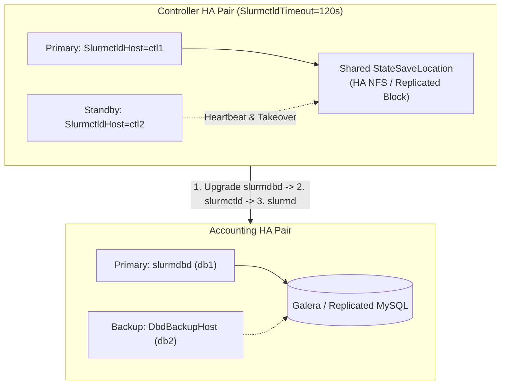

# 6.15 Slurm high availability, upgrades and scaling

| | |
|---|---|
| Level | Intermediate |
| Priority tier | 1 |
| Lab venue | Three or more VMs (controller pair, database, nodes) |
| Part | Part 6: HPC and Slurm |
| Status | Drafted. Read from the `slurm.conf(5)`/`slurmdbd.conf(5)` man pages and the Upgrade, Large Cluster, High Throughput and Configless guides (SchedMD/slurm commit `521370b`, 2026-10-23, development 26.11.0rc1). `code/part06/slurm_upgrade_path.py` was run on four cases (output below) and checked against the guide's compatibility table for 23.11 to 25.05. No failover or upgrade was performed; labs **untested** |

## Why this matters for AI infrastructure

Picture a Monday morning. The scheduler host has crashed over the weekend, and the queue has been frozen since Saturday night. Nothing new starts, the GPUs that finished their jobs sit idle, and researchers are sending messages asking why their experiments have not moved. Suppose `slurmctld` goes down. Nothing new starts, and the queue sits idle behind a multi-million-dollar fleet. The scheduler is a single point of failure for an asset this expensive, so it needs redundancy.

Upgrades are mandatory too, for security fixes and for GPU features such as new GRES autodetect values or `MAX_TRES_GRES` billing. GRES is Slurm's general way to describe generic resources such as GPUs, and autodetect lets Slurm read them from the hardware. They carry real risk, because Slurm state and the accounting database are migrated in place and cannot be rolled back. Clusters also keep growing, to tens of thousands of GPUs and millions of short jobs for inference and evaluation.

This chapter covers three things in that order: how to keep the scheduler running through a failure, how to upgrade it without losing state, and which settings keep it fast as the cluster grows.

## Prerequisites and outcomes

Before you start, complete 6.7 to 6.14. Those chapters cover the cluster build, the scheduling policy and the day-two operations that this chapter builds on. The ideas here assume you already know what `slurmctld` and `slurmd` do, and what a rolling restart looks like in practice.

The chapter explains what fails and what survives when each Slurm part goes down, and how a second controller takes over. It covers the backups you need before any change, and the documented order and version window for upgrades, including why a downgrade is unsafe. It walks through the large-cluster and high-throughput tuning guidance, and shows how to check the results with `sdiag`. Last, it introduces configless mode, `sackd`, `slurmrestd`, authentication choices, federation and elastic nodes, at a conceptual level.

## 1. What fails and what survives

Picture a late-night page. The scheduler is slow, a node has stopped answering, and someone asks whether the running training jobs are safe. Before you can answer, you need to know what each failure actually damages. The pieces of the cluster are `slurmctld` (the scheduler, which holds the state), `slurmdbd` (accounting) with its database, `slurmd` on each node, `munge`, the shared storage behind `StateSaveLocation`, and name services. Each one fails differently, so learn the damage each failure causes before you design redundancy.

When `slurmctld` is down, running jobs keep going, because the `slurmstepd` processes on the nodes carry on without it. A `slurmstepd` is the small per-job process that manages the job's own tasks on a node, so the job does not depend on the controller to keep running. No new jobs start, and commands like `squeue` fail. Job completion messages wait on the nodes and are delivered when the controller returns, and node health checks keep running locally. If the outage exceeds `SlurmdTimeout`, nodes are marked down only after the controller is back and notices they stopped responding. A controller restart does not kill jobs by itself.

When `slurmdbd` is down, scheduling continues. `slurmctld` buffers accounting records in memory and in the state files, and writes them later. A long outage risks loss or memory growth, because the buffer has to live somewhere until the database comes back. With `AccountingStorageEnforce=associations,limits`, jobs from users who lack cached associations may be rejected, so check how your version behaves. An association is Slurm's link between a user, an account and a cluster, and the cache is what lets the controller make decisions without asking the database each time. Fair-share priority calculations stall in the meantime, so the queue order stops reflecting recent usage until the database returns.

If the database is down, `slurmdbd` cannot persist its records, and the effects are the same as above. The database is the permanent store behind `slurmdbd`, so the outage shows up one layer lower but changes nothing about the risk.

If a node is lost, the jobs on that node fail or are requeued. If `munge` breaks or time skew sets in, authentication fails everywhere. That failure is the most dangerous of the common ones, because it looks like everything is broken at once and the fix sits in a different place, the clocks and the munge key.

Decide what each of these failures should cost you before you pick a redundancy design. A design that protects against a controller crash but not against a clock drift has protected the wrong thing.

## 2. Controller high availability

Picture the one host running `slurmctld` failing at a busy hour. Without a standby, nothing new gets scheduled until someone repairs it, and every minute of that gap is a minute of idle GPUs. Suppose the one host running `slurmctld` fails. Without a standby, nothing new gets scheduled until someone repairs it. Slurm avoids that with a second controller that takes over. The diagram below shows the pattern for the controllers and for the accounting database.



Read the diagram from left to right. The controller pair shares one state directory, so whichever controller is active reads the same job records. The accounting pair shares one database. The arrow at the bottom is the upgrade order, which section 4 explains.

The first `SlurmctldHost` entry is the primary, and every other entry is a standby. These settings live in `slurm.conf`:

```ini
SlurmctldHost=ctl1
SlurmctldHost=ctl2
SlurmctldHost=ctl3        # optional additional standbys
SlurmctldTimeout=120      # seconds before a backup assumes control (default 120)
StateSaveLocation=/shared/slurm/state   # must be readable and writable by all controller hosts
```

The repeated `SlurmctldHost` lines set the order of succession, and the timeout sets how long the standby waits. The state location is the one shared path every controller must reach.

The `slurm.conf(5)` man page describes the handover in one line: "If specified more than once, the first entry will run as the primary and all other entries as standby backups. If the primary host fails, the first backup will change from standby to primary until the first host comes back online. This same process will repeat if the new primary fails."

The standby checks on the primary roughly every `SlurmctldTimeout`/2, and it takes control once the primary stops responding for `SlurmctldTimeout`. Both controllers read the same `StateSaveLocation`. The man page says it holds "all running and pending job information", and it recommends a reliable file system, such as RAID. RAID is a way of combining several disks so that one disk failing does not lose the data. The state location also receives core files from crashing daemons, which are the memory snapshots that help you find out why a daemon died.

Five design points follow from this.

1. The state directory is the real HA component. It must be shared. Options include NFS with strong locking semantics, a parallel file system, or a clustered or replicated block device. It must also be highly available itself. `slurmctld` writes state often, so a slow or flaky state file system degrades scheduling. Watch `sdiag` and `iostat` to catch that. A controller pair that shares a weak state directory has only moved the single point of failure, not removed it.
2. Avoid split-brain. If two controllers both believe they are primary, they can corrupt the state. Split-brain is the name for that double-primary situation, where two halves of a cluster each act as the one true leader. Use the built-in standby mechanism. If you add external automation, fence properly with STONITH or a lease, and keep clocks synced. STONITH, which stands for "shoot the other node in the head," forcibly powers off the old primary before the new one starts. A lease is a time-limited claim on the role that the primary must keep renewing.
3. Failover takes about `SlurmctldTimeout` plus the time to load state, which can run to minutes for large queues. Plan for 2 to 5 minutes without scheduling. Tune the timeout so that short network glitches do not trigger false failovers. A timeout that is too short makes the cluster flip between controllers over a brief network blip, and that flipping is its own kind of outage.
4. Test failover regularly. Stop `slurmctld` on the primary, confirm the standby takes over, then restore the primary. Test a restart of both controllers too. A failover that has never been run is a guess, and you want to know the real takeover time before a real failure forces it on you.
5. Clients find the active controller through the same `slurm.conf`, or through the configless `--conf-server` list. Keep that configuration identical on all controllers. If the two controllers disagree about the config, a user can be sent to the wrong place or see different limits depending on which controller answers.

Accounting needs HA as well. `slurmdbd.conf` supports `DbdBackupHost`, which must have access to the same underlying database. The real redundancy, though, lives in the database. Use MariaDB or MySQL replication, such as a Galera cluster or a primary and replica with automatic failover, or use a managed database service. Galera is a multi-primary replication layer for MySQL-family databases. Keep the database on fast storage, back it up, and size it for the job history. Configure `Purge*` options to archive or delete old records, so the database does not grow without limit over the years.

`munge` needs the same key on every node and synchronised clocks. On busy controllers, run it with more threads. The documentation suggests starting with ten for high throughput. Munge is the authentication service behind every Slurm message, so a slow munge daemon slows every command a user runs.

Decide early how you will make the state directory highly available, because the rest of the controller design depends on it. Everything else in this section is easy to change later, but the state storage is hard to move once jobs are running on it.

## 3. Backups

Picture a database administrator asking, a week after an upgrade, where the accounting records from before the upgrade went. If you have no backup, the answer is that they are gone, along with the fair-share history the scheduler used to set priorities. Backups are what turn a bad upgrade from a disaster into a delay. Back up each item in the table below, using the method and frequency shown.

| Item | How | Frequency |
|---|---|---|
| `StateSaveLocation` | Snapshot or rsync while the controller is stopped or via file-system snapshots; at least before upgrades | Before every upgrade; periodic snapshots |
| Accounting database | `mysqldump --single-transaction` or physical backup/replica snapshot | Daily plus pre-upgrade |
| `/etc/slurm/*` (slurm.conf, cgroup.conf, gres.conf, topology, slurmdbd.conf, plugstack) | Git | On every change |
| `munge.key` | Secure secret store | Once; rotate by procedure |
| Custom scripts and plugins (prolog, epilog, health, job_submit.lua) | Git | On change |

The state directory holds the live scheduler picture, and the database holds the history. The configuration files hold what the cluster was told to do, the munge key lets the daemons trust each other, and the custom scripts hold logic that nobody else can rebuild for you.

The state directory and the accounting database need a backup before every upgrade. The other three items change less often, but they still need a copy.

A backup you have never restored is only a hope. Practise restoring the accounting database to a test host, and start a test `slurmdbd` against it. The restore drill is the only real proof that the dump is complete, and it also tells you how long a real restore will take when you are in a hurry.

## 4. Upgrades

Picture a security bulletin that names a Slurm fix, and a team that has been running a version from two years ago. The fix is needed, but the jump is large, and the team does not yet know which steps are safe. Upgrades are where a careful plan matters most, because the rules are strict and the mistakes are permanent. This section gives you the rules, the order and a procedure to follow.

### Rules from the Upgrade Guide

Slurm versions follow the pattern `YY.MM.patch`. The first two numbers name the major release, and patch releases are maintenance updates. Since 24.05, Slurm ships two major releases a year, where it used to ship one every nine months. Read the version number as a date and a level of change. A jump in the `YY.MM` part is a major change, while a jump in the patch part is a bug-fix update that is much easier to take.

In-place upgrades are supported from the previous two major releases. With the six-month cycle, the window has been the previous three releases since 24.11. The guide's table makes the window concrete. In-place means you upgrade the running cluster without building a new one beside it. Read each row as "this release can take over from these older releases without a rebuild."

| Release | Accepts in-place upgrades from |
|---|---|
| 23.11 | 23.02, 22.05 |
| 24.05 | 23.11, 23.02 |
| 24.11 | 24.05, 23.11, 23.02 |
| 25.05 | 24.11, 24.05, 23.11 |
| 25.11 | 25.05, 24.11, 24.05 |
| 26.05 | 25.11, 25.05, 24.11 |

Each release is supported for about 18 months. The guide warns that "Upgrades from incompatible versions will fail immediately upon startup." Upgrading outside the window also kills running jobs and loses job accounting. Out-of-window upgrades must therefore go in steps, and you verify each step. Verifying each step means starting the daemons at that intermediate version, checking that the state and database converted cleanly, and only then moving on.

Downgrades are not supported once any Slurm daemon has started. The guide says it plainly: "Reverting an upgrade (or downgrading) is not supported once any of the Slurm daemons have been started". The reason is that the daemons rewrite state files and database schemas. Reverting means restoring `StateSaveLocation` and the database from before the upgrade, and everything after that backup is lost. Patch and minor upgrades tolerate mixed versions and in-place downgrades better, but keep backups for them too. The word "better" here means fewer surprises, not safety, so a backup is still the right habit.

The order matters. Prepare, then create backups. Upgrade `slurmdbd` first, then `slurmctld`, then `slurmd`, preferably together with `slurmctld`. After that come the login nodes and client commands. Last, recompile or upgrade customised plugins, such as SPANK plugins like pyxis, `job_submit` and `auth`. SPANK is Slurm's plug-in system for adding options to job commands, and pyxis is the NVIDIA plugin that runs containers under Slurm. Pyxis must be built against the Slurm version in use. Finish by testing the key functions and archiving the backups. Checkpoint question 9 explains the reason in more detail.

Let jobs that started before the `slurmd` upgrade end. They run with the old `slurmstepd`, and starting another upgrade or using new features before then "may cause problems".

Upgrade all Slurm packages on a host together. Avoid low-level `rpm` or `dpkg` commands, since they bypass dependency checks. A dependency check is the package manager's way of making sure every library a package needs is present and the right version. Exclude `slurm*` from EPEL, so that an unsupported distribution package does not replace yours. EPEL is the Extra Packages for Enterprise Linux repository, which packages many tools for Red Hat-style systems.

Read `RELEASE_NOTES` for every major release between your version and the target. Note any removed options. If you use `slurmrestd` or `--json`, also note the OpenAPI and `data_parser` changes. The release notes are the only place that lists what a version took away, and a removed option is a common cause of a failed start after an upgrade.

Plan the downtime. Database schema migration in `slurmdbd` can take a long time on a large job table, from minutes to hours. A schema migration rewrites the table layout to match the new version, and the time it takes grows with the number of historical jobs. Notify users in advance, so they do not submit work that will wait in a queue that is frozen for the migration.

The guide also describes an optional "seamless" practice. Install each version in its own directory, then switch a symlink, so you can pre-stage the next version and switch back. A symlink is a file that points to another path, so changing it switches which version the system uses. This only rolls back the binaries before the daemons start. It does not undo the state conversion, so it is a convenience for the start of the process rather than a safety net for the whole upgrade.

Release candidates and master builds are not for production. A release candidate is a version that is still being tested, and a master build is the development branch. Both can change under you without notice.

### A path planner

Run `code/part06/slurm_upgrade_path.py CURRENT TARGET` to apply the window rule. The script uses two prior majors before 24.11 and three from 24.11, and it returns the minimal sequence of steps. The windows for 23.11 to 25.05 reproduce the guide's table exactly. Windows for releases older than 22.05 follow the stated "previous two major releases" rule instead, so confirm them against the guide of the target release. The outputs look like this:

```text
22.05 -> 23.11 -> 25.05 -> 26.05   (3 upgrade steps)
25.05 -> 26.11   (1 upgrade step)
20.11 -> 22.05 -> 23.11 -> 24.11   (3 upgrade steps)
24.05 -> 25.05   (1 upgrade step)
```

Read the first line as a plan. You start on 22.05, you move to 23.11, then to 25.05, and finally to 26.05. Each arrow is one upgrade, so the count in brackets is the number of arrows.

The planner always takes the furthest compatible step, which minimises the number of upgrades. You may prefer to stop at an intermediate release for a soak period. A soak period is a stretch of normal running on a middle version, so you can see problems before you move on. The guide recommends testing every step.

### Procedure (rolling, with downtime windows)

Follow these steps in order for a rolling upgrade that uses downtime windows. A rolling upgrade updates the parts of the cluster one group at a time, so most of the cluster keeps working throughout.

1. Test the whole upgrade in a staging cluster, using a copy of the production database and config. Time the `slurmdbd` migration. A staging run tells you the real duration, which is the number you need when you announce the window.
2. Announce the upgrade, then drain or reserve nodes. Make sure `slurmd` does not restart unexpectedly. `SlurmctldParameters=reconfig_on_restart` can cause earlier upgrades of slurmd and sackd, so consider disabling it temporarily. An early upgrade of a node in the middle of a plan can break the step order, which is why the setting is worth turning off during the window.
3. Back up the state and the database. A backup taken now is the only thing that can undo a bad migration later.
4. Stop `slurmdbd`, upgrade it, and start it. It migrates the schema, so keep an eye on the log, and wait until the migration finishes. Do not start the controller until the database work is done, because the controller depends on the database layout.
5. Stop `slurmctld`, upgrade it, and start it. It converts the state. If you run HA, upgrade the standbys too. A standby on the old version will not take over cleanly from a primary on the new one.
6. Upgrade the `slurmd` nodes in waves. `slurmd` can restart while jobs run, because `slurmstepd` owns the job, so the waves do not need to drain. You can also upgrade everything at once with the controller. Upgrade login nodes and clients as well. Waves keep the cluster partly available, and they make it easy to stop if one wave goes wrong.
7. Run smoke tests: submit jobs on each partition, a GPU job, an array, `srun --mpi=pmix`, a container job, and an accounting query with `sacct`. Add `sreport`, and REST if you use it. A smoke test is a short run that proves the main paths still work, and it is quick enough to run after every wave.
8. Keep the rollback materials until the jobs from before the upgrade finish and the tests pass. Only then archive them. Archiving too early removes the only way back if a problem shows up late.

## 5. Scaling

Picture a cluster that worked well last year and now feels slow. The hardware has not changed, but the job rate has climbed. Scaling means finding which limit you hit first and raising it in a controlled way.

### Large clusters (1,024 or more nodes) — Large Cluster Administration Guide

Start with the system limits, since you will hit them first. Set `/proc/sys/fs/file-max` to the recommended 388067, or to the OS default if that is greater. The file-max setting caps how many files the whole system can have open at once, and a large cluster with many open connections runs into it early. Raise `net.core.somaxconn` to absorb bursts, for example to 1024 or higher. The `somaxconn` value is the length of the queue of pending connections that the kernel holds for a listening socket, so a burst of requests can wait there instead of being refused. Also check `net.ipv4.tcp_max_syn_backlog`, `txqueuelen` and `ip_local_port_range`. Those control the queue of half-open connections, the transmit queue length and the range of ports a client can use. The daemons need room too. Set systemd `TasksMax` for them, because newer systemd imposes thread limits per service. Give `slurmctld` a high `ulimit` for memory, open files and stack. A `ulimit` is the per-process resource limit that the shell or service manager enforces.

Choose `SelectType` with care. For the best scalability, allocate whole nodes with `select/linear`, and avoid `select/cons_tres`. The guide gives this advice for huge CPU clusters. GPU clusters generally need `cons_tres` for per-GPU allocation, so they scale by tuning other parameters instead. The difference is simple to state. `select/linear` hands out whole nodes, which is cheap to track. `cons_tres` hands out pieces of a node, such as one GPU, and it takes more bookkeeping for the controller to do.

Accounting gather has a cost on every node. `jobacct_gather` sampling uses cycles on each node, and the result is what the guide calls "system noise". System noise here means small interruptions that slow down a job whose processes must stay in step. For large jobs that are sensitive to noise, choose `jobacct_gather/none` or a long interval, such as `JobAcctGatherFrequency=task=300`. `JobCompType` records are much cheaper. The sampling costs most when it runs often across thousands of nodes, which is why a longer interval is the first knob to turn.

Declare the expected configuration, `RealMemory`, `CPUs` and `TmpDisk`, instead of letting Slurm discover it. You keep control of what the scheduler expects. Use the minimal number of `NodeName` lines, so the file stays short enough to check by eye.

Set `SlurmdTimeout` to 120 s or more on very large clusters. Communication happens at half of it. Keep `MinJobAge` as small as practical for high job rates. `MinJobAge` is how long a finished job stays in the controller's memory, so a small value frees that memory sooner. Make `EioTimeout` larger for a big `srun`, and use `EpilogMsgTime` to spread completion messages when large jobs end. When a job with thousands of tasks ends, every node reports at once, and spreading those messages stops the controller from being flooded.

`TreeWidth` sets the fan-out of hierarchical `slurmd` communication. Fan-out is how many children each node forwards a message to, so the message travels down a tree rather than coming from one controller to every node. The default is 16, which reaches about 4,368 nodes in three hops. For most sites, the default is fine.

Verify all of this with `sdiag`, checking RPC rates and cycle times, and watch `slurmctld` CPU use so you can see the effect. Change one setting, wait, and measure again. A tuning change you cannot measure is a change you cannot defend later.

### High throughput (many short jobs) — High Throughput Guide

For high throughput, such as inference or evaluation fans that submit thousands of jobs per minute, start with the same OS limits. Set `file-max` to at least 32,832. Set `somaxconn` to 4096, to 8192, or to more than the number of nodes plus clients. Widen the ephemeral port range, and enable `tcp_syncookies`. SYN cookies are a kernel method for handling a flood of new connections without holding memory for each one, so the controller stays up under the burst. Add more munge threads. Put `StateSaveLocation` on fast storage, which means local NVMe for a single controller or replicated storage for HA. NVMe is a fast type of solid-state drive that connects directly over PCIe.

On the scheduler side, tune `SchedulerParameters` options such as `max_rpc_cnt`, `defer`, `sched_min_interval` and `default_queue_depth`, plus the `bf_*` options that 6.9 covers. The `bf_*` options control the backfill scheduler, which fits short jobs into gaps. Keep `MinJobAge` small, and set `MaxJobCount` large. Prefer job arrays to individual submissions, and prefer fewer short `srun` steps, using `--multi-prog` or one allocation with many tasks. An array is one submission that creates many related jobs, so the controller handles one request instead of thousands. Put the database on SSD with enough RAM for InnoDB, and discourage polling. InnoDB is the MySQL storage engine that keeps its working data in memory, so it needs RAM to run well.

If you run AI platforms, prefer to run many small inference tasks as long-lived services, not as many Slurm jobs. Slurm is a batch scheduler. A batch scheduler is built to start and finish work in bulk, so it is a poor fit for a request that must answer in milliseconds.

### Other scale and architecture features

Configless mode lets `slurmctld` serve the configuration to `slurmd`. Clients use `sackd` to fetch the config, keep a local cache, and learn the controller address. Changes reach the nodes on `scontrol reconfigure`, which removes config drift and the need for a shared `/etc/slurm`. Config drift is what happens when different nodes quietly end up with different copies of the same file. Discovery uses DNS SRV records, such as `_slurmctld._tcp`, or `--conf-server`. An SRV record is a DNS entry that says which host and port offer a service. It is highly recommended for large clusters, because it removes a shared file mount that every node would otherwise have to read.

`slurmrestd` is the REST API. Portals, Open OnDemand and workflow engines use it, and 6.25 covers those workflow engines. A REST API lets a web page or another program send Slurm requests over HTTP instead of using the command line. It authenticates with JWT (`AuthAltTypes=auth/jwt`). JWT stands for JSON Web Token, a signed token that proves who is calling. Watch `data_parser` versions on upgrade, and expose it only behind authentication and TLS. TLS is the encryption that protects traffic in transit, which matters because the API carries real job and user data.

Authentication uses `munge`, the classic option, or the newer `auth/slurm` plugin, which is Slurm's own and is documented on the Authentication page. JWT handles REST. Rotate keys with a procedure, so a key change is planned and recorded rather than improvised after a leak.

Federation (`sacctmgr add federation`) lets multiple clusters share a job queue view, so they can accept jobs submitted to any member. Large sites use it to balance work across clusters or sites. Compare it with MultiKueue in Kubernetes, covered in 5.35. MultiKueue does a similar job for Kubernetes clusters, sending work to whichever cluster has room. Keep in mind that federation is a way to share work across clusters. It does not replace the controller HA described earlier.

Elastic and cloud nodes use the `CLOUD` state, `ResumeProgram`, `SuspendProgram`, `SuspendTime`, and dynamic nodes started with `slurmd -Z`. They let you scale GPU capacity in and out in the cloud. On-prem sites use `PowerDownOnIdle` to save cost. This needs robust provisioning, covered in 6.22, and an accurate `ResumeTimeout`. The timeout matters because a node that takes too long to boot should be reported as a failure rather than left waiting forever.

Some sites run several Slurm clusters, with separate controllers for separate fabrics or hardware generations, behind a shared `slurmdbd`. This simplifies upgrades and failure domains, but it fragments capacity. A failure domain is the set of things that go down together, so smaller domains mean a single fault hurts less. Fragmented capacity means free GPUs sit in one cluster while jobs wait in another. Slurm on Kubernetes is another way to run several isolated Slurm clusters. Slinky and SUNK/Soperator are examples, and 6.16 covers them.

Weigh simpler upgrades and smaller failure domains against fragmented capacity before you split one cluster into several. The right answer depends on how different your hardware and users really are.

## 6. Operating HA and upgrades safely

Picture the on-call engineer who has a perfect design on paper, and then discovers during a real outage that nobody has tested the takeover in a year. HA and upgrades only help if the habits around them are kept up. Good habits keep HA and upgrades from causing the outages they are meant to prevent. The table lists each practice and the reason behind it.

| Practice | Why |
|---|---|
| Quarterly failover drill and restore drill | Procedures rot; surprises happen at 3 a.m. |
| One change at a time, outside peak, with a rollback plan (for config) | Slurm config rollback is easy, upgrade rollback is not |
| Staging cluster mirrors production topology and config | Catches plugin/ABI and config removals |
| Pin and track versions of Slurm, pyxis, enroot, munge, PMIx, NVML/Slurm build options | Plugins link against Slurm |
| Watch `sdiag`, controller CPU, state dir latency, DB lag, munge errors | Early warning before outages |
| Document dependencies (DNS, NTP/chrony, LDAP, NFS) with the same HA level | Slurm HA is only as good as these |
| Keep an out-of-band path to controllers | You need them when the network is the problem |

Each row answers one question. The drill asks whether the failover still works, the staging mirror asks whether a change will break a plugin, and the pin row asks which versions must match. The last rows ask what else the cluster depends on, and how you get in when the network is the problem.

Notice the rollback row: configuration changes roll back easily, but an upgrade does not. Your controller HA is also only as strong as the services beneath it, so DNS, NTP or chrony, LDAP and NFS need the same HA level. Put the quarterly failover drill on the calendar now. A drill that is on the calendar is far more likely to happen than one that is only a good intention.

## 7. Lab (self-checking upgrade planner lab tested; cluster failover parts untested)

Start with the self-checking Python lab, which runs on your own machine. It checks the planner before you use it on a real cluster. The lab verifies `window()` and `path()` in `code/part06/slurm_upgrade_path.py` across the 9-month and 6-month Slurm compatibility windows (`22.05 -> 23.11 -> 25.05 -> 26.05`). It also checks the `TreeWidth=16` 3-hop communication fan-out math, where `16 + 16^2 + 16^3 = 4,368` nodes. Last, it validates the mandatory daemon upgrade sequence, `slurmdbd -> slurmctld -> slurmd -> clients`.

```bash
python3 code/part06/slurm_upgrade_path_lab.py
```

Run the lab from the repository root, so the relative path resolves. A pass here shows that the planner matches the rules. It does not show that a real failover or a real migration will behave the same way on your cluster.

These steps were not run on a live cluster, so treat any timing you read here as a number to measure yourself. On a test cluster, work through them in order. Each step needs the one before it to be finished, so do not skip ahead.

1. Run `slurm_upgrade_path.py` for your current and target versions, then compare the output with the release notes.
2. Build a 3-VM test: `ctl1` and `ctl2` sharing an NFS state directory, plus `db1`. Configure `SlurmctldHost` twice, submit jobs, and stop `slurmctld` on `ctl1`. Time the takeover, then verify that the running jobs survived and that `squeue` works through `ctl2`.
3. Take a database dump and a state snapshot. Restore both to a scratch VM, then start a test `slurmdbd` and `slurmctld` against them.
4. Upgrade the test cluster by one major version, in the documented order. Record how long the `slurmdbd` migration and the controller start take, and note any issues.
5. Switch the test cluster to configless mode, with `sackd` running on a login node.
6. Generate a synthetic burst of 5,000 trivial jobs as an array, and watch `sdiag`. Tune `somaxconn`, `max_rpc_cnt`, `MinJobAge` and the munge threads, then compare the results.
7. Enable `slurmrestd` with JWT, submit a job through REST, and note the `data_parser` version.

### 7.1 Deep dive: Diagnosing `slurmctld` RPC queue saturation with `sdiag`

Picture a cluster that has grown past a thousand GPU nodes. A team starts running tens of thousands of short array jobs, and `squeue` begins to hang. Nothing has crashed, but every command feels stuck. A cluster that scales past a thousand GPU nodes, or that receives tens of thousands of short array jobs (`sbatch --array=1-10000`), rarely crashes first. Users notice instead that `squeue` and `sbatch` hang for ten seconds before printing `slurm_receive_msg: Socket timed out on send/recv operation`. The control-plane stress shows up long before a daemon dies. The control plane is the part of the cluster that handles requests and scheduling, as opposed to the part that runs user work.

Rather than guess whether the bottleneck is the network, the Linux kernel socket queue, MUNGE authentication or the backfill scheduler loop, run `sdiag`, the Slurm controller diagnostic utility. Each of those four suspects leaves a different trace in `sdiag`, so the output tells you where to look. Run it twice, sixty seconds apart, and inspect four sections of its output. Two snapshots show the trend, and one snapshot can mislead you about a spike that has passed.

1. Check `Server thread count` first. If it stays near the `max_rpc_cnt` ceiling (`256` maximum), and the incoming connection queue overflows the Linux kernel's `net.core.somaxconn` backlog, client `squeue` and `sbatch` calls time out while they wait for a worker thread. Raising `net.core.somaxconn` on the controller hosts and setting `max_rpc_cnt` in `SchedulerParameters` prevents premature RPC drops, and it lets you identify which RPC type is flooding the daemon. A thread count that sits at the ceiling means requests are queueing for a worker, and a full backlog means some are being turned away before they even reach a worker.
2. Compare the scheduler loops next, under `Main schedule statistics` and `Backfill stats`. Look at `Last cycle` and `Mean cycle`, both in microseconds, for each scheduler. The main loop holds locks while it evaluates the top of the queue. If `Last cycle` climbs into several seconds because tens of thousands of completed jobs remain in `slurmctld` memory, lower `MinJobAge` from `300 s` to `60 s`, and bound `MaxJobCount` so finished jobs age out to `slurmdbd` quickly. In the backfill stats, check `Last depth cycled`. Enable `bf_yield_interval` and `bf_max_job_test` so that a deep backfill sweep over thousands of pending array tasks yields its locks regularly to incoming `srun` and `squeue` RPCs. A lock is a turn-taking rule that stops two parts of the daemon from changing the same data at once, so a long-held lock makes every other request wait behind it.
3. `sdiag` ranks every RPC type by total call count and average processing time. Examples include `REQUEST_JOB_INFO` from `squeue`, `REQUEST_SUBMIT_BATCH_JOB` from `sbatch`, and `MESSAGE_NODE_REGISTRATION_STATUS` from `slurmd`. In nine out of ten control-plane slowdowns, you will find one user running a `while true; do squeue; sleep 1; done` loop inside fifty parallel shell scripts. That generates fifty `REQUEST_JOB_INFO` full-queue dumps per second. You can throttle that abusive polling right away, and point users to cached Prometheus metrics from `slurm_exporter.py` in Chapter 6.26. Prometheus is the metrics system that many clusters use to store and graph numbers over time, and a cached exporter lets people read the queue without asking the controller directly.
4. When `slurmdbd`, or its MySQL or MariaDB database, is slow or stopped during an upgrade, `slurmctld` buffers accounting updates in a queue. That queue lives in memory and in `StateSaveLocation`, and it is reported as `DBD Agent queue size`. While the queue stays below its ceiling, scheduling continues normally, even while `slurmdbd` is offline for maintenance. After you restart `slurmdbd`, watch `DBD Agent queue size` drain back to `0`. That confirms that accounting caught up cleanly.

Read the four sections in order before you change any setting. The order runs from the daemon's front door, to the scheduler's inner loops, to the users who cause the load, and then to the accounting path. Changing a setting before you know which section is hot is how a tuning session makes things worse.

### 7.2 End-to-end live upgrade rehearsal and rollback safety net

Picture a production upgrade that goes well for the first hour, and then a bug appears in the database conversion. Without a snapshot taken right before the change, the team has no clean way back. Downgrading `slurmctld` or `slurmdbd` binaries against an already-upgraded state directory or database is unsupported, and it can corrupt job records. The on-disk `StateSaveLocation` files and `slurmdbd` MySQL schema migrations are forward-only. So every production Slurm upgrade across a multi-hop path (`slurm_upgrade_path.py`) must follow a strict pre-flight snapshot and canary protocol. A canary here is one small, early step that proves the new version works before the rest of the cluster follows.

1. Freeze new submissions, or set a maintenance reservation with `flags=maint,ignore_jobs`. Existing multi-day training jobs keep running on compute nodes. `slurmd` keeps running active job steps unattended while `slurmctld` restarts, provided the outage stays shorter than `SlurmdTimeout`. The freeze keeps new work from arriving during the change, and the reservation keeps the nodes quiet for the window.
2. Back up `slurmdbd` first with `mysqldump --single-transaction --Quick slurm_acct_db > pre_upgrade.sql`. Then upgrade the `slurmdbd` package and start `slurmdbd`. Watch `/var/log/slurm/slurmdbd.log` until the database table conversion completes. On tables with millions of historical jobs, that can take several minutes. Confirm that `sacctmgr show cluster` responds cleanly. A clean response here is the first sign that the converted database is readable.
3. Stop both the backup and the primary `slurmctld` daemons. Then tar the whole `StateSaveLocation` directory with `tar -czf /var/backups/slurm_state_pre_upgrade.tar.gz -C /var/spool/slurmctld .`. If a catastrophic bug forces a rollback, you have what you need. You can stop the new daemons, restore the SQL dump and state directory from the exact pre-upgrade second, and start the old binaries cleanly.
4. Upgrade and start `slurmctld`, primary first and then the backup. Verify with `scontrol ping` and `squeue` that all running jobs survived intact. Then roll out the new `slurmd` and client packages across compute and login nodes, and recompile SPANK plugins such as Pyxis against the new Slurm headers. The headers are the interface files a plugin is built against, so a plugin built against old headers will fail to load.

Keep both the SQL dump and the state tarball until the upgraded cluster passes its checks. Deleting them early removes the only path back.

## 8. Interview angles

Picture yourself on a panel, asked how you would recover a scheduler that has just failed. Each question below connects to a topic in this chapter. Try to answer it out loud before you check the matching section.

- What happens to running jobs when `slurmctld` dies? When `slurmdbd` dies?
- How does controller failover work? What is the critical shared component?
- In what order do you upgrade Slurm components and why?
- Can you roll back a Slurm upgrade? What do you need beforehand?
- You are on 22.05 and want the latest release. What do you do?
- Name five tuning steps for a 5,000-node cluster with many short jobs.
- How do you avoid configuration drift across thousands of nodes?
- What is a SPANK plugin and why does it complicate upgrades?
- When would you run multiple Slurm clusters instead of one?

Mark any question you cannot yet answer, then reread the section it points to. A gap you find now is much cheaper to close than one you find during an incident.

## Exercises

1. Plan a multi-hop upgrade with `code/part06/slurm_upgrade_path.py` and `slurm_upgrade_path_lab.py`. Run `python3 code/part06/slurm_upgrade_path_lab.py` first. Then explain why upgrading from `22.05` to `26.05` needs three upgrade steps with two intermediate releases (`22.05 -> 23.11 -> 25.05 -> 26.05`). Explain why `24.05` accepts only 2 prior major versions (`23.02, 23.11`). Explain why `24.11` accepts 3 (`23.02, 23.11, 24.05`). Finally, describe what happens if you attempt an out-of-window upgrade directly.
2. Write the pre-upgrade checklist and the ordered execution plan for an HA Slurm cluster. The cluster has a `slurmdbd` pair, a `slurmctld` pair, a `slurmd` compute fleet, login nodes with `sackd`, and the `pyxis` SPANK plugin. Explain why in-place downgrades are unsupported once any daemon has started. Name the two artifacts you need to revert: a `StateSaveLocation` snapshot and a `mysqldump --single-transaction` dump.
3. Write the `SlurmctldHost`, `SlurmctldTimeout` and `StateSaveLocation` stanzas for `slurm.conf`. Add the `AccountingStorageHost` and `AccountingStorageBackupHost` (`DbdBackupHost`) stanzas for `slurmdbd.conf`. Then explain what happens to running `slurmstepd` GPU training steps during a 3-minute `slurmctld` failover. Compare that with a 30-minute `slurmdbd` outage.
4. Use `tree_fanout_nodes(16, 3)` in `code/part06/slurm_upgrade_path_lab.py` to verify why `TreeWidth=16` reaches 16 + 256 + 4,096 = **4,368** compute nodes in 3 communication hops. Then work out how far `TreeWidth=32` reaches. Start with 32 + 1,024 = 1,056 nodes in 2 hops. Then add the third hop, 32 + 1,024 + 32,768 = 33,824 nodes in 3 hops.
5. Write `/etc/sysctl.d/99-slurm-scale.conf` with `fs.file-max >= 388067`, `net.core.somaxconn = 4096`, and a `net.ipv4.ip_local_port_range` setting. Then write the `slurm.conf` settings for a cluster that handles thousands of short evaluation jobs per minute: `MinJobAge`, `JobAcctGatherFrequency=task=300`, `SchedulerParameters=defer,max_rpc_cnt=128,default_queue_depth=100`, and `munge --num-threads=10`.
6. Explain how configless mode (`SlurmctldParameters=enable_configless`) distributes `slurm.conf`, `gres.conf` and `cgroup.conf` from `slurmctld` to `slurmd` and to login-node `sackd` daemons. Then write the `_slurmctld._tcp` DNS `SRV` records that let nodes discover `ctl1` and `ctl2` automatically.

## Checkpoint

<details>
<summary>1. What happens to already-running GPU jobs when `slurmctld` crashes or restarts, and what happens when `slurmdbd` goes down?</summary>

If `slurmctld` goes down, running jobs keep executing, because `slurmstepd` on each compute node manages the job's processes independently. No new jobs can start, and `squeue` and `sbatch` block or fail. Job completion messages queue on `slurmd` until `slurmctld` returns.

If `slurmdbd` goes down, `slurmctld` keeps scheduling jobs and buffers accounting records in memory and in the state files for later delivery. Fair-share usage updates pause, though. If `AccountingStorageEnforce=safe` is set, or uncached associations are required, new submissions may be blocked.
</details>

<details>
<summary>2. How do you configure primary and standby controllers in `slurm.conf`, and what does `SlurmctldTimeout` control?</summary>

List several `SlurmctldHost` lines in priority order: `SlurmctldHost=ctl1`, `SlurmctldHost=ctl2`, and `SlurmctldHost=ctl3`. They all point to a shared `StateSaveLocation`. The standby pings the primary, and it assumes control if the primary stops responding for `SlurmctldTimeout` seconds (default `120` s). When `ctl1` recovers, `ctl2` flushes its state to `StateSaveLocation` and hands control back to `ctl1`.
</details>

<details>
<summary>3. Why is `StateSaveLocation` the true single point of failure in `slurmctld` HA, and what storage properties does it require?</summary>

Both the primary and the standby `slurmctld` daemons read and write all pending and running job state files in `StateSaveLocation`. That makes it the true single point of failure. It must sit on a low-latency, highly available shared file system with strict POSIX locking semantics, or on replicated block storage, and it needs ample inodes. High write latency there stalls the main scheduling loop directly.
</details>

<details>
<summary>4. How is high availability achieved for `slurmdbd` and the underlying accounting database?</summary>

Configure `AccountingStorageBackupHost` and `DbdBackupHost` in `slurm.conf` and `slurmdbd.conf` for the daemon. Then back both `slurmdbd` instances with a replicated MySQL or MariaDB cluster, such as a Galera multi-primary cluster or a primary and replica with automated failover. Add regular `Purge*` policies too.
</details>

<details>
<summary>5. What five items must be backed up before every Slurm upgrade, and how do you take a consistent database backup?</summary>

Back up these five items before every upgrade:

1. The `StateSaveLocation` directory, by snapshot or rsync.
2. The Slurm accounting database, dumped with `mysqldump --single-transaction`, or taken as a replica snapshot.
3. The `/etc/slurm/*` configuration files (`slurm.conf`, `slurmdbd.conf`, `gres.conf`, `cgroup.conf`, `topology.conf`, `plugstack.conf`).
4. `/etc/munge/munge.key`.
5. Custom `Prolog`, `Epilog`, `HealthCheckProgram`, SPANK, and `job_submit.lua` scripts.
</details>

<details>
<summary>6. How are Slurm version numbers (`YY.MM.patch`) structured, and what is the supported in-place upgrade compatibility window (`code/part06/slurm_upgrade_path.py`)?</summary>

`YY.MM` identifies the major release by year and month. The cadence was 9-month up to `24.05`, and it has been 6-month, twice a year, since `24.05`. The `.patch` number is the maintenance bug-fix level. For in-place live upgrades, the window is the previous 2 major releases before `24.11`, and the previous 3 major releases from `24.11` onward. For example, `25.05` accepts live upgrades from `24.11`, `24.05`, and `23.11`.
</details>

<details>
<summary>7. What happens if you upgrade Slurm across versions outside the compatibility window (for example `22.05` directly to `26.05`)?</summary>

The new daemons refuse to parse the old state or database format, so they fail immediately on startup. That kills running jobs and risks accounting loss. Upgrade in multi-hop steps instead, such as `22.05 -> 23.11 -> 25.05 -> 26.05`. Start the daemons at each intermediate version, so the state files and DB schemas migrate cleanly.
</details>

<details>
<summary>8. Why is downgrading Slurm in place unsupported once a newer daemon has started?</summary>

As soon as a newer `slurmdbd` or `slurmctld` starts, it rewrites the `StateSaveLocation` binary state files and migrates the MySQL schema tables into its own format. Older daemons cannot read that format. Reverting therefore means stopping the daemons and restoring the pre-upgrade `StateSaveLocation` and MySQL backups.
</details>

<details>
<summary>9. State the mandatory component upgrade order for a Slurm cluster and explain why that order is required.</summary>

The order is `slurmdbd` first, then `slurmctld`, then `slurmd`, and clients last.

1. `slurmdbd` comes first. It must be at or above the version of `slurmctld` and `slurmd`, and its MySQL schema migration can take minutes to hours.
2. `slurmctld`, on both the primary and the standby controllers.
3. `slurmd`, on the compute nodes, upgraded alongside or right after `slurmctld`.
4. Client binaries (`sbatch`, `srun`, `sackd`) and SPANK plugins (`pyxis`) on login and submit nodes.

The order exists because newer daemons understand RPCs from older daemons within the compatibility window. Older `slurmdbd` or `slurmctld` daemons, however, reject RPCs from newer components.
</details>

<details>
<summary>10. Why can `slurmd` be upgraded and restarted on compute nodes without draining or killing running jobs?</summary>

Running job steps are owned by separate per-step `slurmstepd` processes, not by `slurmd` itself. Restarting `slurmd` with the upgraded binary leaves the existing `slurmstepd` processes running until those jobs finish.
</details>

<details>
<summary>11. Why must NVIDIA `pyxis` (and any C SPANK plugin) be rebuilt during a major Slurm upgrade, and why should `slurm*` be excluded from EPEL?</summary>

SPANK plugins link directly against Slurm's internal shared libraries and ABI structs, and those change across major Slurm releases. That is why `pyxis`, and any C SPANK plugin, must be rebuilt. Exclude `slurm*` in `/etc/yum.repos.d/epel.repo` with `exclude=slurm*`. Then an automated OS `dnf update` cannot overwrite a custom or site Slurm build with an incompatible EPEL version.
</details>

<details>
<summary>12. Which Linux kernel `sysctl` and `systemd` limits must be raised for large clusters ($\ge 1,024$ nodes) and high job throughput?</summary>

Raise `/proc/sys/fs/file-max` to $\ge 388,067$ for large clusters, or to $\ge 32,832$ for high throughput, and raise the daemon `LimitNOFILE` too. Raise `net.core.somaxconn` to a value between $\ge 1,024$ and $8,192$, and raise `net.ipv4.tcp_max_syn_backlog` as well, so that bursty RPC connections are absorbed. Widen the ephemeral port range with `net.ipv4.ip_local_port_range`. Finally, set `TasksMax=infinity` in the `systemd` unit, or a high limit, so that the `slurmctld` and `slurmd` thread pools are not capped by systemd's default cgroup pids limit.
</details>

<details>
<summary>13. Why does the Large Cluster Guide recommend `SelectType=select/linear` for giant CPU clusters, and why must GPU clusters stick with `select/cons_tres`?</summary>

`select/linear` schedules whole nodes only, which takes just 1 bit per node. That makes it dramatically faster for `slurmctld` than tracking per-core and per-socket bitmaps. If you run GPU clusters, you need `select/cons_tres`, which tracks and co-allocates consumable GPUs (`gres/gpu`), MIG slices, CPUs per GPU, and memory per GPU.
</details>

<details>
<summary>14. How does `jobacct_gather` introduce "system noise" on compute nodes, and how do you mitigate it at scale?</summary>

`jobacct_gather` polls `/proc` and cgroup counters every few seconds across all tasks. That steals CPU cycles and interrupts tightly coupled MPI and NCCL collectives, which is the system noise. If you need to mitigate it, raise the sampling interval, such as `JobAcctGatherFrequency=task=300`. You can also use `jobacct_gather/none` when step-level memory polling is unnecessary.
</details>

<details>
<summary>15. What do `SlurmdTimeout`, `MinJobAge`, `EpilogMsgTime`, and `TreeWidth` control on a large cluster?</summary>

- **`SlurmdTimeout`:** Seconds before an unresponsive node is marked `DOWN` (raise to $\ge 120\text{–}300$ s at scale).
- **`MinJobAge`:** Seconds a finished job stays in `slurmctld` memory before being purged (lower it under high throughput so `MaxJobCount` does not fill up).
- **`EpilogMsgTime`:** Microseconds over which `slurmd` spreads `Epilog` completion messages when a massive multi-node job ends, preventing an RPC storm at `slurmctld`.
- **`TreeWidth`:** Fan-out of hierarchical `slurmd`-to-`slurmd` message forwarding (default `16`, reaching 16 + 256 + 4,096 = 4,368 nodes in 3 hops).
</details>

<details>
<summary>16. How do you tune `munge` and `SchedulerParameters` when a cluster experiences high short-job submission rates?</summary>

Raise the `munged` worker threads, using `--num-threads=10` or higher, on `slurmctld` and login hosts. That way, credential verification does not bottleneck RPCs. Then set `SchedulerParameters=defer,batch_sched_delay=3,max_rpc_cnt=128,default_queue_depth=100,sched_min_interval=2000000`. This makes `slurmctld` batch its scheduling passes, instead of running the main loop on every single `sbatch`.
</details>

<details>
<summary>17. How does **configless Slurm** work, and what is the role of `sackd` and `_slurmctld._tcp` DNS `SRV` records?</summary>

With `SlurmctldParameters=enable_configless`, `slurmctld` serves `slurm.conf`, `gres.conf`, `cgroup.conf`, and `topology.conf` over the network. It serves them to `slurmd` on compute nodes and to `sackd`, short for Slurm Auth and Cred Kiosk Daemon, on login and client nodes. Those nodes cache the files locally in `/run/slurm/conf`. Nodes find the controllers through `_slurmctld._tcp` DNS `SRV` records, or through `--conf-server`. That removes shared `/etc/slurm` NFS mounts and config drift.
</details>

<details>
<summary>18. What is `slurmrestd`, how is it authenticated, and what must you check in `RELEASE_NOTES` before upgrading a cluster that uses it?</summary>

`slurmrestd` is Slurm's HTTP and OpenAPI REST daemon. Web portals and workflow orchestrators use it. Authentication uses JSON Web Tokens, set with `AuthAltTypes=auth/jwt`. Before you upgrade a cluster that uses it, check `RELEASE_NOTES` for removed or versioned `data_parser` and OpenAPI schema plugins, such as `v0.0.40` → `v0.0.42`. That keeps client integrations from breaking.
</details>

<details>
<summary>19. How do Slurm **elastic / power-saving nodes** (`CLOUD` state) work?</summary>

Nodes configured with `State=CLOUD` call `SuspendProgram` to power down or terminate cloud VMs after they sit idle for `SuspendTime` seconds. Idle on-prem nodes under `SuspendTime` do the same. When a queued job needs a node, Slurm calls `ResumeProgram`, then waits up to `ResumeTimeout` seconds for `slurmd` to register.
</details>

<details>
<summary>20. When is running **multiple independent Slurm clusters** (or Slurm Federation) behind a single shared `slurmdbd` better than one giant monolithic `slurmctld`?</summary>

Multiple clusters make sense when a site has distinct failure domains, security zones, or hardware generations. An example is an InfiniBand H100 pretraining pod, an Ethernet L40S inference and evaluation pool, and a staging cluster. Separate `slurmctld` pairs isolate the blast radius, keep scheduler queues fast, and allow rolling Slurm upgrades one cluster at a time. A shared `slurmdbd` provides unified accounting, and an optional `sacctmgr add federation` adds cross-cluster visibility.
</details>

## Sources and review notes

- HA, upgrade, large-cluster, high-throughput, configless and authentication behaviour: `slurm.conf(5)`, `slurmdbd.conf(5)` and the HTML guides (Upgrade Guide, Large Cluster Administration, High Throughput, Configless, Authentication, Federation, Power Save, Dynamic Nodes) in SchedMD/slurm commit `521370b`.
- Operational context: read in full from *Supercomputers for Linux SysAdmins* (`supercomputers-for-linux-sysadmins-managing-modern-hpc-clusters-and-supercomputers-from-software-to-hardware`) Chapter 15 ("15. Slurm": installation, troubleshooting, advanced `slurm.conf` parameters), and migrated from `nvidia-devops` (`volume-10/06-slurm-administration-ha-accounting-and-upgrades.md` and `volume-10/14-senior-deep-dive-2-slurm-ha-and-accounting-internals.md`).
- Run here: `code/part06/slurm_upgrade_path.py` and `python3 code/part06/slurm_upgrade_path_lab.py` (3 passed, 0 failed).
- W4 check 2026-11-12 against slurm.schedmd.com/upgrades.html: the window rule (previous two majors, three from 24.11) and the table rows 25.05, 25.11 and 26.05 are correct. The planner output 22.05 to 23.11 to 25.05 to 26.05 is three upgrade steps, which is two intermediate releases, so the earlier wording of three intermediate hops was wrong and is fixed. The guide also warns that jobs running across an out-of-window upgrade are killed.
- Explicitly labelled inferences: `tree_fanout_nodes` (`4,368` nodes for `TreeWidth=16` in 3 hops) and `validate_daemon_upgrade_order` in `code/part06/slurm_upgrade_path_lab.py` are deterministic teaching checks of SchedMD's Large Cluster and Upgrade guides.
- Not verified on live hardware: exact behaviour of accounting buffering and association enforcement while `slurmdbd` is down on your version, windows for releases older than the guide's table, and live multi-thousand-node failover timings (`untested here`).
