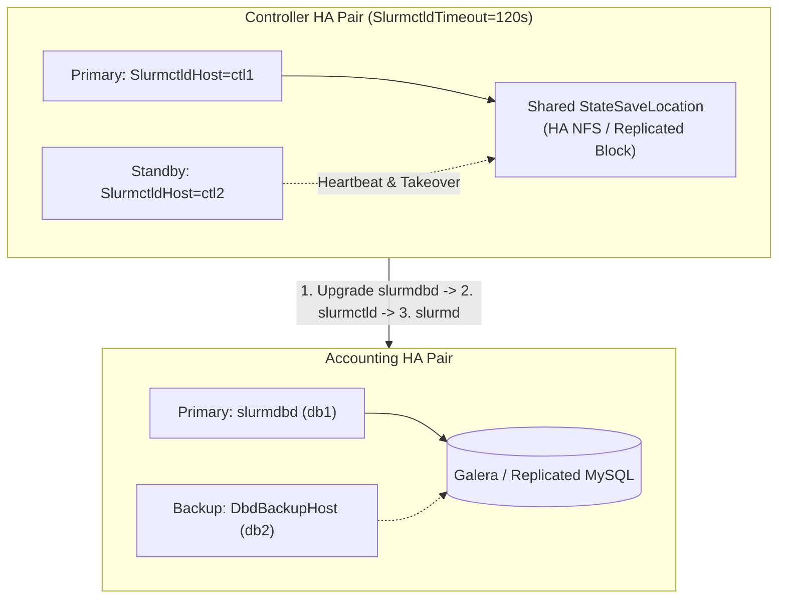

# 6.15 Slurm high availability, upgrades and scaling

| | |
|---|---|
| Level | Intermediate |
| Priority tier | 1 |
| Lab venue | Three or more VMs (controller pair, database, nodes) |
| Part | Part 6: HPC and Slurm |
| Status | Drafted. Read from the `slurm.conf(5)`/`slurmdbd.conf(5)` man pages and the Upgrade, Large Cluster, High Throughput and Configless guides (SchedMD/slurm commit `521370b`, 2026-10-23, development 26.11.0rc1). `code/part06/slurm_upgrade_path.py` was run on four cases (output below) and checked against the guide's compatibility table for 23.11 to 25.05. No failover or upgrade was performed; labs **untested** |

## Why this matters for AI infrastructure

The scheduler is a single point of failure for a very expensive asset: if `slurmctld` is down, nothing new starts and queued work sits idle behind a multi-million-dollar fleet. Upgrades are mandatory (security fixes, GPU features such as new GRES autodetect values or `MAX_TRES_GRES` billing), but carry real risk because Slurm state and the accounting database are migrated in place and cannot be rolled back. And clusters grow: tens of thousands of GPUs, millions of short jobs for inference and evaluation. This chapter covers redundancy, the safe upgrade procedure, and scaling knobs.

## Prerequisites and outcomes

Needs 6.7 to 6.14. After this chapter you can:

- Configure controller failover and database redundancy; explain what is and is not preserved when the primary dies.
- Back up and restore Slurm state and accounting data.
- Plan and execute upgrades in the documented order within the compatibility window, and know why downgrades are unsafe.
- Apply the large-cluster and high-throughput tuning guidance and verify results with `sdiag`.
- Use configless mode, `sackd`, `slurmrestd`, JWT/authentication choices, federation, and cloud/elastic nodes at a conceptual level.

## 1. What fails and what survives

Components: `slurmctld` (scheduler, state), `slurmdbd` (accounting) + database, `slurmd` (per node), `munge`, shared storage for `StateSaveLocation`, name services.

- **slurmctld down**: running jobs **continue** (the `slurmstepd` processes on nodes keep going); no new jobs start; commands like `squeue` fail; job completion messages queue up on nodes and are delivered when the controller returns. Node health checks continue locally. If the outage exceeds `SlurmdTimeout`, nodes are only marked down after the controller is back and notices unresponsiveness, so a controller restart does not itself kill jobs.
- **slurmdbd down**: scheduling continues; accounting records are buffered by `slurmctld` and written later (the controller holds them in memory/state files; long outages risk loss or memory growth, and with `AccountingStorageEnforce=associations,limits` jobs from users lacking cached associations may be rejected, check your version's behaviour). Fair-share priority calculations stall.
- **Database down**: slurmdbd cannot persist; same as above.
- **Node loss**: jobs on that node fail or are requeued.
- **munge or time skew**: authentication failures everywhere.

## 2. Controller high availability



From `slurm.conf(5)`:

```ini
SlurmctldHost=ctl1
SlurmctldHost=ctl2
SlurmctldHost=ctl3        # optional additional standbys
SlurmctldTimeout=120      # seconds before a backup assumes control (default 120)
StateSaveLocation=/shared/slurm/state   # must be readable and writable by all controller hosts
```

"If specified more than once, the first entry will run as the primary and all other entries as standby backups. If the primary host fails, the first backup will change from standby to primary until the first host comes back online. This same process will repeat if the new primary fails." The standby watches the primary (every `SlurmctldTimeout`/2 roughly) and takes control when it stops responding for `SlurmctldTimeout`. All controllers read the same `StateSaveLocation`, which the man page says holds "all running and pending job information" and recommends placing on a reliable file system (for example RAID); it also receives core files of crashing daemons.

Design implications:

1. **The state directory is the real HA component.** It must be shared (NFS with strong locking semantics, a parallel file system, a clustered/replicated block device) and itself highly available. Latency matters: `slurmctld` writes state frequently; a slow or flaky state file system degrades scheduling (watch `sdiag` and `iostat`).
2. Avoid split-brain: two controllers both believing they are primary can corrupt state. Use the built-in standby mechanism, fence properly (STONITH or lease) if you add external automation, and keep clocks synced.
3. Failover time is about `SlurmctldTimeout` plus state load time (minutes for large queues). Plan for 2 to 5 minutes of no scheduling, and tune the timeout against false failovers during short network glitches.
4. Test failover regularly (stop slurmctld on the primary; confirm the standby takes over; restore). Test restart of both.
5. Clients find the active controller through the same `slurm.conf` (or configless `--conf-server` list); keep it identical on all controllers.

**slurmdbd HA**: `slurmdbd.conf` supports `DbdBackupHost` ("must have access to the same underlying database"). The real redundancy is in the **database**: MariaDB/MySQL replication (Galera cluster, primary/replica with automatic failover) or a managed database service. Keep the database on fast storage, backed up, and sized for the job history; configure `Purge*` options to archive or delete old records.

**munge**: same key on all nodes, synchronised clocks; run with more threads on busy controllers (documentation suggests starting with ten for high throughput).

## 3. Backups

Back up:

| Item | How | Frequency |
|---|---|---|
| `StateSaveLocation` | Snapshot or rsync while the controller is stopped or via file-system snapshots; at least before upgrades | Before every upgrade; periodic snapshots |
| Accounting database | `mysqldump --single-transaction` or physical backup/replica snapshot | Daily plus pre-upgrade |
| `/etc/slurm/*` (slurm.conf, cgroup.conf, gres.conf, topology, slurmdbd.conf, plugstack) | Git | On every change |
| `munge.key` | Secure secret store | Once; rotate by procedure |
| Custom scripts and plugins (prolog, epilog, health, job_submit.lua) | Git | On change |

A backup you have not restored is a hope. Practise restoring the accounting database to a test host and starting a test `slurmdbd` against it.

## 4. Upgrades

### Rules from the Upgrade Guide

- Version numbers `YY.MM.patch`: the first two numbers are the **major** release; patch releases are maintenance. Since 24.05 there are two major releases a year (previously nine-monthly).
- **Compatibility window**: in-place upgrades are supported from the previous two major releases; with the 6-month cycle, since 24.11 from the previous **three**. The guide's table: 23.11 accepts 23.02, 22.05; 24.05 accepts 23.11, 23.02; 24.11 accepts 24.05, 23.11, 23.02; 25.05 accepts 24.11, 24.05, 23.11; 25.11 accepts 25.05, 24.11, 24.05; support lasts about 18 months per release. "Upgrades from incompatible versions will fail immediately upon startup", and upgrading outside the window kills running jobs and loses job accounting. Out-of-window upgrades must go **in steps**, each verified.
- **No downgrade**: "Reverting an upgrade (or downgrading) is not supported once any of the Slurm daemons have been started", because daemons rewrite state files and database schemas. Reverting needs restoring `StateSaveLocation` and the database from before the upgrade and loses everything after the backup. (Patch/minor upgrades are more tolerant of mixed versions and in-place downgrades, but keep backups.)
- **Order**: prepare; create backups; upgrade **slurmdbd**; then **slurmctld**; then **slurmd** (preferably together with slurmctld); then login nodes and client commands; recompile or upgrade customised plugins (SPANK such as pyxis, `job_submit`, `auth`), including **pyxis, which must be built against the Slurm version in use**; test key functions; archive backups.
- Finish by letting jobs that started before the slurmd upgrade end: they run with the old `slurmstepd`, and starting another upgrade or using new features before then "may cause problems".
- Package managers: upgrade all Slurm packages on a host together; avoid low-level `rpm`/`dpkg` that bypass dependency checks; **exclude `slurm*` from EPEL** so an unsupported distribution package does not replace yours.
- Read `RELEASE_NOTES` for every major between your version and the target; note removed options and OpenAPI/`data_parser` changes if you use `slurmrestd` or `--json`.
- Plan downtime: database schema migration in `slurmdbd` can take a long time with a large job table (minutes to hours); notify users.
- Optional "seamless" practice from the guide: install each version in its own directory and switch a symlink, so you can pre-stage and switch back (only for pre-start rollback of the binaries; it does not undo state conversion).
- Pre-release versions (rc, master) are not for production.

### A path planner

`code/part06/slurm_upgrade_path.py CURRENT TARGET` encodes the window rule (two prior majors before 24.11, three from 24.11) and returns the minimal sequence of steps. The windows for 23.11 to 25.05 reproduce the guide's table exactly; windows for releases older than 22.05 follow the stated "previous two major releases" rule and are not from the table, so confirm them against the guide of the target release. Outputs:

```text
22.05 -> 23.11 -> 25.05 -> 26.05   (3 upgrade steps)
25.05 -> 26.11   (1 upgrade step)
20.11 -> 22.05 -> 23.11 -> 24.11   (3 upgrade steps)
24.05 -> 25.05   (1 upgrade step)
```

(The planner always takes the furthest compatible step, which minimises the number of upgrades; you may prefer to stop at an intermediate release for a soak period, and the guide recommends testing every step.)

### Procedure (rolling, with downtime windows)

1. Test the whole upgrade in a staging cluster with a copy of the production database and config. Time the `slurmdbd` migration.
2. Announce; drain or reserve; ensure no `slurmd` auto-restart surprises (`SlurmctldParameters=reconfig_on_restart` can cause earlier upgrades of slurmd/sackd, so consider disabling temporarily).
3. Back up state and database.
4. Stop `slurmdbd`; upgrade; start it (it migrates the schema; keep an eye on the log); wait until finished.
5. Stop `slurmctld`; upgrade; start (it converts state). If using HA, upgrade standbys too.
6. Upgrade `slurmd` nodes in waves (drain-free: `slurmd` can be restarted while jobs run, because `slurmstepd` owns the job), or all at once with the controller; upgrade login nodes and clients.
7. Smoke tests: submit jobs on each partition, GPU job, array, `srun --mpi=pmix`, container job, accounting query (`sacct`), `sreport`, REST if used.
8. Keep rollback materials until jobs from before the upgrade finish and the tests pass; then archive.

## 5. Scaling

### Large clusters (1,024 or more nodes) — Large Cluster Administration Guide

- System limits: `/proc/sys/fs/file-max` (recommended start 388067 or the OS default if greater), `net.ipv4.tcp_max_syn_backlog`, `net.core.somaxconn` (raise to absorb bursts, for example 1024 or higher), txqueuelen, `ip_local_port_range`; systemd `TasksMax` for the daemons (newer systemd imposes thread limits per service); high `ulimit` for `slurmctld` (memory, open files, stack).
- **`SelectType`**: for best scalability, allocate whole nodes with `select/linear` and avoid `select/cons_tres` (the guide's advice for huge CPU clusters). GPU clusters generally need `cons_tres` for per-GPU allocation, so scale by tuning other parameters instead.
- **Accounting gather**: `jobacct_gather` sampling costs cycles on every node ("system noise"); for noise-sensitive large jobs choose `jobacct_gather/none` or a large interval (`JobAcctGatherFrequency=task=300`); `JobCompType` records are much cheaper.
- **Node definitions**: state the expected configuration (`RealMemory`, `CPUs`, `TmpDisk`) rather than letting Slurm discover; use the minimal number of `NodeName` lines.
- **Timers**: `SlurmdTimeout` (communication at half of it) of 120 s or more on very large clusters; `MinJobAge` as small as practical for high job rates; `EioTimeout` larger for big `srun`; `EpilogMsgTime` to spread completion messages when large jobs end.
- **`TreeWidth`**: fan-out of the hierarchical slurmd communication, default 16 (about 4,368 nodes reachable in three hops); the default is fine for most.
- Verify everything with `sdiag` (RPC rates, cycle times) and `slurmctld` CPU use.

### High throughput (many short jobs) — High Throughput Guide

Recommendations (for example inference or evaluation fans with thousands of jobs per minute): the same OS limits (`file-max` at least 32,832, `somaxconn` 4096 or 8192 or more than nodes plus clients, wider ephemeral port range, `tcp_syncookies`), **more munge threads**, a fast `StateSaveLocation` (local NVMe for single controller, replicated for HA), `MinJobAge` small, `SchedulerParameters` such as `max_rpc_cnt`, `defer`, `sched_min_interval`, `default_queue_depth`, `bf_*` tuned (6.9), `MaxJobCount` large, job arrays instead of individual submissions, fewer short `srun` steps (`--multi-prog`, one allocation with many tasks), database on SSD with enough RAM for InnoDB, and discouraging polling. For AI platforms, prefer to run **many small inference tasks as long-lived services** rather than as many Slurm jobs; Slurm is a batch scheduler.

### Other scale and architecture features

- **Configless** (`slurmctld` serves configuration to `slurmd`; clients use `sackd` to fetch config and maintain a local cache and the controller address): eliminates config drift and shared `/etc/slurm`; changes propagate on `scontrol reconfigure`. Use DNS SRV (`_slurmctld._tcp`) or `--conf-server`. Highly recommended for large clusters.
- **`slurmrestd`** (REST API) with **JWT** authentication (`AuthAltTypes=auth/jwt`) for portals, Open OnDemand, workflow engines (6.25); watch `data_parser` versions on upgrade; expose only behind authentication and TLS.
- **Authentication**: `munge` (classic) or the newer `auth/slurm` plugin (Slurm's own, documented in the Authentication page); JWT for REST. Rotate keys with a procedure.
- **Federation** (`sacctmgr add federation`): multiple clusters share a job queue view and can accept jobs submitted to any member; used by large sites to balance across clusters or sites. Compare with MultiKueue in Kubernetes (5.35).
- **Elastic/cloud nodes and power saving** (`CLOUD` state, `ResumeProgram`, `SuspendProgram`, `SuspendTime`, dynamic nodes with `slurmd -Z`): scale GPU capacity in and out in clouds; cost-saving at on-prem sites (`PowerDownOnIdle`). Needs robust provisioning (6.22) and accurate `ResumeTimeout`.
- **Multiple Slurm clusters** per site (separate controllers for separate fabrics/hardware generations) behind a shared `slurmdbd`: simplifies upgrades and failure domains, at the cost of fragmented capacity. Slurm on Kubernetes (Slinky, SUNK/Soperator, 6.16) is another way to run several isolated Slurm clusters.

## 6. Operating HA and upgrades safely

| Practice | Why |
|---|---|
| Quarterly failover drill and restore drill | Procedures rot; surprises happen at 3 a.m. |
| One change at a time, outside peak, with a rollback plan (for config) | Slurm config rollback is easy, upgrade rollback is not |
| Staging cluster mirrors production topology and config | Catches plugin/ABI and config removals |
| Pin and track versions of Slurm, pyxis, enroot, munge, PMIx, NVML/Slurm build options | Plugins link against Slurm |
| Watch `sdiag`, controller CPU, state dir latency, DB lag, munge errors | Early warning before outages |
| Document dependencies (DNS, NTP/chrony, LDAP, NFS) with the same HA level | Slurm HA is only as good as these |
| Keep an out-of-band path to controllers | You need them when the network is the problem |

## 7. Lab (self-checking upgrade planner lab tested; cluster failover parts untested)

First, run the self-checking Python lab (`code/part06/slurm_upgrade_path_lab.py`) locally. It verifies `window()` and `path()` in `code/part06/slurm_upgrade_path.py` across the 9-month and 6-month Slurm compatibility windows (`22.05 -> 23.11 -> 25.05 -> 26.05`), checks the `TreeWidth=16` 3-hop communication fan-out math (`16 + 16^2 + 16^3 = 4,368` nodes), and validates the mandatory daemon upgrade sequence (`slurmdbd -> slurmctld -> slurmd -> clients`):

```bash
python3 code/part06/slurm_upgrade_path_lab.py
```

Next, on a test cluster, work through these steps:

1. Run `slurm_upgrade_path.py` for your current and target versions; compare with the release notes.
2. Build a 3-VM test: `ctl1`, `ctl2` sharing an NFS state dir, and `db1`; configure `SlurmctldHost` twice; submit jobs; stop `slurmctld` on `ctl1`; time the takeover; verify running jobs survived and `squeue` works through `ctl2`.
3. Take a database dump and state snapshot; restore to a scratch VM and start a test `slurmdbd`/`slurmctld` against them.
4. Upgrade a test cluster one major version in the documented order; record durations (`slurmdbd` migration, controller start) and issues.
5. Switch the test cluster to configless with `sackd` on a login node.
6. Generate a synthetic burst of 5,000 trivial jobs (array) and watch `sdiag`; tune `somaxconn`, `max_rpc_cnt`, `MinJobAge`, munge threads, and compare.
7. Enable `slurmrestd` with JWT; submit a job via REST; note the `data_parser` version.

### 7.1 Deep dive: Diagnosing `slurmctld` RPC queue saturation with `sdiag`

When a Slurm cluster scales past a thousand GPU nodes or when users submit tens of thousands of short array jobs (`sbatch --array=1-10000`), the first sign of control-plane stress is rarely a daemon crash. Instead, users complain that `squeue` and `sbatch` hang for ten seconds before printing `slurm_receive_msg: Socket timed out on send/recv operation`.

Rather than guessing whether the bottleneck is in the network, the Linux kernel socket queue, MUNGE authentication, or the backfill scheduler loop, run **`sdiag`** (the Slurm controller diagnostic utility) twice separated by sixty seconds and inspect four sections of its output:

1. **Server Thread Count and RPC Queue Depth (`Server thread count`):** If `Server thread count` stays pinned near the `max_rpc_cnt` ceiling (`256` maximum) and the incoming connection queue overflows the Linux kernel's `net.core.somaxconn` backlog, client `squeue`/`sbatch` calls time out waiting for a worker thread. Raising `net.core.somaxconn` on the controller hosts and setting `max_rpc_cnt` in `SchedulerParameters` prevents premature RPC drops while identifies which RPC type is flooding the daemon.
2. **Main Schedule Loop vs Backfill Loop Timing (`Main schedule statistics` & `Backfill stats`):** Look at `Last cycle` and `Mean cycle` (in microseconds) for both the main scheduler and the backfill thread. The main scheduling loop holds locks while evaluating the top of the queue; if `Last cycle` climbs into several seconds because tens of thousands of completed jobs remain in `slurmctld` memory, lower `MinJobAge` (from `300 s` down to `60 s`) and bound `MaxJobCount` so finished jobs age out to `slurmdbd` quickly. In the backfill stats, check `Last depth cycled` and enable `bf_yield_interval` / `bf_max_job_test` so a deep backfill sweep over thousands of pending array tasks yields locks regularly to incoming `srun` and `squeue` RPCs.
3. **RPCs by Message Type (`Remote Procedure Call statistics by message type`):** `sdiag` ranks every RPC type (`REQUEST_JOB_INFO` from `squeue`, `REQUEST_SUBMIT_BATCH_JOB` from `sbatch`, `MESSAGE_NODE_REGISTRATION_STATUS` from `slurmd`) by total call count and average processing time. In nine out of ten control-plane slowdowns, you will discover one user running a `while true; do squeue; sleep 1; done` loop inside fifty parallel shell scripts—generating fifty `REQUEST_JOB_INFO` full-queue dumps per second! You can immediately throttle abusive client polling and point users to cached Prometheus metrics (`slurm_exporter.py` from Chapter 6.26).
4. **Pending `slurmdbd` DBD Agent Queue (`DBD Agent queue size`):** When `slurmdbd` or its underlying MySQL/MariaDB instance is slow (or stopped during an upgrade), `slurmctld` buffers accounting updates in an in-memory and StateSaveLocation queue (`DBD Agent queue size`). As long as that queue stays below its ceiling, job scheduling continues normally even while `slurmdbd` is offline for maintenance; watching `DBD Agent queue size` drain back to `0` after restarting `slurmdbd` confirms that accounting caught up cleanly.

### 7.2 End-to-end live upgrade rehearsal and rollback safety net

Because Slurm's on-disk `StateSaveLocation` files and `slurmdbd` MySQL schema migrations are forward-only (downgrading `slurmctld` or `slurmdbd` binaries against an already-upgraded state directory or database is unsupported and can corrupt job records), every production Slurm upgrade across a multi-hop path (`slurm_upgrade_path.py`) must follow a strict pre-flight snapshot and canary protocol:

1. **Freeze new submissions or set a maintenance reservation (`flags=maint,ignore_jobs`),** while leaving existing multi-day training jobs running on compute nodes (`slurmd` continues running active job steps unattended while `slurmctld` is restarted, provided the outage stays shorter than `SlurmdTimeout`).
2. **Back up `slurmdbd` first (`mysqldump --single-transaction --Quick slurm_acct_db > pre_upgrade.sql`),** upgrade the `slurmdbd` package, start `slurmdbd`, and watch `/var/log/slurm/slurmdbd.log` until the database table conversion completes (which can take several minutes on tables with millions of historical jobs) and `sacctmgr show cluster` responds cleanly.
3. **Stop both backup and primary `slurmctld` daemons and tar the entire `StateSaveLocation` directory (`tar -czf /var/backups/slurm_state_pre_upgrade.tar.gz -C /var/spool/slurmctld .`).** Having both the SQL dump and the pre-upgrade `StateSaveLocation` tarball means that if a catastrophic bug forces a rollback, you can stop the new daemons, restore the SQL dump and state directory from the exact pre-upgrade second, and start the old binaries cleanly.
4. **Upgrade and start `slurmctld` (primary then backup),** verify `scontrol ping` and `squeue` confirm all running jobs survived intact, and then roll out the new `slurmd` and client packages across compute and login nodes (and recompile SPANK plugins such as Pyxis against the new Slurm headers).

## 8. Interview angles

- What happens to running jobs when `slurmctld` dies? When `slurmdbd` dies?
- How does controller failover work? What is the critical shared component?
- In what order do you upgrade Slurm components and why?
- Can you roll back a Slurm upgrade? What do you need beforehand?
- You are on 22.05 and want the latest release. What do you do?
- Name five tuning steps for a 5,000-node cluster with many short jobs.
- How do you avoid configuration drift across thousands of nodes?
- What is a SPANK plugin and why does it complicate upgrades?
- When would you run multiple Slurm clusters instead of one?

## Exercises

1. **Planning Multi-Hop Slurm Upgrades (`code/part06/slurm_upgrade_path.py` & `slurm_upgrade_path_lab.py`):** Run `python3 code/part06/slurm_upgrade_path_lab.py`. Explain why upgrading from `22.05` to `26.05` requires three intermediate hops (`22.05 -> 23.11 -> 25.05 -> 26.05`), why `24.05` accepts only 2 prior major versions (`23.02, 23.11`) whereas `24.11` accepts 3 (`23.02, 23.11, 24.05`), and what happens if you attempt an out-of-window upgrade directly.
2. **Enforcing the Mandatory Daemon Upgrade Sequence and Rollback Backup Plan:** Write a pre-upgrade checklist and ordered execution plan for upgrading an HA Slurm cluster (`slurmdbd` pair, `slurmctld` pair, `slurmd` compute fleet, login nodes with `sackd`, and `pyxis` SPANK plugin). Explain why in-place downgrades are unsupported once any daemon has started and what two artifacts (`StateSaveLocation` snapshot and `mysqldump --single-transaction`) are required to revert.
3. **Designing `slurmctld` and `slurmdbd` High Availability:** Write the `SlurmctldHost`, `SlurmctldTimeout`, and `StateSaveLocation` stanzas in `slurm.conf` plus the `AccountingStorageHost` and `AccountingStorageBackupHost` (`DbdBackupHost`) stanzas in `slurmdbd.conf`. Explain what happens to running `slurmstepd` GPU training steps during a 3-minute `slurmctld` failover versus a 30-minute `slurmdbd` outage.
4. **Calculating Hierarchical `slurmd` Fan-Out (`TreeWidth`):** Using `tree_fanout_nodes(16, 3)` in `code/part06/slurm_upgrade_path_lab.py`, verify why `TreeWidth=16` reaches $16 + 16^2 + 16^3 = \mathbf{4,368}$ compute nodes in 3 communication hops, and calculate how many nodes `TreeWidth=32` reaches in 2 hops ($32 + 32^2 = 1,056$) and 3 hops ($32 + 1,024 + 32,768 = 33,824$).
5. **Tuning Kernel `sysctl` and `SchedulerParameters` for High-Throughput Clusters:** Write the `/etc/sysctl.d/99-slurm-scale.conf` (`fs.file-max >= 388067`, `net.core.somaxconn = 4096`, `net.ipv4.ip_local_port_range`) and `slurm.conf` settings (`MinJobAge`, `JobAcctGatherFrequency=task=300`, `SchedulerParameters=defer,max_rpc_cnt=128,default_queue_depth=100`, `munge --num-threads=10`) for a cluster handling thousands of short evaluation jobs per minute.
6. **Deploying Configless Slurm with `sackd` and DNS `SRV` Records:** Explain how configless mode (`SlurmctldParameters=enable_configless`) distributes `slurm.conf`, `gres.conf`, and `cgroup.conf` from `slurmctld` to `slurmd` and login-node `sackd` daemons, and write the `_slurmctld._tcp` DNS `SRV` records that allow nodes to discover `ctl1` and `ctl2` automatically.

## Checkpoint

<details>
<summary>1. What happens to already-running GPU jobs when `slurmctld` crashes or restarts, and what happens when `slurmdbd` goes down?</summary>

- **`slurmctld` down:** Running jobs **continue executing normally** because `slurmstepd` on each compute node manages the job's processes independently; however, no new jobs can start, `squeue`/`sbatch` block or fail, and job completion messages queue on `slurmd` until `slurmctld` returns.
- **`slurmdbd` down:** `slurmctld` continues scheduling jobs and buffers accounting records in memory/state files for later delivery (though fair-share usage updates pause, and if `AccountingStorageEnforce=safe` or uncached associations are required, new submissions may be blocked).
</details>

<details>
<summary>2. How do you configure primary and standby controllers in `slurm.conf`, and what does `SlurmctldTimeout` control?</summary>

List multiple `SlurmctldHost` lines in priority order (`SlurmctldHost=ctl1`, `SlurmctldHost=ctl2`, `SlurmctldHost=ctl3`) pointing to a shared `StateSaveLocation`. The standby pings the primary and assumes control if the primary stops responding for **`SlurmctldTimeout` seconds** (default `120` s); when `ctl1` recovers, `ctl2` flushes state to `StateSaveLocation` and yields control back to `ctl1`.
</details>

<details>
<summary>3. Why is `StateSaveLocation` the true single point of failure in `slurmctld` HA, and what storage properties does it require?</summary>

Both the primary and standby `slurmctld` daemons read and write all pending/running job state files in `StateSaveLocation`. It must reside on a **low-latency, highly available shared filesystem with strict POSIX locking semantics** (or replicated block storage) and ample inodes; high write latency in `StateSaveLocation` directly stalls the main scheduling loop.
</details>

<details>
<summary>4. How is high availability achieved for `slurmdbd` and the underlying accounting database?</summary>

Configure `AccountingStorageBackupHost` / `DbdBackupHost` in `slurm.conf` and `slurmdbd.conf` for the daemon, and back both `slurmdbd` instances with a **replicated MySQL/MariaDB cluster** (such as a Galera multi-primary cluster or primary/replica with automated failover) plus regular `Purge*` policies.
</details>

<details>
<summary>5. What five items must be backed up before every Slurm upgrade, and how do you take a consistent database backup?</summary>

1. `StateSaveLocation` directory snapshot/rsync.
2. Slurm accounting database via **`mysqldump --single-transaction`** (or replica snapshot).
3. `/etc/slurm/*` configuration files (`slurm.conf`, `slurmdbd.conf`, `gres.conf`, `cgroup.conf`, `topology.conf`, `plugstack.conf`).
4. `/etc/munge/munge.key`.
5. Custom `Prolog`, `Epilog`, `HealthCheckProgram`, SPANK, and `job_submit.lua` scripts.
</details>

<details>
<summary>6. How are Slurm version numbers (`YY.MM.patch`) structured, and what is the supported in-place upgrade compatibility window (`code/part06/slurm_upgrade_path.py`)?</summary>

`YY.MM` identifies the major release (year and month; 9-month cadence up to `24.05`, 6-month cadence twice a year since `24.05`), and `.patch` is the maintenance bug-fix level. In-place live upgrades are supported from the **previous 2 major releases** prior to `24.11`, and from the **previous 3 major releases** starting with `24.11` (for example, `25.05` accepts live upgrades from `24.11`, `24.05`, and `23.11`).
</details>

<details>
<summary>7. What happens if you upgrade Slurm across versions outside the compatibility window (for example `22.05` directly to `26.05`)?</summary>

The new daemons **refuse to parse the old state/database format and fail immediately on startup**, killing running jobs and risking accounting loss. Out-of-window upgrades must be performed in multi-hop steps (`22.05 -> 23.11 -> 25.05 -> 26.05`), starting daemons at each intermediate version so state files and DB schemas migrate cleanly.
</details>

<details>
<summary>8. Why is downgrading Slurm in place unsupported once a newer daemon has started?</summary>

On startup, a newer `slurmdbd` or `slurmctld` immediately rewrites `StateSaveLocation` binary state files and migrates MySQL schema tables into the new version's format, which older daemons cannot read. Reverting requires stopping the daemons and restoring the pre-upgrade `StateSaveLocation` and MySQL backups.
</details>

<details>
<summary>9. State the mandatory component upgrade order for a Slurm cluster and explain why that order is required.</summary>

1. **`slurmdbd`** (first—must be at or above the version of `slurmctld` and `slurmd`, and its MySQL schema migration can take minutes to hours).
2. **`slurmctld`** (primary and standby controllers).
3. **`slurmd`** (compute nodes, upgraded alongside or right after `slurmctld`).
4. **Client binaries (`sbatch`, `srun`, `sackd`) and SPANK plugins (`pyxis`)** on login/submit nodes.
Newer daemons understand RPCs from older daemons (within the compatibility window), whereas older `slurmdbd`/`slurmctld` daemons reject RPCs from newer components.
</details>

<details>
<summary>10. Why can `slurmd` be upgraded and restarted on compute nodes without draining or killing running jobs?</summary>

Because running job steps are owned by independent per-step **`slurmstepd`** processes rather than `slurmd` itself. Restarting `slurmd` with the upgraded binary leaves existing `slurmstepd` processes running until those jobs finish.
</details>

<details>
<summary>11. Why must NVIDIA `pyxis` (and any C SPANK plugin) be rebuilt during a major Slurm upgrade, and why should `slurm*` be excluded from EPEL?</summary>

SPANK plugins link directly against Slurm's internal shared libraries and ABI structs, which change across major Slurm releases. `slurm*` packages must be excluded in `/etc/yum.repos.d/epel.repo` (`exclude=slurm*`) so an automated OS `dnf update` does not accidentally overwrite a custom/site Slurm build with an incompatible EPEL version.
</details>

<details>
<summary>12. Which Linux kernel `sysctl` and `systemd` limits must be raised for large clusters ($\ge 1,024$ nodes) and high job throughput?</summary>

- `/proc/sys/fs/file-max` ($\ge 388,067$ for large clusters; $\ge 32,832$ for high throughput) and daemon `LimitNOFILE`.
- `net.core.somaxconn` ($\ge 1,024$ to $8,192$) and `net.ipv4.tcp_max_syn_backlog` to absorb bursty RPC connections.
- `net.ipv4.ip_local_port_range` (widened ephemeral port range).
- `systemd` unit `TasksMax=infinity` (or high limit) so `slurmctld` and `slurmd` thread pools are not capped by systemd's default cgroup pids limit.
</details>

<details>
<summary>13. Why does the Large Cluster Guide recommend `SelectType=select/linear` for giant CPU clusters, and why must GPU clusters stick with `select/cons_tres`?</summary>

`select/linear` schedules whole nodes only (1 bit per node), which is dramatically faster for `slurmctld` than tracking per-core/per-socket bitmaps. However, GPU clusters require **`select/cons_tres`** to track and co-allocate consumable GPUs (`gres/gpu`), MIG slices, CPUs per GPU, and memory per GPU.
</details>

<details>
<summary>14. How does `jobacct_gather` introduce "system noise" on compute nodes, and how do you mitigate it at scale?</summary>

Polling `/proc` and cgroup counters every few seconds across all tasks via `jobacct_gather` steals CPU cycles and interrupts tightly coupled MPI/NCCL collectives. Mitigate by increasing the sampling interval (e.g., `JobAcctGatherFrequency=task=300`) or using `jobacct_gather/none` when step-level memory polling is unnecessary.
</details>

<details>
<summary>15. What do `SlurmdTimeout`, `MinJobAge`, `EpilogMsgTime`, and `TreeWidth` control on a large cluster?</summary>

- **`SlurmdTimeout`:** Seconds before an unresponsive node is marked `DOWN` (raise to $\ge 120\text{–}300$ s at scale).
- **`MinJobAge`:** Seconds a finished job stays in `slurmctld` memory before being purged (lower it under high throughput so `MaxJobCount` does not fill up).
- **`EpilogMsgTime`:** Microseconds over which `slurmd` spreads `Epilog` completion messages when a massive multi-node job ends, preventing an RPC storm at `slurmctld`.
- **`TreeWidth`:** Fan-out of hierarchical `slurmd`-to-`slurmd` message forwarding (default `16`, reaching $16 + 16^2 + 16^3 = 4,368$ nodes in 3 hops).
</details>

<details>
<summary>16. How do you tune `munge` and `SchedulerParameters` when a cluster experiences high short-job submission rates?</summary>

1. Increase `munged` worker threads (`--num-threads=10` or higher) on `slurmctld` and login hosts so credential verification does not bottleneck RPCs.
2. Set `SchedulerParameters=defer,batch_sched_delay=3,max_rpc_cnt=128,default_queue_depth=100,sched_min_interval=2000000` so `slurmctld` batches scheduling passes instead of running the main loop on every single `sbatch`.
</details>

<details>
<summary>17. How does **configless Slurm** work, and what is the role of `sackd` and `_slurmctld._tcp` DNS `SRV` records?</summary>

With `SlurmctldParameters=enable_configless`, `slurmctld` serves `slurm.conf`, `gres.conf`, `cgroup.conf`, and `topology.conf` directly over the network to `slurmd` on compute nodes and **`sackd`** (Slurm Auth and Cred Kiosk Daemon) on login/client nodes, which cache the files locally in `/run/slurm/conf`. Nodes discover the controllers automatically via **`_slurmctld._tcp` DNS `SRV` records** (or `--conf-server`), eliminating shared `/etc/slurm` NFS mounts and config drift.
</details>

<details>
<summary>18. What is `slurmrestd`, how is it authenticated, and what must you check in `RELEASE_NOTES` before upgrading a cluster that uses it?</summary>

`slurmrestd` is Slurm's HTTP/OpenAPI REST daemon used by web portals and workflow orchestrators, authenticated via **JSON Web Tokens (`AuthAltTypes=auth/jwt`)**. Before upgrading, always check `RELEASE_NOTES` for removed or versioned **`data_parser` / OpenAPI schema plugins** (e.g., `v0.0.40` $\to$ `v0.0.42`) so client integrations do not break.
</details>

<details>
<summary>19. How do Slurm **elastic / power-saving nodes** (`CLOUD` state) work?</summary>

Nodes configured with `State=CLOUD` (or idle on-prem nodes under `SuspendTime`) call `SuspendProgram` to power down or terminate cloud VMs after sitting idle for `SuspendTime` seconds, and call `ResumeProgram` when a queued job needs them, waiting up to `ResumeTimeout` seconds for `slurmd` to register.
</details>

<details>
<summary>20. When is running **multiple independent Slurm clusters** (or Slurm Federation) behind a single shared `slurmdbd` better than one giant monolithic `slurmctld`?</summary>

When a site operates distinct failure domains, security zones, or hardware generations (for example an InfiniBand H100 pretraining pod, an Ethernet L40S inference/eval pool, and a staging cluster). Separate `slurmctld` pairs isolate blast radius, keep scheduler queues fast, and allow rolling Slurm upgrades one cluster at a time while `slurmdbd` (and optional `sacctmgr add federation`) provides unified accounting and cross-cluster visibility.
</details>

## Sources and review notes

- HA, upgrade, large-cluster, high-throughput, configless and authentication behaviour: `slurm.conf(5)`, `slurmdbd.conf(5)` and the HTML guides (Upgrade Guide, Large Cluster Administration, High Throughput, Configless, Authentication, Federation, Power Save, Dynamic Nodes) in SchedMD/slurm commit `521370b`.
- Operational context: read in full from *Supercomputers for Linux SysAdmins* (`supercomputers-for-linux-sysadmins-managing-modern-hpc-clusters-and-supercomputers-from-software-to-hardware`, `SCL`) Chapter 15 ("15. Slurm": installation, troubleshooting, advanced `slurm.conf` parameters), and migrated from `nvidia-devops` (`volume-10/06-slurm-administration-ha-accounting-and-upgrades.md` and `volume-10/14-senior-deep-dive-2-slurm-ha-and-accounting-internals.md`).
- Run here: `code/part06/slurm_upgrade_path.py` and `python3 code/part06/slurm_upgrade_path_lab.py` (3 passed, 0 failed).
- Explicitly labelled inferences: `tree_fanout_nodes` (`4,368` nodes for `TreeWidth=16` in 3 hops) and `validate_daemon_upgrade_order` in `code/part06/slurm_upgrade_path_lab.py` are deterministic teaching checks of SchedMD's Large Cluster and Upgrade guides.
- Not verified on live hardware: exact behaviour of accounting buffering and association enforcement while `slurmdbd` is down on your version, windows for releases older than the guide's table, and live multi-thousand-node failover timings (`untested here`).
