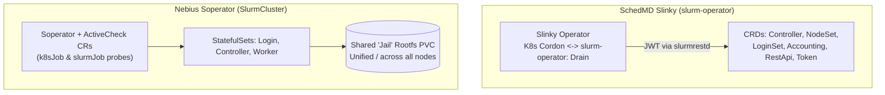

# 6.16 Slurm on Kubernetes: Slinky and Soperator

| | |
|---|---|
| Level | Advanced |
| Priority tier | 2 |
| Lab venue | kind or a GPU Kubernetes cluster |
| Part | Part 6: HPC and Slurm |
| Status | Drafted from the projects' own repositories and docs, read in shallow clones on 2026-10-24: SlinkyProject/slurm-operator (commit `7e01fc1`, 2026-10-21) and nebius/soperator (commit `b2a58e1`, 2026-10-23). Nothing was deployed. CoreWeave's SUNK is proprietary and described from general knowledge only. No lab step was run on a cluster. |

## Why this matters for AI infrastructure

Picture two engineering teams that share one AI cluster. The first team is made up of researchers and HPC veterans. They want Slurm, with its gang-scheduled multi-node jobs, fair-share policy, accounting and `sbatch`. Gang scheduling means all the pieces of a job start together or not at all, which a multi-node training run needs. The second team is the platform team. They want Kubernetes, with declarative infrastructure, GitOps, self-healing, multi-tenant services and one control plane for training, inference and data services. GitOps means the cluster's desired state lives in Git, and a tool keeps the cluster matching it.

Neoclouds such as CoreWeave and Nebius, along with large AI labs, run Kubernetes everywhere, so they also need Slurm on top of it. A neocloud is a cloud provider built specifically around GPU capacity. Knowing how that stack is built, and what it costs, matters directly for roles at those companies. The NVIDIA, CoreWeave and Nebius job families all touch it. When a hiring manager asks about this topic, they are usually asking whether you can keep both teams happy at once.

## Prerequisites and outcomes

This chapter builds on 6.7 to 6.15, 5.29 and 5.31 to 5.33, which cover custom resource definitions (CRDs), operators and how to read operator code. It also builds on 5.35, which covers multicluster setups. A CRD is a way of adding a new kind of object to Kubernetes, and an operator is a program that watches those objects and makes the real world match them. If those two ideas are new, read the Part 5 chapters first, because the rest of this chapter uses them constantly.

The chapter explains why and when to run Slurm on Kubernetes, compared with bare-metal Slurm or native Kubernetes batch schedulers. It describes Slinky's `slurm-operator` architecture, including its CRDs, the NodeSet controller, dynamic nodes and drain coordination. It also describes Soperator's design, with its `SlurmCluster`, jail, health checks and ephemeral nodes. It names the hard problems, which are node identity, shared state, upgrades, GPU drivers, InfiniBand, cgroups and containers in containers. Last, it helps you choose and evaluate an approach for a given platform, and gives you the questions to ask a vendor.

## 1. The motivation and the tension

Picture a research group whose training jobs run for days across many nodes, next to a platform team whose inference services never stop. Each team trusts a different scheduler, and each one has a good reason. The question is whether one cluster can serve both without making either team miserable. Slurm excels at "quickly scheduling workloads that run for a finite amount of time, with well-defined resource requirements and topology, on multiple nodes, with strict policy, but its resource pool is known". Kubernetes excels at "workloads that typically run for an indefinite amount of time, with potentially vague resource requirements, on a single node, with loose policy, but can scale its resource pool infinitely". That is the framing in the Slinky README, shortened here.

Teams combine the two for four reasons. The first is one infrastructure layer. The same Kubernetes cluster, node lifecycle, observability, CI/CD and security tooling serve both Slurm and non-Slurm workloads, so capacity can move between training on Slurm and inference on Kubernetes services. The second is declarative operations. The cluster is YAML in Git, and the operator handles bootstrap, upgrades and healing. The third is elasticity: Slurm workers run as pods that scale with demand, even down to zero. The fourth is isolation. Many small Slurm clusters, one per team or tenant, replace one huge shared cluster. Isolation here means that one team's bad job or bad upgrade cannot reach the other team's cluster.

The combination also has costs and risks. Two schedulers can disagree. Kubernetes places the Slurm worker pods, and Slurm places jobs onto those pods. That leads to capacity fragmentation, double accounting and confusing failure behaviour. Fragmentation means free GPUs exist but sit on pods that Slurm cannot use for the job at hand. A Kubernetes eviction can kill a Slurm node in the middle of a job, and the user sees a failure that nobody on the Slurm side caused.

Pods are not hosts. `slurmd` expects a machine, so cgroups, device access, systemd, SSH access, shared home directories, user identity, MPI/NCCL host networking and IB devices all need deliberate design. The operator, CRDs, storage classes and CNI are extra moving parts, and together they form a new failure domain. CNI is the network plug-in that gives each pod its address, and a failure there looks like a Slurm problem from the user's side. Performance is the final concern. AI training wants bare-metal-like networking, with host network, RDMA devices, SR-IOV or device plugins, and NUMA and CPU pinning. The container layers must not interfere with any of it.

Decide early whether your team can operate those extra layers before you move Slurm into pods. A team that already runs Kubernetes well has a head start. A team that has never debugged a CNI problem should expect a learning curve before the first production job.

## 2. Slinky: `slurm-operator`

Suppose your Slurm workers should grow and shrink the way Kubernetes workloads do. Slinky is SchedMD's answer to that, and the `slurm-operator` is the part you install. In practice, that means a new burst of demand can add worker pods, and a quiet afternoon can remove them, without someone editing `slurm.conf` by hand.



Read the Slinky half first. The operator watches a set of custom resources, and it talks to Slurm through `slurmrestd` using a JWT token. The arrow labelled cordon and drain is the key link, because it means a change on the Kubernetes side can drain a Slurm node. The Soperator half is different. Its operator drives groups of pods, and all of them mount the same shared jail. The two halves answer the same question in different ways, and the rest of this chapter explains each one.

Slinky is SchedMD's project, and SchedMD maintains Slurm itself. The operator manages the lifecycle of Slurm components as Kubernetes resources. That covers creation, upgrade and graceful shutdown. Graceful shutdown means a component is drained or stopped cleanly rather than killed. A Helm chart serves as the reference deployment. Helm is the Kubernetes package manager, and a chart is a bundle of templates that installs the whole set in one step.

### CRDs (from `config/crd/bases` and the README)

The operator defines six custom resources, and each one maps to a piece of the Slurm cluster. Read the table as a map of which object does what. Each row names one kind of object and the Slurm part it stands for, so you can find the right object when something needs changing.

| CRD | Represents |
|---|---|
| `Controller` | The Slurm control plane (`slurmctld`); HA by enabling `controller.ha.enabled` and a ReadWriteMany PVC for state (`controller.persistence.existingClaim`), matching the shared `StateSaveLocation` requirement of 6.15; configuration changes recreate controller pods by default, or reconfigure in place with `controller.inplaceReconfigure=true` |
| `NodeSet` | A set of homogeneous Slurm workers (`slurmd` pods). `scalingMode` selects **StatefulSet** behaviour (fixed `replicas`, stable ordinal names such as `gpu-2-1`, scale-to-zero, HPA compatible) or **DaemonSet** behaviour (one pod per matching Kubernetes node, `replicas` ignored, 1:1 mapping between Kubernetes nodes and Slurm nodes) |
| `LoginSet` | Login (submit) nodes using SSSD for identity; scale to zero supported |
| `Accounting` | `slurmdbd` and its database connection |
| `RestApi` | `slurmrestd` |
| `Token` | JWT/authentication tokens for the REST API and operator-to-Slurm calls |

The `NodeSet` row carries most of the choice. Its `scalingMode` decides whether workers behave like a StatefulSet or a DaemonSet. A StatefulSet gives each pod a stable name and a fixed count. A DaemonSet puts one pod on every matching Kubernetes node. Pick the mode that matches how your nodes are owned, because the two behave very differently when a node disappears.

### How the operator talks to Slurm

Picture the operator about to delete a worker pod in the middle of the night. Kubernetes has decided the pod is no longer needed, but a Slurm job might still be running on it. The key idea is that the operator must make Kubernetes decisions, such as scaling in, upgrading or replacing a pod, with knowledge of Slurm state. So it keeps a map of Slurm clients, reached through `slurmrestd` with JWT, and it consults them before it acts. The architecture docs name the Slurm features it depends on. Configless operation lets workers fetch their configuration from the controller. `auth/slurm` and `auth/jwt` handle authentication. Dynamic nodes let pods register with the controller at startup, rather than being listed in `slurm.conf`. That is how elastic pods can exist; see 6.15. Dynamic topology and node features are also required.

Design points from `docs/concepts/nodeset-controller.md`:

- Node state visibility: each NodeSet pod carries pod conditions that mirror its Slurm node state, such as Idle, Allocated, Mixed, Down, Drain, Not Responding... So `kubectl` shows the scheduler state. An operator can check the pod and see whether Slurm thinks the node is busy, without logging in to the controller.
- Scale-in lifecycle: before deleting a pod, the controller drains its Slurm node and waits until the node is drained, meaning no running jobs. Then it deletes the pod. If the node is still busy, it checks again later. Upgrades follow the same pattern. The wait is the safety net. A pod is never removed while a job is still using it.
- Drain and cordon coordination: cordoning a Kubernetes node triggers a Slurm drain of the pods on it. Annotating a pod with a pod-cordon annotation drains the Slurm node, and uncordoning reverses it. The controller also sets the annotation itself when it selects a pod for scale-in. Cordon is the Kubernetes word for marking a node as not accepting new pods.
- Hybrid support: some Slurm components can run in Kubernetes and others outside it, for example controllers on bare metal with elastic worker pods in Kubernetes. The design supports this. A site that already has a bare-metal controller can add elastic capacity without moving the controller.
- Compatibility: the README's matrix ties operator releases (1.0.x to 1.3.x) to supported Kubernetes minors, 1.35 and later at the time of reading. The project follows upstream Kubernetes support. Check the matrix before any Kubernetes upgrade, because an operator release that does not support the new minor version will not start cleanly.

**All drain reasons the operator sets are prefixed `slurm-operator:`. Reasons without that prefix are treated as externally owned, set by admins or health-check tools through `scontrol`, and they are never modified or cleared.**

That last rule is the same discipline built into the GPU health operator in 5.32. You mark what you changed, touch only what you marked, and never undo a human's drain. It is the central safety property of any controller that shares a resource with people and other automation. Think of the prefix as a name tag on the drain. When the operator sees a tag it wrote, it may remove it. When it sees a tag from someone else, it leaves the drain alone, even if that drain is inconvenient.

### What it does not do for you

Slinky manages Slurm daemons, but it does not install GPU drivers or the NVIDIA stack. Use the GPU Operator, 5.33, for that. It does not provide the fabric, which means the network operator and SR-IOV, and it does not solve user home directories or shared software for you. You supply the storage classes for those. The reference chart is configurable, but you own the integration.

Picture a team that installs Slinky, submits its first GPU job, and then finds that no GPU is visible inside the pod. The operator did its job. The driver layer was simply never part of its scope. Plan the driver, fabric and storage pieces as separate work, because Slinky will not hand them to you.

## 3. Soperator (Nebius)

Suppose you need a complete AI-oriented Slurm cluster, with login, controller and worker nodes, and you want to describe all of it in one object. Soperator does that. One `SlurmCluster` custom resource turns into the whole cluster. The Nebius repository (`nebius/soperator`) calls it "an open-source Kubernetes operator for running Slurm clusters for AI training and high-performance computing". The README names three goals: simple cluster management, high reliability and efficient GPU use. The single object is the main appeal, because a new cluster becomes a file you can review, version and copy.

### Architecture (from `docs/architecture.md`)

The cluster has three node types, each a group of Kubernetes pods run as StatefulSets: Login, Controller and Worker, which is also called Compute. The operator is built with Kubebuilder, and its top-level reconcile code lives in `internal/controller/clustercontroller/reconcile.go`. Kubebuilder is the framework for writing Kubernetes operators in Go, and reconcile is the loop that keeps comparing the desired state with the actual state. Slurm and system config files are rendered into ConfigMaps, while Munge and SSH server keys live in Secrets. A ConfigMap holds ordinary configuration, and a Secret holds sensitive values such as keys. Container file systems are ephemeral, so persistence uses Persistent Volumes. Ephemeral means the container's own disk is thrown away when the container restarts, so anything you need to keep must live on a volume.

The jail is the real magic. A shared Persistent Volume, called the *jail*, is mounted on all worker and login nodes. Inside it sits another root directory, which may belong to a different Linux distribution. When a user logs in or runs a job, the jail becomes that user's `/`. A package installed, a user created or a checkpoint written on one node therefore appears on every node. This removes per-node drift, the classic "software differs between nodes" problem of 6.6 and 6.22. It makes Slurm behave like a bare-metal cluster with a golden shared image. A golden image is one reference copy of the software that every node is built from. The cost is that the jail is shared storage on the critical path. Performance of `/usr` and Python imports depends on it, and so do locking and the blast radius of a corrupted root. The storage backend choice therefore matters.

Picture a user who installs a package on the login node, logs in again the next morning, and finds the same package on a worker. That is the jail working as intended. Now picture a bad edit to the shared root during a busy day. Every node sees the same bad file at once, which is the blast radius the table below names.

Images carry much of the product logic, including drivers, CUDA, NCCL, `nccl-tests`, Slurm builds, SSSD and SSH. The README stresses a preinstalled training stack with an explicit CUDA-to-NCCL version mapping. Keeping that mapping explicit means you can check that the CUDA runtime and the NCCL library agree before a long run starts. The docs advise you to derive your images from the provided ones rather than write your own.

Health checks come in two forms. Passive checks watch control-plane signals and node conditions, such as NVMe health. Active checks come from `ActiveCheck` custom resources, which run scheduled probes as either Kubernetes Jobs or Slurm jobs, on some or all nodes. The probes cover GPU performance, the system, storage, network and InfiniBand, and hardware acceptance. A failed node is drained and replaced automatically. Checks are deployed through GitOps with Flux as a Helm chart, and cluster owners can customise them. A passive check tells you that something looks wrong, while an active check actually runs a test to prove it.

Worker nodes can be created on demand and scaled down when unused. The operator is also aware of InfiniBand topology, which shapes placement constraints, and it excludes CPU-only nodes from the IB tree. Placement constraints keep a job's nodes close together on the fabric, so the traffic between them does not cross slow links.

The integrations include SSSD (LDAP, AD or FreeIPA), Tailscale for SSH, Prometheus, Grafana and Loki, Helm, Argo or Flux, cert-manager, Cilium, and the NVIDIA GPU Operator. SSSD is the Linux service that connects a host to a directory of users, such as LDAP or Active Directory. Container jobs use Pyxis and Enroot with OCI runtimes, which 6.13 covers.

Versions at the time of reading, per the README, were Ubuntu 24.04 node images, a Nebius-patched Slurm 26.05 build, CUDA 13.x, NCCL 2.28 or newer, and Kubernetes 1.35 or newer. The `docs/limitations.md` file lists a single partition, GPUs required and scaling-down leftovers in `sinfo`. That file appears to lag the README, which mentions CPU-only exclusion handling and fuller scheduling features. Trust neither blindly. Check the current releases and test your own requirements. A limitation listed in one file can be fixed in the other, so the two disagree until someone checks the code.

### Deployment options

You can self-deploy on any Kubernetes cluster, or use Nebius-managed services, which the README lists as managed Soperator and a "Pro" tier with engineering support. Terraform recipes in the repository target Nebius. Terraform is the infrastructure-as-code tool that creates cloud resources from text files, so the recipes describe the Nebius setup in a repeatable form.

Before you adopt Soperator, decide whether you will self-deploy it or buy the managed service. The answer depends on how much of the stack you want to own, and on whether your team has the people to run an operator on top of GPUs at night.

## 4. SUNK and other approaches (general knowledge, unverified)

Picture a team reading a vendor deck that mentions SUNK, and wondering whether it is the same thing as Slinky or Soperator. It is not, and the sources for this chapter cannot settle the details. Not every platform runs Slurm the way Slinky and Soperator do. CoreWeave offers SUNK (Slurm on Kubernetes), a proprietary integration that exposes Slurm to customers on CoreWeave's Kubernetes-native cloud. Its scheduling is Kubernetes-aware, so Slurm jobs and Kubernetes workloads can share nodes. The sources for this chapter do not describe SUNK further, so check CoreWeave's documentation for the details.

Other patterns exist too. Run:ai or Kueue can act as the primary scheduler behind a "Slurm-like" front end. A front end is the part users type commands into, while the scheduler behind it does the placement. Volcano is another option, as are custom Slurm-in-container projects and vendor stacks. NVIDIA Base Command Manager can manage both approaches, as Part 8 covers.

## 5. Choosing

Picture a planning meeting with three proposals on the table. One team wants bare metal, one wants Kubernetes everywhere, and one wants both. The right design depends mostly on your workload mix and on how many people will operate the cluster. The table gives a starting point. Use it to frame the discussion, then check the answer against your own workloads.

| Question | Lean toward |
|---|---|
| Many existing Slurm users/scripts, multi-node training dominant | Slurm (bare metal or Slurm on Kubernetes) |
| Mixed training and inference on shared GPUs, GitOps everywhere | Slurm on Kubernetes (Slinky/Soperator/SUNK) or Kubernetes-native (Kueue + JobSet/Kubeflow Trainer) |
| Small team, few clusters | Whatever you can operate: bare-metal Slurm is simplest to reason about |
| Strong multi-tenant isolation with different images and policies | Several small Slurm clusters on Kubernetes |
| Maximum, predictable network performance with minimal layers | Bare-metal Slurm or Slurm on Kubernetes with host networking and device passthrough, validated by `nccl-tests` (6.28) |
| Need Kubernetes-native tooling for researchers (notebooks, services, pipelines) | Kubernetes-native batch (Part 11, 14) |
| Platform vendor provides it (Nebius managed, CoreWeave SUNK) | Use the managed option unless you need control |

Notice that the managed options win whenever you do not need deep control of the stack. A managed service moves the operating burden to someone whose full-time job it is, and that trade is often worth the loss of control.

Before you commit, put these evaluation questions to the vendor or to your own team. How are GPU drivers and the host stack provided to worker pods? How do pods get RDMA devices and pin CPUs? How is user identity and `$HOME` handled? What is the state-storage and HA story? What happens on node failure mid-job, through requeue, drain or replacement? How are upgrades sequenced across Slurm version, operator, Kubernetes and drivers, and can they be rolled back? What is the scaling model, static or ephemeral? How do Kubernetes quota and priority interact with Slurm fair-share? Who owns observability and on-call? Is there a path to run it multi-cluster? Write the answers down. A vendor who cannot answer several of them plainly is telling you something about the next incident.

## 6. Operating considerations

Picture the first upgrade of a Slurm-on-Kubernetes cluster, where the Kubernetes version, the operator and Slurm all need to move. Two control planes mean two upgrade tracks. Pin the Kubernetes, operator, Slurm and driver versions together, read the compatibility matrices, and stage each upgrade. The rules from 6.15 apply to the Slurm inside the cluster.

Failure behaviour depends on the drain path. A Kubernetes node drain or eviction must become a Slurm drain first, and the operators implement this. A hard node failure still kills the job, so checkpointing remains essential. A checkpoint is a saved copy of the training state, so a restarted job can resume rather than start from the beginning.

Keep controller state on RWX storage for Slinky HA, or on a PVC with backups. RWX means ReadWriteMany, a storage mode that lets several pods read and write the same volume. A PVC is a PersistentVolumeClaim, the request a pod makes for storage. Run the accounting database as a managed service, or operate it yourself with backups.

Worker pods should request whole nodes' GPUs, CPUs and memory, with `Guaranteed` QoS, the `static` CPU manager policy and the topology manager. That way Kubernetes does not oversubscribe or throttle them; see 5.9 and 5.11. QoS is the quality-of-service class Kubernetes gives a pod, and Guaranteed is the strictest one, which needs requests equal to limits.

Watch DCGM, node and Slurm metrics through the Slurm exporter, the logs from the `slurmctld` and `slurmd` pods, and the ActiveCheck results from Part 17. A dashboard that shows only one of these will miss the problems that sit between layers.

Privileged or capability-rich pods are needed for `slurmd`, cgroup management and device access. A privileged pod is one that has nearly all the powers of the host, so treat it with care. So isolate namespaces, restrict who can edit the custom resources, and protect the Munge and JWT secrets (see 5.21). A namespace is the Kubernetes way of separating groups of objects, and it is the first wall to put around this kind of pod.

Decide which versions you will pin together and how you will roll them back before you upgrade anything. A rollback plan written after the upgrade has already started is usually too late.

## 7. Reading the code (follows 5.33)

Picture a code review of an operator that you did not write, due by the end of the week. The method from 5.33 gives you a path through it, so you do not get lost in the generated files. When you read the code, follow the method from 5.33. Start at the API types, then move to `SetupWithManager`, `Reconcile`, state and rendering, and readiness. `SetupWithManager` is where the operator registers what it watches, and readiness is how it decides a component is ready to serve. For Slinky, read `api/`, `internal/controller/nodeset` and `docs/concepts/*`. For Soperator, read `api/`, `internal/controller/clustercontroller/reconcile.go`, `images/`, `docs/architecture.md` and `docs/active-checks.md`.

Slinky resembles the GPU Operator in one way: it models components as custom resources (CRs) with a drain-aware lifecycle. Soperator goes further, because it also owns the image and the root filesystem. Compare the two against the GPU Operator before you decide which pattern to adopt. The GPU Operator is the closest model you already know from Part 5, so it makes a good baseline for the comparison.

## 8. Lab (self-checking operator state-machine lab tested; Kubernetes cluster parts untested)

The lab has two parts, and you can start with the self-checking Python script. It runs locally and needs no cluster. Start there because it tests the drain logic in isolation, which is the part most likely to hurt a shared cluster.

The script checks Slinky's `NodeSet` drain and cordon logic. It exercises the scale-in state machine in `reconcile_slinky_node_drain` and proves that pod deletion waits for `DRAINED`. It also shows that the function never overwrites or clears an external admin or health-check drain reason, one without the `slurm-operator:` prefix. Next, it validates Slinky's 6 CRDs (`Controller`, `NodeSet`, `LoginSet`, `Accounting`, `RestApi`, `Token`) and the RWX PVC HA requirement. Last, it checks Soperator's `SlurmCluster` model, with its `Login`, `Controller` and `Worker` groups, the shared `jail`, and `ActiveCheck` in both `k8sJob` and `slurmJob` form.

```bash
python3 code/part06/slinky_soperator_lab.py
```

Run the command from the repository root, so the relative path works. A pass here shows that the logic matches the design in the docs. It does not show that a real Kubernetes cluster will behave the same way.

The second part runs on a Kubernetes test cluster, either `kind` or a GPU cluster. These steps were not run on a cluster, so expect surprises. Work through them in order, and watch what your cluster does at each one.

1. On `kind`, install cert-manager and the Slinky chart. Create a `Controller` and a `NodeSet` with CPU workers. Submit a Slurm job from a `LoginSet` pod. Then scale the `NodeSet` and watch `sinfo` drain nodes before their pods are deleted.
2. Cordon a Kubernetes node and watch the Slurm node move to DRAIN with a `slurm-operator:` reason. Then set your own reason with `scontrol` and confirm that the operator preserves it.
3. Read the Soperator docs and write a one-page comparison with Slinky. Cover the node model, the shared filesystem, health checks and the image strategy.
4. On paper, design a GPU deployment. It needs the GPU Operator, the network operator, Soperator or Slinky, storage for the jail or state, and the IB topology. List the failure drills.
5. Run `nccl-tests` as a Slurm job inside the Kubernetes-hosted Slurm. Compare its bus bandwidth with the bare-metal figure for the same nodes. This step needs hardware.

## 9. Interview angles

Picture a senior interviewer who asks you to explain, out loud, how a Slurm worker leaves a cluster without hurting a running job. These questions test whether you can answer that kind of question. Use them to test your understanding before an interview.

- Why run Slurm on Kubernetes? What problems does it introduce?
- Describe how an operator should scale in a Slurm worker pod safely.
- How does the operator distinguish its own drains from an administrator's?
- What is the Soperator jail and what are its trade-offs?
- Slinky NodeSet StatefulSet vs DaemonSet scaling modes?
- How would you give Slurm pods RDMA and pinned CPUs?
- How do you upgrade Slurm, the operator and Kubernetes in a Slurm-on-Kubernetes cluster?
- When would you choose Kueue and JobSet instead?

### 6.1 Deep dive: Tuning Kubernetes worker pods for bare-metal RDMA and NCCL performance

Suppose your team moves a GPU training job from bare-metal Slurm into Slurm on Kubernetes. The first worry is simple: will `slurmd` inside a pod slow down multi-node training? The answer depends on how the `slurmd` worker PodSpec is configured on the Kubernetes nodes underneath. A PodSpec is the part of a pod's definition that describes its containers, resources and settings. An untuned default pod uses virtual bridge networking, time-sliced CPU scheduling, and a small default limit on locked memory. Those defaults break GPUDirect RDMA and add milliseconds of jitter to AllReduce. To match bare metal inside a `slurmd` pod, check five things on the pod and the kubelet. The kubelet is the agent on each Kubernetes node that starts and watches the pods assigned to it.

1. Pin the pod's resources. Give every `slurmd` worker pod on a GPU node equal requests and limits for CPU, memory, and `nvidia.com/gpu`, so Kubernetes assigns it the Guaranteed QoS class. Then set the kubelet to `cpuManagerPolicy: static` and `topologyManagerPolicy: single-numa-node`. The pod's CPUs, memory, GPUs, and network cards then stay together on one NUMA node, away from background node agents. A NUMA node is one memory and CPU group inside a multi-socket server, and staying on one of them keeps memory access fast.
2. Lift the locked-memory limit. RDMA needs to pin memory, and a default container limit of 64 KB or 64 MB stops that. Multi-node NCCL jobs then fail at start inside the pod. Configure `containerd`, or the pod's security context, so that `ulimit -l` reports `unlimited` inside `srun` job steps. Pinning memory means the kernel must keep it in RAM and never swap it out, and the device needs that guarantee to copy data directly.
3. Pass the RDMA devices through. GPU traffic between nodes skips the kernel TCP/IP stack only if the pod can open `/dev/infiniband/uverbs*` and `/dev/infiniband/rdma_cm`. Grant that with the NVIDIA Network Operator, an RDMA shared device plugin, or SR-IOV passthrough, plus the `IPC_LOCK` capability. The pod then runs with `hostNetwork: true` on the compute fabric, or attaches extra RDMA interfaces through Multus CNI. Multus is a meta-plugin that lets a pod have more than one network interface.
4. Enlarge `/dev/shm`. PyTorch data-loader workers and NCCL use gigabytes of shared memory there, but Kubernetes caps it at 64 MiB by default. A multi-GPU job then crashes on step 1 with `Bus error (core dumped)`. Mount a memory-backed `emptyDir` with `medium: Memory` and a `sizeLimit` of 64Gi or 128Gi at `/dev/shm` on every `slurmd` pod. An emptyDir is a scratch volume that Kubernetes creates for a pod, and the memory medium keeps it in RAM.
5. Coordinate the drain. Two control planes now watch the same node, and neither `kubectl drain` nor a cluster autoscaler may kill a `slurmd` pod in the middle of a 64-node training job. The lab in `code/part06/slinky_soperator_lab.py` models how the operator prevents this. It intercepts node cordoning and pod deletion through PodDisruptionBudgets and finalizers, and it sets the Slurm node to `DRAIN` with `Reason="slurm-operator: node-cordoned"`. A PodDisruptionBudget limits how many pods a voluntary action may remove at once, and a finalizer is a marker that stops an object from being deleted until a controller clears it. It waits until the pod's jobs finish and the node reaches `DRAINED`, and only then lets the pod go. A manual hardware drain, such as `Reason="Xid79 GPU3 ticket INC123"`, survives Kubernetes uncordons.

### 6.2 Comparing Slinky, Soperator, BCM Auto Scaler (`cm-scale`, Ch. 6.31 & 8.1), and Native Kubernetes (`Kueue`)

Picture an interviewer asking how you would share a fleet of 1,024 GPUs between Slurm training researchers and Kubernetes inference services. There is no single correct answer, but there are four patterns that production sites use, and each one makes a different trade. Compare the four production patterns below on operational ownership and workload isolation. Ownership asks who runs the nodes, and isolation asks how much one group's work can affect another's.

| Architecture Pattern | How It Works | Best For | Key Operational Trade-Off |
|---|---|---|---|
| **1. SchedMD Slinky (`slurm-operator`)** | Runs `slurmctld`, `slurmdbd`, `slurmrestd`, `sackd`, and `slurmd` `NodeSet` pods as Kubernetes CRDs; syncs K8s cordon/scale-in with Slurm `DRAIN` | Cloud-native platform teams who want Kubernetes as the single substrate while giving researchers standard `sbatch`/`srun` clusters | Requires careful pod-in-pod / Enroot privilege configuration and RWX storage for `StateSaveLocation` |
| **2. Nebius Soperator** | Kubernetes operator that mounts a shared PersistentVolume (`jail`) as a unified `chroot` root filesystem across all `Login` and `Worker` pods, with built-in `ActiveCheck` CRDs | Multi-user research teams who want a traditional shared-OS HPC login/worker experience (`apt install` once, visible everywhere) on top of K8s | Shared rootfs (`jail`) requires high-IOPS parallel storage; an uncoordinated edit in `jail` affects all nodes in that Slurm cluster |
| **3. BCM Auto Scaler (`cm-scale`, Ch. 6.31 & 8.1)** | Bare-metal nodes run native OS; BCM dynamically switches idle nodes between `slurm-client` and `kube-worker` configuration overlays based on queue demand | Bare-metal DGX SuperPODs managed by NVIDIA Base Command Manager where zero container-nesting overhead is desired | Repurposing happens at whole-node, between-job boundaries rather than sub-node pod packing |
| **4. Pure Kubernetes Batch (`Kueue` + `JobSet` / `Kubeflow`)** | Eliminates Slurm completely; all training and inference run as native Kubernetes pods gang-scheduled by `Kueue` with `TopologyAwareScheduling` | Organizations whose ML engineers are already 100% cloud-native (`kubectl`, YAML/Helm, Ray, PyTorchJob) and have no legacy `sbatch` scripts | Researchers accustomed to `salloc`, `srun`, and `.sbatch` scripts must migrate their workflows to Kubernetes manifests |

Patterns one and two keep Slurm inside Kubernetes, pattern three keeps the bare-metal OS, and pattern four removes Slurm entirely. Choose by asking who owns the nodes and how much isolation the workloads need. Read the trade-off column first, because it names the cost you will pay on day one.

## Exercises

1. Run `python3 code/part06/slinky_soperator_lab.py` first. A busy `ALLOCATED` pod is picked for scale-in. Trace `reconcile_slinky_node_drain()` and say what `can_delete_pod` is at each step.
2. A node carries the admin drain `Reason="Xid79 GPU3 ticket INC123"`. The Kubernetes node is then uncordoned. Show that the operator leaves the reason in place.
3. A node carries the operator drain `Reason="slurm-operator: node-cordoned"`. What happens to it on uncordon?
4. Slinky has six CRDs: `Controller`, `NodeSet`, `LoginSet`, `Accounting`, `RestApi`, and `Token`. Say in one sentence what each one is for.
5. When would you choose `scalingMode: StatefulSet` for a `NodeSet`? When would you choose `scalingMode: DaemonSet`?
6. Why does `controller.ha.enabled: true` need a `ReadWriteMany` PersistentVolumeClaim?
7. Soperator mounts a shared volume as the root filesystem, called the jail, for all login and worker pods. What does a user gain from that? What storage speed does it demand? What is the blast radius of a bad edit?
8. Kubernetes node conditions are passive, and Soperator's `ActiveCheck` resources run in `k8sJob` or `slurmJob` mode. Which kind would you use to check NVMe and mount readiness? Which kind would you use to run `nccl-tests`?
9. List the pod and kubelet settings that let a `slurmd` pod reach bare-metal NCCL bandwidth. Name the QoS class. Name the two kubelet policies. Name the RDMA device setup and the locked-memory limit.
10. A national lab runs only MPI jobs under Slurm. Which architecture from the comparison table fits it, and why?
11. A neocloud moves GPUs between customer Slurm clusters and Kubernetes vLLM endpoints. Which architecture fits it?
12. A cloud-native ML platform runs Ray, Kubeflow Trainer, and JobSet. Which architecture fits it?

Before you start, decide which of these you can run on a real cluster and which you can only answer on paper.

## Checkpoint

<details>
<summary>1. How does the Slinky documentation contrast the scheduling strengths of **Slurm** versus **Kubernetes**, and why do AI platforms combine them?</summary>

Slurm is strong at finite, tightly coupled multi-node jobs. It handles strict topology, gang scheduling and fair-share policy across a known pool of resources. Kubernetes is strong at indefinite services and elastic workloads. It offers declarative GitOps reconciliation, self-healing and dynamic cluster autoscaling. Combining them lets an AI platform run Slurm training clusters and Kubernetes inference and data services on one Kubernetes node fleet, under one GitOps control plane.
</details>

<details>
<summary>2. What are the four main architectural costs and risks of running Slurm on top of Kubernetes?</summary>

1. **Two schedulers:** Kubernetes places `slurmd` worker pods onto nodes while Slurm places jobs onto those pods. That can fragment capacity, or let uncoordinated pod evictions kill multi-node jobs.
2. **Pods are not VMs or hosts:** `slurmd` expects host-level cgroups, `/dev/nvidia*`, `/dev/infiniband/*`, SSH, SSSD/LDAP identity and shared filesystems inside a container.
3. **Extra operational complexity:** Operator CRDs, RWX storage classes and CNI/SR-IOV plumbing add failure domains.
4. **Performance sensitivity:** A misconfiguration in host networking, RDMA passthrough or NUMA CPU pinning degrades multi-node `NCCL` throughput.
</details>

<details>
<summary>3. Who maintains **Slinky (`slurm-operator`)** and who maintains **Soperator**?</summary>

Slinky (`SlinkyProject/slurm-operator`) is maintained by SchedMD, the creators and maintainers of Slurm. Soperator (`nebius/soperator`) is an open-source Kubernetes operator maintained by Nebius.
</details>

<details>
<summary>4. Name the six Custom Resource Definitions (CRDs) provided by Slinky's `slurm-operator`.</summary>

1. **`Controller`**, the `slurmctld` control plane.
2. **`NodeSet`**, a homogeneous group of `slurmd` compute worker pods.
3. **`LoginSet`**, SSH submission pods with SSSD identity.
4. **`Accounting`**, the `slurmdbd` accounting daemon.
5. **`RestApi`**, the `slurmrestd` REST daemon.
6. **`Token`**, the JWT authentication tokens for `slurmrestd` and operator-to-Slurm communication.
</details>

<details>
<summary>5. Compare `scalingMode: StatefulSet` and `scalingMode: DaemonSet` in a Slinky `NodeSet`.</summary>

- **`StatefulSet` mode:** It manages a fixed `replicas` count of `slurmd` pods. Each pod keeps a stable ordinal hostname, such as `gpu-2-0` or `gpu-2-1`. This mode supports scale-to-zero and the Kubernetes Horizontal Pod Autoscaler (HPA).
- **`DaemonSet` mode:** It runs exactly one `slurmd` pod per matching Kubernetes node and ignores `replicas`. That gives a strict 1:1 mapping between physical Kubernetes nodes and Slurm compute nodes.
</details>

<details>
<summary>6. Which four modern Slurm features does Slinky's `slurm-operator` rely on to manage dynamic worker pods?</summary>

The operator relies on four features:

1. **Configless Slurm**, where `slurmd` and `sackd` fetch their configuration from `slurmctld`.
2. **`slurmrestd` with `auth/jwt`**, which lets the operator query and drain Slurm nodes over HTTP REST.
3. **`auth/slurm`** internal authentication.
4. **Dynamic nodes (`slurmd -Z`)**, where worker pods register with `slurmctld` on startup, with no static `NodeName` edits in `slurm.conf`.
</details>

<details>
<summary>7. How does Slinky configure high availability (`HA`) for the `Controller` CRD?</summary>

Set `controller.ha.enabled: true` and give the `Controller` a **`ReadWriteMany` (`RWX`) PersistentVolumeClaim** through `controller.persistence.existingClaim`. That claim serves as the shared `StateSaveLocation` for the primary and standby `slurmctld` pods. You can optionally set `controller.inplaceReconfigure: true` to reload configs without recreating pods.
</details>

<details>
<summary>8. Walk through the safe scale-in lifecycle when Slinky's `NodeSet` controller reduces replica count.</summary>

Before the `NodeSet` controller deletes a target `slurmd` pod, it marks that pod with a pod-cordon annotation. It then calls `slurmrestd` to put the matching Slurm node into **`DRAIN`** with `Reason="slurm-operator: ..."`. It waits until every running Slurm job on that pod finishes, meaning the node reaches `DRAINED` with no allocated jobs. Only then does it delete the Kubernetes pod.
</details>

<details>
<summary>9. Why does Slinky prefix all operator-initiated Slurm drain reasons with `slurm-operator:`, and how does it treat reasons without that prefix?</summary>

The `slurm-operator:` prefix records who owns a drain. Suppose an administrator, or a `HealthCheckProgram`, drains a node with `scontrol` and gives a reason without that prefix, such as `"Xid79 GPU3"`. Slinky then treats that drain as externally owned. It refuses to overwrite the drain or to resume the node automatically when Kubernetes node cordons change.
</details>

<details>
<summary>10. How does cordoning or uncordoning a Kubernetes node propagate to Slurm in Slinky?</summary>

When you run `kubectl cordon` on a Kubernetes node, Slinky's controller detects the node's `Unschedulable` taint or condition. It then drains the `slurmd` pod or pods on that node with a `slurm-operator:` reason. When you run `kubectl uncordon`, Slinky resumes the Slurm node automatically, but only if its drain reason still carries the `slurm-operator:` prefix.
</details>

<details>
<summary>11. What does Slinky's "hybrid support" allow an infrastructure team to build?</summary>

It lets you run some Slurm components on bare metal while bursting elastic `NodeSet` worker pods inside a Kubernetes cluster. For example, an existing bare-metal `slurmctld` and `slurmdbd` pair with static compute nodes can keep running. The elastic pods connect to that same Slurm controller.
</details>

<details>
<summary>12. What are the three StatefulSet pod groups created by Nebius **Soperator** from a `SlurmCluster` custom resource?</summary>

1. **`Controller`**, the `slurmctld` control plane.
2. **`Worker`**, the `slurmd` GPU or CPU compute nodes.
3. **`Login`**, the SSH user entry nodes.
</details>

<details>
<summary>13. What is the **jail** in Nebius Soperator, what problem does it solve, and what is its main trade-off?</summary>

The **jail** is a shared PersistentVolume that holds a complete Linux root filesystem (`/`). It is mounted across all `Login` and `Worker` pods, and users who SSH in or run Slurm jobs execute `chroot`ed inside it.

- **Benefit:** Software drift between nodes disappears. An apt/pip package installed, a user created or a file written on a login node shows up immediately on every compute node, just as on a bare-metal cluster.
- **Trade-off:** The shared storage backend sits directly on the critical path for `/usr` binary loads and Python `import` storms. A corrupted jail filesystem also affects the entire cluster.
</details>

<details>
<summary>14. How do `ActiveCheck` custom resources work in Soperator, and what are their two execution modes?</summary>

`ActiveCheck` resources define automated health and performance probes. You deploy them through GitOps with Flux and Helm. They run in one of two modes: as Kubernetes `Job`s (`k8sJob`), or as Slurm batch jobs (`slurmJob`) across nodes. The probes test GPU health, InfiniBand bandwidth, storage and hardware acceptance. When a probe finds an unhealthy node, that node is drained and replaced automatically.
</details>

<details>
<summary>15. What is CoreWeave **SUNK**, and how does it relate to Slinky and Soperator?</summary>

SUNK (Slurm on Kubernetes) is CoreWeave's proprietary production integration. It runs Slurm clusters natively on CoreWeave's Kubernetes infrastructure, with node scheduling shared between Slurm jobs and Kubernetes workloads.
</details>

<details>
<summary>16. Why must `slurmd` worker pods on Kubernetes run with `Guaranteed` QoS and static CPU/topology pinning?</summary>

If `slurmd` pods run as `Burstable`, without integer CPU requests equal to limits (`Guaranteed` QoS), and without kubelet `static` CPU Manager and Topology Manager alignment, Kubernetes may throttle the pod's CFS quota. It may also migrate ranks across NUMA sockets, away from their allocated GPUs and RDMA NICs.
</details>

<details>
<summary>17. How do `slurmd` pods on Kubernetes obtain GPU drivers and InfiniBand RDMA access?</summary>

Two NVIDIA operators provide the access. The GPU Operator injects host driver libraries and `/dev/nvidia*` devices. The Network Operator provides MOFED drivers, SR-IOV or RDMA device plugins, or `hostNetwork` access to `/dev/infiniband/*`.
</details>

<details>
<summary>18. How do the two upgrade tracks (Kubernetes/Operator vs Slurm) interact in a Slurm-on-Kubernetes deployment?</summary>

You must follow both the Kubernetes operator compatibility matrices and Slurm's own upgrade rules. Chapter 6.15 gives the Slurm order: `slurmdbd -> slurmctld -> slurmd -> clients/pyxis`. Upgrades stay within the 2- or 3-major compatibility window. Take pre-upgrade backups of `StateSaveLocation` and MySQL before you start.
</details>

<details>
<summary>19. When should a platform team choose **Slurm on Kubernetes** versus **native Kubernetes batch (`Kueue` + `JobSet` / `Kubeflow Trainer`)**?</summary>

- **Choose Slurm on Kubernetes** when researchers rely heavily on existing `sbatch` and `srun` workflows, Pyxis and Enroot `.sqsh` images, PMIx MPI and Slurm Fair Tree accounting. The infrastructure team, meanwhile, standardizes on Kubernetes for node lifecycle and inference sharing.
- **Choose Kueue and JobSet** when teams are already cloud-native, building Kubernetes containers, Ray jobs and Kubeflow pipelines. That gives a single scheduler stack without Slurm daemons inside pods.
</details>

<details>
<summary>20. Where in the Slinky and Soperator source trees do you start when auditing their reconciliation logic (following the Chapter 5.33 method)?</summary>

Start with the CRD API definitions in `api/`. Then trace controller registration and the main `Reconcile` loop. For Slinky, that means `internal/controller/nodeset` and `docs/concepts/nodeset-controller.md` in `SlinkyProject/slurm-operator`. For Soperator, look at `internal/controller/clustercontroller/reconcile.go`, `docs/architecture.md` and `docs/active-checks.md` in `nebius/soperator`.
</details>

## Sources and review notes

- Slinky: `README.md`, `docs/concepts/architecture.md`, `docs/concepts/nodeset-controller.md`, CRD names in `config/crd/bases` (`SlinkyProject/slurm-operator` commit `7e01fc1`).
- Soperator: `README.md`, `docs/architecture.md`, `docs/active-checks.md`, `docs/limitations.md` (`nebius/soperator` commit `b2a58e1`). All restated in our own words; short phrases quoted from the READMEs for the Slurm/Kubernetes contrast and the Soperator tagline.
- Context: Chapters 5.29 to 5.35 (operators and fleets), 6.13 and 6.15 in this part.
- Run here: `python3 code/part06/slinky_soperator_lab.py` (3 passed, 0 failed).
- Explicitly labelled inferences: `reconcile_slinky_node_drain` and `validate_slinky_crds` in `code/part06/slinky_soperator_lab.py` are deterministic teaching models of Slinky's documented `nodeset-controller.md` flowchart and CRD requirements.
- Not verified on live hardware: CoreWeave SUNK internal details, current feature completeness of either project on live clusters, and multi-node RDMA performance inside Slinky/Soperator pods (`untested here`).
