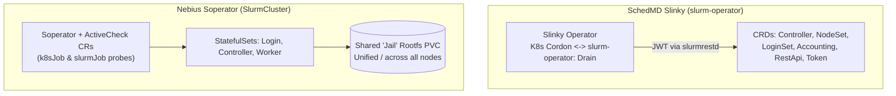

# 6.16 Slurm on Kubernetes: Slinky and Soperator

| | |
|---|---|
| Level | Advanced |
| Priority tier | 2 |
| Lab venue | kind or a GPU Kubernetes cluster |
| Part | Part 6: HPC and Slurm |
| Status | Drafted from the projects' own repositories and docs, read in shallow clones on 2026-10-24: SlinkyProject/slurm-operator (commit `7e01fc1`, 2026-10-21) and nebius/soperator (commit `b2a58e1`, 2026-10-23). Nothing was deployed. CoreWeave's SUNK is proprietary and described from general knowledge only. Labs **untested** |

## Why this matters for AI infrastructure

Two worlds meet in AI clusters. Researchers and HPC veterans want Slurm: gang-scheduled multi-node jobs, fair-share, accounting, `sbatch`. Platform teams want Kubernetes: declarative infrastructure, GitOps, self-healing, multi-tenant services, a single control plane for training, inference and data services. Neoclouds (CoreWeave, Nebius) and large AI labs run Kubernetes everywhere and therefore need Slurm on top of it. Knowing how that is built (and what it costs) is directly relevant to roles at those companies; the NVIDIA, CoreWeave and Nebius job families all touch it.

## Prerequisites and outcomes

Needs 6.7 to 6.15, 5.29 and 5.31 to 5.33 (CRDs, operators, reading operators), and 5.35 (multicluster). After this chapter you can:

- Explain why and when to run Slurm on Kubernetes versus bare-metal Slurm or native Kubernetes batch schedulers.
- Describe Slinky's `slurm-operator` architecture (CRDs, NodeSet controller, dynamic nodes, drain coordination) and Soperator's design (`SlurmCluster`, jail, health checks, ephemeral nodes).
- Identify the hard problems: node identity, shared state, upgrades, GPU drivers, InfiniBand, cgroups and containers in containers.
- Choose and evaluate an approach for a given platform, and list the questions to ask.

## 1. The motivation and the tension

Slurm excels at "quickly scheduling workloads that run for a finite amount of time, with well-defined resource requirements and topology, on multiple nodes, with strict policy, but its resource pool is known"; Kubernetes at "workloads that typically run for an indefinite amount of time, with potentially vague resource requirements, on a single node, with loose policy, but can scale its resource pool infinitely" (the Slinky README's framing, in my condensation). The reason to combine them:

- **One infrastructure layer**: the same Kubernetes cluster, node lifecycle, observability, CI/CD and security tooling for Slurm and non-Slurm workloads; capacity can move between training (Slurm) and inference (Kubernetes services).
- **Declarative operations**: cluster = YAML in Git; the operator handles bootstrap, upgrades, healing.
- **Elasticity**: Slurm workers as pods scale with demand (and to zero).
- **Isolation**: many small Slurm clusters per team or tenant instead of one huge shared one.

Costs and risks:

- **Two schedulers** can disagree: Kubernetes places Slurm worker pods; Slurm places jobs on those pods. Capacity fragmentation, double accounting, confusing failure semantics (a Kubernetes eviction kills a Slurm node mid-job).
- **Pods are not hosts**: `slurmd` expects a machine; cgroups, device access, systemd, SSH access, shared home directories, user identity, MPI/NCCL host networking and IB devices all need deliberate design.
- **Extra moving parts** (operator, CRDs, storage classes, CNI) and a new failure domain.
- **Performance sensitivity**: AI training wants bare-metal-like networking (host network, RDMA devices, SR-IOV or device plugins) and NUMA/CPU pinning; container layers must not interfere.

## 2. Slinky: `slurm-operator`



Slinky is SchedMD's project (the Slurm maintainers). The operator manages the lifecycle (creation, upgrade, graceful shutdown) of Slurm components as Kubernetes resources, with a Helm chart as a reference deployment.

### CRDs (from `config/crd/bases` and the README)

| CRD | Represents |
|---|---|
| `Controller` | The Slurm control plane (`slurmctld`); HA by enabling `controller.ha.enabled` and a ReadWriteMany PVC for state (`controller.persistence.existingClaim`), matching the shared `StateSaveLocation` requirement of 6.15; configuration changes recreate controller pods by default, or reconfigure in place with `controller.inplaceReconfigure=true` |
| `NodeSet` | A set of homogeneous Slurm workers (`slurmd` pods). `scalingMode` selects **StatefulSet** behaviour (fixed `replicas`, stable ordinal names such as `gpu-2-1`, scale-to-zero, HPA compatible) or **DaemonSet** behaviour (one pod per matching Kubernetes node, `replicas` ignored, 1:1 mapping between Kubernetes nodes and Slurm nodes) |
| `LoginSet` | Login (submit) nodes using SSSD for identity; scale to zero supported |
| `Accounting` | `slurmdbd` and its database connection |
| `RestApi` | `slurmrestd` |
| `Token` | JWT/authentication tokens for the REST API and operator-to-Slurm calls |

### How the operator talks to Slurm

The key idea: the operator must make Kubernetes decisions (scale in, upgrade, replace a pod) **with knowledge of Slurm state**. It therefore keeps a map of Slurm clients (via `slurmrestd` with JWT) and consults them. From the architecture docs it relies on required Slurm features: **configless** (workers fetch config from the controller), **`auth/slurm`** and **`auth/jwt`**, and **dynamic nodes** (pods register themselves with the controller at startup rather than being listed in `slurm.conf`; this is how elastic pods can exist; see 6.15), plus dynamic topology and node features.

Design points from `docs/concepts/nodeset-controller.md`:

- **Node state visibility**: each NodeSet pod carries pod conditions mirroring its Slurm node state (Idle, Allocated, Mixed, Down, Drain, Not Responding...), so `kubectl` shows scheduler state.
- **Scale-in lifecycle**: before deleting a pod the controller **drains** its Slurm node and waits until it is drained (no running jobs), then deletes the pod; if the node is still busy it checks again later. Upgrades follow the same pattern.
- **Drain and cordon coordination** (the flowchart in the doc): cordoning a Kubernetes node triggers a Slurm drain of the pods on it; annotating a pod with a pod-cordon annotation drains the Slurm node; uncordoning reverses it. The controller also sets the annotation itself when it selects a pod for scale-in. **All drain reasons the operator sets are prefixed `slurm-operator:`; reasons without that prefix are treated as externally owned (set by admins or health-check tools via `scontrol`) and are never modified or cleared.**

That last rule is the same discipline built into the GPU health operator in 5.32: mark what you changed, touch only what you marked, never undo a human's drain. It is the central safety property of any controller that shares a resource with people and other automation.

- **Hybrid support**: some Slurm components in Kubernetes and others outside (for example controllers on bare metal and elastic worker pods in Kubernetes), supported by design.
- **Compatibility**: the README's matrix ties operator releases (1.0.x to 1.3.x) to supported Kubernetes minors (1.35 and later at the time of reading); the project follows upstream Kubernetes support.

### What it does not do for you

Slinky manages Slurm daemons; it does not install GPU drivers or the NVIDIA stack (use the GPU Operator, 5.33), does not provide the fabric (network operator, SR-IOV), and does not itself solve user home directories or shared software (you provide storage classes). The reference chart is configurable but you own the integration.

## 3. Soperator (Nebius)

Soperator turns one `SlurmCluster` custom resource into a complete AI-oriented Slurm cluster, from the Nebius repository (`nebius/soperator`) described as "an open-source Kubernetes operator for running Slurm clusters for AI training and high-performance computing". Its README lists three goals: simple cluster management, high reliability, efficient GPU use.

### Architecture (from `docs/architecture.md`)

- Three node types, each a Kubernetes Pod group (StatefulSets): **Login**, **Controller**, **Worker/Compute**. The operator is built with Kubebuilder; the top-level reconcile code is `internal/controller/clustercontroller/reconcile.go`.
- Slurm and system config files are rendered into ConfigMaps; Munge and SSH server keys live in Secrets. Container file systems are ephemeral; persistence uses Persistent Volumes.
- **The jail**: the "real magic". A shared Persistent Volume (the *jail*) is mounted on all worker and login nodes and contains **another root directory**, possibly a different Linux distribution. When a user logs in or runs a job, the jail is their `/`. So a package installed, a user created or a checkpoint written on one node appears on all nodes. This removes per-node drift, the classic "software differs between nodes" problem of 6.6 and 6.22, and makes Slurm behave like a bare-metal cluster with a golden shared image. The cost: the jail is shared storage on the critical path (performance of `/usr` and Python imports; locking; blast radius of a corrupted root), so the storage backend choice matters.
- **Images** contain much of the product logic (drivers, CUDA, NCCL, `nccl-tests`, Slurm builds, SSSD, SSH): the README stresses a preinstalled training stack with an explicit CUDA-to-NCCL version mapping, and the docs advise deriving from the provided images rather than writing your own.
- **Health and replacement**: passive health checks (control-plane signals, node conditions such as NVMe health) and **`ActiveCheck`** custom resources that run scheduled probes either as Kubernetes Jobs or as Slurm jobs on some or all nodes (GPU performance, system, storage, network/InfiniBand, hardware acceptance); failed nodes are drained and replaced automatically. Checks are deployed through GitOps (Flux) as a Helm chart and can be customised by cluster owners.
- **Ephemeral nodes and autoscaling**: workers created on demand and scaled down when unused; **InfiniBand topology awareness** (placement constraints, excluding CPU-only nodes from the IB tree).
- **Integrations**: SSSD (LDAP/AD/FreeIPA), Tailscale for SSH, Prometheus/Grafana/Loki, Helm and Argo/Flux, cert-manager, Cilium, and the NVIDIA GPU Operator; Pyxis/Enroot and OCI runtimes for container jobs (6.13).
- **Versions at the time of reading** (README): Ubuntu 24.04 node images, a Nebius-patched Slurm 26.05 build, CUDA 13.x, NCCL 2.28 or newer, Kubernetes 1.35 or newer. The `docs/limitations.md` file (single partition, GPUs required, scaling-down leftovers in `sinfo`) appears to lag the README (which mentions CPU-only exclusion handling and fuller scheduling features); trust neither blindly: check the current releases and test your requirements.

### Deployment options

Self-deploy on any Kubernetes, or Nebius-managed services (managed Soperator, "Pro" with engineering support), per the README. Terraform recipes in the repository target Nebius.

## 4. SUNK and other approaches (general knowledge, unverified)

CoreWeave offers **SUNK** (Slurm on Kubernetes), a proprietary integration that exposes Slurm to customers on CoreWeave's Kubernetes-native cloud, with Kubernetes-aware scheduling so that Slurm jobs and Kubernetes workloads share nodes. Details beyond that are not public in the sources I have; use CoreWeave documentation. Other patterns: Run:ai or Kueue as the primary scheduler with a "Slurm-like" front end; Volcano; custom Slurm-in-container projects; and vendor stacks (NVIDIA Base Command Manager can manage both, Part 8).

## 5. Choosing

| Question | Lean toward |
|---|---|
| Many existing Slurm users/scripts, multi-node training dominant | Slurm (bare metal or Slurm on Kubernetes) |
| Mixed training and inference on shared GPUs, GitOps everywhere | Slurm on Kubernetes (Slinky/Soperator/SUNK) or Kubernetes-native (Kueue + JobSet/Kubeflow Trainer) |
| Small team, few clusters | Whatever you can operate: bare-metal Slurm is simplest to reason about |
| Strong multi-tenant isolation with different images and policies | Several small Slurm clusters on Kubernetes |
| Maximum, predictable network performance with minimal layers | Bare-metal Slurm or Slurm on Kubernetes with host networking and device passthrough, validated by `nccl-tests` (6.28) |
| Need Kubernetes-native tooling for researchers (notebooks, services, pipelines) | Kubernetes-native batch (Part 11, 14) |
| Platform vendor provides it (Nebius managed, CoreWeave SUNK) | Use the managed option unless you need control |

Evaluation questions: How are GPU drivers and the host stack provided to worker pods? How do pods get RDMA devices and pin CPUs? How is user identity and `$HOME` handled? What is the state-storage and HA story? What happens on node failure mid-job (requeue, drain, replace)? How are upgrades sequenced (Slurm version, operator, Kubernetes, drivers) and can they be rolled back? What is the scaling model (static vs ephemeral)? How do Kubernetes quota/priority and Slurm fair-share interact? Who owns observability and on-call? Is there a path to run it multi-cluster?

## 6. Operating considerations

- **Two control planes, two upgrade tracks**: pin Kubernetes, operator, Slurm and driver versions together; read compatibility matrices; stage upgrades (6.15 rules apply to Slurm inside).
- **Failure semantics**: a Kubernetes node drain or eviction must translate into a Slurm drain first (the operators implement this); a hard node failure still kills the job: checkpointing remains essential.
- **State**: controller state on RWX storage (Slinky HA) or a PVC with backups; accounting database as a managed service or operator-managed with backups.
- **Resource requests**: worker pods should request whole nodes' GPUs, CPUs and memory (Guaranteed QoS, static CPU manager policy, topology manager) so Kubernetes does not oversubscribe or throttle them (5.9, 5.11).
- **Observability**: DCGM, node and Slurm metrics (Slurm exporter), logs from `slurmctld`/`slurmd` pods, ActiveCheck results (Part 17).
- **Security**: privileged or capability-rich pods are needed for `slurmd`, cgroup management, device access; isolate namespaces, restrict who can edit the CRs, protect Munge/JWT secrets (5.21).

## 7. Reading the code (follows 5.33)

Method from 5.33: start at the API types, then `SetupWithManager`, `Reconcile`, state/rendering, readiness. For Slinky read `api/`, `internal/controller/nodeset`, `docs/concepts/*`; for Soperator read `api/`, `internal/controller/clustercontroller/reconcile.go`, `images/`, `docs/architecture.md` and `docs/active-checks.md`. Compare with the GPU Operator: Slinky resembles it in modelling components as CRs with drain-aware lifecycle; Soperator additionally owns the image and root filesystem.

## 8. Lab (self-checking operator state-machine lab tested; Kubernetes cluster parts untested)

First, run the self-checking Python lab (`code/part06/slinky_soperator_lab.py`) locally. It verifies Slinky's `NodeSet` drain/cordon and scale-in state machine (`reconcile_slinky_node_drain`, proving that pod deletion waits for `DRAINED` and never overwrites or clears external non-`slurm-operator:` admin/health-check drain reasons), validates Slinky's 6 CRDs (`Controller`, `NodeSet`, `LoginSet`, `Accounting`, `RestApi`, `Token`) and RWX PVC HA requirement, and checks Soperator's `SlurmCluster` (`Login`, `Controller`, `Worker`) + shared `jail` + `ActiveCheck` (`k8sJob` / `slurmJob`) model:

```bash
python3 code/part06/slinky_soperator_lab.py
```

Next, on a Kubernetes test cluster (`kind` or GPU cluster), work through these steps:

1. On kind, install cert-manager and the Slinky chart; create a Controller and a NodeSet with CPU workers; submit a Slurm job from a LoginSet pod; scale the NodeSet and watch `sinfo` drain nodes before pod deletion.
2. Cordon a Kubernetes node and observe the Slurm node going to DRAIN with a `slurm-operator:` reason; set your own reason with `scontrol` and confirm the operator preserves it.
3. Read the Soperator docs; write a one-page comparison with Slinky: node model, shared filesystem, health checks, image strategy.
4. Design (on paper) a GPU deployment: GPU Operator, network operator, Soperator or Slinky, storage for jail or state, IB topology; list the failure drills.
5. Run `nccl-tests` as a Slurm job inside the Kubernetes-hosted Slurm and compare bus bandwidth with the bare-metal figure for the same nodes (needs hardware).

## 9. Interview angles

- Why run Slurm on Kubernetes? What problems does it introduce?
- Describe how an operator should scale in a Slurm worker pod safely.
- How does the operator distinguish its own drains from an administrator's?
- What is the Soperator jail and what are its trade-offs?
- Slinky NodeSet StatefulSet vs DaemonSet scaling modes?
- How would you give Slurm pods RDMA and pinned CPUs?
- How do you upgrade Slurm, the operator and Kubernetes in a Slurm-on-Kubernetes cluster?
- When would you choose Kueue and JobSet instead?

### 6.1 Deep dive: Tuning Kubernetes worker pods for bare-metal RDMA and NCCL performance

When an organization deploys Slurm on Kubernetes using **SchedMD Slinky** or **Nebius Soperator**, the most common engineering concern is: *will running `slurmd` inside a Kubernetes pod hurt multi-node GPU training performance compared to bare-metal Slurm?*

The answer depends entirely on how the `slurmd` worker PodSpec is configured on the underlying Kubernetes nodes. A default, un-tuned Kubernetes pod uses virtualized bridge networking (`veth` pairs + CNI overlay), time-sliced CFS CPU scheduling, and default `memlock` ulimits—which will cripple GPUDirect RDMA and add millisecond-level jitter to `AllReduce` collectives. To achieve bare-metal parity inside a `slurmd` worker pod, verify these five pod and kubelet invariants:

1. **`Guaranteed` Pod QoS Class and Kubelet `static` CPU / Topology Manager:**
   Every `slurmd` worker pod on a GPU node should request and limit the exact same integer CPU, memory, and `nvidia.com/gpu` (or privileged device) resources so Kubernetes assigns it the **`Guaranteed` QoS class**. When paired with kubelet `cpuManagerPolicy: static` and `topologyManagerPolicy: single-numa-node` (or `best-effort` at `pod` scope), the pod's CPUs, host memory, GPUs, and RDMA NICs are pinned cleanly without interference from background node agents.
2. **Unlimited locked memory (`ulimit -l unlimited` / `RLIMIT_MEMLOCK`):**
   InfiniBand and RoCEv2 GPUDirect RDMA require pinning large memory regions in RAM and GPU BAR space (`ibv_reg_mr`). If the container runtime (`containerd`) applies a default `64 KB` or `64 MB` `memlock` limit to the `slurmd` container, multi-node NCCL jobs launched via `srun` inside that pod will fail immediately during communicator initialization. Configure `containerd` (or the pod's security context / privileged container entrypoint) so `ulimit -l` inside `srun` job steps reports `unlimited`.
3. **Direct RDMA / InfiniBand device passthrough (`hostNetwork` or SR-IOV / RDMA CNI):**
   For GPU-to-GPU traffic across nodes to bypass the kernel TCP/IP stack, the `slurmd` worker pod must have direct access to `/dev/infiniband/uverbs*` and `/dev/infiniband/rdma_cm` (via the NVIDIA Network Operator / RDMA shared device plugin or SR-IOV VF passthrough, with `IPC_LOCK` capability) and either run with `hostNetwork: true` on the compute fabric or attach secondary high-speed RDMA interfaces via Multus CNI.
4. **Shared `/dev/shm` sizing (`emptyDir: {medium: Memory}`):**
   PyTorch `DataLoader` multi-processing workers and NCCL intra-node shared-memory channels allocate gigabytes of POSIX shared memory in `/dev/shm`. By default, Kubernetes mounts `/dev/shm` inside a container with a tiny `64 MiB` cap, which causes multi-GPU PyTorch jobs to crash on step 1 with `Bus error (core dumped) — Insufficient shared memory`. Always mount a memory-backed `emptyDir` (`medium: Memory`, `sizeLimit: 64Gi` or `128Gi`) at `/dev/shm` on every `slurmd` worker pod.
5. **Coordinated drain state machine (`slinky_soperator_lab.py`):**
   Because two control planes (Kubernetes and Slurm) now watch the same physical node, never allow `kubectl drain` or a Kubernetes cluster autoscaler scale-in to abruptly `SIGKILL` a `slurmd` pod that is in the middle of a 64-node training job. As verified in `code/part06/slinky_soperator_lab.py`, the operator intercepts node cordoning and pod deletion via PodDisruptionBudgets / finalizers, sets the Slurm node state to `DRAIN` (`Reason="slurm-operator: node-cordoned"`), waits until all active Slurm jobs on that pod complete and transition to `DRAINED`, and only then permits pod eviction—while preserving any manual administrator hardware drain (`Reason="Xid79 GPU3 ticket INC123"`) across Kubernetes uncordons.

### 6.2 Comparing Slinky, Soperator, BCM Auto Scaler (`cm-scale`), and Native Kubernetes (`Kueue`)

When an interviewer or architecture review board asks how you should share a fleet of 1,024 GPUs between Slurm training researchers and Kubernetes inference services, compare the four production patterns along operational ownership and workload isolation:

| Architecture Pattern | How It Works | Best For | Key Operational Trade-Off |
|---|---|---|---|
| **1. SchedMD Slinky (`slurm-operator`)** | Runs `slurmctld`, `slurmdbd`, `slurmrestd`, `sackd`, and `slurmd` `NodeSet` pods as Kubernetes CRDs; syncs K8s cordon/scale-in with Slurm `DRAIN` | Cloud-native platform teams who want Kubernetes as the single substrate while giving researchers standard `sbatch`/`srun` clusters | Requires careful pod-in-pod / Enroot privilege configuration and RWX storage for `StateSaveLocation` |
| **2. Nebius Soperator** | Kubernetes operator that mounts a shared PersistentVolume (`jail`) as a unified `chroot` root filesystem across all `Login` and `Worker` pods, with built-in `ActiveCheck` CRDs | Multi-user research teams who want a traditional shared-OS HPC login/worker experience (`apt install` once, visible everywhere) on top of K8s | Shared rootfs (`jail`) requires high-IOPS parallel storage; an uncoordinated edit in `jail` affects all nodes in that Slurm cluster |
| **3. BCM Auto Scaler (`cm-scale`, Ch. 6.31 & 8.1)** | Bare-metal nodes run native OS; BCM dynamically switches idle nodes between `slurm-client` and `kube-worker` configuration overlays based on queue demand | Bare-metal DGX SuperPODs managed by NVIDIA Base Command Manager where zero container-nesting overhead is desired | Repurposing happens at whole-node, between-job boundaries rather than sub-node pod packing |
| **4. Pure Kubernetes Batch (`Kueue` + `JobSet` / `Kubeflow`)** | Eliminates Slurm completely; all training and inference run as native Kubernetes pods gang-scheduled by `Kueue` with `TopologyAwareScheduling` | Organizations whose ML engineers are already 100% cloud-native (`kubectl`, YAML/Helm, Ray, PyTorchJob) and have no legacy `sbatch` scripts | Researchers accustomed to `salloc`, `srun`, and `.sbatch` scripts must migrate their workflows to Kubernetes manifests |

## Exercises

1. **Verifying Slinky's Drain-and-Cordon Ownership State Machine (`code/part06/slinky_soperator_lab.py`):** Run `python3 code/part06/slinky_soperator_lab.py`. Trace the four transitions in `reconcile_slinky_node_drain()`: (a) a busy `ALLOCATED` pod selected for scale-in transitions to `DRAINING` (`can_delete_pod=False`), (b) once the job finishes (`DRAINED`), `can_delete_pod` becomes `True`, (c) an admin drain (`Reason="Xid79 GPU3 ticket INC123"`) is never overwritten or cleared when the Kubernetes node is uncordoned, and (d) an operator-owned drain (`Reason="slurm-operator: node-cordoned"`) automatically resumes to `IDLE` on uncordon.
2. **Designing Slinky CRDs for an HA GPU Cluster:** Write the architectural specification for Slinky's six CRDs (`Controller`, `NodeSet`, `LoginSet`, `Accounting`, `RestApi`, `Token`), explaining when to choose `scalingMode: StatefulSet` vs `scalingMode: DaemonSet` on the `NodeSet`, and why `controller.ha.enabled: true` requires a `ReadWriteMany` (`RWX`) PersistentVolumeClaim (`existingClaim`).
3. **Evaluating Nebius Soperator's Shared `jail` Root Filesystem:** Explain how Soperator mounts a shared PersistentVolume as the `chroot` / root filesystem (`jail`) across all `Login` and `Worker` pods so package installs, user accounts, and files appear cluster-wide without per-node drift. Analyze the storage IOPS/caching requirements and blast-radius trade-offs of a shared root filesystem.
4. **Designing `ActiveCheck` Health Probes in Soperator:** Compare passive Kubernetes node conditions with Soperator's `ActiveCheck` CRs (`k8sJob` vs `slurmJob` execution modes). Design two `ActiveCheck` workflows—one `k8sJob` checking host NVMe/mount readiness and one `slurmJob` running multi-node `nccl-tests` / DCGM diagnostics—that automatically drain and replace degraded GPU workers.
5. **Configuring Pod QoS, CPU Pinning, and Host RDMA for `slurmd` Worker Pods:** Specify the Kubernetes pod resource requests/limits (`Guaranteed` QoS class), kubelet `static` CPU Manager and Topology Manager policies, `hostNetwork` / SR-IOV RDMA device plugin mounts, and security capabilities required so containerized `slurmd` pods achieve bare-metal `NCCL` bus bandwidth.
6. **Platform Architecture Decision Matrix (Bare-Metal Slurm vs Slurm-on-K8s vs Native Kueue):** Given three organizations—(a) a traditional national HPC lab with 100% MPI/Slurm workloads, (b) a neocloud shifting GPU capacity dynamically between customer Slurm training clusters and Kubernetes vLLM inference endpoints, and (c) a cloud-native ML platform running Ray, Kubeflow Trainer, and JobSet—justify the right scheduler architecture for each.

## Checkpoint

<details>
<summary>1. How does the Slinky documentation contrast the scheduling strengths of **Slurm** versus **Kubernetes**, and why do AI platforms combine them?</summary>

- **Slurm:** Excels at scheduling finite-duration, tightly coupled multi-node jobs with strict topology, gang scheduling, and fair-share policy across a known resource pool.
- **Kubernetes:** Excels at running indefinite-duration services and elastic workloads with declarative GitOps reconciliation, self-healing, and dynamic cluster autoscaling.
Combining them lets an AI platform run Slurm training clusters and Kubernetes inference/data services on a single unified Kubernetes node fleet and GitOps control plane.
</details>

<details>
<summary>2. What are the four main architectural costs and risks of running Slurm on top of Kubernetes?</summary>

1. **Two schedulers:** Kubernetes schedules `slurmd` worker pods onto nodes while Slurm schedules jobs onto those pods—risking capacity fragmentation or uncoordinated pod evictions killing multi-node jobs.
2. **Pods are not VMs/hosts:** `slurmd` expects host-level cgroups, `/dev/nvidia*`, `/dev/infiniband/*`, SSH, SSSD/LDAP identity, and shared filesystems inside a container.
3. **Extra operational complexity:** Operator CRDs, RWX storage classes, and CNI/SR-IOV plumbing add failure domains.
4. **Performance sensitivity:** Any misconfiguration in host networking, RDMA passthrough, or NUMA CPU pinning degrades multi-node `NCCL` throughput.
</details>

<details>
<summary>3. Who maintains **Slinky (`slurm-operator`)** and who maintains **Soperator**?</summary>

**Slinky (`SlinkyProject/slurm-operator`)** is maintained by **SchedMD** (the creators and maintainers of Slurm). **Soperator (`nebius/soperator`)** is an open-source Kubernetes operator maintained by **Nebius**.
</details>

<details>
<summary>4. Name the six Custom Resource Definitions (CRDs) provided by Slinky's `slurm-operator`.</summary>

1. **`Controller`** (`slurmctld` control plane)
2. **`NodeSet`** (homogeneous group of `slurmd` compute worker pods)
3. **`LoginSet`** (SSH submission pods with SSSD identity)
4. **`Accounting`** (`slurmdbd` accounting daemon)
5. **`RestApi`** (`slurmrestd` REST daemon)
6. **`Token`** (JWT authentication tokens for `slurmrestd` and operator-to-Slurm communication)
</details>

<details>
<summary>5. Compare `scalingMode: StatefulSet` and `scalingMode: DaemonSet` in a Slinky `NodeSet`.</summary>

- **`StatefulSet` mode:** Manages a fixed `replicas` count of `slurmd` pods with stable ordinal hostnames (e.g., `gpu-2-0`, `gpu-2-1`), supporting scale-to-zero and Kubernetes Horizontal Pod Autoscaler (HPA).
- **`DaemonSet` mode:** Runs exactly one `slurmd` pod per matching Kubernetes node (ignoring `replicas`), providing a strict 1:1 mapping between physical Kubernetes nodes and Slurm compute nodes.
</details>

<details>
<summary>6. Which four modern Slurm features does Slinky's `slurm-operator` rely on to manage dynamic worker pods?</summary>

1. **Configless Slurm** (`slurmd` and `sackd` fetch configuration from `slurmctld`).
2. **`slurmrestd` with `auth/jwt`** (allows the Kubernetes operator to query and drain Slurm nodes via HTTP REST).
3. **`auth/slurm`** internal authentication.
4. **Dynamic nodes (`slurmd -Z`)** (worker pods register themselves dynamically with `slurmctld` on startup without static `NodeName` edits in `slurm.conf`).
</details>

<details>
<summary>7. How does Slinky configure high availability (`HA`) for the `Controller` CRD?</summary>

Set `controller.ha.enabled: true` and provide a **`ReadWriteMany` (`RWX`) PersistentVolumeClaim** (`controller.persistence.existingClaim`) mounted as the shared `StateSaveLocation` across the primary and standby `slurmctld` pods (with optional `controller.inplaceReconfigure: true` to reload configs without recreating pods).
</details>

<details>
<summary>8. Walk through the safe scale-in lifecycle when Slinky's `NodeSet` controller reduces replica count.</summary>

Before deleting a target `slurmd` pod, the `NodeSet` controller marks the pod with a pod-cordon annotation, calls `slurmrestd` to place the corresponding Slurm node into **`DRAIN`** (`Reason="slurm-operator: ..."`), and **waits until all running Slurm jobs on that pod finish** (node state reaches `DRAINED` / no allocated jobs). Only then does it delete the Kubernetes pod.
</details>

<details>
<summary>9. Why does Slinky prefix all operator-initiated Slurm drain reasons with `slurm-operator:`, and how does it treat reasons without that prefix?</summary>

The **`slurm-operator:`** prefix tracks ownership of the drain state. If an administrator or `HealthCheckProgram` drains a node via `scontrol` (producing a reason without the `slurm-operator:` prefix, such as `"Xid79 GPU3"`), the Slinky operator treats that drain as **externally owned** and refuses to overwrite or auto-resume the node when Kubernetes node cordons change.
</details>

<details>
<summary>10. How does cordoning or uncordoning a Kubernetes node propagate to Slurm in Slinky?</summary>

When a Kubernetes node is cordoned (`kubectl cordon`), Slinky's controller detects the node's `Unschedulable` taint/condition and drains the `slurmd` pod(s) hosted on that node with a `slurm-operator:` reason. When the Kubernetes node is uncordoned (`kubectl uncordon`), Slinky automatically resumes the Slurm node—provided its drain reason still carries the `slurm-operator:` prefix.
</details>

<details>
<summary>11. What does Slinky's "hybrid support" allow an infrastructure team to build?</summary>

It allows running some Slurm components on bare metal (for example an existing bare-metal `slurmctld` / `slurmdbd` pair and static compute nodes) while bursting elastic `NodeSet` worker pods inside a Kubernetes cluster connected to the same Slurm controller.
</details>

<details>
<summary>12. What are the three StatefulSet pod groups created by Nebius **Soperator** from a `SlurmCluster` custom resource?</summary>

1. **`Controller`** (`slurmctld` control plane)
2. **`Worker`** (`slurmd` GPU/CPU compute nodes)
3. **`Login`** (SSH user entry nodes)
</details>

<details>
<summary>13. What is the **jail** in Nebius Soperator, what problem does it solve, and what is its main trade-off?</summary>

The **jail** is a shared PersistentVolume containing a complete Linux root filesystem (`/`) mounted across all `Login` and `Worker` pods; users SSHing in or running Slurm jobs execute `chroot`ed inside the jail.
- **Benefit:** Eliminates node-to-node software drift—any apt/pip package installed, user created, or file written on a login node is immediately visible on every compute node, mimicking a bare-metal cluster.
- **Trade-off:** Places the shared storage backend directly on the critical path for `/usr` binary loads and Python `import` storms, and a corrupted jail filesystem affects the entire cluster.
</details>

<details>
<summary>14. How do `ActiveCheck` custom resources work in Soperator, and what are their two execution modes?</summary>

`ActiveCheck` resources define automated health and performance probes deployed via GitOps (Flux/Helm) that run either as **Kubernetes `Job`s (`k8sJob`)** or as **Slurm batch jobs (`slurmJob`)** across nodes (testing GPU health, InfiniBand bandwidth, storage, and hardware acceptance), automatically draining and replacing unhealthy nodes.
</details>

<details>
<summary>15. What is CoreWeave **SUNK**, and how does it relate to Slinky and Soperator?</summary>

**SUNK (Slurm on Kubernetes)** is CoreWeave's proprietary production integration that runs Slurm clusters natively on CoreWeave's Kubernetes infrastructure with shared node scheduling between Slurm jobs and Kubernetes workloads.
</details>

<details>
<summary>16. Why must `slurmd` worker pods on Kubernetes run with `Guaranteed` QoS and static CPU/topology pinning?</summary>

If `slurmd` pods run as `Burstable` without integer CPU requests equal to limits (`Guaranteed` QoS) and kubelet `static` CPU Manager + Topology Manager alignment, Kubernetes may throttle the pod's CFS quota or migrate ranks across NUMA sockets away from their allocated GPUs and RDMA NICs.
</details>

<details>
<summary>17. How do `slurmd` pods on Kubernetes obtain GPU drivers and InfiniBand RDMA access?</summary>

Through the **NVIDIA GPU Operator** (injecting host driver libraries and `/dev/nvidia*` devices) and the **NVIDIA Network Operator** (providing MOFED drivers, SR-IOV / RDMA device plugins, or `hostNetwork` access to `/dev/infiniband/*`).
</details>

<details>
<summary>18. How do the two upgrade tracks (Kubernetes/Operator vs Slurm) interact in a Slurm-on-Kubernetes deployment?</summary>

You must respect **both** Kubernetes operator compatibility matrices and Slurm's internal upgrade rules (Chapter 6.15: `slurmdbd -> slurmctld -> slurmd -> clients/pyxis`, within the 2- or 3-major compatibility window, with pre-upgrade `StateSaveLocation` and MySQL backups).
</details>

<details>
<summary>19. When should a platform team choose **Slurm on Kubernetes** versus **native Kubernetes batch (`Kueue` + `JobSet` / `Kubeflow Trainer`)**?</summary>

- **Choose Slurm on Kubernetes:** When researchers rely heavily on existing `sbatch`/`srun` workflows, Pyxis/Enroot `.sqsh` images, PMIx MPI, and Slurm Fair Tree accounting, while the infra team standardizes on Kubernetes for node lifecycle and inference sharing.
- **Choose `Kueue` + `JobSet`:** When teams are already cloud-native (building Kubernetes containers, Ray jobs, and Kubeflow pipelines) and want a single scheduler stack without running Slurm daemons inside pods.
</details>

<details>
<summary>20. Where in the Slinky and Soperator source trees do you start when auditing their reconciliation logic (following the Chapter 5.33 method)?</summary>

Start with the CRD API definitions in `api/`, then trace controller registration and the main `Reconcile` loop: `internal/controller/nodeset` and `docs/concepts/nodeset-controller.md` in `SlinkyProject/slurm-operator`, and `internal/controller/clustercontroller/reconcile.go`, `docs/architecture.md`, and `docs/active-checks.md` in `nebius/soperator`.
</details>

## Sources and review notes

- Slinky: `README.md`, `docs/concepts/architecture.md`, `docs/concepts/nodeset-controller.md`, CRD names in `config/crd/bases` (`SlinkyProject/slurm-operator` commit `7e01fc1`).
- Soperator: `README.md`, `docs/architecture.md`, `docs/active-checks.md`, `docs/limitations.md` (`nebius/soperator` commit `b2a58e1`). All restated in our own words; short phrases quoted from the READMEs for the Slurm/Kubernetes contrast and the Soperator tagline.
- Context: Chapters 5.29 to 5.35 (operators and fleets), 6.13 and 6.15 in this part.
- Run here: `python3 code/part06/slinky_soperator_lab.py` (3 passed, 0 failed).
- Explicitly labelled inferences: `reconcile_slinky_node_drain` and `validate_slinky_crds` in `code/part06/slinky_soperator_lab.py` are deterministic teaching models of Slinky's documented `nodeset-controller.md` flowchart and CRD requirements.
- Not verified on live hardware: CoreWeave SUNK internal details, current feature completeness of either project on live clusters, and multi-node RDMA performance inside Slinky/Soperator pods (`untested here`).
