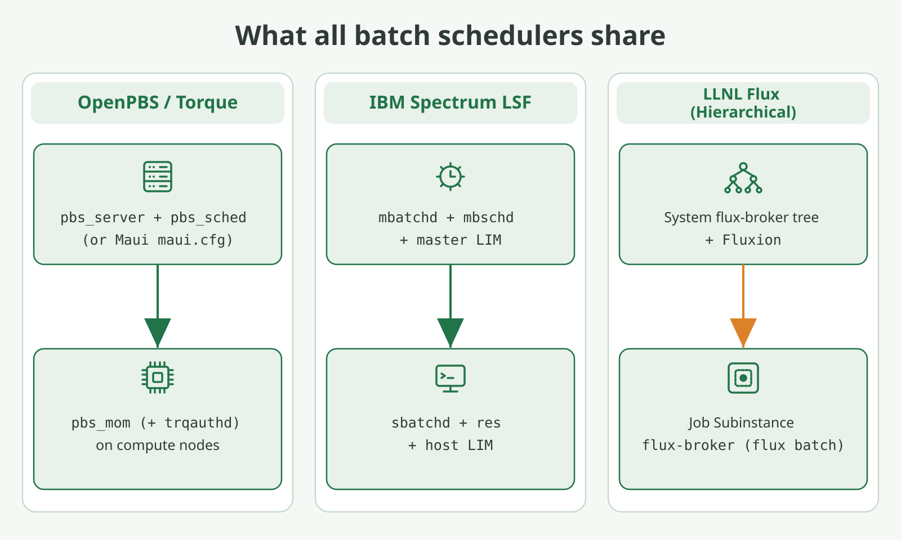

# 6.17 Other schedulers: PBS, Torque, LSF and Flux

| | |
|---|---|
| Level | Intermediate |
| Priority tier | 2 |
| Lab venue | Laptop (converter); optional single-node installs of OpenPBS or Flux |
| Part | Part 6: HPC and Slurm |
| Status | Drafted. PBS facts from the OpenPBS man pages (openpbs/openpbs commit `cd7ab5e`, 2026-04-10), Flux facts from the flux-core documentation (commit `40ecc8d`, 2026-10-23). LSF and Torque are described from general knowledge and the Torque chapter of *Supercomputers for Linux SysAdmins*: **unverified**. `code/part06/pbs2slurm.py` was run on one test script. No scheduler other than the converter was executed; labs **untested** |

## Why this matters for AI infrastructure

Picture a Monday morning when a research partner sends you a folder of job scripts and asks you to run them on your GPU cluster by Friday. Your cluster runs Slurm, but the scripts are full of `#PBS` lines, and nobody on your team has written that syntax in years. A wrong translation can give a job the wrong number of GPUs or the wrong amount of memory, and the job may still start without any error. That is the kind of problem this chapter helps you prevent.

Slurm runs most GPU training clusters, but you will not always work on one. A university or national lab may run PBS Professional or OpenPBS, where PBS stands for Portable Batch System. A financial firm or an electronic design automation (EDA) shop may run IBM Spectrum LSF. Systems in the line of descent from Lawrence Livermore National Laboratory (LLNL) run Flux. Some legacy clusters still run Torque.

The concepts these schedulers share are the same, so learning them once makes it possible to translate between them. That skill matters when a site moves to Slurm or to a Kubernetes-based stack, which is a common migration project. It also comes up in interviews. The chapter gives you the shared picture first, then the specifics of each system, and then the habits that keep a migration safe.

## Prerequisites and outcomes

Before you start, work through chapters 6.7 to 6.11. They cover Slurm's architecture, configuration, accounting and policy, GPU handling and job submission, and they give you the reference point for every comparison here. This chapter then walks through the architecture of PBS, Torque, LSF and Flux, and how each one differs from Slurm. It shows how to translate job scripts and commands across the four systems for common requests such as nodes, GPUs, time, arrays and dependencies. It explains the `select` and `place` model of PBS and the nested-instance model of Flux, which are the two ideas furthest from Slurm's. Last, it lays out a migration plan that covers inventory, translation, policy mapping, accounting continuity, user retraining and a parallel run.

## 1. What all batch schedulers share

When a job sits in a queue, the first question is which scheduler is holding it. The second question is which part of that scheduler is stuck. Learn the shared parts once, and you can place any new scheduler quickly.

Every batch scheduler has the same basic parts. Think of them as a busy restaurant with a waiting list. Jobs wait in a queue, or a partition in Slurm terms. A server or controller holds the state, which means it knows which jobs exist, which are waiting and which are running. Each compute node runs a per-node daemon, a background program that starts and watches the work on that node. That daemon is MOM in PBS, `sbatchd` in LSF, a broker in Flux and `slurmd` in Slurm. A policy engine decides the order. It uses priority, fair-share, backfill, limits and preemption. Fair-share gives less priority to users who have already used more than their share, and backfill slips short jobs into gaps that a bigger job cannot yet use.



*Figure 6.17.1. What all batch schedulers share, as a diagram.*

Read each diagram line as a chain of responsibility. The top box decides what should run and in what order. The lower box is the worker that actually runs it on a node. When a job is stuck, ask which box holds it. A job waiting for resources is still in the top box, while a job that started and then died has moved down to the worker.

Each job carries a script whose directives sit in comment lines. To a shell, a line such as `#PBS -N bert` is only a comment. The scheduler reads it as a request. The schedulers also support arrays, which run many copies of one script, and dependencies, which hold a job until another one finishes. They support interactive jobs and accounting too. The differences lie in vocabulary, the resource-request model, defaults and extensibility. The vocabulary is the easy part. The request model and the defaults are where translations go wrong. *Supercomputers for Linux SysAdmins* devotes a chapter to OpenPBS and Torque because its target readers meet them. The same skills transfer.

## 2. PBS: OpenPBS and PBS Professional

Suppose you submit a job to a PBS cluster and it sits in the queue all afternoon without starting. There is no error message, only a job that never moves. To find the cause, you need to know which daemon does what, because each one owns a different decision.

OpenPBS is the open-source release of PBS Professional, which Altair has since open-sourced. PBS Professional is the commercial product, and OpenPBS is the free code line that came from it. The system has several daemons. `pbs_server` keeps the job and queue database and accepts jobs. `pbs_sched` is the scheduler. It decides what runs where, using a policy set in `sched_config` and the resource definitions. `pbs_mom`, the "Machine Oriented Mini-server", runs on each node and starts the work there. `pbs_comm` relays communication for large clusters. A data service, Postgres, sits underneath. The descriptions come from the `pbs(8B)` family of man pages.

You administer the system with `qmgr`, `pbsnodes`, `qstat`, `qenable`, `qdisable`, `qstart`, `qstop` and `tracejob`. These are the commands you will use day to day. You can also write hooks in Python, using `pbs_python`, to control admission and execution. A hook can look at a job when it arrives, or at the moment it starts running.

### Request model: select and place

PBS asks for resources as chunks. A chunk is a standard block of resources, such as CPUs, memory and GPUs. A job asks for some number of chunks, and each chunk says what it needs. The `qsub(1B)` man page gives the syntax:

```text
-l select=[<N>:]<chunk>[+[<N>:]<chunk> ...]        chunk = <resource>=<value>[:<resource>=<value>...]
-l place=[<arrangement>][:<sharing>][:<grouping>]  arrangement: free | pack | scatter | vscatter
                                                   sharing: excl | shared | exclhost
                                                   grouping: group=<resource>
```

Take the example `#PBS -l select=2:ncpus=64:mpiprocs=8:ngpus=8:mem=500gb`. It asks for two identical chunks. Each chunk needs at least 64 CPUs, 8 MPI processes, 8 GPUs and 500 GB of memory. The next line, `#PBS -l place=scatter:excl`, then puts those two chunks on different hosts, and each host is used exclusively. Read the two lines together. The first says how much each box holds, and the second says where the boxes go.

The `+` sign joins different chunks. That makes it a natural fit for heterogeneous jobs, such as one big-memory chunk plus several GPU chunks. Slurm needs its own special "heterogeneous job" syntax for that case. Do not mix the old-style `-l nodes=...:ppn=` form with `select`. The man page warns that this is an error.

Chunks map to vnodes. A vnode is a virtual node, and one physical host can be split into several of them, for example one per NUMA domain or one per GPU. NUMA means non-uniform memory access, a layout where some memory sits closer to some CPUs than to others. That is why the word "node" means something looser in PBS than in Slurm. When you read a PBS job, check whether a "node" is a whole host or a slice of one.

The other directives you will use most are `-N` for the job name, `-q` for the queue and `-J X-Y[:Z][%max]` for arrays. In an array, `%max` caps the number of sub-jobs that run at the same time. The man page also says that job arrays are always rerunnable. Dependencies use `-W depend=afterok:ID[:ID]`. The types are `after`, `afterok`, `afternotok`, `afterany`, `before...` and `on:N`. The remaining options are `-o/-e/-j` for output, `-v` and `-V` for environment, `-l walltime=HH:MM:SS` for time, `-m/-M` for mail, `-r` for rerunnable jobs, `-I` for interactive jobs and `-A` for the account.

Jobs read their context from environment variables. `PBS_NODEFILE` is a file that lists the allocated hosts, with one line per slot. The others are `PBS_JOBID`, `PBS_O_WORKDIR`, `PBS_ARRAY_INDEX` and `PBS_ARRAYID`. When a script misbehaves on the compute node, print these first, because they show what the scheduler actually handed the job.

### Torque

Torque came out of the old Maui and Torque stack. Its origins are Cluster Resources and Adaptive Computing. Torque has the same lineage as PBS, and it forked OpenPBS 2.3.12. It uses `qsub -l nodes=2:ppn=16`, `pbs_server` and `pbs_mom`. For policy, it usually relies on the Maui or Moab scheduler, because Torque's built-in scheduler is basic.

*Supercomputers for Linux SysAdmins* walks through installing Torque, configuring the MOM on compute nodes, and customising the scheduler and the job-control commands. Torque is legacy. New clusters choose Slurm or PBS Pro and OpenPBS, and the open-source Torque line is no longer a good choice for a new build. That last point comes from general knowledge, so check the project's current status before you rely on it.

### Strengths and weaknesses

A quick way to judge the fit is to ask what your team actually needs from the scheduler. If the answer is flexible chunks, careful placement and custom hooks, PBS is a reasonable fit. If the answer is GPU-aware scheduling with a large AI community behind it, Slurm usually makes the work easier. PBS is strong where you need flexible resource chunks, careful placement and hooks. It has been mature in some industries and has a good Windows and Linux history. It is weaker for GPU AI practice. Its ecosystem of AI tooling is smaller, covering pyxis, NGC reference recipes and Kubernetes bridges. It has fewer GPU-specific features out of the box than Slurm's GRES and `--gpus*` options. AI-lab hiring pools also have less community knowledge of it, which makes it harder to staff.

### Setting up Torque and customising its scheduler

Suppose your university inherits an old Torque cluster and asks you to bring its scheduler back to life. The setup steps look long, but each one answers a single question: which daemon listens, which node is allowed to run work, which queue takes the job, and what happens to the node when the job ends.

Names cause confusion here, so settle them first. The original OpenPBS came from MRJ in 1998, and it has been unsupported since about 2004. Torque is Adaptive Computing's fork of it. PBS Professional is Altair's commercial product, which Altair later released as the new OpenPBS in 2020. These are three different code lines, so "OpenPBS" in a document may mean either the old one or the new one.

The steps below follow the concrete Torque setup in chapter 14 of *Supercomputers for Linux SysAdmins*:

1. Check the daemons and their fixed TCP ports in `/etc/services`. Torque has client and admin CLI tools, `pbs_server` as the central server, `pbs_mom` as the compute-node agent, and `pbs_sched` or an external scheduler such as Maui. From Torque 4.0 onward, `pbs_mom` pairs with the `trqauthd` authentication daemon. A missing firewall rule on one of these ports is a common reason a fresh install looks dead, so open the four fixed TCP ports across the cluster:

   ```text
   # (untested here) — /etc/services entries for Torque
   pbs         15001/tcp   # pbs server
   pbs_mom     15002/tcp   # mom to/from server
   pbs_resmom  15003/tcp   # request mom to manage resources
   pbs_sched   15004/tcp   # scheduler
   ```

2. Initialise the server database on first startup with `{sbindir}/pbs_server -t create`. That command creates an empty database, and it runs once. Then define the compute nodes in `$PBS_HOME/server_priv/nodes`. Each line uses `node_name[:ts] [property...] [np=NUMBER]`. The `:ts` marks a timeshared node, and `np` is the processor count. You can also add nodes with `qmgr`, for example `create node ib01 np=1,ntype=cluster,properties="MYCLUSTER"`, followed by `set node ...`. A node's `state` can be `free`, `offline`, `down` or `excl`. The `excl` state applies while the node runs a job.

3. Create the queues and set the server parameters with `qmgr`. In the example from *Supercomputers for Linux SysAdmins*, the queue is MYCLUSTER or batch. The queue can carry walltime caps such as `24:00:00` or `48:00:00`, and core or slot caps such as 20, 21, 22, 24 or 25. You can enter these settings interactively, load them from a file with `qmgr < MYCLUSTER.txt`, or dump the current settings with `qmgr -c "print server" > /tmp/server.conf`. A saved dump is your backup, so keep one before you change anything:

   ```text
   # (untested here) — Queue setup (in the book's example, queue MYCLUSTER or batch)
   create queue batch
   set queue batch queue_type = Execution
   set queue batch resources_max.walltime = 48:00:00
   create queue MYCLUSTER
   set queue MYCLUSTER queue_type = Execution
   set queue MYCLUSTER resources_max.ncpus = 20
   set queue MYCLUSTER resources_min.ncpus = 1
   set queue MYCLUSTER resources_max.nodect = 20
   set queue MYCLUSTER resources_max.walltime = 336:00:00
   set queue MYCLUSTER resources_default.ncpus = 1
   set queue MYCLUSTER resources_default.nodect = 1
   set queue MYCLUSTER resources_default.walltime = 01:00:00
   set queue MYCLUSTER max_user_run = 12
   set queue MYCLUSTER enabled = True
   set queue MYCLUSTER started = True

   # (untested here) — Server parameters via qmgr
   set server scheduling = True
   set server acl_host_enable = True
   set server acl_hosts = *.mycluster.com
   set server acl_hosts += server.mycluster.com
   set server managers = root@server.mycluster.com
   set server default_queue = MYCLUSTER
   set server log_events = 511
   set server mail_from = root
   set server query_other_tasks = True
   set server scheduler_iteration = 600
   set server node_ping_rate = 300
   set server node_check_rate = 600
   set server tcp_timeout = 6          # (6 seconds in Ch 14; often raised e.g. tcp_timeout = 20)
   set server task_stat_rate = 30
   set server mail_to = mail.mycluster.com
   ```

4. Configure `pbs_mom` on the compute nodes and add an epilogue cleanup script. On every compute node, write the server hostname into `$PBS_HOME/server_name`. Then create `/var/spool/PBS/mom_priv/config`. This file tells the MOM where the server is and how loaded a node may get before it stops taking work:

   ```text
   # (untested here) — /var/spool/PBS/mom_priv/config in the book's example
   $logevent 255
   $pbsserver rsufs
   $cputmult 1.0
   $ideal_load 1.0
   $max_load 2.0
   ```

   When a parallel job's head process exits, stray worker processes and `/tmp` files can remain on the allocated nodes. Torque may already show those nodes as `free`, so the next user inherits the mess. If a node is dedicated to one user's job at a time, you can clean up automatically. Place an executable `/var/spool/PBS/mom_priv/epilogue` script on those nodes:

   ```bash
   #!/usr/bin/env bash
   # (untested here) — Chapter 14 Torque epilogue cleanup script example
   JOBID=$1
   USER=$2
   ######### Get the list of task nodes ###########
   if test -r "/var/spool/PBS/aux/$1"; then
   PBS_NODEFILE="/var/spool/PBS/aux/$1"
   # Perform cleanup on each node of the task
   for node in $PBS_NODEFILE; do
   ssh -o ConnectTimeout=5 $node \
   'pkill -KILL -u $USER; \
   find /tmp -user $USER -exec rm -r \{\} \; >& /dev/null'
   done
   fi
   ```

5. Customise the scheduler in `/var/spool/PBS/sched_priv/sched_config`, or in `maui.cfg`. In Torque, a separate process, the scheduler, selects the next task to launch. Keeping it separate lets you choose a policy that weighs time of day, system load, task size and queuing time. When the server's `scheduling` attribute is set to `True`, `pbs_server` reacts to two events. One is a task being added to the queue, and the other is an assignment finishing. Each event makes it call the scheduler to pick the next task to run.

   Torque ships with several schedulers, which you choose at installation with `./configure --set-sched=cc --set-sched-code=sgi_origin`. By default, the installation includes the FIFO scheduler. Production sites often pair Torque with the external Maui or Moab scheduler, which handles fair-share, backfill, reservations and priority weights in `maui.cfg`. For the built-in scheduler, entries in `/var/spool/PBS/sched_priv/sched_config` take the form `name:value [prime | non_prime | all]`. The options include `round_robin`, `by_queue`, `strict_fifo`, `fair_share` (with `half_life` and `sync_time`), `load_balancing`, `help_starving_jobs` (after `max_starve`), `log_filter` and `sort_by`.

   The built-in scheduler sorts tasks with the keys in Table 14-2 of *Supercomputers for Linux SysAdmins*, plus `multi_sort`, which takes several `key:` lines. Read the table as a menu. Each key orders the queue in one direction, and only one key applies at a time unless you use `multi_sort`:

   | Sorting key (`sort_by`) | Meaning |
   |---|---|
   | `no_sort` | Don't sort tasks |
   | `shortest_task_first` | In ascending order by `cput` attribute |
   | `longest_task_first` | Descending by `cput` attribute |
   | `smallest_memory_first` | Ascending by `mem` attribute |
   | `largest_memory_first` | Descending by `mem` attribute |
   | `high_priority_first` | In descending order by `task_priority` attribute |
   | `low_priority_first` | In ascending order by `task_priority` attribute |
   | `large_walltime_first` | Descending by `task_walltime` attribute |
   | `short_walltime_first` | In ascending order by `task_walltime` attribute |

6. Submit work with `qsub -q QUEUE -l ncpus=CORES script_name`, or place `#PBS` directives inside the batch script and run `qsub myprog.batch`. The examples in *Supercomputers for Linux SysAdmins* cover four cases. For one node with several processes, `#PBS -l nodes=1:ppn=4` and `#PBS -q MYCLUSTER` set the request. Then `cd $PBS_O_WORKDIR` moves into the working directory, which holds the executable `progname`, and `./progname` runs it.

   An OpenMP program starts as many threads as the node has cores by default. To cap it at 2 cores, add `#PBS -l nodes=1`, `#PBS -q MYCLUSTER` and `#PBS -v OMP_NUM_THREADS=2`. For a long job, add `#PBS -l walltime=300:20:00`, which is 300 hours and 20 minutes.

   For MPI across several nodes, set `#PBS -l walltime=30:00:00` and `#PBS -l nodes=4:MYCLUSTER`. Then add `cd $PBS_O_WORKDIR` and `mpirun -np 4 ./progname`.

   Torque buffers everything the job writes to stdout and stderr on the compute node. At the end of the run, it copies those files back to the submission directory, named `<script_name>.o<task_number>` and `<script_name>.e<task_number>`. To watch output live with `cat`, `less` or `tail -f`, redirect it inside the script, for example `mpirun -np 4 progname > $PBS_JOBID`. With input as well, use `mpirun -np 4 progname < input_file > $PBS_JOBID`. If Torque cannot reach the destination path when the job ends, the files stay in `/var/spool/PBS/undelivered/` on the compute node, and the user is notified by mail.

7. Users and admins both use these commands to manage Torque jobs: `qsub`, `qdel`, `qhold`, `qrls`, `qmove`, `qmsg`, `qselect`, `qsig` and `qstat`. The examples include `qstat -a` and `qstat -q`. The list also includes `pestat`, and the X11 GUIs `xpbs` and `xpbsmon`.

Decide early whether your site will stay on PBS or move. That choice decides how much of this setup you need to learn.

## 3. IBM Spectrum LSF (general knowledge, unverified)

Suppose your team's jobs run on an EDA or finance cluster. The scheduler there may well be IBM Spectrum LSF. LSF stands for Load Sharing Facility. It is a commercial scheduler, common in EDA, finance and some HPC centres. Teams that use it often have strict licence rules, so the scheduler also has to know when a tool licence is free.

The master host runs `mbatchd`, the master batch daemon, and `mbschd`, the scheduler. It may also have failover candidates, which take over if the master fails. Each execution host runs `sbatchd` and `res`. `LIM`, the Load Information Manager, collects host load and resource information. The main concepts are queues, each with its own policies, hosts and host groups. You also meet resource requirement strings such as `select[...] rusage[...] span[...] order[...]`, along with fair-share, preemption and "job slots". A job slot is one unit of a host's capacity that a job can take.

Think of LSF as a small office with a front desk and a dispatcher. When you run `bsub`, the request reaches the master batch daemon first, which records the job and holds it in a queue. The scheduler then looks for a host that has free job slots and meets the resource string. Once a host is chosen, the batch daemon on that host starts the job, and the job reports back through the same chain. That chain explains most of the error messages you will see. A job that is pending points at the scheduler's view of resources, while a job that failed after starting points at the host.

`bsub` submits a job, for example `bsub -n 16 -R "span[ptile=8]" -gpu "num=4" -q gpu -W 12:00 < script`. Read that line from left to right. It asks for 16 slots, packs 8 per host, requests 4 GPUs, uses the `gpu` queue and sets a 12-hour limit. `bjobs` shows queue status, `bkill` cancels a job and `bqueues` lists queues. `bhosts` and `lsload` show nodes, and `bhist` and `bacct` cover history and accounting. The other commands are `bmod`, `bswitch` and `bpeek`. Inside a script, you pass options as directives: `#BSUB -n`, `-q`, `-W`, `-o` and `-J name[1-100]%10`. The environment variables are `LSB_JOBID`, `LSB_HOSTS`, `LSB_DJOB_HOSTFILE` and `LSB_JOBINDEX`.

LSF's strengths are enterprise support, licence-aware scheduling, a mature policy model and LSF multicluster, which links several clusters. Many current AI sites that use LSF are migrating to Slurm or Kubernetes. Verify all of this against IBM documentation before you use it.

## 4. Flux

Flux has a very different shape from the other schedulers in this chapter. Suppose you hold an allocation and need to run millions of small tasks inside it. A normal queue would bury the system scheduler under that load. Flux is built for that case. It comes from Lawrence Livermore National Laboratory and its collaborators, and its core project is `flux-core`. The Flux documentation describes it as a framework for resource management.

A Flux instance is a set of `flux-broker` processes that form a tree-based overlay network. A broker is a small program that passes messages and runs services, and the brokers link up in a tree. The docs say the instance "can be started by most launchers that can start MPI jobs." You can start one without administrator privilege, for example inside a Slurm allocation or a Kubernetes pod.

The easiest picture is a contractor who rents a building. The building owner, which is the enclosing scheduler, hands over a block of rooms for a fixed period. The contractor then runs their own small office inside those rooms, with their own staff and their own rules for who works when. When the contract ends, the rooms go back to the owner. A Flux subinstance works the same way.

The key idea is that every job can itself be a Flux instance, called a subinstance. `flux batch SCRIPT` "submits SCRIPT to run as the initial program of a Flux subinstance". When the script exits, the subinstance ends and its resources return to the enclosing instance. Commands inside the script, such as `flux run` and `flux submit`, refer to the subinstance. `flux proxy JOBID` connects a shell to a running subinstance, and `flux uptime` shows `depth` and `size`. Hierarchical scheduling lets users run their own scheduler policy and millions of tasks inside an allocation, without loading the system scheduler. That makes it a strength for ensemble and AI-workflow workloads.

The main commands are `flux run` to run a job interactively, `flux submit` to queue one, `flux batch` to run a script as a subinstance, and `flux alloc` for an interactive subinstance. `flux batch` reads `#flux:` directive lines in the script. `flux bulksubmit` submits many jobs, `flux jobs` lists them and `flux cancel` cancels one. The rest are `flux resource list`, `flux queue`, `flux top`, `flux pstree`, `flux dmesg`, `flux uptime` and `flux config`.

Requests use options on `flux-run` and `flux submit`. `-n` sets tasks, `-c` cores per task and `-g` GPUs per task. `-N` sets nodes, while `--tasks-per-node` and `--gpus-per-node` set counts per node. `-x` requests exclusive use, `-t` sets the time limit, `-q` picks the queue and `-B` sets the bank for accounting. Dependencies use `--dependency=URI`, and the RFC 26 URIs have schemes such as `afterok`. The docs say "dependency chains behave like shell command separators", and `afterok` works like `&&`, the shell's "and then, if that succeeded" operator.

The scheduler is a separate project, `flux-sched`, which provides the graph-based resource model Fluxion. `flux-core` alone provides services such as the job manager, the KVS, which is a key-value store, and the message bus that connects the parts.

Flux's docs, in a page titled "Flux Maturity" from late 2025, say that Flux is the sole system workload manager on El Capitan. El Capitan was then number one on the TOP500 list of supercomputers. Flux also runs the unclassified sister systems at LLNL. The migration guide, titled "Migrating from Slurm", tells large centres not to leave Slurm yet. It says to "check back with us at the end of 2026". The guide lists missing features, including rolling upgrades, where nodes must run exactly the same flux-core version until 1.0. It also lists restarting Flux without killing running jobs, and immovable future reservations. Flux also works alongside Slurm, as an enhanced step manager and portability layer.

For AI work, nested scheduling suits hyperparameter sweeps and agent or reinforcement learning (RL) workloads. Flux can run MPI-style jobs under Kubernetes through the Flux Operator, and it has strong tooling for ensembles. Flux is not common on commercial GPU clouds. Decide whether your ensemble work needs nested scheduling badly enough to accept Flux's missing features.

## 5. Command and concept map

When you move a team from one scheduler to another, the commands are what people notice first. Someone who types `qstat` out of habit will get an error on a Slurm login node, and the first question on the support channel is often "which command do I use now?" The table lines up the same task across Slurm, PBS, LSF and Flux, so you can compare them side by side.

| Task | Slurm | PBS (OpenPBS/Pro) | LSF | Flux |
|---|---|---|---|---|
| Submit script | `sbatch s.sh` | `qsub s.sh` | `bsub < s.sh` | `flux batch s.sh` |
| Run interactive | `srun --pty bash` / `salloc` | `qsub -I` | `bsub -Is bash` | `flux alloc` / `flux run` |
| List jobs | `squeue` | `qstat` | `bjobs` | `flux jobs` |
| Cancel | `scancel` | `qdel` | `bkill` | `flux cancel` |
| Node status | `sinfo`, `scontrol show node` | `pbsnodes -a` | `bhosts`, `lsload` | `flux resource list` |
| Queue/partition | partition | queue | queue | queue |
| Nodes + CPUs | `-N 2 -n 16` | `-l select=2:ncpus=8` | `-n 16 -R "span[ptile=8]"` | `-N 2 -n 16` |
| GPUs | `--gpus-per-node=8` | `ngpus=8` in chunk | `-gpu "num=8"` | `--gpus-per-node=8` / `-g` |
| Memory | `--mem=64G` | `mem=64gb` in chunk | `-R "rusage[mem=65536]"` | via resources/constraints |
| Time | `--time=HH:MM:SS` | `-l walltime=HH:MM:SS` | `-W HH:MM` | `-t MINUTES` or FSD |
| Array | `--array=0-9%3` | `-J 0-9%3` | `-J "name[0-9]%3"` | `flux bulksubmit` |
| Dependency | `--dependency=afterok:ID` | `-W depend=afterok:ID` | `-w "done(ID)"` | `--dependency=afterok:ID` |
| Exclusive node | `--exclusive` | `-l place=excl` | `-x` | `-x` |
| Job ID variable | `SLURM_JOB_ID` | `PBS_JOBID` | `LSB_JOBID` | `FLUX_JOB_ID` |
| Node list | `SLURM_JOB_NODELIST` | `PBS_NODEFILE` | `LSB_DJOB_HOSTFILE` | `flux hostlist` |
| Launch MPI | `srun` | `mpiexec` / `pbsdsh` | `mpirun` / `blaunch` | `flux run` |

(LSF entries are from memory: verify.)

A word of caution about the queue row. In Slurm the word is partition, and in the other three systems it is queue. The same word can also mean a set of hosts in one system and a set of rules in another, so do not assume that a queue in PBS maps one-to-one to a partition in Slurm until you have read its policy.

Look at the launch row and the node list row first. They show where you will see the most difference in how a job finds its hosts and starts its processes. Those two rows often cause the most trouble during a migration.

## 6. A tested translator

Suppose a team hands you a folder of PBS scripts and asks you to run them on Slurm. Translating each file by hand is slow and easy to get wrong. The repository includes a converter for that job, and it handles the common directives so that you can spend your time on the hard cases.

The converter `code/part06/pbs2slurm.py` turns common `#PBS` directives into `#SBATCH` lines. It handles the job name, the queue (which becomes the partition), the account, output and error, arrays with their `%` throttle, mail, `depend=`, `walltime`, `place=...excl` (which becomes `--exclusive`), and `select` with `ncpus`, `mpiprocs`, `ngpus` and `mem`. It also rewrites `$PBS_JOBID`, `$PBS_O_WORKDIR` and `$PBS_ARRAY_INDEX`, and it flags `$PBS_NODEFILE`. Here is its output on a test script:

```text
#PBS -N bert                              ->  #SBATCH --job-name=bert
#PBS -q gpuq                              ->  #SBATCH --partition=gpuq
#PBS -l select=2:ncpus=64:mpiprocs=8:ngpus=8:mem=500gb
                                          ->  #SBATCH --nodes=2 / --ntasks-per-node=8 / --cpus-per-task=8
                                              / --gpus-per-node=8 / --mem=500G
#PBS -l walltime=12:00:00                 ->  #SBATCH --time=12:00:00
#PBS -l place=scatter:excl                ->  #SBATCH --exclusive
#PBS -J 0-9%3                             ->  #SBATCH --array=0-9%3
#PBS -m abe                               ->  #SBATCH --mail-type=FAIL,BEGIN,END
#PBS -W depend=afterok:1234.server        ->  #SBATCH --dependency=afterok:1234.server   (job id must be edited)
#PBS -l software=matlab                   ->  # TODO unmapped resource: software=matlab    (a PBS custom resource -> Slurm licenses/features)
cd $PBS_O_WORKDIR                         ->  cd $SLURM_SUBMIT_DIR
mpirun -np 16 -machinefile $PBS_NODEFILE python train.py
                                          ->  ... <use: scontrol show hostnames $SLURM_JOB_NODELIST> (and prefer srun)
```

Read the output as a list of translations, one for each input line. The arrows show which PBS directive becomes which Slurm directive. Lines marked `TODO` are not failures in the tool. They are the tool telling you it refused to guess.

Look at the `select` line first, because it shows the arithmetic. The chunk asks for `ncpus=64` and `mpiprocs=8`. Dividing 64 CPUs across 8 processes leaves 8 CPUs per task, so the converter writes `--cpus-per-task=8`. This is a semantic translation, not a mechanical one. PBS `ncpus` counts CPUs per chunk, while Slurm `--cpus-per-task` counts CPUs per task. A converter that copied the number straight across would ask for 64 CPUs for every task, and the job would fail to fit on the node.

The tool does not translate some things on purpose, so you must handle them by hand. Heterogeneous `select` requests with `+` chunks are flagged as TODO. So is vnode-specific placement. Custom resources map to Slurm features, licences or GRES, and someone has to decide which one fits. Hooks need rewriting as `job_submit` plugins. Queue policy, such as fair-share and limits, must be rebuilt as described in 6.9. Job IDs in dependencies, the interactive behaviour of `qsub -I` and the MPI launch line also need manual work. Replace `mpirun -machinefile` with `srun`. Finish by running the result through `sbatch_lint.py`, covered in 6.11.

## 7. Migration plan (any scheduler to Slurm)

Suppose the lab's PBS cluster is going to be switched off in a month, and the users will move to Slurm in that same month. A migration touches more than the user scripts. Queues, fair-share, hooks and accounting all have to move too, and a gap in any of them shows up as a complaint from a user who is no longer getting the share they had.

1. Start with an inventory. List your queues, node classes, resource types, limits, fair-share trees, reservations, hooks or plugins, license servers and user scripts. Scan the scripts with `grep -r '#PBS'` or `'#BSUB'`. Then list the accounting integrations, web portals and workflow tools that call `qsub` or `bsub`. Each of those is a hidden dependency that a script scan will miss.
2. Map the policies next. Queues become partitions or QOS, and limits become association or QOS limits. Fair-share shares become accounts. Preemption rules move to `PreemptType` (6.9), and custom resources become GRES, features or licenses. Hooks become `job_submit` and prolog or epilog scripts (6.14).
3. Translate the scripts, first with the automated pass and then with review. Build a compatibility shim only if you cannot avoid one. Slurm ships `qsub`-like wrappers in contribs, and PBS-compatible wrappers exist. Check which ones are available for your version, because a wrapper that only exists in a newer release will break an older cluster.
4. Keep accounting continuous. Export the historical usage, seed fair-share if you want to, and keep the old reports for audits. Users notice quickly when their share resets to zero, and an auditor will ask for the old numbers.
5. Run a parallel pilot. Split the nodes, dual-submit tests and compare the job outcomes. Train users and publish a command-map cheat sheet, such as the table in section 5, so that people have one place to look when a command fails.
6. Cut over in node groups. Keep a rollback window, and decommission the old scheduler only after one full allocation cycle. Waiting for one full cycle lets you see the end-of-month jobs before the old system goes away.
7. Revisit the workflow layer, such as Airflow, Nextflow or Snakemake DAGs. These usually have a Slurm executor already, so the change is often a configuration line rather than a rewrite.

Here is a small example of how the steps fit together. Suppose a queue named `gpuq` holds your largest GPU jobs, and users request it with `-q gpuq`. In Slurm, that queue becomes a partition with the same name, so the converter keeps `--partition=gpuq`. The harder question is whether the old queue's fair-share weight belongs to an account, a QOS or a partition. Answer that question in the policy mapping step, before anyone submits a real job.

Before the cutover, write down the one thing each user group cannot lose, such as a reservation for a grant deadline or a standing queue for nightly builds. Those items deserve a test in the pilot, because they are the first things people will ask about on the day you switch.

Decide who owns each step before you start. A migration with no owner for the accounting step is the one that fails in the second month.

## 8. Mixed environments and bridges

Your first week at a site that runs Slurm for training and an older PBS queue for simulations will show you how common mixed setups are. Many sites run more than one scheduler, and you will likely meet three patterns.

The first is running Flux, Ray or Dask inside a Slurm allocation. That gives you fine-grained, nested scheduling without touching the system scheduler. The second is moving from Slurm to Kubernetes, covered in 6.16. Kubernetes-to-Slurm bridges also exist. They are niche queue-based virtual kubelets, which are programs that make a Kubernetes node that actually hands its pods to a batch queue. The third is workflow tools. Nextflow, Snakemake, Airflow providers, Parsl and Dask-Jobqueue support Slurm, PBS and LSF through executors. An executor is the part of the tool that knows how to submit work to one scheduler.

A practical rule helps when you choose between a bridge and a workflow tool. If your users already write their pipelines in a workflow tool, let the tool hide the scheduler. If your users type scheduler commands by hand, a bridge will not help them, and you should give them the command map instead.

Cloud bursting works differently on each system. Bursting means adding cloud machines when the local cluster is full. PBS and LSF have cloud connectors, while Slurm has power-save and cloud nodes, covered in 6.15. Decide whether you need a bridge, or whether a workflow tool can hide the difference from your users.

## 9. Lab (self-checking converter lab tested; live scheduler installs untested)

Suppose you have a folder of PBS scripts and a week to get them running on Slurm. Before you touch a live scheduler, check the converter, because a wrong translation found on the laptop costs far less than one found on a cluster. The lab runs locally, so you can do that check first.

The lab, `code/part06/pbs2slurm_lab.py`, verifies `convert_line()` and `mem_to_slurm()` in `code/part06/pbs2slurm.py`. It runs them on a 9-directive PBS GPU script. The check confirms that `select=2:ncpus=64:mpiprocs=8:ngpus=8:mem=500gb` translates to `--nodes=2`, `--ntasks-per-node=8`, `--cpus-per-task=8`, `--gpus-per-node=8` and `--mem=500G`. It also checks the Torque port mapping in `/etc/services`, `15001` to `15004`. Finally, it validates the 9 `sort_by` keys from chapter 14 of *Supercomputers for Linux SysAdmins*, in `Table 14-2`:

```bash
python3 code/part06/pbs2slurm_lab.py
```

The converter part of this lab was run on a laptop. The live scheduler steps that follow have not been run on a live cluster, so treat them as a plan to check.

Next, work through these steps:

1. Run `pbs2slurm.py` on two of your own PBS scripts. Fix every TODO by hand, then lint the results with `sbatch_lint.py`.
2. Install OpenPBS in a single-node container or VM. Submit a `select` job, then inspect `pbsnodes -a` and `qstat -f`.
3. Install Flux with `flux start --test-size=4` in a container. Run `flux batch` with nested `flux run`, then use `flux proxy` and `flux uptime` to observe the depth.
4. Write the command-map cheat sheet for your site.
5. Draft a migration inventory template that lists every item in section 7, step 1.
6. Extend the converter to handle Torque-style `-l nodes=2:ppn=16` requests and heterogeneous select.

When the lab prints its results, read each check as a separate claim. If the `select` check passes but the port check fails, the converter is fine and the `/etc/services` lines are the problem. Keeping the checks separate saves you from debugging the wrong layer.

Work through step 1 before you install anything. The converter is the quickest way to see the translation rules at work, and the failures it shows you are the ones your users would otherwise hit first.

## 10. Interview angles

Picture an interview where the panel hands you a PBS script and asks what it would look like on Slurm. The questions below are the kind that come up in that room. Answer them out loud, and check each answer against the command map in section 5. A good answer names the concept first, then the command, and then the trade-off. An answer that lists commands without a reason sounds like memorised notes, and interviewers can tell the difference quickly.

- What does PBS's `select` / `place` express that Slurm's `-N/-n` does not?
- Compare PBS MOM, LSF sbatchd and Slurm slurmd.
- What is a Flux subinstance and why is hierarchical scheduling useful?
- You inherit a PBS cluster and must move it to Slurm. Plan the migration.
- How would you translate a PBS script requesting `select=4:ncpus=32:ngpus=4:mem=128gb`?
- Which schedulers run the top supercomputers?
- Why do most GPU clouds standardise on Slurm or Kubernetes?

## Exercises

Each exercise starts from a small situation, and each one asks you to explain or write something specific. Work through them in order, because the later ones build on the converter and the command map.

1. A colleague sends you the converter output and asks why one line asks for 8 CPUs per task. Start with the converter `code/part06/pbs2slurm.py` and its self-checking lab, `code/part06/pbs2slurm_lab.py`. Run the lab with `python3 code/part06/pbs2slurm_lab.py`. Explain why `pbs2slurm.py` divides `ncpus` (64) by `mpiprocs` (8). Explain how that division produces `#SBATCH --cpus-per-task=8`. Explain how it translates `-l place=scatter:excl`, `-J 0-9%3` and `-m abe`. Explain why custom resources, such as `-l software=matlab`, are emitted as `# TODO` comments for manual review. Explain why heterogeneous `+` chunks get the same treatment.
2. Your team needs a Torque setup from chapter 14 of *Supercomputers for Linux SysAdmins*. Write the `/etc/services` port lines for `15001` to `15004`. Write the `qmgr` commands that create queue MYCLUSTER. The queue needs `resources_max.ncpus = 20` and `resources_max.walltime = 336:00:00`. It also needs `max_user_run = 12`. Then write the command that dumps the settings to `/tmp/server.conf`. Explain how `/var/spool/PBS/mom_priv/epilogue` uses `/var/spool/PBS/aux/$1` to find the job's nodes. Explain how it then removes orphan user processes and `/tmp` files on each node.
3. Work through Torque's scheduler, and compare `sched_config` with `maui.cfg`. Explain the difference between `round_robin`, `by_queue`, `strict_fifo`, `fair_share` and `help_starving_jobs` (`max_starve`) in `/var/spool/PBS/sched_priv/sched_config`. Write a `multi_sort` block that combines three keys from Table 14-2. Then state why production Torque sites often replace `pbs_sched` with Maui or Moab (`maui.cfg`).
4. A team needs a 2-node job on four systems. Each node needs 8 GPUs and 64 CPU cores. Each node also needs 500 GiB RAM. The job also needs exclusive node access and a 12-hour walltime. Write the equivalent submission command or directives for Slurm (`sbatch`). Then write them for OpenPBS (`qsub`). Next, write them for IBM Spectrum LSF (`bsub`) and for LLNL Flux (`flux batch`).
5. Explain how `flux batch` creates a nested flux-broker subinstance inside an enclosing Slurm allocation. Explain why hierarchical scheduling keeps a 50,000-task hyperparameter or RL ensemble from overwhelming slurmctld. Then name the missing features that Flux's own "Migrating from Slurm" guide highlights for large centers, so that you know what to watch for.
6. Design a 7-step migration plan from PBS or LSF to Slurm. Cover the script and hook inventory, and the queue-to-partition and QoS policy mapping. Include automated conversion with `pbs2slurm.py` and `sbatch_lint.py`. Add historical fair-share seeding in `slurmdbd`, dual-partition parallel validation, and workflow engine cutover (Nextflow, Airflow or Snakemake).

## Checkpoint

<details>
<summary>1. Distinguish between the three historical code lines associated with the name **PBS** (*Supercomputers for Linux SysAdmins*, chapter 14).</summary>

1. Original OpenPBS came from MRJ Technology Solutions for NASA in 1998, and it was discontinued around 2004.
2. Torque, which stands for Terascale Open-Source Resource and QUEue Manager, is Adaptive Computing's open-source fork of OpenPBS 2.3.12. It is often paired with the Maui or Moab scheduler.
3. PBS Professional and modern OpenPBS come from Altair Engineering. Altair open-sourced its commercial PBS in 2020 as the `openpbs/openpbs` project.
</details>

<details>
<summary>2. Name the four core daemons of **OpenPBS / PBS Professional** and their Slurm equivalents.</summary>

- `pbs_server` is the central job and queue server and state manager, backed by PostgreSQL. Its Slurm equivalent is `slurmctld` plus `slurmdbd`. ↔
- `pbs_sched` is the policy scheduler daemon that decides which job runs next. Its Slurm equivalent is the `sched/backfill` scheduling plugin in `slurmctld`.
- `pbs_mom`, the "Machine Oriented Mini-server", is the compute-node execution agent. Its Slurm equivalent is `slurmd` plus `slurmstepd`.
- `pbs_comm` is the inter-node communication relay. Its Slurm equivalent is hierarchical `TreeWidth` communication.
</details>

<details>
<summary>3. How do PBS `select` chunks and `place` directives work, and what is a **vnode**?</summary>

- `-l select=<N>:<chunk>[+<M>:<chunk>]` requests $N$ resource chunks. Each chunk sets its own `ncpus`, `mpiprocs`, `ngpus` and `mem`, and `+` joins heterogeneous chunks in one job.
- `-l place=<arrangement>:<sharing>:<grouping>` controls how chunks map onto hosts. The arrangements are `free`, `pack`, `scatter` and `vscatter`, combined with `excl`, `shared` or `exclhost`.
- A vnode, or virtual node, is an abstract, schedulable subdivision of a physical host. For example, one vnode might cover one NUMA socket or one GPU.
</details>

<details>
<summary>4. How are job arrays, job dependencies, and node hostlists expressed in PBS compared to Slurm?</summary>

- Arrays: `#PBS -J 0-9%3` sets the array, and `$PBS_ARRAY_INDEX` holds the index. Slurm uses `#SBATCH --array=0-9%3` and `$SLURM_ARRAY_TASK_ID`.
- Dependencies: PBS uses `#PBS -W depend=afterok:1234`, and Slurm uses `#SBATCH --dependency=afterok:1234`.
- Allocated hostlist: `$PBS_NODEFILE` is a file with one hostname line per allocated slot. `$SLURM_JOB_NODELIST` is a compressed range string that `scontrol show hostnames` expands.
</details>

<details>
<summary>5. Which four TCP ports in `/etc/services` are used by **Torque**, and what daemon was added alongside `pbs_mom` in Torque 4.0 (*Supercomputers for Linux SysAdmins*, chapter 14)?</summary>

- `15001/tcp` for `pbs` is used by `pbs_server`.
- `15002/tcp` for `pbs_mom` carries traffic between `pbs_mom` and the server.
- `15003/tcp` for `pbs_resmom` carries resource management requests to `pbs_mom`.
- `15004/tcp` for `pbs_sched` is the scheduler daemon.

Starting in Torque 4.0, the `trqauthd` client authentication daemon must also run alongside `pbs_mom`.
</details>

<details>
<summary>6. How are compute nodes defined in Torque's `$PBS_HOME/server_priv/nodes` file and via `qmgr`, and what does `:ts` mean (*Supercomputers for Linux SysAdmins*, chapter 14, `Table 14-1`)?</summary>

Each line in `$PBS_HOME/server_priv/nodes` uses the format `node_name[:ts] [property...] [np=NUMBER]`. You can also add a node dynamically with `qmgr: create node ib01 np=1,ntype=cluster,properties="MYCLUSTER"`. Appending `:ts` marks the node as time-shared, which means it is polled for status and used interactively, not for batch cluster allocation. The node states in `Table 14-1` are `free`, `offline` and `down`, plus `excl` while a task runs.
</details>

<details>
<summary>7. How do you initialize `pbs_server` for the first time, back up all server/queue settings with `qmgr`, and restore them (*Supercomputers for Linux SysAdmins*, chapter 14)?</summary>

Initialize the database the first time with `{sbindir}/pbs_server -t create`. Dump the server and queue configuration with `qmgr -c "print server" > /tmp/server.conf`. To restore it, you run `qmgr < /tmp/server.conf`.
</details>

<details>
<summary>8. What parameters go into `/var/spool/PBS/mom_priv/config`, and how does `/var/spool/PBS/mom_priv/epilogue` clean up stray processes after a Torque job ends (*Supercomputers for Linux SysAdmins*, chapter 14)?</summary>

The config file sets `$logevent 255`, `$pbsserver <head_host>`, `$cputmult 1.0`, `$ideal_load 1.0` and `$max_load 2.0`. When a job finishes on the head compute node, `pbs_mom` runs `/var/spool/PBS/mom_priv/epilogue` with `JOBID=$1` and `USER=$2`. The script reads `/var/spool/PBS/aux/$1`, which holds the `PBS_NODEFILE` list. It then SSHes to every allocated node, runs `pkill -KILL -u $USER`, and deletes the user's files in `/tmp`.
</details>

<details>
<summary>9. In Torque's `/var/spool/PBS/sched_priv/sched_config`, what do `round_robin`, `strict_fifo`, `help_starving_jobs`, and `sort_by` (`Table 14-2`) control (*Supercomputers for Linux SysAdmins*, chapter 14)?</summary>

- `round_robin` cycles one task at a time across queues, instead of draining one queue until a limit is hit.
- `strict_fifo` blocks younger tasks whenever the oldest queued task cannot start yet. That prevents starvation of large jobs, but it can leave idle gaps.
- `help_starving_jobs` stops other tasks from starting once a job has waited longer than `max_starve`.
- `sort_by`, in `Table 14-2`, orders queued tasks. The keys are `no_sort`; the pair `shortest_task_first` and `longest_task_first` by `cput`; the pair `smallest_memory_first` and `largest_memory_first` by `mem`; the pair `high_priority_first` and `low_priority_first` by `task_priority`; the pair `large_walltime_first` and `short_walltime_first` by `task_walltime`; and `multi_sort`.
</details>

<details>
<summary>10. How does Torque name standard output and error files by default, how can a user watch output in real time, and where do undeliverable output files land (*Supercomputers for Linux SysAdmins*, chapter 14)?</summary>

By default, Torque buffers stdout and stderr on the execution node. It copies them back to the submission directory at job completion, as `<script_name>.o<task_number>` and `<script_name>.e<task_number>`. To watch output live, redirect stdout inside the batch script, as in `mpirun -np 4 progname > $PBS_JOBID`, and run `tail -f`. If Torque cannot write to the submission path when the job ends, the files are saved in `/var/spool/PBS/undelivered/`, and the user receives mail.
</details>

<details>
<summary>11. Name the core daemons of **IBM Spectrum LSF** and its primary CLI commands.</summary>

The master host runs `mbatchd`, the master batch daemon, `mbschd`, the scheduler daemon, and the master `LIM`, the Load Information Manager. Each execution host runs `sbatchd`, the slave batch daemon, `res`, the Remote Execution Server, and a host `LIM`. The main CLI commands are `bsub` to submit, `bjobs` for queue status, `bkill` to cancel, `bqueues` for queues, `bhosts` and `lsload` for nodes, and `bhist` and `bacct` for history and accounting.
</details>

<details>
<summary>12. How do you request 16 tasks packed 8 per node with 4 GPUs and a 12-hour walltime in LSF (`bsub`)?</summary>

Use `bsub -n 16 -R "span[ptile=8]" -gpu "num=4" -q gpu -W 12:00 < script.sh`. You can also put `#BSUB` directives inside the script, and read `$LSB_JOBID` and `$LSB_DJOB_HOSTFILE` from inside it.
</details>

<details>
<summary>13. What is **LLNL Flux**, and how does its **hierarchical subinstance** model (`flux batch`) differ from Slurm?</summary>

Flux combines `flux-core` with the Fluxion graph scheduler from `flux-sched`. Each scheduler instance is a tree overlay of `flux-broker` processes. When you run `flux batch script.sh`, Flux starts a new child instance, called a subinstance, inside the allocated resources. The subinstance has its own job manager, KVS and scheduling policy. You can launch millions of fine-grained `flux submit` or `flux run` tasks inside it, and none of them adds RPC load to the top-level system scheduler.
</details>

<details>
<summary>14. What does `flux proxy JOBID` do, and how are job dependencies expressed in Flux?</summary>

`flux proxy JOBID` attaches a shell or command to the message bus of a running Flux subinstance. `flux uptime` then shows the nesting `depth` and `size`. Dependencies use RFC 26 URIs, such as `--dependency=afterok:ID`. The `afterok` form behaves like a shell `&&` chain.
</details>

<details>
<summary>15. Which TOP500 #1 supercomputer runs Flux as its sole system workload manager, and what limitations does Flux's Slurm migration guide note for general centers?</summary>

El Capitan at Lawrence Livermore National Laboratory (LLNL) runs Flux as its system workload manager. If you run a general HPC center, Flux's migration guide warns that pre-1.0 Flux still has gaps. It lacks rolling daemon upgrades, because nodes must run exactly the same `flux-core` version. It also lacks controller restarts that preserve running jobs, and it has immovable future maintenance reservations.
</details>

<details>
<summary>16. Why does `code/part06/pbs2slurm.py` translate `#PBS -l select=2:ncpus=64:mpiprocs=8:ngpus=8:mem=500gb` into `--cpus-per-task=8` instead of `--cpus-per-task=64`?</summary>

Consider the arithmetic. PBS `ncpus=64` gives the total CPUs per chunk, which means per node. `mpiprocs=8` gives the MPI tasks per chunk. In Slurm, `--cpus-per-task` multiplies with `--ntasks-per-node=8`, so each of the 8 tasks needs its share of the 64 CPUs. That gives $64 / 8 = \mathbf{8}$ CPUs per task, written as `--cpus-per-task=8`.
</details>

<details>
<summary>17. Name five PBS features or constructs that an automated directive translator (`pbs2slurm.py`) cannot mechanically convert without human review.</summary>

1. Heterogeneous multi-chunk requests, such as `select=1:...+4:...`.
2. Custom site resource attributes, such as `-l software=matlab`, which map to Slurm licenses, features or GRES.
3. Python admission and execution hooks, written with `pbs_python`, which map to Slurm `job_submit.lua` and `Prolog`/`Epilog`.
4. Queue-level fair-share, routing queues and preemption policies, which must be rebuilt in `sacctmgr` QoS or Fair Tree.
5. `mpirun -machinefile $PBS_NODEFILE` launch lines, which you should replace with `srun --mpi=pmix`.
</details>

<details>
<summary>18. What are the 7 steps of a safe production migration from PBS or LSF to Slurm?</summary>

1. Inventory queues, limits, custom resources, hooks, user scripts and workflow integrations.
2. Map policies to Slurm partitions, QoS, Fair Tree accounts, GRES or licenses, and `job_submit`, `Prolog` and `Epilog`.
3. Translate user scripts with `pbs2slurm.py` and `sbatch_lint.py`, plus optional `qsub` compatibility wrappers.
4. Preserve accounting continuity by exporting historical usage and seeding initial fair-share.
5. Run a parallel pilot on a subset of nodes, with a user command-map cheat sheet.
6. Cut over in node waves, with a defined rollback window.
7. Switch workflow executors, such as Nextflow, Snakemake, Airflow and Ray or Dask, to their native Slurm backends.
</details>

<details>
<summary>19. When should you run **Flux, Ray, or Dask inside a Slurm allocation** instead of submitting 100,000 individual `sbatch` jobs?</summary>

Use this approach for high-throughput ensembles, reinforcement-learning rollouts or sub-minute task graphs. You launch one multi-node Slurm allocation, then start Flux (`srun flux start ...`), Ray or Dask inside it. That keeps `slurmctld` completely insulated from high-frequency task scheduling.
</details>

<details>
<summary>20. Map the five everyday user commands (submit batch, interactive shell, list queue, cancel job, inspect nodes) across **Slurm**, **PBS**, **LSF**, and **Flux**.</summary>

- Submit a batch job: `sbatch` on Slurm, `qsub` on PBS, `bsub <` on LSF, and `flux batch` on Flux.
- Interactive shell: `salloc` or `srun --pty` on Slurm, `qsub -I` on PBS, `bsub -Is` on LSF, and `flux alloc` on Flux.
- List the queue: `squeue` on Slurm, `qstat` on PBS, `bjobs` on LSF, and `flux jobs` on Flux.
- Cancel a job: `scancel` on Slurm, `qdel` on PBS, `bkill` on LSF, and `flux cancel` on Flux.
- Inspect nodes: `sinfo` on Slurm, `pbsnodes -a` on PBS, `bhosts` or `lsload` on LSF, and `flux resource list` on Flux.
</details>

## Sources and review notes

Use these notes to judge what you can trust in this chapter.

- OpenPBS: man pages `qsub(1B)`, the `pbs(8B)` family and `pbs_resources(7B)`, from commit `cd7ab5e` of `openpbs/openpbs`.
- Torque history: MRJ's 1998 OpenPBS, Adaptive Computing's Torque and Altair's PBS Pro. The daemon ports `15001`–`15004` and `trqauthd` come from the same source.
- Server and node setup come from the same source. They cover `$PBS_HOME/server_priv/nodes` with its `:ts` timeshared flag, the node attributes in `qmgr` Table 14-1, and the server and queue setup commands, including `qmgr -c "print server" > /tmp/server.conf`.
- Scheduler and output setup come from the same source. They cover `mom_priv/config`, the `/var/spool/PBS/mom_priv/epilogue` cleanup script, `configure --set-sched=cc --set-sched-code=sgi_origin`, `maui.cfg`, and the `sched_config` sorting keys in Table 14-2.
- Batch scripts also come from the same source. They include `myprog.batch`, the OpenMP and MPI scripts, the output names `<script_name>.o<task_number>` and `<script_name>.e<task_number>`, and `/var/spool/PBS/undelivered/`. Job control commands `pestat`, `xpbs` and `xpbsmon` do too.
- That source is *Supercomputers for Linux SysAdmins*, chapter 14, "14. OpenPBS and Torque", at `supercomputers-for-linux-sysadmins-managing-modern-hpc-clusters-and-supercomputers-from-software-to-hardware`.
- Flux: the `flux-core` documentation, including `flux-batch(1)`, the job parameter and dependency pages, and "Migrating from Slurm" in the admin guide, commit `40ecc8d`.
- LSF: general knowledge only. Verify it with the IBM Spectrum LSF documentation. For SUNK and other Kubernetes bridges, see Chapter 6.16.
- Run here: `code/part06/pbs2slurm.py` and `python3 code/part06/pbs2slurm_lab.py`, with 3 passed and 0 failed.
- Explicitly labelled inferences: the semantic `ncpus // mpiprocs` translation in `code/part06/pbs2slurm.py` and `pbs2slurm_lab.py` is a deterministic migration aid. It converts chunk-level PBS CPU requests into per-task Slurm requests.
- Not verified on live hardware: all Torque (`pbs_server`, `qmgr`, `pbs_mom`, `qsub`), OpenPBS, Flux and LSF commands in this chapter, the current upstream status of Torque, the PBS wrappers shipped with Slurm, and the Flux roadmap dates (`untested here`).

Treat those items as untested until you run them yourself.
