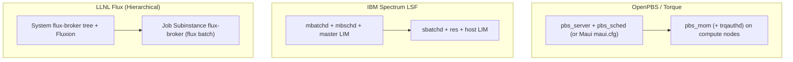

# 6.17 Other schedulers: PBS, Torque, LSF and Flux

| | |
|---|---|
| Level | Intermediate |
| Priority tier | 2 |
| Lab venue | Laptop (converter); optional single-node installs of OpenPBS or Flux |
| Part | Part 6: HPC and Slurm |
| Status | Drafted. PBS facts from the OpenPBS man pages (openpbs/openpbs commit `cd7ab5e`, 2026-04-10), Flux facts from the flux-core documentation (commit `40ecc8d`, 2026-10-23). LSF and Torque are described from general knowledge and the SCL book's Torque chapter: **unverified**. `code/part06/pbs2slurm.py` was run on one test script. No scheduler other than the converter was executed; labs **untested** |

## Why this matters for AI infrastructure

Slurm dominates GPU training clusters, but you will inherit or integrate with others: universities and national labs on PBS Professional or OpenPBS, financial and EDA shops on IBM Spectrum LSF, LLNL-lineage systems on Flux, legacy clusters on Torque, plus customers whose scripts are written for another syntax. Knowing the concepts that all of them share, and being able to translate between them, makes you useful in migrations (a common project when a site moves to Slurm or to a Kubernetes-based stack) and in interviews.

## Prerequisites and outcomes

Needs 6.7 to 6.11. After this chapter you can:

- Describe the architecture of PBS (server, scheduler, MOM, comm), Torque, LSF and Flux, and how each differs from Slurm.
- Translate job scripts and commands between PBS, Slurm, LSF and Flux for common requests (nodes, GPUs, time, arrays, dependencies).
- Explain PBS's `select`/`place` model and Flux's nested-instance model, the two ideas furthest from Slurm's.
- Plan a migration: inventory, translation, policy mapping, accounting continuity, user retraining, parallel run.

## 1. What all batch schedulers share



A **queue/partition** concept; a **server/controller** holding state; a **per-node daemon** (MOM in PBS, `sbatchd` in LSF, broker in Flux, `slurmd`); a **policy engine** (priority, fair-share, backfill, limits, preemption); a **job script with directives** in comments; **arrays**, **dependencies**, **interactive** jobs; **accounting**. Differences are in vocabulary, resource-request model, defaults and extensibility. The SCL book devotes a chapter to OpenPBS/Torque because its target readers meet them; the same skills transfer.

## 2. PBS: OpenPBS and PBS Professional

OpenPBS is the open-source release of PBS Professional (Altair, since open-sourced). Components (from the `pbs(8B)` family of man pages): **`pbs_server`** (job and queue database, accepts jobs), **`pbs_sched`** (the scheduler: decides what runs where, with a policy configured in `sched_config` and resource definitions), **`pbs_mom`** (the execution daemon on each node, "Machine Oriented Mini-server"), **`pbs_comm`** (communication/relay for large clusters), and a data service (Postgres). Administration with `qmgr`, `pbsnodes`, `qstat`, `qenable`/`qdisable`/`qstart`/`qstop`, `tracejob`, hooks written in Python (`pbs_python`) for admission/execution control.

### Request model: select and place

PBS asks for resources as **chunks**. From `qsub(1B)`:

```text
-l select=[<N>:]<chunk>[+[<N>:]<chunk> ...]        chunk = <resource>=<value>[:<resource>=<value>...]
-l place=[<arrangement>][:<sharing>][:<grouping>]  arrangement: free | pack | scatter | vscatter
                                                   sharing: excl | shared | exclhost
                                                   grouping: group=<resource>
```

Example: `#PBS -l select=2:ncpus=64:mpiprocs=8:ngpus=8:mem=500gb` asks for two identical chunks (each at least 64 CPUs, 8 MPI processes, 8 GPUs, 500 GB), `#PBS -l place=scatter:excl` puts them on different hosts, exclusively. `+` joins different chunks (a heterogeneous request such as one big-memory chunk plus several GPU chunks), a natural fit for heterogeneous jobs where Slurm needs special "heterogeneous job" syntax. Do not mix old-style (`-l nodes=...:ppn=`) with `select` (the man page warns of an error). Chunks map to **vnodes** (virtual nodes: a host can be split into several vnodes, for example per NUMA domain or per GPU), so "node" has a looser meaning than in Slurm.

Other directives: `-N` name, `-q` queue, `-J X-Y[:Z][%max]` arrays (indices; `%max` caps running sub-jobs; "job arrays are always rerunnable"), `-W depend=afterok:ID[:ID]` (types `after`, `afterok`, `afternotok`, `afterany`, `before...`, `on:N`), `-o/-e/-j`, `-v`/`-V` environment, `-l walltime=HH:MM:SS`, `-m/-M` mail, `-r` rerunnable, `-I` interactive, `-A` account.

Environment variables: `PBS_JOBID`, `PBS_O_WORKDIR`, `PBS_NODEFILE` (a file listing allocated hosts, one line per slot), `PBS_ARRAY_INDEX`, `PBS_ARRAYID`.

### Torque

Torque (from the old Maui/Torque stack, originally Cluster Resources/Adaptive Computing) has the same lineage as PBS (it forked OpenPBS 2.3.12), with `qsub -l nodes=2:ppn=16`, `pbs_server`, `pbs_mom`, and the Maui or Moab scheduler for policy (Torque's built-in scheduler is basic). The SCL book walks through installing Torque, configuring the MOM on compute nodes, customising the scheduler, and job-control commands. It is **legacy**: new clusters choose Slurm or PBS Pro/OpenPBS; the open-source Torque line is no longer a good greenfield choice (from general knowledge: verify the project's current status before relying on it).

### Strengths and weaknesses

Strong: flexible resource chunks and placement, hooks, mature in some industries, good Windows/Linux history. Weaker for GPU AI practice: smaller ecosystem of AI tooling (pyxis, NGC reference recipes, Kubernetes bridges), fewer GPU-specific features out of the box than Slurm's GRES/`--gpus*`, and less community knowledge in AI-lab hiring pools.

### Setting up Torque and customising its scheduler

Naming caution from the SCL book: the *original* OpenPBS (MRJ, 1998, unsupported since about 2004), **Torque** (Adaptive Computing's fork of it) and **PBS Professional** (Altair's commercial product, later released as the *new* OpenPBS in 2020) are three different code lines; "OpenPBS" in a document may mean either the old or the new one. The sketch below follows the concrete Torque setup in Chapter 14 of *Supercomputers for Linux SysAdmins* (`(untested here)`):

1. **Daemon components and fixed TCP ports (`/etc/services`)**: Torque comprises client/admin CLI tools, `pbs_server` (central server), `pbs_mom` (compute-node agent, paired with the `trqauthd` authentication daemon from Torque 4.0 onward), and `pbs_sched` (or an external scheduler such as Maui). Ensure the four fixed TCP ports in `/etc/services` are open across the cluster:

   ```text
   # (untested here) — /etc/services entries for Torque
   pbs         15001/tcp   # pbs server
   pbs_mom     15002/tcp   # mom to/from server
   pbs_resmom  15003/tcp   # request mom to manage resources
   pbs_sched   15004/tcp   # scheduler
   ```

2. **Initialise the server and define compute nodes (`$PBS_HOME/server_priv/nodes`)**: initialise the server database on first startup with `{sbindir}/pbs_server -t create` (`(untested here)`), and list compute nodes in `$PBS_HOME/server_priv/nodes` using `node_name[:ts] [property...] [np=NUMBER]` (where `:ts` marks a timeshared node and `np` is the processor count), or dynamically via `qmgr` (`create node ib01 np=1,ntype=cluster,properties="MYCLUSTER"`, `set node ...`, where `state` can be `free`, `offline`, `down`, or `excl` when running a job).
3. **Create and configure queues and server parameters with `qmgr`**: in the book's example, queue `MYCLUSTER` (or `batch`, with walltime caps such as `24:00:00` or `48:00:00` and core/slot caps such as `20`, `21`, `22`, `24`, or `25`) and server-wide parameters are configured via `qmgr` (either interactively, via `qmgr < MYCLUSTER.txt`, or dumped with `qmgr -c "print server" > /tmp/server.conf`):

   ```text
   # (untested here) — Queue setup (in the book's example, queue MYCLUSTER or batch)
   create queue batch
   set queue batch queue_type = Execution
   set queue batch resources_max.walltime = 48:00:00
   create queue MYCLUSTER
   set queue MYCLUSTER queue_type = Execution
   set queue MYCLUSTER resources_max.ncpus = 20
   set queue MYCLUSTER resources_min.ncpus = 1
   set queue MYCLUSTER resources_max.nodect = 20
   set queue MYCLUSTER resources_max.walltime = 336:00:00
   set queue MYCLUSTER resources_default.ncpus = 1
   set queue MYCLUSTER resources_default.nodect = 1
   set queue MYCLUSTER resources_default.walltime = 01:00:00
   set queue MYCLUSTER max_user_run = 12
   set queue MYCLUSTER enabled = True
   set queue MYCLUSTER started = True

   # (untested here) — Server parameters via qmgr
   set server scheduling = True
   set server acl_host_enable = True
   set server acl_hosts = *.mycluster.com
   set server acl_hosts += server.mycluster.com
   set server managers = root@server.mycluster.com
   set server default_queue = MYCLUSTER
   set server log_events = 511
   set server mail_from = root
   set server query_other_tasks = True
   set server scheduler_iteration = 600
   set server node_ping_rate = 300
   set server node_check_rate = 600
   set server tcp_timeout = 6          # (6 seconds in Ch 14; often raised e.g. tcp_timeout = 20)
   set server task_stat_rate = 30
   set server mail_to = mail.mycluster.com
   ```

4. **Configure `pbs_mom` on compute nodes (`/var/spool/PBS/mom_priv/config`)** and add an **epilogue cleanup script**: on each compute node, put the server hostname in `$PBS_HOME/server_name` and create `/var/spool/PBS/mom_priv/config`:

   ```text
   # (untested here) — /var/spool/PBS/mom_priv/config in the book's example
   $logevent 255
   $pbsserver rsufs
   $cputmult 1.0
   $ideal_load 1.0
   $max_load 2.0
   ```

   When a parallel job's head process exits, stray worker processes and `/tmp` files can remain on allocated nodes after Torque marks the nodes `free`. To clean them up automatically when a node is dedicated to one user job at a time, place an executable `/var/spool/PBS/mom_priv/epilogue` script on the nodes:

   ```bash
   #!/usr/bin/env bash
   # (untested here) — Chapter 14 Torque epilogue cleanup script example
   JOBID=$1
   USER=$2
   ######### Get the list of task nodes ###########
   if test -r "/var/spool/PBS/aux/$1"; then
   PBS_NODEFILE="/var/spool/PBS/aux/$1"
   # Perform cleanup on each node of the task
   for node in $PBS_NODEFILE; do
   ssh -o ConnectTimeout=5 $node \
   'pkill -KILL -u $USER; \
   find /tmp -user $USER -exec rm -r \{\} \; >& /dev/null'
   done
   fi
   ```

5. **Customizing the scheduler (`pbs_sched`, `/var/spool/PBS/sched_priv/sched_config`, and `maui.cfg`)**: In Torque, a separate process—the scheduler—is responsible for selecting the next task to launch for execution (`SCL` Chapter 14, *Customizing the Scheduler*). This separation allows a flexible policy of task execution organization that evaluates each task by time of day, system load, task size, and queuing time. When the server's `scheduling` attribute is set to `True`, `pbs_server` responds to events (**adding a task to the queue** or **completion of the assignment**) by calling the scheduler to select the next task to run. Torque ships with several schedulers selectable at installation time via `./configure --set-sched=cc --set-sched-code=sgi_origin` (by default installing the FIFO scheduler), and production sites frequently pair Torque with the external **Maui** or **Moab** scheduler (configuring fair-share, backfill, reservations, and priority weights in **`maui.cfg`**). For the built-in scheduler, entries in `/var/spool/PBS/sched_priv/sched_config` take the form `name:value [prime | non_prime | all]`, including `round_robin`, `by_queue`, `strict_fifo`, `fair_share` (with `half_life` and `sync_time`), `load_balancing`, `help_starving_jobs` (after `max_starve`), `log_filter`, and `sort_by`. The built-in Torque scheduler supports the following sorting keys (Table 14-2 in the book, plus `multi_sort` with multiple `key:` lines):

   | Sorting key (`sort_by`) | Meaning |
   |---|---|
   | `no_sort` | Don't sort tasks |
   | `shortest_task_first` | In ascending order by `cput` attribute |
   | `longest_task_first` | Descending by `cput` attribute |
   | `smallest_memory_first` | Ascending by `mem` attribute |
   | `largest_memory_first` | Descending by `mem` attribute |
   | `high_priority_first` | In descending order by `task_priority` attribute |
   | `low_priority_first` | In ascending order by `task_priority` attribute |
   | `large_walltime_first` | Descending by `task_walltime` attribute |
   | `short_walltime_first` | In ascending order by `task_walltime` attribute |

6. **Using Torque (`qsub`, `myprog.batch`, OpenMP, MPI, and output files; `SCL` Chapter 14)**: Users submit tasks with `qsub -q QUEUE -l ncpus=CORES script_name` or place `#PBS` directives inside the batch script (`qsub myprog.batch`). In the book's examples (`(untested here)`):
   - **Single-node / multi-process script (`myprog.batch`):** `#PBS -l nodes=1:ppn=4` and `#PBS -q MYCLUSTER`, followed by `cd $PBS_O_WORKDIR` (which specifies the path to the working directory where the executable program named `progname` is located) and `./progname`.
   - **OpenMP multithreaded script:** By default an OpenMP program spawns as many threads as there are cores on the node; to cap threads at 2 cores, add `#PBS -l nodes=1`, `#PBS -q MYCLUSTER`, and `#PBS -v OMP_NUM_THREADS=2` (and for long jobs, add `#PBS -l walltime=300:20:00` for 300 hours and 20 minutes).
   - **Multi-node MPI script:** `#PBS -l walltime=30:00:00` and `#PBS -l nodes=4:MYCLUSTER`, followed by `cd $PBS_O_WORKDIR` and `mpirun -np 4 ./progname`.
   - **Standard output, error streams, and live redirection:** Everything written to standard output and error while the task is running is buffered to a file on the compute node and copied back to the directory from which the task was started at the end of the run, automatically named **`<script_name>.o<task_number>`** (standard output) and **`<script_name>.e<task_number>`** (error stream). To inspect output live while the program is still executing (with `cat`, `less`, or `tail -f`), redirect output directly inside the script: `mpirun -np 4 progname > $PBS_JOBID` (or with keyboard input redirection: `mpirun -np 4 progname < input_file > $PBS_JOBID`). If Torque has trouble finding the destination path when the job ends, the files remain in `/var/spool/PBS/undelivered/` on the compute node and the user is notified by mail.
7. **Job control commands**: users and admins manage Torque jobs with `qsub`, `qdel`, `qhold`, `qrls`, `qmove`, `qmsg`, `qselect`, `qsig`, `qstat` (`qstat -a`, `qstat -q`), `pestat`, and the X11 GUIs `xpbs` and `xpbsmon`.

## 3. IBM Spectrum LSF (general knowledge, unverified)

LSF (Load Sharing Facility) is a commercial scheduler (IBM Spectrum LSF) common in EDA, finance and some HPC centres. Architecture: **mbatchd** (master batch daemon) and **mbschd** (scheduler) on the master host (with failover candidates), **sbatchd** and **res** on each execution host, **LIM** (Load Information Manager) collecting host load and resource information. Concepts: **queues** with their own policies, **hosts and host groups**, **resource requirement strings** (`select[...] rusage[...] span[...] order[...]`), fair-share and preemption, "job slots". Commands: `bsub` (submit; `bsub -n 16 -R "span[ptile=8]" -gpu "num=4" -q gpu -W 12:00 < script`), `bjobs`, `bkill`, `bqueues`, `bhosts`, `lsload`, `bhist`, `bacct`, `bmod`, `bswitch`, `bpeek`. Script directives: `#BSUB -n`, `-q`, `-W`, `-o`, `-J name[1-100]%10`. Environment: `LSB_JOBID`, `LSB_HOSTS`, `LSB_DJOB_HOSTFILE`, `LSB_JOBINDEX`. Strengths: enterprise support, license-aware scheduling, mature policy model, LSF multicluster. Many current AI sites using LSF are migrating to Slurm or Kubernetes. Verify all of this against IBM documentation before use.

## 4. Flux

Flux (Lawrence Livermore National Laboratory and collaborators; `flux-core`) is a framework for resource management with a very different shape. From its docs:

- A **Flux instance** is a set of `flux-broker` processes (a tree-based overlay network) that "can be started by most launchers that can start MPI jobs" and by a user without administrator privilege, e.g. inside a Slurm allocation or a Kubernetes pod.
- The key idea: **every job can itself be a Flux instance** ("subinstance"). `flux batch SCRIPT` "submits SCRIPT to run as the initial program of a Flux subinstance"; once it exits the subinstance ends and resources return to the enclosing instance. Commands run inside the script (`flux run`, `flux submit`) refer to the subinstance; `flux proxy JOBID` connects a shell to a running subinstance (`flux uptime` shows `depth`, `size`). **Hierarchical scheduling** lets users run their own scheduler policy and millions of tasks inside an allocation without loading the system scheduler, the strength for ensemble and AI-workflow workloads.
- Commands: `flux run` (run a job, interactive), `flux submit` (queue), `flux batch` (script as subinstance, `#flux:` directive lines), `flux alloc` (interactive subinstance), `flux bulksubmit` (many jobs), `flux jobs` (list), `flux cancel`, `flux resource list`, `flux queue`, `flux top`, `flux pstree`, `flux dmesg`, `flux uptime`, `flux config`.
- Request options (`flux-run`/`submit`): `-n` tasks, `-c` cores per task, `-g` GPUs per task, `-N` nodes, `--tasks-per-node`, `--gpus-per-node`, `-x` exclusive, `-t` time limit, `-q` queue, `-B` bank (accounting), `--dependency=URI` (RFC 26 dependency URIs with schemes such as `afterok`: "dependency chains behave like shell command separators", `afterok` like `&&`).
- Scheduler: the separate `flux-sched` project provides the graph-based resource model **Fluxion**; flux-core alone provides services (job manager, KVS, message bus).
- **Maturity** (docs, "Flux Maturity", late 2025): Flux is the sole system workload manager on **El Capitan** (then number one on the TOP500) and its unclassified sister systems at LLNL. The docs' migration guide ("Migrating from Slurm") tells large centres not to leave Slurm yet ("check back with us at the end of 2026") and lists missing features: rolling upgrades (nodes must run exactly the same flux-core version until 1.0), restarting Flux without killing running jobs, immovable future reservations, among others. Flux also coexists with Slurm as an enhanced step manager and portability layer.
- Relevance for AI: nested scheduling for hyperparameter sweeps and agent/RL workloads; Kubernetes integration (the Flux Operator) to run MPI-style jobs; strong tooling for ensembles. Not common on commercial GPU clouds.

## 5. Command and concept map

| Task | Slurm | PBS (OpenPBS/Pro) | LSF | Flux |
|---|---|---|---|---|
| Submit script | `sbatch s.sh` | `qsub s.sh` | `bsub < s.sh` | `flux batch s.sh` |
| Run interactive | `srun --pty bash` / `salloc` | `qsub -I` | `bsub -Is bash` | `flux alloc` / `flux run` |
| List jobs | `squeue` | `qstat` | `bjobs` | `flux jobs` |
| Cancel | `scancel` | `qdel` | `bkill` | `flux cancel` |
| Node status | `sinfo`, `scontrol show node` | `pbsnodes -a` | `bhosts`, `lsload` | `flux resource list` |
| Queue/partition | partition | queue | queue | queue |
| Nodes + CPUs | `-N 2 -n 16` | `-l select=2:ncpus=8` | `-n 16 -R "span[ptile=8]"` | `-N 2 -n 16` |
| GPUs | `--gpus-per-node=8` | `ngpus=8` in chunk | `-gpu "num=8"` | `--gpus-per-node=8` / `-g` |
| Memory | `--mem=64G` | `mem=64gb` in chunk | `-R "rusage[mem=65536]"` | via resources/constraints |
| Time | `--time=HH:MM:SS` | `-l walltime=HH:MM:SS` | `-W HH:MM` | `-t MINUTES` or FSD |
| Array | `--array=0-9%3` | `-J 0-9%3` | `-J "name[0-9]%3"` | `flux bulksubmit` |
| Dependency | `--dependency=afterok:ID` | `-W depend=afterok:ID` | `-w "done(ID)"` | `--dependency=afterok:ID` |
| Exclusive node | `--exclusive` | `-l place=excl` | `-x` | `-x` |
| Job ID variable | `SLURM_JOB_ID` | `PBS_JOBID` | `LSB_JOBID` | `FLUX_JOB_ID` |
| Node list | `SLURM_JOB_NODELIST` | `PBS_NODEFILE` | `LSB_DJOB_HOSTFILE` | `flux hostlist` |
| Launch MPI | `srun` | `mpiexec` / `pbsdsh` | `mpirun` / `blaunch` | `flux run` |

(LSF entries are from memory: verify.)

## 6. A tested translator

`code/part06/pbs2slurm.py` converts the common `#PBS` directives to `#SBATCH`: name, queue (to partition), account, output/error, array (with `%` throttle), mail, `depend=`, `walltime`, `place=...excl` (to `--exclusive`), and `select` with `ncpus`, `mpiprocs`, `ngpus`, `mem`. It also rewrites `$PBS_JOBID`, `$PBS_O_WORKDIR`, `$PBS_ARRAY_INDEX`, and flags `$PBS_NODEFILE`. On a test script:

```text
#PBS -N bert                              ->  #SBATCH --job-name=bert
#PBS -q gpuq                              ->  #SBATCH --partition=gpuq
#PBS -l select=2:ncpus=64:mpiprocs=8:ngpus=8:mem=500gb
                                          ->  #SBATCH --nodes=2 / --ntasks-per-node=8 / --cpus-per-task=8
                                              / --gpus-per-node=8 / --mem=500G
#PBS -l walltime=12:00:00                 ->  #SBATCH --time=12:00:00
#PBS -l place=scatter:excl                ->  #SBATCH --exclusive
#PBS -J 0-9%3                             ->  #SBATCH --array=0-9%3
#PBS -m abe                               ->  #SBATCH --mail-type=FAIL,BEGIN,END
#PBS -W depend=afterok:1234.server        ->  #SBATCH --dependency=afterok:1234.server   (job id must be edited)
#PBS -l software=matlab                   ->  # TODO unmapped resource: software=matlab    (a PBS custom resource -> Slurm licenses/features)
cd $PBS_O_WORKDIR                         ->  cd $SLURM_SUBMIT_DIR
mpirun -np 16 -machinefile $PBS_NODEFILE python train.py
                                          ->  ... <use: scontrol show hostnames $SLURM_JOB_NODELIST> (and prefer srun)
```

The `ncpus=64` per chunk with `mpiprocs=8` became `--cpus-per-task=8` (64/8). That is a **semantic translation**, not a mechanical one: PBS `ncpus` counts CPUs per chunk, Slurm `--cpus-per-task` per task. Things the tool deliberately does not translate: heterogeneous `select` with `+` chunks (flagged as TODO), vnode-specific placement, custom resources (map to Slurm features, licenses or GRES), hooks (rewrite as `job_submit` plugins), queue policy (fair-share, limits: rebuild per 6.9), job IDs in dependencies, `qsub -I` interactive semantics, and the MPI launch line (replace `mpirun -machinefile` by `srun`). Run the result through `sbatch_lint.py` (6.11).

## 7. Migration plan (any scheduler to Slurm)

1. **Inventory**: queues, node classes, resource types, limits, fair-share trees, reservations, hooks/plugins, license servers, user scripts (scan with `grep -r '#PBS'` / `'#BSUB'`), accounting integrations, web portals, workflow tools that call `qsub`/`bsub`.
2. **Policy mapping**: queues to partitions/QOS, limits to association/QOS limits, fair-share shares to accounts, preemption rules to `PreemptType` (6.9), custom resources to GRES/features/licenses, hooks to `job_submit` and prolog/epilog (6.14).
3. **Translate** scripts (automated first pass plus review), build a compatibility shim only if unavoidable (Slurm ships `qsub`-like wrappers in contribs; PBS-compatible wrappers exist: check availability for your version).
4. **Accounting continuity**: export historical usage; seed fair-share if desired; keep old reports for audits.
5. **Parallel run**: split nodes; dual-submit tests; compare job outcomes; train users; publish a command-map cheat sheet.
6. **Cutover** by node groups; keep rollback window; decommission after one full allocation cycle.
7. Revisit the **workflow layer** (Airflow, Nextflow, Snakemake, DAGs) which usually has a Slurm executor already.

## 8. Mixed environments and bridges

- Run **Flux or Ray or Dask inside a Slurm allocation** for fine-grained task scheduling (nested/hierarchical scheduling) without touching the system scheduler.
- Slurm to Kubernetes: 6.16; Kubernetes to Slurm bridges (queue-based "virtual kubelets") exist but are niche.
- Workflow tools abstract the scheduler: Nextflow, Snakemake, Airflow providers, Parsl, Dask-Jobqueue support Slurm, PBS and LSF through executors.
- Cloud bursting: PBS and LSF have cloud connectors; Slurm has power-save/cloud nodes (6.15).

## 9. Lab (self-checking converter lab tested; live scheduler installs untested)

First, run the self-checking Python lab (`code/part06/pbs2slurm_lab.py`) locally. It verifies `convert_line()` and `mem_to_slurm()` in `code/part06/pbs2slurm.py` on a 9-directive PBS GPU script (checking that `select=2:ncpus=64:mpiprocs=8:ngpus=8:mem=500gb` translates to `--nodes=2`, `--ntasks-per-node=8`, `--cpus-per-task=8`, `--gpus-per-node=8`, `--mem=500G`), checks the Torque `/etc/services` port mapping (`15001`–`15004`), and validates the 9 `sort_by` keys from `SCL` Chapter 14 `Table 14-2`:

```bash
python3 code/part06/pbs2slurm_lab.py
```

Next, work through these steps:

1. Run `pbs2slurm.py` on two of your own PBS scripts; fix every TODO by hand; lint with `sbatch_lint.py`.
2. Install OpenPBS in a single-node container or VM; submit a `select` job; inspect `pbsnodes -a` and `qstat -f`.
3. Install Flux (`flux start --test-size=4` in a container); run `flux batch` with nested `flux run`; use `flux proxy` and `flux uptime` to observe depth.
4. Write the command-map cheat sheet for your site.
5. Draft a migration inventory template listing all items in section 7 step 1.
6. Extend the converter to handle `-l nodes=2:ppn=16` (Torque-style) and heterogeneous select.

## 10. Interview angles

- What does PBS's `select` / `place` express that Slurm's `-N/-n` does not?
- Compare PBS MOM, LSF sbatchd and Slurm slurmd.
- What is a Flux subinstance and why is hierarchical scheduling useful?
- You inherit a PBS cluster and must move it to Slurm. Plan the migration.
- How would you translate a PBS script requesting `select=4:ncpus=32:ngpus=4:mem=128gb`?
- Which schedulers run the top supercomputers?
- Why do most GPU clouds standardise on Slurm or Kubernetes?

## Exercises

1. **Automated PBS-to-Slurm Script Translation (`code/part06/pbs2slurm.py` & `pbs2slurm_lab.py`):** Run `python3 code/part06/pbs2slurm_lab.py`. Explain why `pbs2slurm.py` divides `ncpus` (`64`) by `mpiprocs` (`8`) to produce `#SBATCH --cpus-per-task=8`, how it translates `-l place=scatter:excl`, `-J 0-9%3`, and `-m abe`, and why custom resources (`-l software=matlab`) and heterogeneous `+` chunks are emitted as `# TODO` comments for manual review.
2. **Configuring Torque Queues, Server Parameters, and `pbs_mom` Epilogue (`SCL` Chapter 14):** Write the `/etc/services` port lines (`15001`–`15004`), `qmgr` commands to create queue `MYCLUSTER` (`resources_max.ncpus = 20`, `resources_max.walltime = 336:00:00`, `max_user_run = 12`) and dump `/tmp/server.conf`, and explain how `/var/spool/PBS/mom_priv/epilogue` uses `/var/spool/PBS/aux/$1` to clean up orphan user processes and `/tmp` files across nodes.
3. **Customizing Torque's Scheduler (`sched_config` vs `maui.cfg`, `SCL` Chapter 14):** Explain the difference between `round_robin`, `by_queue`, `strict_fifo`, `fair_share`, and `help_starving_jobs` (`max_starve`) in `/var/spool/PBS/sched_priv/sched_config`, write a `multi_sort` block combining three keys from `Table 14-2`, and state why production Torque sites often replace `pbs_sched` with Maui/Moab (`maui.cfg`).
4. **Cross-Scheduler Translation Matrix (Slurm, OpenPBS, LSF, and Flux):** Write equivalent job submission commands and directives across Slurm (`sbatch`), OpenPBS (`qsub`), IBM Spectrum LSF (`bsub`), and LLNL Flux (`flux batch`) for a 2-node job requesting 8 GPUs per node, 64 CPU cores per node, 500 GiB RAM per node, exclusive node access, and a 12-hour walltime.
5. **Running Nested Hierarchical Scheduling with LLNL Flux Inside Slurm:** Explain how `flux batch` creates a nested `flux-broker` subinstance inside an enclosing Slurm allocation, why hierarchical scheduling prevents a 50,000-task hyperparameter/RL ensemble from overwhelming `slurmctld`, and which missing features Flux's own "Migrating from Slurm" guide highlights for large centers.
6. **Planning a Production Scheduler Migration (PBS or LSF to Slurm):** Design a 7-step migration plan from PBS or LSF to Slurm covering script/hook inventory, queue-to-partition/QoS policy mapping, automated `pbs2slurm.py` + `sbatch_lint.py` conversion, historical fair-share seeding in `slurmdbd`, dual-partition parallel validation, and workflow engine (Nextflow/Airflow/Snakemake) cutover.

## Checkpoint

<details>
<summary>1. Distinguish between the three historical code lines associated with the name **PBS** (`SCL` Chapter 14).</summary>

1. **Original OpenPBS (1998, MRJ Technology Solutions for NASA):** Discontinued around 2004.
2. **Torque (Terascale Open-Source Resource and QUEue Manager):** Adaptive Computing's open-source fork of OpenPBS 2.3.12, commonly paired with the Maui/Moab scheduler.
3. **PBS Professional / modern OpenPBS (Altair Engineering):** Altair's commercial evolution of PBS, open-sourced as the modern `openpbs/openpbs` project in 2020.
</details>

<details>
<summary>2. Name the four core daemons of **OpenPBS / PBS Professional** and their Slurm equivalents.</summary>

- **`pbs_server`:** Central job/queue server and state manager (backed by PostgreSQL) $\leftrightarrow$ `slurmctld` + `slurmdbd`.
- **`pbs_sched`:** Policy scheduler daemon deciding which job runs next $\leftrightarrow$ `slurmctld` scheduling plugin (`sched/backfill`).
- **`pbs_mom` ("Machine Oriented Mini-server"):** Compute-node execution agent $\leftrightarrow$ `slurmd` + `slurmstepd`.
- **`pbs_comm`:** Inter-node communication relay $\leftrightarrow$ Slurm hierarchical `TreeWidth` communication.
</details>

<details>
<summary>3. How do PBS `select` chunks and `place` directives work, and what is a **vnode**?</summary>

- **`-l select=<N>:<chunk>[+<M>:<chunk>]`:** Requests $N$ resource chunks, where each chunk specifies per-chunk `ncpus`, `mpiprocs`, `ngpus`, and `mem` (and `+` joins heterogeneous chunks in a single job).
- **`-l place=<arrangement>:<sharing>:<grouping>`:** Controls how chunks map onto hosts (`free`, `pack`, `scatter`, `vscatter` combined with `excl`, `shared`, or `exclhost`).
- **vnode (virtual node):** An abstract schedulable subdivision of a physical host (for example one vnode per NUMA socket or GPU).
</details>

<details>
<summary>4. How are job arrays, job dependencies, and node hostlists expressed in PBS compared to Slurm?</summary>

- **Arrays:** `#PBS -J 0-9%3` (`$PBS_ARRAY_INDEX`) vs `#SBATCH --array=0-9%3` (`$SLURM_ARRAY_TASK_ID`).
- **Dependencies:** `#PBS -W depend=afterok:1234` vs `#SBATCH --dependency=afterok:1234`.
- **Allocated hostlist:** `$PBS_NODEFILE` (a file containing one hostname line per allocated slot) vs `$SLURM_JOB_NODELIST` (a compressed range string expanded via `scontrol show hostnames`).
</details>

<details>
<summary>5. Which four TCP ports in `/etc/services` are used by **Torque**, and what daemon was added alongside `pbs_mom` in Torque 4.0 (`SCL` Chapter 14)?</summary>

- **`15001/tcp` (`pbs`):** `pbs_server`
- **`15002/tcp` (`pbs_mom`):** `pbs_mom` to/from server
- **`15003/tcp` (`pbs_resmom`):** resource management requests to `pbs_mom`
- **`15004/tcp` (`pbs_sched`):** scheduler daemon
Starting in Torque 4.0, the **`trqauthd`** client authentication daemon must also run alongside `pbs_mom`.
</details>

<details>
<summary>6. How are compute nodes defined in Torque's `$PBS_HOME/server_priv/nodes` file and via `qmgr`, and what does `:ts` mean (`SCL` Chapter 14 `Table 14-1`)?</summary>

Each line in `$PBS_HOME/server_priv/nodes` has the format `node_name[:ts] [property...] [np=NUMBER]`, or is added dynamically via `qmgr: create node ib01 np=1,ntype=cluster,properties="MYCLUSTER"`. Appending **`:ts`** (`ntype=time-shared`) marks the node as timeshared (polled for status and interactive use, not batch cluster allocation). Node states in `Table 14-1` are `free`, `offline`, `down`, plus `excl` when running a task.
</details>

<details>
<summary>7. How do you initialize `pbs_server` for the first time, back up all server/queue settings with `qmgr`, and restore them (`SCL` Chapter 14)?</summary>

- **First-time DB initialization:** `{sbindir}/pbs_server -t create`
- **Dump server and queue configuration:** `qmgr -c "print server" > /tmp/server.conf`
- **Restore configuration:** `qmgr < /tmp/server.conf`
</details>

<details>
<summary>8. What parameters go into `/var/spool/PBS/mom_priv/config`, and how does `/var/spool/PBS/mom_priv/epilogue` clean up stray processes after a Torque job ends (`SCL` Chapter 14)?</summary>

`/var/spool/PBS/mom_priv/config` defines `$logevent 255`, `$pbsserver <head_host>`, `$cputmult 1.0`, `$ideal_load 1.0`, and `$max_load 2.0`. When a job finishes on the head compute node, `pbs_mom` executes `/var/spool/PBS/mom_priv/epilogue` with `JOBID=$1` and `USER=$2`, which reads `/var/spool/PBS/aux/$1` (`PBS_NODEFILE`) and SSHes to every allocated node to run `pkill -KILL -u $USER` and delete the user's files in `/tmp`.
</details>

<details>
<summary>9. In Torque's `/var/spool/PBS/sched_priv/sched_config`, what do `round_robin`, `strict_fifo`, `help_starving_jobs`, and `sort_by` (`Table 14-2`) control (`SCL` Chapter 14)?</summary>

- **`round_robin`:** Cycles one task at a time across queues (vs draining one queue until a limit is hit).
- **`strict_fifo`:** Strictly blocks younger tasks when the oldest queued task cannot start yet (preventing starvation of large jobs at the cost of idle gaps).
- **`help_starving_jobs`:** Halts starting other tasks once a job has waited longer than `max_starve`.
- **`sort_by` (`Table 14-2`):** Orders queued tasks by `no_sort`, `shortest_task_first` / `longest_task_first` (`cput`), `smallest_memory_first` / `largest_memory_first` (`mem`), `high_priority_first` / `low_priority_first` (`task_priority`), `large_walltime_first` / `short_walltime_first` (`task_walltime`), or `multi_sort`.
</details>

<details>
<summary>10. How does Torque name standard output and error files by default, how can a user watch output in real time, and where do undeliverable output files land (`SCL` Chapter 14)?</summary>

By default, Torque buffers stdout and stderr on the execution node and copies them back to the submission directory at job completion as **`<script_name>.o<task_number>`** and **`<script_name>.e<task_number>`**. To watch output live during execution, redirect stdout inside the batch script (`mpirun -np 4 progname > $PBS_JOBID`) and run `tail -f`. If Torque cannot write to the submission path when the job ends, the files are saved in **`/var/spool/PBS/undelivered/`** and the user is notified by mail.
</details>

<details>
<summary>11. Name the core daemons of **IBM Spectrum LSF** and its primary CLI commands.</summary>

- **Master host daemons:** `mbatchd` (master batch daemon), `mbschd` (scheduler daemon), and master `LIM` (Load Information Manager).
- **Execution host daemons:** `sbatchd` (slave batch daemon), `res` (Remote Execution Server), and host `LIM`.
- **CLI commands:** `bsub` (submit), `bjobs` (queue status), `bkill` (cancel), `bqueues` (queues), `bhosts` / `lsload` (nodes), `bhist` / `bacct` (history/accounting).
</details>

<details>
<summary>12. How do you request 16 tasks packed 8 per node with 4 GPUs and a 12-hour walltime in LSF (`bsub`)?</summary>

`bsub -n 16 -R "span[ptile=8]" -gpu "num=4" -q gpu -W 12:00 < script.sh` (using `#BSUB` directives inside the script and reading `$LSB_JOBID` and `$LSB_DJOB_HOSTFILE`).
</details>

<details>
<summary>13. What is **LLNL Flux**, and how does its **hierarchical subinstance** model (`flux batch`) differ from Slurm?</summary>

Flux (`flux-core` + the `Fluxion` graph scheduler in `flux-sched`) builds each scheduler instance out of a tree overlay of `flux-broker` processes. When a user runs **`flux batch script.sh`**, Flux spawns a **new child Flux instance ("subinstance")** inside the allocated resources with its own job manager, KVS, and scheduling policy. Users can launch millions of fine-grained `flux submit` / `flux run` tasks inside their subinstance without putting any RPC load on the top-level system scheduler.
</details>

<details>
<summary>14. What does `flux proxy JOBID` do, and how are job dependencies expressed in Flux?</summary>

`flux proxy JOBID` attaches an interactive shell or command to the message bus of a running Flux subinstance (`flux uptime` displays the nesting `depth` and `size`). Dependencies use RFC 26 URIs via `--dependency=afterok:ID` (which behave like shell `&&` chains).
</details>

<details>
<summary>15. Which TOP500 #1 supercomputer runs Flux as its sole system workload manager, and what limitations does Flux's Slurm migration guide note for general centers?</summary>

**El Capitan** at Lawrence Livermore National Laboratory (LLNL) runs Flux as its system workload manager. Flux's own migration guide cautions general HPC centers that pre-1.0 Flux still lacks rolling daemon upgrades without matching `flux-core` versions across nodes, controller restarts that preserve running jobs, and immovable future maintenance reservations.
</details>

<details>
<summary>16. Why does `code/part06/pbs2slurm.py` translate `#PBS -l select=2:ncpus=64:mpiprocs=8:ngpus=8:mem=500gb` into `--cpus-per-task=8` instead of `--cpus-per-task=64`?</summary>

Because PBS `ncpus=64` specifies the **total CPUs per chunk (node)** while `mpiprocs=8` specifies the **number of MPI tasks per chunk**. In Slurm, `--cpus-per-task` multiplies `--ntasks-per-node=8`, so each of the 8 tasks on the node must request $64 / 8 = \mathbf{8}$ CPUs (`--cpus-per-task=8`).
</details>

<details>
<summary>17. Name five PBS features or constructs that an automated directive translator (`pbs2slurm.py`) cannot mechanically convert without human review.</summary>

1. Heterogeneous multi-chunk requests (`select=1:...+4:...`).
2. Custom site resource attributes (`-l software=matlab` $\to$ Slurm licenses, features, or GRES).
3. Python admission/execution hooks (`pbs_python` $\to$ Slurm `job_submit.lua` and `Prolog`/`Epilog`).
4. Queue-level fair-share, routing queues, and preemption policies (must be rebuilt in `sacctmgr` QoS/Fair Tree).
5. `mpirun -machinefile $PBS_NODEFILE` launch lines (should be replaced by `srun --mpi=pmix`).
</details>

<details>
<summary>18. What are the 7 steps of a safe production migration from PBS or LSF to Slurm?</summary>

1. **Inventory** queues, limits, custom resources, hooks, user scripts, and workflow integrations.
2. **Map policies** to Slurm partitions, QoS, Fair Tree accounts, GRES/licenses, and `job_submit`/`Prolog`/`Epilog`.
3. **Translate user scripts** (`pbs2slurm.py` + `sbatch_lint.py`, plus optional `qsub` compatibility wrappers).
4. **Preserve accounting continuity** by exporting historical usage and seeding initial fair-share.
5. **Run a parallel pilot** on a subset of nodes with a user command-map cheat sheet.
6. **Cut over in node waves** with a defined rollback window.
7. **Switch workflow executors** (Nextflow, Snakemake, Airflow, Ray/Dask) to their native Slurm backends.
</details>

<details>
<summary>19. When should you run **Flux, Ray, or Dask inside a Slurm allocation** instead of submitting 100,000 individual `sbatch` jobs?</summary>

When running high-throughput ensembles, reinforcement-learning rollouts, or sub-minute task graphs. Launching a single multi-node Slurm allocation and starting Flux (`srun flux start ...`), Ray, or Dask inside it keeps `slurmctld` completely insulated from high-frequency task scheduling.
</details>

<details>
<summary>20. Map the five everyday user commands (submit batch, interactive shell, list queue, cancel job, inspect nodes) across **Slurm**, **PBS**, **LSF**, and **Flux**.</summary>

- **Submit batch:** `sbatch` (Slurm) | `qsub` (PBS) | `bsub <` (LSF) | `flux batch` (Flux)
- **Interactive:** `salloc` / `srun --pty` (Slurm) | `qsub -I` (PBS) | `bsub -Is` (LSF) | `flux alloc` (Flux)
- **List queue:** `squeue` (Slurm) | `qstat` (PBS) | `bjobs` (LSF) | `flux jobs` (Flux)
- **Cancel job:** `scancel` (Slurm) | `qdel` (PBS) | `bkill` (LSF) | `flux cancel` (Flux)
- **Inspect nodes:** `sinfo` (Slurm) | `pbsnodes -a` (PBS) | `bhosts` / `lsload` (LSF) | `flux resource list` (Flux)
</details>

## Sources and review notes

- OpenPBS: man pages `qsub(1B)`, `pbs(8B)` family, `pbs_resources(7B)` (`openpbs/openpbs` commit `cd7ab5e`).
- Torque history (MRJ 1998 OpenPBS, Adaptive Computing Torque, Altair PBS Pro), daemon ports (`15001`–`15004`), `trqauthd`, `$PBS_HOME/server_priv/nodes` (`:ts` timeshared), `qmgr` `Table 14-1` node attributes and server/queue setup commands (`qmgr -c "print server" > /tmp/server.conf`), `mom_priv/config`, the `/var/spool/PBS/mom_priv/epilogue` cleanup script, `configure --set-sched=cc --set-sched-code=sgi_origin`, `maui.cfg`, `sched_config` sorting keys (`Table 14-2`), `myprog.batch` / OpenMP / MPI batch scripts, `<script_name>.o<task_number>` and `/var/spool/PBS/undelivered/`, and job control commands (`pestat`, `xpbs`, `xpbsmon`): read in full from *Supercomputers for Linux SysAdmins* (`supercomputers-for-linux-sysadmins-managing-modern-hpc-clusters-and-supercomputers-from-software-to-hardware`, `SCL`) Chapter 14 ("14. OpenPBS and Torque").
- Flux: `flux-core` documentation (`flux-batch(1)`, job parameter and dependency pages, "Migrating from Slurm" in the admin guide, commit `40ecc8d`).
- LSF: general knowledge only; verify with IBM Spectrum LSF documentation. SUNK/other Kubernetes bridges: see Chapter 6.16.
- Run here: `code/part06/pbs2slurm.py` and `python3 code/part06/pbs2slurm_lab.py` (3 passed, 0 failed).
- Explicitly labelled inferences: The semantic `ncpus // mpiprocs` translation in `code/part06/pbs2slurm.py` and `pbs2slurm_lab.py` is a deterministic migration aid for converting chunk-level PBS CPU requests into per-task Slurm requests.
- Not verified on live hardware: all Torque (`pbs_server`, `qmgr`, `pbs_mom`, `qsub`), OpenPBS, Flux, and LSF commands, the current upstream status of Torque, the PBS wrappers shipped with Slurm, and Flux roadmap dates (`untested here`).
