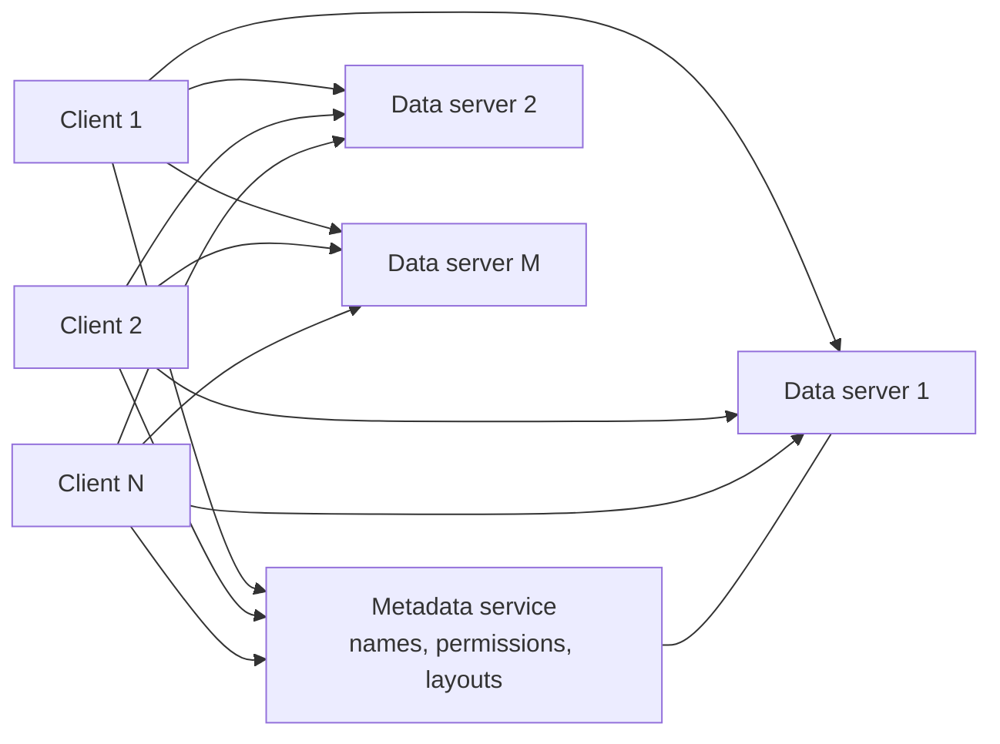

# 6.18 Parallel storage concepts and the limits of NFS

| | |
|---|---|
| Level | Intermediate |
| Priority tier | 1 |
| Lab venue | Laptop (scripts); two or more VMs for NFS experiments |
| Part | Part 6: HPC and Slurm |
| Status | Drafted. `code/part06/iomix.py` and `ckpt_math.py` were run (outputs shown; the micro-benchmark ran on a laptop SSD file system, so its numbers illustrate patterns and are **not** cluster figures). NFS mount options, Lustre/GPFS facts and tuning values come from the SCL book and general knowledge and were not tested here |

## Why this matters for AI infrastructure

Training reads datasets, writes checkpoints and logs, and loads Python environments, all from shared storage. When storage is wrong, GPUs idle: a 4,096-GPU job stalls for minutes at every checkpoint, a data loader starves, a thousand ranks importing Python packages bring the metadata server to its knees. Storage design is one of the highest-leverage and most misunderstood parts of an AI cluster. This chapter builds the vocabulary (metadata, data, striping, consistency), explains where NFS is fine and where it fails, and sets up the Lustre, GPFS, BeeGFS, WEKA and VAST chapters (6.19, 6.20) and Part 13 (AI storage).

## Prerequisites and outcomes

Needs Part 1 (file systems, block devices), Part 2 (networking), 6.2 (anatomy). After this chapter you can:

- State why all compute nodes need a shared namespace and what POSIX semantics a cluster file system must provide.
- Explain NFS architecture, its consistency model and tuning knobs, and predict its limits.
- Distinguish metadata and data workloads, and recognise N-to-1, N-to-N and small-file patterns.
- Describe how parallel file systems stripe data, separate metadata from data, and maintain coherence.
- Do the arithmetic for checkpoint and dataset bandwidth, and size a storage tier.
- Run a micro-benchmark to characterise a file system, and know what it cannot tell you.
- Explain time synchronisation requirements (chrony/NTP) for shared file systems and authentication.

## 1. Why shared storage

A cluster's compute nodes are stateless or reimageable (6.2, 6.22); user data must live elsewhere and be visible identically on every node. The SCL book states the basic requirement: "in a compute cluster, all nodes must have write access to the user's directory". That immediately excludes block-level network protocols such as iSCSI, ATA-over-Ethernet or network block devices as the *shared* layer, because they do not synchronise data between nodes that write concurrently; they can serve as backends beneath a clustered file system, not as the shared namespace. What remains are network and distributed file systems.

Data classes on a cluster, with different needs:

| Class | Typical size | Access pattern | Needs |
|---|---|---|---|
| Home (code, config, small results) | GB | Many small files, interactive | Backup, quotas, low latency, modest throughput |
| Software (modules, containers, Python envs) | 100 GB to TB | Read-mostly, bursts at job start | Metadata-read scalability, caching |
| Datasets | TB to PB | Large sequential or random reads, shared by many ranks | High aggregate read bandwidth |
| Scratch / work | PB | Large parallel read and write | Aggregate bandwidth, not backed up, purge policy |
| Checkpoints | TB per checkpoint | Bursty, synchronous writes from all ranks | Write bandwidth; fast restart read |
| Logs, metrics, traces | GB to TB | Many appends | Metadata, small writes |
| Archive | PB | Rare | Capacity, cost, object interfaces |

## 2. NFS: what it is and where it ends

**NFS** (Network File System) exports a directory from a server to clients over RPC. Versions: NFSv3 (stateless server, separate lock manager `lockd`/`statd`), NFSv4.0/4.1/4.2 (stateful, integrated locking, compound operations, Kerberos, delegations; 4.1 adds sessions and **pNFS** for parallel data access, 4.2 server-side copy and sparse files). It is a transparent POSIX-like view over a single server (or a clustered NAS head).

**Consistency model**: NFS provides *close-to-open* consistency, not strict POSIX coherence. A client caches attributes (`actimeo`, `acregmin/max`) and data; a write is guaranteed visible to another client only after the writer closes and the reader opens. Two nodes appending to the same file, or one node polling a file another writes, can see stale data. Applications and tools that rely on immediate visibility (parallel I/O libraries, some build systems, `tail -f` across nodes) misbehave. `noac` or `lookupcache=none` fix correctness at large cost.

**Locking**: byte-range locks exist (NLM in v3, built in to v4) but are server-mediated and slow; many HPC codes avoid them. Lock recovery after server failure is a classic source of hangs.

**Why one NFS server stops scaling** (from the book's argument and common experience):

1. **Bandwidth is a single funnel.** One server has one network connection (or a few) and one storage backend. "Already on two dozen nodes, a single task can easily create a load that completely blocks the NFS server", e.g. checkpoint writes. A server with a 100 GbE link delivers ~10 GB/s at best; a 1,000-GPU checkpoint wants many times that (section 6).
2. **Metadata is a single funnel.** Every `open`, `stat`, `readdir`, `create` goes to one server's CPU and one file system's journal. Metadata-heavy jobs (Python imports, compiling, millions of small files) scale badly.
3. **Single point of failure** unless built as a clustered or HA NAS (which moves the problem to the vendor).
4. **Cache and attribute traffic** (GETATTR storms) from thousands of clients.
5. **No data striping across servers** in classic NFS (pNFS addresses this; adoption and support vary).

Where NFS is the right answer: home directories and software trees for small to medium clusters (hundreds of nodes) with a strong server; read-mostly shared trees; configuration. Even large GPU clusters often keep `/home` and `/opt` on NFS (or NAS appliances) while datasets and checkpoints live on a parallel file system or object store.

### NFS server and mount essentials (general practice, untested here)

Server (`/etc/exports`): `/export/home 10.0.0.0/16(rw,sync,no_subtree_check,root_squash)`; use `async` only if you accept data loss on crash for speed. Run enough `nfsd` threads (`RPCNFSDCOUNT` or `nfs.conf` `threads=64` or more on busy servers; the default 8 is far too low). Use a journaled or modern file system (XFS/ext4/ZFS) on a fast, redundant backend; separate metadata-heavy exports from bulk exports; enable jumbo frames on a dedicated storage network; monitor with `nfsstat -s`, `nfsiostat`, and `/proc/net/rpc/nfsd`.

Client mount options that matter:

| Option | Effect |
|---|---|
| `vers=4.1` or `4.2` | Modern protocol, fewer lock issues |
| `rsize`/`wsize` (e.g. 1048576) | Transfer size per RPC; larger is better for streaming |
| `hard` (default) vs `soft` | `hard` retries forever (job hangs but data safe), `soft` returns errors (risk of silent corruption); use `hard,intr`-like semantics via timeouts |
| `nconnect=N` (Linux 5.3+) | Several TCP connections per mount, increasing throughput on fast links |
| `noatime`, `nodiratime` | Avoid atime update traffic |
| `actimeo`, `acregmax` | Attribute cache lifetime: higher reduces metadata RPCs but delays visibility |
| `lookupcache`, `nocto` | Trade correctness for speed; know what you are giving up |
| `proto=rdma` | NFS over RDMA on InfiniBand/RoCE for lower CPU and latency (needs server support) |
| `_netdev`, `x-systemd.automount` | Boot ordering; automounts avoid hangs on login |

Avoid stale-handle and hang scenarios: do not unmount under running jobs; monitor server health; use automounter timeouts; make health checks (6.14) test each mount with a timeout so a hung mount drains the node instead of hanging the checker.

## 3. Time synchronisation

The SCL book places NTP in the file system chapter deliberately: distributed file systems and authentication depend on synchronised clocks. Skewed clocks cause stale-cache decisions, `make` rebuild loops, Kerberos and munge failures (`Invalid credential`), confusing logs and, in some parallel file systems, lease/lock timeouts. Use `chronyd` (modern default on RHEL-family and widely elsewhere) or `ntpd`/systemd-timesyncd; point all nodes at two or more internal servers that themselves sync to reliable upstreams (GPS/PTP-backed sources in large sites); monitor offset (`chronyc tracking`, `chronyc sources -v`) and alert above a threshold (milliseconds are fine for most uses; PTP for tighter needs). A health check should include clock synchronisation (the `time_sync` check in 6.14).

## 4. Metadata, data and the parallel file system idea

Every file system has two kinds of state: **metadata** (names, directories, permissions, sizes, timestamps, which blocks hold the data) and **data** (the bytes). NFS serves both from one place. A **parallel file system** separates them and scales each independently:



- The client asks the metadata service where file data lives (the **layout**), then talks **directly to many data servers in parallel**, so bandwidth scales with the number of data servers and clients.
- **Striping**: a file is divided into chunks (stripe size, e.g. 1 MiB) distributed round-robin over a set of data targets (stripe count). A large file written by many clients goes to many servers at once; one client reading a striped file gets the aggregate of several servers.
- **Metadata scaling**: multiple metadata servers/targets, directory sharding, caching on clients; still the hardest part, as single-directory operations and create rates scale poorly in many systems.
- **Coherence**: clients cache data and metadata under **locks/leases** granted by the servers; when another client wants to write a range, the lock is revoked and cache invalidated. This gives POSIX semantics (a write is visible to others immediately after it returns) at the cost of lock traffic, especially for shared-file small writes.
- **Failure handling**: data servers have redundancy (RAID/erasure coding, replication or failover pairs); metadata is mirrored or on shared storage with failover; clients reconnect and replay.
- **Namespaces and tiers**: pools or tiers (NVMe flash, HDD, object/cloud), policies moving data between them.

Main families (details in 6.19, 6.20): **Lustre** (MDS/MDT, OSS/OST, MGS; open source; dominant in HPC), **IBM Storage Scale / GPFS** (shared-disk heritage, NSD servers, distributed metadata), **BeeGFS** (simple, flexible, open core), **PanFS** (Panasas, vendor appliance), **WEKA** and **VAST** (NVMe-first, software-defined, increasingly common in AI clusters), **CephFS**, **GlusterFS**, **OrangeFS/PVFS2** and others in the SCL book's "other file systems"; plus object stores (S3-compatible) for datasets and archives (Part 13).

## 5. I/O patterns and what breaks

| Pattern | Description | Typical trouble |
|---|---|---|
| **N-to-N** (file per process) | Each rank writes its own file | Many files: metadata create storm; directory with 100,000 entries; but data parallelism is good |
| **N-to-1 shared file** | All ranks write disjoint regions of one file (MPI-IO, HDF5, torch distributed checkpoint shards) | Lock contention if regions are not stripe-aligned; needs collective I/O and alignment |
| **Small files** | Millions of KB-sized files (image datasets, Python packages) | Metadata-bound; latency-bound; slow on every file system, worst on NFS and HDD-backed metadata |
| **Random small reads** | Data loaders sampling randomly from a huge file | IOPS and latency, not bandwidth |
| **Read storms at job start** | Thousands of ranks import the same Python modules or read the same config | Metadata and server cache; solved by containers, local copies, caching |
| **Bursty checkpoint writes** | All ranks write at the same instant | Aggregate write bandwidth, burst buffers; stragglers delay the step |
| **Append logs from many nodes** | Interleaved small appends | Lock ping-pong on shared files; use per-rank logs |
| **Checkpoint restart read** | All ranks read after a failure | Aggregate read; restart time counts against goodput |

Rules: prefer fewer, larger files (WebDataset/TFRecord-style shards for datasets), align I/O to stripe size, avoid giant directories (shard into subdirectories), keep Python environments in containers or on local disk, make each rank log to its own file, and write checkpoints asynchronously from a local or burst tier (Part 14).

## 6. Arithmetic you should be able to do

**Checkpoint size and bandwidth.** A full training checkpoint with mixed precision and Adam commonly holds about 14 bytes per parameter (bf16 weights 2, fp32 master weights 4, two fp32 Adam moments 8; some stacks add fp32 gradients, about 18). `code/part06/ckpt_math.py` computes sizes and the bandwidth needed:

```text
 params  train ckpt  to write in 60 s  at 10 GB/s: time  every 1h: lost
    7B       0.10TB              2GB/s              10 s           0.3%
   70B       0.98TB             16GB/s              98 s           2.7%
  405B       5.67TB             94GB/s             567 s          15.8%
 1000B      14.00TB            233GB/s            1400 s          38.9%
```

Reading it: a 70B model writes about a terabyte per checkpoint; at 10 GB/s that takes 98 seconds during which (if synchronous) every GPU idles, costing 2.7 percent of an hourly cadence; a trillion-parameter model needs hundreds of GB/s to checkpoint in a minute. This is why large clusters have burst-buffer-like fast tiers, asynchronous checkpointing (write to local NVMe or host memory, then drain), sharded/distributed checkpoints, and a parallel file system with hundreds of GB/s to TB/s of aggregate bandwidth. (Per-parameter byte counts are the common accounting; verify for your framework and sharding.)

**Dataset reads.** Pre-tokenised text is tiny in bandwidth terms (the script's example: 4,096 GPUs consuming 3,000 tokens/s/GPU at 4 bytes per token is only about 49 MB/s of text; the real problem is random access and the number of files). Images and video are orders of magnitude more demanding (a vision job at 2,000 images/s per node of 150 KB each is 300 MB/s per node; times 500 nodes is 150 GB/s). Compute the requirement from your own sample rates.

**Striping math.** Aggregate bandwidth is roughly `min(client_count x per_client_bw, servers x per_server_bw, network bisection)`; per-file bandwidth `stripe_count x per_target_bw`. A single-stripe 1 TB file lives on one target and is limited to its speed no matter how big the file system is; setting a larger stripe count for big shared files is a standard tuning step (6.19).

## 7. A micro-benchmark and its lessons

`code/part06/iomix.py` measures sequential write (fsync'd) and read, random 4 KiB reads, and file create/stat/unlink rates in a directory you choose. On a laptop SSD file system (APFS, in `/tmp`) it printed:

```text
sequential write      633 MB/s (fsync'd)   read    11562 MB/s (likely cached)
random 4 KiB read     705949 IOPS (likely cached)
create      4585 files/s   stat    378127/s   unlink      8303/s
```

What to take from it (not the absolute numbers): (1) reads came from the page cache (11.5 GB/s is memory speed); benchmarks must defeat caching (large files, drop caches, `O_DIRECT`, or remount) or they measure RAM; (2) data bandwidth and metadata rates are different universes: 633 MB/s of writes but only about 4.6 thousand creates per second, while `stat` of cached entries ran at 378 thousand per second; (3) create is roughly 80 times slower than a cached stat even locally: on a network file system each create is also a network round trip to a metadata server, so thousands of ranks creating files concurrently multiply the pain. Run the same script on `/home` (NFS), scratch (parallel FS) and local NVMe to see the difference; run it from several nodes simultaneously to see scaling. Serious benchmarking uses `fio`, `IOR` and `mdtest`, and the IO500 methodology (6.28).

## 8. Choosing for an AI cluster (preview of Part 13)

| Tier | Suggested technology | Notes |
|---|---|---|
| Home and software | NFS/NAS (HA), or the parallel FS with a small-file-friendly config | Backups, quotas |
| Datasets and scratch | Parallel file system (Lustre, GPFS, WEKA, VAST, BeeGFS), sized for aggregate read/write | NVMe-heavy for AI |
| Fast checkpoint tier | Node-local NVMe + async drain, or an NVMe burst tier | Reduces GPU stall |
| Cold datasets, models, archives | S3-compatible object store | Cost; use a cache layer for training |
| Container images | Squashfs on the parallel FS or local copies (6.13) | One big file beats many small ones |

Decision inputs: peak aggregate bandwidth, metadata rate, capacity, client count, POSIX needs, multi-tenancy and quotas, failure domains, operational skills, cost per TB and per GB/s, network (storage fabric, RDMA), vendor support.

## 9. Lab

Tested: 1) run `iomix.py` in `/tmp` and your home directory; record the three lines; explain differences. 2) Run `ckpt_math.py`; change bytes/param to 18 and to 2; change the interval and bandwidth; decide what bandwidth your target model needs.

Untested (needs two or three VMs): 3) set up an NFS server and two clients; run `iomix.py` on a client against the NFS mount; vary `rsize/wsize`, `nconnect`, `actimeo`; compare. 4) Demonstrate close-to-open: client A appends to a file while client B reads it repeatedly without closing; compare with `noac`. 5) Create 100,000 files in one directory vs sharded over 1,000 directories on NFS. 6) Run `iomix.py` on two clients concurrently and watch `nfsiostat` on both; see the server limits. 7) Configure `chronyd` on all VMs; skew a clock; observe what breaks first (munge, make, Kerberos).

## 10. Interview angles

- Why can't NFS serve a 1,000-GPU cluster's checkpoints?
- What is close-to-open consistency and what does it break?
- Explain the difference between metadata and data performance, and how a parallel file system scales each.
- What is striping? How would you set stripe count and size for a 2 TB shared checkpoint file?
- N-to-1 versus N-to-N checkpointing: trade-offs?
- A training job takes five minutes to start on 512 nodes. What storage causes would you check?
- How do you size storage bandwidth for a 405B-parameter training run?
- Why is time synchronisation a storage topic?
- Which tiers would you put in an AI cluster and why?

## 11. Checkpoint questions (30)

1. Why must compute nodes share a namespace?
2. Why are iSCSI/ATAoE unsuitable as the shared layer?
3. List the data classes on a cluster and their access patterns.
4. What does NFS provide and which versions exist?
5. State the NFS consistency model.
6. Why is the single server a bandwidth and a metadata funnel?
7. What is pNFS?
8. Name six client mount options and their effects.
9. What is `nconnect`?
10. What does `hard` versus `soft` mean?
11. Why must NFS server thread counts be raised?
12. Why does time synchronisation matter for file systems?
13. Name two time-sync daemons and a monitoring command.
14. Define metadata and data.
15. How does a parallel file system separate them?
16. What is striping, stripe count, stripe size?
17. How does coherence work with locks or leases?
18. List four parallel file systems.
19. What is N-to-1 I/O and its problem?
20. What is the small-file problem?
21. Why avoid giant directories?
22. What is the read storm at job start and how to avoid it?
23. How big is a 70B-parameter training checkpoint, and why?
24. How do you compute required checkpoint bandwidth?
25. Why is a text dataset's bandwidth small but its access pattern hard?
26. What limits per-file bandwidth?
27. Why were the benchmark's read numbers misleading?
28. Which tools do real storage benchmarks use?
29. How do you reduce checkpoint stall?
30. Which tier holds container images and why squashfs?

## 12. Sources and review notes

- Shared-file-system requirements, the NFS-scaling argument, NTP's role, Lustre architecture and the survey of distributed file systems: *Supercomputers for Linux SysAdmins* chapter 9 (NTP, NFS, Lustre, PanFS, GPFS/IBM Storage Scale, other file systems), restated in my words. Lustre and GPFS detail in 6.19 and 6.20.
- Original and run: `iomix.py` and `ckpt_math.py` with the outputs above; the pattern table and tier choices.
- Unverified: NFS option semantics and version details (standard knowledge), `nconnect` availability, per-parameter checkpoint byte counts, example image dataset rates, and all absolute performance expectations.
