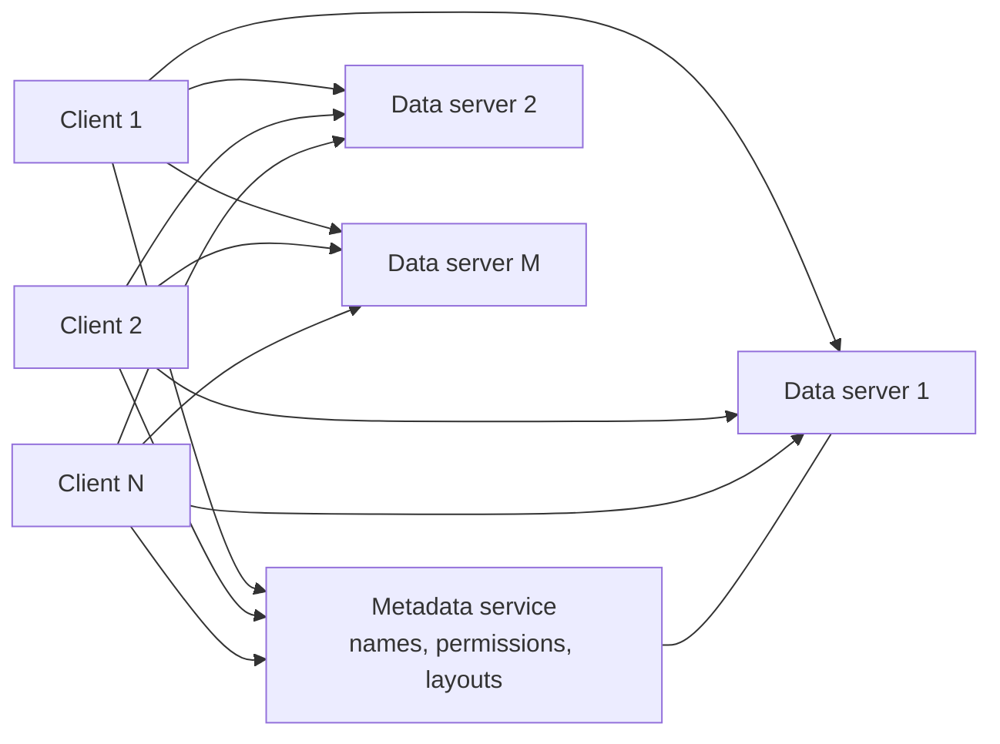

# 6.18 Parallel storage concepts and the limits of NFS

| | |
|---|---|
| Level | Intermediate |
| Priority tier | 1 |
| Lab venue | Laptop (scripts); two or more VMs for NFS experiments |
| Part | Part 6: HPC and Slurm |
| Status | Drafted. `code/part06/iomix.py` and `ckpt_math.py` were run (outputs shown; the micro-benchmark ran on a laptop SSD file system, so its numbers illustrate patterns and are **not** cluster figures). NFS mount options, Lustre/GPFS facts and tuning values come from *Supercomputers for Linux SysAdmins* and general knowledge and were not tested here |

## Why this matters for AI infrastructure

Picture a 4,096-GPU job that reaches the end of a training step and has to write a checkpoint. Every GPU waits while the write finishes. If the storage is slow, the job stalls for minutes at every checkpoint, and the GPUs sit idle the whole time.

Training reads datasets, writes checkpoints and logs, and loads Python environments, all from shared storage. A different failure looks just as bad. A data loader starves for files, or a thousand ranks import Python packages at the same moment and bring the metadata server to its knees. Storage design is one of the highest-leverage and most misunderstood parts of an AI cluster.

This chapter builds the vocabulary you need: metadata, data, striping and consistency. It explains where NFS is fine and where it fails. It also sets up the Lustre, GPFS, BeeGFS, WEKA and VAST material in chapters 6.19 and 6.20, and Part 13 on AI storage.

## Prerequisites and outcomes

Before you start, you should know file systems and block devices from Part 1, networking from Part 2, and the anatomy of a node from 6.2. When you finish this chapter, you should be able to:

- Explain why all compute nodes need a shared namespace, and what POSIX semantics a cluster file system must provide.
- Describe how NFS is built, how its consistency model works and which tuning knobs it has, and predict where it will hit its limits.
- Tell metadata workloads from data workloads, and recognise the N-to-1, N-to-N and small-file patterns.
- Describe how parallel file systems stripe data, separate metadata from data and keep caches coherent.
- Do the arithmetic for checkpoint and dataset bandwidth, and size a storage tier.
- Run a micro-benchmark to characterise a file system, and know what it cannot tell you.
- Explain the time synchronisation that shared file systems and authentication need, using chrony or NTP.

## 1. Why shared storage

Consider a job that starts on whichever compute nodes happen to be free. Every rank in that job must read the same inputs and write its results where any other node can see them. Compute nodes are stateless or reimageable (see 6.2 and 6.22), so user data has to live somewhere else and look identical on every node.

*Supercomputers for Linux SysAdmins* states the basic requirement plainly: "in a compute cluster, all nodes must have write access to the user's directory." That rules out block-level network protocols as the shared layer. Protocols such as iSCSI, ATA-over-Ethernet and network block devices do not synchronise data between nodes that write at the same time. They can sit beneath a clustered file system as a backend, but they cannot be the shared namespace itself. What remains are network and distributed file systems.

A cluster holds several kinds of data, and each kind needs something different from storage. The table lists them. Notice that home data needs backups and quotas, while scratch needs aggregate bandwidth and is not backed up.

| Class | Typical size | Access pattern | Needs |
|---|---|---|---|
| Home (code, config, small results) | GB | Many small files, interactive | Backup, quotas, low latency, modest throughput |
| Software (modules, containers, Python envs) | 100 GB to TB | Read-mostly, bursts at job start | Metadata-read scalability, caching |
| Datasets | TB to PB | Large sequential or random reads, shared by many ranks | High aggregate read bandwidth |
| Scratch / work | PB | Large parallel read and write | Aggregate bandwidth, not backed up, purge policy |
| Checkpoints | TB per checkpoint | Bursty, synchronous writes from all ranks | Write bandwidth; fast restart read |
| Logs, metrics, traces | GB to TB | Many appends | Metadata, small writes |
| Archive | PB | Rare | Capacity, cost, object interfaces |

Decide which of these classes you have before you choose a file system for them.

## 2. NFS: what it is and where it ends

NFS (Network File System) lets one server export a directory to many clients over RPC. It has several versions, and they differ a lot. NFSv3 keeps the server stateless and runs a separate lock manager, `lockd` and `statd`. NFSv4.0, 4.1 and 4.2 are stateful. They fold locking into the protocol, batch requests into compound operations, and support Kerberos and delegations. Version 4.1 adds sessions and pNFS for parallel data access. Version 4.2 adds server-side copy and sparse files. To a program, NFS looks like a transparent, POSIX-like view of a single server, or of a clustered NAS head.

The consistency model is the part that surprises people. NFS provides *close-to-open* consistency, not strict POSIX coherence. A client caches attributes (`actimeo`, `acregmin/max`) and data. A write becomes visible to another client only after the writer closes the file and the reader opens it. Suppose two nodes append to the same log file, or one node polls a status file that another keeps writing. The reader can see stale data. Parallel I/O libraries, some build systems and `tail -f` across nodes all depend on immediate visibility, so they misbehave. Using `noac` or `lookupcache=none` fixes the correctness problem, but at a large cost.

Locking works in byte ranges. NLM handles it in NFSv3, and NFSv4 builds it in. Every lock goes through the server, which makes it slow, so many HPC codes avoid locks altogether. When a server fails, recovering its locks is a classic cause of hangs.

Why does one NFS server stop scaling? The book's argument and common experience point to five causes.

1. Bandwidth is a single funnel. One server has one network connection, or a few, and one storage backend. As the book puts it, "already on two dozen nodes, a single task can easily create a load that completely blocks the NFS server", for example with checkpoint writes. A server with a 100 GbE link delivers about 10 GB/s at best. A checkpoint from 1,000 GPUs wants many times that, as section 6 works out.
2. Metadata is a single funnel. Every `open`, `stat`, `readdir` and `create` goes to one server's CPU and one file system's journal. Metadata-heavy jobs, such as Python imports, compiles and millions of small files, scale badly.
3. The server is a single point of failure, unless it is a clustered or HA NAS. That design moves the problem to the vendor.
4. Thousands of clients can flood the server with cache and attribute traffic, in what are called `GETATTR` storms.
5. Classic NFS does not stripe data across servers. pNFS addresses this, but adoption and support vary.

NFS still fits some jobs well. Home directories and software trees on small to medium clusters, with hundreds of nodes and a strong server, are a good example. So are read-mostly shared trees and configuration. Even large GPU clusters often keep `/home` and `/opt` on NFS. Some use NAS appliances for the same job. Datasets and checkpoints go to a parallel file system or an object store instead. As you read the rest of this chapter, check which of these cases describes your own cluster. Decide early whether your bulk data will outgrow one server, because that decides whether NFS is enough.

### NFS server and mount essentials (general practice, untested here)

On the server, the export line lives in `/etc/exports`. An example is `/export/home 10.0.0.0/16(rw,sync,no_subtree_check,root_squash)`. Use `async` only if you accept data loss on a crash in exchange for speed. Run enough `nfsd` threads: use `RPCNFSDCOUNT` or `threads=64` in `nfs.conf`, or more on a busy server, because the default of 8 is far too low. Pick a journaled or modern file system such as XFS, ext4 or ZFS, on a fast and redundant backend. Keep metadata-heavy exports apart from bulk exports. On a dedicated storage network, enable jumbo frames. To monitor the server, use `nfsstat -s`, `nfsiostat` and `/proc/net/rpc/nfsd`.

The book's examples in chapters 9 and 28 of *Supercomputers for Linux SysAdmins* need two things on the server: the `portmap` service and the `nfsd` and `mountd` services. The Port Mapper maps RPC service names to TCP and UDP ports. For NFS, that port is usually `2049`. Each line in `/etc/exports` names an export directory, followed by a host list. The host list is comma-separated. It may use the wildcards `*` and `?` in hostnames, or CIDR or netmask notation. Export options come last.

```text
# (untested here) — Chapter 9 & Chapter 28 /etc/exports examples
/export/dir host1,host2,host3(rw,root_squash)
/home 10.0.0.0/8(rw,no_subtree_check)
```

Table 9-1 in the book lists the main `/etc/exports` options.

| Option | Meaning |
|---|---|
| `ro` / `rw` | Read-only or read-write access |
| `root_squash` (default) | Maps the client `root` user to `nobody` rights on the server |
| `no_root_squash` | Gives the client `root` user full `root` privileges on the server |
| `all_squash` | Maps all client users to `nobody` rights on the server |
| `anonuid` / `anonguid` | Explicit UID / GID assigned during `root_squash` or `all_squash` (default `nobody`) |
| `no_subtree_check` | Disables checking user permissions in parent directories above the mount point |
| `async` | Allows the server to confirm write operations before they are executed |
| `sync` | Confirms operations only after the server's `write` system call completes (note: data may still reside in the server OS file cache rather than on physical disk) |

The `sync` row is the one to read twice. It confirms a write when the `write` system call completes, and that does not guarantee the data has reached the physical disk.

After you edit `/etc/exports`, apply the change with `exportfs -r` or `exportfs -ra` (`(untested here)`). To inspect active client mounts, use `showmount -d` for directories in use, `showmount -a` for `host:directory` pairs, or `showmount -e` for the exported list (`(untested here)`). On the client, the book's `/etc/fstab` recipe mounts `/home` like this:

```text
# (untested here)
10.0.0.1:/home /home nfs rw,noatime,nodiratime 0 0
```

Table 9-2 in the book adds more client options. The main ones work like this. `soft` and `hard` decide what happens when the server stops answering. `retrans=n` sets how many times a request is resent when `soft` is used. `rsize` and `wsize=n` set the transfer size, in multiples of `1024` bytes. `ac` and `noac` turn client attribute caching on and off. `proto=udp` and `proto=tcp` choose the transport. `intr` and `nointr` decide whether a signal can interrupt a hung file operation, which then returns `EINTR`. `acl` and `noacl` control the `NFSACL` auxiliary protocol. `nfsvers=N` picks the protocol version. `sync` and `async` set how writes are handled. `lock` and `nolock` enable or disable `flock` through `lockd` and `nfslockd`.

Some client options change performance and correctness far more than others. The table shows what each one does.

| Option | Effect |
|---|---|
| `vers=4.1` or `4.2` | Modern protocol, fewer lock issues |
| `rsize`/`wsize` (e.g. 1048576) | Transfer size per RPC; larger is better for streaming |
| `hard` (default) vs `soft` | `hard` retries forever (job hangs but data safe), `soft` returns errors (risk of silent corruption); use `hard,intr`-like semantics via timeouts |
| `nconnect=N` (Linux 5.3+) | Several TCP connections per mount, increasing throughput on fast links |
| `noatime`, `nodiratime` | Avoid atime update traffic |
| `actimeo`, `acregmax` | Attribute cache lifetime: higher reduces metadata RPCs but delays visibility |
| `lookupcache`, `nocto` | Trade correctness for speed; know what you are giving up |
| `proto=rdma` | NFS over RDMA on InfiniBand/RoCE for lower CPU and latency (needs server support) |
| `_netdev`, `x-systemd.automount` | Boot ordering; automounts avoid hangs on login |

The `hard` and `soft` rows show the central trade-off. `hard` keeps data safe but can hang a job. `soft` returns errors and risks silent corruption.

Watch for stale-handle and hang scenarios. Do not unmount a file system under running jobs. Monitor server health and use automounter timeouts. Make the health checks in 6.14 test each mount with a timeout, so a hung mount drains the node instead of hanging the checker.

### Minimal NFS server and client steps from the book

The book gives a short recipe for sharing `/home` with the cluster. Treat it as a starting point, and check each step on a test server first. The server side comes first:

1. Install the `nfs-server` package, or a similar one, and `portmap` if your system needs it.
2. Start the `portmap` and `nfsd` services, and include them in the services that start at boot.
3. Export `/home` to the clients on the `10.0.0.0/8` network by adding `/home 10.0.0.0/8(rw,no_subtree_check)` to `/etc/exports`.
4. Run `exportfs -ra` to apply the change.

On each client, the steps are:

1. Install the `nfs` package, or a similar one.
2. Add a line to `/etc/fstab` that mounts `/home` from the server at `10.0.0.1`: `10.0.0.1:/home /home nfs rw,noatime,nodiratime 0 0`.
3. Create the `/home` directory if it does not exist.
4. Run `mount /home`.

The export line above opens the share to a whole `/8` network. On a real cluster, narrow it to the subnet your nodes actually use.

## 3. Time synchronisation

Clocks matter more than most people expect. *Supercomputers for Linux SysAdmins* places NTP in its file system chapter on purpose, because distributed file systems and authentication depend on synchronised clocks. Skewed clocks cause stale-cache decisions, `make` rebuild loops, and Kerberos or munge failures, where the error reads `Invalid credential`. They also make logs confusing. In some parallel file systems, they cause lease and lock timeouts.

Use `chronyd`, `ntpd` or systemd-timesyncd. `chronyd` is the modern default on RHEL-family systems and is widely used elsewhere. Point all nodes at two or more internal servers, and have those servers sync to reliable upstream sources, such as GPS or PTP-backed sources in large sites. Watch the offset with `chronyc tracking` and `chronyc sources -v`, and alert when it crosses a threshold. Milliseconds are fine for most uses. PTP is for tighter needs.

A health check should include clock synchronisation, which is the `time_sync` check in 6.14. Decide which internal servers will serve time for the cluster, and confirm the offset before you mount a parallel file system.

### `ntpd.conf` / `openntpd`, `chrony`, `ntpdate`, and `systemd-timesyncd` details

Network distance affects how accurate synchronisation is. So install an NTP server on at least one service node. That node syncs with external upstream servers and serves the internal cluster network. The book covers three common implementations.

1. `ntpd` or `openntpd`, configured in `/etc/ntpd.conf`. On the service node that acts as the cluster NTP server, you set four things. You set the upstream servers. You set the internal interface to listen on, which is `listen on` in `openntpd`, or `interface listen eth0` in chapter 28's `ntpd.conf`. You set a `driftfile` if you use standard `ntpd`. And you set the client restriction flags. The book's example in chapter 9 looks like this:

   ```text
   # (untested here) — Chapter 9 /etc/ntpd.conf example
   server 1.ru.pool.ntp.org
   server 2.centos.pool.ntp.org
   listen on 10.1.2.251
   restrict default kod nomodify notrap nopeer noquery
   ```

   On compute nodes, `/etc/ntpd.conf` omits `listen on` and points only to the internal server, for example `server server.cluster.myorg`. The five `restrict` flags in the book's configuration each do one job. `kod` sends a "Kiss-of-death" packet that rate-limits unwanted client queries. `nomodify` stops clients from changing the server's configuration remotely. `notrap` disables protocol trap support. `nopeer` stops remote hosts from forming a peer association with the server. `noquery` blocks `ntpq` and `ntpdc` status queries, while the server still answers normal time requests. For IPv6, duplicate the `restrict` line with `-6`. To restrict by subnet, replace `default` with, for example, `192.168.2.0 mask 255.255.255.0`.

   NTP daemons adjust large clock offsets gradually by default. A 1-hour offset at boot can take many minutes to converge, and during that time parallel file systems may refuse to mount. So run a forced step synchronisation before you start the daemon on a client node. The `ntpdate` tool cannot run while `ntpd` is already running.

   ```bash
   # (untested here)
   ntpdate server_ntp_server_address
   ```

2. `chrony`, configured in `/etc/chrony.conf`. It uses `server` or `pool` directives. The `iburst` option sends initial requests more often at startup, so the clock syncs faster. Server mode for the cluster subnet comes from `allow 10.20.30.0/24`, and you can also write `allow all`.

3. `systemd-timesyncd`, a lightweight client-only daemon that cannot act as an NTP server. You configure it in `/etc/systemd/timesyncd.conf`. It also reads drop-in directories: `/etc/systemd/timesyncd.conf.d/*.conf`, `/run/systemd/timesyncd.conf.d/*.conf` and `/usr/lib/systemd/timesyncd.conf.d/*.conf`.

   ```ini
   # (untested here) — /etc/systemd/timesyncd.conf
   [Time]
   NTP=0.ubuntu.pool.ntp.org 2.ubuntu.pool.ntp.org
   FallbackNTP=0.pool.ntp.org 1.pool.ntp.org
   ```

   To turn the service on and check its state, use `timedatectl`:

   ```bash
   # (untested here)
   systemctl enable --now systemd-timesyncd
   timedatectl show-timesync --all
   ```

   The book's example reports these values: `FallbackNTPServers`, `ServerName`, `ServerAddress`, `RootDistanceMaxUSec=5s`, `PollIntervalMinUSec=32s`, `PollIntervalMaxUSec=34min 8s`, and `PollIntervalUSec=1min 4s`.

## 4. Metadata, data and the parallel file system idea

Every file system keeps two kinds of state. Metadata covers names, directories, permissions, sizes, timestamps, and which blocks hold the data. Data is the bytes themselves. NFS serves both from one place. A parallel file system splits them apart, so each one can scale on its own.

Picture how the pieces fit together, and where your own client sits:



A client first asks the metadata service where a file's data lives. That answer is the layout. The client then talks directly to many data servers in parallel, so bandwidth grows with the number of data servers and clients.

Striping divides each file into chunks of a set stripe size, for example 1 MiB. The chunks are spread round-robin over a set of data targets, and the number of targets is the stripe count. A large file written by many clients reaches many servers at once. A single client reading a striped file gets the combined speed of several servers.

Metadata scaling uses several metadata servers or targets, directory sharding and client caching. It is still the hardest part. Operations inside one directory, and the rate of creating files, scale poorly in many systems.

Clients cache data and metadata under locks or leases that the servers grant. When another client wants to write a range, the server revokes the lock and invalidates the cache. That gives POSIX semantics, so a write is visible to others as soon as it returns. The price is lock traffic, especially for small writes to a shared file.

Data servers rely on redundancy, such as RAID, erasure coding, replication or failover pairs. Metadata is mirrored, or kept on shared storage with failover. Clients reconnect and replay their requests after a failure.

A file system can also group storage into pools or tiers, such as NVMe flash, HDD, and object or cloud storage. Policies then move data between the tiers.

The main families are covered in chapters 6.19 and 6.20. Lustre is open source and dominant in HPC. Its parts are the MDS/MDT, OSS/OST and MGS. IBM Storage Scale / GPFS has a shared-disk heritage, NSD servers and distributed metadata. BeeGFS is simple and flexible, with an open core. PanFS is the Panasas vendor appliance. WEKA and VAST are NVMe-first and software-defined, and they are increasingly common in AI clusters. CephFS, GlusterFS, OrangeFS/PVFS2 and others appear in the book's "other file systems". Object stores with S3-compatible interfaces serve datasets and archives, which Part 13 covers.

Before you pick a parallel file system, check whether your workload stresses metadata or data, since each one scales differently.

## 5. I/O patterns and what breaks

Your job's I/O pattern decides which failures you will meet. A job that writes one file per rank hits a different wall from a job that reads millions of small image files. The table lists the common patterns and what usually goes wrong with each.

| Pattern | Description | Typical trouble |
|---|---|---|
| **N-to-N** (file per process) | Each rank writes its own file | Many files: metadata create storm; directory with 100,000 entries; but data parallelism is good |
| **N-to-1 shared file** | All ranks write disjoint regions of one file (MPI-IO, HDF5, torch distributed checkpoint shards) | Lock contention if regions are not stripe-aligned; needs collective I/O and alignment |
| **Small files** | Millions of KB-sized files (image datasets, Python packages) | Metadata-bound; latency-bound; slow on every file system, worst on NFS and HDD-backed metadata |
| **Random small reads** | Data loaders sampling randomly from a huge file | IOPS and latency, not bandwidth |
| **Read storms at job start** | Thousands of ranks import the same Python modules or read the same config | Metadata and server cache; solved by containers, local copies, caching |
| **Bursty checkpoint writes** | All ranks write at the same instant | Aggregate write bandwidth, burst buffers; stragglers delay the step |
| **Append logs from many nodes** | Interleaved small appends | Lock ping-pong on shared files; use per-rank logs |
| **Checkpoint restart read** | All ranks read after a failure | Aggregate read; restart time counts against goodput |

The fixes follow from the table. Prefer fewer, larger files, such as WebDataset or TFRecord-style shards for datasets. Align I/O to the stripe size. Avoid giant directories by sharding them into subdirectories. Keep Python environments in containers or on local disk. Make each rank log to its own file. Write checkpoints asynchronously from a local or burst tier, as Part 14 describes.

Find the row that matches your job's I/O before you tune anything.

## 6. Arithmetic you should be able to do

Start with checkpoints, since they are the largest. A full training checkpoint with mixed precision and Adam commonly holds about 14 bytes per parameter. That is 2 bytes for bf16 weights, 4 bytes for fp32 master weights, and 8 bytes for the two fp32 Adam moments. Some stacks also save fp32 gradients, which brings the total to about 18 bytes. The script `code/part06/ckpt_math.py` computes the sizes and the bandwidth you need:

```text
 params  train ckpt  to write in 60 s  at 10 GB/s: time  every 1h: lost
    7B       0.10TB              2GB/s              10 s           0.3%
   70B       0.98TB             16GB/s              98 s           2.7%
  405B       5.67TB             94GB/s             567 s          15.8%
 1000B      14.00TB            233GB/s            1400 s          38.9%
```

Read the 70B row as a worked example. A 70B model writes about 0.98 TB per checkpoint, which is nearly a terabyte. At 10 GB/s, that write takes 98 seconds. If the write is synchronous, every GPU idles for those 98 seconds. Against an hourly cadence, that is 2.7 percent lost. A trillion-parameter model needs hundreds of GB/s to checkpoint in a minute. That is why large clusters use burst-buffer-like fast tiers, asynchronous checkpointing that writes to local NVMe or host memory and then drains, sharded or distributed checkpoints, and a parallel file system with hundreds of GB/s to TB/s of aggregate bandwidth. Per-parameter byte counts are the common accounting. Verify them for your framework and sharding.

Dataset reads have a different shape. Pre-tokenised text is small in bandwidth terms. The script's example has 4,096 GPUs each consuming 3,000 tokens per second, at 4 bytes per token. That comes to about 49 MB/s of text. For text, the real problem is random access and the number of files. Images and video are orders of magnitude more demanding. Take a vision job at 2,000 images per second per node, with 150 KB per image. That is 300 MB/s per node. Times 500 nodes, it is 150 GB/s. Compute the requirement from your own sample rates.

Striping has its own arithmetic. Aggregate bandwidth is roughly the smallest of three limits: `min(client_count x per_client_bw, servers x per_server_bw, network bisection)`. The bandwidth of a single file is `stripe_count x per_target_bw`. Take a single-stripe 1 TB file. It lives on one target, so it runs at that target's speed, however large the file system is. Setting a larger stripe count for big shared files is a standard tuning step, covered in 6.19.

Do this arithmetic with your own model size and sample rates before you size a tier.

## 7. A micro-benchmark and its lessons

`code/part06/iomix.py` measures sequential write (fsync'd) and read, random 4 KiB reads, and file create, stat and unlink rates in a directory you choose. On a laptop SSD running APFS, in `/tmp`, it printed this:

```text
sequential write      633 MB/s (fsync'd)   read    11562 MB/s (likely cached)
random 4 KiB read     705949 IOPS (likely cached)
create      4585 files/s   stat    378127/s   unlink      8303/s
```

The lessons matter more than the absolute numbers. 1. The reads came from the page cache. 11.5 GB/s is memory speed, so a benchmark has to defeat caching. Use large files, drop caches, use `O_DIRECT`, or remount. Otherwise it measures RAM.
2. Data bandwidth and metadata rates are different universes. The run wrote at 633 MB/s, but it managed only about 4.6 thousand creates per second. Meanwhile, `stat` on cached entries ran at 378 thousand per second.
3. Create is roughly 80 times slower than a cached stat, even on a local disk. On a network file system, each create is also a network round trip to a metadata server. So thousands of ranks creating files at once multiply the pain.

Run the same script on `/home` (NFS), on scratch (the parallel file system) and on local NVMe to see the difference. Run it from several nodes at once to see how it scales. Serious benchmarking uses `fio`, `IOR` and `mdtest`, and the IO500 methodology in 6.28.

These numbers came from a laptop, so measure your own storage before you trust any figure.

## 8. Choosing for an AI cluster (preview of Part 13)

The table previews Part 13. It suggests a technology for each tier of an AI cluster's storage.

| Tier | Suggested technology | Notes |
|---|---|---|
| Home and software | NFS/NAS (HA), or the parallel FS with a small-file-friendly config | Backups, quotas |
| Datasets and scratch | Parallel file system (Lustre, GPFS, WEKA, VAST, BeeGFS), sized for aggregate read/write | NVMe-heavy for AI |
| Fast checkpoint tier | Node-local NVMe + async drain, or an NVMe burst tier | Reduces GPU stall |
| Cold datasets, models, archives | S3-compatible object store | Cost; use a cache layer for training |
| Container images | Squashfs on the parallel FS or local copies (6.13) | One big file beats many small ones |

Before you choose, gather the inputs that decide the answer. They are peak aggregate bandwidth, metadata rate, capacity, client count, POSIX needs, multi-tenancy and quotas, failure domains, operational skills, cost per TB and per GB/s, the network (storage fabric, RDMA), and vendor support.

## 9. Lab

The self-checking lab runs on your own machine first. It is `code/part06/iomix_lab.py`. It verifies `ckpt_math.py` for two models. The `70B` model gives `0.98 TB`, `16 GB/s`, and `98 s`, which is `2.7%` hourly loss at `10 GB/s`. The `405B` model gives `5.67 TB`, `94 GB/s`, and `567 s`, which is `15.8%` hourly loss. The lab also checks the dataset read bandwidth equations, `49 MB/s` for pre-tokenized text against `150 GB/s` for raw image streaming. Finally, it runs `code/part06/iomix.py --mb 4 --files 100`, which measures sequential write and read, random 4 KiB IOPS, and small-file `create`, `stat` and `unlink` rates. Start it with this command:

```bash
python3 code/part06/iomix_lab.py
```

The first two tasks run on one machine. The last five need two or three VMs, and this chapter did not test them.

1. Run `iomix.py` in `/tmp` and in your home directory. Record the three lines it prints, and explain the differences.
2. Run `ckpt_math.py`. Change the bytes per parameter to 18, then to 2. Change the interval and the bandwidth. Then decide what bandwidth your target model needs.
3. Set up an NFS server and two clients. Run `iomix.py` on a client against the NFS mount. Vary `rsize/wsize`, `nconnect` and `actimeo`, and compare the results.
4. Demonstrate close-to-open consistency. Have client A append to a file while client B reads it repeatedly without closing it. Then compare the result with `noac`.
5. Create 100,000 files in one directory, then create the same number sharded over 1,000 directories on NFS. Compare the two.
6. Run `iomix.py` on two clients at the same time, and watch `nfsiostat` on both. Note where the server limits show up.
7. Configure `chronyd` on all VMs, skew a clock, and observe what breaks first: munge, make or Kerberos.

## 10. Interview angles

- Why can't NFS serve a 1,000-GPU cluster's checkpoints?
- What is close-to-open consistency and what does it break?
- Explain the difference between metadata and data performance, and how a parallel file system scales each.
- What is striping? How would you set stripe count and size for a 2 TB shared checkpoint file?
- N-to-1 versus N-to-N checkpointing: trade-offs?
- A training job takes five minutes to start on 512 nodes. What storage causes would you check?
- How do you size storage bandwidth for a 405B-parameter training run?
- Why is time synchronisation a storage topic?
- Which tiers would you put in an AI cluster and why?

## Exercises

1. Run `python3 code/part06/iomix_lab.py`. Then use `ckpt_bytes(params, 14)`, `need_gbs(size, 60)` and `overhead(size, 10, 3600)`, which come from `code/part06/ckpt_math.py`, to check two results that you can verify yourself. First, a `70B` mixed-precision Adam checkpoint of `0.98 TB` needs `16 GB/s` to write in 60 seconds. On a `10 GB/s` NFS server it wastes `98 s`, which is `2.7%` of an hour. Second, a `405B` checkpoint of `5.67 TB` needs `94 GB/s`. At `10 GB/s` it wastes `567 s`, or `15.8%` of every hour.
2. Run `python3 code/part06/iomix.py --mb 64 --files 2000`. Explain why sequential read bandwidth (`11,562 MB/s` in the laptop run) exceeds physical SSD write bandwidth (`633 MB/s` `fsync`'d). Explain why `create` (`4,585 files/s`) is roughly $80\times$ slower than cached `stat` (`378,127/s`). Then describe how you would defeat OS page-cache inflation during storage benchmarks.
3. Using chapters 9 and 28 of *Supercomputers for Linux SysAdmins* as your guide, configure an NFS server and its client mounts. Write the `/etc/exports` entries `/export/dir host1,host2,host3(rw,root_squash)` and `/home 10.0.0.0/8(rw,no_subtree_check)`. Write the `exportfs -ra` command and the `showmount -e/-d/-a` commands. Write the client `/etc/fstab` mount line with `rw,noatime,nodiratime,vers=4.2,rsize=1048576,wsize=1048576,nconnect=8,hard`. Then explain the trade-offs of `root_squash` against `no_root_squash`, `sync` against `async`, and `hard` against `soft`.
4. Harden cluster time synchronisation with `ntpd`, `chrony` and `systemd-timesyncd`, following chapter 9 of *Supercomputers for Linux SysAdmins*. Write `/etc/ntpd.conf` for a cluster service node, with `listen on 10.1.2.251` and `restrict default kod nomodify notrap nopeer noquery`. Explain each of the five `restrict` flags. State why `ntpdate` (or `chronyd` with `iburst`) is needed before mounting parallel filesystems after a cold boot with a large clock offset. Finally, write the `timedatectl show-timesync --all` verification command.
5. Compare dataset streaming bandwidth for pre-tokenized LLM text and for raw computer vision data. Using `iomix_lab.py`, calculate the aggregate cluster read bandwidth for two cases. In case (a), 4,096 GPUs train on pre-tokenized text at `3,000 tokens/s/GPU` and `4 bytes/token`, which is `49 MB/s`. In case (b), 500 nodes train a vision model at `2,000 images/s/node` and `150 KB/image`, which is `150 GB/s`. Explain why converting millions of small JPEG files into WebDataset `.tar` shards solves both the metadata and the bandwidth bottlenecks.
6. Design a four-tier storage architecture for a 2,048-GPU AI cluster. Specify the storage technology, the capacity and bandwidth targets, and the data lifecycle policies that you would use for four tiers: (a) `/home` and `/opt` software trees, (b) `/scratch` and active training datasets, (c) a node-local NVMe burst tier for asynchronous checkpointing and Enroot `ENROOT_DATA_PATH`, and (d) a cold S3 object archive.

## Checkpoint

Each question below opens to its answer.

<details>
<summary>1. Why must all compute nodes in an HPC/AI cluster share a writable filesystem namespace, and why can't raw block protocols like iSCSI or ATA-over-Ethernet serve directly as that shared user layer (Supercomputers for Linux SysAdmins, chapter 9)?</summary>

Compute nodes are stateless workers. Any job rank may land on any node, and every rank must read its inputs and write its outputs in one consistent directory tree. Raw block protocols such as iSCSI, ATA-over-Ethernet and NBD expose a block device. They do not coordinate concurrent file system metadata or block allocations across several writers. If you mount `ext4` or `XFS` read-write from two nodes over raw iSCSI, the file system corrupts immediately. Only a clustered file system such as GPFS, GFS2 or OCFS2, placed on top, can prevent that.
</details>

<details>
<summary>2. What are the seven primary data classes on an AI cluster, and how do their I/O patterns differ?</summary>

Each class has its own I/O pattern.

1. Home (`/home`): GBs of small source and config files. Access is interactive and latency-sensitive, and it needs backups and quotas.
2. Software (`/opt`, modules, conda, containers): 100 GB to TB, mostly read. Job launches cause massive metadata read storms.
3. Datasets: TB to PB of shared sequential or random reads across thousands of ranks.
4. Scratch (`/scratch`): PB of high-bandwidth parallel reads and writes. It is not backed up, and an automated age purge removes old data.
5. Checkpoints: TBs written synchronously in bursts by all ranks, every $K$ minutes. They need extreme aggregate write bandwidth.
6. Logs, metrics and traces: GB to TB of high-frequency small appends.
7. Archive: multi-PB cold object storage.
</details>

<details>
<summary>3. Explain NFS's **close-to-open consistency** model and what cluster access patterns it breaks.</summary>

If you run a client, it caches file data and attributes locally, under `actimeo`. So bytes written by client A become visible to client B only after A closes the file and B then opens it. Two compute nodes that append to the same log file, or poll a status file that is already open without reopening it, read stale cached blocks. The fix is to force `noac` or `lookupcache=none`, which carries a severe metadata RPC penalty.
</details>

<details>
<summary>4. Give five architectural reasons why a single NFS server stops scaling on an HPC or GPU cluster (Supercomputers for Linux SysAdmins, chapter 9).</summary>

There are five reasons.

1. Single bandwidth funnel: every read and write passes through one server's NICs and disk controller. Even 24 compute nodes checkpointing at once can saturate and block an NFS server.
2. Single metadata funnel: every `open`, `stat`, `create` and `unlink` hits one server CPU and one file system journal.
3. Single point of failure, unless the NAS is built as active/passive or clustered.
4. `GETATTR` cache-validation storms from thousands of concurrent clients.
5. No native multi-server striping in classic NFSv3 or v4.0, outside pNFS.
</details>

<details>
<summary>5. In `/etc/exports`, what is the difference between `root_squash`, `no_root_squash`, and `all_squash`, and between `sync` and `async` (Supercomputers for Linux SysAdmins, chapter 9, Table 9-1)?</summary>

- `root_squash` (the default) maps UID `0`, which is `root` on NFS clients, to the unprivileged `nobody` account on the server, using `anonuid` and `anonguid`. A compromised compute node therefore cannot modify root-owned files on `/home`.
- `no_root_squash` keeps root privileges for client UID `0`. It is needed only for diskless NFS-root OS boot exports.
- `all_squash` maps all client UIDs to `nobody`.
- `sync` replies to the client only after the server's `write` system call completes. `async` replies before the data is written to storage. That is faster, but it risks silent data loss if the NFS server crashes.
</details>

<details>
<summary>6. Which commands apply changes to `/etc/exports` and inspect active NFS exports and client mounts (Supercomputers for Linux SysAdmins, chapter 9)?</summary>

- To apply `/etc/exports` changes, run `exportfs -r` or `exportfs -ra`.
- To inspect exports and mounts, use `showmount -e` for exported directories, `showmount -d` for directories that clients have mounted, and `showmount -a` for `client:directory` pairs.
</details>

<details>
<summary>7. Compare the NFS client mount options `hard` vs `soft`, `rsize`/`wsize`, `nconnect=N`, and `noatime,nodiratime` (Supercomputers for Linux SysAdmins, chapter 9, Table 9-2).</summary>

- `hard` is the default. It retries RPCs indefinitely when the NFS server is unreachable, so processes block until the server returns and data stays intact. `soft` fails the I/O call after `retrans=n` timeouts, and that can silently corrupt application files.
- `rsize` and `wsize` set the maximum payload per read or write RPC. For example, `1048576` is 1 MiB.
- `nconnect=N` opens $N$ parallel TCP connections, up to 16, so one TCP stream does not bottleneck the mount.
- `noatime,nodiratime` stops every file or directory read from writing access-time updates.
</details>

<details>
<summary>8. Why must `RPCNFSDCOUNT` (`threads=` in `/etc/nfs.conf`) be increased on a cluster NFS server?</summary>

The historical default is 8 `nfsd` kernel threads. If 8 client RPCs block on disk I/O at the same moment, every other compute node waits in the socket backlog. Production cluster NFS servers run 64 to 256 or more `nfsd` threads.
</details>

<details>
<summary>9. Why does Supercomputers for Linux SysAdmins, chapter 9, treat **NTP time synchronization** as a core prerequisite for network filesystems?</summary>

Distributed filesystems rely on synchronised clocks for several things. They use lock leases, file modification timestamps (called `mtime`, which `make` and attribute caches use), Munge credentials, which can fail with `Invalid credential`, and Kerberos tickets. Clock skew causes stale cache decisions, lock and lease expirations, and authentication rejections.
</details>

<details>
<summary>10. Explain each of the five flags in `restrict default kod nomodify notrap nopeer noquery` in `/etc/ntpd.conf` (Supercomputers for Linux SysAdmins, chapter 9).</summary>

- `kod` sends a "Kiss-of-Death" packet that rate-limits abusive clients.
- `nomodify` stops clients from altering the `ntpd` server's runtime configuration.
- `notrap` disables the `ntpd` mode-6 control message trap service.
- `nopeer` stops unauthorized hosts from forming symmetric peer associations that could skew the server's clock.
- `noquery` blocks `ntpq` and `ntpdc` status queries from clients, while the server still answers standard NTP time-sync requests.
</details>

<details>
<summary>11. Why does Supercomputers for Linux SysAdmins, chapter 9, run `ntpdate <server>` before starting `ntpd` (or use `iburst` in `chrony`), and how do you inspect `systemd-timesyncd` status?</summary>

Standard NTP daemons slew the system clock slowly, to avoid backward time jumps. A node that boots with a 1-hour BIOS clock offset can therefore take hours to converge. Meanwhile, parallel file system mounts and Munge authentication can fail at boot. `ntpdate` forces an immediate step sync before `ntpd` starts. `chrony` uses `iburst` and `makestep` for the same purpose. To inspect `systemd-timesyncd`, run **`timedatectl show-timesync --all`**.
</details>

<details>
<summary>12. How does a **parallel filesystem** separate **metadata** from **data**, and what is **striping**?</summary>

A parallel file system splits file operations across two separate server tiers. Metadata servers, called `MDS` or `MDT`, handle filenames, directories, permissions and stripe layout maps. Data servers, called `OSS` or `OST`, store the actual file bytes. When a client opens a file, it asks the MDS once for the file's **layout**. It then reads and writes chunks of a **stripe size**, such as `1 MiB` or `4 MiB`, in parallel across `stripe_count` data servers, using RDMA.
</details>

<details>
<summary>13. How do parallel filesystems provide strict **POSIX coherence** across thousands of nodes, and when does that coherence hurt performance?</summary>

Parallel filesystems use distributed lock managers, such as Lustre `LDLM` extent locks or GPFS token managers. Before a client writes a byte range, the server revokes conflicting read and write locks cached on other clients. Any later read then sees the new bytes at once. The cost appears when many ranks make unaligned small writes, or append to the same file, as in an `N-to-1` pattern without stripe alignment. The distributed locks then ping-pong between nodes, and throughput collapses.
</details>

<details>
<summary>14. Compare **N-to-N** (one file per rank) versus **N-to-1** (shared file) checkpointing and the **small-file problem**.</summary>

- N-to-N (file per process) avoids extent lock contention on data blocks and streams well across data targets, for example `__0_0.distcp` and `__0_1.distcp`. At `10,000+` ranks, though, it can trigger a metadata `create` storm if every file lands in one unsharded directory.
- N-to-1 (single shared file) creates only one metadata entry. It needs stripe-aligned collective writes, such as MPI-IO, to avoid extent lock thrashing.
- Small-file problem: reading or creating millions of KB-sized files, such as raw ImageNet JPEGs or unpacked Conda environments, is bound by latency and metadata IOPS, not bandwidth. Pack datasets into large sequential shards, such as WebDataset, TFRecord or MDS, and pack software into `.sqsh` containers.
</details>

<details>
<summary>15. Why does a full mixed-precision (`bf16` + `fp32` Adam) training checkpoint consume $\approx 14\text{ bytes}$ per parameter (`code/part06/ckpt_math.py`), and how big are the checkpoints for `70B` and `405B` models?</summary>

Per parameter, the checkpoint stores four pieces.

- `2` bytes of `bf16` model weights.
- `4` bytes of `fp32` master weights.
- `4` bytes of the `fp32` Adam first moment $m$.
- `4` bytes of the `fp32` Adam second moment $v$.

Those add up to **`14 bytes/parameter`**. If `fp32` gradients are also saved, the total is `18` bytes.

- `70B` model: $70 \times 10^9 \times 14 = \mathbf{0.98\text{ TB}}$. Writing it in 60 s requires `16 GB/s`.
- `405B` model: $405 \times 10^9 \times 14 = \mathbf{5.67\text{ TB}}$. Writing it in 60 s requires `94 GB/s`.
</details>

<details>
<summary>16. If a `405B` training run saves a synchronous `5.67 TB` checkpoint once every hour to a `10 GB/s` storage tier, how much GPU cluster time is lost to checkpoint stalls (`ckpt_math.py`)?</summary>

Writing `5.67 TB`, which is `5,670 GB`, at `10 GB/s` blocks the training loop for **`567 seconds`**, about 9.45 minutes, every hour. That wastes **`15.8%`** of total GPU cluster capacity. You can check the share with `567 / 3600`.
</details>

<details>
<summary>17. How do two-tier **asynchronous checkpointing** and **distributed sharded checkpoints** eliminate that GPU stall?</summary>

1. Distributed sharding, through `torch.distributed.checkpoint` and `.distcp` files: every rank writes its own unique shard in parallel. The N nodes then drive the parallel file system's aggregate bandwidth, instead of rank 0 writing a single file by itself.
2. Two-tier async staging: ranks copy checkpoint tensors from HBM to pinned host RAM, or to node-local NVMe, in a few seconds. They then resume GPU training at once, while background threads drain the checkpoint to the parallel file system or object store.
</details>

<details>
<summary>18. Contrast the storage bandwidth required to feed `4,096` GPUs with pre-tokenized LLM text (`3,000 tok/s/GPU`) versus `500` nodes training a multimodal vision/video model (`2,000 images/s/node` at `150 KB/image`).</summary>

- Pre-tokenized text: $4,096 \times 3,000 \times 4\text{ B} \approx \mathbf{49\text{ MB/s}}$ cluster-wide. That is negligible bandwidth.
- Raw image streaming: $500 \times 2,000 \times 150\text{ KB} = \mathbf{150\text{ GB/s}}$ cluster-wide. It needs a high-bandwidth parallel file system or a local NVMe dataset cache.
</details>

<details>
<summary>19. What three lessons did the `code/part06/iomix.py` micro-benchmark illustrate?</summary>

1. The OS page cache distorts naive read benchmarks. Reading back a `512 MB` file straight after writing it measured RAM speed, `11,562 MB/s` and `705,949 IOPS`, against `633 MB/s` for the `fsync`'d write. If you run real benchmarks such as `fio` and `IOR`, they must use `O_DIRECT`, drop caches, or read data larger than host RAM.
2. Data bandwidth and metadata IOPS are independent. A drive that delivers `633 MB/s` of sequential writes completed only `4,585` small-file creates per second.
3. File creation, `create`, is about $80\times$ slower than cached `stat`. On a networked file system, every `create` needs synchronous, journaled metadata transactions and lock coordination.
</details>

<details>
<summary>20. How should storage tiers be mapped across an AI factory (`Home/Software`, `Scratch/Datasets`, `Fast Checkpoint Burst`, and `Cold Archive`)?</summary>

- Home and software (`/home`, `/opt`): HA NFS or NAS, or a metadata-tuned parallel file system pool, with snapshots, backups and user quotas. Container images are stored as single `.sqsh` files.
- Active datasets and scratch (`/scratch`): a parallel file system, such as Lustre, IBM Storage Scale/GPFS, WEKA, VAST or BeeGFS, over InfiniBand or RoCE RDMA.
- Fast checkpoint and container unpack tier: node-local NVMe RAID, used through `ENROOT_DATA_PATH` and for async checkpoint staging.
- Cold datasets and model registry: S3-compatible object storage.
</details>

## Sources and review notes

- Shared-file-system requirements, the NFS-scaling argument, `/etc/exports` and client mount options (Tables 9-1 and 9-2), `ntpd.conf` / `openntpd` (`restrict default kod nomodify notrap nopeer noquery`), `chrony`, `ntpdate`, `timedatectl show-timesync --all`, Lustre architecture and the survey of distributed file systems: read in full from *Supercomputers for Linux SysAdmins* (`supercomputers-for-linux-sysadmins-managing-modern-hpc-clusters-and-supercomputers-from-software-to-hardware`) Chapter 9 ("9. Network File Systems") and Chapter 28 ("28. One-Two-Three Instructions"). Lustre and GPFS detail continues in Chapters 6.19 and 6.20.
- Run here: `code/part06/iomix.py`, `code/part06/ckpt_math.py`, and `python3 code/part06/iomix_lab.py` (3 passed, 0 failed) with the outputs above.
- Explicitly labelled inferences: The checkpoint bandwidth table (`ckpt_math.py`, using `14 bytes/param`) and dataset streaming examples (`49 MB/s` text vs `150 GB/s` vision in `iomix_lab.py`) are deterministic sizing calculations.
- Book source (`supercomputers-for-linux-sysadmins-managing-modern-hpc-clusters-and-supercomputers-from-software-to-hardware`, Sergey Zhumatiy, *Supercomputers for Linux SysAdmins*), **Chapter 28: "28. One-Two-Three Instructions"**: the minimal NFS server and client recipe (`portmap`, `nfsd`, `/etc/exports`, `exportfs -ra`, and the `/etc/fstab` mount line).
- Not verified on live hardware: NFS server/client configuration commands (`exportfs`, `showmount`, `/etc/exports`, `/etc/fstab` mounts), NTP/timesyncd commands (`ntpdate`, `timedatectl show-timesync --all`), `nconnect` behaviour on live NAS fabrics, and multi-node parallel filesystem benchmark numbers (`untested here`).
