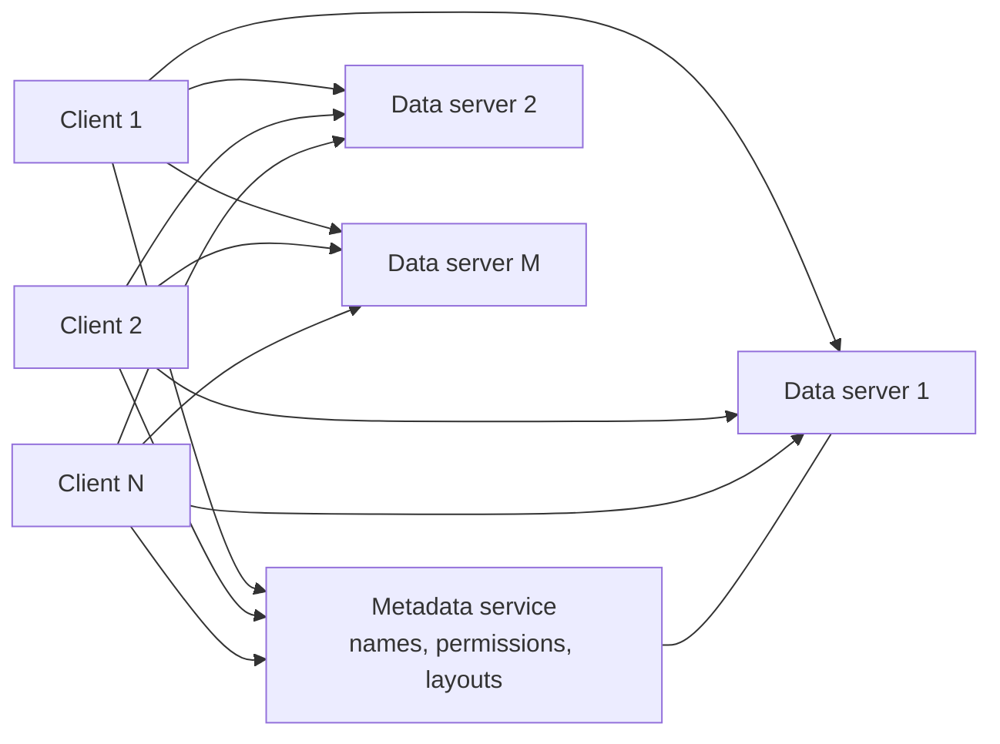

# 6.18 Parallel storage concepts and the limits of NFS

| | |
|---|---|
| Level | Intermediate |
| Priority tier | 1 |
| Lab venue | Laptop (scripts); two or more VMs for NFS experiments |
| Part | Part 6: HPC and Slurm |
| Status | Drafted. `code/part06/iomix.py` and `ckpt_math.py` were run (outputs shown; the micro-benchmark ran on a laptop SSD file system, so its numbers illustrate patterns and are **not** cluster figures). NFS mount options, Lustre/GPFS facts and tuning values come from the SCL book and general knowledge and were not tested here |

## Why this matters for AI infrastructure

Training reads datasets, writes checkpoints and logs, and loads Python environments, all from shared storage. When storage is wrong, GPUs idle: a 4,096-GPU job stalls for minutes at every checkpoint, a data loader starves, a thousand ranks importing Python packages bring the metadata server to its knees. Storage design is one of the highest-leverage and most misunderstood parts of an AI cluster. This chapter builds the vocabulary (metadata, data, striping, consistency), explains where NFS is fine and where it fails, and sets up the Lustre, GPFS, BeeGFS, WEKA and VAST chapters (6.19, 6.20) and Part 13 (AI storage).

## Prerequisites and outcomes

Needs Part 1 (file systems, block devices), Part 2 (networking), 6.2 (anatomy). After this chapter you can:

- State why all compute nodes need a shared namespace and what POSIX semantics a cluster file system must provide.
- Explain NFS architecture, its consistency model and tuning knobs, and predict its limits.
- Distinguish metadata and data workloads, and recognise N-to-1, N-to-N and small-file patterns.
- Describe how parallel file systems stripe data, separate metadata from data, and maintain coherence.
- Do the arithmetic for checkpoint and dataset bandwidth, and size a storage tier.
- Run a micro-benchmark to characterise a file system, and know what it cannot tell you.
- Explain time synchronisation requirements (chrony/NTP) for shared file systems and authentication.

## 1. Why shared storage

A cluster's compute nodes are stateless or reimageable (6.2, 6.22); user data must live elsewhere and be visible identically on every node. The SCL book states the basic requirement: "in a compute cluster, all nodes must have write access to the user's directory". That immediately excludes block-level network protocols such as iSCSI, ATA-over-Ethernet or network block devices as the *shared* layer, because they do not synchronise data between nodes that write concurrently; they can serve as backends beneath a clustered file system, not as the shared namespace. What remains are network and distributed file systems.

Data classes on a cluster, with different needs:

| Class | Typical size | Access pattern | Needs |
|---|---|---|---|
| Home (code, config, small results) | GB | Many small files, interactive | Backup, quotas, low latency, modest throughput |
| Software (modules, containers, Python envs) | 100 GB to TB | Read-mostly, bursts at job start | Metadata-read scalability, caching |
| Datasets | TB to PB | Large sequential or random reads, shared by many ranks | High aggregate read bandwidth |
| Scratch / work | PB | Large parallel read and write | Aggregate bandwidth, not backed up, purge policy |
| Checkpoints | TB per checkpoint | Bursty, synchronous writes from all ranks | Write bandwidth; fast restart read |
| Logs, metrics, traces | GB to TB | Many appends | Metadata, small writes |
| Archive | PB | Rare | Capacity, cost, object interfaces |

## 2. NFS: what it is and where it ends

**NFS** (Network File System) exports a directory from a server to clients over RPC. Versions: NFSv3 (stateless server, separate lock manager `lockd`/`statd`), NFSv4.0/4.1/4.2 (stateful, integrated locking, compound operations, Kerberos, delegations; 4.1 adds sessions and **pNFS** for parallel data access, 4.2 server-side copy and sparse files). It is a transparent POSIX-like view over a single server (or a clustered NAS head).

**Consistency model**: NFS provides *close-to-open* consistency, not strict POSIX coherence. A client caches attributes (`actimeo`, `acregmin/max`) and data; a write is guaranteed visible to another client only after the writer closes and the reader opens. Two nodes appending to the same file, or one node polling a file another writes, can see stale data. Applications and tools that rely on immediate visibility (parallel I/O libraries, some build systems, `tail -f` across nodes) misbehave. `noac` or `lookupcache=none` fix correctness at large cost.

**Locking**: byte-range locks exist (NLM in v3, built in to v4) but are server-mediated and slow; many HPC codes avoid them. Lock recovery after server failure is a classic source of hangs.

**Why one NFS server stops scaling** (from the book's argument and common experience):

1. **Bandwidth is a single funnel.** One server has one network connection (or a few) and one storage backend. "Already on two dozen nodes, a single task can easily create a load that completely blocks the NFS server", e.g. checkpoint writes. A server with a 100 GbE link delivers ~10 GB/s at best; a 1,000-GPU checkpoint wants many times that (section 6).
2. **Metadata is a single funnel.** Every `open`, `stat`, `readdir`, `create` goes to one server's CPU and one file system's journal. Metadata-heavy jobs (Python imports, compiling, millions of small files) scale badly.
3. **Single point of failure** unless built as a clustered or HA NAS (which moves the problem to the vendor).
4. **Cache and attribute traffic** (GETATTR storms) from thousands of clients.
5. **No data striping across servers** in classic NFS (pNFS addresses this; adoption and support vary).

Where NFS is the right answer: home directories and software trees for small to medium clusters (hundreds of nodes) with a strong server; read-mostly shared trees; configuration. Even large GPU clusters often keep `/home` and `/opt` on NFS (or NAS appliances) while datasets and checkpoints live on a parallel file system or object store.

### NFS server and mount essentials (general practice, untested here)

Server (`/etc/exports`): `/export/home 10.0.0.0/16(rw,sync,no_subtree_check,root_squash)`; use `async` only if you accept data loss on crash for speed. Run enough `nfsd` threads (`RPCNFSDCOUNT` or `nfs.conf` `threads=64` or more on busy servers; the default 8 is far too low). Use a journaled or modern file system (XFS/ext4/ZFS) on a fast, redundant backend; separate metadata-heavy exports from bulk exports; enable jumbo frames on a dedicated storage network; monitor with `nfsstat -s`, `nfsiostat`, and `/proc/net/rpc/nfsd`.

In the book's examples (Chapters 9 and 28), an NFS server requires the `portmap` (Port Mapper, which maps RPC service names to TCP/UDP ports, typically port `2049` for NFS) and `nfsd` / `mountd` services. Each line in `/etc/exports` defines an export directory, a comma-separated host/subnet list (supporting wildcards `*` and `?` in hostnames, or CIDR/netmask notation), and export options in parentheses:

```text
# (untested here) — Chapter 9 & Chapter 28 /etc/exports examples
/export/dir host1,host2,host3(rw,root_squash)
/home 10.0.0.0/8(rw,no_subtree_check)
```

Key `/etc/exports` options from the book (Table 9-1):

| Option | Meaning |
|---|---|
| `ro` / `rw` | Read-only or read-write access |
| `root_squash` (default) | Maps the client `root` user to `nobody` rights on the server |
| `no_root_squash` | Gives the client `root` user full `root` privileges on the server |
| `all_squash` | Maps all client users to `nobody` rights on the server |
| `anonuid` / `anonguid` | Explicit UID / GID assigned during `root_squash` or `all_squash` (default `nobody`) |
| `no_subtree_check` | Disables checking user permissions in parent directories above the mount point |
| `async` | Allows the server to confirm write operations before they are executed |
| `sync` | Confirms operations only after the server's `write` system call completes (note: data may still reside in the server OS file cache rather than on physical disk) |

After editing `/etc/exports`, apply the configuration with `exportfs -r` or `exportfs -ra` (`(untested here)`), and inspect active client mounts with `showmount -d` (directories in use), `showmount -a` (`host:directory` pairs), or `showmount -e` (exported list) (`(untested here)`). On the client, the book's `/etc/fstab` recipe mounts `/home` with:

```text
# (untested here)
10.0.0.1:/home /home nfs rw,noatime,nodiratime 0 0
```

Additional Linux NFS client mount options from the book (Table 9-2) include `soft`/`hard`, `retrans=n` (request resend count when `soft` is used), `rsize`/`wsize=n` (multiple of `1024` bytes), `ac`/`noac` (enable/disable client attribute caching), `proto=udp`/`tcp`, `intr`/`nointr` (allow interrupting hung file operations with signals, returning `EINTR`), `acl`/`noacl` (`NFSACL` auxiliary protocol), `nfsvers=N`, `sync`/`async`, and `lock`/`nolock` (enables/disables `flock` via `lockd`/`nfslockd`).

Client mount options that matter:

| Option | Effect |
|---|---|
| `vers=4.1` or `4.2` | Modern protocol, fewer lock issues |
| `rsize`/`wsize` (e.g. 1048576) | Transfer size per RPC; larger is better for streaming |
| `hard` (default) vs `soft` | `hard` retries forever (job hangs but data safe), `soft` returns errors (risk of silent corruption); use `hard,intr`-like semantics via timeouts |
| `nconnect=N` (Linux 5.3+) | Several TCP connections per mount, increasing throughput on fast links |
| `noatime`, `nodiratime` | Avoid atime update traffic |
| `actimeo`, `acregmax` | Attribute cache lifetime: higher reduces metadata RPCs but delays visibility |
| `lookupcache`, `nocto` | Trade correctness for speed; know what you are giving up |
| `proto=rdma` | NFS over RDMA on InfiniBand/RoCE for lower CPU and latency (needs server support) |
| `_netdev`, `x-systemd.automount` | Boot ordering; automounts avoid hangs on login |

Avoid stale-handle and hang scenarios: do not unmount under running jobs; monitor server health; use automounter timeouts; make health checks (6.14) test each mount with a timeout so a hung mount drains the node instead of hanging the checker.

### Minimal NFS server and client steps from the book

The book gives a short recipe for sharing `/home` with the cluster. It is meant as a starting point, so check each step on a test server first. On the server, the steps are:

1. Install the `nfs-server` package, or a similar one, and `portmap` if your system needs it.
2. Start the `portmap` and `nfsd` services, and include them in the services that start at boot.
3. Export `/home` to the clients on the `10.0.0.0/8` network by adding `/home 10.0.0.0/8(rw,no_subtree_check)` to `/etc/exports`.
4. Run `exportfs -ra` to apply the change.

On each client, the steps are:

1. Install the `nfs` package, or a similar one.
2. Add a line to `/etc/fstab` that mounts `/home` from the server at `10.0.0.1`: `10.0.0.1:/home /home nfs rw,noatime,nodiratime 0 0`.
3. Create the `/home` directory if it does not exist.
4. Run `mount /home`.

The export line above opens the share to a whole `/8` network. On a real cluster, narrow it to the subnet your nodes actually use.

## 3. Time synchronisation

The SCL book places NTP in the file system chapter deliberately: distributed file systems and authentication depend on synchronised clocks. Skewed clocks cause stale-cache decisions, `make` rebuild loops, Kerberos and munge failures (`Invalid credential`), confusing logs and, in some parallel file systems, lease/lock timeouts. Use `chronyd` (modern default on RHEL-family and widely elsewhere) or `ntpd`/systemd-timesyncd; point all nodes at two or more internal servers that themselves sync to reliable upstreams (GPS/PTP-backed sources in large sites); monitor offset (`chronyc tracking`, `chronyc sources -v`) and alert above a threshold (milliseconds are fine for most uses; PTP for tighter needs). A health check should include clock synchronisation (the `time_sync` check in 6.14).

### `ntpd.conf` / `openntpd`, `chrony`, `ntpdate`, and `systemd-timesyncd` details

Because network distance affects synchronization accuracy, install an NTP server on at least one service node that syncs with external upstream servers and serves the internal cluster network. The book covers three common implementations:

1. **`ntpd` / `openntpd` (`/etc/ntpd.conf`)**: on the service node acting as the cluster NTP server, configure upstream servers, the internal interface to listen on (`listen on` in `openntpd` or `interface listen eth0` in Chapter 28's `ntpd.conf`), a `driftfile` if using standard `ntpd`, and client restriction flags:

   ```text
   # (untested here) — Chapter 9 /etc/ntpd.conf example
   server 1.ru.pool.ntp.org
   server 2.centos.pool.ntp.org
   listen on 10.1.2.251
   restrict default kod nomodify notrap nopeer noquery
   ```

   On compute nodes, `/etc/ntpd.conf` omits `listen on` and points only to the internal server (for example, `server server.cluster.myorg`). The five `restrict` flags in the book's configuration mean:
   - `kod`: sends a "Kiss-of-death" packet to rate-limit unwanted client queries.
   - `nomodify`: prevents clients from modifying the server's configuration remotely.
   - `notrap`: disables protocol trap support.
   - `nopeer`: prevents remote hosts from forming a peer association with the server.
   - `noquery`: blocks `ntpq` and `ntpdc` status queries while still answering normal time requests (for IPv6, duplicate the `restrict` line with `-6`; to restrict by subnet, replace `default` with e.g. `192.168.2.0 mask 255.255.255.0`).

   Because NTP daemons adjust large clock offsets gradually by default—meaning a 1-hour offset at boot can take many minutes to converge, during which parallel file systems may refuse to mount—run a forced step synchronization before starting the daemon on a client node (`ntpdate` cannot run while `ntpd` is already running):

   ```bash
   # (untested here)
   ntpdate server_ntp_server_address
   ```

2. **`chrony` (`/etc/chrony.conf`)**: uses `server` or `pool` directives with the `iburst` option (which sends initial requests at a higher frequency at startup to synchronize faster) and enables server mode for the cluster subnet via `allow 10.20.30.0/24` (or `allow all`).

3. **`systemd-timesyncd`**: a lightweight client-only daemon (it cannot act as an NTP server) configured via `/etc/systemd/timesyncd.conf` (and drop-in directories `/etc/systemd/timesyncd.conf.d/*.conf`, `/run/systemd/timesyncd.conf.d/*.conf`, `/usr/lib/systemd/timesyncd.conf.d/*.conf`):

   ```ini
   # (untested here) — /etc/systemd/timesyncd.conf
   [Time]
   NTP=0.ubuntu.pool.ntp.org 2.ubuntu.pool.ntp.org
   FallbackNTP=0.pool.ntp.org 1.pool.ntp.org
   ```

   Enable the service and inspect the synchronization state with `timedatectl`:

   ```bash
   # (untested here)
   systemctl enable --now systemd-timesyncd
   timedatectl show-timesync --all
   ```

   In the book's example, `timedatectl show-timesync --all` reports `FallbackNTPServers`, `ServerName`, `ServerAddress`, `RootDistanceMaxUSec=5s`, `PollIntervalMinUSec=32s`, `PollIntervalMaxUSec=34min 8s`, and `PollIntervalUSec=1min 4s`.

## 4. Metadata, data and the parallel file system idea

Every file system has two kinds of state: **metadata** (names, directories, permissions, sizes, timestamps, which blocks hold the data) and **data** (the bytes). NFS serves both from one place. A **parallel file system** separates them and scales each independently:



- The client asks the metadata service where file data lives (the **layout**), then talks **directly to many data servers in parallel**, so bandwidth scales with the number of data servers and clients.
- **Striping**: a file is divided into chunks (stripe size, e.g. 1 MiB) distributed round-robin over a set of data targets (stripe count). A large file written by many clients goes to many servers at once; one client reading a striped file gets the aggregate of several servers.
- **Metadata scaling**: multiple metadata servers/targets, directory sharding, caching on clients; still the hardest part, as single-directory operations and create rates scale poorly in many systems.
- **Coherence**: clients cache data and metadata under **locks/leases** granted by the servers; when another client wants to write a range, the lock is revoked and cache invalidated. This gives POSIX semantics (a write is visible to others immediately after it returns) at the cost of lock traffic, especially for shared-file small writes.
- **Failure handling**: data servers have redundancy (RAID/erasure coding, replication or failover pairs); metadata is mirrored or on shared storage with failover; clients reconnect and replay.
- **Namespaces and tiers**: pools or tiers (NVMe flash, HDD, object/cloud), policies moving data between them.

Main families (details in 6.19, 6.20): **Lustre** (MDS/MDT, OSS/OST, MGS; open source; dominant in HPC), **IBM Storage Scale / GPFS** (shared-disk heritage, NSD servers, distributed metadata), **BeeGFS** (simple, flexible, open core), **PanFS** (Panasas, vendor appliance), **WEKA** and **VAST** (NVMe-first, software-defined, increasingly common in AI clusters), **CephFS**, **GlusterFS**, **OrangeFS/PVFS2** and others in the SCL book's "other file systems"; plus object stores (S3-compatible) for datasets and archives (Part 13).

## 5. I/O patterns and what breaks

| Pattern | Description | Typical trouble |
|---|---|---|
| **N-to-N** (file per process) | Each rank writes its own file | Many files: metadata create storm; directory with 100,000 entries; but data parallelism is good |
| **N-to-1 shared file** | All ranks write disjoint regions of one file (MPI-IO, HDF5, torch distributed checkpoint shards) | Lock contention if regions are not stripe-aligned; needs collective I/O and alignment |
| **Small files** | Millions of KB-sized files (image datasets, Python packages) | Metadata-bound; latency-bound; slow on every file system, worst on NFS and HDD-backed metadata |
| **Random small reads** | Data loaders sampling randomly from a huge file | IOPS and latency, not bandwidth |
| **Read storms at job start** | Thousands of ranks import the same Python modules or read the same config | Metadata and server cache; solved by containers, local copies, caching |
| **Bursty checkpoint writes** | All ranks write at the same instant | Aggregate write bandwidth, burst buffers; stragglers delay the step |
| **Append logs from many nodes** | Interleaved small appends | Lock ping-pong on shared files; use per-rank logs |
| **Checkpoint restart read** | All ranks read after a failure | Aggregate read; restart time counts against goodput |

Rules: prefer fewer, larger files (WebDataset/TFRecord-style shards for datasets), align I/O to stripe size, avoid giant directories (shard into subdirectories), keep Python environments in containers or on local disk, make each rank log to its own file, and write checkpoints asynchronously from a local or burst tier (Part 14).

## 6. Arithmetic you should be able to do

**Checkpoint size and bandwidth.** A full training checkpoint with mixed precision and Adam commonly holds about 14 bytes per parameter (bf16 weights 2, fp32 master weights 4, two fp32 Adam moments 8; some stacks add fp32 gradients, about 18). `code/part06/ckpt_math.py` computes sizes and the bandwidth needed:

```text
 params  train ckpt  to write in 60 s  at 10 GB/s: time  every 1h: lost
    7B       0.10TB              2GB/s              10 s           0.3%
   70B       0.98TB             16GB/s              98 s           2.7%
  405B       5.67TB             94GB/s             567 s          15.8%
 1000B      14.00TB            233GB/s            1400 s          38.9%
```

Reading it: a 70B model writes about a terabyte per checkpoint; at 10 GB/s that takes 98 seconds during which (if synchronous) every GPU idles, costing 2.7 percent of an hourly cadence; a trillion-parameter model needs hundreds of GB/s to checkpoint in a minute. This is why large clusters have burst-buffer-like fast tiers, asynchronous checkpointing (write to local NVMe or host memory, then drain), sharded/distributed checkpoints, and a parallel file system with hundreds of GB/s to TB/s of aggregate bandwidth. (Per-parameter byte counts are the common accounting; verify for your framework and sharding.)

**Dataset reads.** Pre-tokenised text is tiny in bandwidth terms (the script's example: 4,096 GPUs consuming 3,000 tokens/s/GPU at 4 bytes per token is only about 49 MB/s of text; the real problem is random access and the number of files). Images and video are orders of magnitude more demanding (a vision job at 2,000 images/s per node of 150 KB each is 300 MB/s per node; times 500 nodes is 150 GB/s). Compute the requirement from your own sample rates.

**Striping math.** Aggregate bandwidth is roughly `min(client_count x per_client_bw, servers x per_server_bw, network bisection)`; per-file bandwidth `stripe_count x per_target_bw`. A single-stripe 1 TB file lives on one target and is limited to its speed no matter how big the file system is; setting a larger stripe count for big shared files is a standard tuning step (6.19).

## 7. A micro-benchmark and its lessons

`code/part06/iomix.py` measures sequential write (fsync'd) and read, random 4 KiB reads, and file create/stat/unlink rates in a directory you choose. On a laptop SSD file system (APFS, in `/tmp`) it printed:

```text
sequential write      633 MB/s (fsync'd)   read    11562 MB/s (likely cached)
random 4 KiB read     705949 IOPS (likely cached)
create      4585 files/s   stat    378127/s   unlink      8303/s
```

What to take from it (not the absolute numbers): (1) reads came from the page cache (11.5 GB/s is memory speed); benchmarks must defeat caching (large files, drop caches, `O_DIRECT`, or remount) or they measure RAM; (2) data bandwidth and metadata rates are different universes: 633 MB/s of writes but only about 4.6 thousand creates per second, while `stat` of cached entries ran at 378 thousand per second; (3) create is roughly 80 times slower than a cached stat even locally: on a network file system each create is also a network round trip to a metadata server, so thousands of ranks creating files concurrently multiply the pain. Run the same script on `/home` (NFS), scratch (parallel FS) and local NVMe to see the difference; run it from several nodes simultaneously to see scaling. Serious benchmarking uses `fio`, `IOR` and `mdtest`, and the IO500 methodology (6.28).

## 8. Choosing for an AI cluster (preview of Part 13)

| Tier | Suggested technology | Notes |
|---|---|---|
| Home and software | NFS/NAS (HA), or the parallel FS with a small-file-friendly config | Backups, quotas |
| Datasets and scratch | Parallel file system (Lustre, GPFS, WEKA, VAST, BeeGFS), sized for aggregate read/write | NVMe-heavy for AI |
| Fast checkpoint tier | Node-local NVMe + async drain, or an NVMe burst tier | Reduces GPU stall |
| Cold datasets, models, archives | S3-compatible object store | Cost; use a cache layer for training |
| Container images | Squashfs on the parallel FS or local copies (6.13) | One big file beats many small ones |

Decision inputs: peak aggregate bandwidth, metadata rate, capacity, client count, POSIX needs, multi-tenancy and quotas, failure domains, operational skills, cost per TB and per GB/s, network (storage fabric, RDMA), vendor support.

## 9. Lab

First, run the self-checking Python lab (`code/part06/iomix_lab.py`) locally. It verifies `ckpt_math.py` across `70B` (`0.98 TB`, `16 GB/s`, `98 s` / `2.7%` hourly loss at `10 GB/s`) and `405B` (`5.67 TB`, `94 GB/s`, `567 s` / `15.8%` hourly loss) models, checks the dataset read bandwidth equations (`49 MB/s` pre-tokenized text vs `150 GB/s` raw image streaming), and executes `code/part06/iomix.py --mb 4 --files 100` to measure sequential write/read, random 4 KiB IOPS, and small-file `create` / `stat` / `unlink` rates:

```bash
python3 code/part06/iomix_lab.py
```

Tested: 1) run `iomix.py` in `/tmp` and your home directory; record the three lines; explain differences. 2) Run `ckpt_math.py`; change bytes/param to 18 and to 2; change the interval and bandwidth; decide what bandwidth your target model needs.

Untested (needs two or three VMs): 3) set up an NFS server and two clients; run `iomix.py` on a client against the NFS mount; vary `rsize/wsize`, `nconnect`, `actimeo`; compare. 4) Demonstrate close-to-open: client A appends to a file while client B reads it repeatedly without closing; compare with `noac`. 5) Create 100,000 files in one directory vs sharded over 1,000 directories on NFS. 6) Run `iomix.py` on two clients concurrently and watch `nfsiostat` on both; see the server limits. 7) Configure `chronyd` on all VMs; skew a clock; observe what breaks first (munge, make, Kerberos).

## 10. Interview angles

- Why can't NFS serve a 1,000-GPU cluster's checkpoints?
- What is close-to-open consistency and what does it break?
- Explain the difference between metadata and data performance, and how a parallel file system scales each.
- What is striping? How would you set stripe count and size for a 2 TB shared checkpoint file?
- N-to-1 versus N-to-N checkpointing: trade-offs?
- A training job takes five minutes to start on 512 nodes. What storage causes would you check?
- How do you size storage bandwidth for a 405B-parameter training run?
- Why is time synchronisation a storage topic?
- Which tiers would you put in an AI cluster and why?

## Exercises

1. **Checkpoint Bandwidth and Stall-Overhead Arithmetic (`code/part06/ckpt_math.py` & `iomix_lab.py`):** Run `python3 code/part06/iomix_lab.py`. Using `ckpt_bytes(params, 14)`, `need_gbs(size, 60)`, and `overhead(size, 10, 3600)`, verify why a `70B` mixed-precision Adam checkpoint (`0.98 TB`) requires `16 GB/s` to write in 60 seconds and wastes `98 s` (`2.7%` of an hour) on a `10 GB/s` NFS server, whereas a `405B` checkpoint (`5.67 TB`) requires `94 GB/s` and wastes `567 s` (`15.8%` of every hour) at `10 GB/s`.
2. **Characterizing Metadata vs Data Paths with `iomix.py` (`code/part06/iomix.py`):** Run `python3 code/part06/iomix.py --mb 64 --files 2000`. Explain why sequential read bandwidth (`11,562 MB/s` in the laptop run) exceeds physical SSD write bandwidth (`633 MB/s` `fsync`'d), why `create` (`4,585 files/s`) is roughly $80\times$ slower than cached `stat` (`378,127/s`), and how to defeat OS page-cache inflation during storage benchmarks.
3. **Configuring an HPC NFS Server and Client Mounts (`SCL` Chapters 9 & 28):** Write the `/etc/exports` entries (`/export/dir host1,host2,host3(rw,root_squash)` and `/home 10.0.0.0/8(rw,no_subtree_check)`), the `exportfs -ra` and `showmount -e/-d/-a` commands, and the client `/etc/fstab` mount line (`rw,noatime,nodiratime,vers=4.2,rsize=1048576,wsize=1048576,nconnect=8,hard`). Explain the trade-offs of `root_squash` vs `no_root_squash`, `sync` vs `async`, and `hard` vs `soft`.
4. **Hardening Cluster Time Synchronization (`ntpd`, `chrony`, and `systemd-timesyncd`, `SCL` Chapter 9):** Write `/etc/ntpd.conf` for a cluster service node (`listen on 10.1.2.251` and `restrict default kod nomodify notrap nopeer noquery`), explain each of the five `restrict` flags, state why `ntpdate` (or `chronyd` with `iburst`) is needed before mounting parallel filesystems after a cold boot with a large clock offset, and write the `timedatectl show-timesync --all` verification command.
5. **Dataset Streaming Bandwidth (Pre-Tokenized LLM Text vs Raw Computer Vision):** Using `iomix_lab.py`, calculate the aggregate cluster read bandwidth for (a) `4,096` GPUs training on pre-tokenized text at `3,000 tokens/s/GPU` and `4 bytes/token` (`49 MB/s`) versus (b) `500` nodes training a vision model at `2,000 images/s/node` and `150 KB/image` (`150 GB/s`). Explain why converting millions of small JPEG files into WebDataset `.tar` shards solves both metadata and bandwidth bottlenecks.
6. **Designing a 4-Tier Storage Architecture for a 2,048-GPU AI Cluster:** Specify the storage technology, capacity/bandwidth targets, and data lifecycle policies for (a) `/home` and `/opt` software trees, (b) `/scratch` and active training datasets, (c) node-local NVMe burst tier for asynchronous checkpointing and Enroot `ENROOT_DATA_PATH`, and (d) cold S3 object archive.

## Checkpoint

<details>
<summary>1. Why must all compute nodes in an HPC/AI cluster share a writable filesystem namespace, and why can't raw block protocols like iSCSI or ATA-over-Ethernet serve directly as that shared user layer (`SCL` Chapter 9)?</summary>

Compute nodes are stateless workers where any job rank may land on any node and must read inputs and write outputs in a consistent directory tree. Raw block protocols (`iSCSI`, `ATA-over-Ethernet`, `NBD`) expose a block device without coordinating concurrent filesystem metadata or block allocations across multiple writers—mounting standard `ext4` or `XFS` read-write from two nodes over raw iSCSI immediately corrupts the filesystem (unless paired with a clustered filesystem like GPFS/GFS2/OCFS2 on top).
</details>

<details>
<summary>2. What are the seven primary data classes on an AI cluster, and how do their I/O patterns differ?</summary>

1. **Home (`/home`):** GBs of small source/config files; interactive, latency-sensitive, requires backups and quotas.
2. **Software (`/opt`, modules, conda, containers):** 100 GB–TB read-mostly; massive metadata read storms at job launch.
3. **Datasets:** TB–PB shared sequential or random reads across thousands of ranks.
4. **Scratch (`/scratch`):** PB high-bandwidth parallel read/write; unbacked-up with automated age purge.
5. **Checkpoints:** TBs written synchronously in bursts by all ranks every $K$ minutes; requires extreme aggregate write bandwidth.
6. **Logs/metrics/traces:** GB–TB high-frequency small appends.
7. **Archive:** Multi-PB cold object storage.
</details>

<details>
<summary>3. Explain NFS's **close-to-open consistency** model and what cluster access patterns it breaks.</summary>

Under close-to-open consistency, a client caches file data and attributes locally (`actimeo`); bytes written by Client A are **only guaranteed to become visible to Client B after Client A closes the file and Client B subsequently opens it**. If two compute nodes append to the same log file or poll an already-open status file without closing/reopening, they read stale cached blocks unless `noac` / `lookupcache=none` is forced (at a severe metadata RPC penalty).
</details>

<details>
<summary>4. Give five architectural reasons why a single NFS server stops scaling on an HPC or GPU cluster (`SCL` Chapter 9).</summary>

1. **Single bandwidth funnel:** All reads and writes pass through one server's NICs and disk controller (even 24 compute nodes checkpointing simultaneously can saturate and block an NFS server).
2. **Single metadata funnel:** Every `open`, `stat`, `create`, and `unlink` hits a single server CPU and filesystem journal.
3. **Single point of failure** (unless built on an active/passive or clustered NAS).
4. **`GETATTR` cache-validation storms** from thousands of concurrent clients.
5. **No native multi-server striping** in classic NFSv3/v4.0 (outside pNFS).
</details>

<details>
<summary>5. In `/etc/exports`, what is the difference between `root_squash`, `no_root_squash`, and `all_squash`, and between `sync` and `async` (`SCL` Chapter 9 `Table 9-1`)?</summary>

- **`root_squash` (default):** Maps UID `0` (`root`) on NFS clients to the unprivileged `nobody` (`anonuid`/`anonguid`) account on the server so a compromised compute node cannot modify root-owned files on `/home`.
- **`no_root_squash`:** Preserves `root` privileges for client UID `0` (required only for diskless NFS-root OS boot exports).
- **`all_squash`:** Maps *all* client UIDs to `nobody`.
- **`sync` vs `async`:** `sync` replies to the client only after the server's `write` syscall completes, whereas `async` replies immediately before writing to storage (faster, but risks silent data loss if the NFS server crashes).
</details>

<details>
<summary>6. Which commands apply changes to `/etc/exports` and inspect active NFS exports and client mounts (`SCL` Chapter 9)?</summary>

- **Apply `/etc/exports` changes:** `exportfs -r` or `exportfs -ra`
- **Inspect exports and mounts:** `showmount -e` (exported directories), `showmount -d` (directories currently mounted by clients), and `showmount -a` (`client:directory` pairs).
</details>

<details>
<summary>7. Compare the NFS client mount options `hard` vs `soft`, `rsize`/`wsize`, `nconnect=N`, and `noatime,nodiratime` (`SCL` Chapter 9 `Table 9-2`).</summary>

- **`hard` (default) vs `soft`:** `hard` retries RPCs indefinitely when the NFS server is unreachable (blocking processes until the server returns, preserving data integrity), whereas `soft` fails the I/O call after `retrans=n` timeouts (risking silent application file corruption).
- **`rsize` / `wsize`:** Maximum bytes per read/write RPC payload (e.g., `1048576` = 1 MiB).
- **`nconnect=N`:** Opens $N$ parallel TCP connections (up to 16) between the client and NFS server so a single mount isn't bottlenecked by one TCP stream.
- **`noatime,nodiratime`:** Disables writing access-time metadata updates on every file/directory read.
</details>

<details>
<summary>8. Why must `RPCNFSDCOUNT` (`threads=` in `/etc/nfs.conf`) be increased on a cluster NFS server?</summary>

The historical default of 8 `nfsd` kernel threads means that if 8 client RPCs block on disk I/O simultaneously, all other compute nodes wait in the socket backlog. Production cluster NFS servers run 64 to 256+ `nfsd` threads.
</details>

<details>
<summary>9. Why does `SCL` Chapter 9 treat **NTP time synchronization** as a core prerequisite for network filesystems?</summary>

Distributed filesystems, lock leases, file modification timestamps (`mtime` used by `make` and attribute caches), Munge credentials (`Invalid credential`), and Kerberos tickets all depend on synchronized clocks across nodes. Clock skew causes stale cache decisions, lock/lease expirations, and authentication rejections.
</details>

<details>
<summary>10. Explain each of the five flags in `restrict default kod nomodify notrap nopeer noquery` in `/etc/ntpd.conf` (`SCL` Chapter 9).</summary>

- **`kod`:** Sends a "Kiss-of-Death" rate-limiting packet to abusive clients.
- **`nomodify`:** Prevents clients from altering the `ntpd` server's runtime configuration.
- **`notrap`:** Disables `ntpd` mode-6 control message trap service.
- **`nopeer`:** Prevents unauthorized hosts from forming symmetric peer associations to skew the server's clock.
- **`noquery`:** Blocks `ntpq`/`ntpdc` status queries from clients while still answering standard NTP time-sync requests.
</details>

<details>
<summary>11. Why does `SCL` Chapter 9 run `ntpdate <server>` before starting `ntpd` (or use `iburst` in `chrony`), and how do you inspect `systemd-timesyncd` status?</summary>

Standard NTP daemons slew the system clock slowly to avoid backward time jumps, so a node booting with a 1-hour BIOS clock offset can take hours to converge—causing parallel filesystem mounts and Munge authentication to fail at boot. `ntpdate` forces an immediate step sync prior to starting `ntpd` (while `chrony` uses `iburst` and `makestep`). For `systemd-timesyncd`, inspect status with **`timedatectl show-timesync --all`**.
</details>

<details>
<summary>12. How does a **parallel filesystem** separate **metadata** from **data**, and what is **striping**?</summary>

A parallel filesystem splits file operations across two independent server tiers:
- **Metadata servers (`MDS` / `MDT`):** Handle filenames, directories, permissions, and stripe layout maps.
- **Data servers (`OSS` / `OST`):** Store the actual file bytes.
When a client opens a file, it queries the MDS once for the file's **layout** and then reads/writes chunks (**stripe size**, e.g., `1 MiB` or `4 MiB`) in parallel across **`stripe_count`** data servers via RDMA.
</details>

<details>
<summary>13. How do parallel filesystems provide strict **POSIX coherence** across thousands of nodes, and when does that coherence hurt performance?</summary>

Parallel filesystems use **distributed lock managers** (such as Lustre `LDLM` extent locks or GPFS token managers): before a client writes a byte range, the server revokes conflicting read/write locks cached on other clients so any subsequent read immediately sees the new bytes. When many ranks perform unaligned small writes or append to the *same* file (`N-to-1` without stripe alignment), distributed locks ping-pong between nodes and collapse throughput.
</details>

<details>
<summary>14. Compare **N-to-N** (one file per rank) versus **N-to-1** (shared file) checkpointing and the **small-file problem**.</summary>

- **N-to-N (file per process):** Avoids extent lock contention on data blocks and streams well across data targets (`__0_0.distcp`, `__0_1.distcp`), but at `10,000+` ranks can trigger a metadata `create` storm if all files are placed in a single unsharded directory.
- **N-to-1 (single shared file):** Creates only 1 metadata entry, but requires stripe-aligned collective writes (MPI-IO) to avoid extent lock thrashing.
- **Small-file problem:** Reading or creating millions of KB-sized files (raw ImageNet JPEGs or unpacked Conda environments) is latency- and metadata-IOPS-bound rather than bandwidth-bound; pack datasets into large sequential shards (WebDataset/TFRecord/MDS) and software into `.sqsh` containers.
</details>

<details>
<summary>15. Why does a full mixed-precision (`bf16` + `fp32` Adam) training checkpoint consume $\approx 14\text{ bytes}$ per parameter (`code/part06/ckpt_math.py`), and how big are the checkpoints for `70B` and `405B` models?</summary>

Per parameter: `2` bytes (`bf16` model weights) + `4` bytes (`fp32` master weights) + `4` bytes (`fp32` Adam first moment $m$) + `4` bytes (`fp32` Adam second moment $v$) = **`14 bytes/parameter`** (or `18` bytes if `fp32` gradients are also saved).
- **`70B` model:** $70 \times 10^9 \times 14 = \mathbf{0.98\text{ TB}}$ (requires `16 GB/s` to write in 60 s).
- **`405B` model:** $405 \times 10^9 \times 14 = \mathbf{5.67\text{ TB}}$ (requires `94 GB/s` to write in 60 s).
</details>

<details>
<summary>16. If a `405B` training run saves a synchronous `5.67 TB` checkpoint once every hour to a `10 GB/s` storage tier, how much GPU cluster time is lost to checkpoint stalls (`ckpt_math.py`)?</summary>

Writing `5.67 TB` (`5,670 GB`) at `10 GB/s` blocks the training loop for **`567 seconds` (9.45 minutes)** every hour—wasting **`15.8%`** of total GPU cluster capacity (`567 / 3600`).
</details>

<details>
<summary>17. How do two-tier **asynchronous checkpointing** and **distributed sharded checkpoints** eliminate that GPU stall?</summary>

1. **Distributed sharding (`torch.distributed.checkpoint` / `.distcp`):** Every rank writes its own unique shard in parallel (`N` nodes driving aggregate parallel filesystem bandwidth instead of rank 0 writing a single file).
2. **Two-tier async staging:** Ranks copy checkpoint tensors from HBM to pinned host RAM (or node-local NVMe) in a few seconds, immediately resume GPU training steps, and let background threads drain the checkpoint to the parallel filesystem or object store.
</details>

<details>
<summary>18. Contrast the storage bandwidth required to feed `4,096` GPUs with pre-tokenized LLM text (`3,000 tok/s/GPU`) versus `500` nodes training a multimodal vision/video model (`2,000 images/s/node` at `150 KB/image`).</summary>

- **Pre-tokenized text:** $4,096 \times 3,000 \times 4\text{ B} \approx \mathbf{49\text{ MB/s}}$ cluster-wide (negligible bandwidth).
- **Raw image streaming:** $500 \times 2,000 \times 150\text{ KB} = \mathbf{150\text{ GB/s}}$ cluster-wide (requires a high-bandwidth parallel filesystem or local NVMe dataset cache).
</details>

<details>
<summary>19. What three lessons did the `code/part06/iomix.py` micro-benchmark illustrate?</summary>

1. **OS page cache distorts naive read benchmarks:** Reading back a `512 MB` file immediately after writing measured RAM speed (`11,562 MB/s` and `705,949 IOPS` vs `633 MB/s` `fsync`'d write); real benchmarks (`fio`, `IOR`) must use `O_DIRECT`, drop caches, or read data larger than host RAM.
2. **Data bandwidth and metadata IOPS are independent dimensions:** A drive delivering `633 MB/s` sequential writes only completed `4,585` small-file creates per second.
3. **File creation (`create`) is ~80$\times$ slower than cached `stat`:** On a networked filesystem, every `create` requires synchronous journaled metadata transactions and lock coordination.
</details>

<details>
<summary>20. How should storage tiers be mapped across an AI factory (`Home/Software`, `Scratch/Datasets`, `Fast Checkpoint Burst`, and `Cold Archive`)?</summary>

- **Home & Software (`/home`, `/opt`):** HA NFS/NAS (or metadata-tuned parallel FS pool) with snapshots, backups, and user quotas; container images stored as single `.sqsh` files.
- **Active Datasets & Scratch (`/scratch`):** Parallel filesystem (Lustre, IBM Storage Scale/GPFS, WEKA, VAST, BeeGFS) over InfiniBand/RoCE RDMA.
- **Fast Checkpoint & Container Unpack Tier:** Node-local NVMe RAID (`ENROOT_DATA_PATH` and async checkpoint staging).
- **Cold Datasets & Model Registry:** S3-compatible object storage.
</details>

## Sources and review notes

- Shared-file-system requirements, the NFS-scaling argument, `/etc/exports` and client mount options (Tables 9-1 and 9-2), `ntpd.conf` / `openntpd` (`restrict default kod nomodify notrap nopeer noquery`), `chrony`, `ntpdate`, `timedatectl show-timesync --all`, Lustre architecture and the survey of distributed file systems: read in full from *Supercomputers for Linux SysAdmins* (`supercomputers-for-linux-sysadmins-managing-modern-hpc-clusters-and-supercomputers-from-software-to-hardware`, `SCL`) Chapter 9 ("9. Network File Systems") and Chapter 28 ("28. One-Two-Three Instructions"). Lustre and GPFS detail continues in Chapters 6.19 and 6.20.
- Run here: `code/part06/iomix.py`, `code/part06/ckpt_math.py`, and `python3 code/part06/iomix_lab.py` (3 passed, 0 failed) with the outputs above.
- Explicitly labelled inferences: The checkpoint bandwidth table (`ckpt_math.py`, using `14 bytes/param`) and dataset streaming examples (`49 MB/s` text vs `150 GB/s` vision in `iomix_lab.py`) are deterministic sizing calculations.
- Book source (`supercomputers-for-linux-sysadmins-managing-modern-hpc-clusters-and-supercomputers-from-software-to-hardware`, Sergey Zhumatiy, *Supercomputers for Linux SysAdmins*), **Chapter 28: "28. One-Two-Three Instructions"**: the minimal NFS server and client recipe (`portmap`, `nfsd`, `/etc/exports`, `exportfs -ra`, and the `/etc/fstab` mount line).
- Not verified on live hardware: NFS server/client configuration commands (`exportfs`, `showmount`, `/etc/exports`, `/etc/fstab` mounts), NTP/timesyncd commands (`ntpdate`, `timedatectl show-timesync --all`), `nconnect` behaviour on live NAS fabrics, and multi-node parallel filesystem benchmark numbers (`untested here`).
