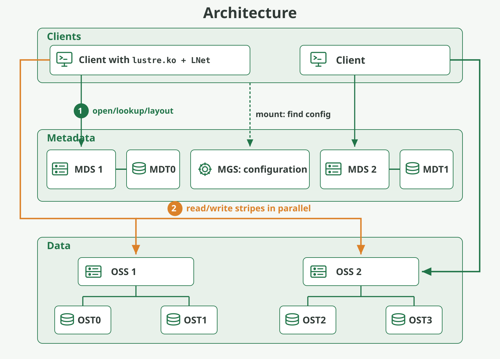

# 6.19 Lustre architecture and operation

| | |
|---|---|
| Level | Advanced |
| Priority tier | 2 |
| Lab venue | Lustre test cluster (VMs); the striping model runs anywhere |
| Part | Part 6: HPC and Slurm |
| Status | Drafted. Command syntax and defaults were read from the Lustre manual pages in a sparse checkout of lustre/lustre-release (commit `6325870`, 2026-10-21, development tree) for `lfs setstripe`, `getstripe`, `migrate`, `setquota`, `mkfs.lustre`, and `lctl`. Architecture follows the Supercomputers for Linux SysAdmins book and the NVIDIA-DevOps volume-15 chapter (with corrections noted). `code/part06/lustre_stripe.py` was run (output shown). No Lustre file system was built; labs **untested** |

## Why this matters for AI infrastructure

Picture a "storage is slow" ticket landing on your desk in the middle of a training run. The GPUs are idle, the training lead is asking for an estimate, and nobody has yet decided whether the problem is the network, the storage or the job itself. Lustre is the most widely deployed parallel file system in HPC, and many large AI training sites use it too. It underlies several vendor and cloud services. Its strengths are enormous aggregate bandwidth and a POSIX interface, which means ordinary programs can use it without modification.

Those strengths come with sharp edges. Striping defaults can cap the bandwidth of a big checkpoint at one disk. A metadata service can be overwhelmed by a data loader. Failures can look like hung nodes, and a hung node can look like a slow file system. Operators who understand striping, metadata and the management tools can prevent and diagnose most "storage is slow" tickets. The rest of this chapter gives you that understanding in the order you will need it during an incident: the architecture first, then how a file system is built, how data is laid out, how quotas and failures work, and finally how to find the bottleneck.

## Lustre in one minute

Imagine eight GPU servers that all need to read the same training dataset. Keeping a separate copy on each server makes updates and capacity harder to manage. Sending every read through one ordinary file server can make that server a bottleneck. Lustre gives the servers one shared directory tree while distributing file data across multiple storage servers.

To a training program, the mounted Lustre path looks like a normal Linux path, such as `/lustre/datasets/train-0001.tar`. This familiar interface is often called POSIX: programs use ordinary operations such as `open`, `read`, and `write`. Behind that path, Lustre separates two jobs. Metadata services keep track of names, permissions, and where a file's data is stored. Storage services hold the file's bytes and can send different pieces to a client in parallel.

For example, when a data loader opens `train-0001.tar`, the client first asks the metadata service where the file lives. It then reads the data from the storage targets named in the file's layout. If the file is striped across several targets, large reads can use them at the same time. A checkpoint follows the same shared-filesystem path in reverse: training processes write checkpoint data to Lustre so that other nodes can access it later. The metadata service handles the questions, and the storage services handle the bulk of the traffic.

The Management Server (MGS) supplies configuration when Lustre clients and servers mount the file system. It is not the server that handles every training-data read. The next section introduces the specific names for the metadata and storage roles. The practical distinction to remember is that Lustre is shared storage, not a training framework, a dataset format, or a backup by itself. A file system that holds the only copy of a checkpoint still needs a separate backup plan.

## Prerequisites and outcomes

This chapter builds on earlier material, so check these first. Chapter 6.18 covers parallel storage concepts. Part 2 covers LNet, which runs over IB and Ethernet. IB is InfiniBand, a high-speed network fabric common in HPC, and Ethernet is the familiar network. Part 1 covers block devices and the ldiskfs and ZFS back ends. ldiskfs is the Lustre-patched ext4 file system that stores target data, and ZFS is the alternative back end.

The chapter then walks through the Lustre architecture and the role each part plays, with the metadata and data paths shown separately. It shows how to create a file system with `mkfs.lustre`, with a single node or with failover, and how to mount servers and clients. It covers how to choose and set striping, including stripe count and size, composite (PFL) layouts, Data-on-MDT, pools, and directory striping across MDTs. It explains quotas for users, groups and projects, how to balance OSTs, migrate data and evacuate hardware. It also describes the failure and recovery model and which components need high availability. The chapter closes with monitoring and troubleshooting with `lfs`, `lctl`, client stats and server logs, plus AI-specific advice such as sharding datasets and choosing checkpoint layouts. If a term in that list feels unfamiliar, the architecture in the next section defines each one.

## 1. Architecture

Lustre splits each file operation into two conversations. One goes to a metadata server, which knows the names, permissions and layout of the file. The other goes to storage servers, which hold the bytes. The diagram shows that split, and the table names each role.



*Figure 6.19.1. Architecture, as a diagram.*

Read the diagram from top to bottom, as you would follow a request through a system. A client first asks a metadata server for the open, the lookup or the layout. It then reads and writes stripes in parallel with several object storage servers. Clients contact the MGS when they mount. Notice that the arrows to the storage servers are thicker than the arrows to the metadata servers. That is the picture of the design: a small number of metadata requests lead to a large flow of data.

The names below follow *Supercomputers for Linux SysAdmins* and the `mkfs.lustre(8)` man page.

| Role | What it does |
|---|---|
| **MGS** (Management Server) | Holds configuration for one or more Lustre file systems (locations of all targets); clients and servers contact it at mount. Often combined with MDT0 but may have its own small device |
| **MDS / MDT** | Metadata server and metadata target (the storage device): file and directory names, permissions, timestamps, and the **layout** (which OST objects hold the data). An MDS can serve several MDTs; with **DNE** (Distributed Namespace) a file system has several MDTs, each owning part of the namespace |
| **OSS / OST** | Object storage server and target: stores file data as objects. An OSS typically serves several OSTs; scaling bandwidth means adding OSS/OST pairs, which can be done to a running file system |
| **Clients** | Compute and login nodes with the Lustre client module; present a POSIX mount; talk to MDS for metadata and directly to OSSs for data |
| **LNet** | Lustre's network layer: addresses by NID (`10.0.0.5@tcp`, `10.1.0.5@o2ib`), supports TCP, InfiniBand (o2ib), and routers between networks. Over RDMA it provides the high throughput |

The table shows that you should not confuse the server with the target. The MDS is the server process, and the MDT is the storage device behind it. The same pattern holds for the OSS and the OST. A useful way to hold the difference is to think of a server as the staff member and the target as the filing cabinet they work with. If the cabinet is full, adding staff does not help, and if the staff is overloaded, a bigger cabinet does not help either.

Each target stores its data on a backing file system. You can choose ldiskfs, which is a modified ext4 and the traditional choice. You can also choose ZFS, which adds software RAID-Z, checksums and snapshots. RAID-Z is ZFS's built-in parity scheme, and checksums let the file system detect silent corruption. Select ZFS with `--backfstype=zfs`.

*Supercomputers for Linux SysAdmins* makes a central point about scaling: "at any time a new server can be added to a running file system, increasing both speed and storage capacity." It also notes that only Linux clients and servers are supported natively. Other systems need an NFS or SMB re-export, which gives up the benefits. SMB is the Windows file-sharing protocol, and a re-export means a Linux machine serves the Lustre tree to those clients over that protocol.

Failure tolerance works through shared storage. Each target sits on storage that two servers can reach, in active/passive or active/active pairs. In an active/passive pair, one server does the work and the other waits. In an active/active pair, both do work and each one can take over the other's targets. Pacemaker and Corosync, or a similar cluster manager, handle the failover. Lustre itself provides recovery: clients replay requests after a server restart or failover, within a recovery window. The cluster resource manager does not do that part.

Here is a failover event in order, so you know what to expect in the logs. The primary server stops responding. The cluster manager confirms that the server is gone and tells the partner to take over the target. The partner mounts the MDT or OST from the shared storage. Recovery starts, and the clients that are still connected begin to reconnect. Clients that reconnect in time replay their uncommitted requests, and the job sees a pause. A client that arrives after the window closes is evicted, and its applications see errors until it remounts. Each of those steps leaves a line in the server logs, which is why the logs are the first place to look after a failover.

Decide early whether each target will use ldiskfs or ZFS, because the choice is made when the target is formatted. Changing it later means reformatting the target, which means moving its data first.

## 2. Creating a file system

Suppose you need to create a new file system called `testfs`. Each target gets formatted once with `mkfs.lustre` and then mounted. Formatting writes the target's identity and settings onto the device. Mounting then starts the service on that server. The shortened examples below cover a combined MGS and MDT, an OST that uses that MGS, a failover pair, and a ZFS back end.

```bash
# combined MGS + MDT0 for file system "testfs"
mkfs.lustre --fsname=testfs --index=0 --mdt --mgs /dev/sda1
# an OST using that MGS
mkfs.lustre --fsname=testfs --index=0 --ost --mgsnode=cfs21@tcp0 /dev/sdb
# failover pair for MGS+MDT: both server NIDs listed with --servicenode
mkfs.lustre --fsname=testfs --index=0 --mdt --mgs --servicenode=cfs21@tcp0,cfs21ib@o2ib0 --servicenode=cfs22@tcp0,cfs22ib@o2ib0 /dev/sda1
# ZFS backing: pool + dataset
mkfs.lustre --fsname=testfs --index=0 --mdt --mgs --backfstype=zfs zfspool/mdt1 mirror /dev/sdb /dev/sdc mirror /dev/sdd /dev/sde
```

Formatting is only half the job. Next, mount each target on its server, starting with the MGS and MDT and then the OSTs. Mount `/dev/sda1` as `/mnt/mdt` with `mount -t lustre /dev/sda1 /mnt/mdt`. Clients mount last, using `mount -t lustre mgsnode@tcp:/testfs /mnt/testfs`. For failover, the list of MGS NIDs can be separated by `:` or `,`. The order matters at boot, because the clients need the MGS and the MDT before they can see any data.

The options you will use most are `--ost`, `--mdt` and `--mgs`, which pick the target type. `--fsname` names the file system, and `--index` must be unique among targets of the same type. `--mgsnode` points to the MGS. `--servicenode` and `--failnode` name failover partners, and you should not mix them. The remaining options are `--backfstype`, `--mkfsoptions` and `--reformat`. Read the four formatting lines above as a set. Each one tells Lustre what kind of target it is, which file system it belongs to and where its management server lives.

Before you format anything, write down the plan on one page. List each target, the server it runs on, its back end, its index, its failover partner and the MGS it reports to. Most setup mistakes are a wrong index or a wrong NID, and a plan on paper makes those mistakes visible before the formatting command runs, not after.

Use `tunefs.lustre` to change parameters after formatting, such as NIDs. Run it only on an OSS or MDS while that server is stopped. Changing a NID on a running target can leave clients trying to reach an address that no longer answers.

### Step-by-step Lustre creation (Installing Lustre (No HA) and HA), LNET port `988`, and OSS RAM sizing

In the walkthroughs of Chapter 9 and Chapter 28 of *Supercomputers for Linux SysAdmins*, Lustre runs entirely as kernel modules on both servers and clients. The nodes talk over LNET, which is Lustre Networking, through Lustre Network Drivers (LNDs). An LND is the piece that speaks one physical network type, such as TCP or InfiniBand. The client side has three parts: the Metadata Client (MDC), the Object Storage Client (OSC), where a group of OSCs forms one Logical Object Volume (LOV), and the Management Client (MGC). Each part handles one of the conversations described in the architecture section.

Each LNET interface has a unique NID, written as `<address>@<LND protocol><lnd#>`. Examples include `10.20.30.40@o2ib1` and `192.168.2.3@tcp2`. Each `<protocol><index>` pair forms an isolated LNET network. That means `1.2.3.4@tcp0` cannot talk directly to `2.3.4.5@tcp1`. On IP networks, the LNET kernel module uses TCP port `988`, so make sure no firewall blocks port `988`. A firewall that blocks it will show up as clients that mount slowly or not at all, and the error often looks like a network fault on the server.

The walkthrough has four stages, and each one depends on the one before it.

1. Configure LNET in `/etc/modprobe.d/lustre.conf`. Define networks with `<lnd><#>(<dev>)[,…]`, for example `options lnet networks="tcp0(eth0)"` or `options lnet networks="o2ib0(ib0),tcp0(eth2)"`. Then load the module and check the NIDs:

   ```bash
   # (untested here) — Chapter 9 LNET verification example (using networks="tcp0(eth1)")
   modprobe lnet
   lnetctl net show
   lctl list_nids
   ```

2. Format and mount the combined MGS and MDT volume on the MDS. The `--fsname` value is limited to 8 characters. Mount the MGS and MDTs before any OSTs. *Supercomputers for Linux SysAdmins* recommends RAID-10 for MDTs, because metadata I/O is small, and RAID-6 for OSTs, because their I/O is 1 MB or larger. RAID-10 is a mirrored and striped layout, and RAID-6 survives two disk failures. The two examples below show the HA version and the simpler non-HA version.

   ```bash
   # (untested here) — Chapter 9 HA-capable example with two --servicenode NIDs
   mkfs.lustre --mdt --mgs --index=0 \
     --servicenode 192.168.2.3@tcp0 \
     --servicenode 192.168.2.4@tcp0 \
     --fsname=large-fs /dev/sdX
   mount -t lustre /dev/sdX /mnt/mdt

   # (untested here) — Chapter 28 simple non-HA recipe
   mkfs.lustre --mdt --mgs --fsname=large-fs /dev/sdX
   mount -t lustre /dev/sdX /mnt/mdt
   ```

3. Format and mount each OST volume on the OSS nodes. Each OST needs its own `--index`, and each one must be told where the MGS is.

   ```bash
   # (untested here) — Chapter 9 OSS initialization
   mkfs.lustre --ost --index=0 --fsname=large-fs \
     --mgsnode=192.168.2.3@tcp0 --mgsnode=192.168.2.4@tcp0 \
     /dev/sdZ
   mount -t lustre /dev/sdZ /mnt/ost1

   # (untested here) — Chapter 28 simple non-HA OSS recipe
   mkfs.lustre --ost --fsname=large-fs --index=0 \
     --mgsnode=mds.your.org@tcp0 /dev/sdZ
   mount -t lustre /dev/sdZ /mnt/ost0
   ```

4. Mount the Lustre file system on the clients. The client mount lists the MGS addresses, so that it can still find the configuration if the first one is down.

   ```bash
   # (untested here) — Chapter 9 client mount with comma-separated MGS NIDs
   mount -t lustre 192.168.2.3@tcp0,192.168.2.4@tcp0:/large-fs /mnt/lustre
   ```

OSS nodes need a lot of memory, and *Supercomputers for Linux SysAdmins* gives two sizing formulas. By default, each OST uses 400 MB for logging and about 600 MB for metadata caching. Each service thread adds 1.5 MB. The number of threads, `N_threads`, can be roughly estimated as the number of clients divided by the number of connected OSTs. A service thread is a worker that handles one stream of requests, so more clients per OST means more threads and more memory.

```text
Per-OST baseline RAM = 400 MB + 600 MB + 1.5 MB * N_threads
Recommended OSS total RAM = 2 GB + 1 GB per OST (plus extra RAM for OS/network buffers and caching)
```

These are common rules of thumb, so verify them against vendor guides. Put the MDT on fast, mirrored NVMe flash, because metadata is small random I/O. Choose the inode count at format time with ldiskfs `bytes-per-inode`, based on the number of files you expect. An inode is the record that stores one file's metadata, and the target runs out of inodes before it runs out of bytes if the files are small. Picking the wrong ratio at format time is hard to fix later.

Size OSTs for rebuild time. For HDD, RAID or ZFS groups of 8+2 on 8-12 TB disks are typical. For NVMe systems, use erasure-coded layouts or ZFS vdevs. A vdev is a ZFS virtual device, the group of disks that ZFS treats as one unit. Run several OSTs per OSS so the server uses all its CPUs and NICs. Give each OSS network at least the sum of its OST bandwidth, and match the client network to the OSS network. 400 Gb/s IB on GPU nodes is common. A rebuild after a disk failure can take a long time on a large HDD group, and during that time the OST is slower and more fragile, which is why rebuild time belongs in the size decision.

### Non-HA install order from the book

The simpler path in *Supercomputers for Linux SysAdmins*, without failover, follows a fixed order. Each step depends on the one before it, so keep the sequence. If you skip a step, the later steps fail with errors that point at the wrong place.

1. Install the `lustre` package, or a similar one, on all servers and clients.
2. On every server and client, write the LNET setup in a `lustre.conf` file under `/etc/modprobe.d`, for example `options lnet networks="o2ib0(ib0),tcp0(eth2)"`.
3. Load the Lustre module on all servers and clients.
4. On the MDS, create the combined MGS and MDT volume and mount it.

   ```bash
   mkfs.lustre --mdt --mgs --fsname=large-fs /dev/sdX
   mount -t lustre /dev/sdX /mnt/mdt
   ```

5. On every OSS, create as many OSTs as you need, then mount each one. The example in that book uses `--index=0` and `mds.your.org@tcp0` as the MGS address.

   ```bash
   mkfs.lustre --ost --fsname=large-fs --index=0 \
     --mgsnode=mds.your.org@tcp0 /dev/sdZ
   mount -t lustre /dev/sdZ /mnt/ost0
   ```

6. After the OSS nodes are ready, mount the file system on each client, using your MGS address.

   ```bash
   mount -t lustre mgsnode:/large-fs /mnt/lustre/
   ```

Give each extra OST a new `--index` number, because that value must be unique for each target of the same type. Reusing an index is one of the quickest ways to make a second OST refuse to join the file system.

## 3. Striping

Striping decides which OSTs hold a file's bytes, and that decides how much bandwidth the file can use. The layout is the part you should understand first. If you understand the layout, most of the defaults and the tuning advice in the rest of the chapter follow from it.

### The raid0 layout

Every file carries a layout. The layout lists the OST objects that hold the file, and it records the stripe size. An object is the piece of a file that one OST stores. With the default `raid0` pattern, the file is cut into `stripe_size` chunks. Those chunks go round-robin to `stripe_count` OST objects. The file is not split into N contiguous parts. Consecutive chunks alternate between OSTs. The `code/part06/lustre_stripe.py` model shows this:

```text
1 GiB file, stripe_size 1 MiB, stripe_count 4: bytes per OST object (MiB)
[256, 256, 256, 256]
First 8 chunks -> OST slot: [0, 1, 2, 3, 0, 1, 2, 3]
A 3 MiB read at offset 2.5 MiB touches slots: [0, 1, 2, 3]
A 512 KiB read at offset 0 touches slots: [0] (one OST: small I/O does not parallelise)
```

Read the output as a worked example. Take a 1 GiB file. The stripe size is 1 MiB, and the stripe count is 4. Each OST object therefore holds 256 MiB. The first eight chunks visit the four slots in turn: 0, 1, 2, 3, 0, 1, 2, 3. The third line of the output shows the same rule for a read. A 3 MiB read that starts at 2.5 MiB covers the end of one chunk, a full chunk, and the start of the next ones, so it reaches all four slots. The last line is a read that fits inside one chunk, so it touches only slot 0.

A large sequential read or write spreads over all `stripe_count` OSTs, so it gets their combined bandwidth. A small I/O touches one OST, so striping does not speed it up. A file with stripe_count 1 is limited to a single OST, no matter how large the file system is. That single rule can explain many of the "my checkpoint is slow" tickets.

The NVIDIA-DevOps chapter on Lustre describes a 2-stripe 1 GB file as "two chunks of 500 MB each." That is a common simplification, but it is wrong for how Lustre places data. The chunks alternate in `stripe_size` units. If you picture two halves, you will predict the wrong slot for most reads.

### Defaults and setting

The options below come from `lfs-setstripe(1)` in the development tree. Most of the time you set only two of them: how many OSTs to use, and how big each chunk is.

| Option | What it does |
|---|---|
| `-c/--stripe-count` | `0` means the file-system default, and that default is **1**. `-1` means all OSTs |
| `-C/--overstripe-count` | More than one stripe on each OST |
| `-S/--stripe-size` | The default is **4 MiB** in this tree. The value must be a multiple of 64 KiB. Older releases defaulted to 1 MiB, so check your version |
| `-i/--stripe-index` | The starting OST. `-1` lets the MDS balance the choice, which the manual calls "strongly recommended" |
| `-o/--ost` | An explicit list of OSTs |
| `-p/--pool` | An OST pool to allocate from |
| `-L/--layout` | `raid0` or `mdt` |

Settings on a directory become the defaults for files created inside it. `lfs setstripe -d dir` removes that directory default. Use `lfs getstripe [-d] path` to see a layout. The point of a directory default is that users never have to remember the setting. They create files in the right directory, and the layout follows.

```bash
lfs setstripe -c 1  -S 1M  /lustre/small-files        # tiny files: one stripe
lfs setstripe -c 16 -S 4M  /lustre/datasets           # big shared read-mostly files
lfs setstripe -c -1 -S 4M  /lustre/checkpoints        # stripe over all OSTs (use with N-1 checkpoint files)
lfs getstripe -d /lustre/checkpoints
```

Each line matches one kind of data. Small files get one stripe, big shared files get 16, and checkpoints spread over all OSTs. The comment on the checkpoint line pairs that setting with N-1 checkpoint files, which means one shared file written by many ranks.

In Chapter 9 (Striping and PFL) of *Supercomputers for Linux SysAdmins*, the setting `lfs setstripe -S 4M -c 8 /lustre/testdir` is applied to a directory. A file created inside it is then inspected with `-y`, which prints YAML. The output looks like this:

```yaml
# (untested here) — lfs getstripe -y /lustre/testdir/testfile (SCL Chapter 9)
lmm_stripe_count:  8
lmm_stripe_size:   4194304
lmm_pattern:       raid0
lmm_layout_gen:    0
lmm_stripe_offset: 2
lmm_objects:
- l_ost_idx: 2
  l_fid:     0x100020000:0x2:0x0
- l_ost_idx: 3
  l_fid:     0x100030000:0x2:0x0
```

Read the fields from the top. The stripe count and size tell you the shape of the layout, and the pattern tells you how chunks are placed. The offset is the first OST, and the list of objects gives the actual OST indexes and object identifiers. When a user says a file is on the wrong OSTs, this is the output you ask for first.

You cannot change `lmm_stripe_count` or `lmm_stripe_size` in place on a file that is already written. Migrate or copy its data into a newly striped file instead, with `lfs migrate` or `cp`. Plan the stripe layout before the data arrives, because fixing it later means moving every byte.

Choose the stripe count from the access pattern. The default of 1 suits the file-per-process pattern with many files. Each file lands on its own OST, and the MDS balances the load. Larger stripe counts suit big files shared by many clients, or files written by one fast client. Match `stripe_size` to your application's I/O size, which is typically 1 to 4 MiB. Use multiples of the I/O request size, so that boundaries do not cause lock contention. Too many stripes on small files waste metadata and RPCs. Too few stripes on large files cap the bandwidth.

### Progressive File Layouts (PFL) and other layouts

A composite layout, added in Lustre `2.10+`, splits a file into components by offset. Each component has its own stripe settings. A file can start narrow and widen as it grows. The `-E` option, also written `--component-end`, sets where each component ends. The benefit is that users do not have to guess a file's final size when they create it.

```bash
lfs setstripe -E 4M -c 1 -E 64M -c 4 -E -1 -c -1 /lustre/dir    # from the man page examples
# (untested here) — SCL Chapter 9 PFL example: 0..1M on 1 OST (512K stripes), 1M..256M (255M span) on 4 OSTs, >256M on 8 OSTs (1M stripes)
lfs setstripe -E 1M -S 512K -c 1 -E 256M -c 4 -E -1 -S 1M -c 8 /lustre/testdir
```

The first command gives small files one stripe, which is cheap. It gives large files all OSTs, which is fast. Neither needs a per-file choice from the user. Set it as the directory default for general-purpose areas, and you get the benefit without choosing per file. A small config file and a large checkpoint can then sit in the same directory and each get a sensible layout.

The man page lists several related features. Data-on-MDT, set with `-L mdt`, places a file's first component on the MDT, which suits fast small-file access. Its size is limited by `lod.*.dom_stripesize`. Self-extending layouts, set with `-z/--extension-size`, grow the first component in steps, which helps avoid full OSTs. Mirrored layouts, set with `-N/--mirror-count`, can place components in different pools such as `flash` and `disk`. The `prefer` flag makes clients favor the flash replica. Newer erasure-coded layouts use `--ec`.

The tool model prints a PFL example. Take a 1 GiB file with three components: the first 4 MiB at stripe count 1, the next part up to 64 MiB at stripe count 4, and the rest at stripe count 16 with 4 MiB stripes.

```text
  [    0 MiB,     4 MiB)  stripe_count=1   stripe_size=1 MiB
  [    4 MiB,    64 MiB)  stripe_count=4   stripe_size=1 MiB
  [   64 MiB,  1024 MiB)  stripe_count=16  stripe_size=4 MiB
```

Notice that the stripe size changes only in the last component, where it becomes 4 MiB. The reason is that a large file benefits from bigger chunks, because each chunk needs fewer requests to move. The small components keep the smaller chunk size so that small reads do not pull in far more data than they need.

### Pools

An OST pool is a named subset of OSTs, such as `flash` or `disk`. `lfs setstripe -p flash` allocates from that pool. Combine pools with directory defaults and mirrors to build tiers. Pools are defined on the MGS with `lctl pool_new` and `pool_add`. That detail comes from general Lustre knowledge rather than the sources here, so confirm it with `lfs pool_list`. A typical use is a flash pool for a hot dataset during a training run, and a disk pool for the archive that follows.

### Directory striping and DNE

With several MDTs, you can spread the namespace across metadata servers. DNE is the Distributed Namespace feature, and it lets a file system have more than one MDT. `lfs mkdir -i N dir` puts a directory on MDT N. `lfs setdirstripe -c K dir` stripes a directory over K MDTs, which helps large directories. Default directory layouts, written as `lfs mkdir -c -1 -D`, spread subdirectories across MDTs. `lfs migrate -m START_MDT dir` moves a directory tree to other MDTs, recursively by default.

Use DNE to spread per-user or per-project trees across metadata servers. A hash-striped single huge directory helps create-heavy workloads, but `ls` on it becomes slower. For a workload that creates many files in one directory, hash striping is the option to weigh against the slower `ls`. A practical habit is to give each team its own directory tree, and to stripe a directory only when one directory really is the bottleneck.

## 4. Quotas and capacity

A team that fills a shared dataset directory can squeeze out every other team on the file system. Quotas stop that. They are enabled at format time, or later with `tunefs`, using `--quota` or `lctl conf_param ... quota.ost=ugp`, depending on your version. You manage them with `lfs`. A quota is a limit on how many bytes or files one user, group or project may use, and it is the tool that turns a shared file system into a fair one. Think of it as a per-tenant budget on a shared building. Without it, one large experiment can fill the whole floor. With it, the experiment fills its own allowance and then stops, and the other teams keep working.

For example, `lfs quota -u alice /lustre` shows one user's usage. `lfs setquota -u alice -b 9T -B 10T -i 1M -I 1100K /lustre` sets soft and hard limits for blocks and inodes. The soft limit is a warning level that starts a grace period, and the hard limit is the wall that cannot be crossed. The `-g` option covers groups and `-p` covers projects. Default quotas use `-U`, `-G` and `-P`. Pool-specific quotas use `--pool`, grace time uses `-t`, and `--delete` and `--reset` remove or clear limits.

In Chapter 9 (Quotas) of *Supercomputers for Linux SysAdmins*, the soft limit is `200G` and `2M` inodes, and the hard limit is `300G` and `3M` inodes. Those limits apply to user `foo`, group `bar` and project `1`, where `lfs project -r /lustre/testdir` sets up the project. The example also adjusts the grace times to `1d8h` for inodes and `2d` for blocks. The default grace time is one week. Resetting to the default uses `--default`, and `0` removes limits. The example commands are:

```bash
# (untested here) — SCL Chapter 9 quota management examples
lfs setquota -u foo -b 200G -B 300G -i 2M -I 3M /lustre
lfs setquota -g bar -b 200G -B 300G -i 2M -I 3M /lustre
lfs project -r /lustre/testdir
lfs setquota -p 1 -b 200G -B 300G -i 2M -I 3M /lustre
lfs setquota -t -u -i 1d8h -b 2d /lustre
lfs setquota -u foo --default /lustre
```

Project quotas, set with `lfs project -p ID -s dir` and then `lfs setquota -p ID`, enforce limits on a directory tree. They apply no matter who owns each file. That makes them the natural unit for AI teams and datasets. A dataset directory belongs to a project, and the limit follows the directory even when a student or a pipeline writes the files. Check capacity with `lfs df -h`, which shows usage per MDT and OST, and look for imbalance. Use `lfs df -i` to check inodes. Inode use often runs out first on a dataset made of millions of small files, even when the bytes look fine.

Balancing and evacuation both rely on migration. `lfs migrate` moves OST objects between OSTs. You can rebalance with it, change the stripe count with `lfs migrate -c 16 file`, move data between pools, or empty an OST before maintenance. It accepts the same options as `setstripe`, and it can run from a list: `lfs find ... --print0 | lfs migrate -0 ...`. The `--print0` option writes file names separated by null bytes, which keeps names with spaces intact through the pipe.

According to the man page, the migration preserves file data. Verify how it handles open or active files on your version, and plan migrations for low-load periods. The NVIDIA-DevOps chapter calls migration "offline." In practice it is an online operation that adds a lot of I/O, so users feel it even though their files stay available. Plan the window as if the cluster is busier than usual.

When an OST shows hardware trouble and must be retired, *Supercomputers for Linux SysAdmins* gives a four-step sequence. It is written for a failing OST:

1. Run `lctl dl` to list all Lustre devices visible on the client, and note the numeric device index `N` of the target OST.
2. Disable new object allocations on that OST with `lctl --device N deactivate`, where `N` is the device number from `lctl dl`.
3. Find the files that sit on the retiring OST, for example with `lfs find --ost ...`, and migrate their data to healthy OSTs with `lfs_migrate` or `lfs migrate`.
4. If an OST fails after the file system holds data and must be repaired offline, unmount all clients first. Then unmount all OSTs, then the MDTs and the MGS. Mount the affected OST locally as ldiskfs if it is ext4-based, and run the Lustre-patched `e2fsck` according to the documentation for your exact Lustre version.

Before you retire an OST, plan the migration window, because moving its data adds heavy I/O. Deactivating the OST first is what stops new data from landing on the failing disk while the old data moves away.

## 5. Failure and recovery model

When an OSS fails in the middle of a checkpoint, you need to know what your jobs will see. The short answer is a pause, if the failover works and the clients come back in time. The longer answer depends on the recovery window, the eviction rules and the redundancy under each target.

Each MDT and OST device is reachable from two servers through shared storage, such as dual-ported disks, NVMe-oF or a JBOD. NVMe-oF is NVMe over a network fabric, and a JBOD is a shelf of disks with no RAID controller of its own. If one server fails, its partner mounts the target, and recovery begins.

After a restart, clients reconnect and replay uncommitted requests during a recovery window. The default is several minutes, and you can configure it. If recovery succeeds, applications see a pause rather than errors. A client that misses the window is evicted, which shows up as stale file handles or I/O errors. Servers also evict clients that stop responding, for example during a network flap or a hang, after timeouts. The eviction frees the client's locks, and the node must remount. Time synchronisation matters here, as covered in 6.18, because timeouts are measured against clocks on different machines.

Use LFSCK, the online consistency checker that runs with `lctl lfsck_start`, after crashes or when you suspect an inconsistency. LFSCK checks the metadata and the object layout against each other while the file system stays mounted. Hierarchical storage management, or HSM, and change logs support tiering to object stores and external tools. Change logs record what changed, so that an external tool can copy only the new data.

Hardware redundancy is the last layer. Use RAID or ZFS redundancy for each target, and give each server dual power and network paths. Keep spare OSS capacity, and monitor the health of disks and SSDs. Redundancy inside a target protects against a dead disk, while failover protects against a dead server. Neither one protects against a deleted directory, so backups stay a separate requirement.

Before you size an HA design, confirm that every MDT and OST can be reached from two servers. A design that looks redundant on a diagram can have one shared power feed, and one feed failure takes down both servers at once.

## 6. Monitoring and tuning

When a ticket says a job is slow, you need to know where to look first. The table lists the tools, and each one answers a different question about space, layout, counters or logs. Start with the question, then pick the tool. Do not start by changing a tunable.

| Tool | Use |
|---|---|
| `lfs df -h`, `lfs df -i` | Space and inode distribution per target |
| `lfs getstripe`, `lfs find`, `lfs quota` | Layout, searches by size/stripe/age, usage |
| `lctl get_param` / `lctl set_param` / `lctl list_param` | Read and set tunables and statistics (`llite.*` client side, `osc.*`, `mdc.*`, `obdfilter.*` on OSS, `mdt.*` on MDS); `lctl conf_param`/`set_param -P` for persistent settings |
| `lctl dk` | Kernel debug log dump |
| Client `/proc/fs/lustre` / `lctl get_param llite.*.stats` | Operation counts and latencies (open, close, getattr, read, write) |
| `lnetctl` | LNet configuration and statistics (`lnetctl net show`, `stats show`) |
| `lctl ping NID` | LNet reachability |
| Server logs (`dmesg`, `/var/log/messages`) | Evictions, recovery, ldiskfs/ZFS errors, LNet errors |
| Monitoring stacks | Lustre exporters for Prometheus, Grafana dashboards, vendor tools (e.g. IML, LTOP-like tools) |

Read the counters as rates, not totals. A total number of opens since boot tells you little, because the file system may have run for months. What you need is how fast the counter grows during the slow part of the job. Take two readings a short time apart during the slow phase, and compare them. The difference is the rate, and the rate is what you compare with the expected load.

Two tools cover most first questions. `lfs df` answers questions about space, and `lctl get_param llite.*.stats` shows client operation counts and latencies. If you run only those two, you will know whether the problem is full disks, an overloaded metadata path or a slow data path. That is enough to choose the next step.

The tunables below are common, but their names are illustrative, so validate them against your version. On the client, `osc.*.max_rpcs_in_flight`, `osc.*.max_dirty_mb`, `llite.*.max_read_ahead_mb` and `llite.*.statahead_max` matter, and statahead speeds up `ls -l`. Statahead is the client's prefetch for directory attributes, so a listing does not wait on each file in turn. On the server, the tunable is `ost.OSS.ost_io.threads_max`. For LNet, the knobs are `peer_credits` and `credits`. Defaults are tuned for typical HPC, so change one parameter at a time and test each change with a benchmark such as IOR, mdtest or `fio` (covered in 6.28). Changing several at once makes it impossible to tell which one helped.

### Diagnosing bottlenecks

When you see a slow job, work through these five checks in order. The order matters, because the first check decides which of the other four are worth your time.

1. Start by asking whether the problem is metadata or data. Compare `lctl get_param llite.*.stats`, which shows open and getattr rates and latencies, with bandwidth per OST. Server `obdfilter` stats and `lfs df` give the OST side. Slow `ls -l`, slow Python imports, slow epoch starts and thousands of `open` calls per second all point to metadata. Low MB/s on a few large files points to striping, or to OST and network limits.
2. If metadata is the bottleneck, reduce the file count. Shard datasets into large files, such as WebDataset, TFRecord or Parquet shards, which chapter 6.18 covers in section 5. Avoid giant directories, and spread trees across MDTs with DNE. Add client caching with statahead. Move metadata-heavy trees, such as Python environments and build trees, into containers or onto local disks. For small files, use Data-on-MDT. You can also increase MDS threads and use faster MDT media.
3. If data is the bottleneck, raise the stripe count for large files, and align the I/O size with the stripe size. Then check the client network for MTU and RDMA problems. MTU is the largest packet size the network carries, and a mismatch between hosts can quietly cut throughput. Check OSS CPU and network load, and check OST imbalance, which `lfs df` reveals. Failing disks, rebuilds in progress and competing jobs can also slow the data path. A rebuild on one OST can make the whole job look slow if that OST holds a hot file.
4. When one client is slow, look at its network first. Check the NIC link speed, its errors and its MTU. Then check CPU and NUMA placement, and review its eviction history. Run `lctl ping`, and read `lnetctl stats`. A single slow client usually points to that node, not to the file system.
5. For stalls and hangs, check the server logs for recovery and eviction events, LNet errors, and OSS or MDS load. Testing from another client helps separate a client fault from a server fault. If a second client is fine, the problem is local. If both hang, the problem is on the servers or the network between them.

The NVIDIA-DevOps chapter gives per-MDS and per-OST figures of "about 50K to 100K metadata ops/s per MDS" and "100 to 800 MB/s per OST." Treat them as illustrative orders of magnitude, not guarantees. Flash MDTs achieve far more than spinning disks, and NVMe OSTs go well beyond 800 MB/s. Measure your own system before you put either figure into a design review.

## 7. AI-specific guidance

Each AI workload you run stresses a different part of Lustre. The table pairs each common concern with the practice that handles it. Read it as a set of starting points, and check each one against a measurement from your own cluster before you commit to it.

| Concern | Practice |
|---|---|
| Datasets | Few large shards (hundreds of MB to GB) per dataset; stripe count 4 to 16 (or PFL) on the dataset directory; read-ahead tuned; a pool on flash for hot datasets |
| Epoch start storms | Pre-shard; stagger; open files lazily; cache dataset index locally |
| Checkpoints | Distributed (per-rank or per-node shard) files with stripe count 1 to 4 each, **or** a few large shared files with wide striping (-c -1) and aligned writes; test both; use async checkpointing to local NVMe and drain to Lustre |
| Restart read | Same layout as writes; ensure enough OST bandwidth for a simultaneous read by all ranks |
| Python/conda environments | Do not run from Lustre at scale: containers (squashfs) or node-local copies; if unavoidable, `statahead` and metadata on flash |
| Logs | Per-rank files in per-job directories; avoid shared append files |
| Quotas | Project quotas per team/dataset; monitor inodes as well as bytes |
| Multi-tenant fairness | Network request scheduler (NRS) policies and QoS (TBF) exist in Lustre; use with care |
| Cloud | Managed Lustre services (e.g. on major clouds) expose the same client semantics; capacity and throughput are provisioned per TiB |

Start with the row that matches your slowest workload. Then check that row against the metadata and data diagnosis from the previous section. A dataset row and a checkpoint row can disagree, because a dataset wants many small reads from many files while a checkpoint wants a few large writes. Both can be correct on the same file system, which is why the layouts are set per directory.

Another useful habit is to keep a short written note of each ticket, with the symptom, the layer you checked, the command you ran and the result. Over a few months those notes become a runbook that your team can trust, because each line records something you actually observed.

A short example shows how the table is used. Suppose the training team reports slow epoch starts, and the checkpoint team reports slow saves on the same cluster. The epoch start points at metadata, so you look at the dataset directory, shard it and move the Python environment to a container. The slow saves point at striping, so you check the checkpoint directory for its layout. Two tickets, two rows, and no need to change the whole file system.

## 8. Lab

A good result from the Python model looks boring. Every prediction you wrote down before the run should match the output, and any mismatch should be explained before you move on. If the output surprises you, the surprise points at the rule you have not yet absorbed, and that rule is worth more than the number.

The Python model in this section was run on a laptop. The Lustre steps after it have not been run, because they need a test cluster with real servers. Run the self-checking Python lab locally before you touch a cluster. It needs no Lustre file system, so you can check the math first. The lab, `code/part06/lustre_stripe_lab.py`, verifies `slot()`, `per_ost_bytes()`, `request_osts()` and `pfl_layout()` in `code/part06/lustre_stripe.py`. It also checks the *Supercomputers for Linux SysAdmins* Chapter 9 OSS RAM sizing equations, the LNET port, and the stripe size. The expected results are:

| Check | Expected result |
|---|---|
| 1 GiB file across 4 OSTs in 1 MiB chunks | `[256, 256, 256, 256]` MiB per OST |
| 3 MiB read at offset 2.5 MiB | Touches `[0, 1, 2, 3]` |
| 512 KiB read at offset 0 | Touches `[0]` |
| PFL component ranges | Match the component boundaries in the script |
| OSS RAM per OST at 20 service threads | `1030.0 MB` |
| OSS baseline for an 8-OST OSS | `10 GB` |
| LNET TCP port | `988` |
| Stripe size | `4194304` (`4 MiB`) |

```bash
python3 code/part06/lustre_stripe_lab.py
```

On the tested side, run `lustre_stripe.py`, change the stripe parameters, and predict the per-OST bytes before you run it. Then model a 4 GiB file with the PFL layout `-E 1M -c 1 -E 1G -c 4 -E -1 -c 8`. The prediction step matters more than the run. If your prediction is wrong, the mismatch tells you which part of the layout rule you have not yet absorbed.

The rest of the lab is untested, because it needs Lustre VMs. Work through these tasks on a test cluster:

1. Build a single-node Lustre with an MGS and MDT, and 2 OSTs on loop devices or small disks, following the `mkfs.lustre` examples. Mount a client.
2. Run `lfs setstripe -c 2 -S 1M f`, write 1 GiB, then run `lfs getstripe f` and `lfs df`. Compare the result with `-c 1`.
3. Set a directory PFL default. Create small and large files, and inspect their layouts.
4. Create 100,000 files with `iomix.py` or `mdtest`, and compare the result with NFS.
5. Add a second MDT, use `lfs mkdir -i 1`, and observe the result with `lfs getdirstripe`.
6. Set a project quota, exceed it, and observe the error.
7. Run `lfs migrate -c 2 bigfile` while reading the file.
8. Stop the OSS that holds an OST, and watch client behaviour and recovery. Then restart it.
9. Write a runbook for evicted clients.

Start with the Python lab, and build the VM setup only once its predictions match what you expect. Keep a log of each task, with the command, the output and the prediction you made before running it. That log is the start of the runbook your team will need later.

## 9. Interview angles

These questions test whether you can reason through a Lustre incident, not just recite commands. A strong answer sounds like a plan. It says what you would look at first, what result would change your mind, and which command gives that result. An answer that lists commands with no order sounds like a memorised list, and experienced interviewers will ask the next question to find out what you do when the first command shows nothing useful. Try to answer each one out loud before you move on. A good answer names the layer you would check first, the number that tells you whether the layer is at fault, and then the command.

- Walk through what happens when a client opens and reads a striped file.
- Why is default stripe count 1 and when do you change it?
- Explain PFL layouts and a case for Data-on-MDT.
- Your checkpoint of 500 GB takes 15 minutes. How do you find and fix the cause?
- Epoch start takes minutes with 10 million files. What do you do?
- How do MGS, MDS, OSS fail over and what do clients experience?
- What are project quotas and why use them?
- How would you rebalance OSTs or evacuate one?
- Lustre versus GPFS versus WEKA/VAST: strengths and weaknesses?

For each question, name the layer you would check first, then the command you would run.

## Exercises

Each exercise works through one piece of the chapter with real numbers. You will need the Python lab for the first two, and then you write the commands yourself. Keep your answers short and specific, because the point is to show that you can read the layout and the arithmetic, not to write an essay.

1. Start by running `python3 code/part06/lustre_stripe_lab.py`. Model `raid0` round-robin striping with `code/part06/lustre_stripe.py`. Explain why a 1 GiB file with `stripe_size=1 MiB` and `stripe_count=4` alternates 1 MiB chunks across OST slots `[0, 1, 2, 3, 0, 1, 2, 3]`. Explain how that gives 256 MiB per OST. Explain why a 3 MiB read starting at byte offset 2.5 MiB touches all four OSTs `[0, 1, 2, 3]`. Explain why a 512 KiB read at offset 0 touches only OST `[0]`.
2. Design a PFL layout for a shared AI directory, and keep Data-on-MDT (`DoM`) in mind. Files $\le 4\text{ MiB}$ use `stripe_count=1` and `stripe_size=1M`. Files from $4\text{ MiB}$ to $64\text{ MiB}$ use `stripe_count=4` and `stripe_size=1M`. Files $> 64\text{ MiB}$ use `stripe_count=16` and `stripe_size=4M`. Write the `lfs setstripe` command for that design. Then compare it with the command from Chapter 9 of *Supercomputers for Linux SysAdmins*, `-E 1M -S 512K -c 1 -E 256M -c 4 -E -1 -S 1M -c 8`. Verify the component boundaries on a 1 GiB file using `pfl_layout()`.
3. Work through the Lustre file system setup from Chapters 9 and 28 of *Supercomputers for Linux SysAdmins*, and size the OSS RAM. Write `/etc/modprobe.d/lustre.conf` with `options lnet networks="o2ib0(ib0),tcp0(eth2)"`. Write the `mkfs.lustre` commands for an HA MGS and MDT pair, using `--servicenode`, and for the OSTs, using `--mgsnode`. Then write the client `mount -t lustre` command. Next, use `oss_ram_sizing_mb(8, 640, 32)` in `code/part06/lustre_stripe_lab.py` to calculate the per-OST RAM and the baseline OSS RAM. The thread count comes from `N_threads = 640 / 32 = 20`. Your per-OST RAM should be `1030.0 MB`. The baseline OSS RAM should be `2 GB + 1 GB * 8 = 10 GB`.
5. Write the `lfs setquota` and `lfs project` commands that enforce a `200G` soft and `300G` hard block quota. The same commands should enforce a `2M` soft and `3M` hard inode quota, on `/lustre/testdir` under project ID `1`. Set the user grace periods to `1d8h` for inodes and `2d` for blocks. Then explain why directory-tree project quotas are preferred over user quotas for shared AI datasets.
6. Write the exact four-step procedure to retire an OST that is showing disk errors. Find its device number with `lctl dl`. Disable new object allocations with `lctl --device N deactivate`. Migrate the existing stripes off the OST with `lfs find` and then `lfs_migrate` or `lfs migrate`. If the OST needs repair, run an offline ldiskfs `e2fsck`.
7. Two tickets arrive. Ticket A says a 512-GPU PyTorch job takes 8 minutes inside `import torch` at startup. Ticket B says that writing a single 500 GB checkpoint file from rank 0 runs at 600 MB/s on a 200 GB/s Lustre cluster. For Ticket A, state which `lctl get_param`, `lfs getstripe` or `lfs df` command confirms the root cause, and give the concrete fix. Do the same for Ticket B.

## Checkpoint

Use these questions to test your understanding. Try each one yourself before you open its answer.

<details>
<summary>1. Define the five core Lustre architectural components (**MGS**, **MDS/MDT**, **OSS/OST**, **Clients**, and **LNet**) and state how metadata and data paths separate.</summary>

The MGS (Management Server) stores the cluster-wide configuration and the registry of targets. Clients and servers contact it at mount time. The MDS and MDT (Metadata Server and Target) hold filenames, directories, permissions and file stripe layouts, which the `LOV` maps describe. The OSS and OST (Object Storage Server and Target) store the striped file data objects. Clients are kernel-module mounts on compute nodes, made of the `MDC`, `OSC`/`LOV` and `MGC` parts. A client asks the MDS once for a file's layout on `open()` or `stat()`. After that it reads and writes the OSSs directly over RDMA. Metadata therefore goes to the MDS, and data goes straight to the OSSs. LNet, the Lustre networking layer, addresses each node by its NID, such as `<ip>@tcp0` or `<ip>@o2ib0`.
</details>

<details>
<summary>2. What is an LNet **NID**, what TCP port does LNet use over IP networks, and why can't `1.2.3.4@tcp0` talk directly to `2.3.4.5@tcp1` (*Supercomputers for Linux SysAdmins*, Chapter 9)?</summary>

A NID, or network identifier, has the form `<address>@<LND_protocol><index>`, such as `10.20.30.40@o2ib1` or `192.168.2.3@tcp0`. Over IP networks, LNet uses TCP port `988`. Each protocol and index pair, such as `tcp0` or `tcp1`, defines a separate LNet network segment. Nodes on different LNet networks cannot communicate without an explicit LNet router.
</details>

<details>
<summary>3. Which two backing filesystems (`--backfstype`) can underlie Lustre MDTs and OSTs, and why does *Supercomputers for Linux SysAdmins*, Chapter 9, recommend RAID-10 for MDTs and RAID-6 for OSTs?</summary>

Lustre targets use either ldiskfs, which is a Lustre-patched ext4, or ZFS, selected with `--backfstype=zfs`. The book recommends RAID-10 for MDTs. Metadata operations are small, latency-critical random I/O, and losing an MDT destroys the entire file system namespace. It recommends RAID-6, or RAID-Z2 on ZFS, for OSTs. Data stripes are large sequential I/Os of 1 MB or more, and dual parity uses that capacity efficiently.
</details>

<details>
<summary>4. What is the maximum length of `--fsname` in `mkfs.lustre`, and in what order must Lustre targets be mounted on startup and unmounted on shutdown (*Supercomputers for Linux SysAdmins*, Chapter 9)?</summary>

The `--fsname` value is limited to 8 characters, for example `large-fs`.

- On startup, mount the MGS and MDTs first, then the OSTs, and finally the clients.
- On shutdown, unmount the clients first, then the OSTs, and finally the MDTs and the MGS.
</details>

<details>
<summary>5. State the two OSS RAM sizing formulas from *Supercomputers for Linux SysAdmins*, Chapter 9.</summary>

The first formula gives the per-OST RAM. Each OST needs $\mathbf{400\text{ MB}}$ for logging, $\mathbf{600\text{ MB}}$ for metadata cache, and $\mathbf{1.5\text{ MB} \times N_{\text{threads}}}$ for its service threads. The number of threads is roughly clients divided by connected OSTs: $N_{\text{threads}} \approx \text{clients} / \text{connected OSTs}$.

The second formula gives the total OSS RAM the book recommends: $\mathbf{2\text{ GB} + 1\text{ GB per OST}}$. Add extra memory for the OS, network buffers and read caching.
</details>

<details>
<summary>6. How does Lustre's `raid0` striping place data across OSTs (`code/part06/lustre_stripe.py`), and why is saying "a 2-stripe 1 GiB file is split into two 512 MiB halves" wrong?</summary>

The `raid0` layout cuts a file into `stripe_size` chunks, such as 1 MiB or 4 MiB. It assigns consecutive chunks round-robin across `stripe_count` OST objects, using `chunk_index = offset // stripe_size` and `ost_slot = chunk_index % stripe_count`. A 2-stripe 1 GiB file with 1 MiB stripes alternates every 1 MiB between OST 0 and OST 1, with 512 chunks on each. If you picture two halves, you have it wrong. It is not two contiguous 512 MiB halves.
</details>

<details>
<summary>7. Why does a `512 KiB` read touch only 1 OST even when a file has `stripe_count=16` and `stripe_size=4 MiB`?</summary>

The whole range from 0 to 512 KiB falls inside the first 4 MiB chunk. That chunk sits on one OST, slot 0. Striping speeds up a read or write only when it spans several chunks, or when several ranks access different chunks at the same time.
</details>

<details>
<summary>8. What are the default values of `stripe_count` (`-c`) and `stripe_size` (`-S`) in `lfs setstripe`, and what do `-c -1` and `-i -1` mean?</summary>

The defaults you will meet are a stripe count of 1 and a stripe size of 4 MiB, which is `4194304` bytes in current Lustre. Older releases default to 1 MiB. The size must be a multiple of 64 KiB. `-c -1` stripes across all available OSTs in the file system or pool. `-i -1` lets the MDS choose the starting OST index, to balance capacity and load.
</details>

<details>
<summary>9. Decode the fields of `lfs getstripe -y /lustre/testdir/testfile` (*Supercomputers for Linux SysAdmins*, Chapter 9).</summary>

`lmm_stripe_count` is the number of OSTs the file is striped across, here 8. `lmm_stripe_size` is the chunk size in bytes, here 4194304, which is 4 MiB. `lmm_pattern` shows the round-robin `raid0` pattern. `lmm_stripe_offset` is the index of the starting OST, here 2, which is `OST0002`. `lmm_objects` lists each OST object, with its `l_ost_idx` and its unique `l_fid`.
</details>

<details>
<summary>10. What is a **Progressive File Layout (PFL)**, and how does `lfs setstripe -E 4M -c 1 -E 64M -c 4 -E -1 -c -1 /lustre/dir` work?</summary>

A PFL is a composite layout with several components, each bounded by file offset, so a file widens automatically as it grows. Bytes from 0 up to 4 MiB use stripe count 1, which keeps small files on one OST with little RPC overhead. Bytes from 4 MiB up to 64 MiB use stripe count 4. Bytes from 64 MiB to the end of the file use all OSTs, because `-E -1` with `-c -1` gives multi-gigabyte checkpoints and dataset shards the most aggregate bandwidth.
</details>

<details>
<summary>11. What is **Data-on-MDT (`DoM`)** (`lfs setstripe -E 1M -L mdt ...`), and what workload does it accelerate?</summary>

Data-on-MDT, set with `-L mdt`, stores a file's first component on the NVMe-backed MDT. The component can be up to `dom_stripesize`, which is typically 1 MiB or less. The data sits next to the inode metadata. That removes the extra network round trip to an OSS, which speeds up small configuration, log and source files.
</details>

<details>
<summary>12. What is **DNE (Distributed Namespace)**, and what is the difference between `lfs mkdir -i N` and `lfs setdirstripe -c K`?</summary>

If you use DNE, it spreads metadata capacity and IOPS across several MDTs, MDT0, MDT1 and so on. `lfs mkdir -i N dir` puts a directory and its subtree on one MDT, MDT N. That is DNE phase 1. `lfs setdirstripe -c K dir`, or `lfs mkdir -c K`, hashes the entries of one large directory across K MDTs. That is DNE phase 2, and it speeds up massive multi-rank file creation in a single directory.
</details>

<details>
<summary>13. How do you configure user, group, and directory **project quotas** in Lustre, and how do you change quota grace times (*Supercomputers for Linux SysAdmins*, Chapter 9)?</summary>

For a user or group quota, set the limits with `lfs setquota`, as in `lfs setquota -u foo -b 200G -B 300G -i 2M -I 3M /lustre`. Here `-b` and `-i` set the soft limits, and `-B` and `-I` set the hard limits. For a project on a directory tree, run `lfs project -p 1 -r -s /lustre/testdir`, then `lfs setquota -p 1 -b 200G -B 300G -i 2M -I 3M /lustre`. Change the grace times with `lfs setquota -t -u -i 1d8h -b 2d /lustre`. The default grace time is one week. Reset to the default with `--default`, or clear the limits with `0`.
</details>

<details>
<summary>14. What is the 4-step procedure to deactivate and evacuate a failing OST before removing or repairing it (*Supercomputers for Linux SysAdmins*, Chapter 9)?</summary>

1. Run `lctl dl` on the client or MGS to find the numeric device index `N` of the failing OST.
2. Run `lctl --device N deactivate`, so the MDS stops allocating new file objects on that OST.
3. Find all files with stripes on that OST, using `lfs find --ost <OST_name> /lustre`, and migrate them to healthy OSTs with `lfs_migrate` or `lfs migrate`.
4. If offline repair is needed, you unmount the clients, then the OSTs, then the MDT and MGS. Mount the OST locally as ldiskfs, and run Lustre's patched `e2fsck`.
</details>

<details>
<summary>15. Does Lustre itself replicate data across OSTs by default, and how is server/target high availability implemented (*Supercomputers for Linux SysAdmins*, Chapter 9)?</summary>

No. By default, Lustre does not duplicate data across OSTs. Only explicit file-level mirroring, created with `lfs mirror create -N`, does that. An OST or MDT disk loss that is not recovered loses data. High availability relies on two things. First, RAID-10 for MDTs and RAID-6 or ZFS RAID-Z2 for OSTs sit beneath each target. Second, the servers use multi-homed shared storage, set with `--servicenode`, so two hosts can reach the disk shelves. Pacemaker and Corosync then mount the target on the standby server if the primary fails.
</details>

<details>
<summary>16. What happens during **Lustre recovery** and **client eviction** when an OSS or MDS fails over?</summary>

For example, if an OSS fails during your checkpoint, its target mounts on the partner server. That mount starts a recovery window of several minutes. During that window, clients reconnect and replay their uncommitted in-flight RPCs from client memory. If every client reconnects in time, applications see only an I/O pause. A client that misses the timer is evicted. It loses its cached locks and state, and it receives `EIO` or stale handle errors until it remounts.
</details>

<details>
<summary>17. How do you distinguish a **metadata bottleneck** from a **data/OST bottleneck** using `lctl` and `lfs`?</summary>

If you compare the client metadata counters from `lctl get_param llite.*.stats`, looking at open, close, getattr and readdir rates and latencies, along with MDS CPU load. Then compare them with per-OST bandwidth and space balance, using `lfs df -h`, `lfs df -i`, and `obdfilter.*.stats` on the OSS. Slow `ls -l`, slow Python imports, and high open or getattr counts point to a metadata bottleneck. Low throughput on large reads and writes, or one OST that is 99% full, points to a data or striping bottleneck.
</details>

<details>
<summary>18. What is the difference between `lctl set_param`, `lctl set_param -P` (`lctl conf_param`), and `tunefs.lustre` (*Supercomputers for Linux SysAdmins*, Chapter 9)?</summary>

- `lctl set_param ...` changes a Lustre kernel parameter on the local node only, until reboot or remount.
- `lctl set_param -P ...` saves the parameter permanently in the MGS configuration log, so it persists across reboots.
- `tunefs.lustre` changes on-disk target header parameters, such as MGS and failover NIDs. Run it only while the OSS or MDS target is stopped.
</details>

<details>
<summary>19. How should striping be configured for **N-to-N** sharded checkpoints (`__0_0.distcp`) versus **N-to-1** single-file checkpoints on Lustre?</summary>

For N-to-N, where each rank or node writes its own shard file, you should use a stripe count of 1 to 4, with `lfs setstripe -c 1 -S 4M`. Hundreds of ranks write separate files at once, and the MDS spreads those files across all OSTs without per-file multi-OST lock overhead. For N-to-1, where every rank writes one large shared file, use `lfs setstripe -c -1 -S 4M` to stripe across all OSTs. Align the rank write offsets to 4 MiB stripe boundaries, so that all OSTs work in parallel without extent-lock contention.
</details>

<details>
<summary>20. Why should Python virtual environments and Conda trees never be imported directly from Lustre by 1,000+ GPU ranks at job start?</summary>

When 1,000 ranks run `import torch, transformers` together, each rank issues thousands of `stat()`, `open()` and `read()` RPCs against the same directory on `MDT0`. Together those requests form a metadata storm of millions of RPCs, which can stall job startup for minutes. Package the environment into a single Enroot `.sqsh` or Apptainer `.sif` image instead, or stage it to local `/tmp` NVMe with `sbcast`.
</details>

## Sources and review notes

- Architecture, roles, LNET port `988`, OSS RAM sizing formulas (`400 MB + 600 MB + 1.5 MB * N_threads` and `2 GB + 1 GB per OST`), step-by-step Lustre creation (`mkfs.lustre` HA and no-HA), OST retirement/deactivation (`lctl dl`, `lctl --device N deactivate`, `lfs_migrate`), fault tolerance (Corosync+Pacemaker), striping (`lfs getstripe -y`) and PFL (`-E 1M -S 512K -c 1 -E 256M -c 4 -E -1 -S 1M -c 8`), and quotas (`lfs setquota`, `lfs project`): read in full from *Supercomputers for Linux SysAdmins* (`supercomputers-for-linux-sysadmins-managing-modern-hpc-clusters-and-supercomputers-from-software-to-hardware`, *Supercomputers for Linux Sysadmins*) Chapter 9 ("9. Network File Systems") and Chapter 28 ("28. One-Two-Three Instructions").
- Migrated from `nvidia-devops`: `nvidia-zero-to-hero/volume-15/chapter-05-lustre-for-ai-and-hpc.md` (metadata/data split, measurement, tuning, AI scenarios), restated in our words with corrections noted in the text (contiguous-halves description of striping, "Metadata Disk Targets", "offline" migration, and unsupported throughput figures).
- Command semantics and defaults: Lustre manual pages `lfs-setstripe(1)`, `lfs-getstripe(1)`, `lfs-migrate(1)`, `lfs-setquota(1)`, `lfs-df(1)`, `lfs-project(1)`, `mkfs.lustre(8)`, `lctl(8)`, `lustre(7)` from `lustre/lustre-release` (commit `6325870`, development tree).
- Run here: `code/part06/lustre_stripe.py` and `python3 code/part06/lustre_stripe_lab.py` (3 passed, 0 failed).
- Explicitly labelled inferences: `oss_ram_sizing_mb` in `code/part06/lustre_stripe_lab.py` (`1030.0 MB` per OST at 20 service threads and `10 GB` for an 8-OST OSS) is a deterministic calculation from *Supercomputers for Linux Sysadmins* Chapter 9's formulas.
- Book source (`supercomputers-for-linux-sysadmins-managing-modern-hpc-clusters-and-supercomputers-from-software-to-hardware`, Sergey Zhumatiy, *Supercomputers for Linux SysAdmins*), **Chapter 28: "28. One-Two-Three Instructions"**: the "Installing Lustre (No HA)" steps (`lustre.conf`, module load, MGS/MDT, OST, and client mount).
- Not verified on live hardware: `mkfs.lustre`, `mount -t lustre`, `lnetctl`, `lctl`, `lfs` commands, tunable names, DNE default directory layout syntax, pool commands, recovery window values, sizing rules of thumb, and managed-service details (`untested here`).
