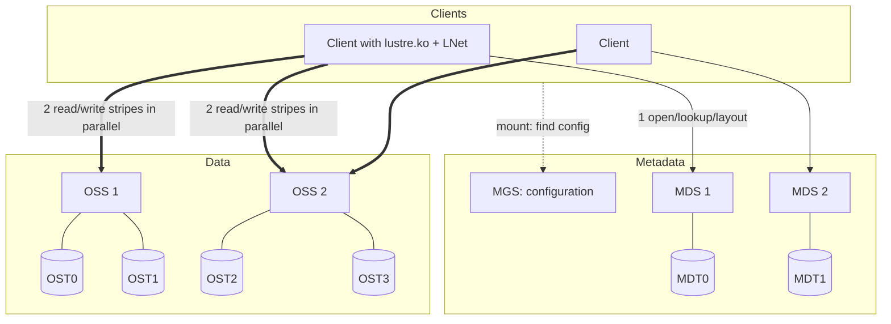

# 6.19 Lustre architecture and operation

| | |
|---|---|
| Level | Advanced |
| Priority tier | 2 |
| Lab venue | Lustre test cluster (VMs); the striping model runs anywhere |
| Part | Part 6: HPC and Slurm |
| Status | Drafted. Command syntax and defaults were read from the Lustre manual pages in a sparse checkout of lustre/lustre-release (commit `6325870`, 2026-10-21, development tree) for `lfs setstripe`, `getstripe`, `migrate`, `setquota`, `mkfs.lustre`, and `lctl`. Architecture follows the SCL book and the NVIDIA-DevOps volume-15 chapter (with corrections noted). `code/part06/lustre_stripe.py` was run (output shown). No Lustre file system was built; labs **untested** |

## Why this matters for AI infrastructure

Lustre is the most widely deployed parallel file system in HPC and in many large AI training sites (it underlies several vendor and cloud services). Its strengths, enormous aggregate bandwidth and a POSIX interface, come with sharp edges: striping defaults that cap the bandwidth of a big checkpoint at one disk, a metadata service that a data loader can overwhelm, and failure modes that look like hung nodes. Operators who understand striping, metadata and the management tools can both prevent and diagnose most "storage is slow" tickets.

## Prerequisites and outcomes

Needs 6.18 (parallel storage concepts), Part 2 (LNet runs over IB and Ethernet), Part 1 (block devices, ldiskfs/ZFS). After this chapter you can:

- Draw the Lustre architecture and explain each role (MGS, MDS/MDT, OSS/OST, clients, LNet) and the data and metadata paths.
- Create a file system with `mkfs.lustre` (single node and with failover), mount servers and clients.
- Choose and set striping: stripe count and size, composite (PFL) layouts, Data-on-MDT, pools, directory striping across MDTs.
- Manage quotas (user, group, project), balance OSTs, migrate data, and evacuate hardware.
- Describe the failure and recovery model; know which components need HA.
- Monitor and troubleshoot with `lfs`, `lctl`, client stats and server logs; apply AI-specific advice (shards, checkpoint layouts).

## 1. Architecture



Components (names as in the SCL book and `mkfs.lustre(8)`):

| Role | What it does |
|---|---|
| **MGS** (Management Server) | Holds configuration for one or more Lustre file systems (locations of all targets); clients and servers contact it at mount. Often combined with MDT0 but may have its own small device |
| **MDS / MDT** | Metadata server and metadata target (the storage device): file and directory names, permissions, timestamps, and the **layout** (which OST objects hold the data). An MDS can serve several MDTs; with **DNE** (Distributed Namespace) a file system has several MDTs, each owning part of the namespace |
| **OSS / OST** | Object storage server and target: stores file data as objects. An OSS typically serves several OSTs; scaling bandwidth means adding OSS/OST pairs, which can be done to a running file system |
| **Clients** | Compute and login nodes with the Lustre client module; present a POSIX mount; talk to MDS for metadata and directly to OSSs for data |
| **LNet** | Lustre's network layer: addresses by NID (`10.0.0.5@tcp`, `10.1.0.5@o2ib`), supports TCP, InfiniBand (o2ib), and routers between networks. Over RDMA it provides the high throughput |

Backing file systems: **ldiskfs** (a modified ext4, the traditional choice) or **ZFS** (software RAID-Z, checksums, snapshots; `--backfstype=zfs`). The book notes the central property: easy scalability, "at any time a new server can be added to a running file system, increasing both speed and storage capacity", and that only Linux clients/servers are supported natively (others need an NFS/SMB re-export that gives up the benefits). Failure tolerance: targets are on shared storage reachable from two servers (active/passive or active/active pairs) with failover managed by Pacemaker/Corosync or similar; Lustre itself provides **recovery** (clients replay requests after a server restart or failover within a recovery window), not the cluster resource manager.

## 2. Creating a file system

From the `mkfs.lustre(8)` examples (shortened):

```bash
# combined MGS + MDT0 for file system "testfs"
mkfs.lustre --fsname=testfs --index=0 --mdt --mgs /dev/sda1
# an OST using that MGS
mkfs.lustre --fsname=testfs --index=0 --ost --mgsnode=cfs21@tcp0 /dev/sdb
# failover pair for MGS+MDT: both server NIDs listed with --servicenode
mkfs.lustre --fsname=testfs --index=0 --mdt --mgs --servicenode=cfs21@tcp0,cfs21ib@o2ib0 --servicenode=cfs22@tcp0,cfs22ib@o2ib0 /dev/sda1
# ZFS backing: pool + dataset
mkfs.lustre --fsname=testfs --index=0 --mdt --mgs --backfstype=zfs zfspool/mdt1 mirror /dev/sdb /dev/sdc mirror /dev/sdd /dev/sde
```

Then mount each target on its server (`mount -t lustre /dev/sda1 /mnt/mdt`, order: MGS/MDT, then OSTs) and mount clients: `mount -t lustre mgsnode@tcp:/testfs /mnt/testfs` (a list of MGS NIDs separated by `:` or `,` for failover). Key options: `--ost|--mdt|--mgs`, `--fsname`, `--index` (unique per target type), `--mgsnode`, `--servicenode`/`--failnode` (failover partners; do not mix), `--backfstype`, `--mkfsoptions`, `--reformat`. `tunefs.lustre` changes parameters later (e.g. changing NIDs) and must only be run on an OSS or MDS while the server is stopped.

### Step-by-step Lustre creation (Installing Lustre (No HA) and HA), LNET port `988`, and OSS RAM sizing

In the book's Chapter 9 and Chapter 28 walkthroughs, Lustre runs entirely as kernel modules on both servers and clients, communicating over **LNET** (Lustre Networking) via Lustre Network Drivers (LNDs). On the client side, the software comprises the Metadata Client (MDC), Object Storage Client (OSC, where the group of OSCs forms one Logical Object Volume, or LOV), and Management Client (MGC). Each LNET interface has a unique NID (`<address>@<LND protocol><lnd#>`, such as `10.20.30.40@o2ib1` or `192.168.2.3@tcp2`). Each `<protocol><index>` forms an isolated LNET network (so `1.2.3.4@tcp0` cannot talk directly to `2.3.4.5@tcp1`). **On IP networks, the LNET kernel module uses TCP port `988`—ensure port `988` is not blocked by any firewall.**

1. **Configure LNET (`/etc/modprobe.d/lustre.conf`)**: define networks using `<lnd><#>(<dev>)[,…]`, for example `options lnet networks="tcp0(eth0)"` or `options lnet networks="o2ib0(ib0),tcp0(eth2)"`. Load the module and verify the NIDs (`(untested here)`):

   ```bash
   # (untested here) — Chapter 9 LNET verification example (using networks="tcp0(eth1)")
   modprobe lnet
   lnetctl net show
   lctl list_nids
   ```

2. **Format and mount the combined MGS + MDT volume on the MDS** (the file system name `--fsname` is limited to 8 characters; mount MGS and MDTs first before OSTs; the book recommend RAID-10 for MDTs due to small I/O size and RAID-6 for OSTs due to 1 MB+ I/O size):

   ```bash
   # (untested here) — Chapter 9 HA-capable example with two --servicenode NIDs
   mkfs.lustre --mdt --mgs --index=0 \
     --servicenode 192.168.2.3@tcp0 \
     --servicenode 192.168.2.4@tcp0 \
     --fsname=large-fs /dev/sdX
   mount -t lustre /dev/sdX /mnt/mdt

   # (untested here) — Chapter 28 simple non-HA recipe
   mkfs.lustre --mdt --mgs --fsname=large-fs /dev/sdX
   mount -t lustre /dev/sdX /mnt/mdt
   ```

3. **Format and mount each OST volume on the OSS nodes**:

   ```bash
   # (untested here) — Chapter 9 OSS initialization
   mkfs.lustre --ost --index=0 --fsname=large-fs \
     --mgsnode=192.168.2.3@tcp0 --mgsnode=192.168.2.4@tcp0 \
     /dev/sdZ
   mount -t lustre /dev/sdZ /mnt/ost1

   # (untested here) — Chapter 28 simple non-HA OSS recipe
   mkfs.lustre --ost --fsname=large-fs --index=0 \
     --mgsnode=mds.your.org@tcp0 /dev/sdZ
   mount -t lustre /dev/sdZ /mnt/ost0
   ```

4. **Mount the Lustre file system on the clients**:

   ```bash
   # (untested here) — Chapter 9 client mount with comma-separated MGS NIDs
   mount -t lustre 192.168.2.3@tcp0,192.168.2.4@tcp0:/large-fs /mnt/lustre
   ```

**OSS RAM sizing formulas from the book**: Lustre OSS nodes require substantial memory. By default, each OST uses `400 MB` of RAM for logging and about `600 MB` for metadata caching, plus `1.5 MB` for each service thread (where the number of threads `N_threads` can be roughly estimated as the number of clients divided by the number of connected OSTs):

```text
Per-OST baseline RAM = 400 MB + 600 MB + 1.5 MB * N_threads
Recommended OSS total RAM = 2 GB + 1 GB per OST (plus extra RAM for OS/network buffers and caching)
```

Sizing rules of thumb (common practice, verify with vendor guides): MDT on fast flash (NVMe, mirrored) because metadata is small random I/O; inode count chosen at format time (ldiskfs `bytes-per-inode`) for the expected file count; OSTs sized for rebuild time (RAID/ZFS groups of 8+2 on 8-12 TB disks are typical for HDD; for NVMe systems erasure-coded or ZFS vdevs); several OSTs per OSS to use all CPUs and NICs; OSS network bandwidth at least the sum of its OST bandwidth; client network matched to OSS network (400 Gb/s IB on GPU nodes is common).

### Non-HA install order from the book

The book's simpler path, without failover, follows a fixed order. Each step depends on the one before it, so keep the sequence.

1. Install the `lustre` package, or a similar one, on all servers and clients.
2. On every server and client, write the LNET setup in a `lustre.conf` file under `/etc/modprobe.d`, for example `options lnet networks="o2ib0(ib0),tcp0(eth2)"`.
3. Load the Lustre module on all servers and clients.
4. On the MDS, create the combined MGS and MDT volume and mount it:

   ```bash
   mkfs.lustre --mdt --mgs --fsname=large-fs /dev/sdX
   mount -t lustre /dev/sdX /mnt/mdt
   ```

5. On every OSS, create as many OSTs as you need, then mount each one. The book's example uses `--index=0` and `mds.your.org@tcp0` as the MGS address:

   ```bash
   mkfs.lustre --ost --fsname=large-fs --index=0 \
     --mgsnode=mds.your.org@tcp0 /dev/sdZ
   mount -t lustre /dev/sdZ /mnt/ost0
   ```

6. After the OSS nodes are ready, mount the file system on each client, using your MGS address:

   ```bash
   mount -t lustre mgsnode:/large-fs /mnt/lustre/
   ```

The `--index` value must be unique for each target of the same type, so use a new number for each extra OST.

## 3. Striping

### The raid0 layout

Every file has a **layout**: a list of OST objects and the stripe size. With the default `raid0` pattern the file is cut into `stripe_size` chunks assigned **round-robin** to `stripe_count` OST objects. It is **not** "split into N contiguous parts": consecutive chunks alternate between OSTs. `code/part06/lustre_stripe.py` models this:

```text
1 GiB file, stripe_size 1 MiB, stripe_count 4: bytes per OST object (MiB)
[256, 256, 256, 256]
First 8 chunks -> OST slot: [0, 1, 2, 3, 0, 1, 2, 3]
A 3 MiB read at offset 2.5 MiB touches slots: [0, 1, 2, 3]
A 512 KiB read at offset 0 touches slots: [0] (one OST: small I/O does not parallelise)
```

Consequences: a large sequential read or write is spread over all `stripe_count` OSTs and gets their aggregate bandwidth; a small I/O touches one OST, so striping does not speed it up; a file with stripe_count 1 is limited to a single OST regardless of the size of the file system. (The NVIDIA-DevOps volume-15 chapter describes a 2-stripe 1 GB file as "two chunks of 500 MB each", which is a common simplification but wrong for how Lustre places data: chunks alternate in `stripe_size` units.)

### Defaults and setting

From `lfs-setstripe(1)` in the development tree: `-c/--stripe-count` (0 = file-system default, **default 1**, -1 = all OSTs), `-C/--overstripe-count` (more than one stripe per OST), `-S/--stripe-size` (**default 4 MiB** in this tree; must be a multiple of 64 KiB; older releases defaulted to 1 MiB, so check yours), `-i/--stripe-index` (starting OST; -1 lets the MDS balance, "strongly recommended"), `-o/--ost` (explicit OST list), `-p/--pool` (OST pool), `-L/--layout` (`raid0` or `mdt`). On a directory the settings become the default for files created within; `lfs setstripe -d dir` removes the directory default. `lfs getstripe [-d] path` shows the layout.

```bash
lfs setstripe -c 1  -S 1M  /lustre/small-files        # tiny files: one stripe
lfs setstripe -c 16 -S 4M  /lustre/datasets           # big shared read-mostly files
lfs setstripe -c -1 -S 4M  /lustre/checkpoints        # stripe over all OSTs (use with N-1 checkpoint files)
lfs getstripe -d /lustre/checkpoints
```

In `SCL` Chapter 9 (*Striping and PFL*), setting `lfs setstripe -S 4M -c 8 /lustre/testdir` and inspecting a file created inside that directory with `-y` (YAML format) outputs (`(untested here)`):

```yaml
# (untested here) — lfs getstripe -y /lustre/testdir/testfile (SCL Chapter 9)
lmm_stripe_count:  8
lmm_stripe_size:   4194304
lmm_pattern:       raid0
lmm_layout_gen:    0
lmm_stripe_offset: 2
lmm_objects:
- l_ost_idx: 2
  l_fid:     0x100020000:0x2:0x0
- l_ost_idx: 3
  l_fid:     0x100030000:0x2:0x0
```

Note that you cannot alter `lmm_stripe_count` or `lmm_stripe_size` in place on an already-written file without migrating/copying its data into a newly striped file (`lfs migrate` or `cp`).

Guidance: default stripe count 1 is right for the file-per-process pattern with many files (each file lands on its own OST, load balanced by the MDS); use larger stripe counts for big files shared by many clients or written by one fast client; match `stripe_size` to application I/O size (1 to 4 MiB typical; multiples of the I/O request size to avoid lock contention at boundaries). Too many stripes on small files wastes metadata and RPCs; too few on large files caps bandwidth.

### Progressive File Layouts (PFL) and other layouts

A **composite layout** (introduced in Lustre `2.10+`) divides a file into components by offset, each with its own stripe parameters, so a file can start narrow and become wider as it grows (`-E`/`--component-end`):

```bash
lfs setstripe -E 4M -c 1 -E 64M -c 4 -E -1 -c -1 /lustre/dir    # from the man page examples
# (untested here) — SCL Chapter 9 PFL example: 0..1M on 1 OST (512K stripes), 1M..256M (255M span) on 4 OSTs, >256M on 8 OSTs (1M stripes)
lfs setstripe -E 1M -S 512K -c 1 -E 256M -c 4 -E -1 -S 1M -c 8 /lustre/testdir
```

This gives small files one stripe (cheap) and large files all OSTs (fast) without the user choosing: set it as the **directory default** for general-purpose areas. Related features in the man page: **Data-on-MDT** (`-L mdt` for a first component placed on the MDT for fast small-file access, limited by `lod.*.dom_stripesize`), **self-extending layouts** (`-z/--extension-size` grows the first component in steps and avoids full OSTs), **mirrored layouts** (`-N/--mirror-count`, with components in different pools such as `flash` and `disk` and the `prefer` flag so clients favour the flash replica), and newer **erasure-coded** layouts (`--ec`). The tool model prints a PFL example: for a 1 GiB file with components `4 MiB x1`, `to 64 MiB x4`, and `rest x16 (4 MiB stripes)`:

```text
  [    0 MiB,     4 MiB)  stripe_count=1   stripe_size=1 MiB
  [    4 MiB,    64 MiB)  stripe_count=4   stripe_size=1 MiB
  [   64 MiB,  1024 MiB)  stripe_count=16  stripe_size=4 MiB
```

### Pools

An **OST pool** names a subset of OSTs (e.g. `flash`, `disk`); `lfs setstripe -p flash ...` allocates from it; combine with directory defaults and mirrors for tiering. Pools are defined with `lctl pool_new` / `pool_add` on the MGS (general knowledge; see `lfs pool_list`).

### Directory striping and DNE

With multiple MDTs, `lfs mkdir -i N dir` creates a directory on MDT N and `lfs setdirstripe -c K dir` stripes a directory over K MDTs (large directories); `lfs mkdir -c -1 -D` style default directory layouts spread subdirectories across MDTs. `lfs migrate -m START_MDT dir` moves a directory tree to other MDTs (recursively by default). Use DNE to spread per-user or per-project trees across metadata servers. Hash-striped single huge directories help create-heavy workloads but make `ls` slower.

## 4. Quotas and capacity

Enabled at format/`tunefs` time (`--quota` / `lctl conf_param ... quota.ost=ugp` depending on version) and managed with `lfs`: `lfs quota -u alice /lustre`, `lfs setquota -u alice -b 9T -B 10T -i 1M -I 1100K /lustre` (soft/hard block and inode limits; `-g` groups, `-p` projects; default quotas `-U/-G/-P`; `--pool` quotas; grace time `-t`; `--delete`, `--reset`). In `SCL` Chapter 9 (*Quotas*), setting a soft limit of `200G` / `2M` inodes and hard limit of `300G` / `3M` inodes for user `foo`, group `bar`, and project `1` (`lfs project -r /lustre/testdir`), adjusting grace times (`1d8h` for inodes, `2d` for blocks; default is 1 week), and resetting to default quota (`--default`, or `0` to remove limits) uses (`(untested here)`):

```bash
# (untested here) — SCL Chapter 9 quota management examples
lfs setquota -u foo -b 200G -B 300G -i 2M -I 3M /lustre
lfs setquota -g bar -b 200G -B 300G -i 2M -I 3M /lustre
lfs project -r /lustre/testdir
lfs setquota -p 1 -b 200G -B 300G -i 2M -I 3M /lustre
lfs setquota -t -u -i 1d8h -b 2d /lustre
lfs setquota -u foo --default /lustre
```

**Project quotas** (`lfs project -p ID -s dir`, then `lfs setquota -p ID ...`) enforce limits per directory tree irrespective of file owner, the natural unit for AI teams and datasets. Capacity: `lfs df -h` (per-MDT/OST usage; look for imbalance), `lfs df -i` (inodes).

**Balancing, OST retirement/deactivation, and evacuation**: `lfs migrate` moves OST objects between OSTs to rebalance, change stripe count (`lfs migrate -c 16 file`), move between pools, or evacuate an OST for maintenance; it takes the same `setstripe`-style options and can run with `lfs find ... --print0 | lfs migrate -0 ...`; the layout swap is performed so that, per the man page, files are migrated while preserving data (verify behaviour for open/active files on your version; plan migrations during low load). The NVIDIA-DevOps chapter calls migration "offline"; in practice it is an online but I/O-heavy operation.

When an OST shows hardware trouble and needs to be retired, the book gives a four-step deactivation and evacuation sequence (`(untested here)`):

1. Run `lctl dl` to list all Lustre devices visible on the client and find the numeric device index `N` of the target OST.
2. Disable new object allocations on that OST by running `lctl --device N deactivate` (where `N` is the device number from `lctl dl`).
3. Locate files residing on the retiring OST (for example with `lfs find --ost ...`) and migrate their data onto healthy OSTs using `lfs_migrate` (or `lfs migrate`).
4. If an OST fails after the file system already holds data and must be repaired offline, unmount all clients first, then unmount all OSTs, then unmount the MDTs and MGS, mount the affected OST locally as `ldiskfs` (if ext4-based), and run the Lustre-patched `e2fsck` per your exact Lustre version documentation.

## 5. Failure and recovery model

- **Failover pairs**: each MDT/OST device is reachable from two servers via shared storage (dual-ported disks/NVMe-oF/JBOD); if one server fails the partner mounts the target and recovery begins.
- **Recovery**: after a restart clients reconnect and replay uncommitted requests during a **recovery window** (default several minutes; configurable). Applications see a pause rather than errors if recovery succeeds; clients that miss the window are evicted (stale file handles, I/O errors).
- **Client eviction**: unresponsive clients (network flap, hang) are evicted by servers after timeouts, freeing locks; the node must remount. Time synchronisation matters (6.18).
- **LFSCK**: online consistency checker (`lctl lfsck_start`), used after crashes or suspected inconsistency.
- **HSM and changelogs**: hierarchical storage management and change logs support tiering to object stores and external tools.
- **Hardware**: RAID/ZFS redundancy per target; dual power and network paths; spare OSS capacity; monitoring of disk and SSD health.

## 6. Monitoring and tuning

| Tool | Use |
|---|---|
| `lfs df -h`, `lfs df -i` | Space and inode distribution per target |
| `lfs getstripe`, `lfs find`, `lfs quota` | Layout, searches by size/stripe/age, usage |
| `lctl get_param` / `lctl set_param` / `lctl list_param` | Read and set tunables and statistics (`llite.*` client side, `osc.*`, `mdc.*`, `obdfilter.*` on OSS, `mdt.*` on MDS); `lctl conf_param`/`set_param -P` for persistent settings |
| `lctl dk` | Kernel debug log dump |
| Client `/proc/fs/lustre` / `lctl get_param llite.*.stats` | Operation counts and latencies (open, close, getattr, read, write) |
| `lnetctl` | LNet configuration and statistics (`lnetctl net show`, `stats show`) |
| `lctl ping NID` | LNet reachability |
| Server logs (`dmesg`, `/var/log/messages`) | Evictions, recovery, ldiskfs/ZFS errors, LNet errors |
| Monitoring stacks | Lustre exporters for Prometheus, Grafana dashboards, vendor tools (e.g. IML, LTOP-like tools) |

Common tunables (names illustrative, validate against your version): client `osc.*.max_rpcs_in_flight`, `osc.*.max_dirty_mb`, `llite.*.max_read_ahead_mb`, `llite.*.statahead_max` (speeds `ls -l`); server `ost.OSS.ost_io.threads_max`; LNet `peer_credits`/`credits`. Defaults are tuned for typical HPC; change one parameter at a time against a benchmark (IOR, mdtest, `fio`; 6.28).

### Diagnosing bottlenecks

1. **Is it metadata or data?** Compare `lctl get_param llite.*.stats` (open/getattr rates and latencies) with bandwidth per OST (server `obdfilter` stats, `lfs df`). Slow `ls -l`, slow Python imports, slow epoch starts, and thousands of `open` calls per second point to metadata. Low MB/s on a few large files points to striping or OST/network limits.
2. **Metadata-bound** remedies: reduce file counts (shard datasets into large files; WebDataset/TFRecord/Parquet shards, 6.18 section 5), avoid giant directories, spread trees across MDTs (DNE), add client caching (statahead), move metadata-heavy trees (Python environments, build trees) to containers or local disks, use Data-on-MDT for small files, increase MDS threads and use faster MDT media.
3. **Data-bound** remedies: raise stripe count for large files, align I/O size with stripe size, check client network (MTU, RDMA), OSS CPU/network, OST imbalance (`lfs df`), failing disks, rebuilds in progress, competing jobs.
4. **One slow client**: network (NIC link speed, errors, MTU), CPU/NUMA, client eviction history, `lctl ping`, `lnetctl stats`.
5. **Stalls and hangs**: check server logs for recovery/eviction, LNet errors, and OSS/MDS load; test from another client.

The NVIDIA-DevOps chapter's per-MDS and per-OST throughput figures ("about 50K to 100K metadata ops/s per MDS", "100 to 800 MB/s per OST") are illustrative orders of magnitude, not guarantees; real figures depend on hardware (flash MDTs achieve far more than spinning disks, NVMe OSTs far more than 800 MB/s). Measure your system.

## 7. AI-specific guidance

| Concern | Practice |
|---|---|
| Datasets | Few large shards (hundreds of MB to GB) per dataset; stripe count 4 to 16 (or PFL) on the dataset directory; read-ahead tuned; a pool on flash for hot datasets |
| Epoch start storms | Pre-shard; stagger; open files lazily; cache dataset index locally |
| Checkpoints | Distributed (per-rank or per-node shard) files with stripe count 1 to 4 each, **or** a few large shared files with wide striping (-c -1) and aligned writes; test both; use async checkpointing to local NVMe and drain to Lustre |
| Restart read | Same layout as writes; ensure enough OST bandwidth for a simultaneous read by all ranks |
| Python/conda environments | Do not run from Lustre at scale: containers (squashfs) or node-local copies; if unavoidable, `statahead` and metadata on flash |
| Logs | Per-rank files in per-job directories; avoid shared append files |
| Quotas | Project quotas per team/dataset; monitor inodes as well as bytes |
| Multi-tenant fairness | Network request scheduler (NRS) policies and QoS (TBF) exist in Lustre; use with care |
| Cloud | Managed Lustre services (e.g. on major clouds) expose the same client semantics; capacity and throughput are provisioned per TiB |

## 8. Lab

First, run the self-checking Python lab (`code/part06/lustre_stripe_lab.py`) locally. It verifies `slot()`, `per_ost_bytes()`, `request_osts()`, and `pfl_layout()` in `code/part06/lustre_stripe.py` (`1 GiB` file striped across 4 OSTs in `1 MiB` chunks $\to$ `[256, 256, 256, 256]` MiB per OST, `3 MiB` read at `2.5 MiB` touching `[0, 1, 2, 3]`, `512 KiB` read touching `[0]`, and PFL component ranges), and checks the `SCL` Chapter 9 OSS RAM sizing equations (`1030.0 MB` per OST at 20 service threads and `10 GB` baseline for an 8-OST OSS), LNET TCP port `988`, and `4194304` (`4 MiB`) stripe size:

```bash
python3 code/part06/lustre_stripe_lab.py
```

Tested: run `lustre_stripe.py`; change the stripe parameters and predict per-OST bytes; model a 4 GiB file with PFL `-E 1M -c 1 -E 1G -c 4 -E -1 -c 8`.

Untested (needs Lustre VMs): 1) Build a single-node Lustre (MGS+MDT, 2 OSTs on loop devices or small disks) following the `mkfs.lustre` examples; mount a client. 2) `lfs setstripe -c 2 -S 1M f`, write 1 GiB, `lfs getstripe f`, `lfs df`; compare with `-c 1`. 3) Set a directory PFL default; create small and large files; inspect layouts. 4) Create 100,000 files with `iomix.py` or `mdtest`; compare to NFS. 5) Add a second MDT and use `lfs mkdir -i 1`; observe `lfs getdirstripe`. 6) Set a project quota, exceed it, observe the error. 7) Run `lfs migrate -c 2 bigfile` while reading it. 8) Stop the OSS holding an OST and watch client behaviour and recovery; restart. 9) Write a runbook for evicted clients.

## 9. Interview angles

- Walk through what happens when a client opens and reads a striped file.
- Why is default stripe count 1 and when do you change it?
- Explain PFL layouts and a case for Data-on-MDT.
- Your checkpoint of 500 GB takes 15 minutes. How do you find and fix the cause?
- Epoch start takes minutes with 10 million files. What do you do?
- How do MGS, MDS, OSS fail over and what do clients experience?
- What are project quotas and why use them?
- How would you rebalance OSTs or evacuate one?
- Lustre versus GPFS versus WEKA/VAST: strengths and weaknesses?

## Exercises

1. **Modeling `raid0` Round-Robin Striping and Request Parallelism (`code/part06/lustre_stripe.py` & `lustre_stripe_lab.py`):** Run `python3 code/part06/lustre_stripe_lab.py`. Explain why a `1 GiB` file with `stripe_size=1 MiB` and `stripe_count=4` alternates `1 MiB` chunks across OST slots `[0, 1, 2, 3, 0, 1, 2, 3]` (yielding `256 MiB` per OST), why a `3 MiB` read starting at byte offset `2.5 MiB` touches all 4 OSTs `[0, 1, 2, 3]`, and why a `512 KiB` read at offset `0` touches only OST `[0]`.
2. **Designing Progressive File Layouts (PFL) and Data-on-MDT (`DoM`):** Write the `lfs setstripe` PFL command for a shared AI directory where files $\le 4\text{ MiB}$ use `stripe_count=1, stripe_size=1M`, files from $4\text{ MiB}$ to $64\text{ MiB}$ use `stripe_count=4, stripe_size=1M`, and files $> 64\text{ MiB}$ use `stripe_count=16, stripe_size=4M` (and compare with `SCL` Chapter 9's `-E 1M -S 512K -c 1 -E 256M -c 4 -E -1 -S 1M -c 8`). Verify the component boundaries on a `1 GiB` file using `pfl_layout()`.
3. **Formatting a Lustre Filesystem and Sizing OSS RAM (`SCL` Chapters 9 & 28):** Write the `/etc/modprobe.d/lustre.conf` (`options lnet networks="o2ib0(ib0),tcp0(eth2)"`), `mkfs.lustre` commands for an HA MGS+MDT pair (`--servicenode`) and OSTs (`--mgsnode`), and client `mount -t lustre` command. Using `oss_ram_sizing_mb(8, 640, 32)` in `code/part06/lustre_stripe_lab.py`, calculate the per-OST RAM (`1030.0 MB` for `N_threads = 640 / 32 = 20`) and baseline OSS RAM (`2 GB + 1 GB * 8 = 10 GB`).
4. **Configuring User, Group, and Project Quotas (`SCL` Chapter 9):** Write the `lfs setquota` and `lfs project` commands to enforce a `200G` soft / `300G` hard block quota and `2M` soft / `3M` hard inode quota on `/lustre/testdir` under project ID `1`, set user grace periods to `1d8h` (inodes) and `2d` (blocks), and explain why directory-tree project quotas are preferred over user quotas for shared AI datasets.
5. **Retiring and Evacuating a Failing OST (`SCL` Chapter 9):** Write the exact 4-step operational procedure to safely retire an OST experiencing disk errors—finding its device number with `lctl dl`, disabling new object allocations with `lctl --device N deactivate`, migrating existing stripes off the OST with `lfs find` + `lfs_migrate` / `lfs migrate`, and performing an offline `ldiskfs` `e2fsck` if required.
6. **Diagnosing Metadata vs Data Bottlenecks on Lustre for AI Workloads:** Given two tickets—Ticket A ("512-GPU PyTorch job takes 8 minutes inside `import torch` at startup") and Ticket B ("Writing a single 500 GB checkpoint file from rank 0 runs at 600 MB/s on a 200 GB/s Lustre cluster")—state which `lctl get_param` / `lfs getstripe` / `lfs df` commands confirm the root cause and give the concrete fix for each.

## Checkpoint

<details>
<summary>1. Define the five core Lustre architectural components (**MGS**, **MDS/MDT**, **OSS/OST**, **Clients**, and **LNet**) and state how metadata and data paths separate.</summary>

- **MGS (Management Server):** Stores cluster-wide configuration and target registries; contacted at mount time.
- **MDS / MDT (Metadata Server / Target):** Stores filenames, directories, permissions, and file stripe layouts (`LOV` maps).
- **OSS / OST (Object Storage Server / Target):** Stores the actual striped file data objects.
- **Clients (`MDC`, `OSC`/`LOV`, `MGC`):** Kernel-module mounts on compute nodes that query the MDS once on `open()`/`stat()` for the file's layout and then perform parallel RDMA reads/writes directly against the OSSs.
- **LNet (Lustre Networking):** Kernel networking layer addressing nodes by **NID** (`<ip>@tcp0`, `<ip>@o2ib0`).
</details>

<details>
<summary>2. What is an LNet **NID**, what TCP port does LNet use over IP networks, and why can't `1.2.3.4@tcp0` talk directly to `2.3.4.5@tcp1` (`SCL` Chapter 9)?</summary>

An **NID (Network Identifier)** has the format `<address>@<LND_protocol><index>` (for example `10.20.30.40@o2ib1` or `192.168.2.3@tcp0`). Over IP networks, the LNet kernel module communicates on **TCP port `988`**. Each `<protocol><index>` pair (`tcp0` vs `tcp1`) defines an isolated LNet network segment; nodes on different LNet networks cannot communicate without an explicit LNet router.
</details>

<details>
<summary>3. Which two backing filesystems (`--backfstype`) can underlie Lustre MDTs and OSTs, and why does `SCL` Chapter 9 recommend RAID-10 for MDTs and RAID-6 for OSTs?</summary>

Lustre targets use either **`ldiskfs`** (a Lustre-patched `ext4`) or **`ZFS`** (`--backfstype=zfs`). `SCL` Chapter 9 recommends **RAID-10 for MDTs** because metadata operations are small, latency-critical random I/Os where losing the MDT destroys the entire filesystem namespace, and **RAID-6 (or RAID-Z2) for OSTs** because data stripes are large ($\ge 1\text{ MB}$) sequential I/Os suited to dual-parity capacity efficiency.
</details>

<details>
<summary>4. What is the maximum length of `--fsname` in `mkfs.lustre`, and in what order must Lustre targets be mounted on startup and unmounted on shutdown (`SCL` Chapter 9)?</summary>

`--fsname` is limited to **8 characters** (e.g., `large-fs`).
- **Startup mount order:** Mount **MGS and MDTs first**, then mount **OSTs**, and finally mount **clients**.
- **Shutdown unmount order:** Unmount **all clients first**, then unmount **all OSTs**, and finally unmount **MDTs and MGS**.
</details>

<details>
<summary>5. State the two OSS RAM sizing formulas from `SCL` Chapter 9.</summary>

1. **Per-OST RAM usage:** $\mathbf{400\text{ MB}}$ (logging) $+ \mathbf{600\text{ MB}}$ (metadata cache) $+ \mathbf{1.5\text{ MB} \times N_{\text{threads}}}$ (where $N_{\text{threads}} \approx \text{clients} / \text{connected OSTs}$).
2. **Recommended total OSS RAM:** $\mathbf{2\text{ GB} + 1\text{ GB per OST}}$ (plus extra memory for OS/network buffers and read caching).
</details>

<details>
<summary>6. How does Lustre's `raid0` striping place data across OSTs (`code/part06/lustre_stripe.py`), and why is saying "a 2-stripe 1 GiB file is split into two 512 MiB halves" wrong?</summary>

Lustre's `raid0` layout cuts a file into fixed **`stripe_size`** chunks (e.g., `1 MiB` or `4 MiB`) and assigns consecutive chunks **round-robin** across `stripe_count` OST objects (`chunk_index = offset // stripe_size`, `ost_slot = chunk_index % stripe_count`). A 2-stripe `1 GiB` file with `1 MiB` stripes alternates every `1 MiB` between OST 0 and OST 1 (`512` chunks on each), **not** two contiguous `512 MiB` halves.
</details>

<details>
<summary>7. Why does a `512 KiB` read touch only 1 OST even when a file has `stripe_count=16` and `stripe_size=4 MiB`?</summary>

Because the entire byte range `[0, 512 KiB)` falls inside the first `4 MiB` chunk (`chunk 0`), which resides on a single OST (`slot 0`). Striping only parallelizes single-file reads or writes that span multiple `stripe_size` chunks (or concurrent multi-rank accesses to different chunks).
</details>

<details>
<summary>8. What are the default values of `stripe_count` (`-c`) and `stripe_size` (`-S`) in `lfs setstripe`, and what do `-c -1` and `-i -1` mean?</summary>

- **Defaults:** `stripe_count = 1` and `stripe_size = 4 MiB` (`4194304` bytes in current Lustre; `1 MiB` in older releases; must be a multiple of `64 KiB`).
- **`-c -1`:** Stripe across **all available OSTs** in the filesystem (or pool).
- **`-i -1`:** Let the MDS automatically select the starting OST index to balance capacity and load across OSTs.
</details>

<details>
<summary>9. Decode the fields of `lfs getstripe -y /lustre/testdir/testfile` (`SCL` Chapter 9).</summary>

- **`lmm_stripe_count: 8`:** Number of OSTs the file is striped across.
- **`lmm_stripe_size: 4194304`:** Stripe chunk size in bytes (`4 MiB`).
- **`lmm_pattern: raid0`:** Round-robin striping pattern.
- **`lmm_stripe_offset: 2`:** Index of the starting OST (`OST0002`).
- **`lmm_objects`:** List of per-OST object allocations (`l_ost_idx` and unique File Identifier `l_fid`).
</details>

<details>
<summary>10. What is a **Progressive File Layout (PFL)**, and how does `lfs setstripe -E 4M -c 1 -E 64M -c 4 -E -1 -c -1 /lustre/dir` work?</summary>

A **PFL** composite layout defines multiple offset-bounded stripe components so files automatically widen as they grow:
- Bytes **`[0, 4 MiB)`:** `stripe_count = 1` (small files stay on a single OST with minimal RPC overhead).
- Bytes **`[4 MiB, 64 MiB)`:** `stripe_count = 4`.
- Bytes **`[64 MiB, EOF)` (`-E -1`):** `stripe_count = -1` (all OSTs, giving multi-gigabyte checkpoints and dataset shards maximum aggregate bandwidth).
</details>

<details>
<summary>11. What is **Data-on-MDT (`DoM`)** (`lfs setstripe -E 1M -L mdt ...`), and what workload does it accelerate?</summary>

**Data-on-MDT (`-L mdt`)** stores the first component of a file (up to `dom_stripesize`, typically $\le 1\text{ MiB}$) directly on the NVMe-backed **MDT** alongside its inode metadata, eliminating the extra client-to-OSS network round trip when reading or writing small configuration, log, or source files.
</details>

<details>
<summary>12. What is **DNE (Distributed Namespace)**, and whatis the difference between `lfs mkdir -i N` and `lfs setdirstripe -c K`?</summary>

**DNE** scales metadata capacity and IOPS across multiple MDTs (`MDT0`, `MDT1`, ...):
- **`lfs mkdir -i N dir`:** Places a specific directory (and its subtree) on a single target `MDT N` (DNE Phase 1).
- **`lfs setdirstripe -c K dir` (or `lfs mkdir -c K`):** Hash-stripes the entries of a single large directory across $K$ MDTs (DNE Phase 2, accelerating massive multi-rank file creation in one directory).
</details>

<details>
<summary>13. How do you configure user, group, and directory **project quotas** in Lustre, and how do you change quota grace times (`SCL` Chapter 9)?</summary>

- **User / group quota:** `lfs setquota -u foo -b 200G -B 300G -i 2M -I 3M /lustre` (`-b`/`-i` soft limits, `-B`/`-I` hard limits).
- **Project quota on a directory tree:** `lfs project -p 1 -r -s /lustre/testdir` followed by `lfs setquota -p 1 -b 200G -B 300G -i 2M -I 3M /lustre`.
- **Grace time:** `lfs setquota -t -u -i 1d8h -b 2d /lustre` (default is 1 week). Reset to default with `--default` or clear with `0`.
</details>

<details>
<summary>14. What is the 4-step procedure to deactivate and evacuate a failing OST before removing or repairing it (`SCL` Chapter 9)?</summary>

1. Run **`lctl dl`** on the client/MGS to identify the numeric device index `N` of the failing OST.
2. Run **`lctl --device N deactivate`** so the MDS stops allocating new file objects on that OST.
3. Find all files with stripes on that OST (`lfs find --ost <OST_name> /lustre`) and migrate them to healthy OSTs with **`lfs_migrate`** / **`lfs migrate`**.
4. If offline repair is needed, unmount clients $\to$ OSTs $\to$ MDT/MGS, mount the OST locally as `ldiskfs`, and run Lustre's patched `e2fsck`.
</details>

<details>
<summary>15. Does Lustre itself replicate data across OSTs by default, and how is server/target high availability implemented (`SCL` Chapter 9)?</summary>

By default, Lustre does **not** duplicate data across OSTs (unless explicit file-level mirroring `lfs mirror create -N` is used)—an unrecovered OST/MDT disk loss loses data. High availability relies on:
1. **RAID-10 (MDT) / RAID-6 or ZFS RAID-Z2 (OST)** beneath each target.
2. **Multi-homed shared storage (`--servicenode`)** where two OSS/MDS hosts share access to the disk shelves and **Pacemaker + Corosync** mounts the target on the standby server if the primary fails.
</details>

<details>
<summary>16. What happens during **Lustre recovery** and **client eviction** when an OSS or MDS fails over?</summary>

When a failed-over MDT or OST mounts on its partner server, it enters a **recovery window** (several minutes) during which clients reconnect and **replay** their uncommitted in-flight RPCs from client memory. If all clients reconnect in time, applications only experience an I/O pause; any client that fails to reconnect before the recovery timer expires is **evicted** (losing its cached locks/state and receiving `EIO` / stale handle errors until remounted).
</details>

<details>
<summary>17. How do you distinguish a **metadata bottleneck** from a **data/OST bottleneck** using `lctl` and `lfs`?</summary>

Compare client metadata operation counters (`lctl get_param llite.*.stats`—looking at `open`, `close`, `getattr`, `readdir` rates and latencies) and MDS CPU load against per-OST bandwidth and space balance (`lfs df -h`, `lfs df -i`, and OSS `obdfilter.*.stats`). Slow `ls -l`, slow Python imports, and high `open`/`getattr` counts indicate a metadata bottleneck; low throughput on large reads/writes or a 99%-full single OST indicates a data/striping bottleneck.
</details>

<details>
<summary>18. What is the difference between `lctl set_param`, `lctl set_param -P` (`lctl conf_param`), and `tunefs.lustre` (`SCL` Chapter 9)?</summary>

- **`lctl set_param ...`:** Changes a Lustre kernel parameter **temporarily** on the local node until reboot/remount.
- **`lctl set_param -P ...`:** Saves the parameter **permanently** in the MGS configuration log so it persists across reboots.
- **`tunefs.lustre`:** Modifies on-disk target header parameters (such as MGS/failover NIDs) and **must only be run while the OSS/MDS target is unmounted/stopped**.
</details>

<details>
<summary>19. How should striping be configured for **N-to-N** sharded checkpoints (`__0_0.distcp`) versus **N-to-1** single-file checkpoints on Lustre?</summary>

- **N-to-N (one shard file per rank/node):** Set `stripe_count = 1` to `4` (`lfs setstripe -c 1 -S 4M`). Because hundreds of ranks write separate files concurrently, the MDS distributes the files across all OSTs automatically without multi-OST lock overhead per file.
- **N-to-1 (all ranks writing to one giant shared file):** Set `stripe_count = -1` (`lfs setstripe -c -1 -S 4M`, striping across all OSTs) and align rank write offsets to `4 MiB` stripe boundaries so all OSTs work in parallel without extent-lock contention.
</details>

<details>
<summary>20. Why should Python virtual environments and Conda trees never be imported directly from Lustre by 1,000+ GPU ranks at job start?</summary>

When 1,000 ranks run `import torch, transformers`, each rank issues thousands of `stat()`, `open()`, and `read()` RPCs against the same directory on `MDT0`, creating a multi-million-RPC metadata storm that stalls job startup for minutes. Package environments into a single **Enroot `.sqsh` / Apptainer `.sif` image** (or stage to local `/tmp` NVMe via `sbcast`).
</details>

## Sources and review notes

- Architecture, roles, LNET port `988`, OSS RAM sizing formulas (`400 MB + 600 MB + 1.5 MB * N_threads` and `2 GB + 1 GB per OST`), step-by-step Lustre creation (`mkfs.lustre` HA and no-HA), OST retirement/deactivation (`lctl dl`, `lctl --device N deactivate`, `lfs_migrate`), fault tolerance (Corosync+Pacemaker), striping (`lfs getstripe -y`) and PFL (`-E 1M -S 512K -c 1 -E 256M -c 4 -E -1 -S 1M -c 8`), and quotas (`lfs setquota`, `lfs project`): read in full from *Supercomputers for Linux SysAdmins* (`supercomputers-for-linux-sysadmins-managing-modern-hpc-clusters-and-supercomputers-from-software-to-hardware`, `SCL`) Chapter 9 ("9. Network File Systems") and Chapter 28 ("28. One-Two-Three Instructions").
- Migrated from `nvidia-devops`: `nvidia-zero-to-hero/volume-15/chapter-05-lustre-for-ai-and-hpc.md` (metadata/data split, measurement, tuning, AI scenarios), restated in our words with corrections noted in the text (contiguous-halves description of striping, "Metadata Disk Targets", "offline" migration, and unsupported throughput figures).
- Command semantics and defaults: Lustre manual pages `lfs-setstripe(1)`, `lfs-getstripe(1)`, `lfs-migrate(1)`, `lfs-setquota(1)`, `lfs-df(1)`, `lfs-project(1)`, `mkfs.lustre(8)`, `lctl(8)`, `lustre(7)` from `lustre/lustre-release` (commit `6325870`, development tree).
- Run here: `code/part06/lustre_stripe.py` and `python3 code/part06/lustre_stripe_lab.py` (3 passed, 0 failed).
- Explicitly labelled inferences: `oss_ram_sizing_mb` in `code/part06/lustre_stripe_lab.py` (`1030.0 MB` per OST at 20 service threads and `10 GB` for an 8-OST OSS) is a deterministic calculation from `SCL` Chapter 9's formulas.
- Book source (`supercomputers-for-linux-sysadmins-managing-modern-hpc-clusters-and-supercomputers-from-software-to-hardware`, Sergey Zhumatiy, *Supercomputers for Linux SysAdmins*), **Chapter 28: "28. One-Two-Three Instructions"**: the "Installing Lustre (No HA)" steps (`lustre.conf`, module load, MGS/MDT, OST, and client mount).
- Not verified on live hardware: `mkfs.lustre`, `mount -t lustre`, `lnetctl`, `lctl`, `lfs` commands, tunable names, DNE default directory layout syntax, pool commands, recovery window values, sizing rules of thumb, and managed-service details (`untested here`).
