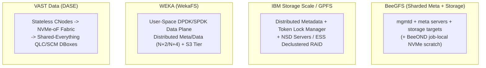

# 6.20 BeeGFS, GPFS, WekaFS and VAST

| | |
|---|---|
| Level | Intermediate |
| Priority tier | 2 |
| Lab venue | BeeGFS on 3 VMs (open source); the others are commercial |
| Part | Part 6: HPC and Slurm |
| Status | Drafted. BeeGFS configuration parameters and the component layout were read from the ThinkParQ/beegfs repository (commit `f329583`, 2026-08-19: default `beegfs-client.conf`, `beegfs-meta.conf`, `beegfs-storage.conf`, README). GPFS/Storage Scale, PanFS, WEKA and VAST are described from the SCL book and general knowledge: **unverified**, vendor documentation must be consulted. Nothing was deployed. Labs **untested** |

## Why this matters for AI infrastructure

You will rarely get to choose the file system from scratch, but you will be asked to operate, size or compare them: a neocloud offering WEKA or VAST, a national lab on Lustre or GPFS, a university on BeeGFS, an appliance vendor shipping PanFS (VDURA). Each makes different trade-offs between metadata scaling, small-file performance, operational complexity, POSIX semantics, cost and ecosystem. The 6.19 chapter covered Lustre in depth; this one gives you the architecture, strengths and pitfalls of the alternatives, and the questions to ask. Part 13 (AI storage) revisits them for AI pipelines, checkpointing and GPUDirect Storage.

## Prerequisites and outcomes

Needs 6.18 and 6.19. After this chapter you can:

- Describe the architecture of BeeGFS, GPFS/Storage Scale, PanFS, WEKA and VAST in a few sentences each and map their components to Lustre's.
- Name the main configuration objects and commands of BeeGFS and read its configuration files.
- Compare the systems on metadata handling, data protection, client access, RDMA/GPUDirect, tiering, multi-tenancy and cost model.
- Pick a candidate for a scenario (checkpoint scratch, dataset store, home directories, mixed HPC) and list the validation tests.

## 1. A common frame



Every system answers the same design questions:

| Question | Why it matters |
|---|---|
| Where does metadata live and how does it scale (single, sharded, distributed everywhere)? | Small-file and create/stat rates, epoch-start storms |
| How is data distributed and protected (RAID on servers, replication, erasure coding, shared disk)? | Bandwidth, rebuild time, capacity efficiency, failure domains |
| How do clients access it (kernel client, FUSE, user-space client, NFS/SMB/S3 gateways)? | POSIX semantics, performance, OS/kernel support, operational friction |
| How is it deployed (software on commodity servers, appliance, managed service)? | Cost, lock-in, support |
| What media tiers (NVMe, HDD, object) and how are they managed? | Cost per TB versus per GB/s |
| Network (RDMA, TCP; GPUDirect Storage support)? | GPU data path (Part 13) |
| Multi-tenancy, quotas, snapshots, encryption, audit? | Shared AI platforms |
| Failure model and recovery | Availability during hardware failure and upgrades |

## 2. BeeGFS

BeeGFS (formerly FhGFS, developed at Fraunhofer, now ThinkParQ) is a parallel cluster file system "designed for very easy installation and management" (its README). It runs on ordinary Linux servers with a kernel client module, and its services are separable:

| Service | Role | Notes (from the repository layout and defaults) |
|---|---|---|
| **Management (mgmtd)** | Registry of nodes and targets, state, configuration; clients and servers find it via `sysMgmtdHost` | In BeeGFS 8 rewritten in Rust (`beegfs-rust`) |
| **Metadata (meta)** | Directory tree, file attributes, stripe pattern; `storeMetaDirectory` points to a fast local file system with extended attributes (`storeUseExtendedAttribs = true`) | Several metadata services can run; each directory is assigned to one, spreading the namespace across servers |
| **Storage** | File chunks on storage targets (`storeStorageDirectory`) | Targets are local file systems (XFS, ext4, ZFS) on RAID or NVMe; `tuneFileReadSize`, read-ahead parameters |
| **Client** | Kernel module `beegfs.ko` mounting at a path configured in `beegfs-mounts.conf` | `connUseRDMA = true` by default with `connTCPFallbackEnabled = true`; `connRDMABufNum`, `connRDMABufSize`; `tuneFileCacheType = buffered` (or native) |
| **CLI** | `beegfs-ctl` (classic), the new Go-based `beegfs` tool in BeeGFS 8 | Node and target listing, stripe settings, quotas, `--serverstats` |
| **Mon / helperd / fsck** | Monitoring (InfluxDB export), client helper, file system checker | |
| **BeeOND** | BeeGFS On Demand: spin up a temporary BeeGFS across the local SSDs of a job's nodes, giving a fast scratch private to the job | Good for staging datasets and checkpoints in training jobs |

Concepts: **striping** with a pattern per directory (chunk size and number of targets; `beegfs-ctl --setpattern --chunksize=1m --numtargets=4 /mnt/beegfs/dir`); **storage pools** (groups of targets, e.g. NVMe and HDD); **buddy mirroring** (replicated metadata/storage groups for high availability); quotas; ACLs; and security options added in recent versions (connection authentication via `connAuthFile = /etc/beegfs/conn.auth`, and TLS in newer releases).

Strengths: quick to install and operate, flexible hardware, good streaming performance, RDMA support, BeeOND, a small team can run it. Trade-offs reported by practitioners: metadata scaling and small-file performance generally trail Lustre-with-DNE and flash-native systems; failure handling and resyncs need care; support depends on the commercial agreement (ThinkParQ). Treat the NVIDIA-DevOps volume-15 chapter's numbers ("50K to 100K ops/s per metadata server", "500 MB/s to 2 GB/s per storage node") as illustrative; its sample `beegfs-client.conf` contains parameters (`tuneUseGDTLSConnPool` and similar) that do not appear in the default configuration file in the repository; use the shipped config files as the source of truth.

## 3. IBM Storage Scale (GPFS)

IBM Storage Scale, formerly Spectrum Scale and **GPFS** (General Parallel File System, developed by IBM in `1998` and available for Linux since `2001`), is a proprietary commercial parallel file system common in large HPC sites and enterprises (`SCL` Chapter 9, *GPFS/IBM Storage Scale*). According to IBM's `2013` architectural figures cited in `SCL` Chapter 9, GPFS scales to **`9300` (`9,300`) nodes** and **`16386` (`16,386`) clients** (with the largest installation at that time having **`5000` (`5,000`) nodes**), and supports RDMA over InfiniBand. Key ideas (`SCL` Chapter 9 and general knowledge; check IBM documentation):

- **Shared-disk heritage and distributed metadata**: all nodes in a cluster can access all disks (**NSDs**, Network Shared Disks) directly or via NSD servers; there are **no dedicated metadata servers**—metadata is distributed across the cluster, with indexed directory entries to accelerate very large directories, and any node can act as a file system manager for certain functions.
- **Heartbeat, quorum, and online maintenance (`SCL` Chapter 9)**: GPFS includes built-in heartbeat and quorum protocols that allow the file system to keep operating in degraded mode even if a network failure splits the file system servers into two isolated subnets; data can be duplicated across servers so that if one server goes down, the whole file system stays alive. Maintenance—adding new disks, replacing a failed disk, or rebalancing data—is performed completely **online** while the file system is up and serving jobs.
- **Wide striping**: files are striped across all disks in a storage pool with large block sizes (multi-MiB) and subblocks to handle small files efficiently.
- **Storage pools and policies**: ILM-style policy engine moving files between pools (flash, HDD, tape) by rules on age, size, name, user.
- **Filesets** and quotas; snapshots; AFM (Active File Management) for caching/replication across sites; protocol nodes for NFS/SMB/S3 exports; erasure coding via **ESS (Elastic Storage System)** with declustered RAID; ECE (Erasure Code Edition) on commodity servers.
- **Strong POSIX semantics** through distributed locking (token management), which also makes some patterns (shared-file small writes) contention-prone.
- **Licensing and immutability of creation parameters (`SCL` Chapter 9)**: Depending on how you configure a host where GPFS is installed, it acts as either a GPFS server or a GPFS client, and **both servers and clients must be licensed** (taking a significant share of the cluster budget, so plan licenses for future expansion). Study recommendations carefully before formatting: many GPFS parameters cannot be changed once the file system has been created.
- Typical use in AI: very large HPC/AI centres with IBM relationships; used under NVIDIA SuperPOD-class reference designs as one of the validated options (verify current support matrices).

Operations vocabulary: `mmlscluster`, `mmlsconfig`, `mmgetstate -a`, `mmlsdisk`, `mmlsfs`, `mmcrfs`, `mmmount`, `mmlsmount`, `mmdf`, `mmlsquota`, `mmedquota`, `mmapplypolicy`, `mmhealth`. Dependencies: a quorum of cluster manager nodes, a cluster-wide configuration repository, tiebreaker disks, and kernel-module compatibility (portability layer builds per kernel).

## 4. PanFS (Panasas, now VDURA)

From `SCL` Chapter 9 (*PanFS*): PanFS is a hardware-software complex produced by Panasas (now **VDURA**), consisting of one or more **ActiveStor** storage appliances plus client file system drivers (available for Linux only):
- **Architecture and networking:** An ActiveStor system comprises **metadata and management nodes (Directors)** and **object data storage nodes**. The native data network is Ethernet (**`1`, `10`, or `25` GB**), while VDURA provides an **InfiniBand router server** to bridge PanFS into InfiniBand clusters (which can become a bottleneck if under-provisioned). CIFS and NFS re-export modules are also available (for example to serve an NFS root filesystem to diskless nodes), though the re-exporting gateway nodes can become a bottleneck under heavy parallel load.
- **Administration and licensing:** All volumes and access levels across multiple VDURA systems are managed from a single point of administration via **`https`**, **`ssh`** console, or **serial port**. Unlike GPFS, PanFS client drivers are **not licensed additionally by client count**; however, the PanFS Linux client driver does not use `DKMS`, so supported Linux distributions and kernel versions are tightly constrained (kernel-specific drivers are requested from VDURA).
- **Per-object RAID, metadata HA, and client-side checksum offload:** Data fault tolerance is implemented at the filesystem object level across nodes using **RAID-1 for small files** and **RAID-5 for medium and large files** (configurable), so the filesystem remains online even if a storage node goes down. Metadata fault tolerance mirrors metadata from the primary Director to a standby Director (and with **3 or more** metadata/management nodes, enables full fault-tolerant cluster mode with transparent failover). A distinctive PanFS design choice is **offloading RAID checksum calculation and data caching to the client driver** on the compute nodes—which scales checksum CPU work with the cluster, at the cost of consuming substantial compute-node RAM for client system buffers. All Directors, storage nodes, and clients require tightly synchronized clocks (syncing cluster nodes to the NTP server on the PanFS management node, which in turn syncs to public NTP).

## 5. WEKA (WekaFS) and other distributed filesystems (`SCL` Chapter 9)

WEKA is a commercial, software-defined, NVMe-first distributed file system popular in AI and EDA (`SCL` Chapter 9, *Other File Systems*, and general knowledge):

- Runs on commodity servers with NVMe; uses **user-space** drivers (SPDK/DPDK-style) to bypass the kernel, with a kernel/POSIX client (and also **POSIX, NFS, SMB, S3, and GPUDirect Storage** paths, plus storage tiering, namespaces, encryption, and snapshots). Dedicated cores on each client and backend host run the WEKA data-plane threads, so CPU planning matters.
- **Metadata and data both distributed** across all backend servers (no dedicated metadata servers); aims at high small-file and metadata performance, flash-optimised data layout and distributed erasure coding (`N+2`/`N+4` stripes, such as `8+2` at `80.0%` or `16+2` at `88.89%` usable efficiency).
- **Active-file-first recovery and cloud elasticity (`SCL` Chapter 9):** WEKA protects data at the file level, and in the event of a node or drive failure, **actively used files are recovered first**, reducing recovery time and rebuild overhead. When deployed in the cloud, WEKA clusters support **auto-expand and auto-shrink**.
- **Tiering to object storage** (S3-compatible) behind the flash tier for capacity; snapshots, snap-to-object; filesystem groups and quotas for multi-tenancy; encryption.
- Cost model: software licence by capacity/cores plus NVMe server hardware; strong at "performance per rack", costly per TB at pure flash.

### Other Linux distributed filesystems, `CernVM-FS`, and `autofs` (`SCL` Chapter 9)

`SCL` Chapter 9 also surveys several other distributed filesystems supported on Linux—including **`Gluster`** (GlusterFS), **`Coda`**, **`CEPH`** (CephFS), **`Hadoop HDFS`**, **`MooseFS`**, and **`zFS`** (IBM z/OS distributed file system, not to be confused with OpenZFS `ZFS`)—and cautions against adopting general-purpose or non-POSIX filesystems blindly for HPC/AI compute scratch when they lack strict POSIX compliance, high-concurrency lock scaling, or production stability under thousand-node load. However, for specialized read-only or login-node roles, `SCL` Chapter 9 highlights two valuable tools:
- **`CernVM-FS` (`CVMFS`, `https://cvmfs.readthedocs.io/en/stable/index.html`):** An HTTP-based, aggressively cached read-only filesystem ideal for distributing software trees, local container images, and static reference datasets across thousands of nodes (alongside read-only NFS mounts of `/home` on compute nodes when jobs write only to `/scratch`).
- **`autofs`:** Automatically mounts user home directories or shared exports on demand (configured via LDAP or NIS maps); `SCL` Chapter 9 recommends `autofs` on **login and data-copying nodes**, while avoiding it on compute nodes where static mounts verified by `HealthCheckProgram` are more predictable.

## 6. VAST Data

VAST Data's **Universal Storage** (DASE: Disaggregated, Shared-Everything architecture) is a commercial all-flash scale-out system (general knowledge, verify):

- **Disaggregation**: stateless compute nodes ("CNodes", containers) and NVMe storage enclosures ("DBoxes", with storage-class memory and QLC flash) connected through an NVMe-over-Fabrics network; all CNodes can access all media ("shared-everything"), so capacity and compute scale independently and there is no data partitioning between servers.
- **Protocols**: NFS (including NFS over RDMA and multi-path "nconnect"-style), SMB, S3, plus a database/analytics interface; the primary HPC/AI access is NFS, with a VAST client for multipathing; a POSIX-like kernel client is not required. Therefore it presents as "enterprise NAS speed with parallel-file-system bandwidth".
- **Data reduction**: global similarity-based reduction and wide erasure coding aimed at making QLC flash cost-efficient.
- Used in AI factories (reference architectures with NVIDIA), notably for dataset hosting; checkpoint absorption characteristics depend on configuration.

## 7. Comparison

(Qualitative, general; verify for the versions you evaluate.)

| | Lustre | GPFS / Storage Scale | BeeGFS | PanFS | WEKA | VAST |
|---|---|---|---|---|---|---|
| Licence / model | Open source; DIY or vendor-supported | Commercial software, appliances (ESS) | Open core, commercial support | Appliance (VDURA) | Commercial software on commodity | Commercial software + enclosures |
| Metadata | Dedicated MDS/MDT; DNE to scale out | Distributed | Dedicated meta services, spread by directory | Director blades | Distributed across all backends | Distributed, shared-everything |
| Data protection | Underlying RAID/ZFS, failover pairs | Declustered RAID (ESS), replication | Underlying RAID; optional buddy mirroring | Per-object RAID | Distributed EC | Wide EC |
| Client | Kernel (Linux only) | Kernel (multi-OS) | Kernel module | Kernel driver (Linux) | User-space/kernel POSIX, NFS/SMB/S3 | NFS/SMB/S3 (+RDMA) |
| Small files | Weak on HDD MDT, strong with flash MDT/DoM | Good, subblocks | Moderate | Good (flash) | Strong | Strong |
| RDMA / GDS | o2ib; GDS support in newer releases | RDMA; GDS support | RDMA (default on) | Limited | Yes | Yes (NFS RDMA) |
| Tiering | Pools, HSM | Pools, policy engine, AFM | Storage pools | Hybrid media | Flash + object | All-flash with data reduction |
| Operational skill | High | High | Low to medium | Low (appliance) | Medium | Low to medium |
| Typical fit | Large scratch for HPC and AI, national labs | Mixed HPC/enterprise, long-term data | Smaller clusters, university, BeeOND scratch | Legacy HPC appliance | AI/EDA performance tier | AI datasets, enterprise consolidation |

## 8. Selecting and validating

1. **Characterise the workload first**: checkpoint size and cadence, dataset format (shards vs small files), number of clients, read/write mix, metadata rate (creates and stats per second), latency sensitivity, POSIX needs. Use the arithmetic from 6.18.
2. **Short-list by constraints**: budget model (capex appliance vs software + hardware vs managed service), existing skills, support, ecosystem (reference architectures from the GPU vendor), network (RDMA fabric), data protection requirements, multi-tenancy.
3. **Prove it** with your own pipeline: `fio` (bandwidth, IOPS, latency, mixed), `IOR` (shared file and file-per-process), `mdtest` (metadata), an AI-realistic read job (your data loader on your dataset format) and a checkpoint job (synchronised all-rank writes at your target size), at the intended client count; test failure modes (kill a server, pull a drive, upgrade) while running load.
4. **Total cost**: capacity, performance (per GB/s), power and rack space, licences per client or core, support, growth steps, data egress.
5. **Plan tiers**: even the fastest system is rarely the only tier; combine with local NVMe, object storage, and NFS for home directories (6.18 section 8).

### 8.1 The AI data path: GPUDirect Storage (`GDS`) and NVMe staging (Volume 15)

Across all five parallel/scale-out filesystems (Lustre, GPFS, BeeGFS, WEKA, and VAST over NFS-RDMA), feeding 8 H100/B200 GPUs per node at wire speed requires bypassing the legacy host CPU page-cache bounce path (`nvidia-zero-to-hero/volume-15` Chapters 1–12 and Labs 1–4):

1. **Legacy buffered I/O path (2 PCIe crossings + `2.0x` host DRAM bounce traffic):** A standard POSIX `read()` copies data from the local NVMe drive or RDMA storage NIC across PCIe into the Linux kernel **page cache** in host DRAM, copies it again into a user-space CPU buffer, and then calls `cudaMemcpyHostToDevice` across PCIe into GPU HBM (generating `200.0 GB` of host DRAM read/write traffic for every `100.0 GB` loaded to GPUs, and bottlenecking on host CPU cores and NUMA interconnects).
2. **GPUDirect Storage (`GDS` / `cuFile` API / `nvidia-fs.ko`, 1 direct DMA crossing, `0.0 GB` host DRAM bounce):** With `nvidia-fs.ko` loaded and a GDS-enabled filesystem (Lustre, GPFS, WEKA, VAST NFS-RDMA, BeeGFS, or local NVMe `ext4`/`XFS` in `O_DIRECT` mode), the storage NIC or NVMe controller performs peer-to-peer DMA **directly into GPU `BAR1` HBM memory** via `cuFileRead` / `cuFileWrite` (validated with `/usr/local/cuda/gds/tools/gdscheck -p` and benchmarked with `gdsio`).

## 9. Lab (self-checking efficiency & GDS lab tested; VM cluster parts untested)

First, run the self-checking Python lab (`code/part06/parallel_fs_compare_lab.py`) locally. It verifies erasure-coding usable capacity efficiency across RAID-1 (`50.0%`), `8+2` (`80.0%`), `16+2` (`88.89%`), and VAST-style wide `146+4` stripes (`97.33%`), checks the GPUDirect Storage (`GDS`) PCIe and host DRAM bounce-buffer elimination math (`200.0 GB -> 0.0 GB` host DRAM traffic on a `100.0 GB` read), and validates the `SCL` Chapter 9 GPFS scale limits (`9,300` nodes, `16,386` clients, `5,000` install) and PanFS Ethernet rates (`1, 10, 25` GbE):

```bash
python3 code/part06/parallel_fs_compare_lab.py
```

Next, on a 3-VM testbed (BeeGFS is open source), work through these steps:

1. Install BeeGFS management, one metadata and two storage services and a client on small VMs; read `beegfs-meta.conf` and `beegfs-storage.conf`; mount the client.
2. Create a directory, set a stripe pattern (4 targets, 512k chunks), write a large file, inspect with `beegfs-ctl --getentryinfo`.
3. Run `fio`/`iomix.py` (6.18) against BeeGFS and an NFS export on the same VMs; compare data and metadata rates.
4. Disable `connUseRDMA` / `connTCPFallbackEnabled` on a lab with Soft-RoCE to see transport selection logs.
5. Try BeeOND on two nodes using local disks as a job-private scratch.
6. Write a comparison worksheet for two candidate file systems for a hypothetical 1,024-GPU cluster using the questions in section 1, and list the validation tests you would run.

## 10. Interview angles

- Compare Lustre, GPFS, BeeGFS, WEKA and VAST for a new 2,000-GPU training cluster.
- What is BeeOND and when is it useful?
- Why is metadata the usual differentiator for AI data loading?
- What does "disaggregated, shared-everything" mean in VAST's architecture?
- What does user-space IO give WEKA and what does it cost?
- How would you validate a vendor's performance claims before purchase?
- What happens to throughput during a drive failure or rebuild in each system?
- Which file system fits a university cluster of 200 nodes with a two-person admin team?

## Exercises

1. **Comparing Erasure Coding Usable Efficiency Across Parallel Filesystems (`code/part06/parallel_fs_compare_lab.py`):** Run `python3 code/part06/parallel_fs_compare_lab.py`. Using `erasure_coding_efficiency(d, p)`, compare usable raw-to-effective capacity across `RAID-1` / buddy mirroring (`1+1 = 50.0%`), standard `8+2` RAID-6 / EC (`80.0%`), `16+2` distributed EC (`88.89%`), and VAST-style wide `146+4` stripes (`97.33%`), and explain the trade-off in failure domain size and rebuild network traffic.
2. **Quantifying GPUDirect Storage (`GDS`) vs Host Page-Cache Bounce Buffering (`parallel_fs_compare_lab.py` & Volume 15):** Using `pcie_host_dram_copies(100.0, use_gds)` in `code/part06/parallel_fs_compare_lab.py`, trace why reading `100.0 GB` of checkpoint/dataset tensors via traditional POSIX buffered I/O generates `200.0 GB` of host DRAM read/write traffic and `2` PCIe root-complex crossings, whereas `cuFileRead` (`nvidia-fs.ko`) performs `1` direct peer-to-peer DMA transfer into GPU `BAR1` memory with `0.0 GB` of host DRAM bounce traffic.
3. **Configuring BeeGFS Striping, RDMA Transport, and `BeeOND` Ephemeral Scratch:** Write the `beegfs-ctl --setpattern --chunksize=1m --numtargets=4 /mnt/beegfs/dir` command and explain the role of `sysMgmtdHost`, `storeMetaDirectory` (`storeUseExtendedAttribs = true`), `storeStorageDirectory`, `connUseRDMA = true`, `connTCPFallbackEnabled = true`, and `connAuthFile = /etc/beegfs/conn.auth`. Explain how `BeeOND` aggregates compute-node local NVMe drives into a per-Slurm-job parallel scratch filesystem.
4. **Contrasting IBM Storage Scale (GPFS) and Lustre Metadata and HA Models (`SCL` Chapter 9):** Compare how GPFS (`NSD`s, distributed metadata with directory indexing, token lock manager, quorum/heartbeat surviving subnet splits, online disk rebalance, per-server and per-client licensing, `9,300`-node / `16,386`-client scale) differs structurally from Lustre (`MGS`, dedicated `MDS`/`MDT`s with `DNE`, `OSS`/`OST`s, open-source kernel modules).
5. **Evaluating PanFS (VDURA), WEKA, and VAST Data Architectures (`SCL` Chapter 9):** Compare how PanFS (`Directors` + object storage nodes, `RAID-1` small / `RAID-5` large files, client-side RAID checksum offload), WEKA (user-space DPDK/SPDK cores on clients and backends, distributed metadata/data, active-file-first rebuilds, S3 tiering), and VAST Data (`DASE` stateless `CNodes` over NVMe-oF to shared-everything `DBoxes`, multipath NFS-RDMA + S3) handle metadata scaling and node failures.
6. **Designing a Storage Acceptance Benchmark Suite (`fio`, `IOR`, `mdtest`, `gdsio`):** Write a 5-stage pre-purchase acceptance test plan for a 1,024-GPU AI cluster covering (a) `IOR` N-to-1 and N-to-N synchronous checkpoint bursts, (b) `mdtest` directory sharded vs single-directory small-file creation/stat rates, (c) `gdsio` GPUDirect Storage verification (`gdscheck -p`), (d) `CernVM-FS` / `.sqsh` 1,000-rank import storm testing, and (e) degraded-mode throughput during an active storage server kill.

## Checkpoint

<details>
<summary>1. Name the four core daemon services of **BeeGFS**, what changed in BeeGFS 8, and what is **BeeOND**?</summary>

- **`beegfs-mgmtd` (Management):** Central registry of nodes, targets, and pools (rewritten in Rust in BeeGFS 8, alongside the new Go-based `beegfs` CLI).
- **`beegfs-meta` (Metadata):** Stores directory trees, file attributes, and stripe patterns (`storeMetaDirectory` with `storeUseExtendedAttribs = true`).
- **`beegfs-storage` (Storage):** Stores striped file chunks (`storeStorageDirectory`).
- **`beegfs-client` (`beegfs.ko`):** Kernel client module (`connUseRDMA = true`, `connTCPFallbackEnabled = true`).
- **`BeeOND` (BeeGFS On Demand):** Spins up an ephemeral, job-private BeeGFS parallel filesystem across the local NVMe drives of the nodes allocated to a Slurm job, and tears it down in the job epilog.
</details>

<details>
<summary>2. How does BeeGFS distribute metadata across servers compared to Lustre and GPFS?</summary>

BeeGFS runs multiple `beegfs-meta` services and assigns **each directory to a specific metadata server**, spreading the directory tree across servers automatically without a single metadata bottleneck—whereas Lustre uses dedicated `MDT`s explicitly partitioned or hash-striped via `DNE`, and GPFS distributes metadata across all cluster nodes with no dedicated metadata server role.
</details>

<details>
<summary>3. What do `connUseRDMA`, `connTCPFallbackEnabled`, and `connAuthFile` control in `beegfs-client.conf`?</summary>

- **`connUseRDMA = true`:** Enables native InfiniBand/RoCE RDMA transport between clients and metadata/storage servers.
- **`connTCPFallbackEnabled = true`:** Allows falling back to TCP sockets if RDMA connection establishment fails (disable during acceptance testing so RDMA misconfigurations do not hide behind slow TCP).
- **`connAuthFile = /etc/beegfs/conn.auth`:** Shared secret file that authenticates BeeGFS daemons and clients to prevent unauthorized mounts.
</details>

<details>
<summary>4. How does **IBM Storage Scale (GPFS)** differ structurally from Lustre (`SCL` Chapter 9)?</summary>

Developed by IBM in `1998` (on Linux since `2001`), GPFS uses a **shared-disk (`NSD` — Network Shared Disk)** architecture where **metadata is distributed across the cluster** (no dedicated MDS/MDT servers), directories are indexed for large file counts, files are wide-striped across all disks in a pool using large blocks with **subblocks** for small files, and built-in heartbeat/quorum protocols keep the filesystem online even across a split subnet.
</details>

<details>
<summary>5. What scale figures, online maintenance capabilities, and licensing rules does `SCL` Chapter 9 note for GPFS?</summary>

- **Scale (`SCL` Chapter 9):** Up to **`9,300` nodes** and **`16,386` clients** (with a `5,000`-node largest installation in IBM's 2013 figures).
- **Online maintenance:** Adding disks, replacing bad disks, and rebalancing data all run **online** without unmounting or stopping jobs.
- **Licensing:** Both **GPFS servers and GPFS clients require commercial licenses**, and many filesystem creation parameters (`mmcrfs`) are immutable after creation.
</details>

<details>
<summary>6. What are GPFS **Filesets**, the **ILM Policy Engine (`mmapplypolicy`)**, **AFM**, and **ESS / ECE**?</summary>

- **Filesets:** Independent namespace subtrees within a GPFS filesystem that support per-fileset inode spaces, quotas, and snapshots.
- **ILM Policy Engine (`mmapplypolicy`):** Rule-based engine that migrates files automatically between NVMe flash, HDD, and tape pools based on age, size, or path.
- **AFM (Active File Management):** Asynchronous cross-site caching and replication across WANs.
- **ESS / ECE (Elastic Storage System / Erasure Code Edition):** Declustered RAID and network erasure coding across storage nodes.
</details>

<details>
<summary>7. Describe the architecture of **PanFS (Panasas / VDURA)** and how it protects small versus large files (`SCL` Chapter 9).</summary>

PanFS (VDURA) is an appliance-based parallel filesystem (**ActiveStor**) combining **Director** nodes (metadata and management, mirrored primary-to-standby or clustered across $\ge 3$ Directors) and **object storage nodes** accessed via the Linux `DirectFlow` client over `1`, `10`, or `25` GbE (plus optional InfiniBand router nodes). It protects data at the object level across nodes using **RAID-1 for small files** and **RAID-5 for medium and large files**.
</details>

<details>
<summary>8. What is unique about PanFS's client licensing, kernel driver packaging, and RAID checksum calculation (`SCL` Chapter 9)?</summary>

1. **Client licensing:** PanFS client drivers are **not licensed per client** (unlike GPFS).
2. **No `DKMS`:** The Linux client module does not use `DKMS`, restricting compute nodes to kernel versions explicitly supported by VDURA.
3. **Client-side checksum offload:** The compute-node client driver calculates RAID parity checksums and caches data in client RAM, scaling checksum CPU work with the compute fleet while consuming host RAM.
</details>

<details>
<summary>9. How does **WEKA (WekaFS)** achieve low latency and high small-file IOPS on commodity NVMe servers?</summary>

WEKA runs a **user-space data plane** (DPDK/SPDK-style polling threads pinned to dedicated CPU cores on both storage servers and compute clients) that bypasses the Linux kernel networking and block stacks. Both metadata and data are distributed across all NVMe backend nodes using distributed erasure coding (`N+2` / `N+4`).
</details>

<details>
<summary>10. What two operational advantages of WEKA does `SCL` Chapter 9 highlight for failure recovery and cloud deployments?</summary>

1. **Active-file-first recovery:** Because WEKA protects data at the file level, after a failure it **rebuilds actively used files first**, minimizing job impact and recovery time.
2. **Cloud elasticity:** In cloud deployments, WEKA supports **auto-expand and auto-shrink** alongside transparent tiering to S3 object storage.
</details>

<details>
<summary>11. What does **DASE (Disaggregated, Shared-Everything)** mean in **VAST Data**'s architecture?</summary>

VAST decouples stateless containerized protocol/compute servers (**`CNodes`**) from high-density NVMe flash/SCM enclosures (**`DBoxes`**) over an internal NVMe-over-Fabrics (`NVMe-oF`) network. Every `CNode` can read and write every `DBox` directly ("shared-everything") without node-to-node data ownership, using wide erasure coding (e.g., `146+4`, `97.33%` efficiency) and global similarity data reduction.
</details>

<details>
<summary>12. How do compute nodes mount VAST Data compared to Lustre, GPFS, or BeeGFS?</summary>

Instead of requiring a custom proprietary kernel filesystem module like `lustre.ko`, `mmfs`, or `beegfs.ko`, VAST primarily exposes standard **NFSv3 / NFSv4.1 over RDMA (`proto=rdma`) with `nconnect` / multipath client drivers** (plus native S3 and SMB), delivering parallel-filesystem aggregate bandwidth through standard Linux NFS-RDMA semantics.
</details>

<details>
<summary>13. Compare the legacy buffered storage read path with **GPUDirect Storage (`GDS` / `cuFile` / `nvidia-fs.ko`)** (Volume 15 Chapter 4).</summary>

- **Legacy buffered read:** Storage NIC/NVMe $\to$ PCIe $\to$ Linux kernel page cache in host DRAM $\to$ CPU copy to user buffer $\to$ PCIe (`cudaMemcpy`) $\to$ GPU HBM (`2` PCIe root crossings and `200 GB` of host DRAM traffic per `100 GB` payload).
- **GPUDirect Storage (`GDS`):** Storage NIC/NVMe $\to$ PCIe peer-to-peer DMA (`nvidia-fs.ko` + `cuFileRead`) $\to$ GPU `BAR1` HBM (`1` PCIe crossing and **`0.0 GB` host DRAM bounce traffic**).
</details>

<details>
<summary>14. Which tools verify that GPUDirect Storage (`GDS`) is properly installed and measure its throughput (Volume 15 Lab 3)?</summary>

- **Configuration and driver check:** `/usr/local/cuda/gds/tools/gdscheck -p` (verifies `nvidia-fs.ko`, IOMMU/ACS settings, and registered filesystems).
- **Throughput & IOPS benchmark:** `/usr/local/cuda/gds/tools/gdsio` (comparing `-x 0` GDS direct mode against `-x 1`/`-x 2` CPU bounce modes).
</details>

<details>
<summary>15. When is **`CernVM-FS` (`CVMFS`)** or read-only NFS preferable to a heavy parallel filesystem (`SCL` Chapter 9)?</summary>

When distributing **read-only software stacks, Conda environments, container images, or static reference datasets** across thousands of compute nodes (`SCL` Chapter 9). `CVMFS` caches immutable content aggressively on node-local disks over HTTP proxies, completely eliminating parallel-filesystem metadata lock contention.
</details>

<details>
<summary>16. Where does `SCL` Chapter 9 recommend enabling **`autofs`**, and where does it advise against it?</summary>

Enable `autofs` on **login nodes and data-transfer nodes** so user home directories or project shares mount on demand; **avoid `autofs` on batch compute nodes**, where static mounts verified by `Prolog` and `HealthCheckProgram` prevent mid-job automount races and timeouts.
</details>

<details>
<summary>17. Compare the usable capacity efficiency of `RAID-1` (buddy mirroring), `8+2` RAID-6/EC, `16+2` distributed EC, and `146+4` wide EC (`code/part06/parallel_fs_compare_lab.py`).</summary>

$$\text{Efficiency} = \frac{D}{D + P}$$
- **`1+1` (`RAID-1` / buddy mirror):** $1 / 2 = \mathbf{50.00\%}$
- **`8+2` (`RAID-6` / EC):** $8 / 10 = \mathbf{80.00\%}$
- **`16+2` (WEKA-style EC):** $16 / 18 = \mathbf{88.89\%}$
- **`146+4` (VAST-style wide EC):** $146 / 150 = \mathbf{97.33\%}$
</details>

<details>
<summary>18. Which of the six filesystems (Lustre, GPFS, BeeGFS, PanFS, WEKA, VAST) are open source, and which require dedicated metadata server roles?</summary>

- **Open source / open core:** **Lustre** (open source GPL) and **BeeGFS** (open core, source available in `ThinkParQ/beegfs`); GPFS, PanFS, WEKA, and VAST are commercial proprietary systems.
- **Dedicated metadata server roles:** **Lustre** (`MDS`/`MDT`), **BeeGFS** (`beegfs-meta`), and **PanFS** (`Director` blades). **GPFS**, **WEKA**, and **VAST** distribute metadata across all storage/compute nodes without dedicated metadata-only servers.
</details>

<details>
<summary>19. Which four standard benchmark tools validate block/streaming bandwidth, parallel shared/per-process I/O, metadata IOPS, and GDS paths before accepting a cluster filesystem?</summary>

1. **`fio`:** Raw sequential/random bandwidth, IOPS, and tail latency.
2. **`IOR`:** Parallel MPI-IO `N-to-1` (shared file) and `N-to-N` (file-per-process) streaming read/write throughput (emulating synchronous all-rank checkpoints).
3. **`mdtest`:** Parallel file and directory `create`, `stat`, `read`, and `remove` metadata operations per second.
4. **`gdsio`:** GPUDirect Storage DMA throughput from storage to GPU HBM.
</details>

<details>
<summary>20. Match each cluster scenario to its best-fit filesystem candidate: (a) a 200-node university cluster with a 2-person admin team and local NVMe scratch, (b) a 10,000-node national lab scratch system, and (c) an enterprise AI factory consolidating NFS/S3 datasets on all-flash QLC.</summary>

- **(a) 200-node university cluster:** **BeeGFS** (fast setup, low operational overhead, plus **BeeOND** for job-local NVMe scratch).
- **(b) 10,000-node national lab scratch:** **Lustre** (or **IBM Storage Scale / GPFS**), scaling aggregate bandwidth across hundreds of OSS/NSD servers.
- **(c) All-flash enterprise AI dataset & NFS/S3 consolidation:** **VAST Data** (or **WEKA** for lowest-latency POSIX + S3 tiering).
</details>

## Sources and review notes

- BeeGFS: `ThinkParQ/beegfs` repository (README, default configuration files `beegfs-client.conf`, `beegfs-meta.conf`, `beegfs-storage.conf`, component layout) at commit `f329583`.
- GPFS/IBM Storage Scale (`1998` origin, `2001` Linux support, `2013` figures of `9,300` nodes, `16,386` clients, and `5,000` install, distributed metadata, heartbeat/quorum across split subnets, online disk addition/replacement/rebalance, server + client licensing), PanFS / VDURA (`ActiveStor` Directors and storage nodes, `1, 10, 25 GB` Ethernet + IB router, single-point `https`/`ssh`/serial admin, `RAID-1` small / `RAID-5` large files, client-side checksum offload, no per-client license, no `DKMS`), and Other File Systems (`WEKA` active-file-first recovery and cloud auto-expand/auto-shrink, `Gluster`, `Coda`, `CEPH`, `Hadoop HDFS`, `BeeGFS`, `MooseFS`, `zFS` vs `ZFS`, `CernVM-FS` `https://cvmfs.readthedocs.io/en/stable/index.html`, and `autofs`): read in full from *Supercomputers for Linux SysAdmins* (`supercomputers-for-linux-sysadmins-managing-modern-hpc-clusters-and-supercomputers-from-software-to-hardware`, `SCL`) Chapter 9 ("9. Network File Systems").
- AI storage data path, local NVMe staging, GPUDirect Storage (`GDS` / `cuFile` / `nvidia-fs.ko`), BeeGFS framing, checkpointing, metadata/small-files, and validation labs: migrated from `nvidia-devops` (`nvidia-zero-to-hero/volume-15/index.md`, `nvidia-zero-to-hero/volume-15/chapter-01-why-ai-storage-is-different.md`, `nvidia-zero-to-hero/volume-15/chapter-02-the-ai-data-path-from-storage-to-gpu.md`, `nvidia-zero-to-hero/volume-15/chapter-03-local-nvme-and-data-staging.md`, `nvidia-zero-to-hero/volume-15/chapter-04-gpudirect-storage-architecture.md`, `nvidia-zero-to-hero/volume-15/chapter-05-lustre-for-ai-and-hpc.md`, `nvidia-zero-to-hero/volume-15/chapter-06-beegfs-for-gpu-clusters.md`, `nvidia-zero-to-hero/volume-15/chapter-07-object-storage-and-dataset-pipelines.md`, `nvidia-zero-to-hero/volume-15/chapter-08-checkpoint-architecture-and-recovery.md`, `nvidia-zero-to-hero/volume-15/chapter-09-metadata-small-files-and-data-loading.md`, `nvidia-zero-to-hero/volume-15/chapter-10-capacity-performance-and-cost-planning.md`, `nvidia-zero-to-hero/volume-15/chapter-11-production-troubleshooting.md`, `nvidia-zero-to-hero/volume-15/chapter-12-volume-15-summary.md`, `nvidia-zero-to-hero/volume-15/labs/lab-01-baseline-an-ai-storage-path.md`, `nvidia-zero-to-hero/volume-15/labs/lab-02-benchmark-local-nvme-and-shared-storage.md`, `nvidia-zero-to-hero/volume-15/labs/lab-03-validate-a-gpudirect-storage-design.md`, and `nvidia-zero-to-hero/volume-15/labs/lab-04-troubleshoot-checkpoint-and-data-loading-bottlenecks.md`).
- Run here: `python3 code/part06/parallel_fs_compare_lab.py` (3 passed, 0 failed).
- Explicitly labelled inferences: `erasure_coding_efficiency` and `pcie_host_dram_copies` in `code/part06/parallel_fs_compare_lab.py` are deterministic teaching models of erasure coding overhead and GDS host-DRAM bounce elimination.
- Not verified on live hardware: commercial product licensing/pricing, BeeGFS 8 live performance, GPFS `mm*` CLI commands, and VAST/WEKA proprietary internals (`untested here`).
