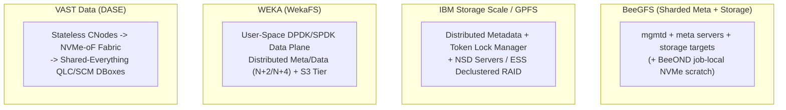

# 6.20 BeeGFS, GPFS, WekaFS and VAST

| | |
|---|---|
| Level | Intermediate |
| Priority tier | 2 |
| Lab venue | BeeGFS on 3 VMs (open source); the others are commercial |
| Part | Part 6: HPC and Slurm |
| Status | Drafted. BeeGFS configuration parameters and the component layout were read from the ThinkParQ/beegfs repository (commit `f329583`, 2026-08-19: default `beegfs-client.conf`, `beegfs-meta.conf`, `beegfs-storage.conf`, README). GPFS/Storage Scale, PanFS, WEKA and VAST are described from the *Supercomputers for Linux SysAdmins* book and general knowledge: **unverified**, vendor documentation must be consulted. Nothing was deployed. Labs **untested** |

## Why this matters for AI infrastructure

You will rarely choose a file system from scratch. More often someone will ask you to operate it, size it or compare it. A neocloud might offer WEKA or VAST, a national lab might run Lustre or GPFS, a university might run BeeGFS, and an appliance vendor might ship PanFS, now called VDURA. Each system makes different trade-offs between metadata scaling, small-file performance, operational complexity, POSIX semantics, cost and ecosystem.

The 6.19 chapter covered Lustre in depth. This chapter gives you the architecture, strengths and pitfalls of the alternatives, along with the questions to ask about each one. Keep the questions in section 1 in mind as you read, because they apply to every system here. Part 13, on AI storage, returns to these systems for AI pipelines, checkpointing and GPUDirect Storage.

## Prerequisites and outcomes

Read 6.18 and 6.19 first. When you finish this chapter, you should be able to:

- Describe the architecture of BeeGFS, GPFS/Storage Scale, PanFS, WEKA and VAST in a few sentences each, and map their components to Lustre's.
- Name the main configuration objects and commands of BeeGFS, and read its configuration files.
- Compare the systems on metadata handling, data protection, client access, RDMA and GPUDirect, tiering, multi-tenancy and cost model.
- Pick a candidate for a scenario, such as checkpoint scratch, a dataset store, home directories or mixed HPC, and list the validation tests.

## 1. A common frame

Picture a training job that runs slowly while the storage team insists the file system looks healthy. Before you can test that claim, you need a common way to describe every system. The diagram below shows how each one divides its work into parts.



Each system answers the same design questions, although its answers differ. The table lists those questions and why each one matters to a GPU cluster.

| Question | Why it matters |
|---|---|
| Where does metadata live and how does it scale (single, sharded, distributed everywhere)? | Small-file and create/stat rates, epoch-start storms |
| How is data distributed and protected (RAID on servers, replication, erasure coding, shared disk)? | Bandwidth, rebuild time, capacity efficiency, failure domains |
| How do clients access it (kernel client, FUSE, user-space client, NFS/SMB/S3 gateways)? | POSIX semantics, performance, OS/kernel support, operational friction |
| How is it deployed (software on commodity servers, appliance, managed service)? | Cost, lock-in, support |
| What media tiers (NVMe, HDD, object) and how are they managed? | Cost per TB versus per GB/s |
| Network (RDMA, TCP; GPUDirect Storage support)? | GPU data path (Part 13) |
| Multi-tenancy, quotas, snapshots, encryption, audit? | Shared AI platforms |
| Failure model and recovery | Availability during hardware failure and upgrades |

Notice that the first question, where metadata lives, controls how fast small files are created and checked. Use these eight questions as a checklist when you compare any two systems in this chapter.

## 2. BeeGFS

BeeGFS is a parallel cluster file system. It was formerly called FhGFS, it was developed at Fraunhofer, and it is now maintained by ThinkParQ. Its README describes it as "designed for very easy installation and management". It runs on ordinary Linux servers with a kernel client module, and its services are separable, so you can see each role on its own in the table below.

| Service | Role | Notes (from the repository layout and defaults) |
|---|---|---|
| **Management (mgmtd)** | Registry of nodes and targets, state, configuration; clients and servers find it via `sysMgmtdHost` | In BeeGFS 8 rewritten in Rust (`beegfs-rust`) |
| **Metadata (meta)** | Directory tree, file attributes, stripe pattern; `storeMetaDirectory` points to a fast local file system with extended attributes (`storeUseExtendedAttribs = true`) | Several metadata services can run; each directory is assigned to one, spreading the namespace across servers |
| **Storage** | File chunks on storage targets (`storeStorageDirectory`) | Targets are local file systems (XFS, ext4, ZFS) on RAID or NVMe; `tuneFileReadSize`, read-ahead parameters |
| **Client** | Kernel module `beegfs.ko` mounting at a path configured in `beegfs-mounts.conf` | `connUseRDMA = true` by default with `connTCPFallbackEnabled = true`; `connRDMABufNum`, `connRDMABufSize`; `tuneFileCacheType = buffered` (or native) |
| **CLI** | `beegfs-ctl` (classic), the new Go-based `beegfs` tool in BeeGFS 8 | Node and target listing, stripe settings, quotas, `--serverstats` |
| **Mon / helperd / fsck** | Monitoring (InfluxDB export), client helper, file system checker | |
| **BeeOND** | BeeGFS On Demand: spin up a temporary BeeGFS across the local SSDs of a job's nodes, giving a fast scratch private to the job | Good for staging datasets and checkpoints in training jobs |

Read the table as a map of the pieces you would configure. The Notes column shows where each piece matters in practice.

Four ideas tie these services together. Striping spreads a file across storage targets, and you set the pattern per directory by choosing the chunk size and the number of targets. For example, `beegfs-ctl --setpattern --chunksize=1m --numtargets=4 /mnt/beegfs/dir` sets the pattern on one directory. Storage pools group targets, such as NVMe and HDD. Buddy mirroring keeps replicated metadata and storage groups for high availability.

Quotas and ACLs round out the feature set. Newer releases also add security options. Connection authentication uses `connAuthFile = /etc/beegfs/conn.auth`, and newer releases add TLS.

BeeGFS is quick to install and operate, and its hardware can be flexible. It streams data well, supports RDMA, includes BeeOND, and a small team can run it. Practitioners also report trade-offs. Metadata scaling and small-file performance generally trail Lustre with DNE and flash-native systems. Failure handling and resyncs need care, and support depends on the commercial agreement with ThinkParQ.

Be careful with the numbers in the NVIDIA-DevOps volume-15 chapter. Its figures, "50K to 100K ops/s per metadata server" and "500 MB/s to 2 GB/s per storage node", are illustrative. Its sample `beegfs-client.conf` also contains parameters such as `tuneUseGDTLSConnPool` and similar parameters that do not appear in the default configuration file in the repository. Trust the shipped config files over a sample when you set your client configuration.

## 3. IBM Storage Scale (GPFS)

Suppose you are asked to run storage for a large HPC site where many users share one system. GPFS is one of the options you will meet there. The product is IBM Storage Scale. It was formerly called Spectrum Scale and GPFS, which stands for General Parallel File System. It is a proprietary, commercial parallel file system, common in large HPC sites and enterprises. Chapter 9 of *Supercomputers for Linux SysAdmins* covers it under the heading "GPFS/IBM Storage Scale".

GPFS was developed by IBM in 1998 and became available for Linux in 2001. IBM's architectural figures from 2013, cited in that chapter, put GPFS at 9,300 nodes and 16,386 clients. The largest installation at that time had 5,000 nodes. GPFS also supports RDMA over InfiniBand. The key ideas below come from that chapter and from general knowledge, so check IBM's documentation before you rely on them.

GPFS uses a shared-disk design. Every node in the cluster can access all of the disks, either directly or through NSD servers, where NSD stands for Network Shared Disk. There are no dedicated metadata servers. Instead, metadata is distributed across the cluster. Directory entries are indexed to speed up very large directories, and any node can act as a file system manager for certain functions.

GPFS has built-in heartbeat and quorum protocols. They let the file system keep running in degraded mode, even if a network failure splits the file system servers into two isolated subnets. Data can be duplicated across servers, so the whole file system stays alive when one server goes down. Maintenance is fully online. You can add new disks, replace a failed disk or rebalance data while the file system keeps serving jobs.

Files are wide-striped across all disks in a storage pool. GPFS uses large blocks, in the multi-MiB range, plus subblocks, so small files are handled efficiently. Storage pools and policies work together. An ILM-style policy engine moves files between pools, such as flash, HDD and tape, using rules based on age, size, name and user.

Filesets and quotas give you finer control, and snapshots are available too. AFM, which stands for Active File Management, handles caching and replication across sites. Protocol nodes export NFS, SMB and S3. For erasure coding, ESS, the Elastic Storage System, uses declustered RAID. ECE, the Erasure Code Edition, runs on commodity servers.

GPFS gives strong POSIX semantics through distributed locking, managed as token management. The same locking makes some patterns, such as small writes to a shared file, prone to contention.

Licensing needs care. Depending on how you configure a host where GPFS is installed, it acts as a GPFS server or a GPFS client, and both servers and clients must be licensed. The licences can take a significant share of the cluster budget, so plan for future expansion. Study the recommendations carefully before you format, because many GPFS parameters cannot be changed once the file system has been created.

In AI, GPFS appears mostly at very large HPC and AI centres that have IBM relationships. It is used under NVIDIA SuperPOD-class reference designs as one of the validated options, though you should verify the current support matrices.

The operations commands include `mmlscluster`, `mmlsconfig`, `mmgetstate -a`, `mmlsdisk`, `mmlsfs`, `mmcrfs`, `mmmount`, `mmlsmount`, `mmdf`, `mmlsquota`, `mmedquota`, `mmapplypolicy` and `mmhealth`. Its dependencies include a quorum of cluster manager nodes, a cluster-wide configuration repository, tiebreaker disks, and kernel-module compatibility. The portability layer is built for each kernel.

If you run GPFS, settle the licence budget and the parameter choices before you format anything.

## 4. PanFS (Panasas, now VDURA)

*Supercomputers for Linux SysAdmins*, chapter 9, describes PanFS as a hardware and software system from Panasas, now VDURA. It consists of one or more ActiveStor storage appliances plus client file system drivers. The drivers are available for Linux only.

An ActiveStor system has two kinds of nodes. Metadata and management nodes are called Directors, and object data storage nodes hold the data. The native data network is Ethernet, at 1, 10 or 25 GbE. VDURA also provides an InfiniBand router server that bridges PanFS into InfiniBand clusters, and an under-provisioned router can become a bottleneck. CIFS and NFS re-export modules are available too. You might use NFS to serve a root file system to diskless nodes, but the re-exporting gateway nodes can become a bottleneck under heavy parallel load.

You manage all volumes and access levels across several VDURA systems from one point, through `https`, an `ssh` console or a serial port. PanFS client drivers are not licensed by client count, which sets them apart from GPFS. The Linux client driver does not use `DKMS`, though, so the supported distributions and kernel versions are tightly constrained. You request kernel-specific drivers from VDURA.

Data protection works per object across nodes. Small files use RAID-1, and medium and large files use RAID-5, although you can configure this. The file system therefore stays online when a storage node goes down. Metadata is mirrored from the primary Director to a standby Director. With 3 or more metadata and management nodes, the cluster runs in full fault-tolerant mode with transparent failover.

PanFS makes one distinctive design choice. It offloads RAID checksum calculation and data caching to the client driver on the compute nodes. Checksum CPU work therefore grows with the cluster. The cost is that the compute nodes must spare a substantial amount of RAM for client system buffers.

Every Director, storage node and client needs tightly synchronised clocks. Sync the cluster nodes to the NTP server on the PanFS management node, which in turn syncs to public NTP. Budget compute-node RAM for those client buffers before you commit to PanFS.

## 5. WEKA (WekaFS) and other distributed filesystems (*Supercomputers for Linux Sysadmins* Chapter 9)

WEKA is a commercial, software-defined, NVMe-first distributed file system, and it is popular in AI and EDA work. The sources for this section are chapter 9 of *Supercomputers for Linux SysAdmins*, under the heading Other File Systems, along with general knowledge.

WEKA runs on commodity servers with NVMe. It uses user-space drivers in the SPDK and DPDK style to bypass the kernel. Clients can use a kernel or POSIX client, and WEKA also offers POSIX, NFS, SMB, S3 and GPUDirect Storage paths, along with storage tiering, namespaces, encryption and snapshots. Dedicated cores on each client and backend host run the WEKA data-plane threads, so CPU planning matters. As you plan a WEKA deployment, size those cores before you size anything else.

Metadata and data are both distributed across all backend servers, with no dedicated metadata servers. WEKA aims at high small-file and metadata performance, a flash-optimised data layout and distributed erasure coding. Its stripes are written as `N+2` or `N+4`. For example, `8+2` gives 80.0% usable efficiency and `16+2` gives 88.89%.

WEKA protects data at the file level. After a node or drive failure, it recovers actively used files first, which cuts recovery time and rebuild overhead. In cloud deployments, WEKA clusters support auto-expand and auto-shrink.

Behind the flash tier, WEKA can tier to S3-compatible object storage for capacity. It also offers snapshots, snap-to-object, filesystem groups and quotas for multi-tenancy, and encryption. Its cost model combines a software licence, priced by capacity or cores, with NVMe server hardware. WEKA is strong on performance per rack, but it is costly per TB at pure flash.

### Other Linux distributed filesystems, `CernVM-FS`, and `autofs` (*Supercomputers for Linux Sysadmins* Chapter 9)

Chapter 9 also surveys other distributed file systems that run on Linux. They include Gluster (GlusterFS), Coda, CEPH (CephFS), Hadoop HDFS, MooseFS and zFS. The zFS in this list is the IBM z/OS distributed file system, so do not confuse it with OpenZFS. The chapter warns against adopting general-purpose or non-POSIX file systems blindly for HPC and AI compute scratch. Such file systems may lack strict POSIX compliance, high-concurrency lock scaling or production stability under thousand-node load.

For specialised read-only roles, chapter 9 highlights two tools. The first is CernVM-FS, written CVMFS for short, at `https://cvmfs.readthedocs.io/en/stable/index.html`. It is an HTTP-based, aggressively cached, read-only file system. It suits software trees, local container images and static reference datasets that must reach thousands of nodes. Read-only NFS mounts of `/home` on compute nodes also fit, when jobs write only to `/scratch`.

The second tool is `autofs`, which mounts user home directories or shared exports on demand. Its maps come from LDAP or NIS. Chapter 9 recommends `autofs` on login and data-copying nodes. It advises against `autofs` on compute nodes, where static mounts verified by `HealthCheckProgram` are more predictable.

## 6. VAST Data

VAST Data's Universal Storage uses a DASE architecture, which stands for Disaggregated, Shared-Everything. It is a commercial, all-flash, scale-out system. The description below comes from general knowledge, so verify it before you rely on it.

The design separates compute from storage. Stateless compute nodes, called CNodes, run as containers. NVMe storage enclosures, called DBoxes, hold storage-class memory and QLC flash. The two sides connect through an NVMe-over-Fabrics network. Every CNode can access all of the media, so capacity and compute scale independently, and there is no data partitioning between servers.

Most HPC and AI access goes through NFS, including NFS over RDMA and multipath, `nconnect`-style client mounts. SMB, S3 and a database and analytics interface are also available. A VAST client handles multipathing, and a POSIX-like kernel client is not required. The chapter sums this up as "enterprise NAS speed with parallel-file-system bandwidth".

VAST uses global similarity-based reduction and wide erasure coding. The goal is to make QLC flash cost-efficient. VAST appears in AI factories, in reference architectures with NVIDIA, and it is used notably for dataset hosting. How well checkpoints are absorbed depends on configuration.

Ask for the configuration before you accept any checkpoint claim for VAST.

## 7. Comparison

The comparison below is qualitative and general, so check it against the versions you actually evaluate. It puts all six systems side by side, which makes the differences easy to see.

| | Lustre | GPFS / Storage Scale | BeeGFS | PanFS | WEKA | VAST |
|---|---|---|---|---|---|---|
| Licence / model | Open source; DIY or vendor-supported | Commercial software, appliances (ESS) | Open core, commercial support | Appliance (VDURA) | Commercial software on commodity | Commercial software + enclosures |
| Metadata | Dedicated MDS/MDT; DNE to scale out | Distributed | Dedicated meta services, spread by directory | Director blades | Distributed across all backends | Distributed, shared-everything |
| Data protection | Underlying RAID/ZFS, failover pairs | Declustered RAID (ESS), replication | Underlying RAID; optional buddy mirroring | Per-object RAID | Distributed EC | Wide EC |
| Client | Kernel (Linux only) | Kernel (multi-OS) | Kernel module | Kernel driver (Linux) | User-space/kernel POSIX, NFS/SMB/S3 | NFS/SMB/S3 (+RDMA) |
| Small files | Weak on HDD MDT, strong with flash MDT/DoM | Good, subblocks | Moderate | Good (flash) | Strong | Strong |
| RDMA / GDS | o2ib; GDS support in newer releases | RDMA; GDS support | RDMA (default on) | Limited | Yes | Yes (NFS RDMA) |
| Tiering | Pools, HSM | Pools, policy engine, AFM | Storage pools | Hybrid media | Flash + object | All-flash with data reduction |
| Operational skill | High | High | Low to medium | Low (appliance) | Medium | Low to medium |
| Typical fit | Large scratch for HPC and AI, national labs | Mixed HPC/enterprise, long-term data | Smaller clusters, university, BeeOND scratch | Legacy HPC appliance | AI/EDA performance tier | AI datasets, enterprise consolidation |

Read a row when you want to compare one property across the systems, and read a column when you want one system's profile. Use the table to shortlist, then test the shortlist with your own workload.

## 8. Selecting and validating

Start with the workload, because every later step depends on its numbers.

1. Characterise the workload first. Write down checkpoint size and cadence, the dataset format (shards or small files), the number of clients, the read and write mix, the metadata rate (creates and stats per second), latency sensitivity and POSIX needs. Use the arithmetic from 6.18.
2. Shortlist by constraints. Consider the budget model, which may be a capex appliance, software plus hardware, or a managed service. Then weigh existing skills, support, the ecosystem of reference architectures from the GPU vendor, the network and its RDMA fabric, data protection requirements and multi-tenancy.
3. Prove it on your own pipeline. Run `fio` for bandwidth, IOPS, latency and mixed workloads. Run `IOR` for a shared file and for file-per-process I/O. Run `mdtest` for metadata. Then run an AI-realistic read job, using your data loader on your dataset format, and a checkpoint job that does synchronised all-rank writes at your target size. Run all of them at the intended client count. While the load runs, test the failure modes: kill a server, pull a drive, and upgrade.
4. Total up the cost. Count capacity, performance per GB/s, power and rack space, licences per client or core, support, growth steps and data egress.
5. Plan for tiers. Even the fastest system is rarely the only tier. Combine it with local NVMe, object storage and NFS for home directories, as section 8 of 6.18 describes.

### 8.1 The AI data path: GPUDirect Storage (`GDS`) and NVMe staging (Volume 15)

Across all five parallel and scale-out file systems (Lustre, GPFS, BeeGFS, WEKA, and VAST over NFS-RDMA), feeding 8 H100 or B200 GPUs per node at wire speed means bypassing the host CPU page-cache bounce path. The source for this material is `nvidia-zero-to-hero/volume-15`, chapters 1 to 12 and labs 1 to 4.

The legacy buffered I/O path crosses PCIe twice and adds 2.0x host DRAM bounce traffic. A standard POSIX `read()` copies data from the local NVMe drive or the RDMA storage NIC across PCIe into the Linux kernel page cache in host DRAM. It copies the data again into a user-space CPU buffer, then calls `cudaMemcpyHostToDevice` across PCIe into GPU HBM. For every 100.0 GB loaded to the GPUs, the host generates 200.0 GB of DRAM read and write traffic. Host CPU cores and NUMA interconnects become the bottleneck.

GPUDirect Storage cuts out that bounce. With `nvidia-fs.ko` loaded and a GDS-enabled file system, the storage NIC or NVMe controller performs peer-to-peer DMA directly into GPU `BAR1` HBM memory, through `cuFileRead` and `cuFileWrite`. That is one PCIe crossing and 0.0 GB of host DRAM bounce traffic. The file systems that can use this path include Lustre, GPFS, WEKA, VAST NFS-RDMA, BeeGFS, and local NVMe with `ext4` or `XFS` in `O_DIRECT` mode. You can validate the path with `/usr/local/cuda/gds/tools/gdscheck -p` and benchmark it with `gdsio`.

Check the GDS path with `gdscheck` before you benchmark the file system on top of it.

## 9. Lab (self-checking efficiency & GDS lab tested; VM cluster parts untested)

Start with the self-checking Python lab, which runs on your own machine. It checks four things. It verifies erasure-coding usable capacity for RAID-1 at 50.0%, `8+2` at 80.0%, `16+2` at 88.89% and VAST-style wide `146+4` stripes at 97.33%. It checks the PCIe and host DRAM bounce-buffer math for GPUDirect Storage (`GDS`), where a 100.0 GB read drops from 200.0 GB to 0.0 GB of host DRAM traffic. It also checks the GPFS scale limits from chapter 9 of *Supercomputers for Linux SysAdmins*, which are 9,300 nodes, 16,386 clients and a 5,000-node install. Last, it checks the PanFS Ethernet rates of 1, 10 and 25 GbE. Read each result as a check you can repeat yourself, not as a claim you have to take on trust.

```bash
python3 code/part06/parallel_fs_compare_lab.py
```

The rest of the lab runs on a 3-VM testbed, where BeeGFS is open source. Work through these steps in order.

1. Install the BeeGFS management service, one metadata service, two storage services and a client on small VMs. Read `beegfs-meta.conf` and `beegfs-storage.conf`, then mount the client.
2. Create a directory and set a stripe pattern of 4 targets and 512k chunks. Write a large file, then inspect it with `beegfs-ctl --getentryinfo`.
3. Run `fio` and `iomix.py` (from 6.18) against BeeGFS and against an NFS export on the same VMs. Compare the data rates and the metadata rates.
4. Disable `connUseRDMA` or `connTCPFallbackEnabled` on a lab with Soft-RoCE, so you can see the transport selection logs.
5. Try BeeOND on two nodes, using their local disks as a job-private scratch.
6. Write a comparison worksheet for two candidate file systems for a hypothetical 1,024-GPU cluster. Use the questions in section 1, and list the validation tests you would run.

Finish the first three steps before you rely on any number this lab produces.

## 10. Interview angles

Use these questions to test yourself. Each one can be answered from this chapter.

- Compare Lustre, GPFS, BeeGFS, WEKA and VAST for a new 2,000-GPU training cluster.
- What is BeeOND and when is it useful?
- Why is metadata the usual differentiator for AI data loading?
- What does "disaggregated, shared-everything" mean in VAST's architecture?
- What does user-space IO give WEKA and what does it cost?
- How would you validate a vendor's performance claims before purchase?
- What happens to throughput during a drive failure or rebuild in each system?
- Which file system fits a university cluster of 200 nodes with a two-person admin team?

Pick two of these and answer them out loud before you start the Exercises.

## Exercises

Each exercise asks you to explain a number or a design choice from this chapter, and you should be able to answer it without looking at the answer. Start with exercise 1, since it needs only the Python lab.

1. Compare erasure coding efficiency across parallel file systems. Run `python3 code/part06/parallel_fs_compare_lab.py`. Using `erasure_coding_efficiency(d, p)`, compare usable raw-to-effective capacity across RAID-1 or buddy mirroring (1+1 = 50.0%), standard 8+2 RAID-6 or EC (80.0%), 16+2 distributed EC (88.89%), and VAST-style wide 146+4 stripes (97.33%). Then explain the trade-off in failure domain size and rebuild network traffic.
2. Quantify GPUDirect Storage (`GDS`) against host page-cache bounce buffering, using the lab. Trace the GPUDirect Storage difference in host DRAM copies. Use `pcie_host_dram_copies(100.0, use_gds)` in `code/part06/parallel_fs_compare_lab.py`. Explain why reading 100.0 GB of checkpoint or dataset tensors through traditional POSIX buffered I/O generates 200.0 GB of host DRAM read and write traffic and 2 PCIe root-complex crossings. Then explain why `cuFileRead` with `nvidia-fs.ko` makes one direct peer-to-peer DMA transfer into GPU BAR1 memory, with 0.0 GB of host DRAM bounce traffic.
3. Configure BeeGFS striping, RDMA transport and BeeOND ephemeral scratch. Write the `beegfs-ctl --setpattern --chunksize=1m --numtargets=4 /mnt/beegfs/dir` command. Explain the role of `sysMgmtdHost`, of `storeMetaDirectory` with `storeUseExtendedAttribs = true`, of `storeStorageDirectory`, of `connUseRDMA = true`, of `connTCPFallbackEnabled = true` and of `connAuthFile = /etc/beegfs/conn.auth`. Finally, explain how BeeOND aggregates the local NVMe drives of compute nodes into a per-Slurm-job parallel scratch file system.
4. Contrast the metadata and high-availability models of IBM Storage Scale (GPFS) and Lustre, using chapter 9 of *Supercomputers for Linux SysAdmins*. For GPFS, cover NSDs, distributed metadata with directory indexing, the token lock manager, quorum and heartbeat that survive a subnet split, online disk rebalancing, per-server and per-client licensing, and the 9,300-node and 16,386-client scale. For Lustre, cover MGS, dedicated MDS and MDTs with DNE, OSS and OSTs, and open-source kernel modules. Then explain how the two structures differ.
5. Compare how PanFS, WEKA and VAST Data handle metadata scaling and node failures. For PanFS, cover Directors plus object storage nodes, RAID-1 for small files and RAID-5 for large files, and client-side RAID checksum offload. For WEKA, cover user-space DPDK and SPDK cores on clients and backends, distributed metadata and data, active-file-first rebuilds, and S3 tiering. For VAST Data, cover DASE stateless CNodes over NVMe-oF to shared-everything DBoxes, plus multipath NFS-RDMA and S3.
6. Design a storage acceptance benchmark suite with `fio`, `IOR`, `mdtest` and `gdsio`. Write a 5-stage pre-purchase acceptance test plan for a 1,024-GPU AI cluster. The plan covers (a) `IOR` N-to-1 and N-to-N synchronous checkpoint bursts, (b) `mdtest` directory sharded against single-directory small-file creation and stat rates, (c) `gdsio` GPUDirect Storage verification with `gdscheck -p`, (d) `CernVM-FS` or `.sqsh` 1,000-rank import storm testing, and (e) degraded-mode throughput during an active storage server kill.

## Checkpoint

Answer each question in your own words first, then open the answer to check yourself. For example, if you are asked how BeeGFS handles metadata, question 2 has the answer you need.

<details>
<summary>1. Name the four core daemon services of BeeGFS, what changed in BeeGFS 8, and what BeeOND is.</summary>

- `beegfs-mgmtd`, the Management service, keeps the central registry of nodes, targets and pools. It was rewritten in Rust in BeeGFS 8, alongside the new Go-based `beegfs` CLI.
- `beegfs-meta` is the metadata service. It stores directory trees, file attributes and stripe patterns, through `storeMetaDirectory` with `storeUseExtendedAttribs = true`.
- `beegfs-storage` is the storage service. It stores striped file chunks in `storeStorageDirectory`.
- `beegfs-client`, which is the kernel module `beegfs.ko`, is the client. It runs with `connUseRDMA = true` and `connTCPFallbackEnabled = true`.
- `BeeOND`, which stands for BeeGFS On Demand, spins up an ephemeral, job-private BeeGFS file system. It uses the local NVMe drives of the nodes allocated to a Slurm job, and it tears the file system down in the job epilog.
</details>

<details>
<summary>2. How does BeeGFS distribute metadata across servers compared to Lustre and GPFS?</summary>

BeeGFS runs multiple `beegfs-meta` services and assigns each directory to one specific metadata server. The directory tree spreads across servers automatically, without a single metadata bottleneck. Lustre takes a different route, with dedicated `MDT`s that are partitioned explicitly or hash-striped through `DNE`. GPFS distributes metadata across all cluster nodes and has no dedicated metadata server role.
</details>

<details>
<summary>3. What do `connUseRDMA`, `connTCPFallbackEnabled`, and `connAuthFile` control in `beegfs-client.conf`?</summary>

`connUseRDMA = true` enables native InfiniBand or RoCE RDMA transport between clients and the metadata and storage servers. `connTCPFallbackEnabled = true` lets the client fall back to TCP sockets if RDMA connection setup fails. During acceptance testing, disable it, so an RDMA misconfiguration does not hide behind slow TCP. `connAuthFile = /etc/beegfs/conn.auth` points to a shared secret file. It authenticates the BeeGFS daemons and clients, which prevents unauthorised mounts.
</details>

<details>
<summary>4. How does IBM Storage Scale (GPFS) differ structurally from Lustre, according to chapter 9 of *Supercomputers for Linux SysAdmins*?</summary>

GPFS was developed by IBM in 1998 and came to Linux in 2001. It uses a shared-disk architecture built on NSDs, which are Network Shared Disks. Metadata is distributed across the cluster, so there are no dedicated MDS or MDT servers. Directories are indexed for large file counts. Files are wide-striped across all disks in a pool, using large blocks, with subblocks for small files. Built-in heartbeat and quorum protocols keep the file system online even when the network splits it across two subnets.
</details>

<details>
<summary>5. What scale figures, online maintenance capabilities, and licensing rules does chapter 9 note for GPFS?</summary>

- Scale: up to 9,300 nodes and 16,386 clients. The largest installation in IBM's 2013 figures had 5,000 nodes.
- Online maintenance: you can add disks, replace bad disks and rebalance data without unmounting the file system or stopping jobs.
- Licensing: GPFS servers and GPFS clients both need commercial licences. Many file system creation parameters, set with `mmcrfs`, cannot be changed after creation.
</details>

<details>
<summary>6. What are GPFS Filesets, the ILM Policy Engine (`mmapplypolicy`), AFM, and ESS / ECE?</summary>

- Filesets are independent namespace subtrees inside a GPFS file system. Each one supports its own inode space, quotas and snapshots.
- The ILM Policy Engine, run with `mmapplypolicy`, is rule-based. It moves files between NVMe flash, HDD and tape pools, based on age, size or path.
- AFM, which stands for Active File Management, provides asynchronous caching and replication across sites over WANs.
- ESS stands for Elastic Storage System, and ECE stands for Erasure Code Edition. Both provide declustered RAID and network erasure coding across storage nodes.
</details>

<details>
<summary>7. Describe the architecture of PanFS (Panasas / VDURA) and how it protects small versus large files, according to chapter 9.</summary>

PanFS is an appliance-based parallel file system built on ActiveStor. It combines Director nodes, which handle metadata and management, with object storage nodes. The Directors are mirrored from a primary to a standby, or clustered across $\ge 3$ Directors. Clients use the Linux DirectFlow client over 1, 10 or 25 GbE, and optional InfiniBand router nodes are available. PanFS protects data at the object level across nodes. It uses RAID-1 for small files and RAID-5 for medium and large files.
</details>

<details>
<summary>8. What is unique about PanFS client licensing, kernel driver packaging, and RAID checksum calculation, according to chapter 9?</summary>

1. Client licensing: PanFS client drivers are not licensed per client, unlike GPFS.
2. No DKMS: the Linux client module does not use DKMS, so compute nodes must run kernel versions that VDURA explicitly supports.
3. Client-side checksum offload: the compute-node client driver calculates RAID parity checksums and caches data in client RAM. Checksum CPU work scales with the compute fleet, but the cost is host RAM.
</details>

<details>
<summary>9. How does WEKA (WekaFS) achieve low latency and high small-file IOPS on commodity NVMe servers?</summary>

WEKA runs a user-space data plane. DPDK- or SPDK-style polling threads are pinned to dedicated CPU cores on both the storage servers and the compute clients. These threads bypass the Linux kernel networking and block stacks. Metadata and data are both distributed across all NVMe backend nodes, using distributed erasure coding at `N+2` or `N+4`.
</details>

<details>
<summary>10. What two operational advantages of WEKA does chapter 9 highlight for failure recovery and cloud deployments?</summary>

1. Active-file-first recovery: because WEKA protects data at the file level, it rebuilds actively used files first after a failure. That keeps job impact and recovery time low.
2. Cloud elasticity: in cloud deployments, WEKA supports auto-expand and auto-shrink, alongside transparent tiering to S3 object storage.
</details>

<details>
<summary>11. What does DASE (Disaggregated, Shared-Everything) mean in VAST Data's architecture?</summary>

VAST separates stateless, containerized protocol and compute servers, called CNodes, from high-density NVMe flash and SCM enclosures, called DBoxes. The two sides connect over an internal NVMe-oF (NVMe-over-Fabrics) network. Every CNode can read and write every DBox directly, which is what shared-everything means. Data has no owner node. VAST protects data with wide erasure coding, such as 146+4 at 97.33% efficiency, and applies global similarity data reduction.
</details>

<details>
<summary>12. How do compute nodes mount VAST Data compared to Lustre, GPFS, or BeeGFS?</summary>

Compute nodes don't need a custom proprietary kernel file system module such as `lustre.ko`, `mmfs` or `beegfs.ko`. VAST mainly exposes standard NFSv3 or NFSv4.1 over RDMA, with `proto=rdma`, plus `nconnect` or multipath client drivers. It also offers native S3 and SMB. Standard Linux NFS-RDMA semantics deliver parallel-file-system aggregate bandwidth through this path.
</details>

<details>
<summary>13. Compare the legacy buffered storage read path with GPUDirect Storage (`GDS`, `cuFile`, `nvidia-fs.ko`).</summary>

- Legacy buffered read: data goes from the storage NIC or NVMe through PCIe into the Linux kernel page cache in host DRAM. The CPU copies it to a user buffer, and `cudaMemcpy` carries it over PCIe to GPU HBM. The path makes 2 PCIe root crossings and generates 200 GB of host DRAM traffic per 100 GB payload.
- GPUDirect Storage (`GDS`): the NIC or NVMe sends data by peer-to-peer DMA, through `nvidia-fs.ko` and `cuFileRead`, straight into GPU `BAR1` HBM. It crosses PCIe once and generates **0.0 GB** of host DRAM bounce traffic.
</details>

<details>
<summary>14. Which tools verify that GPUDirect Storage (`GDS`) is installed correctly and measure its throughput?</summary>

- Configuration and driver check: `/usr/local/cuda/gds/tools/gdscheck -p` verifies `nvidia-fs.ko`, the IOMMU and ACS settings, and the registered file systems.
- Throughput and IOPS benchmark: `/usr/local/cuda/gds/tools/gdsio` compares `-x 0`, the GDS direct mode, against `-x 1` and `-x 2`, the CPU bounce modes.
</details>

<details>
<summary>15. When is `CernVM-FS` (`CVMFS`) or read-only NFS preferable to a heavy parallel file system, according to chapter 9?</summary>

When you distribute read-only software stacks, Conda environments, container images or static reference datasets to thousands of compute nodes. CVMFS caches immutable content aggressively on node-local disks, reached over HTTP proxies. That completely eliminates parallel-file-system metadata lock contention.
</details>

<details>
<summary>16. Where does chapter 9 recommend enabling `autofs`, and where does it advise against it?</summary>

Enable `autofs` on login nodes and data-transfer nodes, so user home directories or project shares mount on demand. Avoid `autofs` on batch compute nodes. There, static mounts verified by `Prolog` and `HealthCheckProgram` prevent automount races and timeouts in the middle of a job.
</details>

<details>
<summary>17. Compare the usable capacity efficiency of RAID-1 (buddy mirroring), 8+2 RAID-6 or EC, 16+2 distributed EC, and 146+4 wide EC, using `code/part06/parallel_fs_compare_lab.py`.</summary>

$$\text{Efficiency} = \frac{D}{D + P}$$
- **`1+1` (`RAID-1` / buddy mirror):** $1 / 2 = \mathbf{50.00\%}$
- **`8+2` (`RAID-6` / EC):** $8 / 10 = \mathbf{80.00\%}$
- **`16+2` (WEKA-style EC):** $16 / 18 = \mathbf{88.89\%}$
- **`146+4` (VAST-style wide EC):** $146 / 150 = \mathbf{97.33\%}$
</details>

<details>
<summary>18. Which of the six file systems (Lustre, GPFS, BeeGFS, PanFS, WEKA, VAST) are open source, and which need dedicated metadata server roles?</summary>

- Open source or open core: Lustre is open source under GPL, and BeeGFS is open core, with its source in `ThinkParQ/beegfs`. GPFS, PanFS, WEKA and VAST are commercial, proprietary systems.
- Dedicated metadata server roles: Lustre has MDS and MDT roles, BeeGFS has `beegfs-meta`, and PanFS has Director blades. GPFS, WEKA and VAST distribute metadata across storage and compute nodes, with no dedicated metadata-only servers.
</details>

<details>
<summary>19. Which four standard benchmark tools validate block or streaming bandwidth, parallel shared and per-process I/O, metadata IOPS, and GDS paths before you accept a cluster file system?</summary>

1. `fio` measures raw sequential and random bandwidth, IOPS and tail latency.
2. `IOR` measures parallel MPI-IO streaming read and write throughput, for N-to-1 (a shared file) and N-to-N (a file per process). It emulates synchronous all-rank checkpoints.
3. `mdtest` measures parallel file and directory create, stat, read and remove operations per second.
4. `gdsio` measures GPUDirect Storage DMA throughput from storage into GPU HBM.
</details>

<details>
<summary>20. Match each cluster scenario to its best-fit file system candidate: (a) a 200-node university cluster with a 2-person admin team and local NVMe scratch, (b) a 10,000-node national lab scratch system, and (c) an enterprise AI factory consolidating NFS/S3 datasets on all-flash QLC.</summary>

- (a) For the 200-node university cluster, choose BeeGFS. It offers fast setup and low operational overhead, and BeeOND adds job-local NVMe scratch.
- (b) For the 10,000-node national lab scratch system, choose Lustre or IBM Storage Scale (GPFS). Either one scales aggregate bandwidth across hundreds of OSS or NSD servers.
- (c) For the all-flash enterprise AI dataset and NFS/S3 consolidation, choose VAST Data, or WEKA if you need the lowest-latency POSIX access with S3 tiering.
</details>

## Sources and review notes

- BeeGFS: `ThinkParQ/beegfs` repository (README, default configuration files `beegfs-client.conf`, `beegfs-meta.conf`, `beegfs-storage.conf`, component layout) at commit `f329583`.
- GPFS/IBM Storage Scale (`1998` origin, `2001` Linux support, `2013` figures of `9,300` nodes, `16,386` clients, and `5,000` install, distributed metadata, heartbeat/quorum across split subnets, online disk addition/replacement/rebalance, server + client licensing), PanFS / VDURA (`ActiveStor` Directors and storage nodes, `1, 10, 25 GB` Ethernet + IB router, single-point `https`/`ssh`/serial admin, `RAID-1` small / `RAID-5` large files, client-side checksum offload, no per-client license, no `DKMS`), and Other File Systems (`WEKA` active-file-first recovery and cloud auto-expand/auto-shrink, `Gluster`, `Coda`, `CEPH`, `Hadoop HDFS`, `BeeGFS`, `MooseFS`, `zFS` vs `ZFS`, `CernVM-FS` `https://cvmfs.readthedocs.io/en/stable/index.html`, and `autofs`): read in full from *Supercomputers for Linux SysAdmins* (`supercomputers-for-linux-sysadmins-managing-modern-hpc-clusters-and-supercomputers-from-software-to-hardware`, *Supercomputers for Linux Sysadmins*) Chapter 9 ("9. Network File Systems").
- AI storage data path, local NVMe staging, GPUDirect Storage (`GDS` / `cuFile` / `nvidia-fs.ko`), BeeGFS framing, checkpointing, metadata/small-files, and validation labs: migrated from `nvidia-devops` (`nvidia-zero-to-hero/volume-15/index.md`, `nvidia-zero-to-hero/volume-15/chapter-01-why-ai-storage-is-different.md`, `nvidia-zero-to-hero/volume-15/chapter-02-the-ai-data-path-from-storage-to-gpu.md`, `nvidia-zero-to-hero/volume-15/chapter-03-local-nvme-and-data-staging.md`, `nvidia-zero-to-hero/volume-15/chapter-04-gpudirect-storage-architecture.md`, `nvidia-zero-to-hero/volume-15/chapter-05-lustre-for-ai-and-hpc.md`, `nvidia-zero-to-hero/volume-15/chapter-06-beegfs-for-gpu-clusters.md`, `nvidia-zero-to-hero/volume-15/chapter-07-object-storage-and-dataset-pipelines.md`, `nvidia-zero-to-hero/volume-15/chapter-08-checkpoint-architecture-and-recovery.md`, `nvidia-zero-to-hero/volume-15/chapter-09-metadata-small-files-and-data-loading.md`, `nvidia-zero-to-hero/volume-15/chapter-10-capacity-performance-and-cost-planning.md`, `nvidia-zero-to-hero/volume-15/chapter-11-production-troubleshooting.md`, `nvidia-zero-to-hero/volume-15/chapter-12-volume-15-summary.md`, `nvidia-zero-to-hero/volume-15/labs/lab-01-baseline-an-ai-storage-path.md`, `nvidia-zero-to-hero/volume-15/labs/lab-02-benchmark-local-nvme-and-shared-storage.md`, `nvidia-zero-to-hero/volume-15/labs/lab-03-validate-a-gpudirect-storage-design.md`, and `nvidia-zero-to-hero/volume-15/labs/lab-04-troubleshoot-checkpoint-and-data-loading-bottlenecks.md`).
- Run here: `python3 code/part06/parallel_fs_compare_lab.py` (3 passed, 0 failed).
- Explicitly labelled inferences: `erasure_coding_efficiency` and `pcie_host_dram_copies` in `code/part06/parallel_fs_compare_lab.py` are deterministic teaching models of erasure coding overhead and GDS host-DRAM bounce elimination.
- Not verified on live hardware: commercial product licensing/pricing, BeeGFS 8 live performance, GPFS `mm*` CLI commands, and VAST/WEKA proprietary internals (`untested here`).
