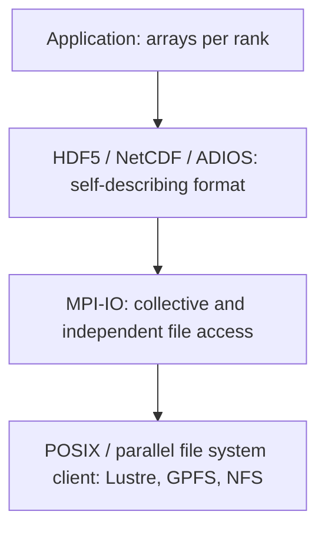

# 6.21 Parallel I/O and checkpoint patterns

| | |
|---|---|
| Level | Advanced |
| Priority tier | 2 |
| Lab venue | Laptop (PyTorch CPU, gloo) for the demos; a cluster with Lustre/GPFS/NVMe for performance tests |
| Part | Part 6: HPC and Slurm |
| Status | Drafted. **Run**: `code/part06/dcp_reshard.py` (PyTorch 2.14.1 `torch.distributed.checkpoint`, gloo, 4 ranks saving, 2 and 1 ranks loading) and `ckpt_atomic.py` (crash-safe commit with simulated crashes). Not run: MPI-IO/HDF5 (multi-rank MPI hangs in this sandbox, see 6.4), any parallel file system, any GPU. Performance statements are general knowledge or arithmetic |

## Why this matters for AI infrastructure

Training at scale is a long sequence of fast compute phases punctuated by I/O: reading data, and periodically writing state so that a failure costs minutes rather than days. Checkpoint design decides how much GPU time is lost on every save, how quickly a run recovers after a failure, whether a crash can corrupt the only good checkpoint, and whether you can resume on a different number of GPUs. The HPC world solved the shared-file and collective-write problems with MPI-IO and HDF5; AI frameworks re-implemented the ideas (sharded distributed checkpoints, asynchronous staging). This chapter covers both and gives you tested building blocks.

## Prerequisites and outcomes

Needs 6.4, 6.18, 6.19, Part 14 basics (parallelism strategies). After this chapter you can:

- Explain independent versus collective I/O, MPI-IO views and hints, HDF5 parallel patterns, and why alignment with stripes matters.
- Compare checkpoint layouts: file-per-process, single shared file, sharded distributed checkpoints, node-local plus drain, and in-memory replicas.
- Demonstrate and explain resharding (saving on N ranks, loading on M).
- Implement a crash-safe commit protocol with manifests, checksums and atomic rename; validate checkpoints on restart.
- Budget checkpoint time and overhead; reduce stall with asynchronous and tiered designs.
- Design the data-loading side: sharded datasets, prefetch, worker counts, caching.

## 1. Parallel I/O in HPC: MPI-IO and HDF5

*Parallel and High Performance Computing* (PHPC, chapter 16) presents the standard stack. Layers from the application down:



**MPI-IO** lets all ranks of a communicator open one file and read/write their portions:

- `MPI_File_open`, `MPI_File_set_view` (each rank sees only its part of the file through a *view* built from derived datatypes), `MPI_File_write_at`/`write` (independent), `MPI_File_write_all`/`write_at_all` (**collective**), non-blocking variants, `MPI_File_sync`, `MPI_File_close`.
- **Collective buffering (two-phase I/O)**: instead of every rank issuing small scattered writes, the library gathers data to a few **aggregator** ranks that write large contiguous blocks aligned to stripes; this converts many small noncontiguous requests into few large ones, usually a big win on parallel file systems. **Data sieving** does the same for independent noncontiguous access (read a big block, pick the pieces).
- **Hints** (`MPI_Info`): `cb_nodes` (aggregator count), `cb_buffer_size`, `romio_cb_read/write` (`automatic`/`enable`/`disable`), `romio_ds_read/write`, `striping_unit`, `striping_factor`. The PHPC book shows how to print them with `ROMIO_PRINT_HINTS=1` (Cray: `MPICH_MPIIO_HINTS_DISPLAY=1`, `MPICH_MPIIO_STATS=1`), and its sample output reports `romio_filesystem_type = NFS:`, `cb_nodes = 1`, `striping_unit = 4194304`, a good reminder to check that the library recognises your file system; wrongly detected file systems get poor defaults.
- **HDF5** adds structure: datasets, attributes, chunking, compression; parallel HDF5 uses MPI-IO underneath (`H5Pset_fapl_mpio`, collective data transfer with `H5Pset_dxpl_mpio(H5FD_MPIO_COLLECTIVE)`, collective metadata `H5Pset_coll_metadata_write`/`H5Pset_all_coll_metadata_ops`). Chunk size should match access patterns and stripe size. Also **NetCDF-4**, **ADIOS2** (staging and burst-buffer friendly), and for AI: safetensors, Arrow/Parquet, WebDataset tar shards, Zarr.

Why it matters for AI: the same issues recur. N ranks writing disjoint regions of one file need alignment and collective aggregation to avoid lock thrash; file-per-rank avoids locks but explodes metadata. Frameworks hide this, but their performance still obeys these rules.

### Alignment rules of thumb

1. Make write block sizes multiples of the file system's stripe size (Lustre `stripe_size`, 6.19) and align offsets; avoid two ranks touching the same stripe.
2. Use few, large writes (MiB scale) rather than many small ones; buffer in memory.
3. Set the stripe count for shared files high enough that aggregate bandwidth covers all aggregators; set it low (1) for file-per-process outputs.
4. Prefer collective I/O for noncontiguous patterns; independent I/O only for tiny, rare operations (headers).
5. Keep metadata operations (open/close/stat) off the critical path: open once, close once; aggregate small outputs into one file per node or per job.

## 2. Checkpoint layouts

A training checkpoint is the model weights plus optimiser state plus bookkeeping (step, RNG, data position, learning-rate schedule). At scale each rank holds only a shard (FSDP/ZeRO/tensor-pipeline parallel). Layout options:

| Layout | Description | Pros | Cons |
|---|---|---|---|
| **Rank-0 gather** | Gather all state to rank 0, write one file | Simple; one file | Rank 0 memory and network bottleneck; does not scale beyond small models |
| **File per rank** | Each rank writes its shard to its own file | No lock contention; parallel by construction | Many files (metadata), load requires the same parallel layout unless resharded; directory size |
| **Shared file, collective** | All ranks write regions of one file via MPI-IO/HDF5 | One logical file, topology-independent layout | Needs alignment and collective support; contention risk |
| **Sharded distributed checkpoint** (PyTorch DCP, Megatron dist-ckpt, DeepSpeed, NeMo) | Each rank writes its shards in parallel plus a metadata file describing the global layout | Parallel writes, **reshardable** on load, good tooling | Framework-specific; metadata file must be consistent |
| **Node-local then drain** | Write fast to local NVMe or host memory, then asynchronously copy to shared storage/object store | Minimal GPU stall; shared storage load smoothed | Local copy is lost if the node dies before draining; needs cleanup and tracking |
| **In-memory replicas** (buddy checkpoints) | Keep copies in peer-node memory for fast recovery from single-node failure | Seconds to recover from common failures | Memory cost; not durable against multi-node failure; complexity |
| **Differential / incremental** | Save only changes or only optimiser state less often | Smaller | Restore complexity |

Real systems combine these: frequent cheap in-memory or local-NVMe checkpoints, less frequent durable sharded checkpoints to the parallel file system, occasional exports to object storage for archival and for evaluation.

### Tested: sharded checkpoint and resharding

`code/part06/dcp_reshard.py` shards an 8x3 tensor across 4 ranks with `DTensor` (`Shard(0)`), saves it with `torch.distributed.checkpoint.save`, then loads it into 2 ranks and into 1 rank. Run through the `fake_srun.py` harness from 6.12 (gloo backend, CPU, PyTorch 2.14.1):

```text
rank 0/4: saved shard (2, 3)     ... (each of 4 ranks saved its 2 rows)
files written: __0_0.distcp  __1_0.distcp  __2_0.distcp  __3_0.distcp   (plus a .metadata file)
--- load with 2 ranks (resharding 4 -> 2)
rank 0/2: loaded shard (4, 3) reassembled_equal=True
rank 1/2: loaded shard (4, 3) reassembled_equal=True
--- load with 1 rank
rank 0/1: loaded shard (8, 3) reassembled_equal=True
```

What it shows: DCP writes one file per rank (data) plus global metadata describing which slice of which tensor lives where; on load each rank reads exactly the slices it needs, even if the number of ranks changed. That makes it possible to restart a job on fewer or more GPUs after a failure or to load a training checkpoint into an evaluation job. (The `gloo` first attempt failed with "Numpy is not available" until `numpy` was installed in the virtual environment: DCP's object gathering needs it. Worth a line in a runbook.) The file system sees one large file per rank per checkpoint: good bandwidth, but with 4,096 ranks that is 4,096 files per checkpoint, so organise one directory per step and consider node-level aggregation.

### Tiering and asynchrony

Checkpoint stall = time for the slowest rank to write its shard to the destination. Reduce it by (a) writing to local NVMe or pinned host memory first (copy GPU to host is fast), then letting a background thread/process drain to shared storage while training continues (**asynchronous checkpointing**; PyTorch DCP offers async save APIs, Megatron and others have their own), (b) staggering or bounding concurrent writers if the file system chokes on a synchronised burst, (c) compressing carefully (CPU cost versus bytes), (d) checkpointing less state (e.g. weights only for frequent saves), (e) overlapping with a non-critical phase. Arithmetic from 6.18: a 70B model's training checkpoint is about 1 TB; at 16 GB/s it takes about a minute, at 160 GB/s about six seconds.

Trade-off to quantify: expected lost work = half the checkpoint interval per failure (on average) plus restart time. With failure rate lambda per hour for the whole job (grows with GPU count), the interval that minimises overhead follows the Young/Daly approximation, `T_opt ~ sqrt(2 * C * MTBF)` where `C` is the checkpoint cost and MTBF the job's mean time between failures (general result; use it as a starting point). A 1-minute checkpoint cost and a 6-hour MTBF give an interval near 27 minutes.

## 3. Crash-safe commits (tested)

A checkpoint that is half written when the job dies must never be mistaken for a good one, and a crash during commit must not destroy the previous good checkpoint. POSIX gives one atomic primitive across files: `rename` within a file system. `code/part06/ckpt_atomic.py` implements the protocol:

1. Each rank writes shards into `step-N.tmp/` and `fsync`s them.
2. The coordinator records a SHA-256 per shard in `MANIFEST.json`, `fsync`s it.
3. Atomic `rename step-N.tmp -> step-N`, then `fsync` the parent directory.
4. Atomically update a `latest` pointer (write temp, rename over).
5. On restart, **do not trust `latest` alone**: scan for the newest directory that has a manifest and whose shard hashes verify.

The self-test simulates crashes and corruption (4 ranks x 64 KiB shards):

```text
step 100: committed                latest pointer=step-100  newest_valid=step-100
step 200: CRASH (before_rename)    latest pointer=step-100  newest_valid=step-100
step 300: CRASH (before_latest)    latest pointer=step-100  newest_valid=step-300
step 400: committed                latest pointer=step-400  newest_valid=step-400
after corrupting step-400/shard-2: newest_valid=step-300
```

Reading it: a crash before the rename leaves only a `.tmp` directory, ignored by readers; a crash after the rename but before the pointer update leaves the pointer stale while a complete newer checkpoint exists (the scan finds `step-300`); a corrupted shard is detected by the hash and the loader falls back to the previous valid checkpoint. Real deployments add: distributed barrier before the coordinator commits, checksums computed by each rank (not re-read by one process for TB-scale data), manifest versioning (framework, parallel layout, tensor shapes, dtype, git commit, data position), retention (keep last K plus periodic milestones), and verification jobs that load a checkpoint into a smaller test model. On object stores without atomic rename, use a final manifest object written last (the manifest's existence defines commit) and versioned prefixes. Caveats: `rename` atomicity holds on local file systems and Lustre/GPFS within one directory tree; NFS semantics are weaker (close-to-open consistency, 6.18) and cloud object stores differ; always test on your storage.

## 4. Restart and validation

- **Resume logic** must restore model, optimiser, learning-rate scheduler, RNG state, dataloader position (or accept a new shuffle), gradient scaler, and the step counter; test bitwise or statistical equivalence on a small run (train 100 steps, checkpoint, resume 100 more, compare loss with an uninterrupted run).
- **Detect silent corruption**: hash verification, tensor shape/dtype checks on load, NaN/Inf scan, loss continuity check after restart (a spike indicates a bad checkpoint or lost optimiser state).
- **Failure drills**: kill a rank, kill a node, fill the disk, kill during save; confirm automatic recovery within the target time (Part 17).
- **Elastic restarts**: with resharding-capable checkpoints the job can resume on fewer nodes while waiting for repairs; keep global batch size semantics consistent.
- **Slurm integration**: `--requeue`, `--signal` and the dependency patterns of 6.11; ensure the SIGTERM handler triggers an emergency checkpoint only if it can finish within the grace window.

## 5. Data loading

The read side in brief (Part 13 expands):

- Store datasets as **large shards** (hundreds of MB to GB) in formats supporting streaming (WebDataset tar, TFRecord, Arrow/Parquet, MDS, Zarr). Avoid millions of tiny files (metadata storms, 6.18).
- **Shuffling**: shuffle shard order plus a bounded in-memory shuffle buffer; avoids random access over the whole dataset.
- **Parallel workers**: `DataLoader(num_workers=N, prefetch_factor=K, pin_memory=True, persistent_workers=True)` hides I/O and decode latency; set N from CPUs per GPU (6.12 binding), watch for oversubscription; `DistributedSampler` (or equivalent) gives each rank unique data. Each worker process holds its own file handles and copies of the dataset object (PyTorch's multi-process loader enqueues indices to workers that load and return batches through queues).
- **Locality and caching**: stage hot shards to local NVMe (per job), use page cache, or a cache layer in front of object storage; for many epochs over the same data the first epoch pays the cost.
- **Throughput budget**: samples/s per GPU x bytes/sample x GPUs (6.18 arithmetic). Check that the loader is not the bottleneck: GPU utilisation gaps, `nvidia-smi dmon`, profiler timeline (Part 10).
- **GPUDirect Storage** (reading directly into GPU memory) helps when CPU copies are the limit; requires supported file systems/NVMe and drivers (Part 13).
- **Determinism**: record shard order and seed in the checkpoint manifest.

## 6. Performance experiments (cluster, untested)

1. **Shared-file write scaling**: IOR with MPI-IO collective writes, 1 to N nodes, stripe count 1 vs all OSTs; plot bandwidth vs ranks.
2. **File-per-process vs shared**: same total data; compare bandwidth and create/open rates (`mdtest`).
3. **Alignment**: write sizes of 64 KiB vs 1 MiB vs 4 MiB aligned/unaligned on a 4 MiB-stripe directory.
4. **DCP at scale**: save a 100 GB sharded state from 64 ranks; time save and load; compare local NVMe, parallel FS, and NFS.
5. **Async vs sync checkpoint**: measure training step time with and without async staging.
6. **Fault drill**: kill a node during save and restart from the last valid checkpoint using the protocol above.

## 7. Lab

Tested here: 1) create a venv with PyTorch and numpy, run `dcp_reshard.py` via `fake_srun.py` (PHASE=save with 4 ranks, PHASE=load with 2 and 1); inspect the checkpoint directory (use `ls -a` to see the metadata file). 2) Run `ckpt_atomic.py`; add a crash between writing the manifest and the rename in a different order and decide whether readers stay safe. 3) Modify `ckpt_atomic.py` to compute per-rank hashes at write time and store them in per-rank manifests merged by the coordinator.

Untested: 4) the performance experiments in section 6; 5) write an MPI-IO collective write with `mpi4py` (`File.Open`, `Set_view`, `Write_all`) and compare to independent writes; 6) implement async checkpointing in a toy training loop using a background thread and a pinned buffer; measure step-time impact.

## 8. Interview angles

- Explain collective buffering and why it speeds up shared-file writes.
- File-per-rank, shared file, or sharded checkpoint for 4,096 GPUs? Defend your choice.
- What does it mean that a checkpoint is reshardable? Give an example use.
- How do you make checkpoint commits crash-safe? What can still go wrong on NFS or S3?
- A 70B-parameter model's checkpoint stalls training for 2 minutes every 30 minutes. How do you reduce it?
- How do you choose a checkpoint interval?
- How do you validate that a resumed run matches an uninterrupted one?
- Why are millions of small files bad for training and what do you do?

## 9. Checkpoint questions (30)

1. Name the layers of the HPC parallel I/O stack.
2. What is an MPI-IO file view?
3. Independent versus collective I/O?
4. Explain two-phase collective buffering.
5. What is data sieving?
6. Name four MPI-IO hints.
7. Why print hints, and what did the PHPC example reveal?
8. What HDF5 calls enable parallel collective I/O?
9. State five alignment rules.
10. List five checkpoint layouts and a drawback of each.
11. What does DCP write to disk and why can it reshard?
12. What did the demo prove about 4 to 2 to 1 ranks?
13. What failed first in the demo and why?
14. What is asynchronous checkpointing?
15. What is the risk of node-local checkpoints?
16. What is an in-memory buddy checkpoint?
17. Give the Young/Daly interval formula.
18. Why is rename atomic and what is it atomic across?
19. Why `fsync` the directory?
20. Why not trust a `latest` pointer alone?
21. What does the manifest contain at minimum?
22. What did the corruption test show?
23. What belongs in a resume procedure?
24. How do you detect a bad checkpoint after restart?
25. How do object stores change the commit protocol?
26. How should datasets be stored for training?
27. What do `num_workers`, `prefetch_factor` and `pin_memory` do?
28. What does `DistributedSampler` do?
29. When does GPUDirect Storage help?
30. How do you record data position for deterministic resume?

## 10. Sources and review notes

- MPI-IO, collective buffering, hints, HDF5 parallel calls and their examples: *Parallel and High Performance Computing* chapter 16 ("File operations for a parallel world"), restated in my words. Storage I/O optimisation, prefetching, data-loader and GPU-feeding advice: *AI Systems Performance Engineering* chapter 5 and its checklist. DataLoader internals: *Distributed AI Systems* chapter 3. Checkpoint context: NVIDIA-DevOps volume-15 chapter 8 (checkpoint architecture and recovery) and the AI-storage chapters, covered further in Part 13/14.
- Original and run: `dcp_reshard.py`, `ckpt_atomic.py` and their outputs.
- Unverified: Young/Daly applicability to your system, DCP async API names in current versions, GPUDirect Storage requirements, behaviour of `rename` on your storage, all performance numbers.
