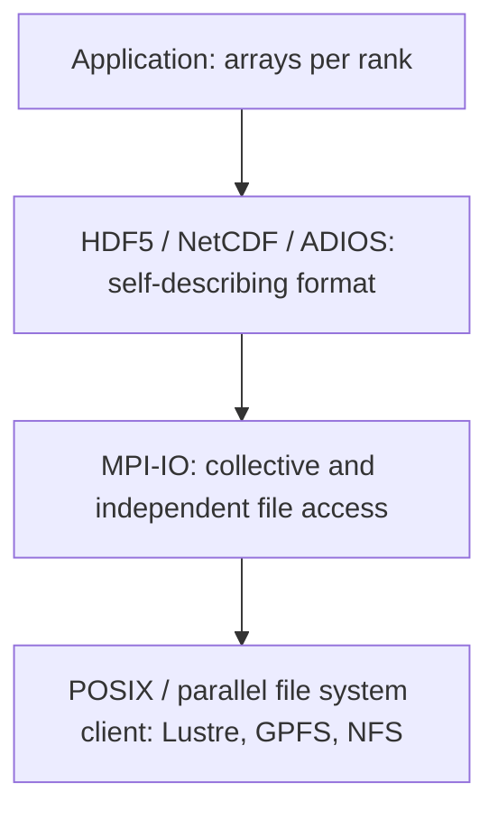

# 6.21 Parallel I/O and checkpoint patterns

| | |
|---|---|
| Level | Advanced |
| Priority tier | 2 |
| Lab venue | Laptop (PyTorch CPU, gloo) for the demos; a cluster with Lustre/GPFS/NVMe for performance tests |
| Part | Part 6: HPC and Slurm |
| Status | Drafted. **Run**: `code/part06/dcp_reshard.py` (PyTorch 2.14.1 `torch.distributed.checkpoint`, gloo, 4 ranks saving, 2 and 1 ranks loading) and `ckpt_atomic.py` (crash-safe commit with simulated crashes). Not run: MPI-IO/HDF5 (multi-rank MPI hangs in this sandbox, see 6.4), any parallel file system, any GPU. Performance statements are general knowledge or arithmetic |

## Why this matters for AI infrastructure

Training at scale is a long sequence of fast compute phases punctuated by I/O: reading data, and periodically writing state so that a failure costs minutes rather than days. Checkpoint design decides how much GPU time is lost on every save, how quickly a run recovers after a failure, whether a crash can corrupt the only good checkpoint, and whether you can resume on a different number of GPUs. The HPC world solved the shared-file and collective-write problems with MPI-IO and HDF5; AI frameworks re-implemented the ideas (sharded distributed checkpoints, asynchronous staging). This chapter covers both and gives you tested building blocks.

## Prerequisites and outcomes

Needs 6.4, 6.18, 6.19, Part 14 basics (parallelism strategies). After this chapter you can:

- Explain independent versus collective I/O, MPI-IO views and hints, HDF5 parallel patterns, and why alignment with stripes matters.
- Compare checkpoint layouts: file-per-process, single shared file, sharded distributed checkpoints, node-local plus drain, and in-memory replicas.
- Demonstrate and explain resharding (saving on N ranks, loading on M).
- Implement a crash-safe commit protocol with manifests, checksums and atomic rename; validate checkpoints on restart.
- Budget checkpoint time and overhead; reduce stall with asynchronous and tiered designs.
- Design the data-loading side: sharded datasets, prefetch, worker counts, caching.

## 1. Parallel I/O in HPC: MPI-IO and HDF5

*Parallel and High Performance Computing* (PHPC, chapter 16) presents the standard stack. Layers from the application down:



**MPI-IO** lets all ranks of a communicator open one file and read/write their portions:

- `MPI_File_open`, `MPI_File_set_view` (each rank sees only its part of the file through a *view* built from derived datatypes), `MPI_File_write_at`/`write` (independent), `MPI_File_write_all`/`write_at_all` (**collective**), non-blocking variants, `MPI_File_sync`, `MPI_File_close`.
- **Collective buffering (two-phase I/O)**: instead of every rank issuing small scattered writes, the library gathers data to a few **aggregator** ranks that write large contiguous blocks aligned to stripes; this converts many small noncontiguous requests into few large ones, usually a big win on parallel file systems. **Data sieving** does the same for independent noncontiguous access (read a big block, pick the pieces).
- **Hints** (`MPI_Info`): `cb_nodes` (aggregator count), `cb_buffer_size`, `romio_cb_read/write` (`automatic`/`enable`/`disable`), `romio_ds_read/write`, `ind_rd_buffer_size`, `ind_wr_buffer_size`, `striping_unit`, `striping_factor`, and GPFS `IBM_largeblock_io=true`. The PHPC book shows how to print them with `ROMIO_PRINT_HINTS=1` (Cray MPICH: `MPICH_MPIIO_HINTS_DISPLAY=1`, `MPICH_MPIIO_STATS=1`, `MPICH_MPIIO_ABORT_ON_RW_ERROR`), and its sample output reports `romio_filesystem_type = NFS:`, `cb_nodes = 1`, `striping_unit = 4194304`, a good reminder to check that the library recognises your file system (using `statfs` and `/usr/include/linux/magic.h` as in `PHPC` `Listing 16.10` `fs_detect.c`); wrongly detected file systems get poor defaults.
- **OpenMPI `ompio` vs `romio` plugins (`PHPC` Chapter 16)**: Parallel file operations entered MPI in the MPI-2 standard in the late 1990s via Argonne National Laboratory's **ROMIO** library (led by Rajeev Thakur). In OpenMPI, `ompi_info | grep "MCA io:"` lists two MCA `io` plugins: `romio321` (default on older releases) and **`ompio`** (default on newer OpenMPI releases), selectable via `mpirun --mca io [ompio|romio]`. Inspecting `ompi_info --param io ompio --level 9` reveals key tuning parameters (`io_ompio_num_aggregators`, `io_ompio_max_aggregators_ratio=8`, `io_ompio_aggregators_cutoff_threshold=3`, `io_ompio_overwrite_amode=1`, `io_ompio_delete_priority=30`, `io_ompio_record_file_offset_info=0`, `io_ompio_coll_timing_info=1`), and running `mpirun --mca io_ompio_verbose_info_parsing 1 -n 4 ./mpi_io_block2d` verifies active info hints.
- **2D block-decomposed MPI-IO views (`PHPC` `Listings 16.1`–`16.4`)**: When a 2D domain of global shape `(ny_global, nx_global)` is decomposed across ranks where each rank holds a local subarray `(ny, nx)` padded by `ng` halo/ghost cells (`local_sizes = {ny+2*ng, nx+2*ng}`, `local_starts = {ng, ng}`), `mpi_io_file_init` creates two derived datatypes once at startup with `MPI_Type_create_subarray(..., MPI_ORDER_C, MPI_DOUBLE, ...)` and `MPI_Type_commit`: `filetype` (mapping the rank's global block in the file) and `memtype` (selecting only the interior `ny` $\times$ `nx` non-ghost cells in RAM). Writing or reading then takes four steps: `MPI_File_open`, `MPI_File_set_size` (preallocating file space so metadata does not grow piecewise during writes), `MPI_File_set_view(fh, disp, MPI_DOUBLE, filetype, "native", info)`, and collective `MPI_File_write_all(fh, data, 1, memtype, &status)` / `MPI_File_read_all`, followed by `MPI_File_close`.
- **HDF5** (`PHPC` `Listings 16.5`–`16.9` and `Tables 16.4`–`16.6`) adds self-describing structure: datasets, attributes, chunking, compression (verify a parallel build in CMake with `set(HDF5_PREFER_PARALLEL true)` and `find_package(HDF5 1.10.1 REQUIRED)` / `if (NOT HDF5_IS_PARALLEL)`). Parallel HDF5 uses MPI-IO underneath across three API groups:
  1. **Collective file routines (`Table 16.4`):** `H5Fcreate`, `H5Fopen`, and `H5Fclose`, using a file access property list configured with `H5Pcreate(H5P_FILE_ACCESS)` and `H5Pset_fapl_mpio(file_access_plist, mpi_hdf5_comm, info)`.
  2. **Dataspace routines (`Table 16.5`):** `H5Screate_simple`, `H5Sselect_hyperslab`, and `H5Sclose` to define both the global `filespace` hyperslab and the interior ghost-stripped `memspace` hyperslab.
  3. **Dataset and collective transfer routines (`Table 16.6`):** `H5Dcreate2`, `H5Dopen2`, `H5Dclose`, `H5Dwrite`, and `H5Dread`, passing a dataset transfer property list `xfer_plist = H5Pcreate(H5P_DATASET_XFER)` with **`H5Pset_dxpl_mpio(xfer_plist, H5FD_MPIO_COLLECTIVE)`** (plus collective metadata `H5Pset_coll_metadata_write` / `H5Pset_all_coll_metadata_ops`).
  Chunk size should match access patterns and stripe size. Also **NetCDF-4** / **PnetCDF** (Northwestern/ANL), **ADIOS2** (Oak Ridge National Laboratory, staging and burst-buffer friendly such as Cray `DataWarp`), and for AI: `safetensors`, Arrow/Parquet, WebDataset tar shards, Zarr.

Why it matters for AI: the same issues recur. N ranks writing disjoint regions of one file need alignment and collective aggregation to avoid lock thrash; file-per-rank avoids locks but explodes metadata. Frameworks hide this, but their performance still obeys these rules.

### Alignment rules of thumb

1. Make write block sizes multiples of the file system's stripe size (Lustre `stripe_size`, 6.19) and align offsets; avoid two ranks touching the same stripe.
2. Use few, large writes (MiB scale) rather than many small ones; buffer in memory.
3. Set the stripe count for shared files high enough that aggregate bandwidth covers all aggregators; set it low (1) for file-per-process outputs.
4. Prefer collective I/O for noncontiguous patterns; independent I/O only for tiny, rare operations (headers).
5. Keep metadata operations (open/close/stat) off the critical path: open once, close once; aggregate small outputs into one file per node or per job.

## 2. Checkpoint layouts

A training checkpoint is the model weights plus optimiser state plus bookkeeping (step, RNG, data position, learning-rate schedule). At scale each rank holds only a shard (FSDP/ZeRO/tensor-pipeline parallel). Layout options:

| Layout | Description | Pros | Cons |
|---|---|---|---|
| **Rank-0 gather** | Gather all state to rank 0, write one file | Simple; one file | Rank 0 memory and network bottleneck; does not scale beyond small models |
| **File per rank** | Each rank writes its shard to its own file | No lock contention; parallel by construction | Many files (metadata), load requires the same parallel layout unless resharded; directory size |
| **Shared file, collective** | All ranks write regions of one file via MPI-IO/HDF5 | One logical file, topology-independent layout | Needs alignment and collective support; contention risk |
| **Sharded distributed checkpoint** (PyTorch DCP, Megatron dist-ckpt, DeepSpeed, NeMo) | Each rank writes its shards in parallel plus a metadata file describing the global layout | Parallel writes, **reshardable** on load, good tooling | Framework-specific; metadata file must be consistent |
| **Node-local then drain** | Write fast to local NVMe or host memory, then asynchronously copy to shared storage/object store | Minimal GPU stall; shared storage load smoothed | Local copy is lost if the node dies before draining; needs cleanup and tracking |
| **In-memory replicas** (buddy checkpoints) | Keep copies in peer-node memory for fast recovery from single-node failure | Seconds to recover from common failures | Memory cost; not durable against multi-node failure; complexity |
| **Differential / incremental** | Save only changes or only optimiser state less often | Smaller | Restore complexity |

Real systems combine these: frequent cheap in-memory or local-NVMe checkpoints, less frequent durable sharded checkpoints to the parallel file system, occasional exports to object storage for archival and for evaluation.

### Tested: sharded checkpoint and resharding

`code/part06/dcp_reshard.py` shards an 8x3 tensor across 4 ranks with `DTensor` (`Shard(0)`), saves it with `torch.distributed.checkpoint.save`, then loads it into 2 ranks and into 1 rank. Run through the `fake_srun.py` harness from 6.12 (gloo backend, CPU, PyTorch 2.14.1):

```text
rank 0/4: saved shard (2, 3)     ... (each of 4 ranks saved its 2 rows)
files written: __0_0.distcp  __1_0.distcp  __2_0.distcp  __3_0.distcp   (plus a .metadata file)
--- load with 2 ranks (resharding 4 -> 2)
rank 0/2: loaded shard (4, 3) reassembled_equal=True
rank 1/2: loaded shard (4, 3) reassembled_equal=True
--- load with 1 rank
rank 0/1: loaded shard (8, 3) reassembled_equal=True
```

What it shows: DCP writes one file per rank (data) plus global metadata describing which slice of which tensor lives where; on load each rank reads exactly the slices it needs, even if the number of ranks changed. That makes it possible to restart a job on fewer or more GPUs after a failure or to load a training checkpoint into an evaluation job. (The `gloo` first attempt failed with "Numpy is not available" until `numpy` was installed in the virtual environment: DCP's object gathering needs it. Worth a line in a runbook.) The file system sees one large file per rank per checkpoint: good bandwidth, but with 4,096 ranks that is 4,096 files per checkpoint, so organise one directory per step and consider node-level aggregation.

### Tiering and asynchrony

Checkpoint stall = time for the slowest rank to write its shard to the destination. Reduce it by (a) writing to local NVMe or pinned host memory first (copy GPU to host is fast), then letting a background thread/process drain to shared storage while training continues (**asynchronous checkpointing**; PyTorch DCP offers async save APIs, Megatron and others have their own), (b) staggering or bounding concurrent writers if the file system chokes on a synchronised burst, (c) compressing carefully (CPU cost versus bytes), (d) checkpointing less state (e.g. weights only for frequent saves), (e) overlapping with a non-critical phase. Arithmetic from 6.18: a 70B model's training checkpoint is about 1 TB; at 16 GB/s it takes about a minute, at 160 GB/s about six seconds.

Trade-off to quantify: expected lost work = half the checkpoint interval per failure (on average) plus restart time. With failure rate lambda per hour for the whole job (grows with GPU count), the interval that minimises overhead follows the Young/Daly approximation, `T_opt ~ sqrt(2 * C * MTBF)` where `C` is the checkpoint cost and MTBF the job's mean time between failures (general result; use it as a starting point). A 1-minute checkpoint cost and a 6-hour MTBF give an interval near 27 minutes.

### Driver-level transparent GPU state checkpointing (`cuda-checkpoint` and `CRIU`)

Orthogonal to framework-level model checkpoints (`state_dict`, sharded DCP), Linux supports driver-level transparent GPU process checkpointing via NVIDIA's `cuda-checkpoint` utility paired with a CPU process checkpointer such as Checkpoint/Restore in Userspace (`CRIU`) for fault tolerance, preemption, and job migration. During suspend, the CUDA Driver API calls `cuCheckpointProcessLock` (locking CUDA driver entry points), `cuCheckpointProcessCheckpoint` (waiting for submitted GPU work to drain, copying the device memory image into host allocations managed by the driver, and releasing GPU resources so `CRIU` can snapshot the process), `cuCheckpointProcessRestore` (reacquiring GPUs—even remapped to different physical GPUs of the same chip type, provided persistence mode or `cuInit` is active—mapping device memory to its original addresses, and restoring streams and contexts), and `cuCheckpointProcessUnlock` (allowing CUDA calls to proceed). Unlike GPUDirect Storage (`GDS`) on the read path, `cuda-checkpoint` does not DMA directly from GPU memory to disk; the suspend time is bounded by the GPU memory image size and the GPU-to-host interconnect bandwidth before `CRIU` writes the host memory image to storage (profile with Nsight Systems markers around the lock and checkpoint calls, untested here).

## 3. Crash-safe commits (tested)

A checkpoint that is half written when the job dies must never be mistaken for a good one, and a crash during commit must not destroy the previous good checkpoint. POSIX gives one atomic primitive across files: `rename` within a file system. `code/part06/ckpt_atomic.py` implements the protocol:

1. Each rank writes shards into `step-N.tmp/` and `fsync`s them.
2. The coordinator records a SHA-256 per shard in `MANIFEST.json`, `fsync`s it.
3. Atomic `rename step-N.tmp -> step-N`, then `fsync` the parent directory.
4. Atomically update a `latest` pointer (write temp, rename over).
5. On restart, **do not trust `latest` alone**: scan for the newest directory that has a manifest and whose shard hashes verify.

The self-test simulates crashes and corruption (4 ranks x 64 KiB shards):

```text
step 100: committed                latest pointer=step-100  newest_valid=step-100
step 200: CRASH (before_rename)    latest pointer=step-100  newest_valid=step-100
step 300: CRASH (before_latest)    latest pointer=step-100  newest_valid=step-300
step 400: committed                latest pointer=step-400  newest_valid=step-400
after corrupting step-400/shard-2: newest_valid=step-300
```

Reading it: a crash before the rename leaves only a `.tmp` directory, ignored by readers; a crash after the rename but before the pointer update leaves the pointer stale while a complete newer checkpoint exists (the scan finds `step-300`); a corrupted shard is detected by the hash and the loader falls back to the previous valid checkpoint. Real deployments add: distributed barrier before the coordinator commits, checksums computed by each rank (not re-read by one process for TB-scale data), manifest versioning (framework, parallel layout, tensor shapes, dtype, git commit, data position), retention (keep last K plus periodic milestones), and verification jobs that load a checkpoint into a smaller test model. On object stores without atomic rename, use a final manifest object written last (the manifest's existence defines commit) and versioned prefixes. Caveats: `rename` atomicity holds on local file systems and Lustre/GPFS within one directory tree; NFS semantics are weaker (close-to-open consistency, 6.18) and cloud object stores differ; always test on your storage.

## 4. Restart and validation

- **Resume logic** must restore model, optimiser, learning-rate scheduler, RNG state, dataloader position (or accept a new shuffle), gradient scaler, and the step counter; test bitwise or statistical equivalence on a small run (train 100 steps, checkpoint, resume 100 more, compare loss with an uninterrupted run).
- **Detect silent corruption**: hash verification, tensor shape/dtype checks on load, NaN/Inf scan, loss continuity check after restart (a spike indicates a bad checkpoint or lost optimiser state).
- **Failure drills**: kill a rank, kill a node, fill the disk, kill during save; confirm automatic recovery within the target time (Part 17).
- **Elastic restarts**: with resharding-capable checkpoints the job can resume on fewer nodes while waiting for repairs; keep global batch size semantics consistent.
- **Slurm integration**: `--requeue`, `--signal` and the dependency patterns of 6.11; ensure the SIGTERM handler triggers an emergency checkpoint only if it can finish within the grace window.

## 5. Data loading

The read side in brief (Part 13 expands):

- **Storage throughput scaling math:** Size storage bandwidth for the aggregate demand of all GPUs. In the book's example, if each GPU needs `200 MB/s` of training data to stay fed, an 8-GPU node requires `1.6 GB/s` (`8 × 200 MB/s`) of aggregate read bandwidth, and a 72-GPU Grace Blackwell GB200/GB300 NVL72 rack requires `14–20 GB/s` sustained throughput across the rack.
- **Host NVMe and NFS client tuning:** On local NVMe drives (`blk-mq`), verify `/sys/block/nvme0n1/queue/scheduler` (or `/sys/block/nvme*/queue/scheduler`) is set to `none` or `mq-deadline`, and raise sequential readahead (`blockdev --setra`, untested here, or `/sys/block/<device>/queue/read_ahead_kb`) from the `128 KB` default to several MB when streaming large shards; mount local XFS with `noatime`. For small-scale NFS mounts, use `rsize=1048576,wsize=1048576,noatime,async,actimeo=60,lookupcache=pos` (untested here) to issue 1 MiB transfers and cache attributes/directory lookups for 60 seconds; for Lustre, stripe large shard files across OSTs with `lfs setstripe` (untested here; e.g., 4 OSTs at `500 MB/s` each = `2 GB/s`).
- Store datasets as **large shards** (hundreds of MB to GB, read in `1 MB` chunks rather than `4 KB` random reads; use `pread()` or `io_uring` if random access is unavoidable) in formats supporting streaming (WebDataset tar, TFRecord, Arrow/Parquet, MDS, Zarr). For LLM pretraining, **NVIDIA `NeMo Curator`** (`DocumentDataset`) runs distributed offline cleansing, deduplication, and tokenization across GPUs/nodes over sharded JSONL or Parquet and builds memory-mapped `.bin` data files paired with `.idx` index files so the online training loop does not parse raw text or millions of small files (6.18).
- **Hardware and GPU-accelerated decompression (`Blackwell` Decompression Engine and `DALI`):** When datasets are stored compressed, Blackwell GPUs include an on-die hardware **Decompression Engine** supporting `LZ4`, `Snappy`, and `Deflate` (at up to `800 GB/s`) to unpack compressed batches in-pipeline without consuming SM compute cycles, alongside `nvJPEG` for GPU image decoding. For multimodal/vision pipelines, **NVIDIA `DALI`** (`nvidia.dali.pipeline.Pipeline`, `define_graph()`) moves JPEG/video decoding and augmentations onto the GPU; in the book's object-detection example, `DALI` cuts host CPU utilization from `800%` (8 cores at 100%) down to `200%` (2 cores handling file reads) while avoiding GPU stalls (keep downstream augmentations on the GPU rather than copying decoded pixels back to CPU).
- **Shuffling**: shuffle shard order plus a bounded in-memory shuffle buffer; avoids random access over the whole dataset (or pre-shuffle N offline copies for N epochs).
- **Parallel workers and copy-stream overlap**: `DataLoader(num_workers=N, prefetch_factor=K, pin_memory=True, persistent_workers=True)` (default `prefetch_factor=2`, raised to `4` or `8` for bursty I/O) hides I/O and decode latency; overlap host-to-device DMA with compute by issuing `batch.to(device, non_blocking=True)` on a dedicated `copy_stream = torch.cuda.Stream()` and synchronizing with `torch.cuda.current_stream().wait_stream(copy_stream)`. Set N from CPUs per GPU (6.12 binding), watch for oversubscription; `DistributedSampler` (or equivalent) gives each rank unique data. Each worker process holds its own file handles and copies of the dataset object (PyTorch's multi-process loader enqueues indices to workers that load and return batches through queues).
- **Isolating DataLoader vs H2D copy overhead:** Calling `next(data_iterator)` measures total GPU wait time across background prefetching and host-to-device copy. To separate Python dataset/transform cost from PCIe copy cost, profile first with `num_workers=0` (disabling background prefetch) to time the pure Python iterator pull, and separately time `.to("cuda", non_blocking=True)` on a Copy stream (using `torch.cuda.Event` or Nsight Systems Copy lanes). In the book's example, reducing GPU I/O wait time from `30%` of iteration time down to `5%` yields a proportional `6x` improvement in training steps per second.
- **Locality and caching**: stage hot shards to local NVMe (per job, or presplit 100 TB across 10 nodes at 10 TB per node), use `s5cmd` / multithreaded range `Get` for S3 staging, use page cache, or a cache layer in front of object storage (such as Amazon FSx for Lustre); for many epochs over the same data the first epoch pays the cost.
- **GPUDirect Storage (`GDS`)** (reading directly into GPU memory via `cuFileRead` / `cuFileReadAsync` and `nvidia-fs` with `O_DIRECT`, bypassing the host page cache and CPU bounce buffers; modern `cuFile` also supports non-`O_DIRECT` descriptors when unaligned, at the cost of extra copies) helps when CPU copies are the limit; for RDMA-accelerated checkpoint writes (`cuFileWrite`), the parallel filesystem must also support RDMA write paths. In the book's examples, VAST Data with GDS measured a `+20%` read-throughput gain on A100 and `+30%+` on H100, and `gdsio` showed a `+20%` gain (`8.0 GB/s` at `1.25 ms` latency and `85%` CPU util without GDS vs `9.6 GB/s` at `1.00 ms` latency and `25%` CPU util with GDS; section 6.28 and Part 13). Trace GDS calls with `nsys profile --trace=cuda,gds,nvtx,osrt` (untested here) and `/etc/cufile.json`.
- **DeepSeek's Fire-Flyer File System (`3FS`) and AI-co-designed storage (`ASP` Chapter 5):** Born out of the observation that AI training workloads perform massive random reads that render traditional read-ahead page caches ineffective, DeepSeek built the open-source **Fire-Flyer File System (`3FS`)** around four components: (1) a **cluster manager** handling membership and configuration changes, (2) **metadata services** backed by a transactional distributed key-value store (**FoundationDB**), (3) **storage services** managing local NVMe SSDs using **CRAQ (Chain Replication with Apportioned Queries)** for strong write-all/read-any consistency across replicas, and (4) a **FUSE / native `USRBIO` client** that uses RDMA and Linux `io_uring` / shared-memory rings to deliver direct-to-GPU random-read throughput comparable to GDS.
- **In-memory preloading, GPU graph fusion, and systematic tuning (`ASP` Chapter 5):** When a dataset (or hot subset) fits inside host RAM or unified CPU+GPU memory (such as on a Grace Blackwell Superchip), preload it into memory at startup as an ultrafast cache. Alongside NVIDIA `DALI`, fuse GPU-friendly preprocessing operations directly into TorchVision, TensorRT, or custom OpenAI Triton kernels, remove unnecessary `torch.cuda.synchronize()` barriers, use `NCCL` for collective training communication versus **NIXL** for high-throughput point-to-point/streaming inference transfers, change only one or two parameters at a time and remeasure after every change, and document environment variables and known library quirks directly in the repository config.
- **Determinism**: record shard order and seed in the checkpoint manifest.

### Sizing storage for every GPU in the job

The problem is that storage has to keep up with all the GPUs at once, not with one GPU at a time. At ultra scale, the storage system must deliver steady throughput to thousands, or even millions, of GPUs that may run for months. When storage falls behind, the GPUs starve and sit idle, and that wastes the expensive part of the cluster.

Placement helps a lot. Colocating NVMe SSDs inside a rack, or using NVMe over Fabrics (NVMe-oF) with rack-local switch topologies, cuts network hops and keeps performance consistent. If your data lives on NFS or cloud object storage such as Amazon S3, add up the read bandwidth of every compute node. Use the same arithmetic as above: each GPU needs 200 MB/s of training data, so 8 GPUs need about 1.6 GB/s in total.

The numbers grow quickly at rack scale. A GB200 or GB300 NVL72 rack holds 72 Blackwell GPUs in one NVLink domain. If each GPU needs 200 MB/s, that rack can require 14–20 GB/s of aggregate storage throughput. Heavier media or multimodal samples push demand higher still. Measure your bytes per sample and samples per second before you buy storage.

Two common fixes close the gap. The first is faster local storage, such as NVMe SSDs in the same rack or an NVMe-oF topology. The second is a parallel filesystem such as Lustre or GPFS that caches your data on local SSDs. Either way, provision several data loading threads to keep the pipe full. Watch out for the Python GIL, which is one reason loaders often use separate processes instead of threads.

Place data as close to the compute nodes as you can. Close can mean the same physical node, such as a local NVMe drive, or at least the same rack with a fast interconnect. For multinode training, shard the dataset so each node reads mostly from its own disk. With 100 TB of data and 10 nodes, you might presplit 10 TB to each node. That keeps the network free of repeated reads, especially when the dataset does not fit in RAM. PyTorch's `DistributedSampler` gives each process a unique slice of data per epoch, which fits this layout.

### Sequential and random reads

GPUs crunch data quickly, but they want it in large, contiguous chunks. Storage also reaches much higher throughput on large sequential reads than on small random ones. Arrange your dataset so reads stay sequential as much as possible. Think of a library where every book is in a separate box scattered across the building: finding each one costs more time than reading it.

That is why millions of small image files hurt. They cause random seeks all over the disk. Pack the samples into a few large files instead, such as Arrow, TFRecord, or Parquet files, database files, or WebDataset tar files. Each big file then holds many samples in a row. Combining small files into large shards matters even more with faster GPUs, because small random reads become the bottleneck sooner. For object stores such as Amazon S3, combine small objects into larger ones ahead of time.

Read size matters too. Reading in 1 MB chunks gives better throughput than reading in 4 KB chunks, because each read carries less overhead. Python's `open()` uses the OS read-ahead buffer to speed up sequential scans. Random reads gain little from bigger buffers, though. So batch your reads into larger contiguous chunks, or use a high-level dataset API such as `TFRecordDataset` or PyTorch's `IterableDataset` with `DataLoader` and a configurable prefetch size.

If access must stay random, issue several reads in parallel. You can use threads that call `pread()`, or Linux asynchronous I/O such as `io_uring`. With preregistered buffers and polling, `io_uring` submits batches of I/O requests with little kernel overhead. That cuts the cost per system call, hides latency, and helps you reach high IOPS.

Pick a filesystem built for large, concurrent I/O. XFS is common on Linux NVMe servers, and you should mount it with `noatime` so reads do not trigger costly access-time updates. For Amazon EFS, set the filesystem to Max I/O performance mode for the highest aggregate throughput. If you need steady bandwidth, switch from the default Bursting throughput mode to Provisioned throughput.

### Workers, pinned memory, and overlap

Frameworks such as PyTorch's `DataLoader` take a `num_workers` setting. Each worker fetches and preprocesses data in parallel, and the main process collects finished batches from a queue. Workers are usually separate processes, which avoids Python GIL problems. The right worker count comes from measurement. Too few workers leave the GPU idle, and too many fight over CPU cores and I/O bandwidth.

Monitor CPU usage and disk throughput while you tune. Ideally the disk runs near full throughput and the CPU still has some headroom. A CPU with a very high core count, such as the 72-core NVIDIA Grace CPU in GB200 and GB300 Superchips, can often run more loader workers. Expect diminishing returns, though, as I/O contention grows.

The complete example below shows the pattern. The dataset returns already-batched tensors, and the loader pins memory and prefetches for each worker. The copy runs on its own CUDA stream, so the next batch moves to the GPU while the current batch computes. The `model` and `device` names come from your training script.

```python
import torch
from torch.utils.data import Dataset, DataLoader


class Synthetic(Dataset):
    def __init__(self, n, shape):
        self.n, self.shape = n, shape

    def __len__(self):
        return self.n

    def __getitem__(self, i):
        # Cheap CPU-side work; replace with real parse/decode.
        return torch.ones(self.shape, dtype=torch.float32)


B, C, H, W = 32, 3, 224, 224
dataset = Synthetic(n=100_000, shape=(B, C, H, W))
# Each of the 8 workers keeps up to 4 batches ready in pinned CPU memory.
loader = DataLoader(
    dataset,
    batch_size=B,
    num_workers=8,
    pin_memory=True,
    persistent_workers=True,
    prefetch_factor=4,
)

copy_stream = torch.cuda.Stream()
compute_stream = torch.cuda.current_stream()
for batch in loader:
    with torch.cuda.stream(copy_stream):
        batch_gpu = batch.to(device, non_blocking=True)
    # Make sure the pending host-to-device copy finishes before compute uses it.
    with torch.cuda.stream(compute_stream):
        torch.cuda.current_stream().wait_stream(copy_stream)
        outputs = model(batch_gpu)
```

Read the example as a timeline. While the GPU works on batch N, the loader is already preparing and copying batch N+1. Pinned memory is what makes that copy fast and asynchronous. Without it, the system would pin memory on the fly for every transfer, which adds latency. The ideal steady state has the GPU starting each batch the moment the previous one ends.

The goal is to overlap data preparation with GPU work in general. The CPU should finish batch N+2 while the GPU runs batch N+1. Most frameworks do this by default when you use multiple workers, but you should still check it. If the overlap is missing, the GPU goes idle at the start of every iteration while it waits for data.

Persistent workers help when you loop over the same dataset many times, especially if each epoch is short. Setting `persistent_workers=True` keeps the workers alive so they start prefetching the next epoch at once. That skips the cost of spawning and tearing down processes at each epoch boundary. It also helps when worker startup is slow because of imports or file opening.

### Finding a hidden loader bottleneck

A common pitfall is a hidden bottleneck in the input pipeline. Debug logging and expensive CPU transforms are easy to add, and their cost may show up only under load. To catch this, time the DataLoader alone first. Measure how long it takes to produce 100 batches with all downstream GPU work turned off. Then compare that baseline with your target iteration time and with the GPU idle time you see in normal training.

If the DataLoader alone is too slow, optimize the Python pipeline. Remove per-element logging, simplify transforms, or add more workers. If the gap between the isolated loader speed and the real-run loader speed is large, you are probably bound by host-to-device transfers or kernel-launch overhead.

Be careful with the isolation test itself. Turning off GPU kernels also removes CPU-side kernel-launch overhead. As a result, the pure data-loading throughput often looks lower than what a real training run shows. The technique is still useful, as long as you keep that difference in mind.

### Monitoring storage I/O

Measurement comes before tuning. Monitoring the storage pipeline is like monitoring network traffic: use every tool you have. On Linux, start with `iostat`, `iotop`, `nvme-cli`, `perf`, and eBPF. Vendor utilities and dashboards show queues, latencies, read-ahead effects, and cache hit ratios. They also show whether local NVMe devices are busy and whether a NAS or object store link is saturated.

On the GPU side, use Nsight Systems to trace I/O waits next to kernels. The `--trace=gds` option captures `cuFile` API activity on the timeline. To see `cuFile` events too, enable the GDS static tracepoints in `/etc/cufile.json`. Kernel-mode counters for NVMe peer-to-peer DMA paths are not exposed in Nsight Systems, and they may not be available on every GDS stack. NVIDIA's Data Center GPU Manager (DCGM) also reports useful GPU I/O statistics.

Here is why this matters. Suppose your GPUs spend 30% of their time waiting for data. Then I/O limits your throughput. After tuning, the wait might fall to 5%, and the training steps per second rise in proportion, here by 6x. Small inefficiencies, such as a 5 ms latency or a buffer that is 10 MB too small, add up at scale. Keep every stage from disk to GPU memory measured.

### GPUDirect Storage: what it changes and what it does not

Without GDS, a read from an NVMe SSD into a GPU takes two hops. The data first goes from the SSD into CPU memory, and then a CUDA call copies it into GPU memory. GDS removes the first hop's extra copy, so the GPU can pull the data directly. GDS also reduces the CPU work each read needs.

GPUDirect RDMA and GDS are related but different. GDS accelerates storage-to-GPU DMA, while GPUDirect RDMA accelerates network-to-GPU DMA. Neither one removes CPU orchestration, because the CPU still sets up the transfers. Both remove the host memory bounce buffer, which is the extra stop in CPU memory.

Most of the attention goes to reads, and that is fair. Training is overwhelmingly read-heavy, so most GDS gains appear there. Checkpoint writes still need to be fast, though. For RDMA-accelerated writes, the filesystem must support RDMA writes for GDS. WekaFS is a well-known provider for ultrascale training, with GDS-aware plugins for reads and writes over RDMA. Other vendors, such as DDN, VAST, and Cloudian, also ship GDS-aware solutions.

Alignment is the next rule. Use `O_DIRECT` when possible, because it enables direct DMA and bypasses the OS page cache. Recent GDS releases let `cuFile` also work with non-`O_DIRECT` file descriptors. Misalignment can then add extra copies or reduce performance. A filesystem that runs in user space through FUSE cannot give you a GDS path, since GDS needs kernel-level integration.

Use a GDS-enabled kernel client if you need a true GDS path. Examples in the book include NVMe, NVMe-oF, BeeGFS, WekaFS, IBM Storage Scale, and VAST. The gain depends on the workload. If your CPU already handles the transfers easily, GDS may not change throughput much, but it still lowers CPU usage. If the CPU is saturated with `memcpy` calls, GDS helps a lot.

As an example, consider a tiny batch size of 1 MB and a target of 1,000 batches per second. That is roughly 1,000 MB/s. Copying it with the CPU would consume a few cores. With GDS, the GPU pulls that data straight from disk and frees the CPU. The gap grows at higher rates and with thousands of GPUs.

### DeepSeek's 3FS: storage built for random reads

The problem is that AI workloads make a huge number of random reads. Traditional read caching helps little in that case, and it can even get in the way. DeepSeek built the open source Fire-Flyer File System (3FS) from scratch for this pattern. It skips caching and uses direct file I/O, so each request goes straight to the NVMe SSD.

This is codesign, the same idea behind GDS. Storage is designed for AI rather than adapted to it afterward. 3FS keeps kernel page-cache work and host memory copies to a minimum, much like modern HPC filesystems do. Its four components are a cluster manager, a metadata service, a storage service, and a client. They connect over an RDMA-capable fabric such as InfiniBand or RoCE. Figure 5-2 in the book shows how these parts connect.

3FS is a Linux-based filesystem, so existing applications keep working. Its clients use RDMA reads for direct, GPU-accessible transfers. Metadata is sharded and replicated across nodes so the design scales out. Data paths bypass the OS page cache entirely. 3FS also lets prefetch and transfer run alongside GPU kernels, which carries the cascading pipeline, or wave, idea from Chapter 4 down into storage.

The reported throughput is large. DeepSeek has published multi-terabyte-per-second aggregate read throughput for 3FS on large clusters, with results up to 7.3 TB/s in their environment. In another benchmark, a 68-node AI-HPC cluster with 10 × 16 TB NVMe SSDs and dual 100 Gb/s networking reached about 6.6 TB/s. It did this while also serving 1.4 TB/s of background work. The book notes that Ceph reached about 1.1 TB/s on similar hardware.

Building a filesystem like this takes a large upfront investment and ongoing maintenance. Most teams should start with an existing distributed filesystem or object store. The lesson still applies to any design. Match the storage layer to the access pattern, and keep the data path RDMA-first so the last I/O bottlenecks disappear. Full-stack design, storage included, is what lets a large AI system use its hardware.

### Using the right library for each transfer

Use NCCL for collective operations, such as all-reduce, that training depends on. NIXL targets high-throughput point-to-point and streaming transfers, which inference often needs. Use NIXL where token streaming dominates the workload. For bulk collective and symmetric-memory patterns, prefer NCCL or NVSHMEM. Leverage the purpose-built libraries instead of reinventing the wheel.

### Preparing LLM datasets offline with NeMo Curator

The problem is that raw text and millions of small files force the training loop to do string work instead of math. NVIDIA NeMo is a toolkit for developing and training language models. Inside it, the open source NeMo Curator framework prepares datasets before training. Curator helps when you have terabytes from many sources, and it supports cleansing, tokenizing, and shuffling.

Curator can spread the preprocessing across multiple GPUs or nodes. Using several accelerators makes multiterabyte training datasets faster to prepare. It can also compress and pack data into a small number of large files. It can convert data into a binary format that machines read easily. It can even create synthetic data to augment human datasets, which are limited and getting scarcer.

Curator also enforces quality. It deduplicates data and removes problematic content, which matters for both model quality and speed. A clean, preprocessed dataset gives the trainer well-structured, evenly sized data, padded to a fixed length. It never has to tokenize on the fly or handle messy strings. Once Curator does the heavy work offline, the online pipeline only reads prepared data and maybe does a light last-mile shuffle.

For NeMo training, preprocessed datasets are usually memory-mappable `.bin` data files with `.idx` index files. Curator's `DocumentDataset` reads and writes sharded JSONL or Parquet, and conversion to `.bin` and `.idx` happens when you build the indexed dataset. You may also store N shuffled copies of the data, each shuffled a different way. That avoids runtime shuffling over N epochs, at the cost of disk space and memory.

The general rule is to prepare data before training. You should almost never train on raw text. Offline preprocessing takes time, but it pays back in faster runs and more predictable scaling. Keep in mind that NeMo's data loading still runs on CPUs, so to bypass CPU I/O you need to combine it with tools such as GDS.

### Decoding images and video on the GPU with DALI

Image and video decoding and augmentation can eat CPU cores. A pipeline can keep all eight cores busy while the GPU still stalls now and then. NVIDIA DALI, the Data Loading Library, moves this work onto the GPU. It can also run optimized C++ code on the CPU when that suits the job. It is most useful for image and video data.

For example, DALI can decode JPEG images on the GPU and apply random crop, resize, and normalization there too. That is often faster than the CPU when the GPU has spare cycles. It also reduces the number of CPU workers you need. DALI provides prebuilt pipelines for common workloads such as classification, object detection, and segmentation, and those pipelines use the GPU's media acceleration hardware fully.

DALI pipelines are static graphs of operators. You subclass `nvidia.dali.pipeline.Pipeline` and declare your data sources and CPU or GPU operators in `define_graph()`. DALI then handles execution, prefetching, and threading with its own thread pools and queues. Integrating it into the training loop adds complexity and a learning curve. For input-bound training, though, it can boost throughput a lot.

Take an object-detection job that reads images and video and augments them. Host CPU usage might sit at 800%, which means eight cores at full load, while the GPU still stalls. With DALI, CPU usage can drop to 200%, which is two cores doing the file reads. The GPU does the decoding and can read concurrently with computation.

Placement decides the result. If you use DALI only to decode JPEGs and then hand raw pixels back to the CPU for augmentation and collation, you add host-to-device-to-host copies. Those copies can cancel the gain. Identify GPU-friendly preprocessing and fuse it into one GPU-side graph, using TorchVision, TensorRT, or custom CUDA kernels. Then benchmark three versions end to end: CPU only, DALI, and a fully fused GPU graph.

### Keeping the pipeline full

Technologies such as GDS and advanced input pipelines keep data flowing and GPUs fed. Profile and tune continuously, and you can push a distributed AI system closer to its theoretical peak at scale. A poorly tuned input pipeline can waste 50% of GPU time. Algorithmic tweaks often give only a few percent, so start with the data path.

## 6. Performance experiments (cluster, untested)

1. **Shared-file write scaling**: IOR with MPI-IO collective writes, 1 to N nodes, stripe count 1 vs all OSTs; plot bandwidth vs ranks.
2. **File-per-process vs shared**: same total data; compare bandwidth and create/open rates (`mdtest`).
3. **Alignment**: write sizes of 64 KiB vs 1 MiB vs 4 MiB aligned/unaligned on a 4 MiB-stripe directory.
4. **DCP at scale**: save a 100 GB sharded state from 64 ranks; time save and load; compare local NVMe, parallel FS, and NFS.
5. **Async vs sync checkpoint**: measure training step time with and without async staging.
6. **Fault drill**: kill a node during save and restart from the last valid checkpoint using the protocol above.

## 7. Lab

First, run the self-checking Python lab (`code/part06/ckpt_atomic_lab.py`) locally. It executes `code/part06/ckpt_atomic.py` to verify all 5 crash-safe commit and SHA-256 bit-rot fallback assertions (`step-100` commit, `step-200` `before_rename` crash, `step-300` `before_latest` crash recovery, `step-400` commit, and fallback to `step-300` when `step-400/shard-2.bin` is corrupted), verifies the Young/Daly optimal checkpoint interval (`27` minutes for a 1-minute checkpoint cost and 6-hour MTBF), and checks the `ASP` Chapter 5 GPU storage throughput scaling equations (`1.6 GB/s` for 8 GPUs, `14.4 GB/s` for 72 GPUs, `+20.0%` `gdsio` gain from `8.0` to `9.6 GB/s`, and `6x` step-rate gain from cutting I/O wait from `30%` to `5%`):

```bash
python3 code/part06/ckpt_atomic_lab.py
```

Tested here: 1) create a venv with PyTorch and numpy, run `dcp_reshard.py` via `fake_srun.py` (PHASE=save with 4 ranks, PHASE=load with 2 and 1); inspect the checkpoint directory (use `ls -a` to see the metadata file). 2) Run `ckpt_atomic.py`; add a crash between writing the manifest and the rename in a different order and decide whether readers stay safe. 3) Modify `ckpt_atomic.py` to compute per-rank hashes at write time and store them in per-rank manifests merged by the coordinator.

Untested: 4) the performance experiments in section 6; 5) write an MPI-IO collective write with `mpi4py` (`File.Open`, `Set_view`, `Write_all`) and compare to independent writes; 6) implement async checkpointing in a toy training loop using a background thread and a pinned buffer; measure step-time impact.

## 8. Interview angles

- Explain collective buffering and why it speeds up shared-file writes.
- File-per-rank, shared file, or sharded checkpoint for 4,096 GPUs? Defend your choice.
- What does it mean that a checkpoint is reshardable? Give an example use.
- How do you make checkpoint commits crash-safe? What can still go wrong on NFS or S3?
- A 70B-parameter model's checkpoint stalls training for 2 minutes every 30 minutes. How do you reduce it?
- How do you choose a checkpoint interval?
- How do you validate that a resumed run matches an uninterrupted one?
- Why are millions of small files bad for training and what do you do?

## Exercises

1. **Verifying Crash-Safe Checkpoint Commits and Bit-Rot Detection (`code/part06/ckpt_atomic.py` & `ckpt_atomic_lab.py`):** Run `python3 code/part06/ckpt_atomic_lab.py`. Trace why `newest_valid()` returns `step-100` after a crash at `before_rename` (`step-200.tmp` ignored), why it recovers `step-300` after a crash at `before_latest` even when the `latest` pointer still reads `step-100`, and why zeroing 4 bytes in `step-400/shard-2.bin` causes `newest_valid()` to reject `step-400` via `MANIFEST.json` SHA-256 verification and fall back to `step-300`.
2. **Resharding Distributed Checkpoints Across World Sizes (`code/part06/dcp_reshard.py`):** Trace how `code/part06/dcp_reshard.py` distributes an $8 \times 3$ tensor across 4 ranks (`(2, 3)` per rank) using `DTensor` (`Shard(0)`) and `torch.distributed.checkpoint.save`, and loads that exact checkpoint onto 2 ranks (`(4, 3)` per rank) and 1 rank (`(8, 3)`) without rewriting the `.distcp` shard files.
3. **Calculating Optimal Checkpoint Intervals with the Young/Daly Approximation (`ckpt_atomic_lab.py`):** Using `young_daly_interval_min(ckpt_cost_min, mtbf_hours)` in `code/part06/ckpt_atomic_lab.py` ($T_{\text{opt}} \approx \sqrt{2 \cdot C \cdot \text{MTBF}}$), verify that a 1-minute checkpoint cost (`C = 1` min) and a 6-hour cluster MTBF (`360` min) yield $T_{\text{opt}} \approx 27\text{ minutes}$, and calculate how $T_{\text{opt}}$ changes when asynchronous NVMe staging reduces synchronous GPU stall `C` from `60 s` down to `5 s` (`7.7` minutes).
4. **Designing 2D Block-Decomposed MPI-IO and Parallel HDF5 Collective Writes (`PHPC` Chapter 16):** Explain how `MPI_Type_create_subarray` constructs both the global file view (`filetype`) and the ghost-cell-stripped interior memory view (`memtype` inside `ny+2*ng` $\times$ `nx+2*ng`) for `MPI_File_write_all`, and map the equivalent parallel HDF5 workflow (`H5Pset_fapl_mpio`, `H5Sselect_hyperslab`, `H5Pset_dxpl_mpio(xfer_plist, H5FD_MPIO_COLLECTIVE)`, `H5Dwrite`).
5. **Isolating PyTorch `DataLoader` vs H2D DMA Copy Bottlenecks and GPU Decoding (`ASP` Chapter 5):** Write a 3-step profiling procedure using `num_workers=0`, a dedicated `copy_stream = torch.cuda.Stream()` with `non_blocking=True`, and NVIDIA `DALI` / Blackwell Decompression Engine (`LZ4`/`Snappy`/`Deflate` at up to `800 GB/s`) to diagnose and eliminate a `30%` data-loading stall (cutting CPU usage from `800%` to `200%` and I/O wait from `30%` to `5%`).
6. **Comparing DeepSeek `3FS` and GPUDirect Storage (`GDS`) for Random-Read AI Workloads (`ASP` Chapter 5):** Explain why AI training's random-read access patterns defeat traditional OS page-cache readahead, how `cuFileRead` (`O_DIRECT` + `nvidia-fs.ko`) boosts throughput (`8.0 GB/s` at `1.25 ms` / `85%` CPU $\to$ `9.6 GB/s` at `1.00 ms` / `25%` CPU in `gdsio`), and how DeepSeek's `3FS` combines `FoundationDB` metadata, `CRAQ` NVMe storage chains, and RDMA/`io_uring` clients.

## Checkpoint

<details>
<summary>1. Name the four layers of the classic HPC parallel I/O stack (`PHPC` Chapter 16) and their AI equivalents.</summary>

1. **Application memory arrays / tensors** (distributed across ranks).
2. **High-level self-describing library:** `HDF5` / `NetCDF-4` / `PnetCDF` / `ADIOS2` $\leftrightarrow$ `torch.distributed.checkpoint` (`.distcp`), `safetensors`, `WebDataset`, `Parquet`, `Zarr`.
3. **Middleware collective I/O layer:** `MPI-IO` (`ROMIO` / OpenMPI `ompio`) $\leftrightarrow$ framework distributed checkpoint coordinators and `cuFile` / `io_uring`.
4. **Parallel filesystem client:** `Lustre`, `GPFS`, `BeeGFS`, `WEKA`, `VAST`, `3FS`.
</details>

<details>
<summary>2. What is the difference between **independent I/O** (`MPI_File_write_at`) and **collective I/O** (`MPI_File_write_all`), and how does **two-phase collective buffering** work (`PHPC` Chapter 16)?</summary>

- **Independent I/O:** Each rank calls the filesystem independently with no coordination—causing lock thrashing and unaligned small writes when many ranks write interleaved regions of a shared file.
- **Collective I/O (`_all`):** All ranks in the communicator call the operation together. Under **two-phase collective buffering**, ranks first exchange data over the high-speed fabric to a chosen subset of **aggregator ranks (`cb_nodes`)**, which then issue large, contiguous, stripe-aligned writes to the parallel filesystem.
</details>

<details>
<summary>3. How do you construct an MPI-IO **file view** (`filetype`) and **memory view** (`memtype`) for a 2D array with `ng` ghost cells (`PHPC` Chapter 16 `Listing 16.1`)?</summary>

Call `MPI_Type_create_subarray(2, ...)` twice at initialization followed by `MPI_Type_commit`:
1. **`filetype`:** Uses `global_sizes = {ny_global, nx_global}`, `global_subsizes = {ny, nx}`, and `global_starts = {ny_off, nx_off}`, passed to `MPI_File_set_view()` so each rank sees only its assigned global tile in the shared file.
2. **`memtype`:** Uses `local_sizes = {ny+2*ng, nx+2*ng}`, `local_subsizes = {ny, nx}`, and `local_starts = {ng, ng}`, passed to `MPI_File_write_all()` so MPI-IO reads directly from the interior cells in RAM without copying out ghost cells.
</details>

<details>
<summary>4. What are OpenMPI's two MCA `io` plugins, how do you inspect their parameters, and how do you print active `ROMIO` / `Cray MPICH` hints (`PHPC` Chapter 16)?</summary>

OpenMPI provides **`ompio`** (the default in modern OpenMPI) and **`romio`** (`--mca io [ompio|romio]`), listed via `ompi_info | grep "MCA io:"` and inspected via `ompi_info --param io ompio --level 9` (or traced at runtime with `mpirun --mca io_ompio_verbose_info_parsing 1`). For ROMIO, set `export ROMIO_PRINT_HINTS=1` (or on Cray MPICH, `export MPICH_MPIIO_HINTS_DISPLAY=1` and `MPICH_MPIIO_STATS=1`).
</details>

<details>
<summary>5. Which HDF5 C API calls enable parallel MPI-IO file access, hyperslab selection, and collective dataset transfers (`PHPC` Chapter 16 `Tables 16.4`–`16.6`)?</summary>

1. **File access property list:** `H5Pcreate(H5P_FILE_ACCESS)` + **`H5Pset_fapl_mpio(fapl, comm, info)`**, passed to `H5Fcreate` or `H5Fopen`.
2. **Dataspace hyperslabs:** `H5Screate_simple` and **`H5Sselect_hyperslab`** for both `filespace` and `memspace`.
3. **Collective dataset transfer:** `H5Pcreate(H5P_DATASET_XFER)` + **`H5Pset_dxpl_mpio(xfer_plist, H5FD_MPIO_COLLECTIVE)`**, passed to `H5Dwrite` or `H5Dread`.
</details>

<details>
<summary>6. Compare five checkpoint layouts (**Rank-0 gather**, **File-per-rank**, **Shared-file collective**, **Sharded distributed checkpoint (`DCP`)**, and **Node-local NVMe + async drain**).</summary>

- **Rank-0 gather:** Simple single file, but OOMs/bottlenecks rank 0 above a few billion parameters.
- **File-per-rank (`torch.save` per rank):** Fast lock-free parallel writes, but creates $N$ unindexed files tied to a fixed world size $N$.
- **Shared-file collective (MPI-IO/HDF5):** Single file, but requires strict stripe alignment.
- **Sharded distributed checkpoint (PyTorch `DCP`, Megatron `.distcp`):** Parallel shard writes plus a global `.metadata` index that supports **automatic resharding** across different world sizes ($N \to M$).
- **Node-local NVMe / host RAM + async drain:** Copies GPU state to local memory/NVMe in seconds and drains to the parallel FS in the background, minimizing GPU stall.
</details>

<details>
<summary>7. How does `code/part06/dcp_reshard.py` demonstrate resharding from 4 ranks to 2 ranks and 1 rank?</summary>

4 ranks distribute an $8 \times 3$ `DTensor` (`Shard(0)`, `(2, 3)` per rank) and call `dcp.save()`, writing `__0_0.distcp .. __3_0.distcp` plus `.metadata`. A subsequent job with 2 ranks allocates a `(4, 3)` local shard per rank and calls `dcp.load()`; DCP reads `.metadata`, fetches two 2-row slices per rank from the existing files, and reassembles the exact $8 \times 3$ tensor (`reassembled_equal=True`).
</details>

<details>
<summary>8. State the **Young/Daly approximation** for the optimal checkpoint interval $T_{\text{opt}}$, and compute $T_{\text{opt}}$ when checkpoint cost $C = 1\text{ min}$ and job $\text{MTBF} = 6\text{ hours}$.</summary>

$$T_{\text{opt}} \approx \sqrt{2 \cdot C \cdot \text{MTBF}}$$
For $C = 1\text{ min}$ and $\text{MTBF} = 360\text{ min}$ ($6\text{ hours}$):
$$T_{\text{opt}} \approx \sqrt{2 \times 1 \times 360} = \sqrt{720} \approx \mathbf{27\text{ minutes}}$$
</details>

<details>
<summary>9. How does driver-level GPU process checkpointing (`cuda-checkpoint` + `CRIU`) work, and how does it differ from framework-level `state_dict`/DCP checkpointing (`ASP` Chapter 5)?</summary>

`cuda-checkpoint` operates transparently at the CUDA Driver API level without application code changes: it calls **`cuCheckpointProcessLock`** (freezing CUDA API entry points), **`cuCheckpointProcessCheckpoint`** (draining active GPU kernels, copying GPU HBM allocations into host memory, and releasing GPU handles so `CRIU` can snapshot the Linux process tree), **`cuCheckpointProcessRestore`** (re-acquiring GPUs and remapping virtual addresses), and **`cuCheckpointProcessUnlock`**. Unlike DCP, it snapshots the entire live CUDA context and CPU process state (bounded by GPU-to-host PCIe/NVLink copy speed).
</details>

<details>
<summary>10. Walk through the 5-step crash-safe checkpoint commit protocol in `code/part06/ckpt_atomic.py`.</summary>

1. Every rank writes its shard into a temporary directory **`step-N.tmp/shard-R.bin`** and calls `os.fsync()`.
2. After a barrier, rank 0 records the `sha256` digest of every shard in **`step-N.tmp/MANIFEST.json`** and `fsync`s it.
3. Rank 0 executes an atomic POSIX **`os.rename("step-N.tmp", "step-N")`** and `fsync`s the parent directory descriptor.
4. Rank 0 writes `latest.tmp`, `fsync`s it, atomically renames it over `latest`, and `fsync`s the parent directory.
5. On restart, `newest_valid()` scans all non-`.tmp` `step-N` directories in descending order and loads the newest one whose `MANIFEST.json` and shard SHA-256 hashes all verify.
</details>

<details>
<summary>11. Why must `ckpt_atomic.py` call `fsync` on the parent directory after `os.rename`, and why shouldn't a restarting job trust the `latest` pointer blindly?</summary>

- **`fsync` on parent directory:** `os.rename()` updates the directory entry in memory; `fsync(parent_dir_fd)` ensures the directory entry update is committed to persistent storage so a power loss cannot lose the rename.
- **Not trusting `latest` blindly:** If the coordinator crashes *after* renaming `step-300.tmp -> step-300` but *before* updating `latest` (or if a shard in `step-400` suffers silent bit rot), scanning and verifying `MANIFEST.json` SHA-256 hashes recovers `step-300` automatically.
</details>

<details>
<summary>12. How must the crash-safe commit protocol be adapted when writing checkpoints directly to an S3-compatible object store?</summary>

Object stores lack POSIX atomic directory `rename`. Instead, write all rank shard objects under a versioned prefix (`s3://bucket/ckpt/step-N/shard-R.distcp`), wait for all ranks at a distributed barrier, and have rank 0 upload `s3://bucket/ckpt/step-N/MANIFEST.json` (single-PUT object creation is atomic in S3) as the commit marker. Readers treat a prefix `step-N/` as committed if and only if `MANIFEST.json` exists and all listed shard digests/ETags match.
</details>

<details>
<summary>13. What complete state must be saved and restored so that a resumed training run is statistically equivalent to an uninterrupted run?</summary>

1. Model weights (`model.state_dict()`).
2. Optimizer states (`optimizer.state_dict()`, including FP32 master weights and Adam $m, v$ moments).
3. Learning-rate scheduler state (`lr_scheduler.state_dict()`).
4. Mixed-precision `GradScaler` state.
5. Global step/epoch counter and stateful `DataLoader` / sampler cursor (` shard_id, sample_offset`).
6. Host Python, NumPy, CPU PyTorch, and per-rank CUDA **RNG states** (`torch.cuda.get_rng_state()`).
</details>

<details>
<summary>14. How do you size aggregate storage read bandwidth for an 8-GPU node and a 72-GPU Grace Blackwell NVL72 rack (`ASP` Chapter 5)?</summary>

Multiply the per-GPU ingestion requirement by the number of GPUs: at `200 MB/s` per GPU, an 8-GPU node requires $8 \times 200\text{ MB/s} = \mathbf{1.6\text{ GB/s}}$, and a 72-GPU NVL72 rack requires $72 \times 200\text{ MB/s} = \mathbf{14.4\text{ GB/s}}$ (`14–20 GB/s` sustained rack throughput).
</details>

<details>
<summary>15. Which Linux block-layer settings optimize local NVMe drives for streaming large dataset shards (`ASP` Chapter 5)?</summary>

1. Set `/sys/block/nvme*/queue/scheduler` to **`none`** (or `mq-deadline`) so the kernel skips redundant I/O sorting on multi-queue NVMe SSDs.
2. Raise sequential readahead (`blockdev --setra` or `/sys/block/nvme*/queue/read_ahead_kb`) from the default `128 KB` to several megabytes (`2048–4096 KB`).
3. Mount local XFS/ext4 filesystems with **`noatime`**.
</details>

<details>
<summary>16. What is **NVIDIA `NeMo Curator`**, and why does it output `.bin` and `.idx` files for LLM pretraining (`ASP` Chapter 5)?</summary>

`NeMo Curator` (`DocumentDataset`) is a GPU-accelerated offline data curation pipeline that performs distributed text extraction, filtering, fuzzy/exact deduplication, and tokenization across multi-node clusters, outputting contiguous binary token files (**`.bin`**) paired with byte-offset index files (**`.idx`**) that training ranks `mmap` with zero parsing overhead.
</details>

<details>
<summary>17. How do **NVIDIA `DALI`** and the **Blackwell Decompression Engine** eliminate host CPU bottlenecks in multimodal/compressed data pipelines (`ASP` Chapter 5)?</summary>

- **Blackwell Hardware Decompression Engine:** Dedicated on-die hardware engine that decompresses **`LZ4`, `Snappy`, and `Deflate`** streams at up to **`800 GB/s`** without using GPU SMs or host CPUs.
- **NVIDIA `DALI` (`nvidia.dali.pipeline.Pipeline`):** Offloads JPEG/video decoding (`nvJPEG`) and image augmentations from CPU `DataLoader` workers onto the GPU—dropping host CPU usage from `800%` (8 cores pegged) to `200%` (2 cores reading file bytes) in `ASP` Chapter 5's object-detection benchmark.
</details>

<details>
<summary>18. How do you overlap PyTorch `DataLoader` host-to-device transfers with GPU compute, and how do you isolate Python iterator latency from PCIe copy latency (`ASP` Chapter 5)?</summary>

Configure `DataLoader(num_workers=N, prefetch_factor=4, pin_memory=True, persistent_workers=True)` and copy batches asynchronously on a dedicated CUDA stream (`with torch.cuda.stream(copy_stream): batch = batch.to(device, non_blocking=True)`). To isolate bottlenecks, benchmark pure Python dataset loading with **`num_workers=0`** (no background prefetch) and separately time `.to("cuda", non_blocking=True)` using `torch.cuda.Event` or Nsight Systems Copy lanes.
</details>

<details>
<summary>19. What are the four components of DeepSeek's **Fire-Flyer File System (`3FS`)**, and why was it designed (`ASP` Chapter 5)?</summary>

DeepSeek built `3FS` because AI training workloads issue massive random reads across large shards that defeat traditional page-cache readahead. Its four components are:
1. **Cluster manager** (membership and layout distribution).
2. **Metadata services** backed by transactional **FoundationDB**.
3. **Storage services** managing NVMe SSDs with **CRAQ (Chain Replication with Apportioned Queries)** for write-all/read-any consistency.
4. **FUSE / native `USRBIO` client** using RDMA and `io_uring` / shared-memory rings for zero-copy reads.
</details>

<details>
<summary>20. Contrast the roles of **`NCCL`** and **`NIXL`** in distributed AI systems (`ASP` Chapter 5).</summary>

- **`NCCL` (NVIDIA Collective Communications Library):** Built for synchronous, gang-scheduled multi-GPU **collective operations** (`AllReduce`, `AllGather`, `ReduceScatter`) across model/data-parallel training ranks.
- **`NIXL` (NVIDIA Inference Xfer Library):** Built for asynchronous, high-throughput **point-to-point and streaming memory/storage transfers** (such as KV-cache transfers between disaggregated prefill and decode nodes and storage tiers in LLM inference).
</details>

## Sources and review notes

- MPI-IO (`MPI_Type_create_subarray`, `MPI_File_set_view`, `MPI_File_write_all`), collective buffering, hints (`ROMIO_PRINT_HINTS=1`, `MPICH_MPIIO_HINTS_DISPLAY=1`, `ompi_info --param io ompio --level 9`), `fs_detect.c` (`statfs`), and parallel HDF5 (`H5Pset_fapl_mpio`, `H5Sselect_hyperslab`, `H5Pset_dxpl_mpio(H5FD_MPIO_COLLECTIVE)`): read in full from *Parallel and High Performance Computing* (`parallel-and-high-performance-computing`, `PHPC`) Chapter 16 ("16 File operations for a parallel world").
- `ai-systems-performance-engineering` — Chris Fregly, *AI Systems Performance Engineering* (`ASP`), "Chapter 5. GPU-Based Storage I/O Optimizations" (read in full): storage throughput scaling math (`200 MB/s` per GPU → `1.6 GB/s` for an 8-GPU node, `14–20 GB/s` sustained for a 72-GPU NVL72 rack), NVMe I/O scheduler tuning (`/sys/block/nvme0n1/queue/scheduler` set to `none` or `mq-deadline`) and readahead (`blockdev --setra` / `read_ahead_kb` from `128 KB` default to several MB), NFS client mount options (`rsize=1048576,wsize=1048576,noatime,async,actimeo=60,lookupcache=pos`), driver-level GPU state checkpointing with `cuda-checkpoint` and `CRIU` (`cuCheckpointProcessLock`, `cuCheckpointProcessCheckpoint`, `cuCheckpointProcessRestore`, `cuCheckpointProcessUnlock`), VAST Data GDS (`+20%` on A100, `+30%+` on H100) and `gdsio` benchmarking (`8.0 GB/s` at `1.25 ms` CPU path vs `9.6 GB/s` at `1.00 ms` GDS path, `+20%`), DeepSeek's Fire-Flyer File System (`3FS` with cluster manager, FoundationDB metadata, CRAQ NVMe storage, and RDMA/`io_uring` client), Blackwell Decompression Engine (`LZ4`, `Snappy`, `Deflate` at up to `800 GB/s`), isolating `DataLoader` overhead (`num_workers=0` vs separate Copy stream, cutting I/O wait from `30%` to `5%` for a `6x` step-rate improvement), NVIDIA `DALI` (cutting CPU utilization from `800%` across 8 cores to `200%`), `NeMo Curator` (`.bin` + `.idx` memory-mapped shards), and `NCCL` vs `NIXL`.
- DataLoader internals: *Distributed AI Systems* (`distributed-ai-systems`, `DAI`) Chapter 3.
- AI storage, checkpointing, and GDS labs: migrated from `nvidia-devops` (`nvidia-zero-to-hero/volume-15/index.md`, `nvidia-zero-to-hero/volume-15/chapter-01-why-ai-storage-is-different.md`, `nvidia-zero-to-hero/volume-15/chapter-02-the-ai-data-path-from-storage-to-gpu.md`, `nvidia-zero-to-hero/volume-15/chapter-03-local-nvme-and-data-staging.md`, `nvidia-zero-to-hero/volume-15/chapter-04-gpudirect-storage-architecture.md`, `nvidia-zero-to-hero/volume-15/chapter-05-lustre-for-ai-and-hpc.md`, `nvidia-zero-to-hero/volume-15/chapter-06-beegfs-for-gpu-clusters.md`, `nvidia-zero-to-hero/volume-15/chapter-07-object-storage-and-dataset-pipelines.md`, `nvidia-zero-to-hero/volume-15/chapter-08-checkpoint-architecture-and-recovery.md`, `nvidia-zero-to-hero/volume-15/chapter-09-metadata-small-files-and-data-loading.md`, `nvidia-zero-to-hero/volume-15/chapter-10-capacity-performance-and-cost-planning.md`, `nvidia-zero-to-hero/volume-15/chapter-11-production-troubleshooting.md`, `nvidia-zero-to-hero/volume-15/chapter-12-volume-15-summary.md`, `nvidia-zero-to-hero/volume-15/labs/lab-01-baseline-an-ai-storage-path.md`, `nvidia-zero-to-hero/volume-15/labs/lab-02-benchmark-local-nvme-and-shared-storage.md`, `nvidia-zero-to-hero/volume-15/labs/lab-03-validate-a-gpudirect-storage-design.md`, and `nvidia-zero-to-hero/volume-15/labs/lab-04-troubleshoot-checkpoint-and-data-loading-bottlenecks.md`).
- Run here: `code/part06/dcp_reshard.py`, `code/part06/ckpt_atomic.py`, and `python3 code/part06/ckpt_atomic_lab.py` (3 passed, 0 failed).
- Explicitly labelled inferences: `young_daly_interval_min` (`27` minutes for $C=1\text{ min}, \text{MTBF}=6\text{ h}$) in `code/part06/ckpt_atomic_lab.py` is a deterministic calculation from the Young/Daly approximation.
- Not verified on live hardware: Young/Daly applicability to specific non-Poisson failure distributions, DCP async API names across future releases, GPUDirect Storage live benchmarks, and multi-node MPI-IO/HDF5 throughput (`untested here`).
