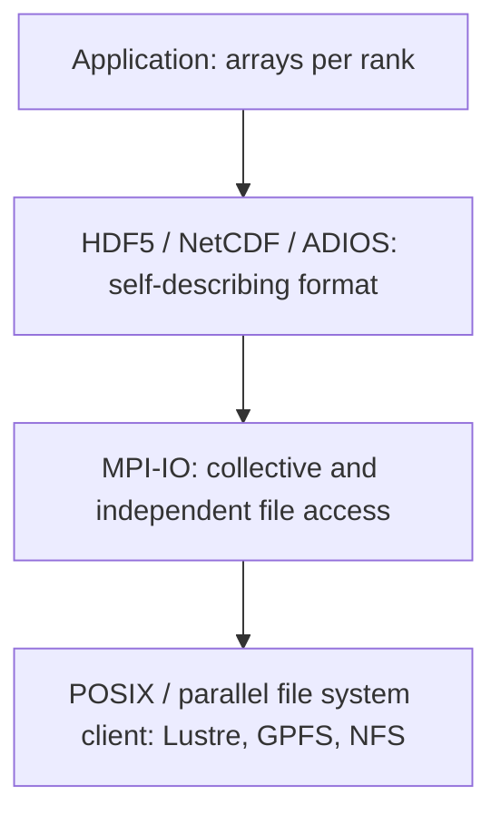

# 6.21 Parallel I/O and checkpoint patterns

| | |
|---|---|
| Level | Advanced |
| Priority tier | 2 |
| Lab venue | Laptop (PyTorch CPU, gloo) for the demos; a cluster with Lustre/GPFS/NVMe for performance tests |
| Part | Part 6: HPC and Slurm |
| Status | Drafted. **Run**: `code/part06/dcp_reshard.py` (PyTorch 2.14.1 `torch.distributed.checkpoint`, gloo, 4 ranks saving, 2 and 1 ranks loading) and `ckpt_atomic.py` (crash-safe commit with simulated crashes). Not run: MPI-IO/HDF5 (multi-rank MPI hangs in this sandbox, see 6.4), any parallel file system, any GPU. Performance statements are general knowledge or arithmetic |

## Why this matters for AI infrastructure

Suppose a node fails halfway through a long training run. Maybe it was well into the run, and the job had been behaving. How much work you lose depends almost entirely on how the job saves its state. Training is a long series of fast compute phases, with I/O in between. The job reads data, and every so often it writes its state to storage. If it writes that state regularly, a failure costs you minutes of work. If it writes rarely, or writes badly, the same failure can cost you days.

Checkpoint design decides several things for you. It sets how much GPU time each save consumes, and how quickly a run recovers after a failure. It also decides whether a crash can corrupt the only good checkpoint you have, and whether you can resume on a different number of GPUs. The HPC world solved the shared-file and collective-write problems with MPI-IO and HDF5. MPI-IO is the parallel I/O layer of the Message Passing Interface, and HDF5 is a self-describing file format for scientific data. AI frameworks re-implemented those ideas through sharded distributed checkpoints and asynchronous staging. This chapter covers both sides, and it gives you tested building blocks you can run yourself.

## Prerequisites and outcomes

You need 6.4, 6.18, 6.19, and the Part 14 basics on parallelism strategies before you start. The chapter walks through the HPC I/O stack first, then checkpoint layouts, then the commit protocol that keeps a checkpoint safe, then restart and validation. After that it covers the data-loading side, which feeds the GPUs between checkpoints. Each part pairs an idea with a number or a command you can check yourself.

## 1. Parallel I/O in HPC: MPI-IO and HDF5

Suppose many ranks each need to write their piece of one large array into the same file. A rank is one process in a parallel program, and each rank holds its own slice of the data. If every rank works on its own, the file system spends its time sorting out scattered writes from many directions. The HPC world avoids that with a layered stack, which *Parallel and High Performance Computing* (chapter 16) describes. Each layer hands its work down to the layer below, and each layer adds one kind of help.



Read the diagram from the top. Your application holds arrays, one set per rank. A self-describing format organizes them, so the file itself records what each array is. MPI-IO decides how the ranks touch the file. Finally, the file system client moves the bytes to the storage servers.

**MPI-IO** lets all ranks of a communicator open one file and read or write their own portions. A communicator is the group of ranks that take part in a job. The main calls are `MPI_File_open`, `MPI_File_set_view`, `MPI_File_write_at` or `MPI_File_write`, `MPI_File_write_all` or `MPI_File_write_at_all`, `MPI_File_sync`, and `MPI_File_close`. There are also non-blocking variants. `MPI_File_set_view` gives each rank a view of the file, built from derived datatypes, so each rank sees only its part. A derived datatype is a description of a layout, such as "every third block." `MPI_File_write_at` is independent, so one rank writes on its own. `MPI_File_write_all` is collective, so every rank in the communicator has to call it together.

Collective buffering, also called two-phase I/O, is what makes collective calls pay off. Think of a group of movers carrying boxes into a warehouse. If each person carries a single item to a random shelf, the warehouse gets busy and slow. If they first pile everything at a few doors and then carry full pallets inside, the trip is far faster. In the same way, instead of every rank issuing small scattered writes, the library gathers data onto a few aggregator ranks. Those aggregators write large contiguous blocks aligned to stripes. Many small noncontiguous requests become a few large ones, which is usually a big win on parallel file systems. Data sieving does the same for independent access to noncontiguous data. It reads one big block and picks out the pieces it needs.

Hints are settings passed in an `MPI_Info` object, and they tune how the library behaves. The list includes `cb_nodes` for the aggregator count, `cb_buffer_size`, `romio_cb_read/write` (set to `automatic`, `enable`, or `disable`), and `romio_ds_read/write`. It also covers `ind_rd_buffer_size`, `ind_wr_buffer_size`, `striping_unit`, `striping_factor`, and, for GPFS, `IBM_largeblock_io=true`. The same book shows how to print them. With ROMIO, set `ROMIO_PRINT_HINTS=1`. On Cray MPICH, use `MPICH_MPIIO_HINTS_DISPLAY=1` and `MPICH_MPIIO_STATS=1`, and the variable `MPICH_MPIIO_ABORT_ON_RW_ERROR` is available too. Printing the hints is the first debugging step. You cannot tune what you have not checked.

The sample output in the book reports `romio_filesystem_type = NFS:`, `cb_nodes = 1`, and `striping_unit = 4194304`. That output is a useful reminder to check that the library recognizes your file system. The book's `fs_detect.c` file, Listing 16.10, uses `statfs` and `/usr/include/linux/magic.h` for that check. A wrongly detected file system gets poor defaults, so a Lustre mount that looks like NFS will be tuned for the wrong thing.

OpenMPI has two MPI-IO plugins, and the choice matters. Parallel file operations entered MPI in the MPI-2 standard in the late 1990s, through Argonne National Laboratory's ROMIO library, which Rajeev Thakur led. In OpenMPI, `ompi_info | grep "MCA io:"` lists two MCA `io` plugins. MCA stands for Modular Component Architecture, OpenMPI's plugin system. One is `romio321`, the default on older releases. The other is `ompio`, the default on newer OpenMPI releases. You select one with `mpirun --mca io [ompio|romio]`. When two runs of the same job behave differently, check which plugin each one used.

To see the key tuning parameters, run `ompi_info --param io ompio --level 9`. The output includes `io_ompio_num_aggregators`, `io_ompio_max_aggregators_ratio=8`, `io_ompio_aggregators_cutoff_threshold=3`, `io_ompio_overwrite_amode=1`, `io_ompio_delete_priority=30`, `io_ompio_record_file_offset_info=0`, and `io_ompio_coll_timing_info=1`. To confirm that your hints are active, run `mpirun --mca io_ompio_verbose_info_parsing 1 -n 4 ./mpi_io_block2d`. The verbose flag shows how the library read each hint, so a typo in a hint name shows up here instead of as a mystery slowdown.

The book's 2D example, in Listings 16.1 to 16.4, shows a block-decomposed domain. Picture a large grid, such as a weather map, cut into rectangles, with one rectangle per rank. Suppose a 2D domain with global shape `(ny_global, nx_global)` is split across ranks. Each rank holds a local subarray `(ny, nx)`, padded by `ng` halo, or ghost, cells. A ghost cell is a copy of a neighbour's edge value, kept so the rank can compute its own edge. That gives `local_sizes = {ny+2*ng, nx+2*ng}` and `local_starts = {ng, ng}`. The function `mpi_io_file_init` creates two derived datatypes once, at startup. It uses `MPI_Type_create_subarray(..., MPI_ORDER_C, MPI_DOUBLE, ...)` and then `MPI_Type_commit`. The first type is `filetype`, which maps the rank's global block in the file. The second is `memtype`, which selects only the interior `ny` × `nx` non-ghost cells in RAM. In other words, the file gets the rank's real cells, and the ghost cells never reach the disk.

Writing or reading then takes four steps. First comes `MPI_File_open`. Second, `MPI_File_set_size` preallocates the file space, so metadata does not grow piece by piece during writes. In short, the four steps are `MPI_File_open`, `MPI_File_set_size`, `MPI_File_set_view`, and the collective write. Third, `MPI_File_set_view(fh, disp, MPI_DOUBLE, filetype, "native", info)` tells the library where this rank's cells sit in the file. Fourth, the collective `MPI_File_write_all(fh, data, 1, memtype, &status)` or `MPI_File_read_all` moves the data, and `MPI_File_close` ends the session.

HDF5 adds self-describing structure to the file, covering datasets, attributes, chunking, and compression. A dataset is a named array, an attribute is a small label attached to it, and chunking splits a dataset into blocks that can be read separately. The book's listings 16.5 to 16.9 and tables 16.4 to 16.6 cover it. To check for a parallel build, use CMake with `set(HDF5_PREFER_PARALLEL true)` and `find_package(HDF5 1.10.1 REQUIRED)`, then test `if (NOT HDF5_IS_PARALLEL)`. A serial HDF5 build would compile and run, but every rank would write alone, so the check is worth the one line. Parallel HDF5 uses MPI-IO underneath, and its calls fall into three groups.

1. Collective file routines (`Table 16.4`) are `H5Fcreate`, `H5Fopen`, and `H5Fclose`. You configure them with a file access property list, created by `H5Pcreate(H5P_FILE_ACCESS)` and set by `H5Pset_fapl_mpio(file_access_plist, mpi_hdf5_comm, info)`.
2. Dataspace routines (`Table 16.5`) are `H5Screate_simple`, `H5Sselect_hyperslab`, and `H5Sclose`. A hyperslab is a rectangular selection inside an array. You use them to define both the global `filespace` hyperslab and the interior, ghost-stripped `memspace` hyperslab.
3. Dataset and collective transfer routines (`Table 16.6`) are `H5Dcreate2`, `H5Dopen2`, `H5Dclose`, `H5Dwrite`, and `H5Dread`. For collective transfers, you pass a dataset transfer property list, `xfer_plist = H5Pcreate(H5P_DATASET_XFER)`, with `H5Pset_dxpl_mpio(xfer_plist, H5FD_MPIO_COLLECTIVE)`. Collective metadata uses `H5Pset_coll_metadata_write` and `H5Pset_all_coll_metadata_ops`.

Chunk size should match access patterns and stripe size. If chunks are much smaller than a stripe, one read touches many pieces. If they are much larger, a small read drags in data you do not need. Other formats matter too. NetCDF-4 and PnetCDF come from Northwestern and Argonne National Laboratory. ADIOS2 comes from Oak Ridge National Laboratory, and it suits staging and burst buffers, such as Cray `DataWarp`. A burst buffer is a fast layer that absorbs a burst of writes before the data moves to slower storage. For AI work, you will also meet `safetensors`, Arrow and Parquet, WebDataset tar shards, and Zarr.

The same problems show up in AI work. When N ranks write disjoint regions of one file, they need alignment and collective aggregation, or they fight over locks. A file per rank avoids locks but creates too much metadata. Frameworks hide most of this, but their performance still follows these rules. When a slow checkpoint puzzles you, these are the first rules to check.

### Alignment rules of thumb

1. Make write block sizes multiples of the file system's stripe size, such as Lustre `stripe_size` from 6.19, and align the offsets. Avoid having two ranks touch the same stripe. If two ranks write to the same stripe, the file system has to serialize them, and that serialization is the slowdown you are trying to avoid.
2. Use few, large writes at the MiB scale rather than many small ones, and buffer them in memory.
3. Set the stripe count for a shared file high enough that aggregate bandwidth covers all aggregators. For file-per-process outputs, set it low, to 1.
4. Prefer collective I/O for noncontiguous patterns. Reserve independent I/O for tiny, rare operations such as headers.
5. Keep metadata operations, such as open, close, and stat, off the critical path. Open once, close once, and aggregate small outputs into one file per node or per job.

Settle the stripe size and the aggregator count first, because those two settings decide whether your shared-file writes line up.

If you cannot find the stripe size on your system, ask the storage team before you touch any code. A guess here can make a correct program slow, and it is hard to spot because nothing fails.

## 2. Checkpoint layouts

Saving a checkpoint sounds simple until each of 4,096 ranks holds its own piece of the model. Picture a model too big for one GPU. Each GPU keeps only a slice of the weights, and the save has to collect all of those slices without stalling the run. A training checkpoint is the model weights, plus the optimizer state, plus bookkeeping. The bookkeeping covers the step, the RNG state (the random number generator state, which keeps shuffles and dropout repeatable), the data position, and the learning-rate schedule. At scale, each rank holds only a shard, for example under FSDP, ZeRO, or tensor and pipeline parallelism. FSDP and ZeRO are two ways of splitting weights and optimizer state across GPUs. The layouts below differ in how many files they write and how you load them back.

| Layout | Description | Pros | Cons |
|---|---|---|---|
| **Rank-0 gather** | Gather all state to rank 0, write one file | Simple; one file | Rank 0 memory and network bottleneck; does not scale beyond small models |
| **File per rank** | Each rank writes its shard to its own file | No lock contention; parallel by construction | Many files (metadata), load requires the same parallel layout unless resharded; directory size |
| **Shared file, collective** | All ranks write regions of one file via MPI-IO/HDF5 | One logical file, topology-independent layout | Needs alignment and collective support; contention risk |
| **Sharded distributed checkpoint** (PyTorch DCP, Megatron dist-ckpt, DeepSpeed, NeMo) | Each rank writes its shards in parallel plus a metadata file describing the global layout | Parallel writes, **reshardable** on load, good tooling | Framework-specific; metadata file must be consistent |
| **Node-local then drain** | Write fast to local NVMe or host memory, then asynchronously copy to shared storage/object store | Minimal GPU stall; shared storage load smoothed | Local copy is lost if the node dies before draining; needs cleanup and tracking |
| **In-memory replicas** (buddy checkpoints) | Keep copies in peer-node memory for fast recovery from single-node failure | Seconds to recover from common failures | Memory cost; not durable against multi-node failure; complexity |
| **Differential / incremental** | Save only changes or only optimiser state less often | Smaller | Restore complexity |

The table compares the layouts, so read each row as a trade-off. Each one is good at something and costs you something else. Rank-0 gather is the easiest to explain, but rank 0 becomes the one machine that has to hold everything. File per rank is fast to write, but a few thousand files per checkpoint strain the metadata side. The sharded layout takes the best of the parallel options and adds a single metadata file that describes the whole picture.

Real systems combine them. They take frequent, cheap checkpoints to memory or local NVMe. They take less frequent, durable sharded checkpoints to the parallel file system. Occasionally they export a copy to object storage for archival and evaluation. Each tier answers a different question. How fast can I recover from a single node failure? How safe is my data if a whole rack goes down? How cheap is it to keep for a year?

### Tested: sharded checkpoint and resharding

`code/part06/dcp_reshard.py` shards an 8x3 tensor across 4 ranks with `DTensor` (`Shard(0)`). It saves the tensor with `torch.distributed.checkpoint.save`, then loads it into 2 ranks and into 1 rank. The run goes through the `fake_srun.py` harness from 6.12, with the gloo backend, on CPU, using PyTorch 2.14.1. The gloo backend is PyTorch's CPU communication library, so you can run this on a laptop without a GPU.

```text
rank 0/4: saved shard (2, 3)     ... (each of 4 ranks saved its 2 rows)
files written: __0_0.distcp  __1_0.distcp  __2_0.distcp  __3_0.distcp   (plus a .metadata file)
--- load with 2 ranks (resharding 4 -> 2)
rank 0/2: loaded shard (4, 3) reassembled_equal=True
rank 1/2: loaded shard (4, 3) reassembled_equal=True
--- load with 1 rank
rank 0/1: loaded shard (8, 3) reassembled_equal=True
```

The output shows what DCP does. It writes one file per rank for the data, plus global metadata that records which slice of which tensor lives where. On load, each rank reads exactly the slices it needs, even if the number of ranks has changed. Look at the second block. Four ranks saved four files, and two ranks each loaded their own half of the same tensor. The one-rank load pulled the whole tensor from the same four files. That makes it possible to restart a job on fewer or more GPUs after a failure. It also lets you load a training checkpoint into an evaluation job. The first gloo attempt failed with "Numpy is not available" until `numpy` was installed in the virtual environment, because DCP's object gathering needs it. Worth a line in your runbook.

The file system sees one large file per rank for each checkpoint. That gives good bandwidth. With 4,096 ranks, though, it means 4,096 files per checkpoint. So organize one directory per step, and consider node-level aggregation, where each node merges its ranks' data before it reaches the file system.

### Tiering and asynchrony

Picture a training job that stops for a minute every hour while it saves. The GPUs sit idle through the whole save, and at scale that idle time is expensive. The checkpoint stall is the time the slowest rank needs to write its shard to the destination. The slowest rank sets the pace, because the job cannot resume until every rank has finished. You can shrink the stall in five ways.

First, write to local NVMe or pinned host memory before anything else, because copying from GPU to host is fast. Pinned memory is host RAM that the GPU can copy from directly, without the operating system moving pages around. A background thread or process then drains the data to shared storage while training continues. This is called asynchronous checkpointing. PyTorch DCP offers async save APIs, and Megatron and others have their own.

Second, stagger or bound the concurrent writers if the file system chokes on a synchronized burst. A synchronized burst is the moment every rank writes at the same instant. Third, compress carefully, since compression costs CPU time and saves bytes. Fourth, checkpoint less state. For example, save only weights for frequent saves. Fifth, overlap the write with a phase that is not on the critical path.

When you present a plan like this, put the stall first. Everyone agrees a stall is bad, but the team needs to know how long it is and which rank causes it. Measure the slowest rank before you change anything.

Here is the arithmetic from 6.18 that you can check yourself. A 70B model's training checkpoint is about 1 TB. At 16 GB/s, writing it takes about a minute. At 160 GB/s, it takes about six seconds. Try the division yourself. Size divided by speed gives the time, and that one line tells you whether a storage upgrade is worth the money.

The trade-off is worth quantifying. On average, each failure costs half the checkpoint interval in lost work, plus the restart time. The failure rate, lambda per hour for the whole job, grows with the GPU count. More GPUs means more chances that one of them fails. The Young/Daly approximation gives the interval that minimizes overhead:

`T_opt ~ sqrt(2 * C * MTBF)`

Here `C` is the checkpoint cost, and MTBF is the job's mean time between failures. This is a general result, so use it as a starting point. A 1-minute checkpoint cost and a 6-hour MTBF give an interval near 27 minutes. Saving more often costs more stall time, and saving less often loses more work on each failure. The formula sits between those two costs.

### Driver-level transparent GPU state checkpointing (`cuda-checkpoint` and `CRIU`)

This layer sits beside the framework checkpoints, which are `state_dict` saves and sharded DCP. A `state_dict` is the dictionary of weights that PyTorch saves. Linux can also checkpoint a GPU process at the driver level, with no change to the application. NVIDIA's `cuda-checkpoint` utility handles the GPU side, and a CPU process checkpointer handles the rest. CRIU, which stands for Checkpoint/Restore in Userspace, is one such checkpointer. Together they support fault tolerance, preemption, and job migration. Preemption means a scheduler pauses a job to make room for a more urgent one. Migration means moving a running job to another machine.

During a suspend, the CUDA Driver API calls four functions, in order. The first is `cuCheckpointProcessLock`, which locks the CUDA driver entry points. The second is `cuCheckpointProcessCheckpoint`. It waits for submitted GPU work to drain, copies the device memory image into host allocations managed by the driver, and releases GPU resources so CRIU can snapshot the process. The third is `cuCheckpointProcessRestore`, which reacquires the GPUs. They can be remapped to different physical GPUs of the same chip type, provided persistence mode or `cuInit` is active. This call also maps device memory to its original addresses and restores streams and contexts. A stream is an ordered queue of GPU work, and a context is the per-process state the driver keeps for a GPU. The fourth is `cuCheckpointProcessUnlock`, which lets CUDA calls proceed again.

Unlike GPUDirect Storage (`GDS`) on the read path, `cuda-checkpoint` does not DMA directly from GPU memory to disk. The suspend time is bounded by the size of the GPU memory image and by the GPU-to-host interconnect bandwidth. After that, CRIU writes the host memory image to storage. The order matters, because the GPU memory has to come to host memory before the snapshot can cover it. To profile this, place Nsight Systems markers around the lock and checkpoint calls. This step has not been run for this chapter.

Decide the layout first, because it sets how many files each checkpoint creates and how your job can restart from it.

A useful habit is to write the layout choice in your runbook, next to the restart steps. When a run fails in the middle of the night, the person on call should not have to guess how the checkpoint was laid out.
## 3. Crash-safe commits (tested)

Picture a job that dies while it is halfway through writing a checkpoint. The power goes out, or a node reboots, or the job gets killed by the scheduler. Now think about what you would find on disk the next morning. A checkpoint in that state must never be mistaken for a good one. A crash during the commit must also not destroy the previous good checkpoint. If either of those happens, the job restarts from garbage, or it restarts from nothing.

POSIX gives one atomic primitive across files, which is `rename` within one file system. Atomic means the rename either happens completely or does not happen at all, so a reader never sees half of it. The script `code/part06/ckpt_atomic.py` builds the protocol on top of it. The protocol has five steps, and each step leaves the disk in a state that a reader can handle.

1. Each rank writes its shards into `step-N.tmp/` and calls `fsync` on them. The `fsync` call forces the data out of the cache and onto the disk, so a power cut cannot lose it after the write returns.
2. The coordinator records a SHA-256 digest for each shard in `MANIFEST.json`, then calls `fsync` on that file. A digest is a fingerprint of the bytes, and it changes if even one byte changes.
3. It renames `step-N.tmp` to `step-N` atomically, then calls `fsync` on the parent directory. The directory `fsync` makes the rename itself durable.
4. It updates the `latest` pointer atomically, by writing a temp file and renaming it over the old one.
5. On restart, do not trust `latest` alone. Scan for the newest directory that has a manifest and whose shard hashes verify.

The self-test simulates crashes and corruption, using 4 ranks with 64 KiB shards. A crash point is a place in the protocol where the script stops, as if the power had failed right there.

```text
step 100: committed                latest pointer=step-100  newest_valid=step-100
step 200: CRASH (before_rename)    latest pointer=step-100  newest_valid=step-100
step 300: CRASH (before_latest)    latest pointer=step-100  newest_valid=step-300
step 400: committed                latest pointer=step-400  newest_valid=step-400
after corrupting step-400/shard-2: newest_valid=step-300
```

Here is how you read the test. A crash before the rename leaves only a `.tmp` directory, and readers ignore it. A crash after the rename but before the pointer update leaves `latest` stale, even though a complete newer checkpoint exists. In that case the scan finds `step-300`. A corrupted shard fails its hash check, so the loader falls back to the previous valid checkpoint. Notice that the pointer is a hint, and the manifest plus the hashes are the truth. That is why the restart code scans the directories instead of trusting one file.

Real deployments add more. They put a distributed barrier before the coordinator commits. A barrier makes every rank wait until all of them have finished writing. Each rank computes its own checksums, rather than having one process re-read terabytes of data. Manifests are versioned, and they record the framework, the parallel layout, tensor shapes, dtype, the git commit, and the data position. The dtype is the numeric type of the tensor, such as bfloat16. Retention keeps the last K checkpoints plus periodic milestones, where K is a number you choose. Verification jobs load a checkpoint into a smaller test model, so a bad save shows up before it matters.

On object stores without atomic rename, write a final manifest object last. The manifest's existence defines the commit, and versioned prefixes keep the copies apart. A prefix is the path-like start of an object name. Keep these caveats in mind. Rename is atomic on local file systems and on Lustre and GPFS, within one directory tree. NFS semantics are weaker, with close-to-open consistency covered in 6.18. Close-to-open means a file's changes are guaranteed visible only after it is closed and reopened. Cloud object stores differ too. Always test on your own storage, because a guarantee in a document is not the same as a guarantee on your mount.

It helps to say the protocol out loud, in order, to a colleague. Each step answers one question. Did the data reach the disk? Did the manifest match the shards? Did the rename land? Did the pointer move? Can the reader trust what it finds? If you can answer each question, the protocol is doing its job.

## 4. Restart and validation

A restart that loads a checkpoint is not the same as a restart that resumes the run. Picture a job that comes back up, loads the weights, and then the loss jumps. The weights were fine, but the optimizer state was empty, so the learning rate and momentum started from scratch. Resume logic has to restore a lot of state. That includes the model, the optimizer, the learning-rate scheduler, the RNG state, the dataloader position (or a new shuffle), the gradient scaler, and the step counter. The gradient scaler keeps small mixed-precision gradients from vanishing, so it counts as training state too. Test it on a small run. Train 100 steps, checkpoint, resume 100 more, and compare the loss with an uninterrupted run, looking for bitwise or statistical equivalence. Bitwise means the two runs match exactly, bit for bit. Statistical means they match within the noise you expect.

Silent corruption needs its own checks, because it does not announce itself. Use hash verification, tensor shape and dtype checks on load, a NaN and Inf scan, and a loss continuity check after restart. NaN and Inf are the not-a-number and infinity values that show up when training breaks. If you see a loss spike right after a restart, it suggests a bad checkpoint or lost optimizer state. Look at the checks in that order, because the cheapest one often finds the problem first.

Run failure drills so that you can confirm recovery. Kill a rank, kill a node, fill the disk, and kill a job during a save. A drill is a planned failure that tests what the system does. Each drill should show automatic recovery within the target time in Part 17. Elastic restarts build on resharding-capable checkpoints. The job can resume on fewer nodes while the repairs are pending, so keep the global batch size semantics consistent. The global batch size is the total number of samples per step across all GPUs, and it has to stay the same, or the training dynamics change.

Slurm integration brings in `--requeue`, `--signal`, and the dependency patterns from 6.11. Make the SIGTERM handler trigger an emergency checkpoint only if that checkpoint can finish within the grace window. SIGTERM is the polite stop signal that Slurm sends before it kills a job, and the grace window is the time it gives the job to clean up. If the save cannot finish in that window, starting it just wastes the grace time and leaves a half-written directory behind.

Use the failure drills as your test of recovery time, and compare every result with the target in Part 17.

Write each drill as a short script with a clear pass condition. A drill that you cannot score is a demo, not a test. Keep the results beside your checkpoint manifests, so the history of recovery times stays with the history of saves.

## 5. Data loading

Picture a GPU dashboard that shows idle gaps at the start of every step. The profiler points at the loader, so the loader is where you look first.

The read side is covered briefly here, and Part 13 expands on it. Start with the arithmetic. Picture a GPU waiting for its next batch. In the book's example, each GPU needs `200 MB/s` of training data to stay fed. An 8-GPU node therefore needs `1.6 GB/s` (`8 × 200 MB/s`) of aggregate read bandwidth. A 72-GPU Grace Blackwell GB200/GB300 NVL72 rack needs `14–20 GB/s` of sustained throughput across the rack. Aggregate means the sum across all readers at once. If the storage delivers less than that, the GPUs wait, and a waiting GPU still costs money.

Local NVMe drives need some tuning. On drives that use `blk-mq`, the multi-queue block layer in Linux, check that `/sys/block/nvme0n1/queue/scheduler`, or `/sys/block/nvme*/queue/scheduler`, is set to `none` or `mq-deadline`. A scheduler decides the order in which the block layer sends requests to the drive. When you stream large shards, raise the sequential readahead. Use `blockdev --setra`, or write to `/sys/block/<device>/queue/read_ahead_kb`, to move it from the `128 KB` default to several MB. Readahead is how far ahead the kernel fetches while it reads, and a bigger value helps a long sequential scan. Mount local XFS with `noatime`. The `noatime` option stops the file system from writing a new access time on every read. For small NFS mounts, use `rsize=1048576,wsize=1048576,noatime,async,actimeo=60,lookupcache=pos`. That issues 1 MiB transfers and caches attributes and directory lookups for 60 seconds. For Lustre, stripe large shard files across OSTs with `lfs setstripe`. An OST is an object storage target, the Lustre unit that holds file data. For example, 4 OSTs at `500 MB/s` each give `2 GB/s`. Check your mount settings with a real read before you copy them into production.

Store datasets as large shards, each hundreds of MB to GB. Read them in `1 MB` chunks rather than `4 KB` random reads. If random access is unavoidable, use `pread()` or `io_uring`. `pread()` reads from a given offset without moving the file position, and `io_uring` is a Linux interface for submitting many I/O requests at once. Choose a format that supports streaming, such as WebDataset tar, TFRecord, Arrow or Parquet, MDS, or Zarr. For LLM pretraining, NVIDIA NeMo Curator runs distributed offline cleansing, deduplication, and tokenization across GPUs and nodes. Tokenization turns text into the integer IDs the model reads. It works on sharded JSONL or Parquet, and it builds memory-mapped `.bin` data files paired with `.idx` index files. Memory-mapped means the file is mapped straight into memory, so the reader can jump to any sample. The online training loop then never parses raw text or millions of small files. See 6.18.

When datasets are stored compressed, Blackwell GPUs help. They include an on-die hardware Decompression Engine, which supports `LZ4`, `Snappy`, and `Deflate` at up to `800 GB/s`. An on-die engine is built into the GPU chip itself. It unpacks compressed batches in the pipeline without consuming SM compute cycles. SM stands for streaming multiprocessor, the unit that runs the GPU's math. Alongside it, `nvJPEG` handles GPU image decoding. For multimodal and vision pipelines, NVIDIA DALI moves JPEG and video decoding, plus augmentations, onto the GPU. In the book's object-detection example, DALI cut host CPU use from `800%`, which means 8 cores at 100%, down to `200%`, which means 2 cores handling file reads. Keep the downstream augmentations on the GPU, so that decoded pixels are not copied back to the CPU and GPU stalls are avoided.

Shuffle at two levels. Shuffle the shard order, and add a bounded in-memory shuffle buffer. That avoids random access over the whole dataset. A shuffle buffer holds a window of samples in memory and draws from it at random. The alternative is to pre-shuffle N offline copies for N epochs, which costs disk space instead of runtime work.

Parallel workers and copy-stream overlap hide I/O and decode latency. A typical setup is `DataLoader(num_workers=N, prefetch_factor=K, pin_memory=True, persistent_workers=True)`. The default `prefetch_factor=2` can be raised to `4` or `8` for bursty I/O. Prefetching means the workers fetch the next batches before the GPU asks for them. To overlap the host-to-device copy with compute, issue `batch.to(device, non_blocking=True)` on a dedicated `copy_stream = torch.cuda.Stream()`. Then synchronize with `torch.cuda.current_stream().wait_stream(copy_stream)`. Set N from the CPUs per GPU, as in the binding from 6.12, and watch for oversubscription. Oversubscription means asking for more workers than the CPUs can serve, so they fight over the same cores. A `DistributedSampler`, or an equivalent sampler, gives each rank unique data. Each worker process holds its own file handles and its own copies of the dataset object. PyTorch's multi-process loader enqueues indices to the workers. The workers load the batches and return them through queues.

Calling `next(data_iterator)` measures the total GPU wait, which includes background prefetching and the host-to-device copy. That single number mixes several costs, so it does not tell you which one to fix. To separate the Python dataset cost from the PCIe copy cost, profile in two steps. First, use `num_workers=0`, which disables background prefetch, to time the pure Python iterator pull. Then time `.to("cuda", non_blocking=True)` on a copy stream, using `torch.cuda.Event` or the Copy lanes in Nsight Systems. In the book's example, cutting GPU I/O wait from `30%` of iteration time to `5%` gives a proportional `6x` gain in training steps per second.

Locality and caching matter too. Stage hot shards to local NVMe, either per job or presplit. Hot shards are the files the job reads again and again, and presplit means you cut the dataset into per-node pieces ahead of time. For example, 100 TB split across 10 nodes gives 10 TB per node. For S3 staging, use `s5cmd` or multithreaded range `Get`. A range `Get` asks the object store for just part of an object, so several threads can fetch one large file in pieces. You can also rely on the page cache, or on a cache layer in front of object storage, such as Amazon FSx for Lustre. For many epochs over the same data, the first epoch pays the cost, and later epochs run from the cache.

GPUDirect Storage (`GDS`) reads directly into GPU memory. It uses `cuFileRead` or `cuFileReadAsync` with `nvidia-fs` and `O_DIRECT`, which bypasses the host page cache and the CPU bounce buffers. Modern `cuFile` also supports non-`O_DIRECT` descriptors when reads are unaligned, though that adds extra copies. GDS helps most when CPU copies are the bottleneck. For RDMA-accelerated checkpoint writes with `cuFileWrite`, the parallel file system also needs an RDMA write path. In the book's examples, VAST Data with GDS measured a `+20%` read-throughput gain on A100 and a `+30%+` gain on H100. The `gdsio` benchmark showed `+20%` too. It went from `8.0 GB/s` at `1.25 ms` latency and `85%` CPU use without GDS, to `9.6 GB/s` at `1.00 ms` latency and `25%` CPU use with GDS. Read those two results together. The throughput went up, the latency went down, and the CPU went from busy to mostly free. Section 6.28 and Part 13 cover this further. To trace GDS calls, run `nsys profile --trace=cuda,gds,nvtx,osrt`, and check `/etc/cufile.json`.

DeepSeek built the open-source Fire-Flyer File System, or 3FS, because AI training workloads make massive random reads. Those reads make traditional read-ahead page caches ineffective. A read-ahead cache guesses the next read from a sequential pattern, and random reads give it nothing to guess. The system has four components. A cluster manager handles membership and configuration changes. Metadata services run on a transactional distributed key-value store, FoundationDB. Storage services manage local NVMe SSDs and use CRAQ, which stands for Chain Replication with Apportioned Queries, for strong write-all, read-any consistency across replicas. A FUSE or native USRBIO client uses RDMA, Linux `io_uring`, and shared-memory rings to deliver direct-to-GPU random-read throughput comparable to GDS. FUSE is the user-space filesystem layer, and USRBIO is 3FS's native I/O interface.

When a dataset, or its hot subset, fits in host RAM or in unified CPU and GPU memory, such as on a Grace Blackwell Superchip, preload it at startup as an ultrafast cache. Unified memory is one memory pool that both the CPU and GPU can address. Next, fuse GPU-friendly preprocessing into TorchVision, TensorRT, or custom OpenAI Triton kernels. Fusing means combining several steps into one GPU pass, so the data does not travel back and forth. Remove unnecessary `torch.cuda.synchronize()` barriers. Those barriers make the CPU wait for the GPU, and each one leaves the GPU idle while the CPU catches up. Use NCCL for collective training communication, and NIXL for high-throughput point-to-point or streaming inference transfers. Change only one or two parameters at a time, and remeasure after every change, so you know which change did what. Document environment variables and known library quirks in the repository config. Record the shard order and the seed in the checkpoint manifest for determinism. The seed is the starting value for the random number generator, and recording it lets you reproduce the same order later.

### Sizing storage for every GPU in the job

Storage has to keep up with every GPU at once, not with one GPU at a time. Think of a line of cashiers. One fast cashier is fine until the whole line moves at once. At ultra scale, the storage system must deliver steady throughput to thousands, or even millions, of GPUs. Those GPUs may run for months. When storage falls behind, the GPUs starve and sit idle, and that wastes the most expensive part of the cluster.

Placement helps a lot. Colocating NVMe SSDs inside a rack, or using NVMe over Fabrics, or NVMe-oF, with rack-local switch topologies, cuts network hops and keeps performance consistent. A network hop is one trip through a switch or router, and every extra hop adds delay. If your data lives on NFS, or on cloud object storage such as Amazon S3, add up the read bandwidth of every compute node. Use the same arithmetic as above. Each GPU needs 200 MB/s of training data, so 8 GPUs need about 1.6 GB/s in total.

The numbers grow quickly at rack scale. A GB200 or GB300 NVL72 rack holds 72 Blackwell GPUs in one NVLink domain. An NVLink domain is a group of GPUs joined by fast NVLink connections, so they behave like one large accelerator. At 200 MB/s per GPU, that rack can require 14–20 GB/s of aggregate storage throughput. Heavier media or multimodal samples push demand higher still. Measure your bytes per sample and samples per second before you buy storage. Bytes per sample times samples per second gives the real demand, and that product is the number to bring to a vendor.

Two common fixes close the gap. The first is faster local storage, such as NVMe SSDs in the same rack or an NVMe-oF topology. The second is a parallel filesystem, such as Lustre or GPFS, that caches your data on local SSDs. Either way, provision several data loading threads to keep the pipe full. Watch out for the Python GIL, which is one reason loaders often use separate processes instead of threads. The GIL, or global interpreter lock, lets only one Python thread run Python code at a time, so threads cannot speed up pure Python work.

Place data as close to the compute nodes as you can. Close can mean the same physical node, such as a local NVMe drive, or at least the same rack with a fast interconnect. For multinode training, shard the dataset so each node reads mostly from its own disk. For example, 100 TB of data spread across 10 nodes leaves a 10 TB slice on each node's local storage. That keeps the network free of repeated reads, especially when the dataset does not fit in RAM. PyTorch's `DistributedSampler` gives each process a unique slice of data per epoch, which fits this layout.

### Sequential and random reads

GPUs crunch data quickly, but they want it in large, contiguous chunks. Storage also reaches much higher throughput on large sequential reads than on small random ones. Arrange your dataset so reads stay sequential as much as possible. Think of a library where every book is in a separate box, scattered across the building. Finding each one costs more time than reading it. A sequential read is like reading the shelf in order, and a random read is like running to a new room for every book.

In a training loop, the loader asks for one sample, then a sample from another part of the dataset, then another. Each request lands somewhere different on the disk, so the drive spends its time moving between places instead of moving data. If the same samples sat in one large shard in the same order, the loader would read one stretch of disk from start to end.

Millions of small image files hurt for this reason. They cause random seeks all over the disk. Pack the samples into a few large files instead, such as Arrow, TFRecord, or Parquet files, database files, or WebDataset tar files. Each big file then holds many samples in a row. Combining small files into large shards matters even more with faster GPUs, because small random reads become the bottleneck sooner. For object stores such as Amazon S3, combine small objects into larger ones ahead of time.

Read size matters too. Reading in 1 MB chunks gives better throughput than reading in 4 KB chunks, because each read carries less overhead. Overhead here means the fixed cost of each request, which is paid whether the read is small or large. Python's `open()` uses the OS read-ahead buffer to speed up sequential scans. Random reads gain little from bigger buffers, though. So group small reads into bigger contiguous blocks. You can also let a dataset class handle the layout, such as `TFRecordDataset`, or PyTorch's `IterableDataset` with `DataLoader` and a configurable prefetch size.

If access must stay random, issue several reads in parallel. You can use threads that call `pread()`, or Linux asynchronous I/O such as `io_uring`. With preregistered buffers and polling, `io_uring` submits batches of I/O requests with little kernel overhead. Preregistered buffers are memory the kernel has already mapped, so it does not have to set them up for each request. That cuts the cost per system call, hides latency, and helps you reach high IOPS. IOPS means I/O operations per second, the count of requests a system can finish.

Pick a filesystem built for large, concurrent I/O. XFS is common on Linux NVMe servers, and you should mount it with `noatime`, so reads do not trigger costly access-time updates. For Amazon EFS, set the filesystem to Max I/O performance mode for the highest aggregate throughput. If you need steady bandwidth, switch from the default Bursting throughput mode to Provisioned throughput. Bursting mode gives throughput that scales with how much data the filesystem stores, so a small filesystem can run short of speed. Provisioned mode lets you buy a fixed rate that does not depend on size.

### Workers, pinned memory, and overlap

Deep learning frameworks give you high-level APIs for loading and preprocessing data. Those APIs reward tuning, so treat their defaults as a starting point. This section covers general strategies. The later sections on DALI and NeMo Curator cover NVIDIA's tools for advanced data pipeline management.

Use multiple worker processes or threads. Frameworks such as PyTorch's `DataLoader` let you set `num_workers`, and each worker runs in parallel to fetch and preprocess data. Think of the workers as cooks in a kitchen, each preparing a dish while the others work. Usually they are separate processes, which avoids Python GIL issues. The main process asynchronously pulls finished batches from the workers through a queue. The right worker count comes from measurement. Too few workers leave the GPU idle, and too many fight over CPU cores and I/O bandwidth. Start from the CPUs per GPU, then move the number up or down while you watch the GPU idle time.

Monitor CPU usage and disk throughput while you tune. Ideally the disk runs near full throughput and the CPU still has some headroom. Headroom means spare capacity, so a small spike does not stall the loader. Chips with many cores, for example the 72-core NVIDIA Grace CPU in GB200 and GB300 Superchips, can often run more loader workers. Expect diminishing returns, though, as I/O contention grows. Adding the tenth worker may buy you less than the second one did.

When the numbers disagree, trust the disk and the GPU timeline over your intuition. The CPU usage chart often looks busy for reasons that do not hurt you, while the GPU idle gap is the number that costs money.

The complete example below shows the pattern. The dataset returns already-batched tensors, and the loader pins memory and prefetches for each worker. The copy runs on its own CUDA stream, so the next batch moves to the GPU while the current batch computes. A CUDA stream is a queue of GPU work, and two streams can run at the same time. The `model` and `device` names come from your training script.

```python
import torch
from torch.utils.data import Dataset, DataLoader


class Synthetic(Dataset):
    def __init__(self, n, shape):
        self.n, self.shape = n, shape

    def __len__(self):
        return self.n

    def __getitem__(self, i):
        # Cheap CPU-side work; replace with real parse/decode.
        return torch.ones(self.shape, dtype=torch.float32)


B, C, H, W = 32, 3, 224, 224
dataset = Synthetic(n=100_000, shape=(B, C, H, W))
# Each of the 8 workers keeps up to 4 batches ready in pinned CPU memory.
loader = DataLoader(
    dataset,
    batch_size=B,
    num_workers=8,
    pin_memory=True,
    persistent_workers=True,
    prefetch_factor=4,
)

copy_stream = torch.cuda.Stream()
compute_stream = torch.cuda.current_stream()
for batch in loader:
    with torch.cuda.stream(copy_stream):
        batch_gpu = batch.to(device, non_blocking=True)
    # Make sure the pending host-to-device copy finishes before compute uses it.
    with torch.cuda.stream(compute_stream):
        torch.cuda.current_stream().wait_stream(copy_stream)
        outputs = model(batch_gpu)
```

Read the example as a timeline. While the GPU works on batch N, the loader is already preparing and copying batch N+1. Pinned memory is what makes that copy fast and asynchronous. Without it, the system would pin memory on the fly for every transfer, which adds latency. The ideal steady state has the GPU starting each batch the moment the previous one ends. The `wait_stream` line is the handshake. It makes the compute stream wait until the copy is finished, and nothing else.

The goal is to overlap data preparation with GPU work in general. The CPU should finish batch N+2 while the GPU runs batch N+1. Most frameworks do this by default when you use multiple workers, but you should still check it. If the overlap is missing, the GPU goes idle at the start of every iteration while it waits for data. A profiler timeline will show that as a gap between kernels.

Persistent workers help when you loop over the same dataset many times, especially if each epoch is short. Setting `persistent_workers=True` keeps the workers alive, so they start prefetching the next epoch at once. That skips the cost of spawning and tearing down processes at each epoch boundary. It also helps when worker startup is slow because of imports or file opening.

A quick way to decide whether persistent workers are worth it is to compare the time to start the loader with the time one epoch takes. If startup is a small share of the epoch, the setting buys little. If startup is a large share, the setting pays off quickly.

### Finding a hidden loader bottleneck

A common pitfall is a hidden bottleneck in the input pipeline. Picture a loader that looks fine in a quick test and then slows down in the real run. Debug logging and expensive CPU transforms are easy to add, and their cost may show up only under load. To catch this, time the DataLoader alone first. Measure how long it takes to produce 100 batches with all downstream GPU work turned off. Then compare that baseline with your target iteration time and with the GPU idle time you see in normal training.

If the DataLoader alone is too slow, optimize the Python pipeline. Remove per-element logging, simplify transforms, or add more workers. If the gap between the isolated loader speed and the real-run loader speed is large, you are probably bound by host-to-device transfers or kernel-launch overhead. Kernel-launch overhead is the CPU time spent telling the GPU what to run next.

Be careful with the isolation test itself. Turning off GPU kernels also removes CPU-side kernel-launch overhead. As a result, the pure data-loading throughput often looks lower than what a real training run shows. That sounds backwards, but the test removes work from the real run, so it cannot be a perfect copy of it. The technique is still useful, as long as you keep that difference in mind.

### Monitoring storage I/O

Measurement comes before tuning. Monitoring the storage pipeline is like monitoring network traffic, so use every tool you have. On Linux, start with `iostat`, `iotop`, `nvme-cli`, `perf`, and eBPF. eBPF lets you attach small probes to the kernel, so you can see what it does without changing it. Vendor utilities and dashboards show queues, latencies, read-ahead effects, and cache hit ratios. They also show whether local NVMe devices are busy and whether a NAS or object store link is saturated. A saturated link is one where the traffic has filled the available bandwidth.

On the GPU side, use Nsight Systems to trace I/O waits next to kernels. The `--trace=gds` option captures `cuFile` API activity on the timeline. To see `cuFile` events too, enable the GDS static tracepoints in `/etc/cufile.json`. Nsight Systems does not show kernel-level counters for NVMe peer-to-peer DMA, and those counters may not be available for all GDS stacks. NVIDIA's Data Center GPU Manager, DCGM, also reports useful GPU I/O statistics.

Here is why this matters. Suppose your GPUs spend 30% of their time waiting for data. Then I/O limits your throughput. After tuning, the wait might fall to 5%, and the training steps per second rise in proportion, here by 6x. Small inefficiencies, such as a 5 ms latency or a buffer that is 10 MB too small, add up at scale. A 5 ms delay on one read looks harmless, but multiplied across every read of every GPU it becomes real money. Keep every stage from disk to GPU memory measured.

### GPUDirect Storage: what it changes and what it does not

Without GDS, a read from an NVMe SSD into a GPU takes two hops. The data first goes from the SSD into CPU memory, and then a CUDA call copies it into GPU memory. GDS removes the first hop's extra copy, so the GPU can pull the data directly. GDS also reduces the CPU work each read needs. Think of it as a delivery that used to go through a warehouse, and now goes straight to the door.

GPUDirect RDMA and GDS are related but different. Storage-to-GPU transfers are what GDS speeds up, and network-to-GPU transfers are what GPUDirect RDMA speeds up. Neither one takes the CPU out of the loop, because the CPU still sets up the transfers. Both skip the host memory bounce buffer, which is the extra stop in CPU memory.

Most of the attention goes to reads, and that is fair. Training is overwhelmingly read-heavy, so most GDS gains appear there. Checkpoint writes still need to be fast, though. For checkpoint writes over RDMA, your filesystem needs an RDMA write path as well. WekaFS is a widely used choice for ultrascale training, and it ships plugins that handle reads and writes over RDMA. Other vendors, such as DDN, VAST, and Cloudian, also ship GDS-aware solutions. A GDS-aware solution is one that knows how to hand data straight to the GPU.

Alignment is the next rule. Use `O_DIRECT` when possible, because it enables direct DMA and bypasses the OS page cache. Recent GDS releases let `cuFile` also work with non-`O_DIRECT` file descriptors. Misalignment can then add extra copies or reduce performance. Alignment here means that offsets and sizes sit on the block boundaries the device expects. A filesystem that runs in user space through FUSE cannot give you a GDS path, since GDS needs kernel-level integration.

Use a GDS-enabled kernel client if you need a true GDS path. Examples in the book include NVMe, NVMe-oF, BeeGFS, WekaFS, IBM Storage Scale, and VAST. The gain depends on the workload. If your CPU already handles the transfers easily, GDS may not change throughput much, but it still lowers CPU usage. If the CPU is saturated with `memcpy` calls, GDS helps a lot. A memcpy call is the CPU copying bytes from one buffer to another.

As an example, consider a tiny batch size of 1 MB and a target of 1,000 batches per second. That is roughly 1,000 MB/s. Copying it with the CPU would consume a few cores. With GDS, the GPU pulls that data straight from disk and frees the CPU. The gap grows at higher rates and with thousands of GPUs.

### DeepSeek's 3FS: storage built for random reads

AI workloads make a huge number of random reads, and traditional read caching helps little with that. It can even get in the way. DeepSeek built the open-source 3FS from scratch for this pattern. It skips caching and uses direct file I/O, so each request goes straight to the NVMe SSD.

3FS reflects a trend toward codesigning storage for AI. Codesigning means the storage and the training stack are designed together rather than bolted together. NVIDIA's GDS is similar, since it is designed to work with high-performance parallel filesystems and reach similar direct-GPU throughput. Storage is designed for AI rather than adapted to it afterward. 3FS keeps kernel page-cache work and host memory copies to a minimum, much like modern HPC filesystems do. Its four components are a cluster manager, a metadata service, a storage service, and a client. They connect over an RDMA-capable fabric such as InfiniBand or RoCE. RoCE stands for RDMA over Converged Ethernet, which runs RDMA on Ethernet hardware. Figure 5-2 in the book shows how these parts connect.

3FS is a Linux-based filesystem, so existing applications keep working. Its clients use RDMA reads for direct, GPU-accessible transfers. Metadata is sharded and replicated across nodes so the design scales out. Data paths bypass the OS page cache entirely. 3FS also lets prefetch and transfer run alongside GPU kernels, which carries the cascading pipeline, or wave, idea from Chapter 4 down into storage. In plain words, the next batch moves while the current one computes, the same overlap you saw in the loader example.

The reported throughput is large. DeepSeek reports aggregate read throughput in the multi-terabyte-per-second range for 3FS. In their environment, results reached 7.3 TB/s on large clusters. Another benchmark used a 68-node AI-HPC cluster. Its hardware included 10 × 16 TB NVMe SSDs and dual 100 Gb/s networking. That benchmark reached about 6.6 TB/s while also serving 1.4 TB/s of background work. The book notes that Ceph reached about 1.1 TB/s on similar hardware. Read these as reported results on specific hardware, not as numbers you can expect on yours.

Building a filesystem like this takes a large upfront investment and ongoing maintenance. Most teams should start with an existing distributed filesystem or object store. The lesson still applies to any design. Match the storage layer to the access pattern, and keep the data path RDMA-first so the last I/O bottlenecks disappear. Full-stack design, storage included, is what lets a large AI system use its hardware.

### Using the right library for each transfer

Use NCCL for collective operations, such as all-reduce, that training depends on. An all-reduce adds up values from every GPU and gives the total back to all of them, which is the core step of gradient averaging. NIXL targets high-throughput point-to-point and streaming transfers, which inference often needs. Use NIXL where token streaming dominates the workload. For bulk collective and symmetric-memory patterns, prefer NCCL or NVSHMEM. Leverage the purpose-built libraries instead of reinventing the wheel. Each library was built for one kind of traffic, and mixing them up is a common source of slow code.

### Preparing LLM datasets offline with NeMo Curator

Raw text and millions of small files force the training loop to do string work instead of math. That is wasted GPU time, because the GPU is paid for to do math. NVIDIA NeMo is a toolkit for developing and training language models. Inside it, the open source NeMo Curator framework prepares datasets before training. Curator helps when you have terabytes from many sources. It supports cleansing, tokenizing, and shuffling.

Curator can spread the preprocessing across multiple GPUs or nodes. Using several accelerators makes multiterabyte training datasets faster to prepare. It can also compress and pack data into a small number of large files. It can convert data into a binary format that machines read easily. It can even create synthetic data to augment human datasets, which are limited and getting scarcer.

Curator also enforces quality. It deduplicates data and removes problematic content, which matters for both model quality and speed. A clean, preprocessed dataset gives the trainer well-structured, evenly sized data, padded to a fixed length. Padding to a fixed length means short samples are filled out so every batch has the same shape. It never has to tokenize on the fly or handle messy strings. Once Curator does the heavy work offline, the online pipeline only reads prepared data and maybe does a light last-mile shuffle.

For NeMo training, preprocessed datasets are usually memory-mappable `.bin` data files with `.idx` index files. Curator's `DocumentDataset` reads and writes sharded JSONL or Parquet, and conversion to `.bin` and `.idx` happens when you build the indexed dataset. JSONL is one JSON record per line, a simple text format. You may also store N shuffled copies of the data, each shuffled a different way. That avoids runtime shuffling over N epochs, at the cost of disk space and memory.

The general rule is to prepare data before training. You should almost never train on raw text. Offline preprocessing takes time, but it pays back in faster runs and more predictable scaling. NeMo's data loading still runs on CPUs, so to bypass CPU I/O you need to combine it with tools such as GDS.

### Decoding images and video on the GPU with DALI

Image and video decoding and augmentation can eat CPU cores. A pipeline can keep all eight cores busy while the GPU still stalls now and then. The GPU stalls because the cores cannot decode fast enough to keep it fed. NVIDIA DALI, the Data Loading Library, moves this work onto the GPU. It can also run optimized C++ code on the CPU when that suits the job. It is most useful for image and video data.

For example, DALI can decode JPEG images on the GPU and apply random crop, resize, and normalization there too. That is often faster than the CPU when the GPU has spare cycles. It also reduces the number of CPU workers you need. DALI provides prebuilt pipelines for common workloads such as classification, object detection, and segmentation. Those pipelines use the GPU's media acceleration hardware fully.

DALI pipelines are static graphs of operators. An operator is one step, such as a decode or a crop, and the graph links them in a fixed order. To build one, create a class based on `nvidia.dali.pipeline.Pipeline`, and list the sources and CPU or GPU steps inside `define_graph()`. DALI then handles execution, prefetching, and threading with its own thread pools and queues. Integrating it into the training loop adds complexity and a learning curve. For input-bound training, though, it can boost throughput a lot. Input-bound means the GPU is waiting on the input, not on its own math.

Take an object-detection job that reads images and video and augments them. Host CPU usage might sit at 800%, which means eight cores at full load, while the GPU still stalls. With DALI, CPU usage can drop to 200%, which is two cores doing the file reads. The GPU does the decoding and can read concurrently with computation.

Placement decides the result. If you use DALI only to decode JPEGs, and then hand raw pixels back to the CPU for augmentation and collation, you add host-to-device-to-host copies. Collation is the step that stacks samples into one batch. Those copies can cancel the gain. Identify GPU-friendly preprocessing and fuse it into one GPU-side graph, using TorchVision, TensorRT, or custom CUDA kernels. Then benchmark three versions end to end: CPU only, DALI, and a fully fused GPU graph. End to end means you time the whole path, from file to model, not one step at a time.

### Keeping the pipeline full

Tools like GDS and advanced input pipelines belong to a full-stack approach. Their job is to keep the data flowing smoothly and the GPUs fed with work. With continuous profiling and tuning, a distributed AI system can approach its theoretical limits at scale. A poorly tuned input pipeline can waste 50% of GPU time. Algorithmic tweaks often give only a few percent, so start with the data path. A few percent on the model side rarely matches what a fixed loader can recover.

## 6. Performance experiments (cluster, untested)

Picture a team that wants to tune their checkpoint before they buy more storage. These experiments need a cluster, so none of them has been run here. Each one answers a question about I/O design, and each one can start small and grow.

1. Shared-file write scaling: run IOR with MPI-IO collective writes from 1 to N nodes. Try stripe count 1 and then all OSTs, and plot bandwidth against ranks. Watch where the curve flattens, because that point is your limit.
2. File-per-process versus shared file: use the same total data, and compare bandwidth and create or open rates with `mdtest`. Keep the total fixed, so only the layout changes.
3. Alignment: test write sizes of 64 KiB, 1 MiB, and 4 MiB, both aligned and unaligned, on a directory with a 4 MiB stripe. The unaligned runs show you the cost of ignoring the rule.
4. DCP at scale: save a 100 GB sharded state from 64 ranks, then time the save and the load. Compare local NVMe, a parallel file system, and NFS.
5. Async versus sync checkpointing: measure training step time with and without async staging. Look at the step time, not only at the save time.
6. Fault drill: kill a node during a save, then restart from the last valid checkpoint using the protocol above.

Pick the experiments that match your storage, and measure before you change the layout.

Write down the result you expect before each run. Then compare the result with the expectation. A gap tells you either that the chapter is missing a detail or that your storage behaves differently from the picture in your head. Both are worth knowing before a purchase.

## 7. Lab

Imagine someone edits the commit code on a Friday afternoon. You want proof that it still works before Monday.

Start with the self-checking Python lab, which you run locally. It runs `code/part06/ckpt_atomic.py` and verifies all 5 crash-safe commit and SHA-256 bit-rot fallback assertions. These cover the step-100 commit, and the step-200 crash at `before_rename`. They also cover the step-300 crash at `before_latest`, which the lab recovers from. Then comes the step-400 commit, and the fallback to step-300 when `step-400/shard-2.bin` is corrupted. Bit rot is the slow, silent corruption that flips bits on disk over time.

The lab also verifies the Young/Daly optimal checkpoint interval. For a 1-minute checkpoint cost and a 6-hour MTBF, the answer is 27 minutes. Last, it checks the storage throughput equations from *AI Systems Performance Engineering*, chapter 5. For 8 GPUs, the requirement is 1.6 GB/s. For 72 GPUs, it is 14.4 GB/s. The lab also checks the +20.0% `gdsio` gain, from 8.0 to 9.6 GB/s. Finally, it checks the 6x step-rate gain from cutting I/O wait from 30% to 5%.

The reason for these checks is simple. A checkpoint counts only after it commits, and a crash must never make a half-written checkpoint look valid. The lab shows what a reader finds at each point, and each assertion covers one of those cases.

```bash
python3 code/part06/ckpt_atomic_lab.py
```

Read the output line by line, because each line matches one of the checks above. This is the quickest way to confirm that the protocol behaves as the chapter describes.

If a line does not match what you expect, stop and find out why before you continue. A lab that passes with a silent mismatch teaches you the wrong thing, and the wrong lesson is harder to unlearn than a missing one.

Three steps are tested here. First, create a venv with PyTorch and numpy, then run `dcp_reshard.py` through `fake_srun.py`. Use PHASE=save with 4 ranks, then PHASE=load with 2 ranks and with 1 rank. Inspect the checkpoint directory with `ls -a` to see the metadata file. Second, run `ckpt_atomic.py`, and add a crash between writing the manifest and the rename, in a different order. Decide whether readers stay safe. Third, modify `ckpt_atomic.py` to compute per-rank hashes at write time. Store them in per-rank manifests that the coordinator merges.

Three more steps have not been run, so treat them as exercises rather than results. The first is the performance experiments in section 6. The second is an MPI-IO collective write with `mpi4py`, using `File.Open`, `Set_view`, and `Write_all`, compared with independent writes. The third is async checkpointing in a toy training loop, using a background thread and a pinned buffer, and then measuring the step-time impact.

Run the first tested step before you change any code, so you have a baseline to compare against. Keep that baseline output, because you will compare your modified runs against it.

## 8. Interview angles

Picture an interviewer who asks how you would keep a huge checkpoint safe, and waits for you to explain it from memory.

Interviewers like to probe checkpointing with questions like these. Practise each one until you can answer it with numbers.

- Explain collective buffering. Why does it speed up writes to a shared file?
- Would you pick file-per-rank, a shared file, or a sharded checkpoint for 4,096 GPUs? Defend your choice.
- What does it mean for a checkpoint to be reshardable? Give an example use.
- How do you make checkpoint commits crash-safe, and what can still go wrong on NFS or S3?
- A 70B-parameter model's checkpoint stalls training for 2 minutes every 30 minutes. How would you reduce that stall?
- How do you choose a checkpoint interval?
- How do you validate that a resumed run matches an uninterrupted one?
- Why are millions of small files bad for training, and what do you do about them?

Practice each answer out loud, and check the numbers against this chapter.

For each answer, start with the situation, then give the mechanism, then the number. That order shows that you have operated a real system and not only read about one.

## Exercises

Work through these in order, and check each result against the chapter. Each one starts from a question someone on your team might ask.

1. Trace the crash-safe commit. Imagine a job died during a save, and you are the one who restarts it. Run `python3 code/part06/ckpt_atomic_lab.py` first, using `code/part06/ckpt_atomic.py` and `code/part06/ckpt_atomic_lab.py`. Work out why `newest_valid()` returns `step-100` after a crash at `before_rename`. The `step-200.tmp` directory is ignored. Work out why it recovers `step-300` after a crash at `before_latest`. At that point the `latest` pointer still reads `step-100`. Last, work out why zeroing 4 bytes in `step-400/shard-2.bin` fails the check. The SHA-256 check in `MANIFEST.json` makes `newest_valid()` reject `step-400`, and the loader falls back to `step-300`.
2. Follow one tensor through a reshard. Your team saved a model from a 4-rank job, and now wants to load it on a smaller evaluation job. Trace how `code/part06/dcp_reshard.py` spreads an $8 \times 3$ tensor across 4 ranks, with `(2, 3)` per rank. Use `DTensor` (`Shard(0)`) and `torch.distributed.checkpoint.save`. Then follow the same checkpoint onto 2 ranks, with `(4, 3)` per rank. Then follow it onto 1 rank, with `(8, 3)`. Notice that the `.distcp` shard files are never rewritten.
3. Check the Young/Daly interval. Your manager asks how often the job should checkpoint. Use `young_daly_interval_min(ckpt_cost_min, mtbf_hours)` in `code/part06/ckpt_atomic_lab.py` to test the rule $T_{\text{opt}} \approx \sqrt{2 \cdot C \cdot \text{MTBF}}$. Confirm that a 1-minute checkpoint cost (`C = 1` min) and a 6-hour cluster MTBF (`360` min) give $T_{\text{opt}} \approx 27\text{ minutes}$. Next, the team wants asynchronous NVMe staging. That cuts the synchronous GPU stall `C` from `60 s` to `5 s`. Calculate the new $T_{\text{opt}}$. The answer is `7.7` minutes.
4. Explain the two MPI views. Use *Parallel and High Performance Computing*, chapter 16, as your guide. First explain how `MPI_Type_create_subarray` builds the global file view, `filetype`. Then explain the memory view, `memtype`, which keeps only the interior cells of the `ny+2*ng` × `nx+2*ng` array. Explain why `MPI_File_write_all` needs both. Last, map the parallel HDF5 workflow onto the same steps. Use `H5Pset_fapl_mpio`, `H5Sselect_hyperslab`, `H5Pset_dxpl_mpio(xfer_plist, H5FD_MPIO_COLLECTIVE)`, and `H5Dwrite`.
5. Profile a slow `DataLoader` in three steps. Your GPU shows a `30%` data-loading stall, and you need to find the cause. Step one: set `num_workers=0` and time the pure Python pull. Step two: move the copy to a dedicated `copy_stream = torch.cuda.Stream()` with `non_blocking=True`, and time it. Step three: test NVIDIA DALI. Check whether the Blackwell Decompression Engine helps too. It handles `LZ4`, `Snappy`, and `Deflate` at up to `800 GB/s`. Use the three results to remove the stall. A good result cuts CPU usage from `800%` to `200%`. It also cuts I/O wait from `30%` to `5%`.
6. Explain why OS readahead fails for AI reads. Random reads give the page cache nothing to predict, so the readahead guess is wasted. Next, trace the gain from `cuFileRead` with `O_DIRECT` and `nvidia-fs.ko`. In `gdsio`, throughput moves from `8.0 GB/s` at `1.25 ms` and `85%` CPU to `9.6 GB/s` at `1.00 ms` and `25%` CPU. Last, explain how DeepSeek's 3FS combines `FoundationDB` metadata, `CRAQ` NVMe storage chains, and RDMA and `io_uring` clients.

## Checkpoint

<details>
<summary>1. Name the four layers of the classic HPC parallel I/O stack (*Parallel and High Performance Computing*, chapter 16) and their AI equivalents.</summary>

1. The application memory arrays, or tensors, distributed across ranks.
2. The high-level, self-describing library. On the HPC side that is HDF5, NetCDF-4, PnetCDF, or ADIOS2. On the AI side it is `torch.distributed.checkpoint` (`.distcp`), `safetensors`, WebDataset, Parquet, or Zarr.
3. The middleware collective I/O layer. On the HPC side that is MPI-IO, through ROMIO or OpenMPI's `ompio`. On the AI side, framework distributed checkpoint coordinators, `cuFile`, and `io_uring` play that role.
4. The parallel file system client, such as Lustre, GPFS, BeeGFS, WEKA, VAST, or 3FS.
</details>

<details>
<summary>2. What is the difference between **independent I/O** (`MPI_File_write_at`) and **collective I/O** (`MPI_File_write_all`), and how does **two-phase collective buffering** work (*Parallel and High Performance Computing*, chapter 16)?</summary>

- **Independent I/O:** Each rank calls the filesystem on its own, with no coordination. When many ranks write interleaved regions of a shared file, this causes lock thrashing and unaligned small writes.
- **Collective I/O (`_all`):** All ranks in the communicator call the operation together. In **two-phase collective buffering**, the ranks first exchange data over the high-speed fabric, sending it to a chosen subset of **aggregator ranks (`cb_nodes`)**. Those aggregators then issue large, contiguous, stripe-aligned writes to the parallel filesystem.
</details>

<details>
<summary>3. How do you construct an MPI-IO **file view** (`filetype`) and **memory view** (`memtype`) for a 2D array with `ng` ghost cells (*Parallel and High Performance Computing*, chapter 16, `Listing 16.1`)?</summary>

You call `MPI_Type_create_subarray(2, ...)` twice during initialization, and then call `MPI_Type_commit`.

1. For **`filetype`**, use `global_sizes = {ny_global, nx_global}`, `global_subsizes = {ny, nx}`, and `global_starts = {ny_off, nx_off}`. Pass it to `MPI_File_set_view()`, so each rank sees only its assigned global tile in the shared file.
2. For **`memtype`**, use `local_sizes = {ny+2*ng, nx+2*ng}`, `local_subsizes = {ny, nx}`, and `local_starts = {ng, ng}`. Pass it to `MPI_File_write_all()`, so MPI-IO reads straight from the interior cells in RAM, without copying out the ghost cells.
</details>

<details>
<summary>4. What are OpenMPI's two MCA `io` plugins, how do you inspect their parameters, and how do you print active `ROMIO` / `Cray MPICH` hints (*Parallel and High Performance Computing*, chapter 16)?</summary>

OpenMPI provides **`ompio`**, the default in modern OpenMPI, and **`romio`**, which you select with `--mca io [ompio|romio]`. You can list them with `ompi_info | grep "MCA io:"`. Inspect their parameters with `ompi_info --param io ompio --level 9`, or trace them at runtime with `mpirun --mca io_ompio_verbose_info_parsing 1`. For ROMIO, set `export ROMIO_PRINT_HINTS=1`. On Cray MPICH, set `export MPICH_MPIIO_HINTS_DISPLAY=1` and `MPICH_MPIIO_STATS=1` instead.
</details>

<details>
<summary>5. Which HDF5 C API calls enable parallel MPI-IO file access, hyperslab selection, and collective dataset transfers (*Parallel and High Performance Computing*, chapter 16, `Tables 16.4`–`16.6`)?</summary>

1. For the file access property list, you use `H5Pcreate(H5P_FILE_ACCESS)` with **`H5Pset_fapl_mpio(fapl, comm, info)`**, and pass it to `H5Fcreate` or `H5Fopen`.
2. For dataspace hyperslabs, use `H5Screate_simple` and **`H5Sselect_hyperslab`** for both `filespace` and `memspace`.
3. For collective dataset transfers, use `H5Pcreate(H5P_DATASET_XFER)` with **`H5Pset_dxpl_mpio(xfer_plist, H5FD_MPIO_COLLECTIVE)`**, and pass it to `H5Dwrite` or `H5Dread`.
</details>

<details>
<summary>6. Compare five checkpoint layouts (**Rank-0 gather**, **File-per-rank**, **Shared-file collective**, **Sharded distributed checkpoint (`DCP`)**, and **Node-local NVMe + async drain**).</summary>

- **Rank-0 gather:** A simple single file, but it runs out of memory or bottlenecks rank 0 above a few billion parameters.
- **File-per-rank (`torch.save` per rank):** Fast, lock-free parallel writes. The cost is $N$ unindexed files, tied to a fixed world size $N$.
- **Shared-file collective (MPI-IO/HDF5):** One file, but it requires strict stripe alignment.
- **Sharded distributed checkpoint (PyTorch `DCP`, Megatron `.distcp`):** Parallel shard writes, plus a global `.metadata` index that supports **automatic resharding** across different world sizes ($N \to M$).
- **Node-local NVMe or host RAM with async drain:** Copies GPU state to local memory or NVMe in seconds, then drains it to the parallel file system in the background. That keeps GPU stall to a minimum.
</details>

<details>
<summary>7. How does `code/part06/dcp_reshard.py` demonstrate resharding from 4 ranks to 2 ranks and 1 rank?</summary>

You can see it in the example: four ranks split an $8 \times 3$ `DTensor` with `Shard(0)`, so each rank holds `(2, 3)`. They call `dcp.save()`, which writes `__0_0.distcp .. __3_0.distcp` plus `.metadata`. A later job with 2 ranks allocates a `(4, 3)` local shard per rank and calls `dcp.load()`. DCP reads `.metadata`, fetches two 2-row slices per rank from the existing files, and reassembles the exact $8 \times 3$ tensor, which gives `reassembled_equal=True`.
</details>

<details>
<summary>8. State the **Young/Daly approximation** for the optimal checkpoint interval $T_{\text{opt}}$, and compute $T_{\text{opt}}$ when checkpoint cost $C = 1\text{ min}$ and job $\text{MTBF} = 6\text{ hours}$.</summary>

$$T_{\text{opt}} \approx \sqrt{2 \cdot C \cdot \text{MTBF}}$$
If you plug in $C = 1\text{ min}$ and $\text{MTBF} = 360\text{ min}$ ($6\text{ hours}$):
$$T_{\text{opt}} \approx \sqrt{2 \times 1 \times 360} = \sqrt{720} \approx \mathbf{27\text{ minutes}}$$
</details>

<details>
<summary>9. How does driver-level GPU process checkpointing (`cuda-checkpoint` + `CRIU`) work, and how does it differ from framework-level `state_dict`/DCP checkpointing (*AI Systems Performance Engineering*, chapter 5)?</summary>

`cuda-checkpoint` works transparently at the CUDA Driver API level, so the application code does not change. It calls **`cuCheckpointProcessLock`** to freeze the CUDA API entry points. Then **`cuCheckpointProcessCheckpoint`** drains the active GPU kernels, copies the GPU HBM allocations into host memory, and releases the GPU handles, so CRIU can snapshot the Linux process tree. **`cuCheckpointProcessRestore`** re-acquires the GPUs and remaps the virtual addresses. **`cuCheckpointProcessUnlock`** finishes the sequence. Unlike DCP, this approach snapshots the entire live CUDA context and CPU process state. Its speed is bounded by the GPU-to-host PCIe or NVLink copy speed.
</details>

<details>
<summary>10. Walk through the 5-step crash-safe checkpoint commit protocol in `code/part06/ckpt_atomic.py`.</summary>

1. Every rank writes its shard into a temporary directory, **`step-N.tmp/shard-R.bin`**, and calls `os.fsync()`.
2. After a barrier, rank 0 records the `sha256` digest of every shard in **`step-N.tmp/MANIFEST.json`**, and then runs `fsync` on it.
3. Rank 0 runs an atomic POSIX **`os.rename("step-N.tmp", "step-N")`**, then `fsync`s the parent directory descriptor.
4. Rank 0 writes `latest.tmp`, runs `fsync` on it, renames it atomically over `latest`, and then runs `fsync` on the parent directory.
5. On restart, `newest_valid()` scans all non-`.tmp` `step-N` directories in descending order. It loads the newest one whose `MANIFEST.json` and shard SHA-256 hashes all verify.
</details>

<details>
<summary>11. Why must `ckpt_atomic.py` call `fsync` on the parent directory after `os.rename`, and why shouldn't a restarting job trust the `latest` pointer blindly?</summary>

- **`fsync` on the parent directory:** `os.rename()` updates the directory entry in memory. Calling `fsync(parent_dir_fd)` commits that update to persistent storage, so a power loss cannot lose the rename.
- **Why not trust `latest` blindly:** Suppose the coordinator crashes after renaming `step-300.tmp -> step-300` but before updating `latest`, the pointer is stale. Likewise, if a shard in `step-400` suffers silent bit rot, the pointer leads to bad data. Scanning and verifying the `MANIFEST.json` SHA-256 hashes recovers `step-300` automatically.
</details>

<details>
<summary>12. How must the crash-safe commit protocol be adapted when writing checkpoints directly to an S3-compatible object store?</summary>

Object stores lack POSIX atomic directory `rename`, so you adapt the protocol. Write all rank shard objects under a versioned prefix, such as `s3://bucket/ckpt/step-N/shard-R.distcp`. Wait for all ranks at a distributed barrier. Then have rank 0 upload `s3://bucket/ckpt/step-N/MANIFEST.json` as the commit marker, because single-PUT object creation is atomic in S3. Readers treat the prefix `step-N/` as committed if and only if `MANIFEST.json` exists and every listed shard digest or ETag matches.
</details>

<details>
<summary>13. What complete state must be saved and restored so that a resumed training run is statistically equivalent to an uninterrupted run?</summary>

Consider a resumed run. You need to save and restore these six pieces of state:

1. The model weights, from `model.state_dict()`.
2. The optimizer state, from `optimizer.state_dict()`. That includes the FP32 master weights and the Adam $m, v$ moments.
3. The learning-rate scheduler state, from `lr_scheduler.state_dict()`.
4. The mixed-precision `GradScaler` state.
5. The global step or epoch counter, and the stateful `DataLoader` or sampler cursor (`shard_id, sample_offset`).
6. The RNG states for the host Python, NumPy, and CPU PyTorch, plus the per-rank CUDA RNG state, from `torch.cuda.get_rng_state()`.
</details>

<details>
<summary>14. How do you size aggregate storage read bandwidth for an 8-GPU node and a 72-GPU Grace Blackwell NVL72 rack (*AI Systems Performance Engineering*, chapter 5)?</summary>

You multiply the per-GPU ingestion requirement by the number of GPUs. At `200 MB/s` per GPU, an 8-GPU node needs $8 \times 200\text{ MB/s} = \mathbf{1.6\text{ GB/s}}$. A 72-GPU NVL72 rack needs $72 \times 200\text{ MB/s} = \mathbf{14.4\text{ GB/s}}$, which matches the `14–20 GB/s` sustained rack throughput.
</details>

<details>
<summary>15. Which Linux block-layer settings optimize local NVMe drives for streaming large dataset shards (*AI Systems Performance Engineering*, chapter 5)?</summary>

1. You set `/sys/block/nvme*/queue/scheduler` to **`none`**, or to `mq-deadline`, so the kernel skips redundant I/O sorting on multi-queue NVMe SSDs.
2. Raise sequential readahead, with `blockdev --setra` or `/sys/block/nvme*/queue/read_ahead_kb`. Move it from the default `128 KB` to several megabytes, `2048–4096 KB`.
3. Mount local XFS or ext4 filesystems with **`noatime`**.
</details>

<details>
<summary>16. What is **NVIDIA `NeMo Curator`**, and why does it output `.bin` and `.idx` files for LLM pretraining (*AI Systems Performance Engineering*, chapter 5)?</summary>

NeMo Curator, through `DocumentDataset`, is a GPU-accelerated offline data curation pipeline. It performs distributed text extraction, filtering, fuzzy and exact deduplication, and tokenization across multinode clusters. It outputs contiguous binary token files, **`.bin`**, paired with byte-offset index files, **`.idx`**. Training ranks `mmap` these files, so they get the data with no parsing overhead.
</details>

<details>
<summary>17. How do **NVIDIA `DALI`** and the **Blackwell Decompression Engine** eliminate host CPU bottlenecks in multimodal/compressed data pipelines (*AI Systems Performance Engineering*, chapter 5)?</summary>

- **Blackwell Hardware Decompression Engine:** A dedicated on-die engine that decompresses **`LZ4`, `Snappy`, and `Deflate`** streams at up to **`800 GB/s`**. It does this without using GPU SMs or host CPUs.
- **NVIDIA `DALI` (`nvidia.dali.pipeline.Pipeline`):** Moves JPEG and video decoding, through `nvJPEG`, plus image augmentations, off the CPU `DataLoader` workers and onto the GPU. In the object-detection benchmark in *AI Systems Performance Engineering*, chapter 5, host CPU usage drops from `800%`, with 8 cores pegged, to `200%`, with 2 cores reading file bytes.
</details>

<details>
<summary>18. How do you overlap PyTorch `DataLoader` host-to-device transfers with GPU compute, and how do you isolate Python iterator latency from PCIe copy latency (*AI Systems Performance Engineering*, chapter 5)?</summary>

You configure `DataLoader(num_workers=N, prefetch_factor=4, pin_memory=True, persistent_workers=True)`. Then copy batches asynchronously on a dedicated CUDA stream, using `with torch.cuda.stream(copy_stream): batch = batch.to(device, non_blocking=True)`. To isolate the bottleneck, benchmark pure Python dataset loading with **`num_workers=0`**, which turns off background prefetch. Separately, time `.to("cuda", non_blocking=True)` with `torch.cuda.Event` or Nsight Systems Copy lanes.
</details>

<details>
<summary>19. What are the four components of DeepSeek's **Fire-Flyer File System (`3FS`)**, and why was it designed (*AI Systems Performance Engineering*, chapter 5)?</summary>

DeepSeek built 3FS because AI training workloads issue massive random reads across large shards. Those reads defeat traditional page-cache readahead. The four components are:
1. A **cluster manager**, which handles membership and layout distribution.
2. **Metadata services**, backed by the transactional **FoundationDB**.
3. **Storage services**, which manage NVMe SSDs with **CRAQ (Chain Replication with Apportioned Queries)** for write-all, read-any consistency.
4. A **FUSE or native `USRBIO` client**, which uses RDMA and `io_uring`, or shared-memory rings, for zero-copy reads.
</details>

<details>
<summary>20. Contrast the roles of **`NCCL`** and **`NIXL`** in distributed AI systems (*AI Systems Performance Engineering*, chapter 5).</summary>

- **`NCCL` (NVIDIA Collective Communications Library):** Built for synchronous, gang-scheduled multi-GPU **collective operations**, such as `AllReduce`, `AllGather`, and `ReduceScatter`, across the model and data parallel training ranks.
- **`NIXL` (NVIDIA Inference Xfer Library):** Built for asynchronous, high-throughput **point-to-point and streaming memory and storage transfers**. Examples include KV-cache transfers between disaggregated prefill and decode nodes, and transfers to storage tiers in LLM inference.
</details>

## Sources and review notes

- MPI-IO (`MPI_Type_create_subarray`, `MPI_File_set_view`, `MPI_File_write_all`), collective buffering, hints (`ROMIO_PRINT_HINTS=1`, `MPICH_MPIIO_HINTS_DISPLAY=1`, `ompi_info --param io ompio --level 9`), `fs_detect.c` (`statfs`), and parallel HDF5 (`H5Pset_fapl_mpio`, `H5Sselect_hyperslab`, `H5Pset_dxpl_mpio(H5FD_MPIO_COLLECTIVE)`): read in full from *Parallel and High Performance Computing* (`parallel-and-high-performance-computing`, `PHPC`) Chapter 16 ("16 File operations for a parallel world").
- `ai-systems-performance-engineering` — Chris Fregly, *AI Systems Performance Engineering*, "Chapter 5. GPU-Based Storage I/O Optimizations" (read in full): storage throughput scaling math (`200 MB/s` per GPU → `1.6 GB/s` for an 8-GPU node, `14–20 GB/s` sustained for a 72-GPU NVL72 rack), NVMe I/O scheduler tuning (`/sys/block/nvme0n1/queue/scheduler` set to `none` or `mq-deadline`) and readahead (`blockdev --setra` / `read_ahead_kb` from `128 KB` default to several MB), NFS client mount options (`rsize=1048576,wsize=1048576,noatime,async,actimeo=60,lookupcache=pos`), driver-level GPU state checkpointing with `cuda-checkpoint` and `CRIU` (`cuCheckpointProcessLock`, `cuCheckpointProcessCheckpoint`, `cuCheckpointProcessRestore`, `cuCheckpointProcessUnlock`), VAST Data GDS (`+20%` on A100, `+30%+` on H100) and `gdsio` benchmarking (`8.0 GB/s` at `1.25 ms` CPU path vs `9.6 GB/s` at `1.00 ms` GDS path, `+20%`), DeepSeek's Fire-Flyer File System (`3FS` with cluster manager, FoundationDB metadata, CRAQ NVMe storage, and RDMA/`io_uring` client), Blackwell Decompression Engine (`LZ4`, `Snappy`, `Deflate` at up to `800 GB/s`), isolating `DataLoader` overhead (`num_workers=0` vs separate Copy stream, cutting I/O wait from `30%` to `5%` for a `6x` step-rate improvement), NVIDIA `DALI` (cutting CPU utilization from `800%` across 8 cores to `200%`), `NeMo Curator` (`.bin` + `.idx` memory-mapped shards), and `NCCL` vs `NIXL`.
- DataLoader internals: *Distributed AI Systems* Chapter 3.
- AI storage, checkpointing, and GDS labs: migrated from `nvidia-devops` (`nvidia-zero-to-hero/volume-15/index.md`, `nvidia-zero-to-hero/volume-15/chapter-01-why-ai-storage-is-different.md`, `nvidia-zero-to-hero/volume-15/chapter-02-the-ai-data-path-from-storage-to-gpu.md`, `nvidia-zero-to-hero/volume-15/chapter-03-local-nvme-and-data-staging.md`, `nvidia-zero-to-hero/volume-15/chapter-04-gpudirect-storage-architecture.md`, `nvidia-zero-to-hero/volume-15/chapter-05-lustre-for-ai-and-hpc.md`, `nvidia-zero-to-hero/volume-15/chapter-06-beegfs-for-gpu-clusters.md`, `nvidia-zero-to-hero/volume-15/chapter-07-object-storage-and-dataset-pipelines.md`, `nvidia-zero-to-hero/volume-15/chapter-08-checkpoint-architecture-and-recovery.md`, `nvidia-zero-to-hero/volume-15/chapter-09-metadata-small-files-and-data-loading.md`, `nvidia-zero-to-hero/volume-15/chapter-10-capacity-performance-and-cost-planning.md`, `nvidia-zero-to-hero/volume-15/chapter-11-production-troubleshooting.md`, `nvidia-zero-to-hero/volume-15/chapter-12-volume-15-summary.md`, `nvidia-zero-to-hero/volume-15/labs/lab-01-baseline-an-ai-storage-path.md`, `nvidia-zero-to-hero/volume-15/labs/lab-02-benchmark-local-nvme-and-shared-storage.md`, `nvidia-zero-to-hero/volume-15/labs/lab-03-validate-a-gpudirect-storage-design.md`, and `nvidia-zero-to-hero/volume-15/labs/lab-04-troubleshoot-checkpoint-and-data-loading-bottlenecks.md`).
- Run here: `code/part06/dcp_reshard.py`, `code/part06/ckpt_atomic.py`, and `python3 code/part06/ckpt_atomic_lab.py` (3 passed, 0 failed).
- Explicitly labelled inferences: `young_daly_interval_min` (`27` minutes for $C=1\text{ min}, \text{MTBF}=6\text{ h}$) in `code/part06/ckpt_atomic_lab.py` is a deterministic calculation from the Young/Daly approximation.
- Not verified on live hardware: Young/Daly applicability to specific non-Poisson failure distributions, DCP async API names across future releases, GPUDirect Storage live benchmarks, and multi-node MPI-IO/HDF5 throughput (`untested here`).
