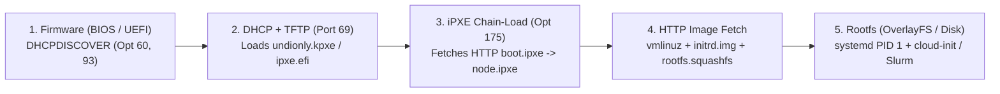

# 6.22 Provisioning with PXE, iPXE, DHCP, TFTP and image management

| | |
|---|---|
| Level | Advanced |
| Priority tier | 2 |
| Lab venue | libvirt/VirtualBox/QEMU VMs on a host-only network; or a spare rack |
| Part | Part 6: HPC and Slurm |
| Status | Drafted. `code/part06/gen_provision.py` was run on a three-node inventory and on a deliberately broken one (outputs shown). dnsmasq option names were checked against the dnsmasq(8) manual (imp/dnsmasq mirror, commit `cf08eee`, 2026-03-15); dnsmasq itself, TFTP, iPXE, and actual network boots were **not** run (no installable dnsmasq here, no privileged ports). iPXE, UEFI HTTP Boot, Kea and image-tool details are from general knowledge and the NVIDIA-DevOps notes. Labs **untested** |

## Why this matters for AI infrastructure

A GPU cluster has hundreds to thousands of nodes that must be installed, reinstalled, patched and replaced without anyone touching a keyboard. When a node is swapped after a GPU failure it must come up with the right OS image, drivers, firmware settings, name and identity within minutes. Provisioning is therefore a first-class system with its own failure modes: DHCP misconfiguration, boot storms, image drift, mismatched firmware modes. NVIDIA Base Command Manager (Part 8), xCAT and Warewulf (6.23), MAAS and Foreman all build on the mechanisms described here.

## Prerequisites and outcomes

Needs Part 1 (boot process, systemd), Part 2 (DHCP, VLANs), 6.2 (management network). After this chapter you can:

- Describe the boot chain and where network boot plugs in (BIOS vs UEFI, PXE, iPXE, HTTP boot).
- Configure a provisioning server (DHCP, TFTP, HTTP) conceptually and generate configuration from an inventory with validation.
- Choose between stateful, stateless (diskless) and hybrid node designs; explain NFS-root and squashfs+overlay.
- Build, version, test and roll out node images; manage node identity and first-boot configuration.
- Troubleshoot network-boot failures with a staged method.
- Relate xCAT, Warewulf, MAAS, Foreman, BCM and out-of-the-box stacks to this foundation.

## 1. The boot chain



1. **Firmware** (legacy BIOS or UEFI) initialises hardware, selects a boot device from the boot order (disk, USB, network).
2. **Boot loader**: from disk (GRUB, systemd-boot) or from the network (PXE ROM/UEFI network stack loads a small NBP, "network bootstrap program").
3. **Kernel + initramfs** are loaded into memory; the kernel starts, runs the initramfs (early user space: drivers, assemble the root device, possibly fetch the root image).
4. **Root file system** is mounted (local disk, NFS, squashfs image in RAM).
5. **Init**: PID 1 starts services. The SCL book contrasts **init in the SystemV style** (SysV init: shell scripts in runlevel directories, sequential) with **systemd** (units, dependencies, parallel start, cgroups, journald); modern distributions use systemd, which also matters for cgroup-based Slurm (6.8).

Local-disk boot is covered by the book's "Booting from Hard Disk" (MBR/partitions/GRUB and initrd); this chapter concentrates on the network paths.

## 2. Network boot protocols

### DHCP

A node's firmware broadcasts DHCPDISCOVER; the server returns IP, router, DNS, and **boot information**: next-server (`siaddr`) and boot file name (`file`, option 67), plus vendor options. The client identifies itself with options such as **60** (vendor class: `PXEClient`, `HTTPClient`) and **93** (client system architecture: 0 = x86 BIOS, 7 and 9 = x64 UEFI, 16 = x64 UEFI HTTP, 11 = ARM64 UEFI; values from the PXE/UEFI specifications). The server uses these to send different boot files for BIOS, UEFI and HTTP clients. Static assignment by MAC address (`dhcp-host=mac,name,ip` in dnsmasq, `host` blocks in ISC dhcpd, reservations in Kea) gives each node a stable identity; an unknown MAC gets a **discovery pool** address and is added to the inventory (6.23).

Servers: ISC `dhcpd` (end-of-life, widely deployed), **ISC Kea** (its successor, JSON config, hooks, database backends), **dnsmasq** (lightweight DHCP+TFTP+DNS, popular in small and medium clusters, used inside many deployment tools), vendor appliances. Run one authoritative DHCP server per provisioning VLAN; two DHCP servers on one segment cause intermittent wrong-image boots. Disable DHCP relay surprises: the switch must forward DHCP between VLANs only intentionally (`ip helper-address`).

### TFTP and PXE

**PXE** (Preboot Execution Environment) is firmware-resident: it obtains DHCP, downloads the boot file by **TFTP** (Trivial File Transfer Protocol, UDP port 69, RFC 1350), and executes it. TFTP is simple enough to implement in a NIC ROM. Its reputation for slowness comes from its default stop-and-wait protocol with 512-byte blocks; modern servers and clients negotiate larger block sizes (`blksize`, RFC 2348) and windows (`windowsize`, RFC 7440), which makes it adequate for the small bootloader. Large kernels and initramfs should not travel over TFTP on big clusters; they should travel over HTTP. TFTP has no authentication or encryption, and in a "boot storm" (a rack power-cycles) hundreds of simultaneous UDP transfers can overwhelm a single server: stage boot, spread over several servers, rate-limit, or use HTTP.

### iPXE

**iPXE** is an open-source network boot firmware that adds a scriptable shell, HTTP/HTTPS, iSCSI, and many NIC drivers. The usual pattern is **chain loading**: PXE ROM fetches `undionly.kpxe` (BIOS) or `ipxe.efi` (UEFI) over TFTP, then iPXE starts, re-runs DHCP and recognises itself via DHCP **option 175** (the dnsmasq tag `ipxe`), and the server then hands it an HTTP URL to a script instead of another binary. This avoids the infinite loop where iPXE keeps being chain-loaded. A script is a few lines:

```text
#!ipxe
dhcp
kernel http://10.10.0.1:8080/images/dgx-os-24.04/vmlinuz ip=dhcp root=live:http://.../rootfs.squashfs hostname=gpu001
initrd http://10.10.0.1:8080/images/dgx-os-24.04/initrd.img
boot || goto failed
```

Scripts can branch on variables (`${mac}`, `${hostname}`, `${uuid}`, `${serial}`, `${asset}`), chain per-node scripts, and fall back to a discovery or rescue image. Because they run as text on an HTTP server, per-node and per-role images are easy to manage and audit.

### UEFI HTTP Boot

Modern UEFI firmware can boot directly over HTTP(S) without PXE/TFTP: the DHCP offer carries a boot URL in option 67 and vendor class `HTTPClient` (client architecture 16). The firmware downloads the boot file (often `grubx64.efi` or `shimx64.efi`) over TCP, which allows full-speed transfer, TLS, and standard web servers. Differences from PXE: the DHCP server must answer HTTPClient requests with a URL (not a filename relative to TFTP) and option 60 `HTTPClient`; DNS names require the firmware to resolve; HTTPS needs the CA certificate enrolled in firmware. NVIDIA DGX systems and many servers support UEFI HTTP Boot; BCM uses its own boot flow built on these primitives (Part 8). The NVIDIA-DevOps note that "TFTP has no window scaling and needs an ACK per 512-byte block" is the default behaviour only, as above; the conclusion (use HTTP for large payloads) stands.

A Kea client-class sketch for serving different boot files (general knowledge, adapt and validate with `kea-dhcp4 -t`):

```json
{ "Dhcp4": {
  "client-classes": [
    { "name": "HTTPClient", "test": "option[93].hex == 0x0010",
      "option-data": [ { "name": "vendor-class-identifier", "data": "HTTPClient" } ],
      "boot-file-name": "http://10.10.0.1:8080/boot/shimx64.efi" },
    { "name": "UEFI_PXE", "test": "option[93].hex == 0x0007", "boot-file-name": "ipxe.efi" }
  ] } }
```

(The class test must exist: a bare `boot-file-name` at the subnet level, as in some tutorials, sends the same file to every client, including PXE clients that cannot fetch HTTP URLs.)

## 3. A tested generator

Hand-editing DHCP files for a thousand nodes is how typos reach production. `code/part06/gen_provision.py` reads an inventory CSV (`name,mac,ip,bmc_mac,bmc_ip,role,image`), **validates** it (hostname syntax, MAC syntax, subnet membership, duplicates), then emits a `dnsmasq.conf` and one iPXE script per node plus a `boot.ipxe` dispatcher. Using option names from the dnsmasq(8) manual (`dhcp-range`, `dhcp-host`, `dhcp-match` with `option:client-arch` and the special number 175 for iPXE, `dhcp-boot=[tag:<tag>,]<filename>`, `enable-tftp`, `tftp-root`, `port=0`). Input of three nodes produced:

```text
# DHCP+TFTP only; DNS is served elsewhere
port=0
enable-tftp
tftp-root=/srv/tftp
dhcp-authoritative
# discovery pools for unknown machines
dhcp-range=10.10.3.232,10.10.7.207,255.255.0.0,1h
dhcp-range=10.20.3.232,10.20.7.207,255.255.0.0,1h
dhcp-match=set:ipxe,175
dhcp-match=set:efi64,option:client-arch,7
dhcp-match=set:efi64,option:client-arch,9
dhcp-boot=tag:!ipxe,tag:efi64,ipxe.efi
dhcp-boot=tag:!ipxe,tag:!efi64,undionly.kpxe
dhcp-boot=tag:ipxe,http://10.10.0.1:8080/boot.ipxe
dhcp-host=aa:bb:cc:00:00:01,gpu001,10.10.1.1,set:gpu
dhcp-host=aa:bb:cc:10:00:01,gpu001-bmc,10.20.1.1
...
```

and `ipxe/gpu001.ipxe` with the kernel/initrd/root lines for that node's image. A second, deliberately broken inventory (duplicate MAC and IP, BMC address outside its subnet, uppercase/underscore hostname, malformed MAC) was rejected with five errors and no files written:

```text
ERROR gpu002: bmc_ip 10.30.1.2 not in 10.20.0.0/16
ERROR duplicate mac aa:bb:cc:00:00:01 (gpu001 and gpu002)
ERROR duplicate ip 10.10.1.1 (gpu001 and gpu002)
ERROR GPU_3: invalid hostname
ERROR GPU_3: bad mac 'aa:bb:cc:00:00:zz'
```

Limits: the discovery pool arithmetic is naive (fixed offsets), dnsmasq itself was not available to run its `--test` syntax check (do that in CI: `dnsmasq --test -C dnsmasq.conf`), one image per node, no IPv6, no secure boot signing. The principle matters more than the script: **inventory is the source of truth (in Git); everything else is generated and validated**. The same pattern drives BCM, MAAS and Foreman, which keep the inventory in a database.

## 4. Stateless, stateful and hybrid nodes

| Design | How it works | Pros | Cons |
|---|---|---|---|
| **Stateful (installed)** | OS on local disk installed by Kickstart/preseed/autoinstall; config management maintains it | Boots fast, survives provisioning-server outage, familiar | Drift between nodes; reinstall is slow; disk wear/failure |
| **Stateless (diskless/RAM-root)** | Image downloaded at every boot into RAM (squashfs + overlay or tmpfs); reboot = clean state | Perfect consistency; reimage = reboot; replace a node with no residue | Needs RAM for the OS (GBs, trivial on GPU nodes with 1-2 TB), boot-time image download, provisioning must be highly available |
| **NFS root** | Root mounted read-only (often with per-node overlay) from an NFS server | Smaller RAM, changes visible instantly | NFS server becomes critical path and bottleneck; boot storms; latency |
| **Hybrid** | Read-only image in RAM plus local NVMe for scratch/logs/containers | Best of both; the common GPU-cluster choice | Need to manage persistent per-node state (SSH host keys, machine-id, logs) |

Compression and layering: root image as a squashfs (compressed, read-only), writable layer as tmpfs or overlayfs on local NVMe, optional "node-local config overlay" applied at boot. Persistent identity needs deliberate handling: SSH host keys, `machine-id`, hostname (from DHCP/hostname hook), Munge key (6.7), GPU/NIC configuration, and credentials; inject them from the provisioning server or a secret store at first boot, not baked into shared images.

The book's chapter on booting describes the classic composition for diskless nodes: PXE ROM, DHCP, TFTP kernel/initrd, **NFS-root** (and a read-only common tree with per-node writable parts), and it also covers building an initrd for that. Today's equivalents use HTTP-delivered squashfs and `dracut` (RHEL family) or `initramfs-tools`/`mkinitramfs` (Debian family) with live-boot hooks, or vendor tooling.

## 5. Image management

An **image** is the node's root file system plus kernel and initramfs. Good practice:

1. **Build reproducibly** from a definition under version control: `debootstrap`/`mmdebstrap` (Debian family), `dnf --installroot` or `mock`/`kiwi` (RHEL family), `mkosi`, `Packer` with a chroot/QEMU builder, container-based builds (build a container image, export the rootfs), or the cluster manager's image tooling (BCM software images, Warewulf containers). Pin package repositories to snapshots (or a local mirror) so rebuilds are repeatable.
2. **Layer** by role: a base OS layer, a GPU layer (driver, CUDA, DCGM, NCCL, fabric manager, Mellanox OFED/DOCA), a Slurm layer, and role overlays (login, compute, storage gateway). Keep drivers coupled to the kernel in the same image build.
3. **Test before promoting**: boot the candidate on a canary node group; run health checks (6.14), a GPU smoke test, NCCL test, a small Slurm job, storage mount checks; only then promote. Keep the previous image for instant rollback (a pointer change, since images are files).
4. **Version and sign**: semantic names with date (`dgx-os-24.04-2026-10-24`), store checksums, sign with a key if secure boot/shim chain is used.
5. **Roll out in waves** (rings): nodes assigned to an image via inventory attribute or iPXE script; drain nodes via Slurm before rebooting (`scontrol reboot ASAP nextstate=resume`, 6.14).
6. **Keep the image minimal**; put frequently changing software in modules/containers (6.6, 6.13), not in the base image.
7. **Config at boot**: cloud-init, Ignition, systemd units, or cluster-manager agents apply node-specific configuration (hostname, network, mounts, Slurm node name) from metadata; avoid per-node image builds.
8. **Firmware and BIOS** state is part of provisioning (settings via Redfish, Part 7; firmware baselines, 6.14/Part 9): enforce a known BIOS profile (boot mode UEFI, SR-IOV, NUMA, power profile) before the OS image matters.
9. **Security**: restrict who can change boot scripts and images; serve images only on the provisioning VLAN; use HTTPS with a private CA where firmware supports it; keep BMC and provisioning networks isolated (Part 18).

## 6. Node identity and lifecycle

A node's lifecycle: **racked** (physical), **discovered** (MAC seen by DHCP in the discovery pool, or imported from a vendor manifest), **registered** (named, assigned role/image, BMC credentials set), **provisioned** (image booted), **configured** (first-boot config, joins Slurm/Kubernetes), **in service**, **drained/failed** (6.14), **replaced** (new hardware inherits the old name by updating MAC addresses in inventory) or **decommissioned**. Good inventories also track serial numbers, asset tags, rack/U position, switch ports (from LLDP), firmware versions and warranty.

Discovery methods: DHCP logs showing unknown MACs, switch MAC tables per port (maps MAC to rack position), BMC Redfish queries (Part 7), or vendor-supplied CSVs. Use LLDP/port mapping so that a node's identity follows its physical location, which makes replacement a one-line inventory edit.

## 7. Cluster managers built on this foundation

(Detailed in 6.23 and Part 8; the SCL book's chapters 25 and 26.)

- **ROCKS** (historic Rocks Clusters, developed by the National Partnership for Advanced compute Infrastructure and San Diego Supercomputer Center in `2000`; based on the RedHat distribution and CentOS with a modified version of the RedHat `anaconda` auto-installer, storing all cluster configuration information in a `MySQL` database; `http://www.rocksclusters.org/`): divides the distribution into modular **Roll CDs** with software suites (for example `Base`, `HPC`, `Java`, `Lustre`, and `Ganglia`), allowing you to create custom Roll CDs and update installed software from new Roll CD images. In the book's installation walkthrough `(untested here)`:
  1. Boot the head node from the **Base Roll CD** and enter `frontend` mode at the boot prompt (instead of the default `compute` mode).
  2. When prompted `"Do you have a roll CD/DVD?"`, answer `"Yes"`, insert the **HPC Roll CD**, then answer `"No"` and re-insert the Base Roll CD; use `Autopartition` and configure the internal cluster NIC manually (unselecting `"configure using DHCP"`).
  3. After the head node reboots, log in as `root`, run `insert-ethers` `(untested here)`, and choose `compute`. Power on each compute node in PXE network-boot mode: `insert-ethers` captures each booting node's MAC address, assigns its hostname/IP in the MySQL database, and provisions its image over the network. Press `F1` to exit `insert-ethers` once all compute nodes are registered.
  4. Create a user (`useradd USERNAME`), initialize SSH keys with `ssh-agent $SHELL` and `ssh-add`, and launch jobs either manually (`/opt/mpich/gnu/bin/mpirun -nolocal -np 2 -machinefile machines ./myexe`) or through the default **Grid Engine** batch system (`qsub sge-run-script.sh`) `(untested here)`.
- **Parallel Knoppix/PelicanHPC** (`https://sourceforge.net/projects/pelicanhpc/`): a Debian-based **LiveCD / LiveUSB** stack designed to turn a BeoWulf-class cluster assembled from improvised materials, or an idle classroom or office of workstations at night, into a temporary diskless computing cluster (including OpenMPI, parallel versions of Linpack and Octave, and `apt-get` `.deb` package delivery) without modifying local hard drives. While out-of-the-box LiveCD stacks have lower flexibility than custom-built clusters, spending a day setting up a deployment system lets you install an entire cluster in an hour and expand or reconfigure it in half an hour (`SCL` Chapter 25). In the book's walkthrough `(untested here)`:
  1. Boot the head machine from the LiveCD (`Start Debian Live`), choose where `/home` lives (RAM disk by default, or persistent mount options documented in `/home/user/pelican_config`), and replace the default password (`PleaseChangeMe`) for account `user` (optionally starting Xfce with `startx`).
  2. Run `pelican_setup` `(untested here)` and select the network interface connected to the cluster LAN (taking care not to start PelicanHPC's DHCP server on a corporate LAN).
  3. Confirm service startup (`DHCP`, `TFTP`, `NFS`) and PXE-boot the compute nodes until they display `"This is a PelicanHPC compute node."`.
  4. PelicanHPC writes the discovered node list to `/home/user/tmp/bhosts`; whenever you add or remove compute nodes later, run `pelican_restart_hpc` `(untested here)` to refresh the cluster configuration.
- **xCAT** (IBM/Lenovo lineage): DHCP/TFTP/DNS, node definitions in a database, `nodeset`, `rpower`, `rinstall`, stateless/statelite/diskful images, hierarchies of service nodes.
- **Warewulf 4**: container-based stateless provisioning, simple and popular.
- **Canonical MAAS**: bare-metal cloud (discover, commission, deploy Ubuntu), API-driven; **Foreman** with Katello/Puppet: lifecycle management for mixed fleets.
- **NVIDIA Base Command Manager (BCM)**: the NVIDIA-supported cluster manager: head node, software images, categories, node discovery, provisioning, health, Slurm/Kubernetes integration (Part 8).

## 8. Boot triage

A staged method (the NVIDIA-DevOps notes call it D-T-B-I; the stages are standard):

| Stage | Question | Checks |
|---|---|---|
| **D**HCP | Did the node get an address and the right boot information? | Console/BMC serial-over-LAN shows "DHCP..."; on the provisioning host `tcpdump -i eth1 -n -vvv port 67 or port 68`; server logs (`log-dhcp` in dnsmasq, Kea logs); correct VLAN/relay; MAC in inventory; only one DHCP server answering; option 93 value seen |
| **T**ransfer | Did the bootloader download? | TFTP: `tcpdump port 69`, server log, file path under `tftp-root`, permissions, firewall (TFTP uses ephemeral ports after the first packet, which stateful firewalls must allow); HTTP: web server access log, status codes, URL reachable from the node network |
| **B**oot-mode | Does the binary match the firmware? | UEFI vs BIOS (`ipxe.efi` vs `undionly.kpxe`), architecture (x86_64 vs ARM64), Secure Boot signing (shim), correct NIC driver in iPXE (some NICs need a specific build) |
| **I**mage | Did kernel, initramfs and root load and start the OS? | Serial console output of the kernel, initramfs shell (`rd.break`), missing NIC driver in initramfs (no network to fetch rootfs), wrong `root=`/URL, not enough RAM for the image, DNS failures, time/TLS errors |

Common specific causes: two DHCP servers; PXE client sent to relay that drops option 60/93; boot order (disk before network after the first install, so the node does not reimage: set via IPMI `chassis bootdev pxe options=efiboot` or Redfish `BootSourceOverrideTarget`); firmware set to legacy while the server offers UEFI binaries; Secure Boot rejecting unsigned iPXE; a big initramfs over TFTP timing out; storm of 500 nodes against one HTTP server (add caching or multiple mirrors); node's MAC changed after a NIC/board swap; stale ARP/DHCP lease for a replaced node; wrong VLAN on the switch port (PXE only works untagged unless the NIC firmware supports VLAN tagging).

Always get **serial-over-LAN** or BMC console access (Part 7) before debugging remotely.

## 9. Lab

First, run the self-checking Python lab (`code/part06/gen_provision_lab.py`) locally. It verifies `validate()`, `dnsmasq_conf()`, and `ipxe_node()` in `code/part06/gen_provision.py` on a valid 3-node inventory (checking `dhcp-match=set:ipxe,175` chain-load loop prevention, BIOS `undionly.kpxe` vs UEFI `ipxe.efi`, and per-node HTTP `rootfs.squashfs` `.ipxe` scripts), verifies that the broken inventory is rejected with all 5 expected errors (subnet mismatch, duplicate MAC, duplicate IP, invalid hostname, malformed MAC), and checks DHCP Option `93` architecture codes (`0, 7, 9, 11, 16=0x0010`) and TFTP RFC `1350`/`2348`/`7440` parameters:

```bash
python3 code/part06/gen_provision_lab.py
```

Tested: run the generator on the sample inventory and the broken one; extend `validate()` to check that BMC IPs are in a different /16 than node IPs and that role values come from an allowed list; add a `--check` mode that only validates.

Untested (two VMs on a host-only network): 1) set up dnsmasq (DHCP+TFTP) with a BIOS client and boot an iPXE ROM, then chain to an HTTP script that boots a small live image. 2) Switch the VM to UEFI and observe the different boot file; add `ipxe.efi`. 3) Add per-node scripts; boot two clients with different images. 4) Intentionally run two DHCP servers and capture the intermittent failure with tcpdump. 5) Boot a stateless node with squashfs+overlay; reboot to show clean state; add a persistent overlay for logs. 6) Practise D-T-B-I: break each stage and write the symptom. 7) Time a boot storm of ten VMs against one TFTP server vs an HTTP server.

## 10. Interview angles

- Walk through a PXE boot from power-on to a running OS.
- PXE versus iPXE versus UEFI HTTP Boot: differences and when to use each.
- Why chain-load iPXE, and how does option 175 prevent a loop?
- Stateless versus stateful nodes: trade-offs for a GPU cluster.
- A node reimages itself every reboot. Why, and how do you stop it?
- How do you roll out a new OS image to 1,000 nodes safely?
- How do you keep node identity when hardware is replaced?
- Two DHCP servers on one VLAN: symptoms and fix.
- What belongs in the image versus modules/containers?

## Exercises

1. **Generating and Validating `dnsmasq.conf` and iPXE Scripts (`code/part06/gen_provision.py` & `gen_provision_lab.py`):** Run `python3 code/part06/gen_provision_lab.py`. Explain how `validate()` catches all 5 inventory mistakes (`bmc_ip` outside `10.20.0.0/16`, duplicate MAC, duplicate IP, uppercase/underscore hostname `GPU_3`, and non-hex MAC `'aa:bb:cc:00:00:zz'`), and how `dnsmasq_conf()` uses `dhcp-match=set:ipxe,175` and `option:client-arch` (`7` and `9`) to chain-load `ipxe.efi` / `undionly.kpxe` into `http://10.10.0.1:8080/boot.ipxe`.
2. **Configuring ISC Kea Client Classes for BIOS PXE, UEFI PXE, and UEFI HTTP Boot:** Write the Kea `Dhcp4` `client-classes` configuration distinguishing `option[93].hex == 0x0000` (`undionly.kpxe`), `option[93].hex == 0x0007` (`ipxe.efi`), and `option[93].hex == 0x0010` (`HTTPClient` with `http://10.10.0.1:8080/boot/shimx64.efi`). Explain what breaks if `boot-file-name` is set globally at the subnet level without client classes.
3. **Comparing Stateless (`RAM-root`), Stateful (`Diskful`), `NFS-root`, and Hybrid Node Provisioning:** Compare the boot speed, RAM consumption, provisioning-server HA dependency, and configuration-drift trade-offs of all four models on a 512-node H100 cluster (where each node has 2 TB host RAM and 8 local NVMe drives), and explain how SSH host keys, `/etc/machine-id`, and `/etc/munge/munge.key` are persisted or injected in a hybrid RAM-root + local-NVMe design.
4. **Building, Testing, and Rolling Out a Versioned GPU OS Image in Rings:** Design a 5-step image promotion pipeline for `dgx-os-24.04-2026-10-24` (layered with matched kernel, NVIDIA driver, CUDA, DCGM, MOFED/DOCA, and `slurmd`), including canary validation (`node_health.sh`, `nccl-tests`), rolling wave assignment in the inventory CSV, drain-aware reboots (`scontrol reboot ASAP nextstate=resume`), and one-line iPXE pointer rollback.
5. **Applying the `D-T-B-I` Network Boot Triage Method:** Given four non-booting nodes—(a) serial console hangs at `DHCP....`, (b) TFTP times out downloading `initrd.img` during a 200-node rack power-on, (c) UEFI screen flashes `Server response timeout` or `Security Violation` immediately after downloading `ipxe.efi`, and (d) kernel boots but drops into the `dracut` / `initramfs` emergency shell unable to fetch `rootfs.squashfs`—diagnose the exact stage (`D`, `T`, `B`, or `I`) and state the fix for each.
6. **Comparing Out-of-the-Box Stacks (`ROCKS` and `Parallel Knoppix/PelicanHPC`) with Modern Provisioners (`SCL` Chapter 25):** Contrast how `ROCKS` (`frontend` mode, `Base` + `HPC` Roll CDs, `insert-ethers` PXE MAC capture into MySQL, `F1` exit, Grid Engine `qsub`) and `Parallel Knoppix/PelicanHPC` (`pelican_setup`, `/home/user/tmp/bhosts`, `pelican_restart_hpc`) provision compute nodes compared to xCAT, Warewulf 4, and NVIDIA Base Command Manager (BCM).

## Checkpoint

<details>
<summary>1. List the five stages of the Linux boot chain and state how network booting replaces stages 2–4 (`SCL` Chapter 23).</summary>

1. **Firmware (`BIOS` or `UEFI`):** Initializes hardware and selects the network boot device.
2. **Bootloader (`NBP`):** Firmware PXE/HTTP client fetches `undionly.kpxe`, `ipxe.efi`, or `shimx64.efi`/`grubx64.efi` over TFTP/HTTP instead of reading GRUB from a local disk.
3. **Kernel (`vmlinuz`) + `initramfs` (`initrd.img`):** Downloaded into RAM over HTTP/TFTP; `initramfs` loads NIC/storage drivers and assembles the root filesystem.
4. **Root filesystem (`/`):** Mounted from a downloaded `rootfs.squashfs` + `overlayfs` in RAM, an `NFS-root` export, or a newly partitioned local disk.
5. **Init (`PID 1`):** `systemd` (parallel unit graph with cgroups, replacing sequential SysV init runlevel scripts) starts system and cluster services (`munged`, `slurmd`).
</details>

<details>
<summary>2. Which DHCP options carry the boot server, boot filename/URL, vendor class, and client CPU/firmware architecture?</summary>

- **`siaddr` (`next-server`):** IP address of the TFTPboot server.
- **Option `67` (`boot-file-name`):** TFTP boot filename (e.g., `ipxe.efi`) or HTTP Boot URL (`http://.../shimx64.efi`).
- **Option `60` (`vendor-class-identifier`):** Identifies `PXEClient` vs `HTTPClient`.
- **Option `93` (`client-arch`):** Identifies client firmware architecture: `0` = x86 legacy BIOS, `7` and `9` = x86_64 UEFI, `11` = ARM64 UEFI, `16` (`0x0010`) = x86_64 UEFI HTTP Boot.
</details>

<details>
<summary>3. Why does running two uncoordinated DHCP servers on the same provisioning VLAN cause intermittent boot failures?</summary>

DHCP uses broadcast `DHCPDISCOVER` messages, and the client accepts whichever `DHCPOFFER` arrives first. If a rogue or corporate DHCP server (without `next-server` / Option `67`) answers faster than the cluster provisioning server, the compute node receives an IP address with no boot image and fails PXE boot intermittently.
</details>

<details>
<summary>4. Why is classic **TFTP** (UDP port `69`, RFC `1350`) slow over high-latency or congested links, and what RFC extensions and architectural pattern solve it?</summary>

By default, RFC `1350` TFTP is a stop-and-wait protocol that sends **one `512`-byte block at a time** and waits for an explicit UDP `ACK` before sending the next block. RFC `2348` (`blksize`) and RFC `7440` (`windowsize`) negotiate larger blocks and sliding windows, and **chain-loading iPXE** transfers only the tiny (~1 MB) `ipxe.efi` binary over TFTP before switching to multi-gigabit **TCP HTTP** for the large kernel, initramfs, and multi-GB `rootfs.squashfs`.
</details>

<details>
<summary>5. Explain **iPXE chain-loading** and how DHCP **Option `175`** prevents an infinite boot loop (`code/part06/gen_provision.py`).</summary>

1. On first boot, the NIC's built-in PXE ROM sends a DHCP request *without* Option `175`. `dnsmasq` matches `tag:!ipxe` and serves `ipxe.efi` (UEFI) or `undionly.kpxe` (BIOS) over TFTP.
2. When `iPXE` starts, it sends a second DHCP request that includes **Option `175`** (`dhcp-match=set:ipxe,175`).
3. `dnsmasq` sees `tag:ipxe` and replies with `http://10.10.0.1:8080/boot.ipxe` instead of `ipxe.efi`, breaking the loop and handing control to the HTTP boot script.
</details>

<details>
<summary>6. How does **UEFI HTTP Boot** differ from PXE + TFTP?</summary>

UEFI HTTP Boot (Option `93` = `16` / `0x0010`, Option `60` = `HTTPClient`) uses a TCP/HTTP(S) stack built directly into modern server UEFI firmware to download the bootloader (`shimx64.efi` / `grubx64.efi`) and OS artifacts from a standard web server—eliminating TFTP (UDP port `69`) entirely and supporting TLS certificate verification.
</details>

<details>
<summary>7. What five validation checks does `code/part06/gen_provision.py` enforce on the cluster inventory CSV before writing `dnsmasq.conf`?</summary>

1. Valid lowercase hostname syntax (`[a-z][a-z0-9-]*`).
2. Host IP (`ip`) is a valid IPv4 address within `--subnet` (`10.10.0.0/16`).
3. BMC IP (`bmc_ip`) is a valid IPv4 address within `--bmc-subnet` (`10.20.0.0/16`).
4. Host MAC (`mac`) and BMC MAC (`bmc_mac`) match 6-octet hex syntax (`([0-9a-f]{2}:){5}[0-9a-f]{2}`).
5. Zero duplicate hostnames, MAC addresses, or IP addresses across the entire inventory.
</details>

<details>
<summary>8. Compare **Stateless (RAM-root)**, **Stateful (local-disk install)**, **NFS-root**, and **Hybrid** node provisioning on a GPU cluster.</summary>

- **Stateful (diskful):** Fast local reboot and survives provisioning server outages, but suffers from package/config drift across nodes and slow reinstalls.
- **Stateless (RAM-root `squashfs` + `tmpfs`):** Zero drift (every reboot gives a byte-identical clean OS) and no boot-disk failure risk; costs a few GBs of RAM (negligible on 1–2 TB GPU nodes) and requires HA HTTP provisioning servers.
- **NFS-root:** Minimal RAM usage, but puts the NFS server on the critical path for every binary load and creates a single point of failure.
- **Hybrid (RAM-root `squashfs` + local NVMe for `/tmp`, `/var/log`, and `ENROOT_DATA_PATH`):** Combines stateless OS immutability with local NVMe scratch speed—the standard pattern for large GPU clusters.
</details>

<details>
<summary>9. Which per-node identity artifacts must never be baked into a shared golden OS image and must instead be injected at boot?</summary>

1. Hostname and static/DHCP network configuration.
2. `/etc/machine-id` (must be unique per node for systemd/journald).
3. SSH host keys (`/etc/ssh/ssh_host_*_key`), so `known_hosts` does not break after every stateless reboot.
4. Cluster secrets (`/etc/munge/munge.key`, TLS certificates), injected from a secure store or provisioning metadata channel.
</details>

<details>
<summary>10. Why must the NVIDIA kernel driver (`nvidia.ko`), Mellanox OFED (`mlx5_core`), and kernel (`vmlinuz`) be coupled in the same immutable node image build?</summary>

Kernel modules (`nvidia.ko`, `nvidia-modeset.ko`, `nvidia-uvm.ko`, ` nvidia-peermem.ko`, `nvidia-fs.ko`, and `mlx5_ib.ko`) compile against exact kernel ABI symbols. Building and versioning the kernel, GPU driver, and RDMA stack together in one immutable `rootfs.squashfs` image (`dgx-os-24.04-2026-10-24`) eliminates runtime DKMS compile failures and driver-to-fabric mismatches.
</details>

<details>
<summary>11. How do you roll out a new OS image across a 1,000-node Slurm GPU cluster without disrupting running training jobs?</summary>

1. Boot and validate the candidate image on a canary node group (`node_health.sh`, DCGM, multi-node `nccl-tests`).
2. Update the target wave's image pointer in the Git inventory and regenerate the iPXE scripts.
3. Run **`scontrol reboot ASAP nextstate=resume reason="image upgrade dgx-os-24.04-2026-10-24" gpu[001-100]`** so Slurm drains each node, reboots it into the new iPXE image as soon as its running jobs finish, runs `HealthCheckProgram`, and returns it to service. Keep the old image on the HTTP server for instant pointer rollback.
</details>

<details>
<summary>12. How do switch **LLDP / MAC port tables** make replacing a failed bare-metal GPU node a zero-touch operation?</summary>

When the top-of-rack switch maps each physical switch port (`sw01:Ethernet1/14`) to a logical node identity (`gpu014` in Rack 2, U10), replacing a dead motherboard or NIC automatically associates the new MAC address seen on `sw01:Ethernet1/14` (or discovered via DHCP/Redfish) with `gpu014`'s IP, hostname, and iPXE script.
</details>

<details>
<summary>13. How does **ROCKS** organize software packages and discover PXE-booting compute nodes (`SCL` Chapter 25)?</summary>

Developed by NPACI and SDSC in 2000 on RedHat/CentOS with a modified `anaconda` installer and a `MySQL` configuration database, **ROCKS** packages software suites into modular **Roll CDs** (`Base`, `HPC`, `Java`, `Lustre`, `Ganglia`). After installing the head node in `frontend` mode, the admin runs **`insert-ethers`** (selecting `compute`) and PXE-boots the compute nodes; `insert-ethers` captures each node's MAC address, registers it in MySQL, and installs its image until the admin presses **`F1`** to exit.
</details>

<details>
<summary>14. What is **Parallel Knoppix/PelicanHPC**, and which commands initialize and refresh its diskless compute nodes (`SCL` Chapter 25)?</summary>

**Parallel Knoppix/PelicanHPC** (`https://sourceforge.net/projects/pelicanhpc/`) is a Debian-based **LiveCD / LiveUSB** distribution that turns a classroom or office of workstations into a temporary diskless BeoWulf cluster (bundling OpenMPI, Linpack, and Octave). After booting the head node and setting the `user` password, running **`pelican_setup`** starts DHCP, TFTP, and NFS on the selected cluster NIC, PXE-boots compute nodes, and writes the node list to **`/home/user/tmp/bhosts`**. Running **`pelican_restart_hpc`** refreshes the cluster when nodes are added or removed.
</details>

<details>
<summary>15. State the four stages of the **D-T-B-I** network-boot troubleshooting method and the primary diagnostic tool for each.</summary>

1. **D — DHCP:** Did the node receive an IP, `next-server`, and Option `67` boot file? Check `tcpdump -i <iface> -n -vvv port 67 or port 68` and `dnsmasq`/`Kea` DHCP logs.
2. **T — Transfer:** Did the bootloader download over TFTP (port `69`) or HTTP? Check `tcpdump port 69`, TFTP file permissions under `tftp-root`, firewall ephemeral UDP tracking, and HTTP access logs.
3. **B — Boot-mode:** Does the NBP binary match the firmware mode (`ipxe.efi` for UEFI vs `undionly.kpxe` for BIOS, x86_64 vs ARM64, and Secure Boot `shim` signatures)? Check BMC Serial-over-LAN / iKVM console.
4. **I — Image:** Did `vmlinuz` and `initrd.img` load NIC drivers, fetch `rootfs.squashfs`, and start `systemd`? Check serial console kernel logs (`console=ttyS0,115200`) and `rd.break` initramfs shell.
</details>

<details>
<summary>16. A stateful node finishes its Kickstart/autoinstall OS installation onto local NVMe, reboots, and immediately starts reinstalling itself again in an infinite loop. Why, and how do you prevent it?</summary>

The node's BIOS/UEFI boot order still lists **Network (PXE)** ahead of the local NVMe disk, and the provisioning server's iPXE script for that MAC address still points to the OS installer instead of `exit` / `sanboot` (local disk boot). Fix by having the installer's post-install webhook flip the node's iPXE state to `localboot` on the provisioning server, or use one-time PXE boot overrides (`ipmitool chassis bootdev pxe options=efiboot` or Redfish `BootSourceOverrideEnabled: Once`).
</details>

<details>
<summary>17. Why does a stateless node boot kernel `vmlinuz` and `initrd.img` fine over iPXE, but then fail inside `initramfs` with `Connection timed out` when fetching `rootfs.squashfs`?</summary>

`iPXE` used its own UNDI/SNP driver to download `vmlinuz` and `initrd.img`, but once the Linux kernel took over, **`initramfs` lacked the Linux kernel driver for the provisioning NIC** (or lacked the VLAN/bonding configuration needed on that switch port) to bring up networking and HTTP-fetch `rootfs.squashfs`. Rebuild `initramfs` (`dracut --add-drivers ...`) with the required NIC driver included.
</details>

<details>
<summary>18. Why does TFTP often fail across a stateful firewall even when UDP port `69` is open?</summary>

In TFTP (RFC `1350`), only the client's initial `RRQ` (Read Request) packet goes to destination **UDP port `69`**. The TFTP server sends all subsequent data packets from a **random ephemeral UDP source port** back to the client's port. Unless the firewall loads the state-tracking helper module (`nf_conntrack_tftp`) or allows the ephemeral UDP range on the provisioning VLAN, the server's data packets are dropped.
</details>

<details>
<summary>19. How do you prevent a **boot storm** when an entire 256-node GPU pod power-cycles simultaneously?</summary>

1. Stagger node power-on via BMC/PDU scripting (e.g., 1–2 second delay per node or rack wave; `SCL` Chapter 23).
2. Chain-load iPXE so the multi-gigabyte `rootfs.squashfs` transfers over **HTTP** (backed by `nginx` worker pools, local NVMe sendfile, or hierarchical service/caching nodes) rather than single-threaded UDP TFTP.
</details>

<details>
<summary>20. Why does `gen_provision.py` set `port=0` in `dnsmasq.conf`?</summary>

Setting **`port=0`** disables `dnsmasq`'s built-in DNS server so `dnsmasq` runs purely as a **DHCP + TFTP server**, avoiding port `53` conflicts with an existing cluster DNS server (`named`/Unbound/`systemd-resolved`).
</details>

## Sources and review notes

- Book source (`supercomputers-for-linux-sysadmins-managing-modern-hpc-clusters-and-supercomputers-from-software-to-hardware`, `SCL`):
  - Chapter 25 ("25. Out-of-the-Box Stacks and Deployment Systems", read in full): ROCKS cluster installation (`2000` NPACI/SDSC, RedHat/CentOS modified `anaconda`, `MySQL` database, `Base` and `HPC` Roll CDs, `frontend` boot mode, `insert-ethers` PXE discovery and `F1` exit, Grid Engine `qsub`, `http://www.rocksclusters.org/`) and Parallel Knoppix/PelicanHPC LiveCD setup (`https://sourceforge.net/projects/pelicanhpc/`, BeoWulf classroom/workstation cluster, `/home/user/pelican_config`, `pelican_setup`, `/home/user/tmp/bhosts`, `pelican_restart_hpc`).
  - Chapters 23, 24, and 26 (boot chain, SysV and systemd init, DHCP/TFTP/PXE/NFS-root, xCAT, MAAS, Foreman, BCM), restated in our words.
- Network boot comparison (PXE/TFTP vs UEFI HTTP Boot), Kea DHCP and the D-T-B-I triage: migrated from `nvidia-devops` (`volume-10/01-bare-metal-and-bmc-lifecycle.md` and `volume-10/03-os-provisioning-and-linux-security-hardening.md`), with two corrections: the TFTP slowness description (defaults, not a hard limit) and the Kea snippet (client classes added so that PXE clients are not given an HTTP URL).
- `dnsmasq` options verified in `dnsmasq(8)` (mirror commit `cf08eee`).
- Run here: `code/part06/gen_provision.py` and `python3 code/part06/gen_provision_lab.py` (3 passed, 0 failed).
- Explicitly labelled inferences: The `GOOD_ROWS` and `BAD_ROWS` validation test cases in `code/part06/gen_provision_lab.py` are deterministic unit checks of `gen_provision.py`.
- Not verified on live hardware: iPXE script syntax details beyond common usage, Kea class tests on live hardware, ROCKS/PelicanHPC interactive installers, BCM and MAAS live provisioning, and server UEFI HTTP Boot firmware quirks (`untested here`).
