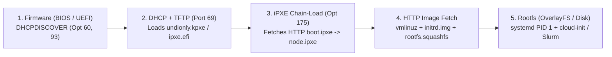

# 6.22 Provisioning with PXE, iPXE, DHCP, TFTP and image management

| | |
|---|---|
| Level | Advanced |
| Priority tier | 2 |
| Lab venue | libvirt/VirtualBox/QEMU VMs on a host-only network; or a spare rack |
| Part | Part 6: HPC and Slurm |
| Status | Drafted. `code/part06/gen_provision.py` was run on a three-node inventory and on a deliberately broken one (outputs shown). dnsmasq option names were checked against the dnsmasq(8) manual (imp/dnsmasq mirror, commit `cf08eee`, 2026-03-15); dnsmasq itself, TFTP, iPXE, and actual network boots were **not** run (no installable dnsmasq here, no privileged ports). iPXE, UEFI HTTP Boot, Kea and image-tool details are from general knowledge and the NVIDIA-DevOps notes. Labs **untested** |

## Why this matters for AI infrastructure

Picture a GPU node that fails and has to be replaced. The new machine must come up with the right OS image, drivers, firmware settings, name and identity, and it must do so within minutes. Nobody should have to touch a keyboard. A GPU cluster has hundreds to thousands of nodes, and each one must be installed, reinstalled, patched and replaced this way.

That makes provisioning a system in its own right, with its own ways to fail. You can run into DHCP misconfiguration, boot storms, image drift or mismatched firmware modes. Several tools build on the mechanisms in this chapter. NVIDIA Base Command Manager (Part 8), xCAT and Warewulf (6.23), and MAAS and Foreman all rely on them. Learn the mechanisms first, because each of those tools is built on them.

## Prerequisites and outcomes

This chapter builds on Part 1 (boot process, systemd), Part 2 (DHCP, VLANs) and 6.2 (management network). When you finish, you should be able to do the following:

- Describe the boot chain and show where network boot plugs in, covering BIOS versus UEFI, PXE, iPXE and HTTP boot.
- Configure a provisioning server with DHCP, TFTP and HTTP at the conceptual level, and generate its configuration from an inventory with validation.
- Choose between stateful, stateless (diskless) and hybrid node designs, and explain NFS-root and squashfs+overlay.
- Build, version, test and roll out node images, and manage node identity and first-boot configuration.
- Troubleshoot network-boot failures with a staged method.
- Relate xCAT, Warewulf, MAAS, Foreman, BCM and out-of-the-box stacks to this foundation.

If Parts 1 and 2 feel unfamiliar, go back to them before the network-boot sections, because the rest of this chapter assumes them.

## 1. The boot chain

A node that will not boot can fail at any of five steps, so you should know the order. Network boot changes where some of the files come from.



1. **Firmware** starts first. The BIOS or UEFI firmware initialises the hardware and picks a boot device from the boot order, which can be disk, USB or network.
2. **Boot loader** comes next. The machine can load it from disk, using GRUB or systemd-boot. Or it can load it from the network. There, the PXE ROM or the UEFI network stack downloads a small program called an NBP, short for network bootstrap program.
3. **Kernel and initramfs** load into memory. The kernel starts and runs the initramfs, an early user space that carries drivers. The initramfs assembles the root device and may fetch the root image itself.
4. **Root file system** gets mounted. It can come from a local disk, from NFS, or from a squashfs image held in RAM.
5. **Init** is PID 1, and it starts the services. The book Supercomputers for Linux Sysadmins compares two styles. SysV init runs shell scripts from runlevel directories, one after another. systemd uses units and dependencies, starts services in parallel, and works with cgroups and journald. Modern distributions use systemd, and that matters for cgroup-based Slurm (6.8).

Local-disk boot is covered in the book's "Booting from Hard Disk" chapter. This chapter concentrates on the network paths.

Find the step where the node stopped before you change anything else, because the fix depends on that step.

## 2. Network boot protocols

### DHCP

When you power on a node, its first step is asking for an address. The node's firmware broadcasts a DHCPDISCOVER message. The server replies with an IP address, a router, a DNS server and boot information. The boot information has two parts: the next-server address (`siaddr`) and the boot file name (`file`, option 67). The server can also send vendor options.

The node says what kind of machine it is, and the server answers with the matching boot file. The node sends option 60, the vendor class, which reads `PXEClient` or `HTTPClient`. It also sends option 93, the client system architecture. The values come from the PXE and UEFI specifications, and the table below lists them.

| Option 93 value | Client firmware |
|---|---|
| 0 | x86 BIOS |
| 7 and 9 | x64 UEFI |
| 16 | x64 UEFI HTTP |
| 11 | ARM64 UEFI |

The server uses these values to hand BIOS, UEFI and HTTP clients different boot files. Static assignment gives each node a stable identity. You bind a MAC address to a fixed address with `dhcp-host=mac,name,ip` in dnsmasq, with `host` blocks in ISC dhcpd, or with reservations in Kea. An unknown MAC address gets an address from the discovery pool, and that node is then added to the inventory. The inventory chapter, 6.23, covers that step.

You have several servers to choose from. ISC `dhcpd` is end-of-life, but many clusters still run it. ISC Kea is its successor, with JSON configuration, hooks and database backends. dnsmasq is lightweight and handles DHCP, TFTP and DNS in one program, so many deployment tools use it inside small and medium clusters. Vendor appliances are another option.

Run one authoritative DHCP server per provisioning VLAN. Two DHCP servers on one segment cause intermittent wrong-image boots. Watch for relay surprises too. The switch should forward DHCP between VLANs only on purpose, using `ip helper-address`.

### TFTP and PXE

PXE, the Preboot Execution Environment, lives in the firmware of the network card. It gets an address from DHCP, downloads a boot file over TFTP (Trivial File Transfer Protocol, UDP port 69, RFC 1350), and runs that file. TFTP is simple enough to fit in a network card's ROM.

You may have heard that TFTP is slow. Its default protocol is stop-and-wait, with 512-byte blocks, so each block waits for an acknowledgement. Modern servers and clients can negotiate bigger blocks with `blksize` (RFC 2348) and bigger windows with `windowsize` (RFC 7440). With those options, TFTP is good enough for a small bootloader. Large kernels and initramfs images should not travel over TFTP on big clusters. Send them over HTTP instead.

TFTP has no authentication or encryption. Picture a rack that power-cycles at once. In that boot storm, hundreds of UDP transfers can start together and overwhelm a single server. You can stage the boot, spread the load over several servers, rate-limit the transfers, or switch to HTTP.

### iPXE

iPXE is an open-source network boot firmware. It adds a scriptable shell, HTTP and HTTPS, iSCSI, and many NIC drivers. The usual setup is chain loading. The PXE ROM first fetches `undionly.kpxe` for BIOS or `ipxe.efi` for UEFI over TFTP. Once iPXE starts, it asks DHCP again, and this time it identifies itself with DHCP option 175. The dnsmasq tag for that match is `ipxe`. The server then hands iPXE an HTTP URL that points to a script, instead of another binary. That step prevents an endless loop in which iPXE keeps loading itself.

A script is only a few lines:

```text
#!ipxe
dhcp
kernel http://10.10.0.1:8080/images/dgx-os-24.04/vmlinuz ip=dhcp root=live:http://.../rootfs.squashfs hostname=gpu001
initrd http://10.10.0.1:8080/images/dgx-os-24.04/initrd.img
boot || goto failed
```

You can branch a script on variables such as `${mac}`, `${hostname}`, `${uuid}`, `${serial}` and `${asset}`. A script can also chain to a per-node script, or fall back to a discovery or rescue image. Because the scripts are plain text served over HTTP, per-node and per-role images are easy to manage and audit.

### UEFI HTTP Boot

Modern UEFI firmware can boot straight over HTTP or HTTPS, with no PXE and no TFTP. The DHCP offer carries a boot URL in option 67, and the client sends the vendor class `HTTPClient` with client architecture 16. The firmware downloads the boot file, often `grubx64.efi` or `shimx64.efi`, over TCP. That allows full-speed transfers, TLS and ordinary web servers.

If you come from PXE, the differences are practical. The DHCP server must answer HTTPClient requests with a URL, not with a filename relative to TFTP, and it must handle option 60 `HTTPClient`. DNS names require the firmware to resolve them. HTTPS also needs the CA certificate enrolled in the firmware. NVIDIA DGX systems and many servers support UEFI HTTP Boot. BCM uses its own boot flow, built on these same primitives (Part 8). The NVIDIA-DevOps note that "TFTP has no window scaling and needs an ACK per 512-byte block" describes the default behaviour only, as above. The conclusion still holds: use HTTP for large payloads.

Here is a Kea client-class sketch for serving different boot files. It comes from general knowledge, so adapt it and validate it with `kea-dhcp4 -t`.

```json
{ "Dhcp4": {
  "client-classes": [
    { "name": "HTTPClient", "test": "option[93].hex == 0x0010",
      "option-data": [ { "name": "vendor-class-identifier", "data": "HTTPClient" } ],
      "boot-file-name": "http://10.10.0.1:8080/boot/shimx64.efi" },
    { "name": "UEFI_PXE", "test": "option[93].hex == 0x0007", "boot-file-name": "ipxe.efi" }
  ] } }
```

The class test is required. A bare `boot-file-name` at the subnet level, as some tutorials show, sends the same file to every client. That includes PXE clients, which cannot fetch HTTP URLs. Give each boot path its own class, and you should test the configuration before it reaches a node.

## 3. A tested generator

Hand-editing DHCP files for a thousand nodes is how typos reach production. You can avoid that by generating every file from one inventory. The script `code/part06/gen_provision.py` reads an inventory CSV with the columns `name,mac,ip,bmc_mac,bmc_ip,role,image`. It validates each row for hostname syntax, MAC syntax, subnet membership and duplicates. Then it writes a `dnsmasq.conf`, one iPXE script per node, and a `boot.ipxe` dispatcher.

The generated `dnsmasq.conf` uses option names from the dnsmasq(8) manual. They include `dhcp-range`, `dhcp-host`, and `dhcp-match` with `option:client-arch`. The special number 175 marks iPXE. Other options include `dhcp-boot=[tag:<tag>,]<filename>`, `enable-tftp`, `tftp-root` and `port=0`. For an input of three nodes, the script produced this:

```text
# DHCP+TFTP only; DNS is served elsewhere
port=0
enable-tftp
tftp-root=/srv/tftp
dhcp-authoritative
# discovery pools for unknown machines
dhcp-range=10.10.3.232,10.10.7.207,255.255.0.0,1h
dhcp-range=10.20.3.232,10.20.7.207,255.255.0.0,1h
dhcp-match=set:ipxe,175
dhcp-match=set:efi64,option:client-arch,7
dhcp-match=set:efi64,option:client-arch,9
dhcp-boot=tag:!ipxe,tag:efi64,ipxe.efi
dhcp-boot=tag:!ipxe,tag:!efi64,undionly.kpxe
dhcp-boot=tag:ipxe,http://10.10.0.1:8080/boot.ipxe
dhcp-host=aa:bb:cc:00:00:01,gpu001,10.10.1.1,set:gpu
dhcp-host=aa:bb:cc:10:00:01,gpu001-bmc,10.20.1.1
...
```

The script also wrote `ipxe/gpu001.ipxe`, which holds the kernel, initrd and root lines for that node's image. Next comes the rejection test. The second inventory was broken on purpose. It had a duplicate MAC and IP, a BMC address outside its subnet, an uppercase and underscored hostname, and a malformed MAC. The script rejected it with five errors and wrote no files:

```text
ERROR gpu002: bmc_ip 10.30.1.2 not in 10.20.0.0/16
ERROR duplicate mac aa:bb:cc:00:00:01 (gpu001 and gpu002)
ERROR duplicate ip 10.10.1.1 (gpu001 and gpu002)
ERROR GPU_3: invalid hostname
ERROR GPU_3: bad mac 'aa:bb:cc:00:00:zz'
```

The generator has limits you should know about. Its discovery pool arithmetic is naive, because it uses fixed offsets. dnsmasq itself was not available to run its syntax check, so run `dnsmasq --test -C dnsmasq.conf` in CI. The generator also supports one image per node, no IPv6, and no secure boot signing.

The principle matters more than the script. **Inventory is the source of truth, and it lives in Git. Everything else is generated and validated.** The same pattern drives BCM, MAAS and Foreman, which keep the inventory in a database.

## 4. Stateless, stateful and hybrid nodes

Each node design trades boot speed, RAM and configuration drift against the others. The table compares the four designs side by side.

| Design | How it works | Pros | Cons |
|---|---|---|---|
| **Stateful (installed)** | OS on local disk installed by Kickstart/preseed/autoinstall; config management maintains it | Boots fast, survives provisioning-server outage, familiar | Drift between nodes; reinstall is slow; disk wear/failure |
| **Stateless (diskless/RAM-root)** | Image downloaded at every boot into RAM (squashfs + overlay or tmpfs); reboot = clean state | Perfect consistency; reimage = reboot; replace a node with no residue | Needs RAM for the OS (GBs, trivial on GPU nodes with 1-2 TB), boot-time image download, provisioning must be highly available |
| **NFS root** | Root mounted read-only (often with per-node overlay) from an NFS server | Smaller RAM, changes visible instantly | NFS server becomes critical path and bottleneck; boot storms; latency |
| **Hybrid** | Read-only image in RAM plus local NVMe for scratch/logs/containers | Best of both; the common GPU-cluster choice | Need to manage persistent per-node state (SSH host keys, machine-id, logs) |

Read the stateless row first if drift is your main worry. Every reboot returns the node to a clean image, so nothing left over from earlier work can linger.

A stateless node usually compresses its root image as a squashfs, which is read-only. Writes go to a separate layer, either tmpfs or overlayfs on local NVMe. An optional node-local config overlay can be applied at boot.

On a stateless node, you need deliberate handling for persistent identity. That covers SSH host keys, `machine-id`, the hostname (from a DHCP or hostname hook), the Munge key (6.7), GPU and NIC configuration, and credentials. Inject them at first boot from the provisioning server or a secret store. You should not bake them into shared images.

The book's chapter on booting describes the classic setup for diskless nodes. It uses a PXE ROM, DHCP, a TFTP kernel and initrd, and an NFS-root. It also uses a read-only common tree with per-node writable parts, and it covers building an initrd for that setup. Today's equivalents deliver squashfs over HTTP. They use `dracut` on the RHEL family, or `initramfs-tools` and `mkinitramfs` on the Debian family, with live-boot hooks. Vendor tooling is another route.

For a GPU cluster, you decide which state must survive a reboot, and where that state gets injected from.

## 5. Image management

Think of an image as one file set that many nodes will boot from. An **image** is the node's root file system plus its kernel and initramfs. Good practice covers nine habits, and each one protects the cluster in a different way.

1. Build reproducibly from a definition kept under version control. You can use `debootstrap` or `mmdebstrap` for the Debian family, and `dnf --installroot` or `mock` or `kiwi` for the RHEL family. Other options are `mkosi`, `Packer` with a chroot or QEMU builder, container-based builds that export the rootfs, and the cluster manager's image tooling, such as BCM software images or Warewulf containers. Pin package repositories to snapshots or a local mirror, so every rebuild stays repeatable.
2. Layer the image by role. A base OS layer comes first. A GPU layer follows, with the driver, CUDA, DCGM, NCCL, fabric manager and Mellanox OFED or DOCA. A Slurm layer and role overlays for login, compute and storage gateway nodes come after that. Keep the drivers in the same image build as the kernel they match.
3. Test before you promote. Boot the candidate on a canary node group. Run health checks (6.14), a GPU smoke test, an NCCL test, a small Slurm job and storage mount checks. Promote the image only after all of them pass. Keep the previous image for instant rollback, which is only a pointer change, because images are files.
4. Version and sign the image. Use a semantic name with the date, such as `dgx-os-24.04-2026-10-24`. Store checksums. If the secure boot or shim chain is in use, sign the image with a key.
5. Roll out in waves, or rings. Nodes get their image through an inventory attribute or an iPXE script. Drain each node through Slurm before you reboot it, using `scontrol reboot ASAP nextstate=resume` (6.14).
6. Keep the image minimal. Software that changes often belongs in modules or containers (6.6, 6.13), not in the base image.
7. Apply configuration at boot. Cloud-init, Ignition, systemd units or cluster-manager agents read metadata and apply node-specific settings, such as hostname, network, mounts and the Slurm node name. That avoids a separate image build for each node.
8. Treat firmware and BIOS state as part of provisioning. You manage those settings through Redfish, covered in Part 7, and through firmware baselines in 6.14 and Part 9. Enforce a known BIOS profile first, with boot mode UEFI, SR-IOV, NUMA and a power profile. Only then does the OS image matter.
9. Lock down security. Restrict who can change boot scripts and images. Serve images only on the provisioning VLAN. Use HTTPS with a private CA where the firmware supports it. Keep the BMC and provisioning networks isolated (Part 18).

Promote an image only after the canary group passes its checks.

## 6. Node identity and lifecycle

A node moves through a set of states over its life. You start with a **racked** node, meaning physically installed. It becomes **discovered** when DHCP sees its MAC in the discovery pool, or when it is imported from a vendor manifest. It is **registered** once it has a name, role, image and BMC credentials. After its image boots, it is **provisioned**. After first-boot configuration joins it to Slurm or Kubernetes, it is **configured**. Then it is **in service**, or **drained or failed** (6.14). When new hardware takes over an old name, the node is **replaced**, which means updating MAC addresses in the inventory. Otherwise it is **decommissioned**.

Good inventories record serial numbers, asset tags, rack and U position, switch ports learned through LLDP, firmware versions and warranty status.

DHCP logs show unknown MACs, and switch MAC tables map each port to a rack position. BMC Redfish queries (Part 7) and vendor CSVs are other methods. Use LLDP and port mapping, so identity follows physical location. Then replacing a node is a one-line inventory edit.

When you swap hardware, the inventory's MAC address is the edit that matters most.

## 7. Cluster managers built on this foundation

This section covers the cluster managers that sit on top of this foundation. The details appear in 6.23 and Part 8. The book Supercomputers for Linux Sysadmins covers the same ground in its chapters 25 and 26.

- **ROCKS** is a historic cluster distribution. The National Partnership for Advanced compute Infrastructure and the San Diego Supercomputer Center developed it in `2000`. It is based on RedHat and CentOS and uses a modified version of the RedHat `anaconda` auto-installer. It stores all cluster configuration in a `MySQL` database, and you can find it at `http://www.rocksclusters.org/`. ROCKS splits the distribution into modular **Roll CDs**. Each Roll holds a software suite, for example `Base`, `HPC`, `Java`, `Lustre` or `Ganglia`. You can build custom Roll CDs and update installed software from new Roll CD images. The book's installation walkthrough `(untested here)` goes like this:
  1. Boot the head node from the **Base Roll CD**, and enter `frontend` mode at the boot prompt instead of the default `compute` mode.
  2. At the prompt `"Do you have a roll CD/DVD?"`, answer `"Yes"` and insert the **HPC Roll CD**. Then answer `"No"` and re-insert the Base Roll CD. Use `Autopartition`, and configure the internal cluster NIC by hand by unselecting `"configure using DHCP"`.
  3. After the head node reboots, log in as `root` and run `insert-ethers` `(untested here)`. Choose `compute`, then power on each compute node in PXE network-boot mode. `insert-ethers` captures each booting node's MAC address, assigns its hostname and IP in the MySQL database, and provisions its image over the network. When every compute node is registered, press `F1` to exit `insert-ethers`.
  4. Create a user with `useradd USERNAME`. Initialize SSH keys with `ssh-agent $SHELL` and `ssh-add`. Then launch jobs by hand with `/opt/mpich/gnu/bin/mpirun -nolocal -np 2 -machinefile machines ./myexe`, or through the default **Grid Engine** batch system with `qsub sge-run-script.sh` `(untested here)`.
- **Parallel Knoppix/PelicanHPC** (`https://sourceforge.net/projects/pelicanhpc/`) is a Debian-based **LiveCD / LiveUSB** stack. It turns a BeoWulf-class cluster, made from improvised materials, into a temporary diskless cluster. It can also turn an idle classroom or office of workstations into one at night. It ships with OpenMPI, parallel versions of Linpack and Octave, and `apt-get` `.deb` package delivery, and it runs without modifying local hard drives. LiveCD stacks are less flexible than custom-built clusters. Still, a day spent on a deployment system lets you install an entire cluster in an hour and expand or reconfigure it in half an hour. The book makes this point in chapter 25. The walkthrough `(untested here)` goes like this:
  1. Boot the head machine from the LiveCD and choose `Start Debian Live`. Pick where `/home` lives. By default it sits on a RAM disk. The other choice is persistent mount options, which `/home/user/pelican_config` documents. Then replace the default password `PleaseChangeMe` for the account `user`. You can optionally start Xfce with `startx`.
  2. Run `pelican_setup` `(untested here)` and select the interface connected to the cluster LAN. Be careful not to start PelicanHPC's DHCP server on a corporate LAN.
  3. Confirm that the `DHCP`, `TFTP` and `NFS` services start. Then PXE-boot the compute nodes until each one displays `"This is a PelicanHPC compute node."`
  4. PelicanHPC writes the node list it finds to `/home/user/tmp/bhosts`. When you add or remove compute nodes later, run `pelican_restart_hpc` `(untested here)` to refresh the cluster configuration.
- **xCAT** belongs to the IBM and Lenovo lineage. It handles DHCP, TFTP and DNS, and it keeps node definitions in a database. Its commands include `nodeset`, `rpower` and `rinstall`. It builds stateless, statelite or diskful images, and it can arrange service nodes in hierarchies.
- **Warewulf 4** provisions stateless nodes from containers. It is simple, and it is popular.
- **Canonical MAAS** works like a bare-metal cloud. It discovers machines, commissions them and deploys Ubuntu, and you drive it through an API. **Foreman**, with Katello and Puppet, manages the lifecycle of mixed fleets.
- **NVIDIA Base Command Manager (BCM)** is the cluster manager that NVIDIA supports. It covers the head node, software images, categories, node discovery, provisioning and health. It also integrates with Slurm and Kubernetes, which Part 8 covers.

### Out-of-the-box stacks: when they fit

Setting up a cluster by hand means installing the OS, the scheduler, MPI and libraries on every node. Every new machine, and every change, repeats that work. Linux cluster distributions exist to cut that effort. They help, but only up to a point.

Flexibility is the main limit. A stack with a fixed set of tools is hard to extend, and you cannot always add commercial or open source software to it. Suppose your cluster grows beyond a small set of tasks, or your users compile their own or open source packages. Then a ready-made stack is usually the wrong choice.

When the task list is small and the stack already runs those tasks, the stack can save a lot of time. Setting up a deployment system takes about a day at first. After that, the book says, an entire cluster can be installed in an hour, and expanded or reconfigured in half an hour.

List the tasks and tools your users need before you pick a stack. If the stack cannot run that list, you need a full provisioning system, like the ones described in 6.23 and Part 8.

### ROCKS: deciding and installing

ROCKS suits typical tasks on small configurations, so it can be a good first choice for that kind of cluster. It groups its software into Roll CDs. Each Roll holds a suite such as Java, Lustre or Ganglia, and you can create your own Roll CDs too.

Effort grows fast when your hardware, network topology or applications are nonstandard or not-so-standard. Then you will spend a lot of time tuning and configuring ROCKS to fit.

Plan the network before you start the installer. It asks general questions first, then questions about the cluster network. Decide your addresses, and decide which network card goes where, before you begin.

Use the `Autopartition` option to partition the head node disk. You can partition by hand, but the automatic option is the safer default. Watch the network card step closely. The installer picks which card is internal and which is external, and its choice may differ from yours. For the internal network, select manual mode by clearing `configure using DHCP`.

Once you answer the last question, the installer formats the disk and unpacks the packages. It asks for the HPC Roll CD during that unpacking. Then the head node reboots and is ready for use. Most of the other questions match those of any Linux installer.

Compute nodes take one more step. Use this path when the nodes are diskless, or when you want to keep the OS already on them, as with machines in a computer lab. The nodes must be able to boot over the network with PXE. Start `insert-ethers` on the head node as `root`, select `compute`, and power on each node in network boot mode. The program shows each node's MAC address as it installs that node. Press `F1` once all the nodes are installed.

When the cluster is ready, create a regular user with `useradd USERNAME`. Log out of `root` and log in as that user. Then you can build MPI programs with `mpicc` or `mpif77`. Before your first MPI run, start an agent with `ssh-agent $SHELL` and load your key with `ssh-add`.

For a manual run, list the compute nodes in a `machines` file, one node per line. ROCKS uses Grid Engine by default, so a batch job needs a startup script first. Submit that script with `qsub`, as in `qsub sge-run-script.sh`.

Settle the addresses and the card layout first, because the installer asks for them early.

### PelicanHPC: a temporary cluster from a LiveCD

PelicanHPC, also called Parallel Knoppix, is a Debian-based distribution that runs from a LiveCD or LiveUSB. You usually do not install it on the head node or the compute nodes. It suits a quick, temporary cluster in a classroom or workstation room. It is not meant for a cluster that runs permanently.

You can still install the head node image for permanent use, and load the compute nodes as needed. The distribution has almost no cluster monitoring or management, because its purpose is to run a task or two after hours. Changes work the way they do on most LiveCD systems. You add packages, updates and configuration by hand.

Boot the LiveCD and choose `Start Debian Live`. On the first boot, keep the default `/home` location, which sits in RAM. To keep `/home` between reboots, you pass mount options for a preformatted partition. The choices are listed in `/home/user/pelican_config`. On a default boot, answer `Yes` when asked to copy the starting user settings. With persistent storage, copy them only on the first boot.

Replace the `PleaseChangeMe!` placeholder with a password for `user`, then log in as `user`. If you want the Xfce desktop, type `startx`.

Run `pelican_setup` to build the cluster. Choose the interface that connects to the cluster network, and be careful with this choice. The program starts a DHCP server on that network, so a wrong choice can disturb your regular network. Click `Yes` when the services start, then power on or reboot the compute nodes. A compute node that boots correctly shows `This is a PelicanHPC compute node.`

When every node has loaded, `pelican_setup` shows the node count. Confirm it, and the program describes the new cluster. Then a simple cluster performance test runs before the program finishes. The node list is kept in `/home/user/tmp/bhosts`, and you run `pelican_restart_hpc` after adding or removing compute nodes.

Extra software comes from `apt-get`. Because the base system is Debian, only `.deb` packages work. PelicanHPC includes parallel versions of Linpack and Octave, along with OpenMPI. You can also build your own PelicanHPC image with the packages you need, and the project documentation covers that process.

Use PelicanHPC for a short-lived cluster, and reach for a full provisioning system when the cluster has to stay.

## 8. Boot triage

When a node will not boot, you work through a staged method. The NVIDIA-DevOps notes call it D-T-B-I, and the four stages are standard. The table gives the question each stage asks, along with the checks to run.

| Stage | Question | Checks |
|---|---|---|
| **D**HCP | Did the node get an address and the right boot information? | Console/BMC serial-over-LAN shows "DHCP..."; on the provisioning host `tcpdump -i eth1 -n -vvv port 67 or port 68`; server logs (`log-dhcp` in dnsmasq, Kea logs); correct VLAN/relay; MAC in inventory; only one DHCP server answering; option 93 value seen |
| **T**ransfer | Did the bootloader download? | TFTP: `tcpdump port 69`, server log, file path under `tftp-root`, permissions, firewall (TFTP uses ephemeral ports after the first packet, which stateful firewalls must allow); HTTP: web server access log, status codes, URL reachable from the node network |
| **B**oot-mode | Does the binary match the firmware? | UEFI vs BIOS (`ipxe.efi` vs `undionly.kpxe`), architecture (x86_64 vs ARM64), Secure Boot signing (shim), correct NIC driver in iPXE (some NICs need a specific build) |
| **I**mage | Did kernel, initramfs and root load and start the OS? | Serial console output of the kernel, initramfs shell (`rd.break`), missing NIC driver in initramfs (no network to fetch rootfs), wrong `root=`/URL, not enough RAM for the image, DNS failures, time/TLS errors |

Several causes come up again and again. Two DHCP servers can answer the same node. A PXE client sent to a relay that drops option 60 or option 93 can fail to boot. The boot order can put disk ahead of network after the first install, so the node never reimages. You set that order with IPMI `chassis bootdev pxe options=efiboot` or with Redfish `BootSourceOverrideTarget`.

Other causes are just as common. Firmware set to legacy can meet a server that offers UEFI binaries. Secure Boot can reject unsigned iPXE. A big initramfs sent over TFTP can time out. A storm of 500 nodes against one HTTP server calls for caching or multiple mirrors. A node's MAC address can change after a NIC or board swap, and a stale ARP or DHCP lease can outlive a replaced node. PXE works only untagged, unless the NIC firmware supports VLAN tagging, so a wrong VLAN on the switch port breaks boot.

Get serial-over-LAN or BMC console access, covered in Part 7, before you debug a node remotely.

## 9. Lab

Suppose you just changed the generator and want proof that it still works. Start with the self-checking Python lab, `code/part06/gen_provision_lab.py`, and run it locally. It tests three functions in `code/part06/gen_provision.py`: `validate()`, `dnsmasq_conf()` and `ipxe_node()`. It checks them on a valid 3-node inventory. That check covers the `dhcp-match=set:ipxe,175` loop prevention, the split between BIOS `undionly.kpxe` and UEFI `ipxe.efi`, and the per-node HTTP `rootfs.squashfs` `.ipxe` scripts. It also confirms that the broken inventory is rejected with all 5 expected errors: subnet mismatch, duplicate MAC, duplicate IP, invalid hostname and malformed MAC. Last, it checks the DHCP option 93 architecture codes (`0, 7, 9, 11, 16=0x0010`) and the TFTP parameters from RFC `1350`, `2348` and `7440`:

```bash
python3 code/part06/gen_provision_lab.py
```

What has been tested: the generator ran on the sample inventory and on the broken one. Two extensions remain. Extend `validate()` so that it checks that BMC IPs sit in a different /16 than node IPs, and that role values come from an allowed list. Add a `--check` mode that only validates.

Several steps are still untested. They need two VMs on a host-only network. Work through them in this order:

1. Set up dnsmasq for DHCP and TFTP with a BIOS client. Boot an iPXE ROM, then chain to an HTTP script that boots a small live image.
2. Switch the VM to UEFI and watch the boot file change. Add `ipxe.efi`.
3. Add per-node scripts, then boot two clients with different images.
4. Run two DHCP servers on purpose, and capture the intermittent failure with tcpdump.
5. Boot a stateless node with squashfs+overlay, and reboot it to show a clean state. Then add a persistent overlay for logs.
6. Practise D-T-B-I by breaking each stage and writing down the symptom.
7. Time a boot storm of ten VMs against one TFTP server, then against an HTTP server.

Run the lab first. Treat the seven VM steps as the next thing to try.

## 10. Interview angles

Interviewers tend to ask about this material in a few familiar ways. Expect questions like these, and try to answer each one by walking the boot chain from section 1:

- Walk me through a PXE boot, from power-on to a running OS.
- How do PXE, iPXE and UEFI HTTP Boot differ, and when would you use each one?
- Why do you chain-load iPXE, and how does option 175 prevent a loop?
- What are the trade-offs between stateless and stateful nodes for a GPU cluster?
- A node reimages itself on every reboot. Why does that happen, and how do you stop it?
- How would you roll out a new OS image to 1,000 nodes safely?
- How do you keep node identity when hardware is replaced?
- Two DHCP servers share one VLAN. What are the symptoms, and what is the fix?
- What belongs in the image, and what belongs in modules or containers?

## Exercises

1. Start by generating and validating `dnsmasq.conf` and the iPXE scripts with `python3 code/part06/gen_provision_lab.py`, which uses `code/part06/gen_provision.py`. Explain how `validate()` catches all 5 inventory mistakes: `bmc_ip` outside `10.20.0.0/16`, a duplicate MAC, a duplicate IP, the uppercase and underscored hostname `GPU_3`, and the non-hex MAC `'aa:bb:cc:00:00:zz'`. Then explain how `dnsmasq_conf()` uses `dhcp-match=set:ipxe,175` and `option:client-arch` (`7` and `9`) to chain-load `ipxe.efi` / `undionly.kpxe` into `http://10.10.0.1:8080/boot.ipxe`.
2. Configure Kea client classes for BIOS PXE, UEFI PXE and UEFI HTTP Boot. Write the Kea `Dhcp4` `client-classes` configuration that tells them apart: `option[93].hex == 0x0000` (`undionly.kpxe`), `option[93].hex == 0x0007` (`ipxe.efi`), and `option[93].hex == 0x0010` (`HTTPClient` with `http://10.10.0.1:8080/boot/shimx64.efi`). Then explain what you expect to break if `boot-file-name` is set globally at the subnet level without client classes.
3. Compare all four models, Stateless (`RAM-root`), Stateful (`Diskful`), `NFS-root` and Hybrid, on a 512-node H100 cluster. Each node has 2 TB of host RAM and 8 local NVMe drives. Cover boot speed, RAM consumption, dependence on the provisioning server's HA, and configuration-drift trade-offs. Then explain how you would persist or inject SSH host keys, `/etc/machine-id` and `/etc/munge/munge.key` in a hybrid RAM-root + local-NVMe design.
4. Design a 5-step image promotion pipeline for `dgx-os-24.04-2026-10-24`. The image layers a matched kernel, NVIDIA driver, CUDA, DCGM, MOFED/DOCA and `slurmd`. Include canary validation with `node_health.sh` and `nccl-tests`, rolling wave assignment in the inventory CSV, and drain-aware reboots with `scontrol reboot ASAP nextstate=resume`. Your pipeline finishes with a one-line iPXE pointer rollback.
5. Apply the D-T-B-I method to four non-booting nodes, and name the stage and fix for each. Node (a)'s serial console hangs at `DHCP....`. Node (b)'s TFTP times out downloading `initrd.img` during a 200-node rack power-on. Node (c)'s UEFI screen flashes `Server response timeout` or `Security Violation` right after it downloads `ipxe.efi`. Node (d)'s kernel boots but drops into the `dracut` / `initramfs` emergency shell, unable to fetch `rootfs.squashfs`. For each node, you give the exact stage (`D`, `T`, `B` or `I`) and the fix.
6. Contrast how `ROCKS` (`frontend` mode, the `Base` and `HPC` Roll CDs, `insert-ethers` capturing PXE MAC addresses into MySQL, the `F1` exit and Grid Engine `qsub`) and `Parallel Knoppix/PelicanHPC` (`pelican_setup`, `/home/user/tmp/bhosts` and `pelican_restart_hpc`) provision compute nodes with how xCAT, Warewulf 4 and NVIDIA Base Command Manager (BCM) do it. The book Supercomputers for Linux Sysadmins covers the first two in its chapter 25.

Exercise 1 is the quickest check, because the lab output confirms your answer.

## Checkpoint

<details>
<summary>1. List the five stages of the Linux boot chain and state how network booting replaces stages 2–4 (Supercomputers for Linux Sysadmins, chapter 23).</summary>

1. **Firmware (`BIOS` or `UEFI`):** The firmware starts the hardware and picks the network as the boot device.
2. **Bootloader (`NBP`):** A PXE or HTTP client in the firmware downloads `undionly.kpxe`, `ipxe.efi` or `shimx64.efi`/`grubx64.efi` over TFTP or HTTP. The GRUB loader on a local disk is not read.
3. **Kernel (`vmlinuz`) and `initramfs` (`initrd.img`):** These download into RAM over HTTP or TFTP. The `initramfs` loads the NIC and storage drivers, then assembles the root filesystem.
4. **Root filesystem (`/`):** It is mounted from a downloaded `rootfs.squashfs` + `overlayfs` in RAM, from an `NFS-root` export, or from a newly partitioned local disk.
5. **Init (`PID 1`):** `systemd` starts the system and cluster services, `munged` and `slurmd` among them. It runs a parallel unit graph with cgroups, which replaces sequential SysV init runlevel scripts.
</details>

<details>
<summary>2. Which DHCP options carry the boot server, boot filename/URL, vendor class, and client CPU/firmware architecture?</summary>

- `siaddr` (`next-server`) holds the IP address of the TFTP boot server.
- Option `67` (`boot-file-name`) holds the TFTP boot filename, such as `ipxe.efi`, or an HTTP Boot URL, such as `http://.../shimx64.efi`.
- Option `60` (`vendor-class-identifier`) tells you whether the client is a `PXEClient` or an `HTTPClient`.
- Option `93` (`client-arch`) tells you the client firmware architecture. `0` means x86 legacy BIOS. `7` and `9` mean x86_64 UEFI. `11` means ARM64 UEFI. `16` (`0x0010`) means x86_64 UEFI HTTP Boot.
</details>

<details>
<summary>3. Why does running two uncoordinated DHCP servers on the same provisioning VLAN cause intermittent boot failures?</summary>

The client sends a broadcast `DHCPDISCOVER` message, and it accepts whichever `DHCPOFFER` reaches it first. Suppose a rogue or corporate DHCP server answers faster than the cluster's provisioning server. That server does not send `next-server` or Option `67`. The compute node then gets an IP address with no boot image, so PXE boot fails, but only some of the time.
</details>

<details>
<summary>4. Why is classic **TFTP** (UDP port `69`, RFC `1350`) slow over high-latency or congested links, and what RFC extensions and architectural pattern solve it?</summary>

By default, RFC `1350` TFTP is stop-and-wait. It sends **one `512`-byte block at a time**, and it waits for an explicit UDP `ACK` before it sends the next one. That default behaviour is what makes it slow in the case the question describes. RFC `2348` (`blksize`) and RFC `7440` (`windowsize`) negotiate larger blocks and sliding windows. The architectural fix is **chain-loading iPXE**. It moves only the small `ipxe.efi` binary, about 1 MB, over TFTP. The large kernel, initramfs and multi-GB `rootfs.squashfs` then travel over **TCP HTTP**, which runs at multi-gigabit speeds.
</details>

<details>
<summary>5. Explain **iPXE chain-loading** and how DHCP **Option `175`** prevents an infinite boot loop (`code/part06/gen_provision.py`).</summary>

1. On first boot, the NIC's built-in PXE ROM sends a DHCP request with no Option `175`. `dnsmasq` matches `tag:!ipxe` and serves `ipxe.efi` for UEFI, or `undionly.kpxe` for BIOS, over TFTP.
2. When iPXE starts, it sends a second DHCP request. This one includes **Option `175`**, matched by `dhcp-match=set:ipxe,175`.
3. `dnsmasq` sees `tag:ipxe` and replies with `http://10.10.0.1:8080/boot.ipxe` instead of `ipxe.efi`. That breaks the loop and hands control to the HTTP boot script.
</details>

<details>
<summary>6. How does **UEFI HTTP Boot** differ from PXE + TFTP?</summary>

UEFI HTTP Boot identifies itself with Option `93` set to `16` (`0x0010`) and Option `60` set to `HTTPClient`. Modern server UEFI firmware has a TCP and HTTP(S) stack built in. It downloads the bootloader, `shimx64.efi` or `grubx64.efi`, along with the OS artifacts, from a standard web server. It drops TFTP and its UDP port `69` entirely. HTTPS also supports TLS certificate verification.
</details>

<details>
<summary>7. What five validation checks does `code/part06/gen_provision.py` enforce on the cluster inventory CSV before writing `dnsmasq.conf`?</summary>

1. Hostnames use valid lowercase syntax, matching `[a-z][a-z0-9-]*`.
2. The host IP (`ip`) is a valid IPv4 address inside `--subnet`, which is `10.10.0.0/16`.
3. The BMC IP (`bmc_ip`) is a valid IPv4 address inside `--bmc-subnet`, which is `10.20.0.0/16`.
4. The host MAC (`mac`) and BMC MAC (`bmc_mac`) match 6-octet hex syntax, `([0-9a-f]{2}:){5}[0-9a-f]{2}`.
5. No hostname, MAC address or IP address appears twice in the inventory.
</details>

<details>
<summary>8. Compare **Stateless (RAM-root)**, **Stateful (local-disk install)**, **NFS-root**, and **Hybrid** node provisioning on a GPU cluster.</summary>

- **Stateful (diskful):** The node reboots fast from local disk and survives a provisioning server outage. The cost is package and config drift between nodes, and slow reinstalls.
- **Stateless (RAM-root `squashfs` + `tmpfs`):** Drift is zero, because every reboot gives a byte-identical clean OS, and there is no boot-disk failure risk. It costs a few GB of RAM, which is negligible on 1–2 TB GPU nodes. It needs HA HTTP provisioning servers.
- **NFS-root:** It uses very little RAM. But the NFS server sits on the critical path for every binary load, and it is a single point of failure.
- **Hybrid (RAM-root `squashfs` + local NVMe for `/tmp`, `/var/log`, and `ENROOT_DATA_PATH`):** It pairs stateless immutability with fast local NVMe scratch. This is the standard pattern for large GPU clusters.
</details>

<details>
<summary>9. Which per-node identity artifacts must never be baked into a shared golden OS image and must instead be injected at boot?</summary>

1. The hostname and the static or DHCP network configuration.
2. `/etc/machine-id`, which must be unique per node for systemd and journald.
3. SSH host keys in `/etc/ssh/ssh_host_*_key`, so that `known_hosts` does not break after every stateless reboot.
4. Cluster secrets, such as `/etc/munge/munge.key` and TLS certificates, which are injected from a secure store or a provisioning metadata channel.
</details>

<details>
<summary>10. Why must the NVIDIA kernel driver (`nvidia.ko`), Mellanox OFED (`mlx5_core`), and kernel (`vmlinuz`) be coupled in the same immutable node image build?</summary>

The kernel modules `nvidia.ko`, `nvidia-modeset.ko`, `nvidia-uvm.ko`, ` nvidia-peermem.ko`, `nvidia-fs.ko` and `mlx5_ib.ko` compile against exact kernel ABI symbols. So the kernel, the GPU driver and the RDMA stack must be built and versioned together. Put them in one immutable `rootfs.squashfs` image, such as `dgx-os-24.04-2026-10-24`. That removes runtime DKMS compile failures and driver-to-fabric mismatches.
</details>

<details>
<summary>11. How do you roll out a new OS image across a 1,000-node Slurm GPU cluster without disrupting running training jobs?</summary>

1. Boot and validate the candidate image on a canary node group (`node_health.sh`, DCGM, multi-node `nccl-tests`).
2. Update the target wave's image pointer in the Git inventory and regenerate the iPXE scripts.
3. Run **`scontrol reboot ASAP nextstate=resume reason="image upgrade dgx-os-24.04-2026-10-24" gpu[001-100]`**. Slurm drains each node, and it reboots the node into the new iPXE image once its running jobs finish. It then runs `HealthCheckProgram` and returns the node to service. Keep the old image on the HTTP server, so you can roll back instantly.
</details>

<details>
<summary>12. How do switch **LLDP / MAC port tables** make replacing a failed bare-metal GPU node a zero-touch operation?</summary>

The top-of-rack switch maps each physical port, such as `sw01:Ethernet1/14`, to a logical node identity, such as `gpu014` in Rack 2, U10. Suppose a motherboard or NIC dies and gets replaced. The new MAC address appears on `sw01:Ethernet1/14`, and it is linked to `gpu014`'s IP, hostname and iPXE script. The new MAC can also be discovered through DHCP or Redfish. That makes the swap zero-touch.
</details>

<details>
<summary>13. How does **ROCKS** organize software packages and discover PXE-booting compute nodes (Supercomputers for Linux Sysadmins, chapter 25)?</summary>

NPACI and SDSC developed ROCKS in 2000. It runs on RedHat or CentOS, with a modified `anaconda` installer and a `MySQL` configuration database. ROCKS packages software suites into modular **Roll CDs**, such as `Base`, `HPC`, `Java`, `Lustre` and `Ganglia`. You install the head node in `frontend` mode, then run **`insert-ethers`**, selecting `compute`, and PXE-boot the compute nodes. `insert-ethers` captures each node's MAC address, registers it in MySQL and installs its image. It keeps running until you press **`F1`** to exit.
</details>

<details>
<summary>14. What is **Parallel Knoppix/PelicanHPC**, and which commands initialize and refresh its diskless compute nodes (Supercomputers for Linux Sysadmins, chapter 25)?</summary>

**Parallel Knoppix/PelicanHPC** (`https://sourceforge.net/projects/pelicanhpc/`) is a Debian-based **LiveCD / LiveUSB** distribution. It turns a classroom or office of workstations into a temporary diskless BeoWulf cluster, and it bundles OpenMPI, Linpack and Octave. After you boot the head node and set the `user` password, run **`pelican_setup`**. It starts DHCP, TFTP and NFS on the selected cluster NIC, PXE-boots the compute nodes, and writes the node list to **`/home/user/tmp/bhosts`**. Run **`pelican_restart_hpc`** to refresh the cluster when nodes are added or removed.
</details>

<details>
<summary>15. State the four stages of the **D-T-B-I** network-boot troubleshooting method and the primary diagnostic tool for each.</summary>

1. **D, DHCP:** Check whether the node received an IP, `next-server` and the Option `67` boot file. Use `tcpdump -i <iface> -n -vvv port 67 or port 68`, and check the `dnsmasq` or `Kea` DHCP logs.
2. **T, Transfer:** Check whether the bootloader downloaded over TFTP (port `69`) or HTTP. Look at `tcpdump port 69`, the TFTP file permissions under `tftp-root`, the firewall's ephemeral UDP tracking, and the HTTP access logs.
3. **B, Boot-mode:** Check that the NBP binary matches the firmware mode: `ipxe.efi` for UEFI and `undionly.kpxe` for BIOS, x86_64 or ARM64, and Secure Boot `shim` signatures. Use the BMC Serial-over-LAN or iKVM console.
4. **I, Image:** Check whether `vmlinuz` and `initrd.img` loaded the NIC drivers, fetched `rootfs.squashfs` and started `systemd`. Use the serial console kernel logs, which use `console=ttyS0,115200`, and the `rd.break` initramfs shell.
</details>

<details>
<summary>16. A stateful node finishes its Kickstart/autoinstall OS installation onto local NVMe, reboots, and immediately starts reinstalling itself again in an infinite loop. Why, and how do you prevent it?</summary>

The BIOS or UEFI boot order still lists **Network (PXE)** ahead of the local NVMe disk. The iPXE script for that MAC address on the provisioning server still points to the OS installer. It should point to `exit` or `sanboot`, which boot from local disk. To fix it, you can have the installer's post-install webhook set the node's iPXE state to `localboot` on the provisioning server. Or use a one-time PXE boot override, with `ipmitool chassis bootdev pxe options=efiboot` or Redfish `BootSourceOverrideEnabled: Once`.
</details>

<details>
<summary>17. Why does a stateless node boot kernel `vmlinuz` and `initrd.img` fine over iPXE, but then fail inside `initramfs` with `Connection timed out` when fetching `rootfs.squashfs`?</summary>

iPXE downloaded `vmlinuz` and `initrd.img` with its own UNDI or SNP driver. Once the Linux kernel took over, though, the `initramfs` did not have the kernel driver for the provisioning NIC. It may also have lacked the VLAN or bonding setup that the switch port needs. Without them it cannot bring up networking or fetch `rootfs.squashfs` over HTTP. Rebuild the `initramfs` with `dracut --add-drivers ...`, so the required NIC driver is included.
</details>

<details>
<summary>18. Why does TFTP often fail across a stateful firewall even when UDP port `69` is open?</summary>

In TFTP, RFC `1350`, only the client's first `RRQ` (Read Request) packet goes to **UDP port `69`**. After that, the server sends its data packets from a **random ephemeral UDP source port**, back to the client. Unless the firewall loads the state-tracking helper module `nf_conntrack_tftp`, or allows the ephemeral UDP range on the provisioning VLAN, those packets are dropped.
</details>

<details>
<summary>19. How do you prevent a **boot storm** when an entire 256-node GPU pod power-cycles simultaneously?</summary>

1. Stagger power-on through BMC or PDU scripting, such as a 1–2 second delay per node or per rack wave. The book Supercomputers for Linux Sysadmins covers this in chapter 23.
2. Chain-load iPXE, so that the multi-gigabyte `rootfs.squashfs` moves over **HTTP** rather than single-threaded UDP TFTP. HTTP can be backed by `nginx` worker pools, local NVMe sendfile, or hierarchical service and caching nodes.
</details>

<details>
<summary>20. Why does `gen_provision.py` set `port=0` in `dnsmasq.conf`?</summary>

Setting **`port=0`** turns off `dnsmasq`'s built-in DNS server. That way `dnsmasq` runs purely as a **DHCP and TFTP server**. It avoids port `53` conflicts with a cluster DNS server that already runs, such as `named`/Unbound/`systemd-resolved`.
</details>

## Sources and review notes

- Book source (`supercomputers-for-linux-sysadmins-managing-modern-hpc-clusters-and-supercomputers-from-software-to-hardware`, Supercomputers for Linux Sysadmins):
  - Chapter 25 ("25. Out-of-the-Box Stacks and Deployment Systems", read in full): ROCKS cluster installation (`2000` NPACI/SDSC, RedHat/CentOS modified `anaconda`, `MySQL` database, `Base` and `HPC` Roll CDs, `frontend` boot mode, `insert-ethers` PXE discovery and `F1` exit, Grid Engine `qsub`, `http://www.rocksclusters.org/`) and Parallel Knoppix/PelicanHPC LiveCD setup (`https://sourceforge.net/projects/pelicanhpc/`, BeoWulf classroom/workstation cluster, `/home/user/pelican_config`, `pelican_setup`, `/home/user/tmp/bhosts`, `pelican_restart_hpc`).
  - Chapters 23, 24, and 26 (boot chain, SysV and systemd init, DHCP/TFTP/PXE/NFS-root, xCAT, MAAS, Foreman, BCM), restated in our words.
- Network boot comparison (PXE/TFTP vs UEFI HTTP Boot), Kea DHCP and the D-T-B-I triage: migrated from `nvidia-devops` (`volume-10/01-bare-metal-and-bmc-lifecycle.md` and `volume-10/03-os-provisioning-and-linux-security-hardening.md`), with two corrections: the TFTP slowness description (defaults, not a hard limit) and the Kea snippet (client classes added so that PXE clients are not given an HTTP URL).
- `dnsmasq` options verified in `dnsmasq(8)` (mirror commit `cf08eee`).
- Run here: `code/part06/gen_provision.py` and `python3 code/part06/gen_provision_lab.py` (3 passed, 0 failed).
- Explicitly labelled inferences: The `GOOD_ROWS` and `BAD_ROWS` validation test cases in `code/part06/gen_provision_lab.py` are deterministic unit checks of `gen_provision.py`.
- Not verified on live hardware: iPXE script syntax details beyond common usage, Kea class tests on live hardware, ROCKS/PelicanHPC interactive installers, BCM and MAAS live provisioning, and server UEFI HTTP Boot firmware quirks (`untested here`).
