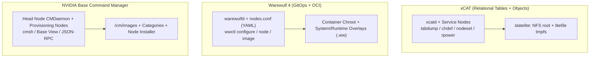

# 6.23 xCAT, Warewulf and cluster managers compared with BCM

| | |
|---|---|
| Level | Intermediate |
| Priority tier | 2 |
| Lab venue | Warewulf on a VM head node with 2 to 3 VM compute nodes |
| Part | Part 6: HPC and Slurm |
| Status | Drafted from the projects' own documentation: Warewulf (warewulf/warewulf commit `324c0bc`, 2026-10-21, `userdocs`), xCAT (xcat2/xcat-core commit `56a009b`, 2026-10-23, README and docs tree; version file 2.20.0), BCM 11 manuals (corpus) and the SCL book. Nothing was installed or run. MAAS, Foreman and Confluent are described from general knowledge: **unverified**. Labs **untested** |

## Why this matters for AI infrastructure

6.22 explained the mechanisms; a cluster manager packages them: node database, DHCP/TFTP/HTTP services, image build and distribution, power and console control, discovery, health, user and software management, and integration with Slurm or Kubernetes. Which manager a site uses determines its workflows, its upgrade story and who supports it. AI clusters from NVIDIA come with **Base Command Manager**; research clusters often use **Warewulf**; legacy sites run **xCAT**; cloud-style fleets use **MAAS** or **Foreman**. An infrastructure engineer should be able to operate whichever is in front of them and explain the trade-offs.

## Prerequisites and outcomes

Needs 6.2, 6.22 and Part 7 awareness (BMC/Redfish). After this chapter you can:

- Describe the architecture and object model of xCAT, Warewulf 4 and BCM and map their concepts onto each other.
- Run the core workflows in each: define nodes, build and assign images, provision, power control, run commands across nodes.
- State the current status and positioning of each project, including xCAT's recent change of course and its recommended successor.
- Compare managers on scalability, GPU-cluster fit, extensibility, support model and lock-in; choose and justify.

## 1. Common model



All managers implement the same abstractions under different names:

| Abstraction | xCAT | Warewulf 4 | BCM | MAAS | Foreman |
|---|---|---|---|---|---|
| Node record | node object (`mkdef`) | node in `nodes.conf` (`wwctl node`) | device (node) in CMDaemon database | machine | host |
| Group/template | node group | profile | category | tags/pods | host group |
| OS image | osimage (`genimage`, `packimage`) | image (container/chroot) | software image under `/cm/images` | image/stream deployed | provisioning template + media |
| Per-node customisation | postscripts, synclists | overlays (templated files) | node-installer scripts, finalize scripts, config overlays | cloud-init user data | templates, Puppet/Ansible |
| Services | DHCP, TFTP, DNS, HTTP, NTP configured by xCAT | DHCP, TFTP, NFS, hosts configured via `wwctl configure` | provisioning, DHCP, DNS, NTP, LDAP, monitoring | DHCP, DNS, TFTP, PXE proxy | smart proxies for DHCP/TFTP/DNS |
| Out-of-band control | `rpower`, `rcons`, BMC plugins | IPMI settings on node (`wwctl node ... ipmi`) | built-in power control and BMC mgmt | BMC power drivers | BMC via plugins |
| Remote command | `xdsh` | `wwctl`-driven or `pdsh` | `pdsh`/`cmsh` | `maas` CLI | remote execution (Ansible) |
| Database | tables (SQLite, MySQL, PostgreSQL) | YAML file | embedded/MySQL database | PostgreSQL | PostgreSQL |

## 2. xCAT

xCAT (Extreme Cloud Administration Toolkit) is an IBM-originated, later Lenovo-supported toolkit for deployment and administration of clusters of all sizes (README). It has been the standard on many large HPC systems.

### Architecture (from the overview docs)

- **Management node**: the single point of control; runs `xcatd`, the node database, and network services.
- **Service nodes**: optional "slave" servers under the management node that take over DHCP/TFTP/HTTP and installation load for racks or groups, for scale.
- **Compute nodes**: the managed targets.
- **Service processor (BMC, IMM, FSP)**: out-of-band hardware control.
- **Networks**: management network (OS installs), service network (BMC access), application network (MPI), site (public) network.
- **REST API** for integration.

### Object model and commands

Everything is a typed **object** (node, group, network, osimage, site, policy) with attributes. The manual pages in the docs tree list the main tools: `mkdef`, `chdef`, `lsdef`, `rmdef` (define and inspect objects), `nodels`, `nodech`, `noderm`, `nodeimport`, `nodechmac`, `nodediscoverstart/ls/stop` (discovery), `getmacs`, `makedhcp`, `makedns`, `makentp` (services), `copycds` (import installation media), `genimage`, `packimage`, `liteimg` (stateless and statelite image creation), `nodeset` (set the boot state of nodes), `rpower` (power), `rinv` (inventory), `xdsh` (distributed shell), `rinstall`. A typical stateless flow (from the docs structure and common usage; verify against your release): `copycds` the distribution media; `mkdef` nodes and groups with MACs, IPs and BMC details; `genimage`/`packimage` the stateless image; `makedhcp -n` and `makedns -n`; `nodeset <noderange> osimage=...`; `rpower <noderange> boot`; check with `nodestat` and `xdsh`. The **noderange** syntax (`n[001-200]`, groups, regular expressions) is xCAT's lasting contribution to cluster tooling.

### xCAT installation, database tables, and statelite recipe

In Chapters 26 and 28 of the SCL book, xCAT is installed on a Red Hat/CentOS management server from `xCAT-core.repo` and `xCAT-dep.repo` under `/etc/yum.repos.d/` (`yum install -y xCAT`, then `source /etc/profile.d/xcat.sh` so `/opt/xcat` binaries are in `PATH`) `(untested here)`. Because xCAT overwrites `/etc/exports`, DHCP, Apache, DNS, and TFTP configuration files when its service-generation commands run, always back up existing configuration files beforehand.

#### Database tables vs logical objects

xCAT stores all state in relational tables: the list of all tables can be obtained with the `tabdump` command (if you add the `-d` parameter, `tabdump -d` outputs the same list with explanations in English), edited interactively in `$EDITOR` via `tabedit <table>`, replaced with `tabrestore`, or updated scripted-style with `chtab`. Because a single logical object spans many underlying tables, object-level commands (`lsdef`, `mkdef`, `chdef`, `rmdef`, or node-specific `nodech`) maintain cross-table consistency; you can also export and re-import an object stanza with `lsdef -z node01 > /tmp/n01.stanza` and `cat /tmp/n01.stanza | mkdef -z` `(untested here)`. In `SCL` Chapter 26, the primary logical object types are `site` (cluster(s)), `node`, `group` (group of nodes), `network` (subnetwork), `osdistro` (OS distribution), `osimage` (OS image), and `route` (routing description)—and besides these types, there are `auditlog`, `boottarget`, `eventlog`, `firmware`, `kit`, `kitcomponent`, `kitrepo`, `monitoring`, `notification`, `pdu`, `policy`, `rack`, `taskstate`, and `zone`. Inspecting a configured node object with `lsdef node1` displays its aggregated attributes across tables `(untested here)`:

```text
# (untested here) — SCL Chapter 26 lsdef node1 output
Object name: node1
    arch=x86_64
    bmc=10.1.1.3
    bmcpassword=admin
    bmcusername=ADMIN
    groups=all,compute
    mac=00:10:30:30:40:03
    mgt=ipmi
    netboot=pxe
    postbootscripts=otherpkgs
    postscripts=syslog,remoteshell,syncfiles
```

Key tables highlighted in the book include:

- `site` — cluster-wide settings (`domain`, `installdir` `/install`, `tftpdir` `/tftpboot`, `xcatconfdir` `/etc/xcat`, `master`, `nameservers`, `forwarders`, `timezone`, `ipmiretries`, `ipmitimeout`, `SNsyncfiledir`, `nodesyncfiledir`). For example: `chtab key=tftpdir site.value=/tftpboot` or `chdef -t site -o clustersite domain=mycluster` `(untested here)`.
- `hosts` — hostname-to-IP mappings, supporting regular-expression rules so you do not have to enter each node's IP by hand.
- `mac` — node MAC addresses (`chdef -t node node1 mac=xx:xx:xx:xx:xx:xx`).
- `noderes` — per-node or per-group boot and network resources (`netboot=pxe`, `tftpserver`, `nfsserver`, `installnic=eth0`, `primarynic=eth0`).
- `nodelist` and `nodegroup` — node names, group memberships (`groups=all,compute`), and status.
- `nodetype` — OS, architecture, profile, and node type (`nodetype.os=rhel76`, `nodetype.arch=x86_64`, `nodetype.profile=compute`, `nodetype.nodetype=osi`).
- `networks` — subnet definitions and dynamic DHCP ranges (`chtab netname=main_vlan networks.dynamicrange="10.0.0.200-10.0.0.254"`).
- `passwd` — default credentials (`chtab key=system passwd.username=root passwd.password=cluster`).
- `policy` — access control rules for non-root and remote administrators.
- `litefile`, `litetree`, and `statelite` — writable tmpfs paths, directory trees, and persistent state paths for `statelite` (read-only NFS root) nodes.
- `postscripts` — scripts under `/install/postscripts` executed during or after node boot.

#### Delegating access: `setup-local-client.sh` and the `policy` table

By default only `root` on the management server can run xCAT commands. To grant a local or remote user (such as `xadmin`, present in `/etc/passwd`) access over TLS (with `XCATHOST=<xCAT-server>:3001` set on remote clients), generate client certificates and add a rule in the `policy` table `(untested here)`:

```bash
# Generate ~xadmin/.xcat/{ca.pem,client-cert.pem,client-cred.pem,client-key.pem,client-req.pem} (untested here)
/opt/xcat/share/xcat/scripts/setup-local-client.sh xadmin

# Allow xadmin to run 'rpower stat' only on nodes h02-h05 at priority 7 (untested here)
mkdef -t policy -o 7 name=xadmin commands=rpower \
  parameters=stat noderange=h02-h05 rule=allow
```

In `tabedit policy` (`#priority,name,host,commands,noderange,parameters,time,rule,comments`), rules are evaluated in ascending numeric `priority` order (dotted priorities such as `6.1` or `7.012` are allowed) and the first matching rule wins:

```csv
#priority,name,host,commands,noderange,parameters,time,rule,comments
"1","root",,,,,,"allow",
"2","xadmin","*","nodels",,,,"allow",
```

#### Loading and Controlling: Step-by-step `statelite` provisioning workflow (Chapters 26 and 28)

xCAT supports three provisioning modes: **statefull** (installed to local disk, typical for service nodes), **stateless** (entire image unpacked in RAM), and **statelite** (root mounted read-only over NFS with specific writable files/directories mounted in RAM via `tmpfs` as listed in `litefile`, and optional persistent state in `statelite`). Combining the book's Chapter 26 and Chapter 28 recipes `(untested here)`:

1. **Import OS media and define nodes**:
   ```bash
   # (untested here)
   copycds CentOS-7.6-x86_64-bin-DVD1.iso
   mkdef -t node node[1-100] groups=all,compute arch=x86_64 mgt=ipmi netboot=pxe
   ```
2. **Assign IP addresses automatically by regex rule in `hosts.ip`**:
   ```bash
   # Strip non-digits (\D+), capture the node number (\d+) as $1, and add 10 (untested here)
   # For example, node15 receives 10.0.0.25
   chtab node=compute hosts.ip='|\D+(\d+)|10.0.0.(10+$1)|'
   ```
3. **Generate and customize the `statelite` image**:
   Package lists live in `/opt/xcat/share/xcat/netboot/centos/compute.rhel7.pkglist` (extra RPMs go in `/install/post/otherpkgs` and `/install/custom/install/centos/compute.rhel7.otherpkgs.pkglist`; install templates live in `/opt/xcat/share/xcat/install/centos/compute.rhel7.tmpl`). Build the image and assign it to the `compute` group `(untested here)`:
   ```bash
   # (untested here)
   genimage
   chdef compute provmethod=centos7.6-x86_64-statelite-compute
   ```
4. **Populate `litefile` with writable RAM paths (`tabedit litefile`)**:
   Because the NFS root is read-only, the book recommends adding at least these 15 entries to `litefile` so services can write their runtime state into `tmpfs` `(untested here)`:
   ```csv
   #image,file,options,comments,disable
   "ALL","/etc/adjtime",,,
   "ALL","/etc/inittab",,,
   "ALL","/etc/ntp.conf",,,
   "ALL","/etc/ntp.conf.predhclient",,,
   "ALL","/etc/resolv.conf",,,
   "ALL","/etc/resolv.conf.predhclient",,,
   "ALL","/etc/ssh/",,,
   "ALL","/etc/sysconfig/",,,
   "ALL","/etc/sysconfig/network-scripts/",,,
   "ALL","/etc/udev/",,,
   "ALL","/opt/xcat/",,,
   "ALL","/root/.ssh/",,,
   "ALL","/tmp/",,,
   "ALL","/var/",,,
   "ALL","/xcatpost/",,,
   ```
5. **Inject SSH keys, `/etc/passwd`, and postscripts, then finalize the image**:
   In Chapter 28's recipe, helper scripts copy SSH keys and passwd entries into the image root before `liteimg` packs it `(untested here)`:
   ```bash
   # (untested here)
   cd /opt/xcat/share/xcat/netboot/add-on/statelite
   ./add_ssh /install/netboot/centos7.6/x86_64/compute/rootimg/
   ./add_passwd /install/netboot/centos7.6/x86_64/compute/rootimg/
   liteimg centos7.6-x86_64-statelite-compute
   ```
   For first-boot or post-boot customization, place scripts in `/install/postscripts/` (such as `/install/postscripts/mypost`), attach them via `chdef node1 -p postbootscripts=mypost` (in the `postscripts` table), and xCAT renders `/tftpboot/mypostscripts/mypostscript.<node_name>` from `/opt/xcat/share/xcat/mypostscript/mypostscript.tmpl`.
6. **Generate `/etc/hosts`, DHCP, DNS, and TFTP configs and boot the nodes**:
   ```bash
   # (untested here)
   makehosts
   makedhcp compute
   systemctl restart dhcpd
   makenamed.conf
   makedns compute
   nodeset compute osimage=centos7.6-x86_64-statelite-compute
   rpower node[1-100] boot
   ```

Table 26-1 in the book summarizes `rpower` IPMI power actions (`rpower compute stat`, `rpower node1 off`, `rpower node1 cycle`, `rpower node[1-100] on`, `rpower node1 reset`), while `psh compute uname -n` and `pscp /tmp/myfile all:/tmp` provide parallel shell execution and file copying across node groups `(untested here)`. The book also notes xCAT's practical limitations: strict OS version support, inability to snapshot an already-installed disk node directly into an image, overwriting custom DNS/DHCP zones, and no built-in historical telemetry.

### Status

The repository README (2026) states that the earlier announced sunset "has changed course": the xCAT Consortium and participating companies (VersatusHPC) continue upstream development, Enterprise Linux 10 support is planned, and development continues "while there is community and user demand"; the Consortium recommends **Confluent** (github.com/xcat2/confluent, a newer Python-based tool from the same community, the long-term successor) for new deployments. Practical reading: xCAT is maintained but not where new designs should start; plan migrations for old clusters; check the OS support matrix before upgrading distributions.

## 3. Warewulf 4

Warewulf (since 2001) is "a stateless, network-boot cluster provisioning system designed primarily for use in HPC clusters" (README). The v4 documentation describes its design tenets: lightweight, simple, flexible, agnostic (x86 and ARM, many distributions), secure (SELinux supported), open source.

### Architecture

- **Warewulf server** with `warewulfd` and the CLI `wwctl`. State lives in plain files: `/etc/warewulf/warewulf.conf` (server), `/etc/warewulf/nodes.conf` (node database, YAML), image roots under `/var/lib/warewulf/chroots/`, overlays under `/usr/share/warewulf/overlays/` (distribution) and `/var/lib/warewulf/overlays/` (site), built per-node overlay images under `/var/lib/warewulf/provision/` (quick-reference paths).
- **Nodes** carry network configuration, IPMI settings, kernel arguments, image and overlay assignments; **profiles** apply shared settings; hostlist syntax (`n[1-10]`) works in commands.
- **Images** (OS images) are bootable root file systems managed with container tooling: import from a registry (Docker Hub, private registries) or build from a Dockerfile in CI/CD; they run entirely in memory by default so a reboot returns the node to a known-good state.
- **Overlays**: collections of files and `.ww` **templates** rendered per node from the node registry (so `nodes.conf` becomes an expressive metadata store) and applied over the image, at boot (system overlays) and periodically at runtime (runtime overlays). Core functions (`hosts`, `fstab`, `ssh`, network config, `dhcpd`, `nfsd`) are themselves overlays; `wwctl overlay blame <node>` shows which overlay contributes each file.
- **Services**: `wwctl configure --all` (re)configures DHCP, TFTP, NFS, SSH and hosts file; `warewulf.conf` defines the ranges and the iPXE binary per architecture (the quickstart config maps architecture codes `00:00` to `undionly.kpxe`, `00:07` and `00:09` to the x64 EFI iPXE binary, `00:0B` to the arm64 binary, matching the DHCP option-93 values in 6.22), plus NFS exports (`/home`, `/opt`), and `image mounts`.

### Commands (from the quick reference)

```bash
wwctl configure --all                              # DHCP, TFTP, NFS, SSH, hosts, TLS
wwctl image import docker://ghcr.io/warewulf/warewulf-rockylinux:8 rockylinux-8   # the docs' own example; also .tar, .sif, or a directory
wwctl node add n[2-4] --ipaddr=10.0.2.2            # IP auto-increments across the range
wwctl node add n1 --ipaddr=10.0.2.1 --netdev=eno1 --hwaddr=00:00:00:00:00:01 --image=rockylinux-8 --profile=default
wwctl node list --net ; wwctl node list --all n1 ; wwctl node status
wwctl profile list default --all
wwctl overlay list --all ; wwctl overlay blame n1
journalctl -u warewulfd
```

Typical workflow: install the RPM/DEB, edit `warewulf.conf`, `wwctl configure --all`, import an image (add drivers/Slurm/GPU stack by building your own image), add nodes with MACs, power them on, `wwctl node status` to watch them boot, adjust overlays for Slurm/munge/Lmod.

Strengths: simplicity, fully open, container-native images, small footprint, scales to thousands of nodes, fits GitOps (nodes.conf and images in version control). Limits: provisioning only (no built-in monitoring, health, user management, power orchestration beyond IPMI settings); you assemble the rest (Slurm, monitoring, LDAP); GPU stack integration is your image build; commercial support from CIQ and others.

## 4. Confluent, MAAS, Foreman (general knowledge, verify)

- **Confluent** (xCAT Consortium): Python-based successor to xCAT with asynchronous design, web API/CLI (`nodedeploy`, `nodeconfig`, `nodeshell`...), hardware discovery and OS deployment (including Redfish-driven), recommended by the xCAT project for new deployments (per the xCAT README).
- **Canonical MAAS** (Metal as a Service): treats physical servers (and KVM/LXD virtual machines) as an API-driven cloud. As detailed in Chapter 26 of the SCL book, minimum MAAS server hardware is SSD drives in RAID-1 with over `120 GB` disk space, a dual-core CPU over `2 GHz` with virtualization enabled, `2 GB` RAM, and a `1 Gb/s` NIC. Installed via `ppa:maas/3.2` (`maas` and `maas-region-controller`) and managed at `http://<MAAS_IP>:5240/MAAS` `(untested here)`, MAAS separates a central **region controller** from distributed **rack controllers** for scale and high availability. Adding a physical server progresses through three states: `New` (registered with MAC and BMC/IPMI `LAN_2_0` or Redfish power driver) → `Commission` (PXE-boots a temporary environment to inventory NICs, disks, and hardware) → `Deploy` (installs Ubuntu, CentOS 7/8, Oracle Linux, Windows, or ESXi; custom images require Ubuntu Pro). Once deployed, the node's IP cannot be changed in MAAS, and the book cautions against enabling direct public repository updates on compute nodes because kernel upgrades can break Mellanox/NVIDIA drivers.
- **Foreman** (with Katello, Puppet/Ansible/Salt): lifecycle management for bare metal, VMs (KVM, VMware), Docker, and clouds (OpenStack, EC2, Azure, GCE). While a single Foreman server is not horizontally scalable by itself, **smart-proxies** distribute DHCP/TFTP/DNS and provisioning across large installations.

## 5. NVIDIA Base Command Manager (BCM)

BCM (formerly Bright Cluster Manager) is NVIDIA's cluster management product, bundled with DGX systems and sold for AI clusters (the SCL book notes a free licence tier for clusters of up to `16` nodes and `16` GPUs or fewer). Part 8 covers it in depth; the model relevant to this comparison, from the BCM 11 administrator and installation manuals:

- **Head node** is the centre: it holds the **head copy of the software images** (under `/cm/images/<image>`, `default-image` on a fresh install) and runs **CMDaemon**, the daemon that manages devices, provisioning and monitoring. Nodes boot from the network and receive a *known good state* from the head node (diskless: image copied into memory/tmpfs; diskful: local disk contents checked against the image, differing content corrected).
- **Software images, categories, nodes**: a **software image** is the root file system; a **category** groups nodes and sets their software image, disk layout, services, and parameters; individual nodes ("devices") belong to a category (and can override). To make nodes behave differently, you clone a category, point it at a modified image and move nodes to it with `cmsh` (the manual's example: `category; clone default categorytwo; set softwareimage imagetwo; commit`, then `device; use node099; set category categorytwo; commit`, or a `foreach` loop over a range).
- **Provisioning roles and nodes**: large clusters designate **provisioning nodes** that serve images to others; `updateprovisioners` (from `softwareimage` mode) propagates head-copy changes to them, and runs automatically when changes go through CMDaemon; provisioning requests lost with a node are retried after a timeout (the manual cites 180 seconds).
- **Node installer**: an early boot phase on each node that identifies the node, partitions disks, syncs the image, then hands over to the OS; finalize scripts customise the result (SELinux initialisation, for instance, occurs at the very end of the node-installer phase in BCM-provisioned nodes).
- **Interfaces**: `cmsh` (shell, modes such as `device`, `category`, `softwareimage`, `partition`), Base View (web UI), a JSON-RPC API, `cm-` utilities; configuration and monitoring in one database.
- **Integration**: Slurm, PBS, Kubernetes, Jupyter, GPU and DCGM monitoring, health checks, Redfish power, NVIDIA-validated reference architectures (DGX BasePOD/SuperPOD). Licensing per node; support from NVIDIA.

Trade-offs: batteries included and vendor-validated, single support path, deep GPU-system knowledge; costs licence and a closed core, and the cluster workflows are BCM's (less pure GitOps, though it can be scripted via `cmsh`/API).

## 6. Selection matrix

| Criterion | xCAT | Warewulf 4 | Confluent | MAAS | Foreman | BCM |
|---|---|---|---|---|---|---|
| Licence/cost | Open source (EPL) | Open source (BSD-style) | Open source | Open source + support | Open source + support | Commercial per node |
| Core strength | Large-scale HPC deployment, noderange, hierarchy | Simple stateless images, overlays | Modern successor to xCAT | Cloud-like bare metal | Enterprise lifecycle/compliance | Integrated AI cluster management |
| Stateless images | Yes | Yes (default) | Yes | Mostly stateful deploys | Mostly stateful | Yes and stateful |
| Monitoring/health | Basic | None built-in | Limited | Hardware tests | Reporting | Built in, GPU-aware |
| Slurm/K8s integration | Manual | Manual | Manual | Manual (Juju/Terraform) | Manual | Built in |
| GPU-system knowledge | Manual | Manual (your image) | Manual | Some | Manual | Strong (DGX) |
| Scale | Very large (service nodes) | Large | Large | Large | Large | Large (provisioning nodes) |
| Project status (as read) | Maintained, successor recommended | Active | Active | Active | Active | Active (NVIDIA) |
| Best fit | Existing xCAT estates | Research HPC, GitOps-minded teams | New xCAT-style clusters | Mixed fleets/K8s bare metal | Enterprise Linux estates | NVIDIA GPU clusters, SuperPOD |

Decision flow: buying DGX/HGX with NVIDIA support, or needing integrated monitoring: BCM. Building an open-source HPC cluster with your own automation: Warewulf (plus Ansible, Prometheus, Slurm). Existing xCAT: stay, plan Confluent. Cloud-style GPU fleet feeding Kubernetes: MAAS or the provider's tooling. Always consider who will operate it at 3 a.m.

## 7. Operating practices that carry across managers

- Inventory in version control (CSV/YAML) or exported regularly from the manager's database; the manager's database is not a backup of your design.
- Back up the manager state (xCAT database dump, `nodes.conf` and chroots, BCM head-node backup and `cmsh` exports).
- HA for the head/management node (BCM has head-node failover; Warewulf can run on replicated hosts; xCAT uses service nodes and backups).
- Staged rollouts of images (canary categories/profiles), automatic drain/reboot via Slurm.
- Document the node replacement procedure (update MAC in inventory, reprovision, verify, resume).
- Secure the management plane: network isolation, BMC credentials rotation, TLS, auditing, restricted access.

## 8. Lab (self-checking xCAT/Warewulf/BCM lab tested; VM cluster parts untested)

First, run the self-checking Python lab (`code/part06/cluster_mgr_lab.py`) locally. It verifies xCAT's `hosts.ip` regular-expression rule (`|\D+(\d+)|10.0.0.(10+$1)|` mapping `node1 -> 10.0.0.11`, `node15 -> 10.0.0.25`, `node100 -> 10.0.0.110`), tests xCAT's `policy` table authorization engine in ascending numeric priority order (`priority 1` `root`, `priority 2` `xadmin nodels`, `priority 7` `xadmin rpower stat` on `h02-h05`), and checks the 15 `litefile` writable tmpfs paths, MAAS port `5240`, and BCM `180 s` provisioning retry / `16`-node free tier parameters:

```bash
python3 code/part06/cluster_mgr_lab.py
```

Next, on a VM testbed, work through these steps:

1. Install Warewulf on a Rocky/Alma VM following the quickstart; import a Rocky image; add two VM nodes with MACs; boot them; use `wwctl node status`, `wwctl overlay blame`.
2. Add a Slurm client and munge to the image (build your own image from a Dockerfile) and a template overlay that renders each node's `slurm.conf` fragment from tags in `nodes.conf`.
3. Read the xCAT `nodeset`, `genimage`, `packimage` man pages and write the command sequence for a stateless deployment; compare line by line with the Warewulf flow.
4. Read BCM's category and software image sections; write the `cmsh` commands to create a GPU category with a modified image.
5. Fill the selection matrix for your own site constraints and pick one manager.

## 9. Interview angles

- Compare xCAT, Warewulf and BCM in one minute each.
- What is a Warewulf overlay and how does it differ from baking a file into the image?
- What are BCM categories and software images? How do you test a new image on a few nodes?
- Why would a site use service nodes in xCAT or provisioning nodes in BCM?
- Which manager would you pick for 4,000 H100 nodes and why?
- How do you replace a failed node so that it keeps its name and image?
- What does xCAT's current status mean for planning?
- What does a cluster manager not do that Slurm and Kubernetes do?

## Exercises

1. **Evaluating xCAT `hosts.ip` Regex Rules and `policy` Table Authorization (`code/part06/cluster_mgr_lab.py`):** Run `python3 code/part06/cluster_mgr_lab.py`. Using `eval_xcat_hosts_ip_regex()` and `eval_xcat_policy()`, verify why `chtab node=compute hosts.ip='|\D+(\d+)|10.0.0.(10+$1)|'` assigns `10.0.0.25` to `node15`, and trace how xCAT's `policy` table allows `xadmin` to run `rpower stat` on `h02-h05` (priority `7`) while blocking `rpower off` on `h03` and `rpower stat` on `h09`.
2. **Provisioning a 100-Node `statelite` Cluster in xCAT (`SCL` Chapters 26 & 28):** Write the complete 6-step xCAT command sequence to import `CentOS-7.6-x86_64-bin-DVD1.iso` (`copycds`), define `node[1-100]` (`mkdef`), build `centos7.6-x86_64-statelite-compute` (`genimage`, `litefile` with 15 writable tmpfs paths, `add_ssh`, `add_passwd`, `liteimg`), generate `/etc/hosts`, DHCP, and DNS (`makehosts`, `makedhcp`, `makenamed.conf`, `makedns`), and boot the nodes (`nodeset`, `rpower`).
3. **Designing Warewulf 4 Images, Profiles, and `.ww` Overlays:** Write the `wwctl` commands to import an OCI container image (`wwctl image import`), register 4 nodes (`wwctl node add`), inspect file provenance (`wwctl overlay blame n1`), and regenerate services (`wwctl configure --all`). Explain the difference between **system overlays** (applied once at boot) and **runtime overlays** (applied periodically while the node is running).
4. **Managing Software Images and Categories in NVIDIA Base Command Manager (`cmsh`):** Write the `cmsh` command sequence to clone the `default` category into `categorytwo`, bind it to a modified software image (`imagetwo` under `/cm/images/imagetwo`), move `node099` into `categorytwo`, and propagate the updated image to provisioning nodes (`updateprovisioners`).
5. **Comparing Canonical MAAS (`New -> Commission -> Deploy`) and Foreman (`smart-proxies`, `SCL` Chapter 26):** Trace the 3-stage node lifecycle in Canonical MAAS (`http://<MAAS_IP>:5240/MAAS`, region controller vs rack controllers), state why `SCL` Chapter 26 warns against enabling automatic public OS repository updates on GPU/InfiniBand compute nodes, and explain how Foreman scales DHCP/TFTP/DNS via `smart-proxies`.
6. **Cluster Manager Selection Matrix for Three Production Scenarios:** Select and justify the optimal cluster manager (NVIDIA BCM, Warewulf 4, Confluent, or MAAS) for: (a) a 512-node DGX H100 SuperPOD requiring turnkey DCGM health checks and vendor support, (b) a 256-node open-source academic cluster managed via GitOps and OCI Dockerfiles, and (c) an existing 1,000-node IBM/Lenovo xCAT estate planning its next-generation upgrade.

## Checkpoint

<details>
<summary>1. Map the five core cluster-management abstractions (**Node record**, **Group/template**, **OS image**, **Per-node customization**, and **Remote shell**) across **xCAT**, **Warewulf 4**, and **NVIDIA BCM**.</summary>

- **Node record:** `node` object (`mkdef`/`chdef`) in xCAT | node in `/etc/warewulf/nodes.conf` (`wwctl node`) in Warewulf 4 | `device` in CMDaemon DB (`cmsh`) in BCM.
- **Group / template:** `nodegroup` in xCAT | `profile` in Warewulf 4 | `category` in BCM.
- **OS image:** `osimage` (`genimage`/`packimage`/`liteimg`) in xCAT | container chroot (`/var/lib/warewulf/chroots/`) in Warewulf 4 | software image (`/cm/images/<name>`) in BCM.
- **Per-node customization:** `postscripts` / `synclists` in xCAT | `.ww` `overlays` (system & runtime) in Warewulf 4 | node-installer & finalize scripts in BCM.
- **Remote shell:** `xdsh` / `psh` in xCAT | `pdsh` in Warewulf 4 | `pdsh` / `cmsh` in BCM.
</details>

<details>
<summary>2. What are the roles of the **Management node**, **Service nodes**, and **Compute nodes** in xCAT?</summary>

- **Management node:** Runs `xcatd`, holds the central configuration database, and orchestrates the cluster.
- **Service nodes:** Hierarchical relay servers deployed per rack or pod that offload DHCP, TFTP, HTTP, DNS, and image serving from the management node on multi-thousand-node clusters.
- **Compute nodes:** Target worker nodes provisioned and controlled via IPMI/Redfish (`rpower`, `rcons`).
</details>

<details>
<summary>3. In xCAT, what is the difference between table-level commands (`tabdump`, `tabedit`, `chtab`) and object-level commands (`lsdef`, `mkdef`, `chdef`, `rmdef`) (`SCL` Chapter 26)?</summary>

- **Table-level commands (`tabdump`, `tabdump -d`, `tabedit`, `tabrestore`, `chtab`):** Read and write individual relational database tables directly (`site`, `hosts`, `mac`, `noderes`, `nodelist`, `nodetype`, `policy`, `litefile`).
- **Object-level commands (`lsdef`, `mkdef`, `chdef`, `rmdef`, `nodech`):** Operate on logical objects (`node`, `group`, `osimage`, `network`, `site`, `policy`) that span multiple underlying tables, preserving cross-table consistency (and exporting/importing stanzas via `lsdef -z` / `mkdef -z`).
</details>

<details>
<summary>4. What IP address does the xCAT regex rule `chtab node=compute hosts.ip='|\D+(\d+)|10.0.0.(10+$1)|'` assign to `node15`, and how does it work (`SCL` Chapters 26 & 28)?</summary>

It assigns **`10.0.0.25`**. The regex `\D+(\d+)` strips the non-digit prefix (`node`) and captures the numeric suffix (`15`) as `$1`, and the replacement expression evaluates `10 + 15 = 25` for the fourth octet.
</details>

<details>
<summary>5. How do you grant a non-root user (`xadmin`) permission to run specific xCAT commands on a subset of nodes (`SCL` Chapter 26)?</summary>

1. Run `/opt/xcat/share/xcat/scripts/setup-local-client.sh xadmin` to generate TLS client certificates in `~xadmin/.xcat/`.
2. Add an `allow` rule to the **`policy`** table (evaluated in ascending numeric `priority` order, first match wins):
   `mkdef -t policy -o 7 name=xadmin commands=rpower parameters=stat noderange=h02-h05 rule=allow`.
</details>

<details>
<summary>6. Compare xCAT's `statefull`, `stateless`, and `statelite` provisioning modes, and what is the role of the `litefile` table (`SCL` Chapter 26)?</summary>

- **`statefull`:** Installs the OS permanently onto the node's local disk.
- **`stateless`:** Downloads and unpacks the entire root image (`packimage`) into RAM (`tmpfs`) on every boot.
- **`statelite`:** Mounts the root filesystem read-only over NFS (`liteimg`) while mounting specific writable paths (such as `/etc/resolv.conf`, `/etc/ssh/`, `/tmp/`, `/var/`, `/root/.ssh/`) in RAM as `tmpfs` according to the 15+ entries in the **`litefile`** table.
</details>

<details>
<summary>7. What is the current upstream status of **xCAT**, and what is its recommended successor?</summary>

While the xCAT Consortium (with VersatusHPC) reversed the earlier sunset and continues maintaining `xcat-core` (including Enterprise Linux 10 plans), the consortium recommends **Confluent** (`xcat2/confluent`, a modern Python-based provisioning system from the same community) for new deployments.
</details>

<details>
<summary>8. Where does **Warewulf 4** store its server configuration, node inventory, container chroots, and overlays?</summary>

- **Server config:** `/etc/warewulf/warewulf.conf`
- **Node & profile database:** `/etc/warewulf/nodes.conf` (plain YAML, ideal for GitOps)
- **Unpacked OS container chroots:** `/var/lib/warewulf/chroots/`
- **Overlays:** `/usr/share/warewulf/overlays/` (distribution defaults) and `/var/lib/warewulf/overlays/` (site customizations)
- **Built per-node overlay archives:** `/var/lib/warewulf/provision/`
</details>

<details>
<summary>9. How do Warewulf 4 **system overlays** and **runtime overlays** work, and what does `wwctl overlay blame <node>` show?</summary>

Overlays are directories of files and `.ww` Go templates (parameterized by per-node attributes from `nodes.conf`) layered on top of the base container image without modifying the image itself:
- **System overlays:** Applied once during early boot (`initramfs`).
- **Runtime overlays:** Fetched and applied periodically while the node is running (`wwclient`).
`wwctl overlay blame <node>` lists every overlaid file on the node and identifies which specific overlay contributed it.
</details>

<details>
<summary>10. What does `wwctl configure --all` do in Warewulf 4?</summary>

It reads `/etc/warewulf/warewulf.conf` and `/etc/warewulf/nodes.conf` and automatically writes/updates the host's `/etc/hosts`, DHCP (`dhcpd.conf` / `dnsmasq`), TFTP (copying iPXE binaries for BIOS `00:00`, x64 EFI `00:07`/`00:09`, and ARM64 `00:0B`), NFS (`/etc/exports`), SSH keys, and TLS certificates.
</details>

<details>
<summary>11. Describe the architecture of **NVIDIA Base Command Manager (BCM)** (`Head node`, `CMDaemon`, `/cm/images`, `Categories`, and `Provisioning nodes`).</summary>

- **Head node & `CMDaemon`:** Central management server running `CMDaemon` (configured via `cmsh`, Base View web UI, or JSON-RPC) and storing master software images under **`/cm/images/<image>`**.
- **Categories:** Node groupings that bind a **software image**, disk partitioning layout, network roles, and service configurations to member devices.
- **Provisioning nodes:** Scale-out relay nodes that mirror software images from the head node (`updateprovisioners`) to provision large compute fleets.
</details>

<details>
<summary>12. How do you safely test a modified OS image on a canary node in NVIDIA BCM using `cmsh`?</summary>

Clone the existing software image (`default-image` $\to$ `imagetwo`), modify `/cm/images/imagetwo`, clone the category (`category; clone default categorytwo; set softwareimage imagetwo; commit`), and assign the canary node to the new category (`device; use node099; set category categorytwo; commit`) before rebooting `node099`.
</details>

<details>
<summary>13. What happens during BCM's **node-installer** boot phase on diskless versus diskful compute nodes?</summary>

When a BCM node boots over PXE/HTTP, it enters the **node-installer** environment, which identifies the device, configures hardware/disks, and synchronizes the category's software image:
- **Diskless node:** Downloads and unpacks the software image directly into RAM (`tmpfs`).
- **Diskful node:** Compares the local disk contents against the head node's software image via `rsync`-style delta sync, correcting any drifted files, runs finalize scripts (such as SELinux labeling), and pivots into the OS.
</details>

<details>
<summary>14. What free license tier does `SCL` Chapter 26 note for NVIDIA Base Command Manager?</summary>

BCM offers a free license tier for small clusters of up to **`16` nodes and `16` GPUs** (or fewer).
</details>

<details>
<summary>15. How does **Canonical MAAS** structure its controllers, and what are the three lifecycle states when onboarding a bare-metal server (`SCL` Chapter 26)?</summary>

MAAS separates a central **region controller** (`http://<MAAS_IP>:5240/MAAS`) from distributed **rack controllers** (which handle local DHCP, TFTP, HTTP images, and BMC power). Onboarding a server progresses through:
1. **`New`:** Node MAC and BMC (`LAN_2_0` IPMI or Redfish) registered.
2. **`Commission`:** Node PXE-boots an ephemeral image to inventory CPU, RAM, NICs, LLDP, and disks and run hardware tests.
3. **`Deploy`:** Installs the target OS image onto the node.
</details>

<details>
<summary>16. Why does `SCL` Chapter 26 warn against enabling automatic public repository updates on MAAS-deployed HPC/GPU compute nodes?</summary>

Because an unattended `apt upgrade` or `dnf update` from a public repository can install a new Linux kernel version that breaks ABI compatibility with the installed NVIDIA GPU driver or Mellanox OFED InfiniBand stack (and introduces software drift between nodes).
</details>

<details>
<summary>17. How does **Foreman** (with Katello) scale bare-metal provisioning across multiple network segments (`SCL` Chapter 26)?</summary>

Because a single Foreman server does not scale horizontally by itself, Foreman deploys **`smart-proxies`** (`foreman-proxy`) on each subnet/rack to handle local DHCP, DNS, TFTP, Puppet/Ansible execution, and content caching (`Katello`/`Pulp`).
</details>

<details>
<summary>18. Which of the six cluster managers (xCAT, Warewulf 4, Confluent, MAAS, Foreman, BCM) include built-in GPU/DCGM telemetry, health checks, and native Slurm/Kubernetes deployment?</summary>

**NVIDIA Base Command Manager (BCM)** includes integrated DCGM GPU monitoring, automated health checks, and turnkey Slurm and Kubernetes cluster deployment out of the box. With **Warewulf 4**, **xCAT**, **Confluent**, **MAAS**, and **Foreman**, the operator layers Slurm, DCGM/Prometheus, and health checks on top via images, overlays, or Ansible/Puppet.
</details>

<details>
<summary>19. Regardless of which cluster manager you use, why must you export and version-control your node inventory and image definitions in Git?</summary>

A cluster manager's internal SQLite/MySQL/PostgreSQL database is runtime state, not a design audit trail. Keeping the canonical node inventory (MACs, IPs, rack/U locations, roles) and image build recipes (`Dockerfile`s, package lists, overlays) in Git allows deterministic disaster recovery, peer-reviewed changes, and migration between cluster managers.
</details>

<details>
<summary>20. Walk through the standard operational procedure for replacing a failed bare-metal compute node (`gpu042`) under any cluster manager.</summary>

1. Drain `gpu042` in Slurm (`scontrol update NodeName=gpu042 State=drain Reason="motherboard swap INC456"`).
2. Physically swap the node/motherboard and record the new host NIC and BMC MAC addresses (or discover them via switch port LLDP / DHCP).
3. Update `gpu042`'s MAC address in the version-controlled inventory and cluster manager (`chdef` / `wwctl node set` / `cmsh`).
4. Boot `gpu042` over the network (`rpower gpu042 boot`) so it receives the exact same hostname, IP, and golden OS image.
5. Run acceptance and health checks (`node_health.sh`, DCGM, IB link check) and resume in Slurm (`scontrol update NodeName=gpu042 State=resume`).
</details>

## Sources and review notes

- Book source (`supercomputers-for-linux-sysadmins-managing-modern-hpc-clusters-and-supercomputers-from-software-to-hardware`, `SCL`):
  - Chapter 26 ("26. Cluster Management Systems – xCAT and Others", read in full): xCAT installation, logical object types (`site`, `node`, `group`, `network`, `osdistro`, `osimage`, `route`, `auditlog`, `boottarget`, `eventlog`, `firmware`, `kit`, `kitcomponent`, `kitrepo`, `monitoring`, `notification`, `pdu`, `policy`, `rack`, `taskstate`, `zone`), database tables (`site`, `hosts`, `mac`, `noderes`, `nodelist`, `nodetype`, `networks`, `passwd`, `policy`, `litefile`, `litetree`, `statelite`, `postscripts`), `tabdump`/`tabdump -d`/`tabedit`/`tabrestore`/`chtab` vs `lsdef`/`mkdef`/`chdef`/`rmdef`/`nodech`, `lsdef node1` output, `setup-local-client.sh` and `policy` table authorization, regex IP rule `chtab node=compute hosts.ip='|\D+(\d+)|10.0.0.(10+$1)|'`, `litefile` 15 entries and `liteimg`, `rpower` Table 26-1, `psh`/`pscp`, Canonical MAAS (`ppa:maas/3.2`, port `5240/MAAS`, `New` → `Commission` → `Deploy`, rack controllers), Foreman (`smart-proxies`), and NVIDIA Base Command Manager (`16` nodes / `16` GPUs free tier).
  - Chapter 28 ("28. One-Two-Three Instructions", read in full): xCAT 100-node `statelite` recipe (`copycds`, `mkdef`, `chtab`, `genimage`, `litefile`, `add_ssh`, `add_passwd`, `liteimg`, `makehosts`, `makedhcp`, `makenamed.conf`, `makedns`, `nodeset`, `rpower`).
- xCAT architecture and commands: `xcat-core` README and docs tree (overview/architecture, admin guide manual pages) at commit `56a009b`; positioning text paraphrased from the README ("sunset ... changed course", Confluent recommendation).
- Warewulf: `warewulf/userdocs` (introduction, EL quickstart, quick reference, overlays) at commit `324c0bc`.
- BCM: `bcm11-admin`, `bcm11-install`, and `bcm11-containerization` manuals in the corpus (software images, categories, provisioning, `180` s retry, node installer); see Part 8.
- Run here: `python3 code/part06/cluster_mgr_lab.py` (3 passed, 0 failed).
- Explicitly labelled inferences: `eval_xcat_hosts_ip_regex` and `eval_xcat_policy` in `code/part06/cluster_mgr_lab.py` are deterministic Python models of xCAT's `hosts.ip` regex substitution and `policy` table priority evaluation from `SCL` Chapter 26.
- Not verified on live hardware: Confluent CLI commands, MAAS and Foreman live deployments, and live `xcatd` / `warewulfd` / `CMDaemon` daemon execution (`untested here`).
