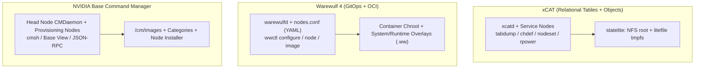

# 6.23 xCAT, Warewulf and cluster managers compared with BCM

| | |
|---|---|
| Level | Intermediate |
| Priority tier | 2 |
| Lab venue | Warewulf on a VM head node with 2 to 3 VM compute nodes |
| Part | Part 6: HPC and Slurm |
| Status | Drafted from the projects' own documentation: Warewulf (warewulf/warewulf commit `324c0bc`, 2026-10-21, `userdocs`), xCAT (xcat2/xcat-core commit `56a009b`, 2026-10-23, README and docs tree; version file 2.20.0), BCM 11 manuals (corpus) and the Supercomputers for Linux SysAdmins book. Nothing was installed or run. MAAS, Foreman and Confluent are described from general knowledge: **unverified**. Labs **untested** |

## Why this matters for AI infrastructure

Picture a new GPU node arriving at the data center. Someone has to record its MAC address, give it a boot image, power it on and confirm that it comes up healthy. Chapter 6.22 explained the mechanisms behind that work. A cluster manager packages those mechanisms into one tool. It covers the node database, the DHCP, TFTP and HTTP services, image build and distribution, power and console control, discovery, health, user and software management, and integration with Slurm or Kubernetes.

The manager you pick decides your daily workflows, how the cluster gets upgraded and who supports it. AI clusters from NVIDIA ship with Base Command Manager. Research clusters often run Warewulf, legacy sites run xCAT, and cloud-style fleets use MAAS or Foreman. As an infrastructure engineer, you should be able to operate whichever manager is in front of you and explain its trade-offs.

## Prerequisites and outcomes

Before you start, you should know the material in 6.2 and 6.22. You also need some awareness of BMC and Redfish from Part 7. When this chapter is done, you should be able to:

- Describe the architecture and object model of xCAT, Warewulf 4 and BCM, and map their concepts onto each other.
- Run the core workflows in each one. That means defining nodes, building and assigning images, provisioning, controlling power, and running commands across nodes.
- State the current status and positioning of each project, including xCAT's recent change of course and its recommended successor.
- Compare the managers on scalability, GPU-cluster fit, extensibility, support model and lock-in, then choose one and justify the choice.

## 1. Common model

Each manager has its own vocabulary, so the same job can look different from one tool to the next. The diagram below shows how each one is organized. You will find the database, the node record and the image in every design, but the names change.



All managers implement the same abstractions under different names. The table lines up the matching concept in each manager, so you can translate a task from one tool to another. Read down a column to see how one manager handles a job. Read across a row to compare all the managers on the same job.

| Abstraction | xCAT | Warewulf 4 | BCM | MAAS | Foreman |
|---|---|---|---|---|---|
| Node record | node object (`mkdef`) | node in `nodes.conf` (`wwctl node`) | device (node) in CMDaemon database | machine | host |
| Group/template | node group | profile | category | tags/pods | host group |
| OS image | osimage (`genimage`, `packimage`) | image (container/chroot) | software image under `/cm/images` | image/stream deployed | provisioning template + media |
| Per-node customisation | postscripts, synclists | overlays (templated files) | node-installer scripts, finalize scripts, config overlays | cloud-init user data | templates, Puppet/Ansible |
| Services | DHCP, TFTP, DNS, HTTP, NTP configured by xCAT | DHCP, TFTP, NFS, hosts configured via `wwctl configure` | provisioning, DHCP, DNS, NTP, LDAP, monitoring | DHCP, DNS, TFTP, PXE proxy | smart proxies for DHCP/TFTP/DNS |
| Out-of-band control | `rpower`, `rcons`, BMC plugins | IPMI settings on node (`wwctl node ... ipmi`) | built-in power control and BMC mgmt | BMC power drivers | BMC via plugins |
| Remote command | `xdsh` | `wwctl`-driven or `pdsh` | `pdsh`/`cmsh` | `maas` CLI | remote execution (Ansible) |
| Database | tables (SQLite, MySQL, PostgreSQL) | YAML file | embedded/MySQL database | PostgreSQL | PostgreSQL |

## 2. xCAT

xCAT stands for Extreme Cloud Administration Toolkit. IBM started it, and Lenovo later supported it. You can use it to deploy and administer clusters of all sizes. For many large HPC systems, it has been the standard tool. The project README describes it this way.

### Architecture (from the overview docs)

Before you run a single command, you need to know the roles. Each role has one job in the system.

- **Management node**: the single point of control. It runs `xcatd`, the node database and the network services.
- **Service nodes**: optional servers under the management node. They take over DHCP, TFTP, HTTP and installation load for a rack or a group, which keeps large systems scalable.
- **Compute nodes**: the managed targets.
- **Service processor (BMC, IMM, FSP)**: the hardware controller that gives you out-of-band hardware control.

The networks split into four roles. A management network handles OS installs. A service network gives access to the BMC. An application network carries MPI traffic. A site network is the public one. xCAT also offers a REST API for integration.

### Object model and commands

Everything in xCAT is a typed **object**, such as a node, a group, a network, an osimage, a site or a policy. Each object carries attributes. The manual pages in the docs tree list the main tools. You define and inspect objects with `mkdef`, `chdef`, `lsdef` and `rmdef`. You work with nodes using `nodels`, `nodech`, `noderm`, `nodeimport` and `nodechmac`. Discovery runs through `nodediscoverstart/ls/stop`. Service configuration uses `getmacs`, `makedhcp`, `makedns` and `makentp`. For media and images, you use `copycds` to import installation media, and `genimage`, `packimage` and `liteimg` to create stateless and statelite images. Day-to-day control comes from `nodeset` for boot state, `rpower` for power, `rinv` for inventory, `xdsh` for distributed shell, and `rinstall`.

A typical stateless flow looks like this. It comes from the docs structure and common usage, so verify it against your release. First, `copycds` the distribution media. Then `mkdef` the nodes and groups with their MACs, IPs and BMC details. Next, build the stateless image with `genimage` and `packimage`, and run `makedhcp -n` and `makedns -n`. Finally, point the nodes at the image with `nodeset <noderange> osimage=...`, power them on with `rpower <noderange> boot`, and check the result with `nodestat` and `xdsh`.

The noderange syntax is xCAT's lasting contribution to cluster tooling. You can name a set of nodes as `n[001-200]`, by group, or with a regular expression. That one idea saves you from typing every hostname.

### xCAT installation, database tables, and statelite recipe

xCAT installs on a Red Hat or CentOS management server. The recipe here follows Chapters 26 and 28 of Supercomputers for Linux SysAdmins. The xCAT commands in this section were not run on live hardware. You point the package manager at the `xCAT-core.repo` and `xCAT-dep.repo` files under `/etc/yum.repos.d/`. Then you run `yum install -y xCAT` and `source /etc/profile.d/xcat.sh`, which puts the `/opt/xcat` binaries in your `PATH`.

Back up first. When its service-generation commands run, xCAT overwrites `/etc/exports`, along with the DHCP, Apache, DNS and TFTP configuration files. Keep a copy of anything you care about before you run them.

#### Database tables vs logical objects

xCAT keeps all of its state in relational tables. Run `tabdump` to see the list of tables. Add the `-d` parameter, as in `tabdump -d`, and the same list comes with explanations in English. To edit a table, open it in `$EDITOR` with `tabedit <table>`. You can replace a table with `tabrestore`, or update it in a scripted way with `chtab`.

One logical object often spans several tables, so the object-level commands keep those tables consistent with each other. Those commands are `lsdef`, `mkdef`, `chdef` and `rmdef`, plus `nodech` for nodes. You can also export an object stanza and import it again. For example, `lsdef -z node01 > /tmp/n01.stanza` saves the stanza, and `cat /tmp/n01.stanza | mkdef -z` loads it back.

The main logical object types are `site` for the cluster or clusters, `node`, `group` for a group of nodes, `network` for a subnetwork, `osdistro` for an OS distribution, `osimage` for an OS image, and `route` for a routing description. There are more types beyond these: `auditlog`, `boottarget`, `eventlog`, `firmware`, `kit`, `kitcomponent`, `kitrepo`, `monitoring`, `notification`, `pdu`, `policy`, `rack`, `taskstate` and `zone`. Run `lsdef node1` on a configured node, and it shows the attributes gathered from all of its tables.

```text
# lsdef node1 output
Object name: node1
    arch=x86_64
    bmc=10.1.1.3
    bmcpassword=admin
    bmcusername=ADMIN
    groups=all,compute
    mac=00:10:30:30:40:03
    mgt=ipmi
    netboot=pxe
    postbootscripts=otherpkgs
    postscripts=syslog,remoteshell,syncfiles
```

These are the key tables:

- `site` holds the cluster-wide settings: `domain`, `installdir` set to `/install`, `tftpdir` set to `/tftpboot`, `xcatconfdir` set to `/etc/xcat`, `master`, `nameservers`, `forwarders`, `timezone`, `ipmiretries`, `ipmitimeout`, `SNsyncfiledir` and `nodesyncfiledir`. For example, `chtab key=tftpdir site.value=/tftpboot` or `chdef -t site -o clustersite domain=mycluster` sets values there.
- `hosts` maps hostnames to IP addresses. Its regular-expression rules mean you do not have to type each node's IP by hand.
- `mac` stores node MAC addresses, for example through `chdef -t node node1 mac=xx:xx:xx:xx:xx:xx`.
- `noderes` holds boot and network resources for each node or group, such as `netboot=pxe`, `tftpserver`, `nfsserver`, `installnic=eth0` and `primarynic=eth0`.
- `nodelist` and `nodegroup` hold node names, group memberships such as `groups=all,compute`, and status.
- `nodetype` holds the OS, architecture, profile and node type, for example `nodetype.os=rhel76`, `nodetype.arch=x86_64`, `nodetype.profile=compute` and `nodetype.nodetype=osi`.
- `networks` defines subnets and their dynamic DHCP ranges, as in `chtab netname=main_vlan networks.dynamicrange="10.0.0.200-10.0.0.254"`.
- `passwd` stores default credentials, set with `chtab key=system passwd.username=root passwd.password=cluster`.
- `policy` holds access control rules for non-root and remote administrators.
- `litefile`, `litetree` and `statelite` cover writable tmpfs paths, directory trees and persistent state paths for `statelite` nodes, which have a read-only NFS root.
- `postscripts` lists scripts from `/install/postscripts` that run during or after node boot.

#### Delegating access: `setup-local-client.sh` and the `policy` table

By default, only `root` on the management server can run xCAT commands. To let another user run them, you take two steps. Suppose you want `xadmin`, a user already listed in `/etc/passwd`, to connect over TLS. You generate client certificates for that user, and you add a rule to the `policy` table. Remote clients also need `XCATHOST=<xCAT-server>:3001` set.

```bash
# Generate ~xadmin/.xcat/{ca.pem,client-cert.pem,client-cred.pem,client-key.pem,client-req.pem}
/opt/xcat/share/xcat/scripts/setup-local-client.sh xadmin

# Allow xadmin to run 'rpower stat' only on nodes h02-h05 at priority 7
mkdef -t policy -o 7 name=xadmin commands=rpower \
  parameters=stat noderange=h02-h05 rule=allow
```

Open the table with `tabedit policy`. Its header reads `#priority,name,host,commands,noderange,parameters,time,rule,comments`. xCAT checks the rules in ascending numeric `priority` order, and dotted priorities such as `6.1` or `7.012` are allowed. The first matching rule wins.

```csv
#priority,name,host,commands,noderange,parameters,time,rule,comments
"1","root",,,,,,"allow",
"2","xadmin","*","nodels",,,,"allow",
```

#### Loading and Controlling: Step-by-step `statelite` provisioning workflow (Chapters 26 and 28)

xCAT offers three provisioning modes. In **statefull** mode, the OS is installed onto local disk, which is typical for service nodes. In **stateless** mode, the whole image is unpacked into RAM. In **statelite** mode, the root filesystem is mounted read-only over NFS. Specific writable files and directories are mounted in RAM with `tmpfs`, as listed in `litefile`, and optional persistent state can live in `statelite`. The steps below combine the recipes from Chapters 26 and 28 of Supercomputers for Linux SysAdmins.

1. Start by importing the OS media and defining the nodes.

   ```bash
   copycds CentOS-7.6-x86_64-bin-DVD1.iso
   mkdef -t node node[1-100] groups=all,compute arch=x86_64 mgt=ipmi netboot=pxe
   ```

2. Next, let xCAT assign IP addresses with a regex rule in `hosts.ip`.

   ```bash
   # Strip non-digits (\D+), capture the node number (\d+) as $1, and add 10
   # For example, node15 receives 10.0.0.25
   chtab node=compute hosts.ip='|\D+(\d+)|10.0.0.(10+$1)|'
   ```

3. Generate and customize the `statelite` image. Package lists live in `/opt/xcat/share/xcat/netboot/centos/compute.rhel7.pkglist`. Extra RPMs go in `/install/post/otherpkgs` and `/install/custom/install/centos/compute.rhel7.otherpkgs.pkglist`. Install templates live in `/opt/xcat/share/xcat/install/centos/compute.rhel7.tmpl`. Then build the image and assign it to the `compute` group.

   ```bash
   genimage
   chdef compute provmethod=centos7.6-x86_64-statelite-compute
   ```

4. Populate `litefile` with writable RAM paths using `tabedit litefile`. The NFS root is read-only, so services need a place to write their runtime state. Add at least these 15 entries, so services can write to `tmpfs`:

   ```csv
   #image,file,options,comments,disable
   "ALL","/etc/adjtime",,,
   "ALL","/etc/inittab",,,
   "ALL","/etc/ntp.conf",,,
   "ALL","/etc/ntp.conf.predhclient",,,
   "ALL","/etc/resolv.conf",,,
   "ALL","/etc/resolv.conf.predhclient",,,
   "ALL","/etc/ssh/",,,
   "ALL","/etc/sysconfig/",,,
   "ALL","/etc/sysconfig/network-scripts/",,,
   "ALL","/etc/udev/",,,
   "ALL","/opt/xcat/",,,
   "ALL","/root/.ssh/",,,
   "ALL","/tmp/",,,
   "ALL","/var/",,,
   "ALL","/xcatpost/",,,
   ```

5. Inject SSH keys, `/etc/passwd` entries and postscripts, then finalize the image. The Chapter 28 recipe uses helper scripts that copy SSH keys and passwd entries into the image root. Run them before `liteimg` packs the image.

   ```bash
   cd /opt/xcat/share/xcat/netboot/add-on/statelite
   ./add_ssh /install/netboot/centos7.6/x86_64/compute/rootimg/
   ./add_passwd /install/netboot/centos7.6/x86_64/compute/rootimg/
   liteimg centos7.6-x86_64-statelite-compute
   ```

   For customization at first boot or after it, put your scripts in `/install/postscripts/`, for example `/install/postscripts/mypost`. Attach a script to a node with `chdef node1 -p postbootscripts=mypost`, which stores it in the `postscripts` table. xCAT then renders `/tftpboot/mypostscripts/mypostscript.<node_name>` from `/opt/xcat/share/xcat/mypostscript/mypostscript.tmpl`.

6. Last, generate the `/etc/hosts`, DHCP, DNS and TFTP configuration and boot the nodes.

   ```bash
   makehosts
   makedhcp compute
   systemctl restart dhcpd
   makenamed.conf
   makedns compute
   nodeset compute osimage=centos7.6-x86_64-statelite-compute
   rpower node[1-100] boot
   ```

The `rpower` command covers the IPMI power actions, such as `rpower compute stat`, `rpower node1 off`, `rpower node1 cycle`, `rpower node[1-100] on` and `rpower node1 reset`. To run commands across many nodes at once, use `psh compute uname -n` for parallel execution. Use `pscp /tmp/myfile all:/tmp` for copying a file across node groups.

xCAT also has practical limits. Strict OS version support is one. You cannot snapshot an already-installed disk node straight into an image. Custom DNS and DHCP zones get overwritten. And xCAT has no built-in historical telemetry.

### Status

The 2026 repository README says the earlier announced sunset "has changed course." The xCAT Consortium and participating companies, including VersatusHPC, keep up the upstream development. Enterprise Linux 10 support is planned. Development continues "while there is community and user demand." The Consortium recommends Confluent for new deployments. Confluent lives at github.com/xcat2/confluent. It is a newer Python-based tool from the same community and the long-term successor.

Practically, xCAT is maintained, but new designs should not start there. If you run an old cluster, plan a migration. Check the OS support matrix before you upgrade distributions.

## 3. Warewulf 4

Warewulf has been around since 2001. The README calls it "a stateless, network-boot cluster provisioning system designed primarily for use in HPC clusters." The v4 documentation lists its design tenets. Warewulf aims to be lightweight, simple, flexible and agnostic, running on x86 and ARM across many distributions. It is secure, with SELinux supported, and it is open source.

### Architecture

Warewulf keeps its state in plain files, and the layout is worth learning early. You run a Warewulf server that contains `warewulfd` and the `wwctl` CLI.

- **Warewulf server**: the `warewulfd` daemon and the `wwctl` CLI run here. The server config is `/etc/warewulf/warewulf.conf`. The node database is `/etc/warewulf/nodes.conf`, a YAML file. Image roots sit under `/var/lib/warewulf/chroots/`. Distribution overlays live under `/usr/share/warewulf/overlays/`, and site overlays under `/var/lib/warewulf/overlays/`. Built per-node overlay images go to `/var/lib/warewulf/provision/`. The docs keep these paths in a quick-reference list.
- **Nodes** carry their network configuration, IPMI settings, kernel arguments, and image and overlay assignments. **Profiles** apply settings shared by many nodes. You can use hostlist syntax, such as `n[1-10]`, in commands.
- **Images** are bootable OS root filesystems, managed with container tooling. You can import one from a registry such as Docker Hub or a private registry, or build one from a Dockerfile in CI/CD. By default, an image runs entirely in memory, so a reboot returns the node to a known-good state.
- **Overlays** are collections of files and `.ww` templates. Warewulf renders each template for each node from the node registry, so `nodes.conf` becomes a rich metadata store. Overlays are applied over the image at boot, as system overlays, and periodically at runtime, as runtime overlays. Core functions such as `hosts`, `fstab`, `ssh`, network config, `dhcpd` and `nfsd` are overlays too. Run `wwctl overlay blame <node>` to see which overlay contributes each file.
- **Services**: `wwctl configure --all` configures DHCP, TFTP, NFS, SSH and the hosts file. The `warewulf.conf` file sets the address ranges and the iPXE binary for each architecture. The quickstart config maps the architecture code `00:00` to `undionly.kpxe`. It maps `00:07` and `00:09` to the x64 EFI iPXE binary, and `00:0B` to the arm64 binary. These codes match the DHCP option-93 values from 6.22. The same file also lists NFS exports, `/home` and `/opt`, and `image mounts`.

### Commands (from the quick reference)

The quick reference gives these commands. The comment on each line says what it does.

```bash
wwctl configure --all                              # DHCP, TFTP, NFS, SSH, hosts, TLS
wwctl image import docker://ghcr.io/warewulf/warewulf-rockylinux:8 rockylinux-8   # the docs' own example; also .tar, .sif, or a directory
wwctl node add n[2-4] --ipaddr=10.0.2.2            # IP auto-increments across the range
wwctl node add n1 --ipaddr=10.0.2.1 --netdev=eno1 --hwaddr=00:00:00:00:00:01 --image=rockylinux-8 --profile=default
wwctl node list --net ; wwctl node list --all n1 ; wwctl node status
wwctl profile list default --all
wwctl overlay list --all ; wwctl overlay blame n1
journalctl -u warewulfd
```

The image import line is the docs' own example, and it is only one of the formats the import accepts. A typical workflow starts by installing the RPM or DEB package. Next, you edit `warewulf.conf` and run `wwctl configure --all`. Then you import an image. Drivers, Slurm and the GPU stack go into the image when you build your own. Add the nodes with their MACs, power them on, and watch them boot with `wwctl node status`. Finally, adjust the overlays for Slurm, munge and Lmod.

Warewulf's strengths are its simplicity, its openness and its container-native images. It has a small footprint and scales to thousands of nodes. It also fits GitOps, because `nodes.conf` and the images can live in version control. Its limits matter just as much. Warewulf only provisions. It has no built-in monitoring, health checks or user management, and its power control goes no further than IPMI settings. You assemble the rest yourself, including Slurm, monitoring and LDAP. GPU stack integration happens in your image build. Commercial support comes from CIQ and others. Choose Warewulf when you are ready to assemble the rest of the stack yourself.

## 4. Confluent, MAAS, Foreman (general knowledge, verify)

- **Confluent** comes from the xCAT Consortium. It is a Python-based successor to xCAT with an asynchronous design. It offers a web API and a CLI, with commands such as `nodedeploy`, `nodeconfig`, `nodeshell`... It handles hardware discovery and OS deployment, including Redfish-driven deployment. The xCAT project recommends it for new deployments, as the xCAT README says.
- **Canonical MAAS** stands for Metal as a Service. It treats physical servers, along with KVM and LXD virtual machines, as an API-driven cloud. The minimum hardware for a MAAS server is as follows. You need SSD drives in RAID-1 with over `120 GB` of disk space. The CPU must be a dual-core over `2 GHz` with virtualization enabled. You also need `2 GB` of RAM and a `1 Gb/s` NIC. You install MAAS via `ppa:maas/3.2`, using the `maas` and `maas-region-controller` packages. You then manage it at `http://<MAAS_IP>:5240/MAAS`. MAAS splits a central **region controller** from distributed **rack controllers**, which gives you scale and high availability.

  A physical server moves through three states. In `New`, its MAC and BMC/IPMI settings are registered with the `LAN_2_0` or Redfish power driver. In `Commission`, it PXE-boots a temporary environment that inventories its NICs, disks and hardware. In `Deploy`, it installs Ubuntu, CentOS 7/8, Oracle Linux, Windows or ESXi. Custom images require Ubuntu Pro. Once a node is deployed, its IP cannot be changed in MAAS. Do not enable direct public repository updates on compute nodes, because kernel upgrades can break Mellanox/NVIDIA drivers.
- **Foreman** works with Katello, Puppet, Ansible or Salt. It manages the lifecycle of bare-metal servers, VMs on KVM and VMware, Docker, and clouds such as OpenStack, EC2, Azure and GCE. A single Foreman server does not scale horizontally on its own. **Smart-proxies** spread DHCP, TFTP, DNS and provisioning across large installations.

Decide which of these three fits your fleet before you choose a manager.

## 5. NVIDIA Base Command Manager (BCM)

BCM, formerly Bright Cluster Manager, is NVIDIA's cluster management product. It comes bundled with DGX systems and is sold for AI clusters. There is a free licence tier for clusters of up to `16` nodes and `16` GPUs or fewer. Part 8 covers BCM in depth. This section keeps only the model that matters for this comparison, taken from the BCM 11 administrator and installation manuals.

- **Head node**: the centre of the system. It holds the head copy of the software images under `/cm/images/<image>`. On a fresh install, that image is `default-image`. It also runs CMDaemon, the daemon that manages devices, provisioning and monitoring. Nodes boot from the network and receive a *known good state* from the head node. A diskless node gets the image copied into memory (tmpfs). A diskful node has its local disk contents checked against the image, and any differing content is corrected.
- **Software images, categories and nodes**: a software image is the root file system. A category groups nodes and sets their software image, disk layout, services and parameters. Each individual node, called a device, belongs to a category and can override some settings. To make some nodes behave differently, you clone a category, point the clone at a modified image, and move the nodes into it with `cmsh`. The manual's example runs `category; clone default categorytwo; set softwareimage imagetwo; commit`. Then it runs `device; use node099; set category categorytwo; commit`. A `foreach` loop over a range does the same for many nodes.
- **Provisioning roles**: large clusters designate provisioning nodes, which serve images to other nodes. Run `updateprovisioners` from `softwareimage` mode to push head-copy changes to them. It also runs automatically when changes go through CMDaemon. If a node is lost while a provisioning request is pending, the request is retried after a timeout. The manual cites 180 seconds for that timeout.
- **Node installer**: an early boot phase on each node. It identifies the node, partitions the disks and syncs the image, then hands over to the OS. Finalize scripts customise the result. For example, SELinux initialisation happens at the very end of the node-installer phase on BCM-provisioned nodes.
- **Interfaces**: `cmsh` is a shell with modes such as `device`, `category`, `softwareimage` and `partition`. Base View is the web UI. A JSON-RPC API and `cm-` utilities are also available. Configuration and monitoring share one database.

Integration covers Slurm, PBS, Kubernetes, Jupyter, GPU and DCGM monitoring, health checks, Redfish power, and NVIDIA-validated reference architectures such as DGX BasePOD and SuperPOD. Licensing is per node, and support comes from NVIDIA.

The trade-off is clear. BCM comes with batteries included, is vendor-validated, gives you a single support path, and carries deep GPU-system knowledge. In return, you pay a license cost and accept a closed core. Its cluster workflows are BCM's own, so you get less pure GitOps, though you can still script it with `cmsh` or the API. Weigh that support path against the license cost before you choose BCM.

## 6. Selection matrix

The matrix compares the six managers on the same criteria. Each row is one question you would ask about a manager, such as how far it scales or how well it fits GPU systems.

| Criterion | xCAT | Warewulf 4 | Confluent | MAAS | Foreman | BCM |
|---|---|---|---|---|---|---|
| Licence/cost | Open source (EPL) | Open source (BSD-style) | Open source | Open source + support | Open source + support | Commercial per node |
| Core strength | Large-scale HPC deployment, noderange, hierarchy | Simple stateless images, overlays | Modern successor to xCAT | Cloud-like bare metal | Enterprise lifecycle/compliance | Integrated AI cluster management |
| Stateless images | Yes | Yes (default) | Yes | Mostly stateful deploys | Mostly stateful | Yes and stateful |
| Monitoring/health | Basic | None built-in | Limited | Hardware tests | Reporting | Built in, GPU-aware |
| Slurm/K8s integration | Manual | Manual | Manual | Manual (Juju/Terraform) | Manual | Built in |
| GPU-system knowledge | Manual | Manual (your image) | Manual | Some | Manual | Strong (DGX) |
| Scale | Very large (service nodes) | Large | Large | Large | Large | Large (provisioning nodes) |
| Project status (as read) | Maintained, successor recommended | Active | Active | Active | Active | Active (NVIDIA) |
| Best fit | Existing xCAT estates | Research HPC, GitOps-minded teams | New xCAT-style clusters | Mixed fleets/K8s bare metal | Enterprise Linux estates | NVIDIA GPU clusters, SuperPOD |

Start with the decision in front of you. If you are buying DGX or HGX systems with NVIDIA support, or you need integrated monitoring, choose BCM. If you are building an open-source HPC cluster with your own automation, choose Warewulf and bring Ansible, Prometheus and Slurm along. If you already run xCAT, stay put and plan a move to Confluent. For a cloud-style GPU fleet that feeds Kubernetes, look at MAAS or the provider's tooling. Whichever you pick, ask who will operate it at 3 a.m.

## 7. Operating practices that carry across managers

Your inventory belongs in version control. Keep it as CSV or YAML, or export it on a regular schedule from the manager's database. The manager's database is not a backup of your design.

Back up the manager state as well. For xCAT, that means a database dump. For Warewulf, it means `nodes.conf` and the chroots. For BCM, it means the head-node backup and `cmsh` exports. Protect the head or management node with high availability too. BCM has head-node failover, Warewulf can run on replicated hosts, and xCAT uses service nodes and backups.

Roll out image changes in stages, using canary categories or profiles. Let Slurm drain and reboot nodes automatically as part of that rollout.

Document the node replacement procedure before you need it. Update the MAC address in your inventory, reprovision the node, verify it, and then resume it. Secure the management plane as well, with network isolation, rotated BMC credentials, TLS, auditing and restricted access.

## 8. Lab (self-checking xCAT/Warewulf/BCM lab tested; VM cluster parts untested)

Start with the self-checking Python lab at `code/part06/cluster_mgr_lab.py`, and run it on your own machine. It checks the xCAT `hosts.ip` regex rule, `|\D+(\d+)|10.0.0.(10+$1)|`, and the other values in the table below, so you can compare each result against what the lab expects.

| Check | Expected values |
|---|---|
| xCAT `hosts.ip` regex rule | node1 to 10.0.0.11, node15 to 10.0.0.25, node100 to 10.0.0.110 |
| xCAT `policy` authorization, in ascending numeric priority order | Priority 1 `root`, priority 2 `xadmin nodels`, priority 7 `xadmin rpower stat` on `h02-h05` |
| Other parameters | 15 `litefile` writable tmpfs paths, MAAS port 5240, BCM 180 s provisioning retry, 16-node free tier |

Run the lab with this command.

```bash
python3 code/part06/cluster_mgr_lab.py
```

Next, work through these five steps on a VM testbed.

1. Install Warewulf on a Rocky or Alma VM by following the quickstart. Import a Rocky image, add two VM nodes with MACs, and boot them. Then check them with `wwctl node status` and `wwctl overlay blame`.
2. Add a Slurm client and munge to the image by building your own image from a Dockerfile. Then add a template overlay that renders each node's `slurm.conf` fragment from tags in `nodes.conf`.
3. Read the xCAT `nodeset`, `genimage` and `packimage` man pages. Write the command sequence for a stateless deployment, then compare it line by line with the Warewulf flow.
4. Read the BCM category and software image sections. Write the `cmsh` commands that create a GPU category with a modified image.
5. Fill in the selection matrix for your own site constraints, and pick one manager.

## 9. Interview angles

- Compare xCAT, Warewulf and BCM in one minute each.
- What is a Warewulf overlay, and how does it differ from baking a file into the image?
- What are BCM categories and software images? How do you test a new image on a few nodes?
- Why would a site use service nodes in xCAT or provisioning nodes in BCM?
- Which manager would you pick for 4,000 H100 nodes, and why?
- How do you replace a failed node so that it keeps its name and image?
- What does xCAT's current status mean for planning?
- What does a cluster manager not do that Slurm and Kubernetes do?

## Exercises

1. Run `python3 code/part06/cluster_mgr_lab.py`. Then use `eval_xcat_hosts_ip_regex()` and `eval_xcat_policy()` to check two things. First, verify why `chtab node=compute hosts.ip='|\D+(\d+)|10.0.0.(10+$1)|'` assigns `10.0.0.25` to `node15`. Second, trace how xCAT's `policy` table lets `xadmin` run `rpower stat` on `h02-h05` at priority `7`, while it blocks `rpower off` on `h03` and `rpower stat` on `h09`.
2. Write the complete six-step xCAT command sequence for a 100-node `statelite` cluster, using Chapters 26 and 28 of the Supercomputers for Linux SysAdmins book. Start by importing `CentOS-7.6-x86_64-bin-DVD1.iso` with `copycds`, and define `node[1-100]` with `mkdef`. Next, build `centos7.6-x86_64-statelite-compute`. That step uses `genimage`, a `litefile` with 15 writable tmpfs paths, `add_ssh`, `add_passwd` and `liteimg`. Then generate `/etc/hosts`, DHCP and DNS with `makehosts`, `makedhcp`, `makenamed.conf` and `makedns`. Finish by booting the nodes with `nodeset` and `rpower`.
3. Write the `wwctl` commands that you need to import an OCI container image with `wwctl image import`, register 4 nodes with `wwctl node add`, inspect file provenance with `wwctl overlay blame n1`, and regenerate services with `wwctl configure --all`. Then explain the difference between system overlays and runtime overlays for your `.ww` templates. System overlays are applied once at boot, and runtime overlays are applied periodically while the node is running.
4. Write the `cmsh` command sequence that you would use to clone the `default` category into `categorytwo`. Bind that category to a modified software image, `imagetwo` under `/cm/images/imagetwo`. Move `node099` into `categorytwo`, and propagate the updated image to the provisioning nodes with `updateprovisioners`.
5. Trace the three-stage node lifecycle in Canonical MAAS, `New -> Commission -> Deploy`. Use `http://<MAAS_IP>:5240/MAAS` and the difference between region controllers and rack controllers as the reference points you need. Then explain why Chapter 26 of the Supercomputers for Linux SysAdmins book warns against enabling automatic public OS repository updates on GPU and InfiniBand compute nodes. Finally, explain how Foreman scales DHCP/TFTP/DNS with `smart-proxies`.
6. Select and justify the best cluster manager (NVIDIA BCM, Warewulf 4, Confluent or MAAS) for three cases. In case (a), a 512-node DGX H100 SuperPOD needs turnkey DCGM health checks and vendor support. In case (b), a 256-node open-source academic cluster is managed through GitOps and OCI Dockerfiles. In case (c), an existing 1,000-node IBM/Lenovo xCAT estate is planning its next-generation upgrade.

## Checkpoint

<details>
<summary>1. Map the five core cluster-management abstractions (**Node record**, **Group/template**, **OS image**, **Per-node customization**, and **Remote shell**) across **xCAT**, **Warewulf 4**, and **NVIDIA BCM**.</summary>

- **Node record:** In xCAT, it is the `node` object, managed with `mkdef` and `chdef`. In Warewulf 4, it is a node in `/etc/warewulf/nodes.conf`, managed with `wwctl node`. In BCM, it is a `device` in the CMDaemon database, managed with `cmsh`.
- **Group / template:** In xCAT, it is a `nodegroup`. In Warewulf 4, it is a `profile`. In BCM, it is a `category`.
- **OS image:** In xCAT, it is an `osimage`, built with `genimage`, `packimage` and `liteimg`. In Warewulf 4, it is a container chroot at `/var/lib/warewulf/chroots/`. In BCM, it is a software image at `/cm/images/<name>`.
- **Per-node customization:** In xCAT, it is done with `postscripts` and `synclists`. In Warewulf 4, it is done with `.ww` overlays, both system and runtime. In BCM, it is done with node-installer and finalize scripts.
- **Remote shell:** In xCAT, you use `xdsh` or `psh`. In Warewulf 4, you use `pdsh`. In BCM, you use `pdsh` or `cmsh`.
</details>

<details>
<summary>2. What are the roles of the **Management node**, **Service nodes**, and **Compute nodes** in xCAT?</summary>

- **Management node:** It runs `xcatd`, holds the central configuration database and orchestrates the cluster.
- **Service nodes:** They are hierarchical relay servers, deployed per rack or pod. They take DHCP, TFTP, HTTP, DNS and image serving off the management node on clusters of several thousand nodes.
- **Compute nodes:** They are the worker nodes that get provisioned and controlled through IPMI or Redfish, using `rpower` and `rcons`.
</details>

<details>
<summary>3. In xCAT, what is the difference between table-level commands (`tabdump`, `tabedit`, `chtab`) and object-level commands (`lsdef`, `mkdef`, `chdef`, `rmdef`) (Supercomputers for Linux SysAdmins book, Chapter 26)?</summary>

- **Table-level commands (`tabdump`, `tabdump -d`, `tabedit`, `tabrestore`, `chtab`):** They read and write individual relational database tables directly, such as `site`, `hosts`, `mac`, `noderes`, `nodelist`, `nodetype`, `policy` and `litefile`.
- **Object-level commands (`lsdef`, `mkdef`, `chdef`, `rmdef`, `nodech`):** They work on logical objects such as `node`, `group`, `osimage`, `network`, `site` and `policy`. Each object spans several tables, so these commands keep the tables consistent with each other. You can also export and import stanzas with `lsdef -z` and `mkdef -z`.
</details>

<details>
<summary>4. What IP address does the xCAT regex rule `chtab node=compute hosts.ip='|\D+(\d+)|10.0.0.(10+$1)|'` assign to `node15`, and how does it work (Supercomputers for Linux SysAdmins book, Chapters 26 and 28)?</summary>

It assigns **`10.0.0.25`**. The regex `\D+(\d+)` strips the non-digit prefix, `node`, and captures the numeric suffix, `15`, as `$1`. The replacement then computes `10 + 15 = 25` for the fourth octet.
</details>

<details>
<summary>5. How do you grant a non-root user (`xadmin`) permission to run specific xCAT commands on a subset of nodes (Supercomputers for Linux SysAdmins book, Chapter 26)?</summary>

1. Run `/opt/xcat/share/xcat/scripts/setup-local-client.sh xadmin` to generate TLS client certificates in `~xadmin/.xcat/`.
2. Add an `allow` rule to the **`policy`** table. xCAT checks the rules in ascending numeric `priority` order, and the first match wins: `mkdef -t policy -o 7 name=xadmin commands=rpower parameters=stat noderange=h02-h05 rule=allow`. For example, that rule lets `xadmin` run `rpower stat` on `h02-h05` and nothing else in that table.
</details>

<details>
<summary>6. Compare xCAT's `statefull`, `stateless`, and `statelite` provisioning modes, and what is the role of the `litefile` table (Supercomputers for Linux SysAdmins book, Chapter 26)?</summary>

- **`statefull`:** It installs the OS permanently onto the node's local disk.
- **`stateless`:** It downloads and unpacks the entire root image (`packimage`) into RAM (`tmpfs`) on every boot.
- **`statelite`:** It mounts the root filesystem read-only over NFS (`liteimg`). Specific writable paths sit in RAM as `tmpfs`, such as `/etc/resolv.conf`, `/etc/ssh/`, `/tmp/`, `/var/` and `/root/.ssh/`. The **`litefile`** table decides which paths those are, and it has 15 or more entries.
</details>

<details>
<summary>7. What is the current upstream status of **xCAT**, and what is its recommended successor?</summary>

The xCAT Consortium, working with VersatusHPC, changed course on the earlier sunset. It keeps maintaining `xcat-core`, and it plans Enterprise Linux 10 support. It still recommends **Confluent** for new deployments. Confluent is `xcat2/confluent`, a modern Python-based provisioning system from the same community.
</details>

<details>
<summary>8. Where does **Warewulf 4** store its server configuration, node inventory, container chroots, and overlays?</summary>

- **Server config:** `/etc/warewulf/warewulf.conf`
- **Node and profile database:** `/etc/warewulf/nodes.conf`, a plain YAML file that suits GitOps well.
- **Unpacked OS container chroots:** `/var/lib/warewulf/chroots/`
- **Overlays:** `/usr/share/warewulf/overlays/` holds the distribution defaults, and `/var/lib/warewulf/overlays/` holds the site customizations.
- **Built per-node overlay archives:** `/var/lib/warewulf/provision/`
</details>

<details>
<summary>9. How do Warewulf 4 **system overlays** and **runtime overlays** work, and what does `wwctl overlay blame <node>` show?</summary>

An overlay is a directory of files and `.ww` Go templates. The templates take their values from per-node attributes in `nodes.conf`. Overlays sit on top of the base container image, and they do not change the image itself.

- **System overlays:** They are applied once during early boot (`initramfs`).
- **Runtime overlays:** They are fetched and applied periodically while the node runs (`wwclient`).

`wwctl overlay blame <node>` lists every overlaid file on the node, and it shows which overlay contributed each one.
</details>

<details>
<summary>10. What does `wwctl configure --all` do in Warewulf 4?</summary>

It reads `/etc/warewulf/warewulf.conf` and `/etc/warewulf/nodes.conf`. Then it writes or updates the host's `/etc/hosts`, DHCP (`dhcpd.conf` or `dnsmasq`), TFTP, NFS (`/etc/exports`), SSH keys and TLS certificates. For TFTP, it copies the iPXE binaries for BIOS `00:00`, x64 EFI `00:07` and `00:09`, and ARM64 `00:0B`.
</details>

<details>
<summary>11. Describe the architecture of **NVIDIA Base Command Manager (BCM)** (`Head node`, `CMDaemon`, `/cm/images`, `Categories`, and `Provisioning nodes`).</summary>

- **Head node and `CMDaemon`:** The head node runs `CMDaemon`, the central management server. You configure it with `cmsh`, the Base View web UI or JSON-RPC. It stores the master software images under **`/cm/images/<image>`**.
- **Categories:** They group nodes and bind a **software image**, a disk partitioning layout, network roles and service configurations to the member devices.
- **Provisioning nodes:** They are scale-out relay nodes. They mirror software images from the head node through `updateprovisioners`, so they can provision large compute fleets.
</details>

<details>
<summary>12. How do you safely test a modified OS image on a canary node in NVIDIA BCM using `cmsh`?</summary>

Clone `default-image` to `imagetwo`, then modify `/cm/images/imagetwo`. Clone the category with `category; clone default categorytwo; set softwareimage imagetwo; commit`. Assign the canary node to the new category with `device; use node099; set category categorytwo; commit`, and then reboot `node099`.
</details>

<details>
<summary>13. What happens during BCM's **node-installer** boot phase on diskless versus diskful compute nodes?</summary>

When a BCM node boots over PXE or HTTP, it enters the **node-installer** environment. There it identifies the device, configures the hardware and disks, and syncs the category's software image.

- **Diskless node:** It downloads the software image and unpacks it straight into RAM, which is `tmpfs`.
- **Diskful node:** It compares its local disk with the head node's software image using an `rsync`-style delta sync, and it corrects any drifted files. Then it runs finalize scripts, such as SELinux labeling, and pivots into the OS.
</details>

<details>
<summary>14. What free license tier does Supercomputers for Linux SysAdmins book, Chapter 26, note for NVIDIA Base Command Manager?</summary>

BCM has a free license tier for small clusters. It covers up to **`16` nodes and `16` GPUs**, or fewer.
</details>

<details>
<summary>15. How does **Canonical MAAS** structure its controllers, and what are the three lifecycle states when onboarding a bare-metal server (Supercomputers for Linux SysAdmins book, Chapter 26)?</summary>

MAAS splits its controllers into a central **region controller**, found at `http://<MAAS_IP>:5240/MAAS`, and distributed **rack controllers**. The rack controllers handle local DHCP, TFTP, HTTP images and BMC power. A server goes through three steps when it is onboarded:

1. **`New`:** Its node MAC and BMC, the `LAN_2_0` IPMI or Redfish settings, are registered.
2. **`Commission`:** It PXE-boots an ephemeral image that inventories the CPU, RAM, NICs, LLDP and disks, and that runs hardware tests.
3. **`Deploy`:** The target OS image is installed onto the node.
</details>

<details>
<summary>16. Why does Supercomputers for Linux SysAdmins book, Chapter 26, warn against enabling automatic public repository updates on MAAS-deployed HPC/GPU compute nodes?</summary>

An unattended `apt upgrade` or `dnf update` from a public repository can install a new Linux kernel. That kernel can break ABI compatibility with the installed NVIDIA GPU driver or the Mellanox OFED InfiniBand stack. It can also cause software drift between nodes.
</details>

<details>
<summary>17. How does **Foreman** (with Katello) scale bare-metal provisioning across multiple network segments (Supercomputers for Linux SysAdmins book, Chapter 26)?</summary>

A single Foreman server does not scale horizontally on its own. So Foreman deploys **`smart-proxies`**, which run as `foreman-proxy`, on each subnet or rack. For example, each subnet or rack gets its own proxy, and each one handles local DHCP, DNS and TFTP, runs Puppet or Ansible, and handles content caching with `Katello`/`Pulp`.
</details>

<details>
<summary>18. Which of the six cluster managers (xCAT, Warewulf 4, Confluent, MAAS, Foreman, BCM) include built-in GPU/DCGM telemetry, health checks, and native Slurm/Kubernetes deployment?</summary>

**NVIDIA Base Command Manager (BCM)** includes these out of the box. It has integrated DCGM GPU monitoring, automated health checks, and turnkey Slurm and Kubernetes deployment. With Warewulf 4, xCAT, Confluent, MAAS or Foreman, the operator adds Slurm, DCGM with Prometheus, and health checks through images, overlays, or Ansible or Puppet.
</details>

<details>
<summary>19. Regardless of which cluster manager you use, why must you export and version-control your node inventory and image definitions in Git?</summary>

A cluster manager's database, whether SQLite, MySQL or PostgreSQL, holds runtime state. It is not a design audit trail. Keep the canonical node inventory in Git, with MACs, IPs, rack and U locations, and roles. Keep the image build recipes there too, including `Dockerfile`s, package lists and overlays. With both in Git, you get deterministic disaster recovery, peer-reviewed changes, and migration between cluster managers.
</details>

<details>
<summary>20. Walk through the standard operational procedure for replacing a failed bare-metal compute node (`gpu042`) under any cluster manager.</summary>

1. Drain `gpu042` in Slurm with `scontrol update NodeName=gpu042 State=drain Reason="motherboard swap INC456"`.
2. Swap the node or motherboard physically, and record the new host NIC and BMC MAC addresses. You can also discover them through switch port LLDP or DHCP.
3. Update `gpu042`'s MAC address in your version-controlled inventory and in the cluster manager. Use `chdef`, `wwctl node set` or `cmsh`, depending on the manager.
4. Boot `gpu042` over the network with `rpower gpu042 boot`. It then gets the same hostname, IP and golden OS image as before.
5. Run the acceptance and health checks, such as `node_health.sh`, DCGM and the IB link check. Then resume the node in Slurm with `scontrol update NodeName=gpu042 State=resume`.
</details>

## Sources and review notes

- Book source (`supercomputers-for-linux-sysadmins-managing-modern-hpc-clusters-and-supercomputers-from-software-to-hardware`, *Supercomputers for Linux Sysadmins*):
  - Chapter 26 ("26. Cluster Management Systems – xCAT and Others", read in full): xCAT installation, logical object types (`site`, `node`, `group`, `network`, `osdistro`, `osimage`, `route`, `auditlog`, `boottarget`, `eventlog`, `firmware`, `kit`, `kitcomponent`, `kitrepo`, `monitoring`, `notification`, `pdu`, `policy`, `rack`, `taskstate`, `zone`), database tables (`site`, `hosts`, `mac`, `noderes`, `nodelist`, `nodetype`, `networks`, `passwd`, `policy`, `litefile`, `litetree`, `statelite`, `postscripts`), `tabdump`/`tabdump -d`/`tabedit`/`tabrestore`/`chtab` vs `lsdef`/`mkdef`/`chdef`/`rmdef`/`nodech`, `lsdef node1` output, `setup-local-client.sh` and `policy` table authorization, regex IP rule `chtab node=compute hosts.ip='|\D+(\d+)|10.0.0.(10+$1)|'`, `litefile` 15 entries and `liteimg`, `rpower` Table 26-1, `psh`/`pscp`, Canonical MAAS (`ppa:maas/3.2`, port `5240/MAAS`, `New` → `Commission` → `Deploy`, rack controllers), Foreman (`smart-proxies`), and NVIDIA Base Command Manager (`16` nodes / `16` GPUs free tier).
  - Chapter 28 ("28. One-Two-Three Instructions", read in full): xCAT 100-node `statelite` recipe (`copycds`, `mkdef`, `chtab`, `genimage`, `litefile`, `add_ssh`, `add_passwd`, `liteimg`, `makehosts`, `makedhcp`, `makenamed.conf`, `makedns`, `nodeset`, `rpower`).
- xCAT architecture and commands: `xcat-core` README and docs tree (overview/architecture, admin guide manual pages) at commit `56a009b`; positioning text paraphrased from the README ("sunset ... changed course", Confluent recommendation).
- Warewulf: `warewulf/userdocs` (introduction, EL quickstart, quick reference, overlays) at commit `324c0bc`.
- BCM: `bcm11-admin`, `bcm11-install`, and `bcm11-containerization` manuals in the corpus (software images, categories, provisioning, `180` s retry, node installer); see Part 8.
- Run here: `python3 code/part06/cluster_mgr_lab.py` (3 passed, 0 failed).
- Explicitly labelled inferences: `eval_xcat_hosts_ip_regex` and `eval_xcat_policy` in `code/part06/cluster_mgr_lab.py` are deterministic Python models of xCAT's `hosts.ip` regex substitution and `policy` table priority evaluation from *Supercomputers for Linux Sysadmins* Chapter 26.
- Not verified on live hardware: Confluent CLI commands, MAAS and Foreman live deployments, and live `xcatd` / `warewulfd` / `CMDaemon` daemon execution (`untested here`).
