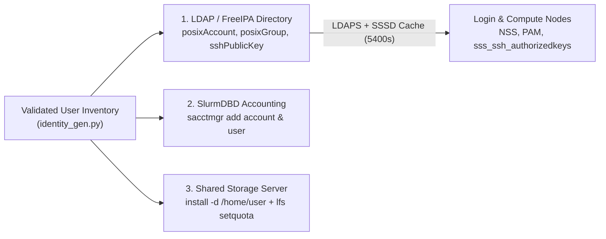

# 6.24 Users, LDAP, SSSD, quotas and accounting at scale

| | |
|---|---|
| Level | Intermediate |
| Priority tier | 2 |
| Lab venue | VMs (OpenLDAP or 389-ds or FreeIPA, plus an SSSD client) |
| Part | Part 6: HPC and Slurm |
| Status | Drafted. `code/part06/identity_gen.py` was run on a valid and an invalid user list (outputs shown); its LDIF and `sacctmgr` command forms follow standard schemas and the Slurm man page but were **not** loaded into a real LDAP server or Slurm. SSSD/PAM/OpenLDAP configuration is from general knowledge and the *Supercomputers for Linux Sysadmins* book (chapters 11 and 28), unverified here. Labs **untested** |

## Why this matters for AI infrastructure

Picture a Monday morning on a GPU cluster. A researcher cannot open files she wrote last week, and a new student cannot submit a job at all. Both problems start with identity, which means knowing who each user is on every machine. A GPU cluster is a multi-user, multi-team system that holds valuable data and compute. Every node has to agree on who a user is. The same numeric UID and GID must appear everywhere, or file permissions on shared storage stop meaning anything. Users must also be added and removed quickly, in a way you can audit. Resources have to be charged to the right project. None of this can slow a login or a job launch when you run thousands of nodes. Identity mistakes cause incidents that range from "permission denied on my own files" to unauthorised access after an employee leaves. Containers, Kubernetes and Slurm add further identity layers, and all of them must stay consistent.

## Prerequisites and outcomes

You should already know Part 1 (users, permissions, PAM and nsswitch) and Part 2 (DNS and TLS basics). You also need 6.9 for Slurm accounts and 6.18 and 6.19 for quotas. When you finish this chapter, you will be able to:

- Explain the account synchronisation options (NIS/NIS+, LDAP, FreeIPA/AD, file push), and why a single directory plus SSSD is the modern default.
- Design a UID/GID scheme and an LDAP tree for a cluster, and read an LDIF entry for `posixAccount`.
- Configure, at the concept level, SSSD, `nsswitch.conf`, PAM and SSH so that logins, `getent` and file ownership agree on every node.
- Provision homes and storage quotas, and keep Slurm accounting in step with the directory.
- Plan onboarding, offboarding, group and project access, service accounts, and audit.
- Diagnose slow logins, missing users, UID mismatches, and cache problems.

## 1. Account synchronisation: the problem and the options

The diagram below shows the flow this chapter builds. One validated user inventory feeds three places: the LDAP or FreeIPA directory, the Slurm accounting database, and the shared storage server. From the directory, every login and compute node reads the same identities.



Account management gets harder as the cluster grows, and the first requirement is that every node agrees on every account. You can meet it in one of two ways. You can point all nodes at a single data source over the network, such as LDAP. Or you can copy the account files to every node, either on a schedule or when something changes.

Basic data, such as uid, gid, home directory and shell, must match everywhere. Quotas, access limits and similar information can be stored and synchronised separately, and they may legitimately differ by node type. For example, CPU time limits should not apply on compute nodes, but they may apply on login nodes. Users generally should not log in to service nodes, such as backup servers. Those service nodes still need to know who the users are, because file ownership depends on it.

| Method | How | Status and notes |
|---|---|---|
| **Local files pushed by config management** (Ansible/Puppet/BCM) | `/etc/passwd`, `/etc/group`, `/etc/shadow` generated centrally and copied | Simple, no network dependency at login, fine for small and medium clusters; no instant propagation; drift risk if edited locally |
| **NIS / NIS+** | Sun-era directory (YP). NIS is plaintext and weak; NIS+ added security and was deprecated by Sun | Historical. Do not choose for new clusters |
| **LDAP (OpenLDAP, 389 Directory Server)** | Hierarchical directory with the RFC 2307/2307bis POSIX schema (`posixAccount`, `posixGroup`, `shadowAccount`) | The long-standing standard; clients via `nss_ldap`/`pam_ldap` (old) or **SSSD** (modern) |
| **FreeIPA / Red Hat IdM** | LDAP + Kerberos + DNS + CA + sudo rules + SSH key distribution + host-based access control as one product | Common in enterprises and larger clusters; strong policy features; adds Kerberos and PKI to operate |
| **Active Directory / Entra ID** (via SSSD `ad` provider, Samba/winbind) | Corporate directory as identity source | Common when the company mandates it; mapping UID/GID from AD attributes (RFC2307 attributes) or algorithmically (SSSD `ldap_id_mapping`) |
| **SSO via OIDC/SAML for web portals** | Open OnDemand, JupyterHub, Kubernetes dashboards | Complements POSIX identity; the portal still maps to a POSIX user (6.25) |

The table compares the options side by side. In practice, teams mix these approaches. The corporate identity provider (IdP) stays the authority for people. The cluster keeps its own LDAP or IPA tree, or uses SSSD mapping, to supply POSIX attributes and groups. Local system and service accounts stay in local files, with UIDs below a reserved range.

### Pull-based file synchronisation and timeout wrappers

Suppose you copy `/etc/passwd`, `/etc/shadow` and `/etc/group` to the nodes instead of running a directory. Pushing from the head node fails quietly for any node that is off or being replaced. A pull model avoids that. Each compute node runs a small script at boot, and the head node can trigger the same script on demand. A node that was offline catches up as soon as it boots.

The script on each node, saved as `/usr/sbin/master-sync`, pulls the three files over `rsync` and SSH. The listing is a sketch and was not run on a cluster:

```bash
#!/usr/bin/env bash
SYNC="rsync -e 'ssh -i /root/secret_key'"
SRC_ADDR=root@master.cluster
$SYNC $SRC_ADDR:/etc/passwd /etc/passwd
$SYNC $SRC_ADDR:/etc/shadow /etc/shadow
$SYNC $SRC_ADDR:/etc/group /etc/group
```

After a batch of account edits, the head node runs the script on every node. Two things must not happen. The trigger must not flood the network, and it must not hang on a dead node. The wrapper below waits a tenth of a second between nodes, which you can replace with `pdsh` or `clush`. It also arms a timer that sends `ALRM` to the script itself:

```bash
#!/usr/bin/env bash
TIMEOUT=600
CT=3
# exit the script after getting ALRM signal
trap 'exit' ALRM
# schedule ALRM signal to self
(sleep $TIMEOUT && kill -ALRM "$$") &
# do the sync
for i in $(grep -v \# /etc/nodes); do
  ssh -o connecttimeout=$CT $i /usr/sbin/master-sync
  echo -n .
  sleep 0.1
done
echo
```

The option `connecttimeout=3` keeps SSH from waiting on unreachable hosts. The background timer is the safety net: after 600 seconds it signals the script's own process ID, and the `trap` handler ends the run.

### NIS and NIS+, for the record

NIS, the Network Information System, began as Sun Yellow Pages, which is why its commands start with `yp`. It distributes account and host tables over RPC with no encryption and weak authentication. Its successor NIS+ added security, is not protocol-compatible with NIS, and was deprecated by Sun. A single NIS server also starts to struggle beyond roughly 30 to 40 clients, because of concurrent RPC load. You may still meet NIS on an old, small cluster. Do not build a new one. The directory and SSSD design in the next sections replaces it, and the exercises do not ask you to set NIS up.

## 2. UID/GID design

Consistency is the contract. File ownership on shared storage is numeric. If `alice` is 10001 on login nodes and 10005 on compute nodes, her files look as if someone else owns them. A mismatch like that also breaks Kubernetes volume ownership and container user mapping.

Ranges keep different kinds of account from colliding. System accounts below 1000 are defined by the distribution. Local service accounts use 1000 to 9999. Service accounts such as `slurm` and `munge` must have the same numeric id on every node, and a mismatch there is a classic cause of munge failures. People start at 10000 upward, and this chapter's generator enforces a site minimum. Groups for projects come from a separate range, and the generator starts them at 20000. Never reuse a UID after offboarding. Reuse lets a new user inherit a leaver's old files.

For the primary group, you can use a user-private group, where UID equals GID for each user. You can also use a project or team primary group. Private groups plus project groups for sharing, with set-gid directories, give you flexibility.

Generated IDs must not depend on file ordering. The generator assigns group GIDs in order of first appearance. That is fine for a demo, but if the CSV is reordered, the numbers change. Real systems store allocated IDs in the directory and allocate new ones from a counter.

If SSSD generates IDs algorithmically from SIDs, the same SSSD ID-mapping configuration must be on every node. Otherwise the IDs differ between nodes.

Decide your ranges and your ID allocation method before you create the first account, and store the allocated IDs in the directory.

## 3. LDAP in practice

### Directory layout

A directory is a tree. The layout below shows where people and groups sit in this chapter's example.

```text
dc=cluster,dc=example,dc=org
  ou=People    uid=alice (posixAccount, shadowAccount, inetOrgPerson, ldapPublicKey)
  ou=Groups    cn=research (posixGroup, memberUid: alice, bob)
  ou=Hosts / ou=Netgroups / ou=Sudoers (optional)
```

### An entry and the generator

Entries are loaded from LDIF (LDAP Data Interchange Format), a plain text form. You load an LDIF file with a command such as `ldapadd -x -D cn=admin,... -W -f users.ldif`. The script `code/part06/identity_gen.py` keeps this manageable. You give it a user list CSV with the fields `user,uid,fullname,group,project,shell,quota_gb,sshkey`. It validates the list first. Then it generates three artefacts from that one source of truth: `users.ldif`, `slurm_accounts.sh` and `homes.sh`. The validation rules check the user-name pattern, reject duplicates, require a numeric UID at or above the site minimum, require unique UIDs, require an absolute shell path, and require an integer quota.

Here is an excerpt of the output for three users:

```text
dn: cn=research,ou=Groups,dc=cluster,dc=example,dc=org
objectClass: posixGroup
cn: research
gidNumber: 20000
memberUid: alice
memberUid: bob
...
dn: uid=alice,ou=People,dc=cluster,dc=example,dc=org
objectClass: inetOrgPerson
objectClass: posixAccount
objectClass: shadowAccount
objectClass: ldapPublicKey
uid: alice
cn: Alice Nguyen
...
```

The same run writes `slurm_accounts.sh`, which tells Slurm about the same people:

```text
sacctmgr -i add account infra Description='infra' Organization='infra' || true
sacctmgr -i add account llm-pretrain Description='llm-pretrain' Organization='llm-pretrain' || true
sacctmgr -i add user alice account=llm-pretrain defaultaccount=llm-pretrain || true
...
```

Bad input never reaches these files. A broken list, with UID 500, a relative shell path, a non-integer quota and a duplicate user, was rejected with five errors. The generator wrote no output.

```text
ERROR root2: uid 500 below site minimum 10000 (collides with system/local ranges)
ERROR root2: shell must be an absolute path
ERROR root2: quota_gb must be an integer
ERROR bob: duplicate user
ERROR bob: uid 10002 already used by bob
```

Real directories need more than this. You need a password or credential policy, or Kerberos or SSO instead of passwords. You also need `memberOf` overlays, and indexes on `uid`, `uidNumber`, `gidNumber`, `memberUid`, `cn`. Add access control lists, replication (multi-master or provider-consumer), backups (`slapcat`), TLS (LDAPS or StartTLS with a private CA), and audit logging. Use the vendor or distribution documentation for current install commands. Many sites use 389 Directory Server or FreeIPA instead of hand-built OpenLDAP.

### Standing up the directory

The server side has more moving parts than the generator shows, and the commands change between releases, so follow the current OpenLDAP, 389 Directory Server or FreeIPA documentation for your distribution. Three details help you read older guides. Current OpenLDAP keeps its configuration in a `cn=config` tree, and the single `slapd.conf` file that older recipes edit is deprecated. The Berkeley DB backends, `bdb` and `hdb`, have been removed, and `mdb` is the backend to use. Older clients used `nss_ldap` and `pam_ldap`, and SSSD replaced them.

Whatever you install, a new server is empty. You first load a base entry and an administrator role from an LDIF file, then your people and groups. The base entry looks like this, with names that match the suffix you chose:

```text
dn: dc=ldap,dc=server,dc=org
objectclass: dcObject
objectclass: organization
o: Example cluster
dc: ldap

dn: cn=Manager,dc=ldap,dc=server,dc=org
objectclass: organizationalRole
cn: Manager
```

Load it with `ldapadd`, which asks for the administrator password, and search from the server itself to confirm two entries came back:

```bash
ldapadd -a -x -D 'cn=Manager,dc=ldap,dc=server,dc=org' -W -f ldap-init.ldif
ldapsearch -x -H ldap://127.0.0.1 -b "dc=ldap,dc=server,dc=org"
```

The search should report `numEntries: 2`. If it does not, re-check the LDIF file before you load any users.

To bring existing local accounts into the directory, generate LDIF from one validated source, as `identity_gen.py` does, rather than converting `/etc/passwd` by hand. An older route is the `migrate_passwd.pl` and `migrate_group.pl` scripts from the MigrationTools package, which convert the flat files to LDIF for `ldapadd`.

Clients should talk to the directory over TLS. An LDAP client file such as `/etc/openldap/ldap.conf` sets a search base and a server URI beginning `ldaps://`. Turning encryption off on clients is a shortcut for first tests only. Once certificates exist, switch it on.

## 4. SSSD, nsswitch and PAM on the nodes

Logins and `ls -l` on a large cluster depend on the identity layer. **SSSD** (System Security Services Daemon) is the standard client for that job. It talks to LDAP, IPA or AD. It caches identities and credentials, so logins survive a directory outage and the directory is not queried for every `ls -l`. It exposes the results through NSS and PAM. The key files below come from general knowledge:

```ini
# /etc/sssd/sssd.conf  (mode 600)
[sssd]
services = nss, pam, ssh
domains = cluster

[domain/cluster]
id_provider = ldap
auth_provider = ldap
ldap_uri = ldaps://ldap1.cluster.example.org, ldaps://ldap2.cluster.example.org
ldap_search_base = dc=cluster,dc=example,dc=org
ldap_tls_cacert = /etc/pki/tls/certs/cluster-ca.pem
ldap_default_bind_dn = cn=readonly,dc=cluster,dc=example,dc=org
ldap_default_authtok = <secret>
cache_credentials = true
enumerate = false
entry_cache_timeout = 5400
ldap_user_ssh_public_key = sshPublicKey
access_provider = simple
simple_allow_groups = research, platform
```

```text
# /etc/nsswitch.conf
passwd: files sss
group:  files sss
shadow: files sss
```

PAM is configured through `system-auth` or `password-auth`. On RHEL, `authselect` manages those files, and on Debian, `pam-auth-update` does. Either way, the module is `pam_sss.so`. Three other modules matter here. `pam_mkhomedir` or `oddjob-mkhomedir` creates home directories on first login. Avoid them on compute nodes with shared homes, and create homes at onboarding instead. `pam_slurm_adopt` lets SSH reach a node only while the user has a job there (see 6.8). `pam_limits` applies resource limits.

These settings matter most, and each one has a reason. `enumerate = false` stops SSSD from listing every user on each lookup. Enumeration hurts at tens of thousands of users. With it off, `getent passwd` shows only the users already cached.

Cache timeouts control how long an entry stays valid. Use `sss_cache -E` to invalidate the cache by hand. Stale caches explain why a user says "I was added to the group an hour ago" and still gets no access.

`access_provider`, or host-based access control, decides who can log in where. Put people on login nodes, and block direct login on compute nodes, except through a job.

SSH keys can come from the directory. In `/etc/ssh/sshd_config`, set `AuthorizedKeysCommand /usr/bin/sss_ssh_authorizedkeys` and `AuthorizedKeysCommandUser nobody`. Alternatively, FreeIPA handles key distribution. Disable password SSH login where you can, and use keys, or Kerberos or certificates plus MFA (Part 18).

Time matters too. Kerberos and LDAP TLS depend on clocks (6.18).

Give SSSD more than one LDAP URI so it can fail over. Tune `ldap_network_timeout` and `ldap_opt_timeout` so that a dead server does not stall logins for minutes.

Test every node type with `id alice`, `getent passwd alice`, `getent group research`, `su - alice -c id`, `ssh alice@node`, `sssctl domain-status cluster` and `sssctl user-checks alice`. Logs live in `/var/log/sssd/`.

### Compute nodes

Stateless nodes (6.22) should come up with SSSD already configured in the image, and with the host key and identity injected. Make sure the first job does not wait on directory lookups. Consider keeping a local cached subset. For Slurm, `slurmd` and `slurmstepd` call `getpwnam` when they launch tasks. Slow LDAP therefore means slow job starts, and a directory outage can make launches fail. Slurm also offers a way to cache user information. `LaunchParameters=enable_nss_slurm` makes `slurmstepd` provide passwd and group data from information the controller sends. Verify support and semantics on your version. Alternatively, you can push a generated passwd and group subset to compute nodes through the provisioning system. That is the static synchronisation approach.

### Restricting and blocking user access

When you need to block a user, or restrict access during maintenance four host-level mechanisms are common. Use them alongside SSSD `access_provider` and scheduler-level blocks.

1. OpenSSH `DenyUsers` or `AllowUsers`. Add `DenyUsers user1,user2` to `/etc/ssh/sshd_config`, or use `AllowUsers` during maintenance windows, then reload `sshd`. Existing sessions stay open until terminated. Do not mix `AllowUsers` and `DenyUsers` in the same scope, because only one of them takes effect.
2. PAM `pam_access.so`. Insert `account required pam_access.so` at the top of `/etc/pam.d/sshd` or `/etc/pam.d/system-auth`. Then define sequential rules in `/etc/security/access.conf`, using the format `permission:users/groups:origins`. A `+` allows, a `-` denies, `@group` names a group, `EXCEPT` handles exclusions, and `ALL`, `LOCAL`, an IP or subnet, or a TTY name are origins. Place administrator access first and a catch-all deny last:
   ```text
   +:@admins:ALL
   # ... other access rules
   -:ALL:ALL
   ```
3. Login shell replacement with `chsh`. Change the user's shell to a non-interactive binary such as `/sbin/nologin` or `/bin/false`. For example, `chsh -s /bin/false user1`, with `/bin/false` listed in `/etc/shells`. SSH runs remote commands through the user's login shell, so this blocks both interactive logins and `ssh remotehost command`.
4. A file-transfer-only shell, `scponly`. When a user must copy files with `scp` or `sftp` but never needs a shell, install the `scponly` package and set the user's shell to `/usr/bin/scponly`.

Before you trust the setup, run the `getent` and `id` checks on every node type.

## 5. Homes, storage quotas and CPU limits

Home directories are created at onboarding. A script on the file server runs `install -d -m 0700 -o UID -g GID /home/user`, as emitted by `homes.sh`. The directory is populated from `/etc/skel`, with ownership and ACLs set correctly. Avoid creating homes at each login on compute nodes.

Storage quotas apply per user and per project, on each file system that matters. For Lustre, use `lfs setquota -u USER -b SOFT -B HARD -i ISOFT -I IHARD /lustre`, and use project quotas for directories (6.19). Other systems have their own tools: GPFS fileset quotas, XFS project quotas on NFS servers (`xfs_quota -x -c 'limit -p bhard=1t projname'`), ZFS dataset quotas, and object-store bucket quotas. The generator's `homes.sh` emits the `lfs setquota` line as a comment. In this example, the soft limit sits at 90 percent of the hard limit.

On a small local file system or an NFS server, the classic Linux quota tools still apply: mount with the `usrquota` and `grpquota` options, set limits with `setquota` or `edquota`, and report with `repquota -s`. They are a poor fit for the shared parallel file systems that GPU clusters use, so this chapter does not walk through them.

Inode quotas matter as much as byte quotas, especially with millions of tiny files (6.18).

CPU and memory limits on login nodes work differently. `pam_limits` reads `/etc/security/limits.conf`, which can set `nproc`, `cpu`, `as`, `memlock`, `nofile`, `stack` and `maxlogins`. systemd `user-.slice` resource controls (`UserTasksMax`, `CPUQuota`, `MemoryMax` in `user-*.slice.d/`) do a similar job, so one user cannot saturate a shared login node (6.2). Compute nodes are different. Slurm cgroups apply there (6.8), and `nofile` (open file descriptors for SSH and MPI sockets) and `memlock` (locked RAM for RDMA buffers) must be raised.

The default shell limits from `ulimit -a` often look like this on a stock Linux install: core file size (blocks, -c) 0, data seg size (kbytes, -d) unlimited, scheduling priority (-e) 0, file size (blocks, -f) unlimited, pending signals (-i) 63616, max locked memory (kbytes, -l) 64, max memory size (kbytes, -m) unlimited, and open files (-n) 1024. Two of these are badly wrong for GPU work. A `max locked memory` of `64` KB is far too small for InfiniBand or RDMA on compute nodes, which need `unlimited`. An `open files` limit of `1024` is too small for a large multi-rank job.

On login nodes, a common choice limits ordinary users to `50` to `100` processes. That stops a fork bomb from taking the node down. It can also set a `cpu` time limit, such as `100` seconds of processor time, which stops accidental calculations on the head node.

Watch the `cpu` limit closely. If the hard `cpu` limit in `/etc/security/limits.conf` is set too small on login nodes, large `scp` or `sftp` transfers die mid-copy. The SSH and sftp process uses CPU time while it encrypts and checksums the data. Once that process accumulates the limit's worth of CPU time, the transfer is killed.

For shared project work, set up project directories with the set-gid bit and default ACLs. Commands such as `setfacl -d`, `setfacl -m u:user1:rw mydir` and `getfacl` let files inherit the group or the per-user access list.

Report usage with `lfs quota`, `repquota`, and nightly usage reports per user and per project. Alert at 80 percent, and document your purge policy for scratch. Decide your soft and hard limits, and your purge policy, before users start writing data.

## 6. Slurm accounting alignment

Slurm users and accounts (6.9) are separate from POSIX users. `sacctmgr add user` is keyed by user name, and that name must match the name the system resolves. You keep the two aligned with these steps, so that a name that works in one place works in the other.

1. You feed LDAP and `sacctmgr` from the same inventory source. The generator shows how.
2. Slurm needs the user to exist on the controller and on the compute nodes (`getpwnam`) before it can submit and run jobs. A user created in `sacctmgr` but missing in LDAP fails at launch with "invalid user".
3. Map projects and teams to Slurm accounts, for fair-share and limits, and to POSIX groups, for file access. These two tree structures are related, but they are not identical.
4. When someone leaves, disable LDAP login first. Then set `sacctmgr modify user ... set` limits to zero, or remove the associations, which keeps the accounting history. Reassign or archive their files. Remove SSH keys and revoke tokens, such as API keys, container registry tokens, object store keys and Slurm REST JWTs. Finally, disable cloud and Kubernetes access.
5. You run a nightly reconciliation job. It diffs LDAP users against Slurm associations, home directories and quotas, and it reports orphans.

When someone leaves, work through step 4 in order, starting with disabling LDAP login.

## 7. Lifecycle: onboarding and offboarding

Every person who joins or leaves a cluster touches several systems. The table lists what each step involves, so you can see what a joiner or a leaver needs from you.

| Step | Onboarding | Offboarding |
|---|---|---|
| Request | Ticket with sponsor, project, resource needs | HR/sponsor notification |
| Identity | Create directory entry (UID/GID allocated), SSH key/MFA enrolment | Disable account (lock, remove keys), keep UID reserved |
| Access | Add to groups/projects; Slurm association, QOS | Remove from groups; cancel jobs; remove Slurm associations or set to zero |
| Storage | Home, quotas, project dirs | Transfer ownership of shared data; archive/delete home per policy; keep UID |
| Audit | Log who approved | Verify no remaining keys, tokens, cron/at jobs |
| Training | Cluster etiquette, support channel | Exit checklist |

Use the left column when someone joins, and the right column when someone leaves. Automate the workflow with a ticket tool that calls Ansible or AWX, or an internal API. Keep the inventory under review, and run periodic recertification to ask whether people still need access.

## 8. Scale, security and troubleshooting

Scale is the first worry. Tens of thousands of nodes can each call `getpwnam` at job start, and that can hammer LDAP. You can reduce the load in several ways. Use SSSD caching, read replicas, local `nscd` or `sssd` memory caches, indexes, and connection pooling. Rate-limit enumeration, and consider `enable_nss_slurm`-style approaches. Monitor LDAP latency and connection counts. For jobs that start on thousands of nodes, pre-warm the caches or push static data ahead of time.

Security comes next. Use LDAPS or StartTLS only, and give clients a read-only bind account with minimal ACLs. Protect `sssd.conf` with mode 600, and allow no anonymous binds. For password hashes, use SSHA512 or PBKDF2, or avoid local passwords by using Kerberos or SSO. Require MFA for logins to bastions, and audit admin changes. Rotate bind passwords, segment the directory network, and back up the directory with a tested restore. Service accounts get no interactive shell, key-only access and minimal scope, and their tokens expire.

When something breaks, start with the symptom. The table maps each one to its likely cause and the check that confirms it.

| Symptom | Likely cause | Check |
|---|---|---|
| `id alice` fails on some nodes | SSSD down/misconfigured, TLS CA missing, directory unreachable, wrong search base | `systemctl status sssd`, `sssctl domain-status`, `/var/log/sssd/`, `ldapsearch -H ldaps://... -x -D ... -b ...` |
| Files owned by numeric IDs | UID mapping differs across nodes, user deleted | `getent passwd 10001` on both nodes, ID-mapping config |
| Login takes 30+ seconds | DNS/LDAP timeouts, failover to dead server first, enumerate=true, slow PAM modules | `strace -f -tt ssh`, SSSD debug level, timeouts |
| New user cannot submit jobs | Not in `sacctmgr`, or not resolvable on controller | `sacctmgr show assoc user=...`, `getent` on controller |
| Group change not effective | Cache | `sss_cache -E`, wait for timeouts, new login session |
| SSH key not accepted | `AuthorizedKeysCommand` not configured, attribute name mismatch, sssd ssh service off | `sss_ssh_authorizedkeys alice`, `sshd -T`, logs |
| Munge failures | `munge` UID/GID differs across nodes, time skew | `id munge` on all nodes (6.7) |
| Jobs fail to start on all nodes after directory outage | `slurmstepd` cannot resolve user | cache settings, `enable_nss_slurm`, restore directory |

Start from the symptom you see, and check its likely cause before you change anything else.

## 9. Containers and Kubernetes note

Containers run under the invoking user's numeric UID. That holds for enroot/pyxis and Apptainer. So host identity must be consistent across nodes (6.13). User namespaces can remap IDs, and that breaks the assumptions you make about file ownership on shared mounts. In Kubernetes, a pod's `runAsUser` and `fsGroup` settings interact with volume ownership (5.12 and 5.21). Give training pods the user's UID and GID explicitly, or use a service identity with a project group. Do not run jobs as root to avoid permission problems.

## 10. Lab

Start with the self-checking Python lab, which you run locally. It checks `validate()`, `ldif()`, `slurm()` and `homes()` in `code/part06/identity_gen.py` against a valid 3-user list. It checks for `gidNumber: 20000`, the `posixAccount` and `ldapPublicKey` LDIF records, the `sacctmgr` account and user commands, and home directories created with `0700`, plus the `90%` soft and `100%` hard Lustre quota lines. It also rejects a broken list with all 5 expected errors: `uid < 10000`, a relative shell path, a non-integer quota, a duplicate user and a duplicate UID. Finally, it checks the reference values quoted in this chapter: the `30–40` NIS client limit, `ulimit -l 64` KB for `memlock`, `-n 1024` for `nofile`, `-i 63616` for `pending signals`, and the `5400` s SSSD cache timeout.

```bash
python3 code/part06/identity_gen_lab.py
```

The first three steps run on your own machine. 1) Run `identity_gen.py` on a ten-user list with two projects, and read the three outputs. 2) Break the list in each rule, and confirm the error message. 3) Extend the script to read an existing UID allocation file, so that UIDs and GIDs stay stable.

The remaining steps need VMs and were not run on live systems. 4) Install OpenLDAP or 389-ds, load `users.ldif`, and query it with `ldapsearch`. 5) Configure an SSSD client, then verify `id`, `getent`, and SSH login with a key from LDAP. 6) Stop the LDAP server and observe the cached logins, then set short and long cache timeouts. 7) Run `slurm_accounts.sh` on a test Slurm system, and verify the result with `sacctmgr show assoc`. 8) Create project quotas on an XFS or Lustre test file system. 9) Measure login time with `enumerate = true` and with `enumerate = false`, and again with a dead primary LDAP URI.

## 11. Interview angles

Use these questions to test what you now know. Answer each one in a few sentences, out loud if you can.

- Why must UIDs be identical on every node, and how do you guarantee that?
- For a new GPU cluster, how do you choose between LDAP, FreeIPA and AD-integrated SSSD?
- What does SSSD cache, and what happens if the directory goes down?
- How would you onboard 200 students quickly and securely, and how would you offboard one of them?
- A user's job fails with "invalid user" on one partition. What do you check first?
- How do you keep Slurm accounts and Unix users in sync?
- How would you protect SSH access to the login nodes?
- Why can LDAP become a bottleneck at job start, and how do you mitigate that?
- Which quotas do you set, and where are they enforced?

## Exercises

Work through these in order. You will need a test environment for the steps that touch live services, and you can do the others on your own machine.

1. **Generate the unified LDIF, Slurm associations and home quotas (`code/part06/identity_gen.py` and `identity_gen_lab.py`).** Run `python3 code/part06/identity_gen_lab.py`. Then explain the five checks that `validate()` enforces: `uid >= 10000`, a unique username, a unique UID, an absolute shell path, and an integer `quota_gb`. Finally, confirm how `identity_gen.py` derives each output. `users.ldif` gets a `posixGroup` at `gidNumber: 20000` and `posixAccount` and `ldapPublicKey` entries. `slurm_accounts.sh` uses `sacctmgr -i add account` and `add user`. `homes.sh` uses `install -d -m 0700` and sets the `lfs setquota` at `90%` soft and `100%` hard.
2. **Write a pull-based static account sync with a `SIGALRM` timeout.** Write the `/usr/sbin/master-sync` pull script, which uses `rsync -e 'ssh -i /root/secret_key'`. Then write the master trigger wrapper. It should use `trap 'exit' ALRM`, the background timer `(sleep 600 && kill -ALRM "$$") &`, `ssh -o connecttimeout=3` and `sleep 0.1`. Explain why a pull-based sync beats a blind push from the master when compute nodes are rebooting or being replaced.
3. **Configure SSSD, `nsswitch.conf` and LDAP SSH key lookup.** Write `/etc/sssd/sssd.conf` with mode `0600` for an `ldaps://` pair, `ldap1` and `ldap2`. Set `cache_credentials = true`, `enumerate = false`, `entry_cache_timeout = 5400`, `ldap_user_ssh_public_key = sshPublicKey`, and `access_provider = simple`, with `simple_allow_groups = research, platform`. Then add the two `/etc/ssh/sshd_config` lines, `AuthorizedKeysCommand /usr/bin/sss_ssh_authorizedkeys` and `AuthorizedKeysCommandUser nobody`.
4. **Retire an old NIS setup.** A small cluster still serves accounts over NIS. List what you would stand up in its place, from the directory to the SSSD client settings, and say why NIS is the weaker choice. Cover plaintext transport, weak authentication and the limit near 30 to 40 clients.
5. **Tune `ulimit` on login nodes and compute nodes, and block access.** Compare `/etc/security/limits.conf` on a shared login node with the same file on a GPU compute node. The login node gets `nproc` set to `50–100`, and a `cpu` time limit. Be ready to explain why a small `cpu` limit kills large `scp` and `sftp` transfers. The compute node needs `memlock unlimited` instead of the default `64` KB, and `nofile 65536` instead of `1024`. Then compare four user-blocking methods: `DenyUsers`, `pam_access.so` with `/etc/security/access.conf`, `chsh -s /bin/false`, and `scponly`.
6. **Design an automated onboarding, offboarding and nightly reconciliation workflow.** Write the exact steps for offboarding a departing researcher. The steps must not break shared project files or the historical Slurm accounting in `slurmdbd`. Then specify what a nightly reconciliation script checks across LDAP, `sacctmgr`, `/home` and the Lustre project quotas.

## Checkpoint

<details>
<summary>1. Why must every user and service account have the exact same numeric `UID` and `GID` across all login, compute, storage, and service nodes?</summary>

POSIX filesystems such as NFS, Lustre and GPFS check file ownership with **numeric UIDs and GIDs**, not usernames. Suppose you check `alice` and find UID `10001` on the login nodes and `10005` on the compute nodes. Jobs then cannot read or write her files on shared storage. The same problem hits `munge` and `slurm`. If their UIDs differ across nodes, Munge credential verification and Slurm job launches fail.
</details>

<details>
<summary>2. What UID/GID ranges should be reserved for OS system accounts, cluster service accounts, human users, and project groups, and why must UIDs never be reused?</summary>

- `0–999`: OS distribution system accounts.
- `1000–9999`: cluster service accounts (`munge`, `slurm`, `sssd`, `prometheus`) pinned to fixed numeric IDs in configuration management.
- `10000+`: human user accounts (`--min-uid 10000` in `identity_gen.py`).
- `20000+`: shared project and team groups.

Never reuse a UID after a user leaves. Otherwise the new user inherits ownership of any archived or leftover files owned by that numeric UID.
</details>

<details>
<summary>3. In the static file-synchronisation pattern (`/usr/sbin/master-sync`): why do compute nodes pull `/etc/passwd`, `/etc/shadow`, and `/etc/group` at boot, and how does the master trigger script avoid hanging?</summary>

Each compute node pulls the files at boot through `/usr/sbin/master-sync`, so you never have to push to a node that is offline. A node that was powered off, under repair, or freshly provisioned therefore syncs its account files as soon as it boots. The master triggers the same script across `/etc/nodes` with `ssh -o connecttimeout=3`, and it staggers the nodes with `sleep 0.1`. It also arms a background timer, `(sleep 600 && kill -ALRM "$$") &`, together with `trap 'exit' ALRM`. A wedged SSH session therefore cannot hang the sync script past 600 seconds.
</details>

<details>
<summary>4. Why is NIS the wrong choice for a new cluster, and what replaces it?</summary>

NIS sends account data without encryption, authenticates clients weakly, and a single server struggles beyond roughly `30–40` clients because of uncached, synchronous RPC load during parallel job startup. Its four daemons are `ypserv` (query server), `yppasswdd` (password updates), `ypxfrd` (map transfer to secondary servers) and `ypbind` (client binding). A directory such as OpenLDAP, 389 Directory Server or FreeIPA, read on every node through SSSD, replaces it.
</details>

<details>
<summary>5. Which LDAP object classes represent a cluster user with POSIX attributes and an SSH public key (`code/part06/identity_gen.py`)?</summary>

If you want a cluster user with POSIX attributes and an SSH key, you build it from `inetOrgPerson`, `posixAccount` (`uid`, `uidNumber`, `gidNumber`, `homeDirectory`, `loginShell`), `shadowAccount`, and `ldapPublicKey` (`sshPublicKey`). Groups use `posixGroup` (`cn`, `gidNumber`, `memberUid`).
</details>

<details>
<summary>6. How do you get existing local accounts into a new LDAP directory?</summary>

Generate LDIF from one validated user list, as `identity_gen.py` does, and load it with `ldapadd -x -W -D "cn=Manager,..." -f users.ldif`. An older route is the MigrationTools scripts `migrate_passwd.pl` and `migrate_group.pl`, which convert `/etc/passwd` and `/etc/group` to LDIF after you set the base DN and mail domain in `migrate_common.ph`.
</details>

<details>
<summary>7. What advantages does **SSSD** provide over legacy `nss_ldap` / `pam_ldap` on compute and login nodes?</summary>

SSSD keeps a persistent cache of user and group lookups, both on disk and in memory. With `cache_credentials = true`, it also keeps hashed credentials. It multiplexes LDAP connections over persistent LDAPS sockets, and it supports failover across several servers. It serves SSH keys through `sss_ssh_authorizedkeys`. As a result, `ls -l` and `getpwnam()` do not flood the LDAP server, and nodes keep working through a brief directory outage.
</details>

<details>
<summary>8. Why must `enumerate = false` be set in `/etc/sssd/sssd.conf`, and how do you flush a stale SSSD cache entry?</summary>

With `enumerate = true`, SSSD periodically downloads the whole `ou=People` and `ou=Groups` trees from LDAP. On a large directory, that overloads both the server and the node CPU. With `enumerate = false`, on-demand lookups such as `id alice` and `getent passwd alice` still work and still cache. To flush a stale entry, you run **`sss_cache -E`** or `sss_cache -u alice`.
</details>

<details>
<summary>9. How do you configure OpenSSH (`sshd_config`) to authenticate users against SSH public keys stored in LDAP via SSSD?</summary>

You enable the `ssh` service in `/etc/sssd/sssd.conf` by setting `services = nss, pam, ssh` and `ldap_user_ssh_public_key = sshPublicKey`. Then set these two lines in `/etc/ssh/sshd_config`:
- `AuthorizedKeysCommand /usr/bin/sss_ssh_authorizedkeys`
- `AuthorizedKeysCommandUser nobody`
</details>

<details>
<summary>10. Why can launching a 2,000-node MPI/PyTorch job cause an **LDAP lookup storm**, and how does Slurm's `LaunchParameters=enable_nss_slurm` prevent it?</summary>

When `slurmstepd` starts tasks on 2,000 nodes at once, every node calls `getpwnam()` and `initgroups()` to resolve the user's UID and supplementary GIDs. That creates thousands of LDAP queries at the same moment. With **`LaunchParameters=enable_nss_slurm`** and `nss_slurm` in `/etc/nsswitch.conf`, `slurmctld` resolves the user once. It packs the UID and GID list into the job launch credential, so `slurmstepd` resolves the user locally, with zero network directory traffic.
</details>

<details>
<summary>11. Compare four host-level user access restriction mechanisms (`DenyUsers`/`AllowUsers`, `pam_access.so`, `chsh -s /bin/false`, and `scponly`).</summary>

1. `DenyUsers` or `AllowUsers` in `/etc/ssh/sshd_config` blocks or whitelists SSH logins for the named users. Do not mix both in the same scope.
2. `pam_access.so` with `/etc/security/access.conf` evaluates `permission:users/groups:origins` rules in order, for example `+:@admins:ALL` followed by `-:ALL:ALL`.
3. `chsh -s /bin/false user1`, or `/sbin/nologin`, replaces the login shell, so both interactive SSH and `ssh host command` fail at once.
4. `/usr/bin/scponly` lets the user transfer files with `scp` or `sftp`, and it blocks interactive shell commands.
</details>

<details>
<summary>12. Why should home directories (`/home/user`) be created centrally at onboarding rather than via `pam_mkhomedir` on compute nodes?</summary>

If `pam_mkhomedir` is enabled on compute nodes, and `/home` is mounted with `root_squash` or suffers a transient automount delay, then 100 parallel tasks on a new user's first run can race or fail with `EACCES` while they create `/home/user`. Creating the directory on the storage server at onboarding, with `install -d -m 0700 -o UID -g GID`, makes sure it exists before the first login or job.
</details>

<details>
<summary>13. Which commands set and report storage quotas on the file systems this chapter uses?</summary>

On Lustre, set limits with `lfs setquota -u USER -b SOFT -B HARD -i ISOFT -I IHARD /lustre`, use project quotas for directories, and report with `lfs quota`. On an XFS server, `xfs_quota -x -c 'limit -p bhard=1t projname'` sets a project limit. On a small local or NFS file system, the classic `usrquota` and `grpquota` mount options with `setquota`, `edquota` and `repquota` apply. Set inode limits as well as byte limits, and alert at 80 percent.
</details>

<details>
<summary>14. Why must `/etc/security/limits.conf` (`ulimit`) differ between login nodes and GPU compute nodes?</summary>

- On login nodes, restrict `nproc` to `50–100` processes, and limit memory and CPU through `pam_limits` or the systemd `user-.slice`. That way one user's compile or script cannot starve the others.
- On GPU compute nodes, the default limits break things. `max locked memory` of `64` KB and `open files` of `1024` are common defaults. InfiniBand RDMA verbs such as `ibv_reg_mr` need **`memlock unlimited`**, and multi-rank PyTorch or NCCL sockets need **`nofile 65536+`**. CPU and RAM isolation is handled per job by Slurm cgroups.
</details>

<details>
<summary>15. Why should you avoid setting a very small hard `cpu` time limit in `/etc/security/limits.conf` on login or data-transfer nodes?</summary>

`scp`, `sftp` and `rsync` over SSH encrypt and checksum every byte on the CPU. If a login node sets a low hard `cpu` limit, such as `100` CPU seconds, the kernel sends `SIGKILL` to the user's `sshd` or `sftp-server` process partway through a large transfer. A multi-gigabyte dataset or checkpoint is one example.
</details>

<details>
<summary>16. How do POSIX **set-gid directories (`chmod 2770`)** and **default ACLs (`setfacl -d`)** simplify shared project directories?</summary>

Setting the setgid bit, with `chmod g+s` or mode `2770`, on `/scratch/proj_llm` makes every new file and subdirectory inherit the project group, `proj_llm`, instead of the creator's primary group. Default POSIX ACLs, set with `setfacl -d -m g:proj_llm:rwx /scratch/proj_llm`, keep new files group-writable even when a user's `umask` is restrictive.
</details>

<details>
<summary>17. How do POSIX users/groups and Slurm accounting (`sacctmgr`) interact, and what happens if a user is added to `sacctmgr` but missing from LDAP?</summary>

Slurm's accounting database, `slurmdbd`, tracks authorizations and Fair Tree shares by username string, as in `sacctmgr add user alice account=llm-pretrain`. Meanwhile `slurmctld` and `slurmd` use NSS, with `getpwnam("alice")`, to look up the numeric UID and GID at job submission and at task launch. If `alice` is in `sacctmgr` but NSS cannot resolve her on the compute nodes, the launch fails at once with `Invalid user id` or `User not found on host`.
</details>

<details>
<summary>18. Walk through the safe offboarding sequence when an engineer leaves the organization.</summary>

1. **Lock or disable the LDAP or IdP account.** Remove the `sshPublicKey` entries, then flush the SSSD caches with `sss_cache -E`.
2. **Cancel running and pending Slurm jobs** with `scancel -u <user>`. Then remove the `sacctmgr` associations, or set their limits to zero. Never delete historical job records in `slurmdbd`.
3. **Revoke active tokens and certificates.** These include Slurm JWTs, NGC or registry tokens, S3 keys, Kubernetes RBAC, and VPN or bastion sessions. Terminate open `sshd` and `tmux` processes on login nodes.
4. **Reassign shared project files** to the project lead with `chown -R`. Archive or purge `/home/<user>` according to the retention policy, and keep the numeric UID permanently retired.
</details>

<details>
<summary>19. How do host UIDs interact with **Enroot/Pyxis**, **Apptainer**, and **Kubernetes pods** on shared storage?</summary>

Enroot, Pyxis and Apptainer run container processes under the invoking user's host UID and GID. Shared Lustre or NFS mounts therefore work, as long as host UIDs match across nodes. In Kubernetes, a training pod that runs as `root` (UID `0`) without matching `securityContext.runAsUser`, `runAsGroup` and `fsGroup` writes files owned by `root` to shared storage, or gets blocked by `root_squash`. You should always pass the user's or project's numeric `runAsUser` and `fsGroup`.
</details>

<details>
<summary>20. What four checks belong in a nightly cluster identity and quota reconciliation job?</summary>

1. **LDAP against `sacctmgr`.** You flag active Slurm associations whose user no longer exists in LDAP, or is locked there. Also flag LDAP users in cluster groups that have no Slurm associations.
2. **UID and GID consistency.** Verify `id munge`, `id slurm`, and sample user UIDs across all node classes.
3. **Orphaned files and `/home`.** Detect `/home` directories, or `/scratch` trees, owned by unmapped numeric UIDs.
4. **Quota thresholds.** Parse `lfs quota` and `repquota`, and alert users and projects that exceed `80–90%` of their block or inode quotas before training jobs hit `EDQUOT`.
</details>

## Sources and review notes

- Book source (`supercomputers-for-linux-sysadmins-managing-modern-hpc-clusters-and-supercomputers-from-software-to-hardware`, *Supercomputers for Linux Sysadmins*):
  - Chapter 11 ("11. Users – Accounting Management", read in full): pull-based `/usr/sbin/master-sync` over `rsync`/SSH, `trap 'exit' ALRM` timeout wrapper loop, NIS/NIS+ daemon roles (`ypserv`, `yppasswdd`, `ypxfrd`, `ypbind`), `30–40` client RPC load limit, and 8-step NIS+ setup.
  - Chapter 12 ("12. Users – Quotas and Access Rights", read in full): traditional Linux file system quotas (`usrquota`/`grpquota`, `quotacheck`, `quotaon`, `setquota`, `edquota`, `repquota`, `rpc.rquotad`), `ulimit -a` (`core file size 0`, `pending signals 63616`, `max locked memory 64`, `open files 1024`) and `/etc/security/limits.conf` (`50–100` processes and `100` seconds CPU time on login nodes, and why a small `cpu` limit kills large `scp`/`sftp` transfers), POSIX ACLs (`setfacl`/`getfacl`), and user blocking methods (`DenyUsers`/`AllowUsers`, `pam_access.so` with `/etc/security/access.conf`, `chsh -s /bin/false`, and `scponly`).
  - Chapter 28 ("28. One-Two-Three Instructions", read in full): NIS+ server/client recipes (`ypinit -m`, `/etc/ypserv.securenets`, `/var/yp/Makefile`) and OpenLDAP server/client setup (`slappasswd`, `/etc/openldap/slapd.conf`, `ldap-init.ldif`, `migrate_passwd.pl`, `migrate_group.pl`, `/etc/ldap.secret`, and `pam_ldap.so`).
- Run here: `code/part06/identity_gen.py` and `python3 code/part06/identity_gen_lab.py` (3 passed, 0 failed).
- Explicitly labelled inferences: `GOOD_USERS` and `BAD_USERS` in `code/part06/identity_gen_lab.py` are deterministic test fixtures verifying `identity_gen.py`.
- Not verified on live hardware: SSSD/LDAP/PAM/NIS+ live daemon configuration, `/usr/sbin/master-sync` and wrapper scripts on a multi-node cluster, `enable_nss_slurm` semantics across Slurm releases, FreeIPA/AD live joins, and XFS and Lustre quota commands.
- Corrections made in the 2026-11 rework: the chapter no longer gives NIS setup steps or ext3 quota commands. The `slapd.conf` and `bdb` recipe was replaced by a pointer to current OpenLDAP documentation, which describes `cn=config` and the `mdb` backend. This is from general knowledge of OpenLDAP 2.5 and later and was not re-fetched here.
