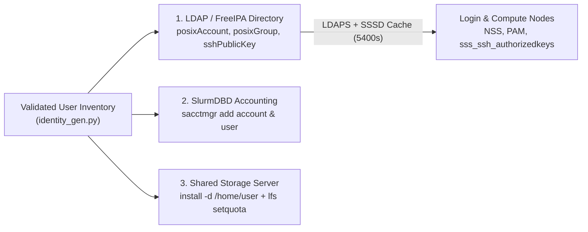

# 6.24 Users, LDAP, SSSD, quotas and accounting at scale

| | |
|---|---|
| Level | Intermediate |
| Priority tier | 2 |
| Lab venue | VMs (OpenLDAP or 389-ds or FreeIPA, plus an SSSD client) |
| Part | Part 6: HPC and Slurm |
| Status | Drafted. `code/part06/identity_gen.py` was run on a valid and an invalid user list (outputs shown); its LDIF and `sacctmgr` command forms follow standard schemas and the Slurm man page but were **not** loaded into a real LDAP server or Slurm. SSSD/PAM/OpenLDAP configuration is from general knowledge and the SCL book (chapters 11 and 28), unverified here. Labs **untested** |

## Why this matters for AI infrastructure

A GPU cluster is a multi-user, multi-team system holding valuable data and compute. Every node must agree on who a user is (same numeric UID and GID everywhere, or file permissions on shared storage are meaningless), users must be added and removed quickly and auditably, resources must be charged to the right project, and none of it can slow login or job launch at thousands of nodes. Identity mistakes cause incidents ranging from "permission denied on my own files" to unauthorised access after an employee leaves. Containers, Kubernetes and Slurm add further identity layers that must stay consistent.

## Prerequisites and outcomes

Needs Part 1 (users, permissions, PAM, nsswitch), Part 2 (DNS, TLS basics), 6.9 (Slurm accounts), 6.18 and 6.19 (quotas). After this chapter you can:

- Explain account synchronisation options (NIS/NIS+, LDAP, FreeIPA/AD, file push) and why a single directory plus SSSD is the modern default.
- Design a UID/GID scheme and an LDAP tree for a cluster; read an LDIF entry for `posixAccount`.
- Configure (conceptually) SSSD, `nsswitch.conf`, PAM and SSH so that logins, `getent` and file ownership agree on every node.
- Provision homes and storage quotas, and keep Slurm accounting in step with the directory.
- Plan onboarding, offboarding, group/project access, service accounts, and audit.
- Diagnose slow logins, missing users, UID mismatches, and cache problems.

## 1. Account synchronisation: the problem and the options



The SCL book (chapter 11) states the issue: "account management becomes a challenge in a supercomputer environment", and the most important requirement is account synchronisation between all nodes, achieved either with a **single data source over the network** (LDAP or NIS+) or by **periodic or event-driven synchronisation of static information**. Basic data (uid, gid, home directory, shell) must match everywhere; quotas, access limits and similar information can be stored and synchronised separately and may legitimately differ by node type. The book gives a pointed example: CPU time limits should not apply on compute nodes but may on login nodes, and users generally should not log in to service nodes (backup servers), although the service nodes still need to know the users' identities for file ownership.

| Method | How | Status and notes |
|---|---|---|
| **Local files pushed by config management** (Ansible/Puppet/BCM) | `/etc/passwd`, `/etc/group`, `/etc/shadow` generated centrally and copied | Simple, no network dependency at login, fine for small and medium clusters; no instant propagation; drift risk if edited locally |
| **NIS / NIS+** | Sun-era directory (YP). NIS is plaintext and weak; NIS+ added security and was deprecated by Sun | Historical; the book covers install steps. Do not choose for new clusters |
| **LDAP (OpenLDAP, 389 Directory Server)** | Hierarchical directory with the RFC 2307/2307bis POSIX schema (`posixAccount`, `posixGroup`, `shadowAccount`) | The long-standing standard; clients via `nss_ldap`/`pam_ldap` (old) or **SSSD** (modern) |
| **FreeIPA / Red Hat IdM** | LDAP + Kerberos + DNS + CA + sudo rules + SSH key distribution + host-based access control as one product | Common in enterprises and larger clusters; strong policy features; adds Kerberos and PKI to operate |
| **Active Directory / Entra ID** (via SSSD `ad` provider, Samba/winbind) | Corporate directory as identity source | Common when the company mandates it; mapping UID/GID from AD attributes (RFC2307 attributes) or algorithmically (SSSD `ldap_id_mapping`) |
| **SSO via OIDC/SAML for web portals** | Open OnDemand, JupyterHub, Kubernetes dashboards | Complements POSIX identity; the portal still maps to a POSIX user (6.25) |

Mixed approach in practice: corporate directory or IdP is authoritative for people; the cluster has its own LDAP/IPA tree (or SSSD mapping) giving POSIX attributes and groups; local system and service accounts stay in local files with UIDs below a reserved range.

### Pull-based file synchronization and timeout wrappers

When synchronising `/etc/passwd`, `/etc/shadow`, and `/etc/group` directly instead of running a network directory, the book recommends a pull model rather than pushing blindly from the master node. Each compute node runs a local script at boot—and on demand when triggered from the master—so that a replaced or temporarily offline node automatically catches up when it boots. In the book's example, `/usr/sbin/master-sync` on each node pulls the three files over `rsync` and SSH `(untested here)`:

```bash
#!/usr/bin/env bash
# (untested here)
SYNC="rsync -e 'ssh -i /root/secret_key'"
SRC_ADDR=root@master.cluster
$SYNC $SRC_ADDR:/etc/passwd /etc/passwd
$SYNC $SRC_ADDR:/etc/shadow /etc/shadow
$SYNC $SRC_ADDR:/etc/group /etc/group
```

To trigger `/usr/sbin/master-sync` across the cluster from the master after batch account edits without overloading the network or hanging indefinitely on a dead node, the book uses a wrapper script with a `0.1`- to `0.5`-second delay between nodes (or `pdsh`/`clush`) and a self-targeted `ALRM` signal timer `(untested here)`:

```bash
#!/usr/bin/env bash
# (untested here)
TIMEOUT=600
CT=3
# exit the script after getting ALRM signal
trap 'exit' ALRM
# schedule ALRM signal to self
(sleep $TIMEOUT && kill -ALRM "$$") &
# do the sync
for i in $(grep -v \# /etc/nodes); do
  ssh -o connecttimeout=$CT $i /usr/sbin/master-sync
  echo -n .
  sleep 0.1
done
echo
```

Here `connecttimeout=3` avoids waiting on unreachable hosts, while the background subshell sends `SIGALRM` to the script's own PID (`$$`) after `600` seconds so the `trap 'exit' ALRM` handler terminates the entire run if stuck.

### Legacy NIS / NIS+ architecture and setup

NIS (Network Information System, originally Sun Yellow Pages, hence the `yp` prefix on its commands) and its successor NIS+ (which is protocol-incompatible with original NIS despite sharing utility names) distribute account and host tables over RPC. The book notes that a single NIS server begins to struggle when serving more than `30–40` clients because of concurrent RPC load, and NIS/NIS+ lack modern security. You may still encounter them on older small clusters. Three server daemons run on the master:

- `ypserv` — the main NIS/NIS+ query server.
- `yppasswdd` — the daemon that processes user password updates.
- `ypxfrd` — the daemon that transfers updated database maps to secondary (slave) servers.
- `ypbind` — the client daemon that binds a node to a server in the NIS domain.

In the book's 8-step setup and Chapter 28 recipe `(untested here)`:

1. Configure `rpcbind` (or `portmap`), `ypserv`, `yppasswdd`, and `ypxfrd` to start at boot (`systemctl enable rpcbind ypserv yppasswdd ypxfrd`).
2. Open the firewall for `rpcbind`, `portmap`, `ypserv`, `yppasswdd`, and `ypxfrd`.
3. Set the NIS domain name (`NISDOMAIN="MYCLUSTER"` in `/etc/sysconfig/network` on Red Hat systems, `NISSERVER=master` in `/etc/default/nis` on Debian systems, and `MYCLUSTER` in `/etc/defaultdomain` on both server and clients).
4. Configure `/etc/ypserv.conf` and `/etc/sysconfig/ypserv` with the database directory (`/var/yp`) and client subnet rules.
5. Create the `/var/yp/Makefile` and restrict allowed client subnets in `/etc/ypserv.securenets` (for example `255.255.255.0 192.168.123.0` and `host 192.168.111.222`), then initialise the master database with `/usr/lib/yp/ypinit -m` `(untested here)`.
6. On each client, set the domain in `/etc/defaultdomain` and point `/etc/yp.conf` to the server (`domain MYCLUSTER my-nis-server-ip-address`).
7. Start `ypbind` on the clients (and on the master node if it also resolves cluster users via NIS).
8. Add `nis` or `nis+` to `/etc/nsswitch.conf` (`passwd: compat nis`, `group: compat nis`, `shadow: compat nis`, `hosts: files dns nis`). Whenever `/etc/passwd`, `/etc/shadow`, or `/etc/group` changes on the master, run `cd /var/yp; make` `(untested here)` to rebuild and push the maps.

### NIS start-up commands and access rules

The NIS master must run four daemons, and each must start again after a reboot. The book gives several command sets, one for each family of init system. On a systemd host, start the daemons and enable them in one pass `(untested here)`:

```bash
systemctl start rpcbind ypserv yppasswdd ypxfrd
systemctl enable rpcbind ypserv yppasswdd ypxfrd
```

On older SysV-style hosts, the book starts the services with `service` and enables them with `chkconfig` `(untested here)`:

```bash
service nis start
service portmap restart
chkconfig ypserv on
chkconfig yppasswdd on
chkconfig ypxfrd on
```

On Debian-like hosts, the book uses `update-rc.d nis enable` instead. Access control comes from `/etc/ypserv.securenets`. The book starts by removing access from everywhere, then adds only the internal network and any single hosts that must connect:

```text
255.255.255.0 192.168.123.0  # format: MASK SUBNET
host 192.168.111.222         # individual host
```

Before you test a new client, confirm that its subnet is in this file. Then build the maps with `cd /var/yp; make`, as in the setup list above.

## 2. UID/GID design

- **Consistency is the contract.** File ownership on shared storage is numeric. If `alice` is 10001 on login nodes and 10005 on compute nodes, her files appear to belong to someone else. A mismatch also breaks Kubernetes volume ownership and container user mapping.
- **Reserved ranges**: system accounts below 1000 (distribution-defined), local service accounts 1000 to 9999 (for example `slurm`, `munge` must have the **same numeric id on every node**, a classic cause of munge failures), people from 10000 upward (this chapter's generator enforces a site minimum), groups for projects from a separate range (the generator starts at 20000). Never reuse a UID after offboarding: reuse lets a new user inherit a leaver's old files.
- **Primary group**: choose user-private groups (UID=GID per user) or a project/team primary group. Private groups plus project groups for sharing (with set-gid directories) is flexible.
- **Stability of generated IDs**: IDs must not depend on file ordering. (The generator assigns group GIDs in order of first appearance, which is fine for a demo but would change numbers if the CSV is reordered; real systems store allocated IDs in the directory and allocate from a counter.)
- **AD/IdP mapping**: if SSSD generates IDs algorithmically from SIDs, ensure the same SSSD ID-mapping configuration on every node, or the IDs differ.

## 3. LDAP in practice

### Directory layout

```text
dc=cluster,dc=example,dc=org
  ou=People    uid=alice (posixAccount, shadowAccount, inetOrgPerson, ldapPublicKey)
  ou=Groups    cn=research (posixGroup, memberUid: alice, bob)
  ou=Hosts / ou=Netgroups / ou=Sudoers (optional)
```

### An entry and the generator

LDIF (LDAP Data Interchange Format) is the text form used to load entries (`ldapadd -x -D cn=admin,... -W -f users.ldif`). `code/part06/identity_gen.py` takes a user list CSV (`user,uid,fullname,group,project,shell,quota_gb,sshkey`), **validates** it, and generates three artefacts from the same source of truth: `users.ldif`, `slurm_accounts.sh` and `homes.sh`. Validation rules: user-name pattern, no duplicates, numeric UID at or above the site minimum, unique UIDs, absolute shell path, integer quota. Output for three users (excerpt):

```text
dn: cn=research,ou=Groups,dc=cluster,dc=example,dc=org
objectClass: posixGroup
cn: research
gidNumber: 20000
memberUid: alice
memberUid: bob
...
dn: uid=alice,ou=People,dc=cluster,dc=example,dc=org
objectClass: inetOrgPerson
objectClass: posixAccount
objectClass: shadowAccount
objectClass: ldapPublicKey
uid: alice
cn: Alice Nguyen
...
```

and `slurm_accounts.sh`:

```text
sacctmgr -i add account infra Description='infra' Organization='infra' || true
sacctmgr -i add account llm-pretrain Description='llm-pretrain' Organization='llm-pretrain' || true
sacctmgr -i add user alice account=llm-pretrain defaultaccount=llm-pretrain || true
...
```

A broken list (UID 500, relative shell path, non-integer quota, duplicate user) was rejected with five errors and no output written:

```text
ERROR root2: uid 500 below site minimum 10000 (collides with system/local ranges)
ERROR root2: shell must be an absolute path
ERROR root2: quota_gb must be an integer
ERROR bob: duplicate user
ERROR bob: uid 10002 already used by bob
```

Real directories need more: password/credential policy (or Kerberos/SSO instead of passwords), `memberOf` overlays, indexes on `uid`, `uidNumber`, `gidNumber`, `memberUid`, `cn`, access control lists, replication (multi-master or provider-consumer), backups (`slapcat`), TLS (LDAPS or StartTLS with a private CA), audit logging. The book's chapter 28 lists the OpenLDAP install steps for Red Hat family systems in "do one, two, three" style. Use the vendor/distribution documentation for current commands; many sites use 389 Directory Server or FreeIPA instead of hand-built OpenLDAP.

### OpenLDAP setup and flat-file migration recipe

In the book's Chapter 28 recipe for Red Hat-based systems (`openldap-servers`, `openldap-clients`, `nss_ldap`), you first generate an administrator password hash with `slappasswd` `(untested here)`:

```bash
# (untested here)
slappasswd
# >>> {SSHA}ABCDEF1234567890
```

In the book's example, `/etc/openldap/slapd.conf` configures the database backend (`bdb`), directory suffix, administrator DN (`rootdn`), password hash (`rootpw`), and schema files `(untested here)`:

```text
database bdb
suffix "dc=ldap,dc=server,dc=org"
rootdn "cn=Manager,dc=ldap,dc=server,dc=org"
rootpw {SSHA}ABCDEF1234567890

include /etc/openldap/schema/core.schema
include /etc/openldap/schema/cosine.schema
include /etc/openldap/schema/inetorgperson.schema
include /etc/openldap/schema/nis.schema
include /etc/openldap/schema/redhat/autofs.schema
include /etc/openldap/schema/openldap.schema
include /etc/openldap/schema/misc.schema
```

Next, copy `/etc/openldap/DB_CONFIG.example` to `/var/lib/ldap/DB_CONFIG` (owned by `ldap:ldap`, mode `600`), set `BASE dc=ldap, dc=server, dc=org` in `/etc/openldap/ldap.conf`, start the daemon, and load the base entry and `Manager` role from `/etc/openldap/ldap-init.ldif` using `/usr/bin/ldapadd -a -x -D 'cn=Manager,dc=ldap,dc=server,dc=org' -W -f ldap-init.ldif` `(untested here)` (verifying with `ldapsearch -h 127.0.0.1 -x -b "dc=ldap,dc=server,dc=org"`).

To migrate existing `/etc/passwd` and `/etc/group` entries into OpenLDAP, edit `/usr/share/migrationtools/migrate_common.ph` (`$DEFAULT_MAIL_DOMAIN = "ldap.server.org";` and `$DEFAULT_BASE = "dc=ldap,dc=server,dc=org";`) and run the migration Perl scripts `(untested here)`:

```bash
# (untested here)
/usr/share/migrationtools/migrate_passwd.pl /etc/passwd people.ldif
ldapadd -x -W -D "cn=Manager,dc=ldap,dc=server,dc=org" -f people.ldif

/usr/share/migrationtools/migrate_group.pl /etc/group group.ldif
ldapadd -x -W -D "cn=Manager,dc=ldap,dc=server,dc=org" -f group.ldif
```

On legacy `nss_ldap`/`pam_ldap` clients (before SSSD), the book's recipe configures `/etc/openldap/ldap.conf` (`base`, `rootbinddn`, `port 389`, `scope sub`, `pam_filter objectclass=posixAccount`, `pam_login_attribute uid`, `nss_base_passwd`, `nss_base_shadow`, `nss_base_group`, `pam_password SSHA`), stores the bind secret in `/etc/ldap.secret` (`chmod 600`, `chown root:root`), sets `files ldap` in `/etc/nsswitch.conf`, and appends `pam_ldap.so` lines (`auth sufficient /lib/security/pam_ldap.so use_first_pass`, `account sufficient`, `password sufficient ... use_authtok`, `session optional`) to `/etc/pam.d/system-auth` without removing the local Unix PAM entries so `root` can still log in during network outages.

### Loading the base entries and checking the directory

A new OpenLDAP server is running but empty. The book fills it with an LDIF file, `/etc/openldap/ldap-init.ldif`, that creates the base entry and the `Manager` role. The names must match the `suffix` and `rootdn` you set earlier. Any name works; it does not have to match the server's DNS name.

```text
dn: dc=ldap,dc=server,dc=org
objectclass: dcObject
objectclass: organization
o: Servidor LDAP ldap
dc: ldap

dn: cn=Manager,dc=ldap,dc=server,dc=org
objectclass: organizationalRole
cn: Manager
```

Load the file with `ldapadd`, which asks for the password you hashed with `slappasswd`. The book's command is:

```bash
/usr/bin/ldapadd -a -x \
  -D 'cn=Manager,dc=ldap,dc=server,dc=org' \
  -W -f ldap-init.ldif
```

Then search the directory from the server itself. The book expects two entries and a result code of `0`, which means success:

```bash
ldapsearch -h 127.0.0.1 -x -b "dc=ldap,dc=server,dc=org"
```

The search should report `numEntries: 2`, with the `dc=ldap` root and the `cn=Manager` role. If the counts differ, re-check the LDIF file before you move on.

The client side reads `/etc/openldap/ldap.conf`. The book's example sets the search base and the server URI:

```text
BASE  dc=ldap, dc=server, dc=org
URI   ldaps://ldap.server.ru:636/
```

The book turns encryption off on clients with `ssl no` in the client file. It calls this a shortcut. Turn encryption on later, once you have certificates and matching settings. The `pam_password` value must use the same hash method that `slappasswd` produced.

## 4. SSSD, nsswitch and PAM on the nodes

**SSSD** (System Security Services Daemon) is the standard client: it talks to LDAP/IPA/AD, **caches** identities and credentials (so logins survive a directory outage and the directory is not queried for every `ls -l`), and exposes them through NSS and PAM. Key files (general knowledge):

```ini
# /etc/sssd/sssd.conf  (mode 600)
[sssd]
services = nss, pam, ssh
domains = cluster

[domain/cluster]
id_provider = ldap
auth_provider = ldap
ldap_uri = ldaps://ldap1.cluster.example.org, ldaps://ldap2.cluster.example.org
ldap_search_base = dc=cluster,dc=example,dc=org
ldap_tls_cacert = /etc/pki/tls/certs/cluster-ca.pem
ldap_default_bind_dn = cn=readonly,dc=cluster,dc=example,dc=org
ldap_default_authtok = <secret>
cache_credentials = true
enumerate = false
entry_cache_timeout = 5400
ldap_user_ssh_public_key = sshPublicKey
access_provider = simple
simple_allow_groups = research, platform
```

```text
# /etc/nsswitch.conf
passwd: files sss
group:  files sss
shadow: files sss
```

PAM (`system-auth`/`password-auth` via `authselect` on RHEL, `pam-auth-update` on Debian) uses `pam_sss.so`. Also relevant: `pam_mkhomedir` or `oddjob-mkhomedir` to create home directories on first login (avoid on compute nodes with shared homes; create homes at onboarding), `pam_slurm_adopt` (SSH to a node only while the user has a job there; 6.8), and `pam_limits`.

Important settings and why:

- `enumerate = false`: do not list all users on every lookup; enumeration at tens of thousands of users hurts; `getent passwd` shows only cached users.
- **Cache timeouts** and `sss_cache -E` to invalidate; stale caches explain "I was added to the group an hour ago".
- **`access_provider`** or host-based access control: restrict who can log in where (people to login nodes; no direct login on compute nodes except via a job).
- **SSH keys from the directory**: `sshd_config`: `AuthorizedKeysCommand /usr/bin/sss_ssh_authorizedkeys` and `AuthorizedKeysCommandUser nobody`; or FreeIPA's key distribution. Disable password SSH login where possible (keys or Kerberos/certificates plus MFA, Part 18).
- **Time**: Kerberos and LDAP TLS depend on clocks (6.18).
- Multiple LDAP URIs for failover; `ldap_network_timeout`, `ldap_opt_timeout` tuned so that a dead server does not stall logins for minutes.

Test on every node type: `id alice`, `getent passwd alice`, `getent group research`, `su - alice -c id`, `ssh alice@node`, `sssctl domain-status cluster`, `sssctl user-checks alice`, logs in `/var/log/sssd/`.

### Compute nodes

Stateless nodes (6.22) should come up with SSSD configured in the image and the host key/identity injected; ensure the first job does not wait on directory lookups. Consider a **local cached subset**: for Slurm, `slurmd`/`slurmstepd` calls `getpwnam` when launching tasks; slow LDAP means slow job starts, and a directory outage can fail launches (Slurm also offers an option to cache user information: `LaunchParameters=enable_nss_slurm` makes `slurmstepd` provide passwd/group data from information sent by the controller; verify support and semantics on your version). Alternatively push a generated passwd/group subset to compute nodes via the provisioning system (the "static synchronisation" approach).

### Restricting and blocking user access

When you need to block a user from logging in or restrict access during maintenance (Chapter 12 of the book), four host-level mechanisms are commonly used alongside SSSD `access_provider` and scheduler-level blocks:

1. **OpenSSH `DenyUsers` / `AllowUsers`**: in `/etc/ssh/sshd_config`, add `DenyUsers user1,user2` (or `AllowUsers` during maintenance windows) and reload `sshd` `(untested here)`. Existing sessions stay open until terminated. Do not mix `AllowUsers` and `DenyUsers` in the same scope because only one of them will take effect.
2. **PAM `pam_access.so`**: insert `account required pam_access.so` at the top of `/etc/pam.d/sshd` or `/etc/pam.d/system-auth`, then define sequential rules in `/etc/security/access.conf` using the format `permission:users/groups:origins` (`+` to allow, `-` to deny, `@group` for groups, `EXCEPT` for exclusions, and `ALL`, `LOCAL`, IP/subnet, or TTY names for origins). The book recommends placing administrator access first and a catch-all deny last `(untested here)`:
   ```text
   +:@admins:ALL
   # ... other access rules
   -:ALL:ALL
   ```
3. **Login shell replacement (`chsh`)**: change the user's shell to a non-interactive binary such as `/sbin/nologin` or `/bin/false` (for example `chsh -s /bin/false user1` `(untested here)`, ensuring `/bin/false` is listed in `/etc/shells`). Because SSH executes remote commands through the user's login shell, this blocks both interactive logins and `ssh remotehost command`.
4. **File-transfer-only shell (`scponly`)**: when a user must copy files via `scp` or `sftp` without interactive shell access, install the `scponly` package and set the user's shell to `/usr/bin/scponly` `(untested here)`.

## 5. Homes, storage quotas and CPU limits

- **Home directories**: created at onboarding by a script on the file server (`install -d -m 0700 -o UID -g GID /home/user`, as emitted by `homes.sh`), populated from `/etc/skel`, with ACL/ownership right; avoid per-login creation on compute nodes.
- **Storage quotas**: user and project quotas on the file systems that matter. Lustre: `lfs setquota -u USER -b SOFT -B HARD -i ISOFT -I IHARD /lustre` and project quotas for directories (6.19); GPFS fileset quotas; XFS project quotas on NFS servers (`xfs_quota -x -c 'limit -p bhard=1t projname'`); ZFS dataset quotas; object-store bucket quotas. The generator's `homes.sh` emits the `lfs setquota` line as a comment: soft limit at 90 percent of hard in this example. On traditional local ext3/ext4 file systems (and NFS servers running `rpc.rquotad`), the book outlines mounting with `usrquota`/`grpquota` in `/etc/fstab`, building the quota database in read-only or single-user mode (`quotacheck -vugc /dev/sda6` or `quotacheck -a -M`), enabling enforcement (`quotaon -va`), and managing block/inode soft and hard limits and grace periods with `setquota`, `edquota`, `setquota -p foo -u bar -a` (to copy user `foo`'s quota to `bar`), and `repquota -s` `(untested here)`.
- **Inode quotas** matter as much as bytes (millions of tiny files, 6.18).
- **CPU/memory limits on login nodes (`ulimit -a` and `/etc/security/limits.conf`, `SCL` Chapter 12)**: `pam_limits`/`/etc/security/limits.conf` (`nproc`, `cpu`, `as`, `memlock`, `nofile`, `stack`, `maxlogins`), systemd `user-.slice` resource controls (`UserTasksMax`, `CPUQuota`, `MemoryMax` in `user-*.slice.d/`) so one user cannot saturate a shared login node (6.2); different from compute nodes where Slurm cgroups apply (6.8) and where `nofile` (open file descriptors for SSH/MPI sockets) and `memlock` (locked RAM for RDMA buffers) must be raised. In `SCL` Chapter 12 (`ulimit -a`), default shell limits often look like `core file size (blocks, -c) 0`, `data seg size (kbytes, -d) unlimited`, `scheduling priority (-e) 0`, `file size (blocks, -f) unlimited`, `pending signals (-i) 63616`, `max locked memory (kbytes, -l) 64`, `max memory size (kbytes, -m) unlimited`, and `open files (-n) 1024`—where `max locked memory (kbytes, -l) 64` is far too small for InfiniBand/RDMA on compute nodes (must be `unlimited`) and `open files (-n) 1024` is too small for large multi-rank jobs. In the book's login-node example, limiting ordinary users to `50` to `100` processes (`max user processes`, `-u`) prevents fork bombs, and setting a `cpu` time limit (for example `100` seconds of processor time) stops accidental calculation runs on the head node. However, the book warns that setting the hard `cpu` time limit too small in `/etc/security/limits.conf` on login nodes will kill large `scp` or `sftp` file transfers mid-copy once the SSH/sftp process accumulates that much CPU time encrypting and checksumming data.
- **Group data areas**: project directories with set-gid bit and default ACLs (`setfacl -d`, `setfacl -m u:user1:rw mydir`, `getfacl`) so files inherit the group or per-user access list.
- **Reporting**: `lfs quota`, `repquota`, nightly usage reports per user/project, alert at 80 percent, purge policy for scratch (document it).

## 6. Slurm accounting alignment

Slurm users and accounts (6.9) are separate from POSIX users: `sacctmgr add user` is keyed by user name and must match the name the system resolves. Keep them aligned:

1. The same inventory source feeds LDAP and `sacctmgr` (the generator shows how).
2. Slurm needs the user to exist on the controller and compute nodes (`getpwnam`) to submit and run; a user created in `sacctmgr` but missing in LDAP fails at launch with "invalid user".
3. Map **projects/teams** to Slurm accounts (fair-share and limits) and to POSIX groups (file access); these two tree structures are related but not identical.
4. On offboarding: disable LDAP login first, then `sacctmgr modify user ... set` limits to zero or remove associations (accounting history is kept), reassign or archive files, remove SSH keys, revoke tokens (API keys, container registry, object store, Slurm REST JWT), disable cloud and Kubernetes access.
5. Reconciliation job: nightly diff of LDAP users vs Slurm associations vs home directories vs quotas; report orphans.

## 7. Lifecycle: onboarding and offboarding

| Step | Onboarding | Offboarding |
|---|---|---|
| Request | Ticket with sponsor, project, resource needs | HR/sponsor notification |
| Identity | Create directory entry (UID/GID allocated), SSH key/MFA enrolment | Disable account (lock, remove keys), keep UID reserved |
| Access | Add to groups/projects; Slurm association, QOS | Remove from groups; cancel jobs; remove Slurm associations or set to zero |
| Storage | Home, quotas, project dirs | Transfer ownership of shared data; archive/delete home per policy; keep UID |
| Audit | Log who approved | Verify no remaining keys, tokens, cron/at jobs |
| Training | Cluster etiquette, support channel | Exit checklist |

Automate with a workflow tool (ticket to Ansible/AWX or an internal API), keep the inventory under review, and run periodic recertification (do these people still need access?).

## 8. Scale, security and troubleshooting

**Scale**: tens of thousands of nodes asking for `getpwnam` at job start can hammer LDAP: use SSSD caching, read replicas, local `nscd`/`sssd` memory caches, indexes, connection pooling, rate-limit enumeration, and `enable_nss_slurm`-style approaches; monitor LDAP latency and connection counts. Pre-warm or push static data for jobs starting on thousands of nodes.

**Security**: LDAPS/StartTLS only; read-only bind account for clients with minimal ACLs; protect `sssd.conf` (mode 600); no anonymous binds; password hashes (use SSHA512/PBKDF2 or avoid local passwords via Kerberos/SSO); MFA for logins to bastions; audit logging of admin changes; rotate bind passwords; segment the directory network; backup and tested restore. Service accounts: no interactive shell, key-only, minimal scope; tokens with expiry.

| Symptom | Likely cause | Check |
|---|---|---|
| `id alice` fails on some nodes | SSSD down/misconfigured, TLS CA missing, directory unreachable, wrong search base | `systemctl status sssd`, `sssctl domain-status`, `/var/log/sssd/`, `ldapsearch -H ldaps://... -x -D ... -b ...` |
| Files owned by numeric IDs | UID mapping differs across nodes, user deleted | `getent passwd 10001` on both nodes, ID-mapping config |
| Login takes 30+ seconds | DNS/LDAP timeouts, failover to dead server first, enumerate=true, slow PAM modules | `strace -f -tt ssh`, SSSD debug level, timeouts |
| New user cannot submit jobs | Not in `sacctmgr`, or not resolvable on controller | `sacctmgr show assoc user=...`, `getent` on controller |
| Group change not effective | Cache | `sss_cache -E`, wait for timeouts, new login session |
| SSH key not accepted | `AuthorizedKeysCommand` not configured, attribute name mismatch, sssd ssh service off | `sss_ssh_authorizedkeys alice`, `sshd -T`, logs |
| Munge failures | `munge` UID/GID differs across nodes, time skew | `id munge` on all nodes (6.7) |
| Jobs fail to start on all nodes after directory outage | `slurmstepd` cannot resolve user | cache settings, `enable_nss_slurm`, restore directory |

## 9. Containers and Kubernetes note

Containers run with the invoking user's numeric UID (enroot/pyxis, Apptainer), so host identity must be consistent (6.13); user namespaces can remap IDs, which breaks assumptions about file ownership on shared mounts. In Kubernetes, pod `runAsUser`/`fsGroup` interplay with volume ownership (5.12 and 5.21); give training pods the user's UID/GID explicitly, or use a service identity with a project group. Do not run jobs as root to "avoid permission problems".

## 10. Lab

First, run the self-checking Python lab (`code/part06/identity_gen_lab.py`) locally. It verifies `validate()`, `ldif()`, `slurm()`, and `homes()` in `code/part06/identity_gen.py` on a valid 3-user list (checking `gidNumber: 20000`, `posixAccount` / `ldapPublicKey` LDIF records, `sacctmgr` account/user creation commands, and `0700` home directory creation with `90%` soft / `100%` hard Lustre quota lines), verifies that a broken user list is rejected with all 5 expected errors (`uid < 10000`, relative shell path, non-integer quota, duplicate user, duplicate UID), and checks the `SCL` Chapter 11/12 parameters (`30–40` NIS client limit, `ulimit -l 64` KB default `memlock`, `-n 1024` `nofile`, `-i 63616` `pending signals`, and `5400` s SSSD cache timeout):

```bash
python3 code/part06/identity_gen_lab.py
```

Tested: 1) run `identity_gen.py` on a ten-user list with two projects; read the three outputs. 2) Break the list in each rule and confirm the error message. 3) Extend the script to read an existing UID allocation file so UIDs/GIDs are stable.

Untested (VMs): 4) install OpenLDAP or 389-ds, load `users.ldif`, query with `ldapsearch`. 5) Configure an SSSD client, verify `id`, `getent`, SSH login with a key from LDAP. 6) Stop the LDAP server and observe cached logins; set short/long cache timeouts. 7) Run `slurm_accounts.sh` on a test Slurm; verify `sacctmgr show assoc`. 8) Create project quotas on an XFS or Lustre test file system. 9) Measure login time with `enumerate = true` versus false and with a dead primary LDAP URI.

## 11. Interview angles

- Why must UIDs be identical on every node and how do you guarantee it?
- LDAP versus FreeIPA versus AD-integrated SSSD for a new GPU cluster?
- What does SSSD cache and what happens if the directory is down?
- How do you onboard 200 students quickly and securely? How do you offboard one?
- A user's job fails with "invalid user" on one partition. What do you check?
- How do you keep Slurm accounts and Unix users in sync?
- How would you protect SSH access to login nodes?
- Why can LDAP become a bottleneck at job start and how do you mitigate it?
- What quotas do you set and where are they enforced?

## Exercises

1. **Generating Unified LDIF, Slurm Associations, and Home Quotas (`code/part06/identity_gen.py` & `identity_gen_lab.py`):** Run `python3 code/part06/identity_gen_lab.py`. Explain the five validation checks enforced by `validate()` (`uid >= 10000`, unique username, unique UID, absolute shell path, integer `quota_gb`), and verify how `identity_gen.py` derives `users.ldif` (`posixGroup` at `gidNumber: 20000` and `posixAccount`/`ldapPublicKey`), `slurm_accounts.sh` (`sacctmgr -i add account` and `add user`), and `homes.sh` (`install -d -m 0700` and `90%` soft / `100%` hard `lfs setquota`).
2. **Pull-Based Static Account Sync with `SIGALRM` Timeout Protection (`SCL` Chapter 11):** Write the `/usr/sbin/master-sync` pull script (`rsync -e 'ssh -i /root/secret_key'`) and the master trigger wrapper using `trap 'exit' ALRM` and `(sleep 600 && kill -ALRM "$$") &` with `ssh -o connecttimeout=3` and `sleep 0.1`. Explain why pull-based sync is superior to blind master push when compute nodes are rebooting or being replaced.
3. **Configuring SSSD, `nsswitch.conf`, and LDAP SSH Key Lookup:** Write `/etc/sssd/sssd.conf` (mode `0600`) for an `ldaps://` pair (`ldap1`, `ldap2`) with `cache_credentials = true`, `enumerate = false`, `entry_cache_timeout = 5400`, `ldap_user_ssh_public_key = sshPublicKey`, and `access_provider = simple` (`simple_allow_groups = research, platform`), plus the `/etc/ssh/sshd_config` lines (`AuthorizedKeysCommand /usr/bin/sss_ssh_authorizedkeys` and `AuthorizedKeysCommandUser nobody`).
4. **Migrating Flat Files to OpenLDAP and Legacy NIS+ (`SCL` Chapters 11 & 28):** Compare the 8-step NIS/NIS+ setup (`ypserv`, `yppasswdd`, `ypxfrd`, `ypbind`, `/etc/ypserv.securenets`, `/usr/lib/yp/ypinit -m`, `cd /var/yp; make`, and why NIS struggles above `30–40` clients) with the OpenLDAP migration workflow (`slappasswd`, `/etc/openldap/slapd.conf`, `ldap-init.ldif`, `migrate_passwd.pl`, `migrate_group.pl`).
5. **Tuning Login-Node vs Compute-Node `ulimit`s and Blocking Access (`SCL` Chapter 12):** Compare `/etc/security/limits.conf` settings on a shared login node (`nproc` `50–100`, `cpu` time limit—and why an overly small `cpu` limit kills large `scp`/`sftp` transfers) versus a GPU compute node (`memlock unlimited` instead of the default `64` KB, `nofile 65536` instead of `1024`). Compare the four user-blocking methods in `SCL` Chapter 12 (`DenyUsers`, `pam_access.so` `/etc/security/access.conf`, `chsh -s /bin/false`, and `scponly`).
6. **Designing an Automated Onboarding, Offboarding, and Nightly Reconciliation Workflow:** Write the exact sequence of actions for offboarding a departing researcher without breaking shared project files or historical Slurm accounting (`slurmdbd`), and specify what a nightly reconciliation script checks across LDAP, `sacctmgr`, `/home`, and Lustre project quotas.

## Checkpoint

<details>
<summary>1. Why must every user and service account have the exact same numeric `UID` and `GID` across all login, compute, storage, and service nodes (`SCL` Chapter 11)?</summary>

POSIX filesystems (NFS, Lustre, GPFS) and container runtimes store file ownership and check permissions using **numeric UIDs and GIDs**, not usernames. If `alice` is UID `10001` on login nodes and `10005` on compute nodes, jobs cannot read or write her files on shared storage; similarly, if `munge` or `slurm` has different UIDs across nodes, Munge credential verification and Slurm job launches fail.
</details>

<details>
<summary>2. What UID/GID ranges should be reserved for OS system accounts, cluster service accounts, human users, and project groups, and why must UIDs never be reused?</summary>

- **`0–999`:** OS distribution system accounts.
- **`1000–9999`:** Cluster service accounts (`munge`, `slurm`, `sssd`, `prometheus`) pinned to fixed numeric IDs in configuration management.
- **`10000+`:** Human user accounts (`--min-uid 10000` in `identity_gen.py`).
- **`20000+`:** Shared project/team groups.
**Never reuse a UID** after a user leaves, or the new user will automatically inherit ownership of any archived or leftover files owned by that numeric UID.
</details>

<details>
<summary>3. In `SCL` Chapter 11's static file-synchronization pattern (`/usr/sbin/master-sync`), why do compute nodes pull `/etc/passwd`, `/etc/shadow`, and `/etc/group` at boot, and how does the master trigger script avoid hanging?</summary>

Pulling at boot via `/usr/sbin/master-sync` ensures that any node that was powered off, under repair, or freshly provisioned automatically synchronizes its account files as soon as it boots. When the master triggers `/usr/sbin/master-sync` across `/etc/nodes`, it passes `ssh -o connecttimeout=3`, staggers nodes with `sleep 0.1`, and arms a background timer `(sleep 600 && kill -ALRM "$$") &` with `trap 'exit' ALRM` so a wedged SSH session can never hang the sync script past 600 seconds.
</details>

<details>
<summary>4. Name the four NIS/NIS+ daemons and explain why `SCL` Chapter 11 advises against NIS for clusters larger than `30–40` nodes.</summary>

- **`ypserv`:** Main NIS query server daemon.
- **`yppasswdd`:** Password update daemon.
- **`ypxfrd`:** Map transfer daemon for secondary servers.
- **`ypbind`:** Client binding daemon.
A single NIS server struggles above **`30–40` clients** due to uncached synchronous RPC load (especially during parallel job startup) and lacks modern encryption/authentication.
</details>

<details>
<summary>5. Which LDAP object classes represent a cluster user with POSIX attributes and an SSH public key (`code/part06/identity_gen.py`)?</summary>

`inetOrgPerson`, **`posixAccount`** (`uid`, `uidNumber`, `gidNumber`, `homeDirectory`, `loginShell`), **`shadowAccount`**, and **`ldapPublicKey`** (`sshPublicKey`), while groups use **`posixGroup`** (`cn`, `gidNumber`, `memberUid`).
</details>

<details>
<summary>6. How do you migrate existing `/etc/passwd` and `/etc/group` files into OpenLDAP (`SCL` Chapter 28)?</summary>

Configure `$DEFAULT_MAIL_DOMAIN` and `$DEFAULT_BASE` in `/usr/share/migrationtools/migrate_common.ph`, run **`/usr/share/migrationtools/migrate_passwd.pl /etc/passwd people.ldif`** and **`migrate_group.pl /etc/group group.ldif`**, and load both LDIF files with `ldapadd -x -W -D "cn=Manager,..." -f ...`.
</details>

<details>
<summary>7. What advantages does **SSSD** provide over legacy `nss_ldap` / `pam_ldap` on compute and login nodes?</summary>

SSSD maintains a persistent **on-disk and in-memory cache** of user/group lookups and (`cache_credentials = true`) hashed credentials, multiplexes LDAP connections over persistent LDAPS sockets, supports multi-server failover, and serves SSH keys via `sss_ssh_authorizedkeys`—so `ls -l` and `getpwnam()` do not flood the LDAP server and nodes continue functioning during a brief directory outage.
</details>

<details>
<summary>8. Why must `enumerate = false` be set in `/etc/sssd/sssd.conf`, and how do you flush a stale SSSD cache entry?</summary>

With `enumerate = true`, SSSD periodically downloads the entire `ou=People` and `ou=Groups` trees from LDAP, which overloads both the directory server and node CPU on large directories (with `enumerate = false`, on-demand lookups `id alice` and `getent passwd alice` still work and cache normally). Flush stale cached entries with **`sss_cache -E`** (or `sss_cache -u alice`).
</details>

<details>
<summary>9. How do you configure OpenSSH (`sshd_config`) to authenticate users against SSH public keys stored in LDAP via SSSD?</summary>

Enable the `ssh` service in `/etc/sssd/sssd.conf` (`services = nss, pam, ssh` and `ldap_user_ssh_public_key = sshPublicKey`), and set in `/etc/ssh/sshd_config`:
- `AuthorizedKeysCommand /usr/bin/sss_ssh_authorizedkeys`
- `AuthorizedKeysCommandUser nobody`
</details>

<details>
<summary>10. Why can launching a 2,000-node MPI/PyTorch job cause an **LDAP lookup storm**, and how does Slurm's `LaunchParameters=enable_nss_slurm` prevent it?</summary>

When `slurmstepd` spawns tasks simultaneously on 2,000 nodes, every node calls `getpwnam()` and `initgroups()` to resolve the user's UID and supplementary GIDs—generating thousands of simultaneous LDAP queries. With **`LaunchParameters=enable_nss_slurm`** (and `nss_slurm` in `/etc/nsswitch.conf`), `slurmctld` resolves the user once and packs the UID/GID list into the job launch credential so `slurmstepd` resolves the user locally with zero network directory traffic.
</details>

<details>
<summary>11. Compare the four host-level user access restriction mechanisms in `SCL` Chapter 12 (`DenyUsers`/`AllowUsers`, `pam_access.so`, `chsh -s /bin/false`, and `scponly`).</summary>

1. **`DenyUsers` / `AllowUsers` in `/etc/ssh/sshd_config`:** Blocks or whitelists SSH logins for specified users (do not mix both in the same scope).
2. **`pam_access.so` + `/etc/security/access.conf`:** Evaluates `permission:users/groups:origins` rules in order (e.g., `+:@admins:ALL` then `-:ALL:ALL`).
3. **`chsh -s /bin/false user1` (or `/sbin/nologin`):** Replaces the user's login shell so both interactive SSH and `ssh host command` fail immediately.
4. **`/usr/bin/scponly`:** Allows the user to transfer files via `scp`/`sftp` while blocking interactive shell commands.
</details>

<details>
<summary>12. Why should home directories (`/home/user`) be created centrally at onboarding rather than via `pam_mkhomedir` on compute nodes?</summary>

If `pam_mkhomedir` is enabled on compute nodes and `/home` is mounted with `root_squash` (or experiences a transient automount delay), 100 parallel job tasks starting on a new user's first run will race or fail with `EACCES` trying to create `/home/user`. Creating `/home/user` (`install -d -m 0700 -o UID -g GID`) on the storage server during onboarding guarantees it exists before the user's first login or job.
</details>

<details>
<summary>13. What is the 6-step workflow for enabling and managing traditional Linux filesystem quotas (`SCL` Chapter 12)?</summary>

1. Add **`usrquota,grpquota`** to the filesystem's options in `/etc/fstab` and remount.
2. Build the quota database files (`aquota.user`, `aquota.group`) with **`quotacheck -vugc /dev/sdX`** (or `quotacheck -a -M`).
3. Enable enforcement with **`quotaon -va`**.
4. Set block and inode soft/hard limits with **`edquota -u user`** or **`setquota -u user bsoft bhard isoft ihard /mount`**.
5. Clone a template user's quota with **`setquota -p foo -u bar -a`**.
6. Audit usage across users with **`repquota -va`** / **`repquota -s`** (and run `rpc.rquotad` on NFS servers).
</details>

<details>
<summary>14. Why must `/etc/security/limits.conf` (`ulimit`) differ between login nodes and GPU compute nodes (`SCL` Chapter 12)?</summary>

- **On login nodes:** Restrict `nproc` (`50–100` processes) and memory/CPU via `pam_limits` or `systemd` `user-.slice` so one user's compile or script cannot starve other users.
- **On GPU compute nodes:** Default limits (`max locked memory -l 64` KB, `open files -n 1024` in `SCL` Chapter 12) break InfiniBand RDMA verbs (`ibv_reg_mr` requires **`memlock unlimited`**) and multi-rank PyTorch/NCCL sockets (requires **`nofile 65536+`**), while CPU/RAM isolation is handled per job by Slurm cgroups.
</details>

<details>
<summary>15. Why does `SCL` Chapter 12 warn against setting a very small hard `cpu` time limit in `/etc/security/limits.conf` on login or data-transfer nodes?</summary>

Because `scp`, `sftp`, and `rsync`-over-SSH encrypt and checksum every byte on the CPU. If a login node sets a low hard `cpu` limit (e.g., `100` CPU seconds), the kernel sends `SIGKILL` to the user's `sshd`/`sftp-server` process partway through transferring a multi-gigabyte dataset or checkpoint.
</details>

<details>
<summary>16. How do POSIX **set-gid directories (`chmod 2770`)** and **default ACLs (`setfacl -d`)** simplify shared project directories (`SCL` Chapter 12)?</summary>

Setting the `setgid` bit (`chmod g+s` / `2770`) on `/scratch/proj_llm` ensures that every new file or subdirectory created inside it automatically inherits the directory's project group (`proj_llm`) rather than the creator's primary group. Adding default POSIX ACLs (`setfacl -d -m g:proj_llm:rwx /scratch/proj_llm`) ensures newly created files remain group-writable regardless of a user's restrictive `umask`.
</details>

<details>
<summary>17. How do POSIX users/groups and Slurm accounting (`sacctmgr`) interact, and what happens if a user is added to `sacctmgr` but missing from LDAP?</summary>

Slurm's accounting database (`slurmdbd`) tracks authorizations and Fair Tree shares by username string (`sacctmgr add user alice account=llm-pretrain`), while `slurmctld` and `slurmd` use NSS (`getpwnam("alice")`) to look up numeric UID/GID at job submission and task launch. If `alice` is in `sacctmgr` but not resolvable via NSS on compute nodes, job launch fails immediately with `Invalid user id` / `User not found on host`.
</details>

<details>
<summary>18. Walk through the safe offboarding sequence when an engineer leaves the organization.</summary>

1. **Lock/disable the LDAP/IdP account** and remove `sshPublicKey` entries (and flush SSSD caches with `sss_cache -E`).
2. **Cancel running/pending Slurm jobs** (`scancel -u <user>`) and remove or zero-limit their `sacctmgr` associations (never delete historical job records in `slurmdbd`).
3. **Revoke active tokens and certificates** (Slurm JWTs, NGC/registry tokens, S3 keys, Kubernetes RBAC, VPN/bastion sessions) and terminate open `sshd`/`tmux` processes on login nodes.
4. **Reassign shared project files** to the project lead (`chown -R`) and archive/purge `/home/<user>` per retention policy while **keeping the numeric UID permanently retired**.
</details>

<details>
<summary>19. How do host UIDs interact with **Enroot/Pyxis**, **Apptainer**, and **Kubernetes pods** on shared storage?</summary>

Enroot/Pyxis and Apptainer run container processes under the **invoking user's host UID/GID**, so shared Lustre/NFS mounts work seamlessly as long as host UIDs match across nodes. In Kubernetes, if a training pod defaults to running as `root` (`UID 0`) inside the container without matching `securityContext.runAsUser` / `runAsGroup` / `fsGroup`, files written to shared storage will be owned by `root` (or blocked by `root_squash`)—always pass the user's or project's numeric `runAsUser`/`fsGroup`.
</details>

<details>
<summary>20. What four checks belong in a nightly cluster identity and quota reconciliation job?</summary>

1. **LDAP vs `sacctmgr` diff:** Flag active Slurm associations whose user no longer exists (or is locked) in LDAP, and LDAP users in cluster groups missing Slurm associations.
2. **UID/GID consistency check:** Verify `id munge`, `id slurm`, and sample user UIDs across all node classes.
3. **Orphaned file & `/home` audit:** Detect `/home` directories or `/scratch` trees owned by unmapped numeric UIDs.
4. **Quota threshold alerting:** Parse `lfs quota` / `repquota` and alert users/projects exceeding `80–90%` of block or inode quotas before training jobs hit `EDQUOT`.
</details>

## Sources and review notes

- Book source (`supercomputers-for-linux-sysadmins-managing-modern-hpc-clusters-and-supercomputers-from-software-to-hardware`, `SCL`):
  - Chapter 11 ("11. Users – Accounting Management", read in full): pull-based `/usr/sbin/master-sync` over `rsync`/SSH, `trap 'exit' ALRM` timeout wrapper loop, NIS/NIS+ daemon roles (`ypserv`, `yppasswdd`, `ypxfrd`, `ypbind`), `30–40` client RPC load limit, and 8-step NIS+ setup.
  - Chapter 12 ("12. Users – Quotas and Access Rights", read in full): traditional Linux file system quotas (`usrquota`/`grpquota`, `quotacheck`, `quotaon`, `setquota`, `edquota`, `repquota`, `rpc.rquotad`), `ulimit -a` (`core file size 0`, `pending signals 63616`, `max locked memory 64`, `open files 1024`) and `/etc/security/limits.conf` (`50–100` processes and `100` seconds CPU time on login nodes, and why a small `cpu` limit kills large `scp`/`sftp` transfers), POSIX ACLs (`setfacl`/`getfacl`), and user blocking methods (`DenyUsers`/`AllowUsers`, `pam_access.so` with `/etc/security/access.conf`, `chsh -s /bin/false`, and `scponly`).
  - Chapter 28 ("28. One-Two-Three Instructions", read in full): NIS+ server/client recipes (`ypinit -m`, `/etc/ypserv.securenets`, `/var/yp/Makefile`) and OpenLDAP server/client setup (`slappasswd`, `/etc/openldap/slapd.conf`, `ldap-init.ldif`, `migrate_passwd.pl`, `migrate_group.pl`, `/etc/ldap.secret`, and `pam_ldap.so`).
- Run here: `code/part06/identity_gen.py` and `python3 code/part06/identity_gen_lab.py` (3 passed, 0 failed).
- Explicitly labelled inferences: `GOOD_USERS` and `BAD_USERS` in `code/part06/identity_gen_lab.py` are deterministic test fixtures verifying `identity_gen.py`.
- Not verified on live hardware: SSSD/LDAP/PAM/NIS+ live daemon configuration, `/usr/sbin/master-sync` and wrapper scripts on a multi-node cluster, `enable_nss_slurm` semantics across Slurm releases, FreeIPA/AD live joins, and ext3/XFS/ZFS/Lustre quota commands (`untested here`).
