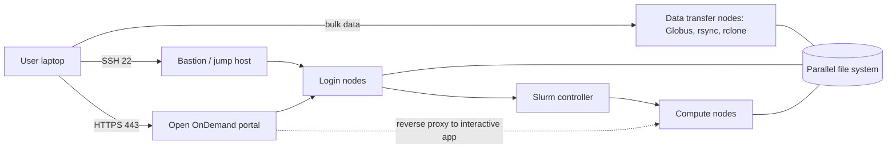

# 6.25 Remote access, bastions, Open OnDemand and user environments

| | |
|---|---|
| Level | Intermediate |
| Priority tier | 2 |
| Lab venue | VMs: bastion, login, compute; Open OnDemand host |
| Part | Part 6: HPC and Slurm |
| Status | Drafted. OpenSSH option names and defaults were checked against `sshd_config(5)` (openssh/openssh-portable commit `26b1363`, 2026-10-18); `code/part06/sshd_audit.py` was run on a bad and a good config (output shown). Open OnDemand statements come from its documentation (OSC/ood-documentation commit `0d23cee`, 2026-10-13: architecture and cluster configuration). Nothing was deployed. Labs **untested** |

## Why this matters for AI infrastructure

Researchers meet the cluster through access paths. An SSH session, a browser-based Jupyter, a VS Code remote window and a web job composer are all paths in. Each one makes decisions for you: how secure the cluster is, how quickly a researcher can start working, and how many support tickets you will field.

Security depends on the login node first. It sits close to the internet, and a weak bastion is the most common initial-access vector in compromised research clusters. Productivity depends on the path too. Can users get a GPU notebook in two clicks? When the answer is no, people find their own way. They run notebooks on login nodes or move data to cloud notebooks, and the support load grows.

This chapter covers the technology and the operating practices around it.

## Prerequisites and outcomes

This chapter builds on chapter 6.2 for login nodes, chapters 6.8 to 6.11 for Slurm and chapter 6.24 for identity. Read those first if the terms below feel new. When you finish, you should be able to:

- Design the access architecture: bastion, login nodes, compute node access, web portal and data transfer nodes.
- Harden and audit `sshd`, and choose a key, certificate and MFA strategy. Use `ProxyJump`, tunnels and X11 forwarding properly, and know the risk that comes with agent forwarding.
- Explain Open OnDemand's architecture and write a cluster configuration for Slurm. You will also understand the interactive apps, such as Jupyter, RStudio and VNC desktops, and the batch-connect model behind them.
- Provide user environments, covering shells, modules and containers, dotfiles, conda and uv guidance, quotas and etiquette.
- Run user support through channels, tickets, documentation, status communication and training.

Use this list as a self-check. Any outcome you cannot yet explain is the place to start.

## 1. Access architecture

Suppose a researcher on a laptop needs a GPU node. The request crosses several hosts, and each one has a narrow job. The diagram shows that path.



The bastion, or jump host, is the only SSH entry point that the internet or the campus network can reach. Keep it hardened, with minimal software, no user data and no compute. It should log everything and require MFA. You reach internal hosts through it with `ssh -J user@bastion user@login`, which uses OpenSSH's `ProxyJump` option.

Login nodes are where users edit code, compile and submit jobs, as chapter 6.2 explains. In strict designs, outside clients cannot reach them directly. A DNS alias spreads the load across several of them.

Users reach compute nodes only through Slurm, with `srun` or `salloc`. There is one exception. With `pam_slurm_adopt`, a user can SSH to a node where they have a running job. Chapter 6.14 covers the `Contain` prolog flag that this mode relies on. Interactive web apps reach compute nodes through the portal's reverse proxy instead.

Bulk transfers should not load the login nodes. Data transfer nodes (DTNs) are dedicated hosts with fast external links, and they run tools such as Globus, `rsync`, `rclone` and `aria2` to move datasets in and out. Their firewall and intrusion detection are tuned for large flows, which is the Science DMZ pattern.

The web portal can be Open OnDemand, JupyterHub or a custom one. It sits behind HTTPS with single sign-on.

Network zones are covered in Parts 2 and 18. The internet and campus network sit outside. The DMZ holds the bastion, the portal and the DTNs. Users reach the login nodes from the user zone, and the compute and storage fabrics have zones of their own. The management network holds the BMCs, and users must never reach it.

## 2. SSH

In Chapter 18 of *Supercomputers for Linux Sysadmins*, "Remote User Access", the author calls SSH "the main method of remote access to supercomputers today". The practical stance is that users need only a few commands, such as queuing a job or checking its status. File copying happens in a GUI client on the personal computer. For newcomers on the access node, a two-panel file manager such as Midnight Commander eases the first steps.

### Authentication

SSH offers several ways to prove who you are. Each one trades convenience against control, so compare them before you choose.

| Method | Notes |
|---|---|
| **Passwords** | Avoid on exposed hosts; brute-force target; if unavoidable, rate-limit and add MFA |
| **Public keys** | Standard. Enforce passphrase-protected keys (or hardware-backed: FIDO2 `sk-ssh-ed25519`); keys stored in the directory and served via `AuthorizedKeysCommand` (6.24) so revocation is central |
| **SSH certificates** | A CA signs short-lived user certificates (`TrustedUserCAKeys` on servers); no per-user key distribution; expiry limits damage; common with SSO-issued certs (Smallstep, Vault SSH, Teleport, FreeIPA) |
| **Kerberos / GSSAPI** | Ticket-based SSO inside an institution |
| **MFA** | PAM modules (TOTP, Duo, hardware tokens) via keyboard-interactive; or `AuthenticationMethods publickey,keyboard-interactive` to require key *and* a second factor |

Avoid passwords on exposed hosts. They are a brute-force target, and if you cannot avoid them, rate-limit them and add MFA. Public keys are the standard choice. Passphrase-protect them, or use hardware-backed FIDO2 keys, and keep the keys in the directory, served through `AuthorizedKeysCommand`, so that revoking a user happens in one place. Certificates from a CA expire on their own, which limits the damage from a stolen credential.

### Hardening and audit

Start with the defaults that `sshd_config(5)` documents. `PermitRootLogin prohibit-password` is the default, which blocks password logins for root. `MaxStartups 10:30:100` throttles unauthenticated connections. Current OpenSSH also enables `PerSourcePenalties` by default, which penalises abusive sources.

On every login host, review `PermitRootLogin`, `PasswordAuthentication`, `KbdInteractiveAuthentication`, `PermitEmptyPasswords`, `PermitUserEnvironment`, `AllowGroups`/`AllowUsers`, `MaxAuthTries`, `LoginGraceTime`, `ClientAliveInterval`/`ClientAliveCountMax`, `X11Forwarding`, `AllowTcpForwarding`, `AuthorizedKeysCommand`, `LogLevel`, `Banner` and `MaxStartups`.

The script `code/part06/sshd_audit.py` reads the global section of an `sshd_config` and applies these rules. Each finding is reported as ERROR, warn or info. We ran it on a deliberately poor config that turned on root login, passwords, user environment and X11. It produced this output:

```text
ERROR PermitRootLogin=yes: root login must be no/prohibit-password/forced-commands-only (default is prohibit-password)
ERROR PasswordAuthentication=yes: password authentication should be off on login nodes (keys, certificates, or SSO+MFA)
warn  AllowGroups=<default>: restrict logins with AllowGroups (or AllowUsers) instead of everyone in the directory
warn  MaxAuthTries=<default>: set MaxAuthTries <= 4 (default 6)
...
ERROR PermitUserEnvironment=yes: PermitUserEnvironment must stay 'no' (lets users inject LD_PRELOAD-style variables)
```

A reasonable config produced only the informational note about X11. When you read the output, treat it as a to-do list. Every ERROR is a setting to change before the host goes into service.

The audit reads the global block, which means everything before the first `Match`. In sshd, the first occurrence of a keyword wins, and the audit follows that rule. It does not evaluate `Match` blocks, `Include` files or the effective configuration. For that, use `sshd -T`, for example `sshd -T -C user=alice,host=x,addr=1.2.3.4`. Treat the script as a checklist, not a scanner.

Add controls around the config as well. Use fail2ban or `PerSourcePenalties`, and allow only known networks through a host firewall, so the bastion is reachable from known networks alone. Admins can run a separate `sshd` instance on a non-standard port. Keep the privilege separation defaults, rotate host keys regularly, and sign them with host certificates. Ship auth logs to a SIEM, since `LogLevel VERBOSE` records key fingerprints. Record sessions on bastions with tools such as `tlog` or `ttyrec`, set idle timeouts, and tie `AllowGroups` to directory groups.

### Client-side practices (document these for users)

You also need to give users a client configuration, so write one and share it. The example below is a `~/.ssh/config` for a laptop.

```text
# ~/.ssh/config on the user's laptop
Host bastion
    HostName bastion.cluster.example.org
    User alice
    IdentityFile ~/.ssh/id_ed25519
Host login
    HostName login.cluster.internal
    User alice
    ProxyJump bastion
    ServerAliveInterval 60
```

Use `ProxyJump` rather than agent forwarding to reach internal hosts. Agent forwarding exposes the user's agent socket to root on the intermediate hosts, so avoid it or limit it. With `ssh -J`, the keys stay on the laptop.

For data, use `scp`, `rsync`, `sftp` or Globus. Tunnels such as `ssh -L 8888:localhost:8888` follow the same pattern. To reach a Jupyter server on a compute node through the login node, use `ssh -L 8888:gpu014:8888 login`, but only if the policy allows `AllowTcpForwarding`. Run `tmux` or `screen` on login nodes so that sessions survive a disconnect. Do not run them for compute work.

### X11 and graphical tools (*Supercomputers for Linux Sysadmins* Chapter 18)

Sometimes a visualization tool has to run on the cluster, because moving multi-terabyte datasets to a workstation is not practical. Chapter 18 of *Supercomputers for Linux Sysadmins* explains how graphical access works in that case.

The X Window System, also called `X11` or `X.Org Server`, does not live in the kernel. Unlike Windows, Linux keeps its graphics subsystem out of the kernel. X uses a client and server model. The X server owns the physical or virtual display, which is `:0` by default, so you can run `xclock -display :0` or `export DISPLAY=:0`. The server has two parts: 1) the hardware drivers for the keyboard, mouse, video adapters and monitors, and 2) an X protocol handler. Graphical applications, the X clients, talk to that handler over UNIX domain sockets or Internet TCP sockets.

X draws and moves windows, but a window manager frames and places them. The options range from Windows-like and Macintosh-like managers, such as `Kwin` in KDE and `Metacity` in GNOME, to frame-based tiling managers like `Ion`, the minimal `twm` and the full-featured `Enlightenment`. The Single UNIX Specification standardizes `CDE`, and freedesktop.org standardizes interoperability.

The reference `X.Org Server` reads `/etc/X11/xorg.conf`, which takes priority if it exists. It also reads `/etc/X11/xorg.conf.d/`, which holds several files with separate configuration sections. If auto-detection fails, `Xorg -configure` generates `xorg.conf.new`. The `man xorg.conf` page covers this. Startup errors go to `/var/log/Xorg.0.log`, where `0` is the display number. From a terminal, `startx` launches the X server and then `~/.xsession` and `/etc/X11/Xsession.d`. When X runs as a service, a screen manager authenticates the user and starts the session. The screen managers are `xdm`, configured under `/etc/X11/xdm/` and running `/etc/X11/xdm/Xsession`, `gdm` in `/etc/gdm/`, `kdm` in `/etc/kde4/kdm/`, and `lightdm`.

On Windows workstations, the open-source `Xming` X server is one option, available at `http://www.straightrunning.com/XmingNotes/`. It comes in two variants. Standard `xming` is one, and `xming Mesa` is the other, which lets you run OpenGL applications on a remote terminal. The downloads also include backgrounds, some in Cyrillic, and `Xlaunch` manages startup parameters. A typical start command looks like this:

```text
"C:\Program Files\Xming\Xming.exe" :0 -clipboard \
  -multiwindow -xkblayout us,ru -xkbvariant winkeys \
  -xkboptions grp:ctrl_shift_toggle
```

Each flag does one job. `:0` sets the display number. `-clipboard` shares the Windows clipboard, and `-multiwindow` gives each X11 app its own native window. `-xkblayout us,ru` sets English and Russian keyboard layouts, and `-xkbvariant winkeys` enables Windows keys. `-xkboptions grp:ctrl_shift_toggle` switches layouts on `Ctrl+Shift`. Restrict the Xming Windows Firewall rule to known cluster hosts.

In PuTTY, enabling "Connection/SSH/X11 Forwarding" sets `DISPLAY` automatically. It also fills `XAUTHORITY` through `xauth` on the remote node. That avoids the insecure IP-based `C:\Program Files\Xming\X0.hosts` file and `xhost +computer_name` rules.

Raw X11 forwarding, through `ssh -X`, `ssh -Y` or `srun --x11` with `PrologFlags=X11`, is chatty and slow over WAN links. The book compares compressed remote desktop protocols instead. VNC runs as `tightvncserver` or `TigerVNC`, and RDP is another option. `x2go` is open source and derived from NoMachine `NX`. It tunnels over SSH without a persistent daemon, and it can stream individual application windows. The book also covers NoMachine `NX` and `SPICE`, along with browser terminals such as `shellinabox` and log monitors such as `logcheck` and `logwatch`.

The book sums up the principle this way: for a supercomputer, as for any server, "the less access, the better, without clamping users in a hedgehog's grip". In practice, SSH with SCP or SFTP, plus web portals like Open OnDemand, covers 99% of normal operation. Start with SSH and a portal, and add graphical tools only when a real workload needs them.

## 3. Open OnDemand

Open OnDemand, called OOD in this chapter, comes from the Ohio Supercomputer Center. It is an open-source web portal that gives users browser access to a cluster. The portal offers a file manager, a shell, a job composer and an active-jobs viewer. It also runs interactive apps, such as Jupyter, RStudio, VS Code server, VNC desktops and TensorBoard. Those apps run as Slurm jobs, and the portal reaches them on the user's behalf.

### Architecture (from the OOD documentation)

The OOD documentation describes the request path. Apache is the front end, and it accepts every request. It "authenticates the user", "starts per-user NGINX processes (PUNs)" and "reverse proxies each user to her PUN via Unix domain sockets". It also "reverse proxies to interactive apps running on compute nodes (RStudio, Jupyter, VNC desktop) via TCP sockets".

Each Per-User NGINX (PUN) serves the Ruby and Node web apps. It is also how users submit jobs and start interactive apps. A PUN runs as the user, so file access follows the user's real permissions.

Authentication is pluggable. The options include OIDC, which is OpenID Connect, SAML, LDAP, Dex, Shibboleth and basic auth for testing. The cluster, the file systems and the identity source are site-specific, so they sit outside OOD.

Interactive apps use batch connect. In the form, you pick options such as partition, GPUs, hours and environment. OOD renders a job script from a template and submits it through the scheduler. Once the job starts, OOD proxies the user to the web server on the compute node, using a generated password and port.

### Cluster configuration (docs)

Cluster files live in `/etc/ood/config/clusters.d/`, with one YAML file per cluster. The file name can end in `.yml` or `.yaml`. A minimal login-only config looks like this:

```yaml
# /etc/ood/config/clusters.d/my_cluster.yml
---
v2:
  metadata:
    title: "My Cluster"
  login:
    host: "my_cluster.my_center.edu"
```

With Slurm, the config adds a job section. This is the Slurm example from the documentation:

```yaml
---
v2:
  metadata:
    title: "My Cluster"
  login:
    host: "my_cluster.my_center.edu"
  job:
    adapter: "slurm"
    cluster: "my_cluster"
    bin: "/path/to/slurm/bin"
    conf: "/path/to/slurm.conf"
    copy_environment: false
```

Two points in the docs matter most. First, name the YAML file after `ClusterName` in `slurm.conf`, so OOD can discover information from `sacctmgr`. Second, OOD's Slurm support issues its CLI commands with `--export=NONE`, while Slurm's own default is `ALL`. That difference can break jobs that rely on `srun`. You can fix it with `export SLURM_EXPORT_ENV=ALL` in a script wrapper, or with `copy_environment`. The caveat is that the PUN's environment differs from normal shells.

`bin_overrides` lets you swap wrapper scripts in for `sbatch`, `squeue`, `scontrol` and `scancel`. You can automate the whole configuration with the project's Puppet module and Ansible role. The docs also list other adapters: Torque, PBS Pro, LSF, SGE, HTCondor, Kubernetes, systemd and the Linux host adapter, which is covered in 6.17.

### Interactive apps for AI work

Jupyter (JupyterLab) needs GPU options. Its form fields cover partition, GPUs (`--gpus`), CPUs, memory, hours, and container or environment. The app uses the site's modules and containers from 6.6 and 6.13. Provide curated kernels, such as PyTorch with matching CUDA, instead of letting users build environments on shared storage, where they cause metadata storms covered in 6.18.

Run VS Code server through code-server or a tunnel for remote development. Watch the extension host's resource use on login nodes, and run it as a job instead.

Use VNC desktops for GUI tools such as TensorBoard, and for the Nsight Systems UI through VirtualGL on GPU nodes. TensorBoard, MLflow and Weights & Biases proxies link job output to dashboards.

Governance matters here. Limit the time and resources for interactive sessions, and reap idle sessions with Jupyter culling. Use a dedicated interactive or MIG partition (6.10, 6.11), and keep the default sizes small.

### Alternatives

JupyterHub with a Slurm spawner, batchspawner or wrapspawner, is one option. SSH-based remote development is another. VS Code Remote-SSH to a login node is tolerated by some sites and banned by others because of its load, so use job-based tunnels instead. NVIDIA Base Command and the BCM web UI are covered in Part 8, and notebooks on Kubernetes in Part 16.

Decide the default size and the reaping rule for each interactive app before you publish it to users.

## 4. User environment

The user environment covers the shell, the software, storage, compute, reproducibility and data movement.

Start with a sane default `~/.bashrc`. It should not `module load` heavy stacks or activate conda automatically, because that breaks batch jobs. `sbatch` exports the environment, as chapter 6.11 explains, so tell users to load modules inside their job scripts. Provide `/etc/skel` templates and `/etc/profile.d/` snippets for site settings, such as a message of the day with status or maintenance notices, and the `module` initialisation. Keep the difference between login shells and non-login interactive shells in mind.

Software comes from modules and containers, covered in 6.6 and 6.13. Document one supported way to create Python environments. Either `uv` or `venv` on fast storage works, or conda in a place that quotas can handle. Guide users away from millions of small files on parallel file systems. Pre-built "AI base" modules help as well.

Storage etiquette says what goes where. Home, project, scratch (which is purged) and local NVMe each serve a different purpose, and quotas apply as described in 6.24. Do not run I/O-heavy work on login nodes. Send big transfers through DTNs.

Compute etiquette starts with one rule: no computation on login nodes. Set limits on CPU and memory per user there, through systemd user slices or `limits.conf`. Avoid `watch squeue` loops, because they add load to the controller (6.14). Right-size job requests, as 6.9 covers.

For reproducibility, keep job templates, `module save`, container digests, `sacct` instructions, and a record of the environment in the logs.

For data movement, you can use Globus endpoints, or `rclone` to reach object stores, and verify your transfers with checksums.

Choose which of these rules you will enforce on login nodes, and publish them where users will see them.

## 5. Communicating with users (*Supercomputers for Linux Sysadmins* chapter 27)

The book opens with a blunt point: "one of the most important components of any supercomputer is its customers, or users. Without them, it is of no use to anyone". Four themes follow from that idea, and each one translates directly into practice.

Start with correspondence. Set up a virtual address, which is an alias on the mail server that forwards email to several addresses. Use it instead of a personal or work address, or a shared `IMAP` mailbox on the server. Support assistants can then start answering at once, and user requests stay separate from other mail. On Linux mail servers, add an entry to `/etc/aliases` and rebuild the alias database with `newaliases`:

```text
# /etc/aliases
cluster-support: foo, bar, expert@supermail.org
```

```bash
newaliases
```

Next, configure the admins' mail clients. In Thunderbird, a message filter under `Tools/Message Filters` works on the `to whom/copy` field. Route incoming mail into a `support` folder for open requests and a `support_done` folder for resolved ones. Send replies from `cluster-support@your.server`, with both `Reply-To` and `BCC` set to `cluster-support@your.server`. Every assistant then sees every reply at once.

Good email etiquette matters here too. Remove unnecessary quotes of the user's question, such as headers, addresses and signatures, and keep only the key lines. Write your answer directly underneath them. If a letter holds several questions, answer each one under its own quotation. The book covers this in Chapter 27.

For cluster-wide maintenance and update announcements, automate subscription at account creation. Use a mailing-list manager such as Mailman or majordomo, and configure it in moderated mode, which restricts senders to `cluster-support`. Then a user who replies to the list by mistake does not broadcast to everyone. If you run a chat channel, such as Slack, Rocket.Chat, Microsoft Teams or Telegram, require users or a channel bot to turn support requests into tracked tickets.

Accounting for requests means tracking user support requests, hardware failures, software installation requests and access approvals in a helpdesk or ticketing system. Options include RT (Request Tracker), OTRS, Trac and OpenProject. Modern equivalents include Jira Service Management, GitLab issues, Zendesk and ServiceNow. Keep one ticket per problem, with its status, creator, owner and full correspondence history. The same system can hold internal data, such as event logs, requests to hardware and software manufacturers' technical support, and preventive maintenance plans.

These systems integrate well with email and web forms, but Chapter 27 flags two recurring challenges: 1) authorizing users is complex, because helpdesk accounts are often not tied to supercomputer user accounts, and 2) linking actions in the ticketing system to actions on the supercomputer, and back again, is complex. The book also advises against repurposing software bug trackers such as Bugzilla or Redmine, because their workflows fit code defects rather than operational support.

Accounts need upkeep too. On multi-institution or research clusters, the account count can reach dozens or hundreds after three or four years, and many accounts go inactive. The book calls these "dead souls". They can take `5%` or more of disk space. Deleting every account that has not logged in for a year sounds tidy. But that rule will sooner or later delete an important experiment or an important employee's data, and the administrator will be blamed despite the rules.

Run an annual re-registration campaign instead. The book calls it actualization. Give it a window of at least two to three weeks, so people can cover business trips, vacations and time to write an activity report. Users confirm that their account is up to date. You can use email with automated processing of replies, or a better option, a web form. The form can be part of your IT infrastructure or a standalone `cgi-script`. It writes results to a database or log, handles duplicates when someone submits two or three times by mistake, saves the submission date, notifies the administrator and returns a confirmation message number.

Users who have not re-registered within the window are blocked, not deleted. Their data stays, or moves to archive storage, at least until the next re-registration cycle. That way a user who missed the window can still re-register later.

Documentation, status pages, the MOTD and mailing lists must change with every cluster change, because stale docs generate tickets. Keep a status page for planned maintenance, incidents and post-mortems. Keep a changelog of software stacks and policies, and keep versioned docs in Git.

Education helps users solve issues before they ask for support. Cover the day-to-day cluster limits, the partition and priority structure, and vendor best practices and FAQs. Run onboarding sessions, a "first job in 15 minutes" tutorial, and workshops on Slurm, data management, GPU profiling, Python environments and containers. Build a FAQ from ticket analysis. When you reply, link directly to the FAQ item, such as `http://your.server/docs/faq.html#p1.1`, and reuse email templates instead of replying "read the docs, it's written for you". Point users to Victor Eijkhout's *The Art of HPC* (`https://theartofhpc.com/`) from TACC (Texas Advanced Computing Center). It covers parallel programming, HPC packages and Slurm fundamentals. For AI clusters, add checkpointing and resume patterns, NCCL debugging basics, data sharding and right-sizing GPU requests.

Track support metrics: time to first response, time to resolution, tickets per user, top categories and user satisfaction. Review them monthly, and turn the top categories into docs or tooling. For incidents, acknowledge quickly, state the impact and any workaround, post updates on a cadence, and close with the cause and prevention.

Pick the support channel you will staff first, and make sure every request that arrives there becomes a ticket.

## 6. Security and compliance

Give every user least privilege, and restrict the portal and bastion networks. Require MFA on all remote access, and use short-lived certificates. Log everything, and review the logs. Patch the bastion, the portal and OOD promptly, because they face the internet. Isolate the management networks (Parts 7 and 18). Protect the tokens, such as JWT tokens for Slurm REST and Jupyter tokens, and disable the Jupyter terminal where policy requires it. Scan user-run web apps. Classify what data may leave through DTNs, and keep an acceptable-use policy with a documented process for suspending an account quickly.

Finally, keep an incident response runbook. For a compromised key, revoke it in the directory, kill sessions, search for persistence, and rotate shared secrets. Write the runbook before you need it.

## 7. Lab

Start with the self-checking Python lab, and run it locally. It tests `parse()` and `audit()` in `code/part06/sshd_audit.py` against two configs. The first is a vulnerable `sshd_config`, and the lab catches `4` `ERROR`s: `PermitRootLogin=yes`, `PasswordAuthentication=yes`, `PermitEmptyPasswords=yes` and `PermitUserEnvironment=yes`. The second is a hardened bastion `sshd_config`, which should produce `0` findings. The lab also confirms that `parse()` enforces OpenSSH's "first occurrence of a keyword wins" rule and stops before `Match` blocks. Finally, it checks the access architecture ports (`22`, `443` and `8888`) and the `5%` inactive-account disk threshold from Chapter 27 of *Supercomputers for Linux Sysadmins*.

```bash
python3 code/part06/sshd_audit_lab.py
```

Tested: run `sshd_audit.py` against your own `sshd_config`, or against `sshd -T` output saved to a file (global section only). Then fix every ERROR and warn it reports.

Untested steps follow. None of them has been run here, so treat them as your own checklist.

Untested: 1) On a bastion and login VM pair, configure `ProxyJump`, `AllowGroups`, key-only auth and `AuthorizedKeysCommand`. Then test with a user who is not in the group.

Untested: 2) Add TOTP MFA through PAM and `AuthenticationMethods`.

Untested: 3) Install Open OnDemand on a VM and authenticate with a test OIDC or LDAP provider. Add a Slurm cluster file named after your `ClusterName`. Check `active-jobs` and `job-composer`, and run the documented resource-manager test.

Untested: 4) Create a Jupyter batch-connect app with GPU form fields, and observe the `--export` behaviour.

Untested: 5) Build a user onboarding page and a "first job" tutorial, then test both with a new user.

Untested: 6) Draft the incident communication template for a storage outage.

## 8. Interview angles

- Describe the access architecture of a secure GPU cluster.
- Why would you use ProxyJump instead of agent forwarding?
- How do SSH certificates improve on `authorized_keys`, and what are the trade-offs?
- How does Open OnDemand authenticate users, and how does it reach a Jupyter session on a compute node?
- Why does the `--export=NONE` default in OOD matter for Slurm jobs?
- How do you stop users from running heavy work on login nodes?
- How would you structure support for 500 researchers with two admins?
- What do you put in a bastion's `sshd_config`?
- A user can SSH to the login node but not to their compute node. What are the possible policy and technical reasons?

## Exercises

1. Audit and harden `sshd_config` on bastion and login nodes, using `code/part06/sshd_audit.py` and `code/part06/sshd_audit_lab.py`. Run `python3 code/part06/sshd_audit_lab.py` first. Your answer should explain why `sshd_audit.py` treats `PermitRootLogin=yes`, `PasswordAuthentication=yes`, `PermitEmptyPasswords=yes` and `PermitUserEnvironment=yes` as hard `ERROR`s. You should also explain why `parse()` uses `cfg.setdefault()` to honor OpenSSH's "first occurrence wins" semantics, and how to inspect the effective `Match`-evaluated settings with `sshd -T -C user=alice,host=x,addr=1.2.3.4`.

2. Design a `ProxyJump` client config and SSH certificate authentication with MFA. Write a user `~/.ssh/config` that reaches `login.cluster.internal` through `bastion.cluster.example.org` using `ProxyJump`. Explain why `ForwardAgent yes` is a privilege-escalation risk on shared hosts. Then write the server `sshd_config` settings for short-lived SSH user certificates (`TrustedUserCAKeys`), combined with a second factor from PAM TOTP through `AuthenticationMethods publickey,keyboard-interactive`.

3. Configure Open OnDemand for a Slurm GPU cluster. Write `/etc/ood/config/clusters.d/my_cluster.yml` for a Slurm cluster. Then explain the roles of OOD's front-end Apache reverse proxy and the Per-User NGINX (`PUN`). Explain why the YAML filename must match `ClusterName` in `slurm.conf`, and how OOD's `--export=NONE` behaviour affects `sbatch` jobs that invoke `srun`.

4. Compare remote graphical access: `X11`, `Xming`, `TigerVNC`, `x2go` and OOD batch-connect, using Chapter 18 of *Supercomputers for Linux Sysadmins*. Explain the role swap in X11, where the X server runs on your workstation and the X client runs on the cluster node. Trace each flag in `"C:\Program Files\Xming\Xming.exe" :0 -clipboard -multiwindow -xkblayout us,ru -xkbvariant winkeys -xkboptions grp:ctrl_shift_toggle`. Explain why `xauth` is strongly preferred over `xhost +` and `X0.hosts`. Then compare `TigerVNC`, `x2go` and Open OnDemand browser desktops over high-latency WAN links.

5. Prevent dotfile pollution and login-node abuse. Explain why putting `conda activate` or `module load cuda` inside `~/.bashrc` breaks batch reproducibility when `sbatch` runs with `--export=ALL`. Then design a login-node protection policy. Combine `/etc/skel` templates, `systemd` `user-.slice` CPU and RAM caps, `pam_slurm_adopt` on compute nodes, and dedicated Data Transfer Nodes (`DTN`s).

6. Build the user support, ticketing and annual account "actualization" process, using Chapter 27 of *Supercomputers for Linux Sysadmins*. Write the `/etc/aliases` entry (`cluster-support: foo, bar, expert@supermail.org`) and the `newaliases` setup. Explain why `Mailman` or `majordomo` announcement lists must use moderated mode. Compare `RT`, `OTRS`, `Trac` and `OpenProject` with `Bugzilla` and `Redmine`. Then design the 3-week annual account re-registration ("actualization") workflow. Inactive "dead soul" accounts should be blocked and archived, and active experiment data must never be deleted.

## Checkpoint

<details>
<summary>1. Separate the roles of the **Bastion (jump host)**, **Login nodes**, **Data Transfer Nodes (DTNs)**, **Open OnDemand portal**, and **Compute nodes** in a cluster access architecture.</summary>

- **Bastion / jump host:** A hardened, minimal SSH entry point in the DMZ. It requires MFA and logs sessions, and it holds no user data or compilers.
- **Login nodes:** The internal nodes that users reach through `ProxyJump`. Users edit code, compile, and run `sbatch` and `squeue` there.
- **Data Transfer Nodes (DTNs):** Science DMZ hosts with high-bandwidth WAN links and parallel mounts. They run `Globus`, `rsync`, and `rclone`, so bulk transfers never slow the login nodes.
- **Open OnDemand portal:** An HTTPS portal for browser file management and job submission. It reverse-proxies interactive GPU apps such as Jupyter, VS Code, and VNC.
- **Compute nodes:** Reached only through Slurm jobs (`srun` or `salloc`), or through `pam_slurm_adopt` SSH when the user has an active allocation on that node.
</details>

<details>
<summary>2. Why should users connect through a bastion using `ProxyJump` (`ssh -J bastion login`) rather than `ForwardAgent yes` (`ssh -A`)?</summary>

`ForwardAgent yes` creates a UNIX domain socket on the intermediate host that links back to the user's local SSH agent. Any `root` user on that host, or an attacker who compromises it, can use the socket to impersonate the user on every system the user's keys unlock. **`ProxyJump` (`ssh -J`)** instead tunnels the end-to-end encrypted SSH connection through the bastion. That keeps every private key operation on your laptop.
</details>

<details>
<summary>3. How do **SSH user certificates** (`TrustedUserCAKeys`) improve on static `~/.ssh/authorized_keys` files?</summary>

With an SSH Certificate Authority, such as Smallstep, HashiCorp Vault, Teleport, or FreeIPA, the user signs in with corporate SSO and MFA. They receive a **short-lived signed SSH certificate**, valid for 8 to 12 hours, for example. Cluster nodes trust the CA's public key through `TrustedUserCAKeys`, so you never distribute per-user key files. The credential also expires at the end of the workday.
</details>

<details>
<summary>4. How do you convert an RFC-formatted multiline SSH public key into OpenSSH single-line format and append it to `authorized_keys` (Chapter 18 of *Supercomputers for Linux Sysadmins*)?</summary>

Run this command:
`ssh-keygen -i -f rfc-key.pub >> ~user/.ssh/authorized_keys`
The `>>` appends the key, so existing keys are not overwritten.
</details>

<details>
<summary>5. What four `sshd_config` settings does `code/part06/sshd_audit.py` flag as hard `ERROR`s if misconfigured?</summary>

1. **`PermitRootLogin`:** It must be `no`, `prohibit-password`, or `forced-commands-only`, and never `yes`.
2. **`PasswordAuthentication`:** It must be `no` on exposed login and bastion nodes.
3. **`PermitEmptyPasswords`:** It must be `no`.
4. **`PermitUserEnvironment`:** It must be `no`. Allowing `~/.ssh/environment` or `environment=` options in `authorized_keys` lets users inject variables such as `LD_PRELOAD`, which can get around restricted shells.
</details>

<details>
<summary>6. How does `sshd` resolve duplicate keywords in `sshd_config`, and what command prints the fully evaluated configuration for a specific user/host/IP?</summary>

In `sshd_config`, the **first occurrence** of a keyword wins. `sshd_audit.py` follows that rule with `cfg.setdefault()`. To see the effective configuration after every `Include` file and conditional `Match` block is applied, run:
`sshd -T -C user=alice,host=login01,addr=10.10.1.5`
</details>

<details>
<summary>7. What do `MaxStartups 10:30:100` and `PerSourcePenalties` do in OpenSSH (`sshd_config(5)`)?</summary>

- **`MaxStartups 10:30:100`:** It throttles unauthenticated connections. Once 10 of them are open, `sshd` starts dropping new ones, with a 30% chance that rises in a straight line to 100% at 100 unauthenticated connections. Raise this value on bastions that see bursts of logins during classes or workshops.
- **`PerSourcePenalties`:** It tracks client IP addresses that repeatedly fail authentication or crash pre-auth `sshd` child processes, and it blocks them for a while.
</details>

<details>
<summary>8. Explain the X-Window (`X11`) client/server architecture and why `xauth` is used instead of `xhost +` (Chapter 18 of *Supercomputers for Linux Sysadmins*).</summary>

In X11, the **X server** runs on the **user's local workstation**. It owns the physical screen, keyboard, and mouse on display `:0`. The graphical application on the remote supercomputer is the X client. Running `xhost +computer_name` (or using `X0.hosts` in Xming) lets every user on that remote host snoop on your keystrokes and windows. **`xauth`** avoids this. `ssh -X` and PuTTY's X11 Forwarding use it automatically to create a per-session `MIT-MAGIC-COOKIE-1` token in `XAUTHORITY`, which only your user account can read.
</details>

<details>
<summary>9. Compare **X11 forwarding**, **VNC (`TigerVNC`)**, and **`x2go`** for running remote graphical applications on a cluster (Chapter 18 of *Supercomputers for Linux Sysadmins*).</summary>

- **X11 forwarding (`ssh -X`):** It sends raw X11 drawing primitives over the network. Round-trip latency is high, so complex GUIs are nearly unusable over WAN links.
- **VNC (`tightvncserver` / `TigerVNC`):** It runs a virtual X11 framebuffer on the node and streams compressed or scaled pixel rectangles. It is fast over WAN, and it supports OpenGL through VirtualGL.
- **`x2go` (open-source `NX` derivative):** It tunnels compressed X11 or desktop traffic over standard **SSH**. It needs no separate background daemon on the server, and it supports a single-application window mode.
</details>

<details>
<summary>10. Walk through the request flow in **Open OnDemand (OOD)**: what does **Apache** do, and what is a **Per-User NGINX (`PUN`)**?</summary>

1. The user's browser connects over HTTPS (`443`) to OOD's front-end **Apache** server. Apache authenticates the user through OIDC, SAML, or LDAP.
2. Apache maps the authenticated username to a local POSIX UID. It starts a **Per-User NGINX (`PUN`)** process running as that UID and GID, and reverse-proxies the user's browser requests to it over a local UNIX domain socket.
3. Because the PUN runs as the user, file browsing and `sbatch` or `squeue` commands run with the user's own Linux permissions and Slurm associations.
</details>

<details>
<summary>11. How does Open OnDemand's **batch-connect** workflow launch and proxy an interactive JupyterLab or VS Code session on a GPU compute node?</summary>

1. The user selects partition, GPU count, CPUs, RAM, and walltime in OOD's web form.
2. The user's PUN renders a batch script from an ERB template and submits it to Slurm with `sbatch`.
3. When the job starts on a GPU compute node, such as `gpu014`, the script generates a one-time password or token. It starts JupyterLab on a random high TCP port, and it writes the connection details (`host`, `port`, `password`) to a shared directory in the user's `$HOME`.
4. OOD's front-end Apache reads that connection file and reverse-proxies the user's authenticated browser session straight to `gpu014:<port>`.
</details>

<details>
<summary>12. Where do Open OnDemand cluster configurations live, what must the YAML filename match, and what is the Slurm `--export=NONE` gotcha?</summary>

Cluster configurations live in **`/etc/ood/config/clusters.d/<cluster_name>.yml`**. The `<cluster_name>` should match `ClusterName` in `slurm.conf`. By default, OOD's Slurm adapter submits jobs with **`sbatch --export=NONE`**. That differs from the interactive CLI `sbatch`, which defaults to `--export=ALL`. If a batch-connect job script runs `srun` inside, `srun` inherits `--export=NONE` and strips `PATH` and `LD_LIBRARY_PATH`, unless the script runs `export SLURM_EXPORT_ENV=ALL` explicitly.
</details>

<details>
<summary>13. Why should users never put `conda activate` or `module load` inside their `~/.bashrc` on a Slurm cluster?</summary>

The CLI `sbatch` defaults to `--export=ALL`, and non-interactive shells source `~/.bashrc`. If `~/.bashrc` activates a heavy Conda environment or loads a specific CUDA module automatically, every batch job's environment gets polluted. That causes version clashes between projects, and it slows down every non-interactive SSH session and step. Load modules and virtual environments explicitly inside each job's `#SBATCH` script.
</details>

<details>
<summary>14. Why is running VS Code Remote-SSH directly against a shared login node problematic at scale, and what is the clean alternative?</summary>

VS Code Remote-SSH starts several `node` extension-host processes, language servers such as `Pylance` and `rust-analyzer`, file watchers, and Git indexers. Together they can use 4–8 CPU cores and 16+ GiB of RAM per user. When dozens of researchers connect, that can crash a shared login node. The cleaner alternative is an **Open OnDemand VS Code batch-connect app** (`code-server` or a tunnel). You can also have users `ProxyJump` into an interactive `salloc` compute or MIG node.
</details>

<details>
<summary>15. How do you configure a support email alias on a Linux mail server, and how should support staff configure `Reply-To`, `BCC`, and mail folders (Chapter 27 of *Supercomputers for Linux Sysadmins*)?</summary>

Add a virtual support alias in **`/etc/aliases`**, such as `cluster-support: foo, bar, expert@supermail.org`, and then run **`newaliases`**. Support staff should file incoming mail into **`support`** for open requests and **`support_done`** for resolved ones. Their mail client should reply from `cluster-support@your.server`, with both **`Reply-To`** and **`BCC`** set to `cluster-support@your.server`, so every admin sees each response.
</details>

<details>
<summary>16. Why must a cluster announcement mailing list (`Mailman` or `majordomo`) always be configured in **moderated mode** (Chapter 27 of *Supercomputers for Linux Sysadmins*)?</summary>

In moderated mode, only `cluster-support` may post. If one of the 500 cluster users clicks "Reply" to a maintenance announcement instead of replying to support, the message is held for the moderator. It does not go out as spam to all 500 users.
</details>

<details>
<summary>17. Which open-source helpdesk and ticketing systems does Chapter 27 of *Supercomputers for Linux Sysadmins* recommend, why does it advise against `Bugzilla` or `Redmine`, and what two integration challenges arise?</summary>

The book recommends **`RT` (Request Tracker)**, **`OTRS`**, **`Trac`**, or **`OpenProject`**. It advises against software defect trackers such as `Bugzilla` or `Redmine`, because their workflows do not fit user support and hardware maintenance. The two main integration challenges are:
1. **User authorization complexity**, when helpdesk accounts are separate from cluster POSIX or LDAP accounts.
2. **Linking ticket actions to cluster actions**, and the reverse, which is complex.
</details>

<details>
<summary>18. What is the **"dead soul" account problem** on multi-organization clusters, why is a 1-year auto-delete rule dangerous, and how does annual **"actualization" (re-registration)** solve it (Chapter 27 of *Supercomputers for Linux Sysadmins*)?</summary>

After 3 to 4 years, dozens or hundreds of inactive "dead soul" accounts can occupy `5%` or more of cluster disk capacity. Deleting accounts that have not logged in for 1 year inevitably destroys the critical experiment data of a researcher on sabbatical or between grants. Instead, run an **annual re-registration ("actualization")** campaign with a **2–3 week window**. Users submit a brief activity report through a web form, which removes repeat clicks, logs the date, and returns a confirmation reference number. Accounts that do not re-register are **blocked, not deleted**. Their data stays archived until at least the next annual cycle, so returning users can still re-register and recover their work.
</details>

<details>
<summary>19. What email communication etiquette rules does Chapter 27 of *Supercomputers for Linux Sysadmins* emphasize when answering user support messages?</summary>

The book makes two points. First, strip unnecessary quoted headers, addresses, and signatures. Keep only the essential lines of the user's question, and write your answer directly below each quoted question. Second, never reply "read the docs, it's written for you". Give the direct FAQ anchor instead, such as `http://your.server/docs/faq.html#p1.1`, and keep reusable response templates.
</details>

<details>
<summary>20. Outline the immediate incident-response steps when a researcher's SSH private key or bastion session is suspected of compromise.</summary>

Picture an on-call engineer who learns that a researcher's key may be stolen. If you handle it, work through these steps in order.

1. **Revoke the SSH public key or certificate** in LDAP or FreeIPA. Flush the SSSD caches on all bastions and login nodes with `sss_cache -E`, and lock the account through `pam_access` or an LDAP lock.
2. **Terminate all active processes and sessions** with `pkill -KILL -u <user>` on bastions and login nodes. Cancel every running and pending Slurm job with `scancel -u <user>`.
3. **Audit persistence locations**, including `~/.ssh/authorized_keys`, `~/.bashrc`, `crontab`, `at`, `/tmp`, `/dev/shm`, and Open OnDemand tokens and PUNs. Check the `sshd` `LogLevel VERBOSE` key-fingerprint records and the bastion session logs (`tlog`) to trace lateral movement.
4. **Re-enroll the user** with a newly generated hardware-backed (`FIDO2` `sk-ssh-ed25519`) or CA-signed key, and with MFA.
</details>

## Sources and review notes

- Book source (`supercomputers-for-linux-sysadmins-managing-modern-hpc-clusters-and-supercomputers-from-software-to-hardware`, *Supercomputers for Linux Sysadmins*):
  - Chapter 18 ("18. Remote User Access", read in full): SSH key authentication, `ssh-keygen -i -f rfc-key.pub >> ~user/.ssh/authorized_keys`, Midnight Commander (`mc`), PuTTY (`putty-gen`, `.ppk`, `putty-agent`), WinSCP / FileZilla, FTP vs SFTP/SCP, HTTP/WWW isolation (`chroot` / `LXC` / `IDS`), X-Window (`X11` / `X.Org Server` client/server architecture, `:0`, `Kwin`/`Metacity`/`Ion`/`twm`/`Enlightenment`/`CDE`, `/etc/X11/xorg.conf`, `Xorg -configure`, `startx`, `xdm`/`gdm`/`kdm`/`lightdm`), Windows `Xming` and `xming Mesa` (`Xlaunch`, `X0.hosts` vs `xhost +` vs `xauth`), and alternatives (`TigerVNC`, `RDP`, `x2go`, `NX`, `SPICE`).
  - Chapter 27 ("27. Communicating with Users", read in full): `/etc/aliases` (`cluster-support: foo, bar, expert@supermail.org`) and `newaliases`, Thunderbird `Tools/Message Filters`, `Reply-To`/`BCC` and `support`/`support_done` folders, `Mailman` and `majordomo` in moderated mode, email quoting etiquette and direct FAQ anchor links (`http://your.server/docs/faq.html#p1.1`), ticketing systems (`RT`, `OTRS`, `Trac`, `OpenProject` vs `Bugzilla`/`Redmine`, and the two authorization/linking challenges), annual account re-registration ("actualization") with a 2–3 week window to handle "dead soul" accounts (`5%` disk space) without deleting active experiment data, and user education (Victor Eijkhout's *The Art of HPC*, `https://theartofhpc.com/`).
- OpenSSH option semantics and defaults: `sshd_config(5)` from `openssh/openssh-portable` (commit `26b1363`).
- Open OnDemand architecture and configuration: `OSC/ood-documentation` (`architecture.rst`, `installation/add-cluster-config.rst`, `installation/resource-manager/slurm.rst`, commit `0d23cee`).
- Run here: `code/part06/sshd_audit.py` and `python3 code/part06/sshd_audit_lab.py` (3 passed, 0 failed).
- Explicitly labelled inferences: `BAD_SSHD` and `GOOD_SSHD` in `code/part06/sshd_audit_lab.py` are deterministic test fixtures verifying `sshd_audit.py`.
- Not verified on live hardware: MFA/PAM module behaviour, SSH CA certificate tooling specifics, VS Code server and JupyterHub spawner live deployment, DTN/Globus tuning, and `/etc/aliases` + `newaliases` on a live mail server (`untested here`).
