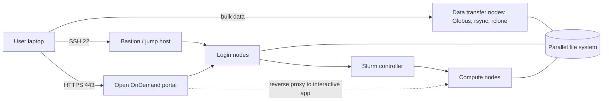

# 6.25 Remote access, bastions, Open OnDemand and user environments

| | |
|---|---|
| Level | Intermediate |
| Priority tier | 2 |
| Lab venue | VMs: bastion, login, compute; Open OnDemand host |
| Part | Part 6: HPC and Slurm |
| Status | Drafted. OpenSSH option names and defaults were checked against `sshd_config(5)` (openssh/openssh-portable commit `26b1363`, 2026-10-18); `code/part06/sshd_audit.py` was run on a bad and a good config (output shown). Open OnDemand statements come from its documentation (OSC/ood-documentation commit `0d23cee`, 2026-10-13: architecture and cluster configuration). Nothing was deployed. Labs **untested** |

## Why this matters for AI infrastructure

Researchers experience the cluster through access paths: an SSH session, a browser-based Jupyter, a VS Code remote window, a web job composer. These paths decide security (the login node is internet-adjacent), productivity (can users get a GPU notebook in two clicks?) and support load. A weak bastion is the most common initial-access vector in compromised research clusters; a clumsy access path generates tickets and shadow IT (people run notebooks on login nodes or move data to cloud notebooks). This chapter covers the technology and the operating practices around it.

## Prerequisites and outcomes

Needs 6.2 (login nodes), 6.8 to 6.11 (Slurm), 6.24 (identity). After this chapter you can:

- Design the access architecture: bastion, login nodes, compute node access, web portal, data transfer nodes.
- Harden and audit `sshd`; choose key, certificate and MFA strategies; use `ProxyJump`, agent forwarding (and know its risk), tunnels and X11 forwarding properly.
- Explain Open OnDemand's architecture and write a cluster configuration for Slurm; understand interactive apps (Jupyter, RStudio, VNC desktops) and the batch-connect model.
- Provide user environments: shells, modules/containers, dotfiles, conda/uv guidance, quotas and etiquette.
- Run user support: channels, tickets, documentation, status communication, training.

## 1. Access architecture



- **Bastion / jump host**: the only SSH entry point exposed to the internet or campus network; hardened, minimal software, no user data, no compute, full logging, MFA. Users `ssh -J user@bastion user@login` (OpenSSH `ProxyJump`).
- **Login nodes**: where users edit, compile, submit (6.2); not reachable directly from outside in strict designs; load-balanced behind a DNS alias.
- **Compute nodes**: not reachable by users except through Slurm (`srun`, `salloc`) or, with `pam_slurm_adopt`, via SSH to a node where they have a running job (the `Contain` prolog flag, 6.14). Interactive web apps reach compute nodes through the portal's reverse proxy.
- **Data transfer nodes (DTNs)**: dedicated hosts with fast external links and tools like Globus, `rsync`, `rclone`, `aria2`, for moving datasets in and out without loading login nodes; firewall and IDS tuned for large flows (Science DMZ pattern).
- **Web portal**: Open OnDemand, JupyterHub, or custom; behind HTTPS with SSO.
- Network zones (Part 2, 18): internet/campus, DMZ (bastion, portal, DTN), user (login), compute/storage fabrics, management (BMC; never user-reachable).

## 2. SSH

The SCL book (chapter 18, "Remote User Access") calls SSH "the main method of remote access to supercomputers today" and gives a practical stance: users only need a few commands (queue a job, check status), file copying is done in a GUI client on the personal computer, and a two-panel file manager such as Midnight Commander on the access node eases newcomers' first steps.

### Authentication

| Method | Notes |
|---|---|
| **Passwords** | Avoid on exposed hosts; brute-force target; if unavoidable, rate-limit and add MFA |
| **Public keys** | Standard. Enforce passphrase-protected keys (or hardware-backed: FIDO2 `sk-ssh-ed25519`); keys stored in the directory and served via `AuthorizedKeysCommand` (6.24) so revocation is central |
| **SSH certificates** | A CA signs short-lived user certificates (`TrustedUserCAKeys` on servers); no per-user key distribution; expiry limits damage; common with SSO-issued certs (Smallstep, Vault SSH, Teleport, FreeIPA) |
| **Kerberos / GSSAPI** | Ticket-based SSO inside an institution |
| **MFA** | PAM modules (TOTP, Duo, hardware tokens) via keyboard-interactive; or `AuthenticationMethods publickey,keyboard-interactive` to require key *and* a second factor |

### Hardening and audit

`sshd` defaults from `sshd_config(5)` worth remembering: `PermitRootLogin prohibit-password` (default), `MaxStartups 10:30:100`, `PerSourcePenalties` enabled by default in current OpenSSH (penalises abusive sources). Settings to review on every login host: `PermitRootLogin`, `PasswordAuthentication`, `KbdInteractiveAuthentication`, `PermitEmptyPasswords`, `PermitUserEnvironment`, `AllowGroups`/`AllowUsers`, `MaxAuthTries`, `LoginGraceTime`, `ClientAliveInterval`/`ClientAliveCountMax`, `X11Forwarding`, `AllowTcpForwarding`, `AuthorizedKeysCommand`, `LogLevel`, `Banner`, `MaxStartups`.

`code/part06/sshd_audit.py` reads the global section of an `sshd_config` and applies these rules (ERROR/warn/info). A deliberately poor config (root login yes, passwords on, user environment on, X11 on) produced:

```text
ERROR PermitRootLogin=yes: root login must be no/prohibit-password/forced-commands-only (default is prohibit-password)
ERROR PasswordAuthentication=yes: password authentication should be off on login nodes (keys, certificates, or SSO+MFA)
warn  AllowGroups=<default>: restrict logins with AllowGroups (or AllowUsers) instead of everyone in the directory
warn  MaxAuthTries=<default>: set MaxAuthTries <= 4 (default 6)
...
ERROR PermitUserEnvironment=yes: PermitUserEnvironment must stay 'no' (lets users inject LD_PRELOAD-style variables)
```

and a reasonable config only produced the informational note about X11. The audit looks at the global block (before the first `Match`), where, as in sshd, the first occurrence of a keyword wins; it does not evaluate `Match` blocks, `Include` files, or the effective configuration (use `sshd -T` for that, e.g. `sshd -T -C user=alice,host=x,addr=1.2.3.4`). Treat it as a checklist, not a scanner.

Additional controls: fail2ban or `PerSourcePenalties`, host firewall allow-lists (bastion reachable only from known networks), separate `sshd` instance on a non-standard port for admins, `sshd` privilege separation defaults, regularly rotated host keys with host certificates, central log shipping (auth logs to SIEM; `LogLevel VERBOSE` records key fingerprints), session recording on bastions (e.g. `tlog`, `ttyrec`), idle timeouts, and `AllowGroups` tied to directory groups.

### Client-side practices (document these for users)

```text
# ~/.ssh/config on the user's laptop
Host bastion
    HostName bastion.cluster.example.org
    User alice
    IdentityFile ~/.ssh/id_ed25519
Host login
    HostName login.cluster.internal
    User alice
    ProxyJump bastion
    ServerAliveInterval 60
```

Use `ProxyJump` (not agent forwarding) to reach internal hosts: agent forwarding exposes the user's agent socket to root on intermediate hosts and should be avoided or limited (`ssh -J` keeps keys on the laptop). Use `scp`/`rsync`/`sftp` or Globus for data; `ssh -L 8888:localhost:8888` style tunnels to reach a Jupyter server running on a compute node via login (`ssh -L 8888:gpu014:8888 login`), if the policy allows `AllowTcpForwarding`; `tmux`/`screen` on login nodes to keep sessions across disconnects (not for compute).

### X11 and graphical tools

The SCL book walks through X11 forwarding with an X server on the client (Xming on Windows, with a firewall rule restricted to the machines in use; PuTTY's "Connection/SSH/X11 Forwarding" option sets `DISPLAY` and `XAUTHORITY` automatically; the remote host needs `xauth`). Today: X11 forwarding (`ssh -X`/`-Y`, server `X11Forwarding yes`) is slow over WAN and increases attack surface, so prefer web-based apps (Open OnDemand VNC desktops, Jupyter) or VS Code remote. If needed, `ssh -X` works with `salloc`/`srun --x11` (Slurm's `PrologFlags=X11`, 6.14).

## 3. Open OnDemand

Open OnDemand (OOD, from the Ohio Supercomputer Center) is an open-source web portal giving browser access to a cluster: a file manager, a shell, a job composer, an active-jobs viewer, and **interactive apps** (Jupyter, RStudio, VS Code server, VNC desktops, TensorBoard...) that run as Slurm jobs and are reached through the portal.

### Architecture (from the OOD documentation)

- **Apache** is the front end, accepting all requests, and "authenticates the user", "starts per-user NGINX processes (PUNs)", "reverse proxies each user to her PUN via Unix domain sockets", and "reverse proxies to interactive apps running on compute nodes (RStudio, Jupyter, VNC desktop) via TCP sockets".
- The **Per-User NGINX (PUN)** serves the Ruby/Node web apps and is how users submit jobs and start interactive apps, running as the user (so file access uses the user's real permissions).
- Authentication is pluggable (OIDC/OpenID Connect, SAML, LDAP, Dex, Shibboleth, basic for testing).
- Site-specific components (the cluster, file systems, identity) are outside OOD.
- Interactive apps use **batch connect**: the app's form collects options (partition, GPUs, hours, environment), OOD renders a job script from a template, submits it through the scheduler, waits for the job to start, then proxies the user to the web server on the compute node (with generated password/port).

### Cluster configuration (docs)

Cluster files live in `/etc/ood/config/clusters.d/*.yml` (one per cluster, YAML, `.yml` or `.yaml`). Minimal login-only config:

```yaml
# /etc/ood/config/clusters.d/my_cluster.yml
---
v2:
  metadata:
    title: "My Cluster"
  login:
    host: "my_cluster.my_center.edu"
```

With Slurm (from the documentation's Slurm page):

```yaml
---
v2:
  metadata:
    title: "My Cluster"
  login:
    host: "my_cluster.my_center.edu"
  job:
    adapter: "slurm"
    cluster: "my_cluster"
    bin: "/path/to/slurm/bin"
    conf: "/path/to/slurm.conf"
    copy_environment: false
```

Notes from the docs worth remembering: the YAML file name should equal `ClusterName` in `slurm.conf` so OOD can discover information from `sacctmgr`; **OOD's Slurm support issues CLI commands with `--export=NONE`** (Slurm's default is `ALL`), which can break jobs that rely on `srun` unless you `export SLURM_EXPORT_ENV=ALL` in a script wrapper or use `copy_environment` (with the caveat that the PUN's environment differs from normal shells); `bin_overrides` lets you substitute wrapper scripts for `sbatch`, `squeue`, `scontrol`, `scancel`; configuration can be automated with the project's Puppet module and Ansible role. Other adapters in the docs: Torque, PBS Pro, LSF, SGE, HTCondor, Kubernetes, systemd, Linux host (6.17).

### Interactive apps for AI work

- **Jupyter** (JupyterLab) with GPU options: form fields for partition, GPUs (`--gpus`), CPUs, memory, hours, container or environment; uses the site's modules/containers (6.6, 6.13). Provide curated kernels (PyTorch with matching CUDA) rather than letting users build environments on shared storage (metadata storms, 6.18).
- **VS Code server** (code-server or tunnel-based) for remote development; mind the extension host's resource use on login nodes: run it as a job.
- **VNC desktops** for GUI tools (TensorBoard, Nsight Systems UI via VirtualGL on GPU nodes).
- **TensorBoard / MLflow / Weights & Biases proxies**: link job output to dashboards.
- Governance: limit time and resources for interactive sessions, reap idle sessions (Jupyter culling), use a dedicated interactive/MIG partition (6.10, 6.11), and make the default sizes small.

### Alternatives

JupyterHub with a Slurm spawner (batchspawner/wrapspawner); SSH-based remote development (VS Code Remote-SSH to a login node is tolerated by some sites and banned by others because of load; use job-based tunnels); NVIDIA Base Command / BCM web UI (Part 8); notebooks on Kubernetes (Part 16).

## 4. User environment

- **Shell and dotfiles**: a sane default `~/.bashrc` that does **not** `module load` heavy stacks or activate conda automatically (it breaks batch jobs: `sbatch` exports the environment, 6.11); instruct users to load modules in job scripts. Provide `/etc/skel` templates and `/etc/profile.d/` snippets for site settings (MOTD with status/maintenance, `module` initialisation). Distinguish login shells from non-login interactive shells.
- **Software**: modules and containers (6.6, 6.13); a documented, supported way to create Python environments (`uv`/`venv` on fast storage, or conda in a quota-safe place), with guidance on avoiding millions of small files on parallel file systems; pre-built "AI base" modules.
- **Storage etiquette**: what goes in home, project, scratch (purged), local NVMe; quotas (6.24); do not run I/O-heavy work on login nodes; use DTNs for big transfers.
- **Compute etiquette**: no computation on login nodes; set limits (CPU/memory per user on login nodes via systemd user slices or `limits.conf`); no `watch squeue` loops (controller load, 6.14); right-size job requests (6.9).
- **Reproducibility aids**: job templates, `module save`, container digests, `sacct` instructions, recording environment in logs.
- **Data movement**: Globus endpoints, `rclone` to object stores, checksums.

## 5. Communicating with users (SCL chapter 27)

The book opens with a blunt point: "one of the most important components of any supercomputer is its customers, or users. Without them, it is of no use to anyone". Its four themes translate directly:

- **Correspondence**: set up a *virtual address* (an alias on the mail server forwarding to several admins, e.g. `support@cluster...`), never a personal address; it lets you add support staff over time and separates user requests from other mail. Use a ticketing system as soon as volume demands it (RT, Jira Service Management, GitLab issues, Zendesk, ServiceNow): one ticket per problem, categories, owners, service levels, searchable history.
- **Accounting for requests**: keep a record of what users ask (software installs, quota increases, reservations, access) with decisions and rationale; it supports capacity planning, billing and audits and reveals recurring problems that need documentation or automation.
- **Actualization** (keeping information current): documentation, status pages, MOTD and mailing lists must be updated with every change; stale docs generate tickets. Maintain a status page (planned maintenance, incidents, post-mortems), a changelog of software stacks and policies, and an announcements list; version the docs in Git.
- **Education**: onboarding sessions, "first job in 15 minutes" tutorials, office hours, workshops on Slurm, data management, GPU profiling, Python environments, containers; example repositories; a FAQ built from ticket analysis; champion users in each group. For AI clusters: checkpointing and resume patterns, NCCL debugging basics, data sharding, right-sizing GPU requests.

Support metrics: time to first response, time to resolution, tickets per user, top categories, user satisfaction; review monthly and convert top categories into docs or tooling. Incident communication: acknowledge quickly, state impact and workaround, update on a cadence, close with cause and prevention.

## 6. Security and compliance

Least privilege everywhere; restrict portal and bastion networks; MFA on all remote access; short-lived certificates; log and review; patch bastion/portal/OOD promptly (internet-facing); isolate management networks (Part 7, 18); protect tokens (JWT for Slurm REST, Jupyter tokens); disable Jupyter terminal where policy requires; scan user-run web apps; data classification for what may leave via DTNs; acceptable-use policy and a documented process for suspending an account quickly; incident response runbook (compromised key: revoke in directory, kill sessions, search for persistence, rotate shared secrets).

## 7. Lab

Tested: run `sshd_audit.py` against your own `sshd_config` (or `sshd -T` output saved to a file, global section only) and fix every ERROR and warn.

Untested: 1) bastion + login VM: configure `ProxyJump`, `AllowGroups`, key-only auth, `AuthorizedKeysCommand`; test with a user not in the group. 2) Add TOTP MFA via PAM and `AuthenticationMethods`. 3) Install Open OnDemand on a VM, authenticate with a test OIDC/LDAP provider, add a Slurm cluster file named after your `ClusterName`, check `active-jobs` and `job-composer`; run the documented resource-manager test. 4) Create a Jupyter batch-connect app with GPU form fields; observe the `--export` behaviour. 5) Build a user onboarding page and a "first job" tutorial; test it on a new user. 6) Draft the incident communication template for a storage outage.

## 8. Interview angles

- Describe the access architecture of a secure GPU cluster.
- Why ProxyJump instead of agent forwarding?
- How do SSH certificates improve on authorized_keys? What are the trade-offs?
- How does Open OnDemand authenticate users and reach a Jupyter session on a compute node?
- Why does OOD's `--export=NONE` default matter for Slurm jobs?
- How do you prevent users running heavy work on login nodes?
- How would you structure support for 500 researchers with two admins?
- What do you put in a bastion's `sshd_config`?
- A user can SSH to the login node but not to their compute node. What are the possible policy and technical reasons?

## 9. Checkpoint questions (30)

1. What roles do the bastion, login node, DTN and portal play?
2. What is `ProxyJump` and why use it?
3. Why avoid agent forwarding?
4. List SSH authentication methods and one risk each.
5. How do SSH certificates work?
6. How can keys come from the directory?
7. State the default of `PermitRootLogin` in current OpenSSH.
8. What is `MaxStartups` default?
9. What is `PerSourcePenalties`?
10. Why is `PermitUserEnvironment yes` dangerous?
11. What do `ClientAliveInterval` and `ClientAliveCountMax` do?
12. How do you see the effective sshd configuration?
13. What does `sshd_audit.py` check and what does it ignore?
14. What does `pam_slurm_adopt` do?
15. How does X11 forwarding work and why discourage it?
16. What is OOD's Apache role?
17. What is a PUN?
18. Where do OOD cluster configs live?
19. What must the cluster YAML file name match?
20. What is the Slurm `--export` caveat in OOD?
21. What is batch connect?
22. Which interactive apps suit AI work?
23. How do you stop idle interactive sessions wasting GPUs?
24. What should `.bashrc` not do?
25. Name three storage etiquette rules.
26. What are the four themes of SCL chapter 27?
27. Why a virtual support address?
28. What belongs on a status page?
29. Which metrics measure support quality?
30. Outline a compromised-key response.

## 10. Sources and review notes

- SSH, X11/Xming/PuTTY, user-facing practice: *Supercomputers for Linux SysAdmins* chapter 18 ("Remote User Access"); user communication (correspondence, accounting for requests, actualization, education): chapter 27; both restated in my words.
- OpenSSH option semantics and defaults: `sshd_config(5)` from openssh-portable (commit `26b1363`). Open OnDemand architecture and configuration: OSC/ood-documentation (`architecture.rst`, `installation/add-cluster-config.rst`, `installation/resource-manager/slurm.rst`, commit `0d23cee`).
- Original and run: `sshd_audit.py`.
- Unverified: MFA/PAM module behaviour, certificate tooling specifics, VS Code server and JupyterHub spawner details, DTN/Globus practice, exact OOD app form field names.
