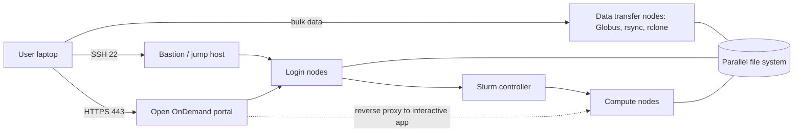

# 6.25 Remote access, bastions, Open OnDemand and user environments

| | |
|---|---|
| Level | Intermediate |
| Priority tier | 2 |
| Lab venue | VMs: bastion, login, compute; Open OnDemand host |
| Part | Part 6: HPC and Slurm |
| Status | Drafted. OpenSSH option names and defaults were checked against `sshd_config(5)` (openssh/openssh-portable commit `26b1363`, 2026-10-18); `code/part06/sshd_audit.py` was run on a bad and a good config (output shown). Open OnDemand statements come from its documentation (OSC/ood-documentation commit `0d23cee`, 2026-10-13: architecture and cluster configuration). Nothing was deployed. Labs **untested** |

## Why this matters for AI infrastructure

Researchers experience the cluster through access paths: an SSH session, a browser-based Jupyter, a VS Code remote window, a web job composer. These paths decide security (the login node is internet-adjacent), productivity (can users get a GPU notebook in two clicks?) and support load. A weak bastion is the most common initial-access vector in compromised research clusters; a clumsy access path generates tickets and shadow IT (people run notebooks on login nodes or move data to cloud notebooks). This chapter covers the technology and the operating practices around it.

## Prerequisites and outcomes

Needs 6.2 (login nodes), 6.8 to 6.11 (Slurm), 6.24 (identity). After this chapter you can:

- Design the access architecture: bastion, login nodes, compute node access, web portal, data transfer nodes.
- Harden and audit `sshd`; choose key, certificate and MFA strategies; use `ProxyJump`, agent forwarding (and know its risk), tunnels and X11 forwarding properly.
- Explain Open OnDemand's architecture and write a cluster configuration for Slurm; understand interactive apps (Jupyter, RStudio, VNC desktops) and the batch-connect model.
- Provide user environments: shells, modules/containers, dotfiles, conda/uv guidance, quotas and etiquette.
- Run user support: channels, tickets, documentation, status communication, training.

## 1. Access architecture



- **Bastion / jump host**: the only SSH entry point exposed to the internet or campus network; hardened, minimal software, no user data, no compute, full logging, MFA. Users `ssh -J user@bastion user@login` (OpenSSH `ProxyJump`).
- **Login nodes**: where users edit, compile, submit (6.2); not reachable directly from outside in strict designs; load-balanced behind a DNS alias.
- **Compute nodes**: not reachable by users except through Slurm (`srun`, `salloc`) or, with `pam_slurm_adopt`, via SSH to a node where they have a running job (the `Contain` prolog flag, 6.14). Interactive web apps reach compute nodes through the portal's reverse proxy.
- **Data transfer nodes (DTNs)**: dedicated hosts with fast external links and tools like Globus, `rsync`, `rclone`, `aria2`, for moving datasets in and out without loading login nodes; firewall and IDS tuned for large flows (Science DMZ pattern).
- **Web portal**: Open OnDemand, JupyterHub, or custom; behind HTTPS with SSO.
- Network zones (Part 2, 18): internet/campus, DMZ (bastion, portal, DTN), user (login), compute/storage fabrics, management (BMC; never user-reachable).

## 2. SSH

The SCL book (chapter 18, "Remote User Access") calls SSH "the main method of remote access to supercomputers today" and gives a practical stance: users only need a few commands (queue a job, check status), file copying is done in a GUI client on the personal computer, and a two-panel file manager such as Midnight Commander on the access node eases newcomers' first steps.

### Authentication

| Method | Notes |
|---|---|
| **Passwords** | Avoid on exposed hosts; brute-force target; if unavoidable, rate-limit and add MFA |
| **Public keys** | Standard. Enforce passphrase-protected keys (or hardware-backed: FIDO2 `sk-ssh-ed25519`); keys stored in the directory and served via `AuthorizedKeysCommand` (6.24) so revocation is central |
| **SSH certificates** | A CA signs short-lived user certificates (`TrustedUserCAKeys` on servers); no per-user key distribution; expiry limits damage; common with SSO-issued certs (Smallstep, Vault SSH, Teleport, FreeIPA) |
| **Kerberos / GSSAPI** | Ticket-based SSO inside an institution |
| **MFA** | PAM modules (TOTP, Duo, hardware tokens) via keyboard-interactive; or `AuthenticationMethods publickey,keyboard-interactive` to require key *and* a second factor |

### Hardening and audit

`sshd` defaults from `sshd_config(5)` worth remembering: `PermitRootLogin prohibit-password` (default), `MaxStartups 10:30:100`, `PerSourcePenalties` enabled by default in current OpenSSH (penalises abusive sources). Settings to review on every login host: `PermitRootLogin`, `PasswordAuthentication`, `KbdInteractiveAuthentication`, `PermitEmptyPasswords`, `PermitUserEnvironment`, `AllowGroups`/`AllowUsers`, `MaxAuthTries`, `LoginGraceTime`, `ClientAliveInterval`/`ClientAliveCountMax`, `X11Forwarding`, `AllowTcpForwarding`, `AuthorizedKeysCommand`, `LogLevel`, `Banner`, `MaxStartups`.

`code/part06/sshd_audit.py` reads the global section of an `sshd_config` and applies these rules (ERROR/warn/info). A deliberately poor config (root login yes, passwords on, user environment on, X11 on) produced:

```text
ERROR PermitRootLogin=yes: root login must be no/prohibit-password/forced-commands-only (default is prohibit-password)
ERROR PasswordAuthentication=yes: password authentication should be off on login nodes (keys, certificates, or SSO+MFA)
warn  AllowGroups=<default>: restrict logins with AllowGroups (or AllowUsers) instead of everyone in the directory
warn  MaxAuthTries=<default>: set MaxAuthTries <= 4 (default 6)
...
ERROR PermitUserEnvironment=yes: PermitUserEnvironment must stay 'no' (lets users inject LD_PRELOAD-style variables)
```

and a reasonable config only produced the informational note about X11. The audit looks at the global block (before the first `Match`), where, as in sshd, the first occurrence of a keyword wins; it does not evaluate `Match` blocks, `Include` files, or the effective configuration (use `sshd -T` for that, e.g. `sshd -T -C user=alice,host=x,addr=1.2.3.4`). Treat it as a checklist, not a scanner.

Additional controls: fail2ban or `PerSourcePenalties`, host firewall allow-lists (bastion reachable only from known networks), separate `sshd` instance on a non-standard port for admins, `sshd` privilege separation defaults, regularly rotated host keys with host certificates, central log shipping (auth logs to SIEM; `LogLevel VERBOSE` records key fingerprints), session recording on bastions (e.g. `tlog`, `ttyrec`), idle timeouts, and `AllowGroups` tied to directory groups.

### Client-side practices (document these for users)

```text
# ~/.ssh/config on the user's laptop
Host bastion
    HostName bastion.cluster.example.org
    User alice
    IdentityFile ~/.ssh/id_ed25519
Host login
    HostName login.cluster.internal
    User alice
    ProxyJump bastion
    ServerAliveInterval 60
```

Use `ProxyJump` (not agent forwarding) to reach internal hosts: agent forwarding exposes the user's agent socket to root on intermediate hosts and should be avoided or limited (`ssh -J` keeps keys on the laptop). Use `scp`/`rsync`/`sftp` or Globus for data; `ssh -L 8888:localhost:8888` style tunnels to reach a Jupyter server running on a compute node via login (`ssh -L 8888:gpu014:8888 login`), if the policy allows `AllowTcpForwarding`; `tmux`/`screen` on login nodes to keep sessions across disconnects (not for compute).

### X11 and graphical tools (`SCL` Chapter 18)

`SCL` Chapter 18 (*Remote User Access*) explains how graphical access works when scientific visualization or graphical tools must run on the cluster rather than transferring multi-terabyte datasets to a workstation:

- **X-Window System (`X11` / `X.Org Server`) architecture:** Unlike Microsoft Windows, the Linux graphics subsystem is not baked into the kernel. X-Window uses a client/server model where the **X server** owns the physical or virtual display (`:0` by default, e.g., `xclock -display :0` or `export DISPLAY=:0`) and consists of two main parts: (1) hardware drivers for input/output devices (keyboard, mouse, video adapters, monitors) and (2) an **X protocol** handler communicating with graphical application **X clients** over UNIX domain sockets or Internet TCP sockets.
- **Window managers, desktop environments, and screen managers:** X11 draws and moves windows but delegates window framing and placement to a **window manager**—ranging from Microsoft Windows / Macintosh-like managers (**`Kwin`** in **KDE**, **`Metacity`** in **GNOME**), to frame-based tiling managers like **`Ion`**, minimalistic **`twm`**, or full-featured **`Enlightenment`** (with the Single UNIX Specification standardizing **`CDE`**, and **`freedesktop.org`** standardizing interoperability). The reference **`X.Org Server`** reads **`/etc/X11/xorg.conf`** (which has higher priority if it exists) and **`/etc/X11/xorg.conf.d/`** (containing multiple files with separate configuration sections; if auto-detection fails, `Xorg -configure` generates `xorg.conf.new`—documented in `SCL` Chapter 28 *"One-Two-Three Instructions"* and `man xorg.conf`—and logs startup errors to `/var/log/Xorg.0.log` where `0` is the display number). From a terminal, **`startx`** launches the X server and `~/.xsession` / `/etc/X11/Xsession.d`; when run as a system service, a **screen manager**—**`xdm`** (`/etc/X11/xdm/` running `/etc/X11/xdm/Xsession`), **`gdm`** (`/etc/gdm/`), **`kdm`** (`/etc/kde4/kdm/`), or **`lightdm`**—authenticates the user and starts the session.
- **Remote X11 from Windows (`Xming` and PuTTY):** On Windows workstations, `SCL` Chapter 18 highlights the open-source **`Xming`** X server (`http://www.straightrunning.com/XmingNotes/`), available on the official site in two variants—standard **`xming`** and **`xming Mesa`** (which allows running applications using OpenGL on a remote terminal)—alongside downloadable backgrounds (including Cyrillic ones) and **`Xlaunch`** for managing startup parameters:
  ```text
  "C:\Program Files\Xming\Xming.exe" :0 -clipboard \
    -multiwindow -xkblayout us,ru -xkbvariant winkeys \
    -xkboptions grp:ctrl_shift_toggle
  ```
  Here `:0` sets the display number, `-clipboard` shares the Windows clipboard, `-multiwindow` gives each X11 app its own native window, `-xkblayout us,ru` sets English and Russian keyboard layouts, `-xkboptions grp:ctrl_shift_toggle` switches layouts on `Ctrl+Shift`, and `-xkbvariant winkeys` enables Windows keys. Restrict Xming's Windows Firewall rule to known cluster hosts. Enabling **"Connection/SSH/X11 Forwarding"** in PuTTY automatically sets `DISPLAY` and populates `XAUTHORITY` via **`xauth`** on the remote node (avoiding insecure IP-based `C:\Program Files\Xming\X0.hosts` or `xhost +computer_name` rules).
- **Faster remote desktop alternatives (`VNC`, `RDP`, `x2go`, `NX`, `SPICE`):** Because raw X11 forwarding (`ssh -X`/`-Y`, or `srun --x11` with `PrologFlags=X11`) is chatty and slow over WAN links, `SCL` Chapter 18 compares compressed remote desktop protocols: **VNC** (`tightvncserver`, **`TigerVNC`**), **RDP**, **`x2go`** (open-source protocol derived from NoMachine **`NX`** that tunnels over SSH without a persistent daemon and can stream individual application windows), **NoMachine `NX`**, and **`SPICE`** (alongside browser terminals like `shellinabox` and log monitors like `logcheck` and `logwatch`). As `SCL` Chapter 18 summarizes: for a supercomputer, as for any server, the principle is **the less access, the better—without clamping users in a hedgehog's grip**; SSH combined with SCP/SFTP (and web portals like Open OnDemand) is sufficient for 99% of normal operation.

## 3. Open OnDemand

Open OnDemand (OOD, from the Ohio Supercomputer Center) is an open-source web portal giving browser access to a cluster: a file manager, a shell, a job composer, an active-jobs viewer, and **interactive apps** (Jupyter, RStudio, VS Code server, VNC desktops, TensorBoard...) that run as Slurm jobs and are reached through the portal.

### Architecture (from the OOD documentation)

- **Apache** is the front end, accepting all requests, and "authenticates the user", "starts per-user NGINX processes (PUNs)", "reverse proxies each user to her PUN via Unix domain sockets", and "reverse proxies to interactive apps running on compute nodes (RStudio, Jupyter, VNC desktop) via TCP sockets".
- The **Per-User NGINX (PUN)** serves the Ruby/Node web apps and is how users submit jobs and start interactive apps, running as the user (so file access uses the user's real permissions).
- Authentication is pluggable (OIDC/OpenID Connect, SAML, LDAP, Dex, Shibboleth, basic for testing).
- Site-specific components (the cluster, file systems, identity) are outside OOD.
- Interactive apps use **batch connect**: the app's form collects options (partition, GPUs, hours, environment), OOD renders a job script from a template, submits it through the scheduler, waits for the job to start, then proxies the user to the web server on the compute node (with generated password/port).

### Cluster configuration (docs)

Cluster files live in `/etc/ood/config/clusters.d/*.yml` (one per cluster, YAML, `.yml` or `.yaml`). Minimal login-only config:

```yaml
# /etc/ood/config/clusters.d/my_cluster.yml
---
v2:
  metadata:
    title: "My Cluster"
  login:
    host: "my_cluster.my_center.edu"
```

With Slurm (from the documentation's Slurm page):

```yaml
---
v2:
  metadata:
    title: "My Cluster"
  login:
    host: "my_cluster.my_center.edu"
  job:
    adapter: "slurm"
    cluster: "my_cluster"
    bin: "/path/to/slurm/bin"
    conf: "/path/to/slurm.conf"
    copy_environment: false
```

Notes from the docs worth remembering: the YAML file name should equal `ClusterName` in `slurm.conf` so OOD can discover information from `sacctmgr`; **OOD's Slurm support issues CLI commands with `--export=NONE`** (Slurm's default is `ALL`), which can break jobs that rely on `srun` unless you `export SLURM_EXPORT_ENV=ALL` in a script wrapper or use `copy_environment` (with the caveat that the PUN's environment differs from normal shells); `bin_overrides` lets you substitute wrapper scripts for `sbatch`, `squeue`, `scontrol`, `scancel`; configuration can be automated with the project's Puppet module and Ansible role. Other adapters in the docs: Torque, PBS Pro, LSF, SGE, HTCondor, Kubernetes, systemd, Linux host (6.17).

### Interactive apps for AI work

- **Jupyter** (JupyterLab) with GPU options: form fields for partition, GPUs (`--gpus`), CPUs, memory, hours, container or environment; uses the site's modules/containers (6.6, 6.13). Provide curated kernels (PyTorch with matching CUDA) rather than letting users build environments on shared storage (metadata storms, 6.18).
- **VS Code server** (code-server or tunnel-based) for remote development; mind the extension host's resource use on login nodes: run it as a job.
- **VNC desktops** for GUI tools (TensorBoard, Nsight Systems UI via VirtualGL on GPU nodes).
- **TensorBoard / MLflow / Weights & Biases proxies**: link job output to dashboards.
- Governance: limit time and resources for interactive sessions, reap idle sessions (Jupyter culling), use a dedicated interactive/MIG partition (6.10, 6.11), and make the default sizes small.

### Alternatives

JupyterHub with a Slurm spawner (batchspawner/wrapspawner); SSH-based remote development (VS Code Remote-SSH to a login node is tolerated by some sites and banned by others because of load; use job-based tunnels); NVIDIA Base Command / BCM web UI (Part 8); notebooks on Kubernetes (Part 16).

## 4. User environment

- **Shell and dotfiles**: a sane default `~/.bashrc` that does **not** `module load` heavy stacks or activate conda automatically (it breaks batch jobs: `sbatch` exports the environment, 6.11); instruct users to load modules in job scripts. Provide `/etc/skel` templates and `/etc/profile.d/` snippets for site settings (MOTD with status/maintenance, `module` initialisation). Distinguish login shells from non-login interactive shells.
- **Software**: modules and containers (6.6, 6.13); a documented, supported way to create Python environments (`uv`/`venv` on fast storage, or conda in a quota-safe place), with guidance on avoiding millions of small files on parallel file systems; pre-built "AI base" modules.
- **Storage etiquette**: what goes in home, project, scratch (purged), local NVMe; quotas (6.24); do not run I/O-heavy work on login nodes; use DTNs for big transfers.
- **Compute etiquette**: no computation on login nodes; set limits (CPU/memory per user on login nodes via systemd user slices or `limits.conf`); no `watch squeue` loops (controller load, 6.14); right-size job requests (6.9).
- **Reproducibility aids**: job templates, `module save`, container digests, `sacct` instructions, recording environment in logs.
- **Data movement**: Globus endpoints, `rclone` to object stores, checksums.

## 5. Communicating with users (SCL chapter 27)

The book opens with a blunt point: "one of the most important components of any supercomputer is its customers, or users. Without them, it is of no use to anyone". Its four themes translate directly:

- **Correspondence (`/etc/aliases`, `newaliases`, and `Mailman`)**: set up a *virtual address* (an alias on the mail server forwarding emails to multiple addresses—rather than a personal/work address or a shared `IMAP` mailbox on the server), so you can connect support assistants immediately and separate user requests from other correspondence. On Linux mail servers, add an entry in `/etc/aliases` and rebuild the alias database with `newaliases` `(untested here)`:
  ```text
  # /etc/aliases (untested here)
  cluster-support: foo, bar, expert@supermail.org
  ```
  ```bash
  # (untested here)
  newaliases
  ```
  Configure admins' mail clients (for example in Thunderbird under `Tools/Message Filters` filtering on the `to whom/copy` field) to route incoming messages into `support` (open) and `support_done` (resolved, problem solved, question answered) folders and to send replies from `cluster-support@your.server` with both `return address (reply-to)` and `blind carbon copy (bcc)` set to `cluster-support@your.server` so all support assistants immediately see every reply. Observe clean email correspondence culture: remove unnecessary quotations of the user's question (headers, addresses, signatures), leaving only the key lines, and write your answer directly underneath them; if a letter contains several questions, answer each question separately under its corresponding quotation (`SCL` Chapter 27). For cluster-wide maintenance and update announcements, automate subscription at account creation using a mailing-list manager such as **Mailman** or **majordomo** configured in **moderated mode** (restricting senders to `cluster-support`) so a user who accidentally replies to the list does not broadcast to all users. If you provide a chat channel (Slack, Rocket.Chat, Microsoft Teams, Telegram), require users or a channel bot to turn support requests into tracked tickets.
- **Accounting for requests (`RT`, `OTRS`, `Trac`, `OpenProject`)**: track user support requests, hardware failures, software installation requests, and access approvals in a dedicated helpdesk/ticketing system such as **RT** (Request Tracker), **OTRS**, **Trac**, or **OpenProject** (or modern equivalents like Jira Service Management, GitLab issues, Zendesk, ServiceNow)—one ticket per problem, with status, creator, owner, and full correspondence history, plus internal data such as event logs, requests to hardware and software manufacturers' technical support, and preventive maintenance plans. These systems integrate well with email and web forms, though `SCL` Chapter 27 notes two recurring implementation challenges: (1) **complexity of authorization of users**, because helpdesk accounts are often not tied directly to supercomputer user accounts, and (2) **complexity of linking actions in the ticketing system to actions on the supercomputer and vice versa**. The book also advises against repurposing software bug trackers such as Bugzilla or Redmine for cluster helpdesk work because their workflows fit code defects rather than operational support.
- **Actualization (annual account re-registration for "dead soul" accounts)** and **keeping information current**:
  - *Annual account re-registration ("actualization")*: on multi-institution or research clusters, after three or four years when the number of accounts is in the dozens or hundreds, many accounts become inactive ("dead souls"), sometimes occupying `5%` or more of disk space. The book warns against introducing draconian rules that blindly delete accounts that have not logged in for a year, because sooner or later that rule deletes the data of an important experiment or an important employee and the administrator will be blamed despite the rules. Instead, run an **annual re-registration** campaign with a window of at least **two to three weeks** (to allow for business trips, vacations, and time to write an activity report) where users confirm their account is up to date—either via email distribution with automated processing of letters or, more conveniently, by filling out a web form (part of your IT infrastructure or a standalone `cgi-script`) that enters the results into a database or log, handles duplicate data (when someone submits the form two or three times by mistake), saves the submission date, notifies the administrator, and returns a confirmation message number to the submitter. Users who have not re-registered within the window are **blocked** (not deleted) and their data is kept or sent to archive storage until at least the next re-registration cycle, ensuring that users who have not re-registered are still able to re-register later.
  - *Living documentation*: documentation, status pages, MOTD, and mailing lists must be updated with every cluster change; stale docs generate tickets. Maintain a status page (planned maintenance, incidents, post-mortems), a changelog of software stacks and policies, and versioned docs in Git.
- **Education**: provide as much information as possible to help users solve issues before asking support—covering day-to-day cluster limits, partitioning, and priorities structure, software vendor best practices and FAQs, onboarding sessions, "first job in 15 minutes" tutorials, workshops on Slurm, data management, GPU profiling, Python environments, and containers, a FAQ built from ticket analysis (replying with direct links such as `http://your.server/docs/faq.html#p1.1` and reusable email templates rather than "read the docs, it's written for you"), and pointers to Victor Eijkhout's *The Art of HPC* (`https://theartofhpc.com/`) from TACC (Texas Advanced Computing Center), which covers parallel programming, HPC packages, and Slurm fundamentals. For AI clusters: checkpointing and resume patterns, NCCL debugging basics, data sharding, right-sizing GPU requests.

Support metrics: time to first response, time to resolution, tickets per user, top categories, user satisfaction; review monthly and convert top categories into docs or tooling. Incident communication: acknowledge quickly, state impact and workaround, update on a cadence, close with cause and prevention.

## 6. Security and compliance

Least privilege everywhere; restrict portal and bastion networks; MFA on all remote access; short-lived certificates; log and review; patch bastion/portal/OOD promptly (internet-facing); isolate management networks (Part 7, 18); protect tokens (JWT for Slurm REST, Jupyter tokens); disable Jupyter terminal where policy requires; scan user-run web apps; data classification for what may leave via DTNs; acceptable-use policy and a documented process for suspending an account quickly; incident response runbook (compromised key: revoke in directory, kill sessions, search for persistence, rotate shared secrets).

## 7. Lab

First, run the self-checking Python lab (`code/part06/sshd_audit_lab.py`) locally. It verifies `parse()` and `audit()` in `code/part06/sshd_audit.py` on a vulnerable `sshd_config` (`4` `ERROR`s caught: `PermitRootLogin=yes`, `PasswordAuthentication=yes`, `PermitEmptyPasswords=yes`, `PermitUserEnvironment=yes`) and a hardened bastion `sshd_config` (`0` findings), confirms that `parse()` enforces OpenSSH's "first occurrence of a keyword wins" rule and stops before `Match` blocks, and checks the access architecture ports (`22`, `443`, `8888`) and `SCL` Chapter 27's `5%` inactive-account disk threshold:

```bash
python3 code/part06/sshd_audit_lab.py
```

Tested: run `sshd_audit.py` against your own `sshd_config` (or `sshd -T` output saved to a file, global section only) and fix every ERROR and warn.

Untested: 1) bastion + login VM: configure `ProxyJump`, `AllowGroups`, key-only auth, `AuthorizedKeysCommand`; test with a user not in the group. 2) Add TOTP MFA via PAM and `AuthenticationMethods`. 3) Install Open OnDemand on a VM, authenticate with a test OIDC/LDAP provider, add a Slurm cluster file named after your `ClusterName`, check `active-jobs` and `job-composer`; run the documented resource-manager test. 4) Create a Jupyter batch-connect app with GPU form fields; observe the `--export` behaviour. 5) Build a user onboarding page and a "first job" tutorial; test it on a new user. 6) Draft the incident communication template for a storage outage.

## 8. Interview angles

- Describe the access architecture of a secure GPU cluster.
- Why ProxyJump instead of agent forwarding?
- How do SSH certificates improve on authorized_keys? What are the trade-offs?
- How does Open OnDemand authenticate users and reach a Jupyter session on a compute node?
- Why does OOD's `--export=NONE` default matter for Slurm jobs?
- How do you prevent users running heavy work on login nodes?
- How would you structure support for 500 researchers with two admins?
- What do you put in a bastion's `sshd_config`?
- A user can SSH to the login node but not to their compute node. What are the possible policy and technical reasons?

## Exercises

1. **Auditing and Hardening `sshd_config` on Bastion and Login Nodes (`code/part06/sshd_audit.py` & `sshd_audit_lab.py`):** Run `python3 code/part06/sshd_audit_lab.py`. Explain why `sshd_audit.py` treats `PermitRootLogin=yes`, `PasswordAuthentication=yes`, `PermitEmptyPasswords=yes`, and `PermitUserEnvironment=yes` as hard `ERROR`s, why `parse()` uses `cfg.setdefault()` to honor OpenSSH's "first occurrence wins" semantics, and how to inspect effective `Match`-evaluated settings with `sshd -T -C user=alice,host=x,addr=1.2.3.4`.
2. **Designing `ProxyJump` Client Configs and SSH Certificate + MFA Authentication:** Write a user `~/.ssh/config` that reaches `login.cluster.internal` through `bastion.cluster.example.org` via `ProxyJump` (explaining why `ForwardAgent yes` is a privilege-escalation risk on shared hosts), and write the server `sshd_config` settings for short-lived SSH user certificates (`TrustedUserCAKeys`) combined with second-factor PAM TOTP (`AuthenticationMethods publickey,keyboard-interactive`).
3. **Configuring Open OnDemand for a Slurm GPU Cluster (`/etc/ood/config/clusters.d/`):** Write `/etc/ood/config/clusters.d/my_cluster.yml` for a Slurm cluster. Explain the roles of OOD's front-end Apache reverse proxy and Per-User NGINX (`PUN`), why the YAML filename must match `ClusterName` in `slurm.conf`, and how OOD's `--export=NONE` behavior affects `sbatch` jobs that invoke `srun`.
4. **Comparing Remote Graphical Access (`X11`, `Xming`, `TigerVNC`, `x2go`, and OOD Batch-Connect, `SCL` Chapter 18):** Explain the X11 client/server role inversion (`X server` on the user's workstation, `X client` on the cluster node), trace the flags in `"C:\Program Files\Xming\Xming.exe" :0 -clipboard -multiwindow -xkblayout us,ru -xkbvariant winkeys -xkboptions grp:ctrl_shift_toggle`, explain why `xauth` is strongly preferred over `xhost +` / `X0.hosts`, and compare `TigerVNC`, `x2go`, and Open OnDemand browser desktops over high-latency WAN links.
5. **Preventing Dotfile Pollution and Login-Node Abuse:** Explain why placing `conda activate` or `module load cuda` inside `~/.bashrc` breaks batch reproducibility when `sbatch` runs with `--export=ALL`, and design a login-node protection policy combining `/etc/skel` templates, `systemd` `user-.slice` CPU/RAM caps, `pam_slurm_adopt` on compute nodes, and dedicated Data Transfer Nodes (`DTN`s).
6. **Implementing User Support, Ticketing, and Annual Account "Actualization" (`SCL` Chapter 27):** Write the `/etc/aliases` (`cluster-support: foo, bar, expert@supermail.org`) and `newaliases` setup, explain why `Mailman`/`majordomo` announcement lists must use moderated mode, compare `RT`/`OTRS`/`Trac`/`OpenProject` with `Bugzilla`/`Redmine`, and design the 3-week annual account re-registration ("actualization") workflow so inactive "dead soul" accounts are blocked and archived without ever deleting active experiment data.

## Checkpoint

<details>
<summary>1. Separate the roles of the **Bastion (jump host)**, **Login nodes**, **Data Transfer Nodes (DTNs)**, **Open OnDemand portal**, and **Compute nodes** in a cluster access architecture.</summary>

- **Bastion / jump host:** Hardened, minimal SSH entry point in the DMZ with MFA and session logging; holds no user data or compilers.
- **Login nodes:** Internal nodes reached via `ProxyJump` where users edit code, compile, and run `sbatch`/`squeue`.
- **Data Transfer Nodes (DTNs):** Dedicated Science-DMZ hosts with high-bandwidth WAN links and parallel mounts running `Globus`, `rsync`, and `rclone` so bulk transfers never bog down login nodes.
- **Open OnDemand portal:** HTTPS web portal providing browser file management, job submission, and reverse-proxied interactive GPU apps (Jupyter, VS Code, VNC).
- **Compute nodes:** Reached only via Slurm jobs (`srun`/`salloc`) or `pam_slurm_adopt` SSH when the user owns an active allocation on that node.
</details>

<details>
<summary>2. Why should users connect through a bastion using `ProxyJump` (`ssh -J bastion login`) rather than `ForwardAgent yes` (`ssh -A`)?</summary>

`ForwardAgent yes` creates a UNIX domain socket on the intermediate host linked back to the user's local SSH agent; any `root` user (or attacker who compromises the intermediate host) can use that socket to impersonate the user on every system their key unlocks. **`ProxyJump` (`ssh -J`)** tunnels the end-to-end encrypted SSH connection through the bastion so private key operations happen exclusively on the user's laptop.
</details>

<details>
<summary>3. How do **SSH user certificates** (`TrustedUserCAKeys`) improve on static `~/.ssh/authorized_keys` files?</summary>

With an SSH Certificate Authority (such as Smallstep, HashiCorp Vault, Teleport, or FreeIPA), a user authenticates via corporate SSO + MFA and receives a **short-lived signed SSH certificate** (valid for e.g. 8–12 hours). Cluster nodes trust the CA's public key (`TrustedUserCAKeys`) without needing per-user key files distributed, and credentials expire automatically at the end of the workday.
</details>

<details>
<summary>4. How do you convert an RFC-formatted multiline SSH public key into OpenSSH single-line format and append it to `authorized_keys` (`SCL` Chapter 18)?</summary>

Run:
`ssh-keygen -i -f rfc-key.pub >> ~user/.ssh/authorized_keys`
(using `>>` to append rather than `>` so existing keys are not overwritten).
</details>

<details>
<summary>5. What four `sshd_config` settings does `code/part06/sshd_audit.py` flag as hard `ERROR`s if misconfigured?</summary>

1. **`PermitRootLogin`:** Must be `no`, `prohibit-password`, or `forced-commands-only` (never `yes`).
2. **`PasswordAuthentication`:** Must be `no` on exposed login/bastion nodes.
3. **`PermitEmptyPasswords`:** Must be `no`.
4. **`PermitUserEnvironment`:** Must be `no` (allowing `~/.ssh/environment` or `environment=` options in `authorized_keys` lets users inject variables like `LD_PRELOAD` to bypass restricted shells).
</details>

<details>
<summary>6. How does `sshd` resolve duplicate keywords in `sshd_config`, and what command prints the fully evaluated configuration for a specific user/host/IP?</summary>

In `sshd_config`, the **first occurrence** of a configuration keyword wins (`cfg.setdefault()` in `sshd_audit.py`). To inspect the effective configuration after all `Include` files and conditional `Match` blocks are evaluated, run:
`sshd -T -C user=alice,host=login01,addr=10.10.1.5`
</details>

<details>
<summary>7. What do `MaxStartups 10:30:100` and `PerSourcePenalties` do in OpenSSH (`sshd_config(5)`)?</summary>

- **`MaxStartups 10:30:100`:** Controls unauthenticated concurrent connection throttling: once `10` unauthenticated connections are open, `sshd` begins dropping new connections with a `30%` probability that rises linearly to `100%` at `100` unauthenticated connections (raise this on bastions that experience simultaneous class/workshop login bursts).
- **`PerSourcePenalties`:** Automatically tracks and temporarily blocks client IP addresses that repeatedly fail authentication or crash pre-auth `sshd` child processes.
</details>

<details>
<summary>8. Explain the X-Window (`X11`) client/server architecture and why `xauth` is used instead of `xhost +` (`SCL` Chapter 18).</summary>

In X11, the **X server** runs on the **user's local workstation** (owning the physical screen, keyboard, and mouse on display `:0`), while the graphical application running on the remote supercomputer is the **X client**. Using `xhost +computer_name` (or `X0.hosts` in Xming) authorizes every user on that remote host to snoop keystrokes and windows on your display, whereas **`xauth`** (used automatically by `ssh -X` and PuTTY's X11 Forwarding) generates a per-session secret `MIT-MAGIC-COOKIE-1` token in `XAUTHORITY` readable only by your user account.
</details>

<details>
<summary>9. Compare **X11 forwarding**, **VNC (`TigerVNC`)**, and **`x2go`** for running remote graphical applications on a cluster (`SCL` Chapter 18).</summary>

- **X11 forwarding (`ssh -X`):** Sends raw X11 drawing primitives over the network; high round-trip latency makes complex GUIs nearly unusable over WAN links.
- **VNC (`tightvncserver` / `TigerVNC`):** Runs a virtual X11 framebuffer on the node and streams compressed/scaled pixel rectangles; fast over WAN and supportsOpenGL via VirtualGL.
- **`x2go` (open-source `NX` derivative):** Tunnels compressed X11/desktop traffic over standard **SSH** without requiring a separate background daemon on the server, and supports seamless single-application window mode.
</details>

<details>
<summary>10. Walk through the request flow in **Open OnDemand (OOD)**: what does **Apache** do, and what is a **Per-User NGINX (`PUN`)**?</summary>

1. The user's browser connects over HTTPS (`443`) to OOD's front-end **Apache** server, which authenticates the user via OIDC/SAML/LDAP.
2. Apache maps the authenticated username to a local POSIX UID, spawns a **Per-User NGINX (`PUN`)** process running **as that user's UID/GID**, and reverse-proxies the user's browser requests to their PUN over a local UNIX domain socket.
3. Because the PUN runs as the user, file-browser actions and `sbatch`/`squeue` commands execute with the user's exact Linux permissions and Slurm associations.
</details>

<details>
<summary>11. How does Open OnDemand's **batch-connect** workflow launch and proxy an interactive JupyterLab or VS Code session on a GPU compute node?</summary>

1. The user selects partition, GPU count, CPUs, RAM, and walltime in OOD's web form.
2. The user's PUN renders a batch script from an ERB template and submits it to Slurm via `sbatch`.
3. When the job starts on a GPU compute node (e.g., `gpu014`), the job script generates a one-time password/token, starts JupyterLab on a random high TCP port, and writes connection metadata (`host`, `port`, `password`) to a shared directory in the user's `$HOME`.
4. OOD's front-end Apache reads that connection file and reverse-proxies the user's authenticated browser session directly to `gpu014:<port>`.
</details>

<details>
<summary>12. Where do Open OnDemand cluster configurations live, what must the YAML filename match, and what is the Slurm `--export=NONE` gotcha?</summary>

Cluster configurations live in **`/etc/ood/config/clusters.d/<cluster_name>.yml`**, where `<cluster_name>` should match `ClusterName` in `slurm.conf`. By default, OOD's Slurm adapter submits jobs with **`sbatch --export=NONE`** (unlike interactive CLI `sbatch`, which defaults to `--export=ALL`). If a batch-connect job script runs `srun` inside the script, `srun` inherits `--export=NONE` and strips `PATH`/`LD_LIBRARY_PATH` unless the script explicitly runs `export SLURM_EXPORT_ENV=ALL`.
</details>

<details>
<summary>13. Why should users never put `conda activate` or `module load` inside their `~/.bashrc` on a Slurm cluster?</summary>

Because CLI `sbatch` defaults to `--export=ALL` and non-interactive subshells source `~/.bashrc`. Having `~/.bashrc` automatically activate a heavy Conda environment or load specific CUDA modules silently pollutes every batch job's environment—causing version clashes across different projects and slowing down every non-interactive SSH/step invocation. Modules and virtual environments should be loaded explicitly inside each job's `#SBATCH` script.
</details>

<details>
<summary>14. Why is running VS Code Remote-SSH directly against a shared login node problematic at scale, and what is the clean alternative?</summary>

VS Code Remote-SSH spawns multiple `node` extension-host processes, language servers (`Pylance`, `rust-analyzer`), file watchers, and Git indexers that can easily consume 4–8 CPU cores and 16+ GiB of RAM per user—crashing a shared login node when dozens of researchers connect. Instead, provide an **Open OnDemand VS Code (`code-server` or tunnel) batch-connect app** (or instruct users to `ProxyJump` into an interactive `salloc` compute/MIG node).
</details>

<details>
<summary>15. How do you configure a support email alias on a Linux mail server, and how should support staff configure `Reply-To`, `BCC`, and mail folders (`SCL` Chapter 27)?</summary>

Add a virtual support alias in **`/etc/aliases`**:
`cluster-support: foo, bar, expert@supermail.org`
and run **`newaliases`**. Support staff should filter incoming mail into **`support`** (open) and **`support_done`** (resolved) folders and configure their mail client profile to reply from `cluster-support@your.server` with both **`Reply-To`** and **`BCC`** set to `cluster-support@your.server` so all admins see every response.
</details>

<details>
<summary>16. Why must a cluster announcement mailing list (`Mailman` or `majordomo`) always be configured in **moderated mode** (`SCL` Chapter 27)?</summary>

In moderated mode (with only `cluster-support` authorized to post), if one of the 500 cluster users hits "Reply" to a maintenance announcement instead of replying to support, their message is held for moderator approval rather than broadcasting spam to all 500 users.
</details>

<details>
<summary>17. Which open-source helpdesk/ticketing systems does `SCL` Chapter 27 recommend, why does it advise against `Bugzilla` or `Redmine`, and what two integration challenges arise?</summary>

`SCL` Chapter 27 recommends **`RT` (Request Tracker)**, **`OTRS`**, **`Trac`**, or **`OpenProject`** (and advises against software defect trackers like `Bugzilla` or `Redmine`, whose workflows do not fit user support and hardware maintenance). The two main integration challenges are:
1. **User authorization complexity** when helpdesk accounts are separate from cluster POSIX/LDAP accounts.
2. **Complexity of linking ticket actions to cluster actions** (and vice versa).
</details>

<details>
<summary>18. What is the **"dead soul" account problem** on multi-organization clusters, why is a 1-year auto-delete rule dangerous, and how does annual **"actualization" (re-registration)** solve it (`SCL` Chapter 27)?</summary>

After 3–4 years, dozens or hundreds of inactive accounts ("dead souls") can occupy `5%` or more of cluster disk capacity. Blindly deleting accounts that have not logged in for 1 year inevitably destroys critical experiment data of a researcher on sabbatical or between grants. Instead, run an **annual re-registration ("actualization")** campaign with a **2–3 week window**: users submit a brief activity report via a web form (which deduplicates repeat clicks, logs the date, and returns a confirmation reference number). Accounts that do not re-register are **blocked (not deleted)** and their data is archived/retained until at least the next annual cycle so returning users can still re-register and recover their work.
</details>

<details>
<summary>19. What email communication etiquette rules does `SCL` Chapter 27 emphasize when answering user support messages?</summary>

1. Strip unnecessary quoted headers, addresses, and signatures, keeping only the essential lines of the user's question and writing your answer directly below each quoted question separately.
2. Never reply with a dismissive *"read the docs, it's written for you"*—instead, give the direct URL anchor to the exact FAQ item (e.g., `http://your.server/docs/faq.html#p1.1`) and maintain reusable response templates.
</details>

<details>
<summary>20. Outline the immediate incident-response steps when a researcher's SSH private key or bastion session is suspected of compromise.</summary>

1. **Revoke the SSH public key / certificate** in LDAP/FreeIPA and flush SSSD caches across all bastions and login nodes (`sss_cache -E`) and lock the account (`pam_access` / LDAP lock).
2. **Terminate all active processes and sessions** (`pkill -KILL -u <user>` on bastions and login nodes) and cancel all running/pending Slurm jobs (`scancel -u <user>`).
3. **Audit persistence locations** (`~/.ssh/authorized_keys`, `~/.bashrc`, `crontab`, `at`, `/tmp`, `/dev/shm`, and Open OnDemand tokens/PUNs) and inspect `sshd` `LogLevel VERBOSE` key-fingerprint and bastion session logs (`tlog`) to trace lateral movement.
4. **Re-enroll the user** with a newly generated hardware-backed (`FIDO2` `sk-ssh-ed25519`) or CA-signed key and MFA.
</details>

## Sources and review notes

- Book source (`supercomputers-for-linux-sysadmins-managing-modern-hpc-clusters-and-supercomputers-from-software-to-hardware`, `SCL`):
  - Chapter 18 ("18. Remote User Access", read in full): SSH key authentication, `ssh-keygen -i -f rfc-key.pub >> ~user/.ssh/authorized_keys`, Midnight Commander (`mc`), PuTTY (`putty-gen`, `.ppk`, `putty-agent`), WinSCP / FileZilla, FTP vs SFTP/SCP, HTTP/WWW isolation (`chroot` / `LXC` / `IDS`), X-Window (`X11` / `X.Org Server` client/server architecture, `:0`, `Kwin`/`Metacity`/`Ion`/`twm`/`Enlightenment`/`CDE`, `/etc/X11/xorg.conf`, `Xorg -configure`, `startx`, `xdm`/`gdm`/`kdm`/`lightdm`), Windows `Xming` and `xming Mesa` (`Xlaunch`, `X0.hosts` vs `xhost +` vs `xauth`), and alternatives (`TigerVNC`, `RDP`, `x2go`, `NX`, `SPICE`).
  - Chapter 27 ("27. Communicating with Users", read in full): `/etc/aliases` (`cluster-support: foo, bar, expert@supermail.org`) and `newaliases`, Thunderbird `Tools/Message Filters`, `Reply-To`/`BCC` and `support`/`support_done` folders, `Mailman` and `majordomo` in moderated mode, email quoting etiquette and direct FAQ anchor links (`http://your.server/docs/faq.html#p1.1`), ticketing systems (`RT`, `OTRS`, `Trac`, `OpenProject` vs `Bugzilla`/`Redmine`, and the two authorization/linking challenges), annual account re-registration ("actualization") with a 2–3 week window to handle "dead soul" accounts (`5%` disk space) without deleting active experiment data, and user education (Victor Eijkhout's *The Art of HPC*, `https://theartofhpc.com/`).
- OpenSSH option semantics and defaults: `sshd_config(5)` from `openssh/openssh-portable` (commit `26b1363`).
- Open OnDemand architecture and configuration: `OSC/ood-documentation` (`architecture.rst`, `installation/add-cluster-config.rst`, `installation/resource-manager/slurm.rst`, commit `0d23cee`).
- Run here: `code/part06/sshd_audit.py` and `python3 code/part06/sshd_audit_lab.py` (3 passed, 0 failed).
- Explicitly labelled inferences: `BAD_SSHD` and `GOOD_SSHD` in `code/part06/sshd_audit_lab.py` are deterministic test fixtures verifying `sshd_audit.py`.
- Not verified on live hardware: MFA/PAM module behaviour, SSH CA certificate tooling specifics, VS Code server and JupyterHub spawner live deployment, DTN/Globus tuning, and `/etc/aliases` + `newaliases` on a live mail server (`untested here`).
