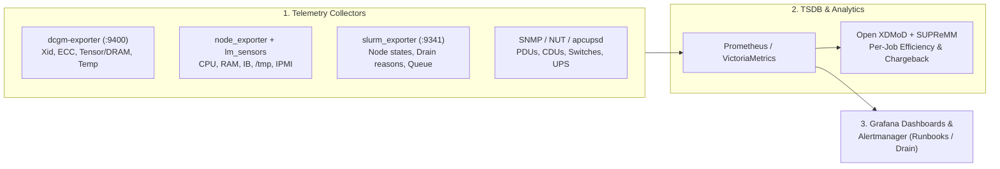

# 6.26 Cluster monitoring and health at scale

| | |
|---|---|
| Level | Advanced |
| Priority tier | 2 |
| Lab venue | A cluster or VM stack with Prometheus; GPU node for DCGM |
| Part | Part 6: HPC and Slurm |
| Status | Drafted. **Run**: `code/part06/slurm_exporter.py --selftest` (parser and metric rendering against canned `sinfo`/`squeue` output, `prometheus-client` library; output shown) and `check_alert_rules.py` on `alerts_gpu_cluster.yml` (9 rules, DCGM metric names cross-checked against `etc/default-counters.csv` from NVIDIA/dcgm-exporter commit `fafd151`, 2026-09-18; a deliberately broken copy was caught). **Not run**: Prometheus itself (`promtool` unavailable), Slurm, DCGM, Grafana, any real cluster. The `sinfo -O` fixed-width field format and `squeue -o` specifiers were checked against the Slurm man pages; the real command output was not captured. No lab step was run on a real cluster. |

## Why this matters for AI infrastructure

Picture a 2,000-GPU cluster that looks fine from across the room. The lights are on, the jobs are running and the queue is long, and all of that sounds healthy. Yet some of its parts may be failing quietly, and each one is expensive. A single GPU that starts throwing errors can slow a multi-day training run for hours before anyone notices. The run keeps going, so no alarm sounds on its own. The cost shows up later, as results that arrive late or a bill that is higher than it should be.

Monitoring is how you keep that cluster working as one system instead of a heap of hardware. It helps to think of monitoring as answering four different questions, and each question needs its own signals. *Is it up?* is the simplest kind of health check: do the nodes, daemons, mounts and fabrics respond at all? *Is it healthy?* goes further, and it covers errors, temperatures and the network fabric that carries traffic between GPUs. *Is it used well?* asks about utilisation, the queue and goodput, which is the share of time that turns into useful work. *Is it going to fail?* looks at trends and early warnings, so you can act before a part dies.

Monitoring also feeds chargeback (billing each team for what it uses), capacity planning and incident analysis. GPU clusters send different signals than ordinary web services do. A web server mostly reports requests and errors. A GPU node reports Xid errors, which are codes the NVIDIA driver writes when a GPU hits a fault. It reports ECC events, which are memory errors that the hardware either corrects or cannot correct. It reports remapped rows, which are spare memory rows that the GPU swaps in for damaged ones. You also watch NVLink and InfiniBand counters, thermal throttling (the GPU slowing itself down to cool off), power draw, storage latency and scheduler state. Keep the four questions in mind, because each later section answers at least one of them.

## Prerequisites and outcomes

You need 6.2, 6.8 to 6.14 and Part 2 before you start this chapter. The chapter begins with the classic monitoring tools and the modern Prometheus stack, so you can see what each one is good at. It then moves layer by layer, from the facility down to the scheduler and the jobs themselves. It shows how DCGM (NVIDIA's Data Center GPU Manager, the software that reads GPU health and usage) feeds `dcgm-exporter`, which is the piece that turns those readings into metrics a monitoring server can scrape. After that come alerts that page the right people, with a link to each alert's runbook, and then the link to health checks (6.14) and security scans. The chapter closes with usage reports and with the work of scaling the stack.

Pick the layers you need to cover before you pick any tool.

## 1. The tool landscape

Picture an on-call engineer, the person who gets the alert when something breaks outside office hours. The phone buzzes about one hot rack in the middle of the night. The engineer has to decide which tool can answer the question, and the answer depends on which tool has the right numbers. Monitoring tools have changed a lot over the decades. Some are still in daily use, and others you will only meet in old documentation.

The diagram below shows the modern shape. Telemetry collectors on the left send their numbers into a time-series store, which is a database built for values that change over time and carry a timestamp. Dashboards, alerts and usage reports then read from that store. Read the diagram from left to right. The store sits in the middle, so every consumer reads the same numbers.



*Supercomputers for Linux SysAdmins* surveys the generations of these tools in chapter 19, "Cluster Status Monitoring Systems". Read the table from top to bottom, since the rows roughly follow the history. Each row shows what the tool does and whether you still meet it today.

| Tool | Idea | Today |
|---|---|---|
| **SNMP** (Simple Network Management Protocol, 1988; v1, v2c, v3) | Poll devices' management information bases (MIBs) for counters and settings; the de facto standard for switches, PDUs, UPSes. v1 has short counters, poor security, no encryption; v2c (community strings) is the most common; v3 adds authentication and encryption | Still the way to read many network and power devices; exported to Prometheus via `snmp_exporter` |
| **Ganglia** | Lightweight multicast/unicast daemons (`gmond`), aggregators (`gmetad`), RRD storage, web UI; designed for clusters | Largely historic, simple and scalable for its time |
| **Nagios** (and forks Icinga, Naemon) | Check-based monitoring: plugins return OK/WARN/CRIT/UNKNOWN, with notifications and dependencies | Common for host/service up-down checks and legacy estates |
| **Zabbix** | Agent plus server with templates, auto-discovery, triggers, graphs, SQL backend | Popular all-rounder, strong in enterprises |
| **XDMoD** | Open XDMoD (XSEDE/ACCESS) analyses accounting data (scheduler logs, performance data) into usage and efficiency reports | Used by HPC centres for utilisation reporting, chargeback, job performance |
| **Prometheus + Grafana** (the "modern approach") | Pull-based metrics scraped from exporters, labels instead of hierarchies, PromQL, alert manager, dashboards | De facto standard for AI/cloud-native clusters |
| **DCGM / dcgm-exporter** | NVIDIA's data-centre GPU manager and its Prometheus exporter | GPU-specific telemetry and diagnostics |
| **Commercial/vendor** | BCM monitoring, Datadog, Splunk, NVIDIA UFM (fabric), Mission Control | Integrated stacks |

The same chapter adds sections on health checks and security scans, which come later in this chapter. Its sensor and UPS sections cover in-band and out-of-band hardware readings and power monitoring. In-band means you read the hardware from inside the running operating system. Out-of-band means you read it through a separate path, such as the management controller on the server board, which keeps answering when the operating system does not.

### SNMP, `snmpconf`, and `snmptrapd` handlers

SNMP is how you talk to many network and power devices. Switches, PDUs (the power distribution units that feed each rack) and UPSes often do not run an operating system that you can log into. They do run a small SNMP agent, though, and that agent answers questions over the network. The monitored device runs an **agent**, which listens on UDP port `161`. (A UDP port is a numbered door on a machine, and a service listens behind it for packets.) For v3 over TLS the port is `10161`, described in RFC `6353`. The monitoring server runs a **manager** that receives asynchronous **Trap** notifications on UDP port `162`. For v3 over TLS that port is `10162`.

The protocol defines six core operations: `GetRequest`, `GetNextRequest`, `SetRequest`, `GetResponse`, `GetBulkRequest`, and `Trap`. Each variable that a device exposes sits in its Management Information Base (MIB), which is the device's published list of values. Each variable in that list has a numeric address called an Object Identifier (OID). The uptime counter, `sysUpTime`, has the OID `1.3.6.1.2.1.1.3`. Its readable name is `iso.org.dod.internet.mgmt.mib-2.system.sysUpTime`, and it counts the time since the device's management software last restarted. The standards bodies IETF, ISO, and IANA define most OID branches. Manufacturers such as Cisco and APC own the enterprise branches.

The `net-snmp` package, also called `snmp`, provides the client utilities. The three commands below show them with sample output. The output comes from a public test agent, so it shows the shape of the answer rather than a device you own. Read the first command as a single question and the third as a sweep of a whole branch.

```bash
# 1. Read a single OID (omitting default prefix iso.org.dod.internet.mgmt.mib-2.system)
snmpget -v 2c -c demopublic test.net-snmp.org sysUpTime.0
# DISMAN-EVENT-MIB::sysUpTimeInstance = Timeticks: (4935618) 13:42:36.18

# 2. Translate an OID name offline: outputs DESCRIPTION, SYNTAX, MAX-ACCESS, and full numeric path
snmptranslate -Td -Ib 'sysUptime'
# SNMPv2-MIB::sysUpTime (FROM SNMPv2-MIB, RFC1213-MIB, SYNTAX TimeTicks, MAX-ACCESS read-only, STATUS current)
# DESCRIPTION "The time (in hundredths of a second) since the network management portion of the system was last re-initialized."
# ::={iso(1) org(3) dod(6) internet(1) mgmt(2) mib-2(1) system(1) 3}

# 3. Walk an entire OID subtree without knowing its composition beforehand (defaults to mib-2 if omitted)
snmpwalk -v 2c -c demopublic test.net-snmp.org system
# SNMPv2-MIB::sysDescr.0 = STRING: test.net-snmp.org
# SNMPv2-MIB::sysObjectID.0 = OID: NET-SNMP-MIB::netSnmpAgentOIDs.10
# DISMAN-EVENT-MIB::sysUpTimeInstance = Timeticks: (5337593) 14:49:35.93
# SNMPv2-MIB::sysContact.0 = STRING: Net-SNMP Coders
# SNMPv2-MIB::sysName.0 = STRING: test.net-snmp.org
# SNMPv2-MIB::sysLocation.0 = STRING: Undisclosed
# SNMPv2-MIB::sysORDescr.1..5 = STRING: The MIB module for SNMPv2 entities / View-based Access Control Model / Message Processing / SNMP Management Architecture MIB
# SNMPv2-MIB::sysORUpTime.1..5 = Timeticks: (4) 0:00:00.04 / (5) 0:00:00.05
```

Two more tools cover other jobs. `snmpbulkget` and `snmpbulkwalk` perform bulk reads, which fetch many values in one round trip instead of one at a time. `snmpset` writes variables, so use it with care, because a write changes a live device.

To configure the local SNMP agent, start by backing up `/etc/snmp/snmpd.conf` with `cp /etc/snmp/snmpd.conf{,.bak}`. That copy lets you return to the old file if the new settings lock you out. Then run the interactive `snmpconf` utility. Pick `snmpd.conf`, then section `6` (`Access Control Setup`), then option `3` (`a SNMPv1/SNMPv2c read-only access community name`). Enter the community `public` and the network `192.168.0.0`. A community string works like a shared password for SNMP v1 and v2c. The name `public` is a widely known default, so treat it as a lab value only. The utility then writes this directive:

```text
rocommunity public 192.168.0.0
```

Traps from switches, PDUs, cooling units or UPSs need a receiver. A trap works the other way round from a poll. The device calls you when something happens, rather than you asking it a question. That matters for a switch that has just failed, because a failed switch cannot answer a poll but can still send a trap if it is able to. Configure `snmptrapd` in `/etc/snmp/snmptrapd.conf`. If TCP wrappers are active, also add `snmptrapd: 0.0.0.0` to `/etc/hosts.allow`. The usual example uses `authCommunity` to let the `public` community log, execute handlers and forward traps. The `traphandle` line runs a custom script whenever a matching notification OID arrives:

```text
# /etc/snmp/snmptrapd.conf
authCommunity log,execute,net public
traphandle NET-SNMP-EXAMPLES-MIB::netSnmpExampleHeartbeatNotification /tmp/demo demo-trap
```

The handler script reads its input from standard input. Think of it as a short pipeline. Line 1 is the sender hostname, and line 2 is the sender IP and transport. Every later line is an `oid val` pair, which is one variable name and its value, as the device reported it:

```sh
#!/bin/sh
# /tmp/demo (chmod a+x /tmp/demo; use a non-/tmp path in production)
read host
read ip
vars=
while read oid val
do
  if [ "x$vars" = "x" ]
  then
    vars="$oid = $val"
  else
    vars="$vars,\n$oid = $val"
  fi
done
echo -e "trap: $1 $host $ip $vars" > /tmp/demo.log
```

The script writes to `/tmp` only because this is a demo. The comment in the first lines already warns you to use a different path in production, since `/tmp` is writable by many accounts.

To test the whole trap pipeline without a real device, send a trap from the command line with `snmptrap`. If the handler writes its log line, the configuration works end to end. If it does not, check the `authCommunity` line first, because a community mismatch drops the trap before the handler ever runs:

```bash
snmptrap -v 2c -c public localhost "" \
  NET-SNMP-EXAMPLES-MIB::netSnmpExampleHeartbeatNotification \
  netSnmpExampleHeartbeatRate i 123456
```

### Ganglia multicast routing, Zabbix proxies, VictoriaMetrics, and XDMoD

- **Ganglia**: Ganglia was built for computing clusters by scientists at the University of California, Berkeley (`http://ganglia.sourceforge.net/`). Each machine runs the `gmond` daemon. A daemon is a background program that keeps running, and `gmond` is the one that watches the machine it lives on. It collects CPU speed, memory usage and custom C++/Python or XDR metrics, and sends them in either `multicast` mode or `unicast` mode. Multicast sends one packet to a group address, so every subscriber to the group receives a copy. Multicast is the default. Unicast sends to one specific server instead. The collector server runs `gmetad`, compiled with `./configure --with-gmetad && make && make install`. `gmetad` processes and aggregates the metrics, using max or sum. It stores Round-Robin Database (RRD) files in `/var/lib/ganglia/rrds`, owned by `nobody:nobody`. An RRD is a fixed-size file that keeps the history of one metric, so the disk use stays flat over time. `gmetad` also serves the web interface, copied to `/var/www/html/ganglia/`. You can generate a default agent config with `gmond -t | tee /etc/ganglia/gmond.conf`. Because `gmond` sends multicast on `239.2.11.71` by default, you must add a multicast route on the interface that faces the compute nodes. Without that route, the packets never reach `gmetad`. *Supercomputers for Linux SysAdmins* uses `eth0` in its example, so the packets reach `gmetad` on that interface:
  ```bash
  #
  ip route add 239.2.11.71/4 dev eth0
  ```
- **Nagios and Zabbix at cluster scale**: In Nagios (`http://www.nagios.org/`, and its fork Icinga `https://icinga.com/`), each plug-in is a separate program or script. That is both a strength and a weakness. It is very easy to write your own plug-in to monitor SMTP, HTTP, SNMP, Cisco or Brocade gear. But collecting many metrics means running many separate programs, through SSH or a local NRPE (the Nagios remote plugin executor). Each of those programs starts a new process on the compute node, which costs CPU. That creates high load on the compute nodes and limits polling to every few minutes. Zabbix uses a **Server → Proxy → Agent** hierarchy, backed by MySQL, PostgreSQL, SQLite or Oracle. The proxies collect traffic close to the nodes and pass a summary upward, so the central server does less work. With proxies aggregating traffic, it scales to roughly `1000` nodes. It also includes automatic SNMP device discovery. Polling hundreds of nodes directly on one flat LAN without proxies can still cause network spikes.
- **Time-series databases (TSDBs)**: A TSDB stores values indexed by time, which is the shape of almost every metric. Prometheus TSDB and InfluxDB are paired with collectors such as `prometheus`, `telegraf` or `collectd`, and with visualizers such as Grafana or Kibana. *Supercomputers for Linux SysAdmins* highlights **VictoriaMetrics** as a fast, disk-efficient TSDB for cluster metrics. It has one constraint: VictoriaMetrics stores only numeric values and cannot store string metrics. Plan your labels with that in mind, and keep text fields out of the metric values.
- **XDMoD and SUPReMM**: Open XDMoD ingests scheduler accounting logs from `SLURM` or `PBS` into a MySQL/MariaDB and Apache/PHP/Node.js stack. Accounting logs are the records the scheduler writes about each job, such as who ran it, on which nodes and for how long. XDMoD charts usage efficiency by user, group or project. To connect job records with node-level hardware counters, you extend XDMoD with its **SUPReMM** module. That module is backed by Prometheus, Performance Co-Pilot (PCP) or `TACC_Stats`. With it, you can track GPU usage, licences and energy through Slurm TRES/GRES.

### In-band hardware sensors: `lm_sensors` and `/etc/sensors3.conf`

A sensor chip on the motherboard works like a tiny thermometer or voltmeter. The `lm_sensors` package reads those chips in-band, which means from inside the running system. It works with the kernel's `/sys/class/hwmon` interface and `libsensors`. The kernel exposes each reading as a file, so a program can read a temperature the same way it reads any other file. The package reads over `150` sensor types across ISA, I2C, SMBus, SPI, Super-I/O, south bridge, CPU die (`coretemp`) and DIMM thermal sensors. Run `sensors-detect` to probe the controllers. It writes the required kernel module list to `/etc/sysconfig/lm_sensors`.

Sensor formatting, scaling formulas and hardware threshold limits live in `/etc/sensors3.conf`, or in `/etc/sensors.conf` on older releases. Each stanza starts with a `chip` selector in the form `type-bus-hexaddress`. For example, `lm78-i2c-2d` names an LM78 chip at address `0x2d` on the I2C bus, and `lm78-*` uses a wildcard instead. Standard input names are `in0, in1, ...` for voltages, with parameters such as `in0_input`, `in0_min`, `in0_max` and `in0_alarm`. `fan1, fan2, ...` are fans, and `temp1, temp2, ...` are temperatures. Inside a `chip` block, four directives control behaviour:

- `label`: sets the human-readable name shown by `sensors`. Without it, you see a cryptic channel number:
  ```text
  label in3 "+5V"
  ```
- `ignore`: suppresses a noisy or unconnected sensor channel, so it does not clutter the output or trigger false alarms:
  ```text
  ignore fan1
  ```
- `compute`: defines two comma-separated conversion formulas that use `@` for the raw value. The first converts the raw chip reading to the displayed value, which voltage dividers need. A voltage divider is a pair of resistors that scales a voltage down so the chip can read it. The second formula is the inverse, which converts the displayed value back to the raw register value when you write limits:
  ```text
  compute in3 ((6.8/10)+1)*@, @/((6.8/10)+1)
  ```
- `set`: programs minimum or maximum alarm thresholds into the sensor chip:
  ```text
  set in3_min 5 * 0.95
  set in3_max 5 * 0.05 + 5
  ```
  Or, as in the usual example, `set in3_max 5 * 1.05`.

After you edit `/etc/sensors3.conf`, write the configured `set` thresholds into the hardware registers. Then read the current values:

```bash
# Program min/max limits into sensor chips
sensors -s

# Display current voltage, fan RPM, and temperature readings
sensors
```

*Supercomputers for Linux SysAdmins* chapter 19 shows a server's `sensors` output. The chip `fschds-i2c-5-73` appears on `Adapter: SMBus I801 adapter at 1c20`, and `coretemp-isa-0000` appears on `Adapter: ISA adapter`. The output includes `+12V: +12.00 V`, `+5V: +5.15 V`, `Vbat: +3.14 V`, `PSU Fan: 1440 RPM (div = 4)`, `CPU Fan: 720 RPM (div = 4)`, `System FAN3: 720 RPM`, `System FAN4: 720 RPM`, `CPU Temp: +36.0°C (high = +69.0°C)`, `Super I/O Temp: +38.0°C (high = +52.0°C)`, `System Temp: +41.0°C (high = +56.0°C)`, and `Core 0..3: +51.0°C / +49.0°C (high = +82.0°C, crit = +100.0°C)`. One line stands out: **`System FAN2: FAULT (div = 4)`**. It flags a failed chassis fan immediately. Read every line of the output once, so that a line like this one does not hide among the normal readings.

For out-of-band readings through IPMI (`ipmitool`), polling BMCs remotely at high frequency can overload the BMC controllers. The BMC (baseboard management controller) is a small computer on the server board that reports sensors even when the operating system is down. IPMI (the Intelligent Platform Management Interface) is the protocol you use to query it. The BMC is slow compared with the main processor, so a flood of remote queries can lock it up. Read IPMI sensors locally on each node instead, through an agent such as `node_exporter` or `prometheus-ipmi-exporter`.

### UPS monitoring with Network UPS Tools (`NUT`) and `apcupsd`

Computing clusters solve large, resource-intensive tasks, so they need reliable, uninterrupted power. A power cut in the middle of a long job can throw away hours of work if no checkpoint exists. That takes an uninterruptible power supply (`UPS`), which means both the UPS hardware and the software that manages the link between the UPS and the equipment it protects. *Supercomputers for Linux SysAdmins* chapter 19 covers *APCUPS* and *NUT*.

Cluster UPS systems are typically designed to provide power for at least `10–30 minutes` during a grid outage. If utility power is not restored within `5 minutes`, they must start a controlled cluster shutdown. That shutdown prohibits new jobs and stops the compute nodes first, to relieve the energy load. The network file systems and monitoring servers shut down last, because the rest of the cluster depends on them. The order matters, and the next section explains how the monitoring software enforces it.

For APC UPSs, the freely distributed `apcupsd` package has four parts: the `apcupsd` daemon, the `apcaccess` status reader, parameter adjustment tools, and CGI web scripts. You build it from source with `./configure --prefix=/usr --sbindir=/sbin --enable-threads --enable-snmp --enable-cgi --with-libwrap=/lib64/libwrap.so.0 --with-cgi-bin=/usr/apache/cgi-bin && make && make install`. Then `apcaccess` queries UPS status. A typical run reports `APC: 001 / 048 / 1157`, `HOSTNAME: rsufs`, `VERSION: 3.14.7`, `UPSNAME: UPS_3`, `MODEL: SNMP UPS Driver`, `STATUS: ONLINE`, `LINEV: 226.0 Volts`, `LOADPCT: 32.0 Percent Load Capacity`, `BCHARGE: 100.0 Percent`, `TIMELEFT: 73.0 Minutes`, `MBATTCHG: 5 Percent`, `MINTIMEL: 3 Minutes`, `MAXTIME: 0 Seconds`, `MAXLINEV: 227.0 Volts`, `MINLINEV: 221.0 Volts`, `OUTPUTV: 218.0 Volts`, and `APCMODEL: Smart-UPS RT 10000`. Read `STATUS` and `TIMELEFT` first, because those two lines tell you whether the UPS is on mains power and how long the battery can carry the load. The package also runs `/etc/apcupsd/onbattery` and `offbattery`, which are scripts that fire when the power leaves and returns. It serves the `http://localhost/cgi-bin/multimon.cgi` web dashboard, which reads its hosts from `/etc/apcupsd/hosts.conf`: `MONITOR 192.168.5.11 "asile1"`, `MONITOR 192.168.5.77 "asile2"` and `MONITOR 192.168.5.99 "storage"`. Concrete `apcupsd.conf` parameters and staged shutdown scripts are detailed in Chapter 6.30.

For multi-vendor UPS fleets, **Network UPS Tools (`NUT`)** splits the work across three pieces: hardware drivers, a network server called `upsd`, and a reaction client called `upsmon`. Think of the driver as the translator for one brand of UPS, the server as the post office that shares its status, and the client as the watcher that decides what each machine should do. The setup is spread across four files in `/etc/nut`:

1. **`/etc/nut/ups.conf`**, for driver settings. It names each UPS section and selects the driver from `/usr/share/nut/driver.list`. Start here, because the other files refer back to the name you choose in this file:
   ```ini
   [ups1]
   driver = usbhid-ups
   port   = auto
   serial = 1234567890
   ```
2. **`/etc/nut/upsd.conf`**, for server settings. Tuning here is optional. It covers `MAXAGE seconds`, the stale data timeout, `LISTEN interface port` (for example `172.0.0.1`) and `MAXCONN connections`.
3. **`/etc/nut/upsd.users`**, for access control and roles. You define NUT users and their passwords here, along with the allowed `actions`. `set` modifies UPS parameters, and `fsd` forces a shutdown. Instant commands go in `instcmds`. Whether `upsmon` runs in `master` mode (shut down last, attached to the UPS) or `slave` mode (shut down first) is set here too:
   ```ini
   [admin]
   password = adminpass
   actions = set
   actions = fsd
   instcmds = all

   [tester]
   password = tstpass
   instcmds = test.panel.start
   instcmds = test.panel.stop

   [monmaster]
   password = 123qweasd
   upsmon master
   ```
4. **`/etc/nut/upsmon.conf`**, for monitoring and event actions. It connects to `upsd` and says how to react to each state change: `ONLINE`, `ONBATT`, `LOWBATT`, `FSD`, `COMMOK`, `COMMBAD`, `SHUTDOWN`, `REPLBATT`, `NOCOMM` and `NOPARENT`. The actions use the flags `SYSLOG`, `WALL`, `EXEC` (which runs `NOTIFYCMD` with the event name in `$NOTIFYTYPE`), or `IGNORE`:
   ```text
   MONITOR ups1@localhost 1 monmaster 123qweasd master
   ```

After the `nut` / `upsd` service starts, query the live UPS state with `upsc`:

```bash
upsc ups1@localhost
```

After any change to these four files, run `upsc` to confirm that they work together. A file that reads correctly can still fail if the name in `ups.conf` does not match the name in `upsmon.conf`, and `upsc` shows that mismatch at once.

## 2. What to monitor, by layer

Think about the last time a slow job turned out to be a storage problem and not a code problem. If you watched only the servers, you would have missed it entirely. Every layer of a GPU cluster sends its own kind of signal, and each signal comes from a different source. Servers, the fabric, the storage and the facility all have their own readings. Read the table row by row, since each row lists what to watch in one layer and where the data comes from.

| Layer | Signals | Source |
|---|---|---|
| **Facility** | Rack inlet/outlet temperature, humidity, PDU power per outlet, UPS state, CDU coolant temperature/flow/pressure, leak sensors | SNMP/Modbus/BACnet to PDUs, CDUs; UPS monitoring with APCUPS (`apcupsd`, which can also trigger orderly shutdown scripts) or NUT (Network UPS Tools); BMC sensors |
| **Node** | CPU load, memory, swap, disk space/IO, temperatures, fan speeds, power, kernel errors (`dmesg`, EDAC ECC), clock sync, services | `node_exporter` (+ textfile collector), `lm_sensors`/hwmon, IPMI/Redfish (`ipmi_exporter`, Part 7), journald |
| **GPU** | Utilisation, memory used, SM/memory clocks, power, temperature, **Xid errors**, ECC and **row remapping**, throttle reasons, NVLink bandwidth and errors, PCIe replay, tensor-pipe activity (profiling) | DCGM, `dcgm-exporter`, `nvidia-smi` |
| **Fabric** | Port state, link speed/width, symbol errors, link-down events, congestion (PFC/ECN counters), adaptive-routing, bandwidth per port | UFM, `ibstat`/`perfquery`, `node_exporter` InfiniBand collector, switch telemetry (Part 12) |
| **Storage** | Server health, OST/MDT utilisation, client latency/throughput, metadata ops, quotas, rebuilds | Lustre/GPFS/WEKA exporters, `lfs df`, `nfsiostat` (6.18 to 6.20) |
| **Scheduler** | Node states, drain reasons, queue length and wait time by partition, utilisation, failed jobs, controller RPC rate and backfill cycle | Slurm exporter, `sdiag`, `sacct` (6.14) |
| **Jobs/application** | Per-job GPU utilisation and efficiency, step time, tokens/s, loss, checkpoint duration, data-loader stalls | DCGM job mapping, framework metrics, MLflow/W&B, Slurm accounting |
| **Security** | Auth failures, new keys, privilege changes, image/package vulnerabilities, open ports | Audit logs, scanners (below) |

Notice that each row names both what to measure and where the number comes from. That tells you which exporter to install before you can get the number at all. The Golden Rule is **alert on symptoms that need human action; graph everything else.** A GPU at 99 C might be fine for a minute, and a graph can show that without waking anyone. A rack where 40 percent of GPUs show Xid 79 is an incident, and that is the kind of symptom that should page someone. The rule keeps the pager quiet enough that a real page still gets read.

## 3. GPU metrics with DCGM

Suppose a job runs for two hours, its GPUs look busy, and the results still arrive slower than last week. Before you blame the code, you need the right GPU counters on screen. A metric is a single number tracked over time, such as a GPU's temperature or its memory in use. `dcgm-exporter` serves the DCGM fields at `:9400/metrics`, where a field is one named measurement that DCGM can read. A CSV file of counters decides which fields it publishes. The default file is `etc/default-counters.csv` in the NVIDIA/dcgm-exporter repository, and a larger set is in `dcp-metrics-included.csv`.

Four fields explain most slow-job questions. `DCGM_FI_DEV_GPU_UTIL` says whether a kernel was running. `DCGM_FI_PROF_PIPE_TENSOR_ACTIVE` says whether the tensor cores were busy. `DCGM_FI_DEV_XID_ERRORS` shows the last GPU error. `DCGM_FI_DEV_POWER_USAGE` and the clock fields show throttling. Start with these four when a job looks slow, and only then reach for the rest. The table lists the rest of the default fields by what they answer.

| Question | Fields in the default CSV |
|---|---|
| Is the GPU throttled or hot? | `DCGM_FI_DEV_SM_CLOCK`, `DCGM_FI_DEV_MEM_CLOCK`, `DCGM_FI_DEV_GPU_TEMP`, `DCGM_FI_DEV_MEMORY_TEMP`, `DCGM_FI_DEV_POWER_USAGE`, `DCGM_FI_DEV_TOTAL_ENERGY_CONSUMPTION` (counter, mJ) |
| Is it busy, and doing what? | `DCGM_FI_DEV_GPU_UTIL`, `DCGM_FI_DEV_MEM_COPY_UTIL`, `DCGM_FI_DEV_ENC_UTIL`, `DCGM_FI_DEV_DEC_UTIL`, and the profiling fields `DCGM_FI_PROF_GR_ENGINE_ACTIVE`, `DCGM_FI_PROF_PIPE_TENSOR_ACTIVE`, `DCGM_FI_PROF_DRAM_ACTIVE` |
| Is it failing? | `DCGM_FI_DEV_XID_ERRORS` (value of the last XID error), `DCGM_FI_DEV_UNCORRECTABLE_REMAPPED_ROWS`, `DCGM_FI_DEV_CORRECTABLE_REMAPPED_ROWS`, `DCGM_FI_DEV_ROW_REMAP_FAILURE`, `DCGM_FI_DEV_PCIE_REPLAY_COUNTER` |
| How much memory and bandwidth? | `DCGM_FI_DEV_FB_FREE`, `DCGM_FI_DEV_FB_USED`, `DCGM_FI_DEV_FB_RESERVED` (MiB), `DCGM_FI_DEV_NVLINK_BANDWIDTH_TOTAL`, `DCGM_FI_PROF_PCIE_TX_BYTES`, `DCGM_FI_PROF_PCIE_RX_BYTES` |
| Which driver? | `DCGM_FI_DRIVER_VERSION` (a label) |

> **dcgm-exporter 4.9.0 version note.** dcgm-exporter 4.9.0 (2026-11-06) renamed many default metrics and changed some units. For example `DCGM_FI_DEV_GPU_UTIL` (percent) became `DCGM_FI_DEV_GPU_UTIL_RATIO` (0 to 1), and `DCGM_FI_DEV_FB_USED` (MiB) became `DCGM_FI_DEV_FB_USED_BYTES`. The metric names in this chapter are the 4.8.x names. On a 4.9.0 exporter use the [full mapping in 17.4](../part-17-operations/04-dcgm-exporter-and-interpreting-gpu-metrics.md#14-what-dcgm-exporter-490-renamed), and change thresholds together with the unit. If you change the unit and forget the threshold, an alert will either never fire or fire all the time.

Reading these fields takes care. **`GPU_UTIL`** is the fraction of time any kernel was running. A kernel is a unit of work the GPU runs, and this number only asks whether one was on the GPU at all. It does not tell you how efficiently the streaming multiprocessors (the SMs, the compute blocks inside the GPU) are used. A job can show 100 percent util while its tensor cores sit idle, because the kernels are busy waiting on memory. `PIPE_TENSOR_ACTIVE` and `DRAM_ACTIVE` show real efficiency. Low tensor activity with high DRAM activity means the job is memory-bound, which means the GPU spends its time moving data rather than computing on it.

`XID_ERRORS` reports only the last Xid number, so it behaves like a gauge. A gauge is a value that goes up and down, and this one only tells you the most recent error code. Alert on any non-zero value, and keep the history in logs, because the gauge forgets earlier codes. Remapped rows and a failed remap are RMA (return merchandise authorisation) signals, which means the vendor may need to replace the card. Temperature, power and clocks together reveal throttling, since a GPU that is hot and drawing less power than it should is often slowing itself down.

Always include the job-to-GPU mapping labels. A label is a tag on a metric, such as a job name or a pod name, that lets you filter and group the numbers. DCGM can map GPUs to Kubernetes pods. For Slurm, map them via `SLURM_JOB_GPUS`, a cgroup, or a prolog-written file that the textfile collector reads. A prolog is a script that Slurm runs before a job starts, and a textfile collector is a node_exporter feature that reads small metric files from disk. With those labels in place, you can attribute usage to users and projects.

Metrics are passive, which means they only watch what the GPU is already doing. **DCGM diagnostics** run active tests instead. The command is `dcgmi diag -r 1|2|3`. Level 1 is quick, and higher levels stress memory, PCIe and compute. Run these before jobs as part of health checks. Do not run them as continuous monitors (6.14), because a stress test takes the GPU away from real work while it runs.

## 4. A Slurm exporter (tested)

Imagine you are about to turn on a new Slurm exporter for the whole cluster, and the first dashboard shows a GPU count that looks too low. Before you trust the numbers, you want proof that the parser reads the output correctly. Maintained exporters already exist, including the community `prometheus-slurm-exporter` family and others. The point of `code/part06/slurm_exporter.py` is different. It shows what an exporter does, and how to test its parser without a cluster. The exporter runs these two commands:

```text
sinfo -h -N -O "NodeList:32,StateLong:20,Gres:40,GresUsed:60,Reason:80,Partition:24"
squeue -h -o "%T|%P|%u|%D"
```

The `-O` fields `NodeList`, `StateLong`, `Gres`, `GresUsed`, `Reason` and `Partition`, and the `-o` specifiers `%T %P %u %D`, were checked against the `sinfo(1)` and `squeue(1)` man pages. The exporter parses fixed-width columns, which means each field sits at a set position in the line. It removes duplicate nodes that appear in several partitions. It pulls GPU counts out of GRES strings such as `gpu:h100:8(S:0-1)`, where GRES is the Slurm name for generic resources such as GPUs. It classifies drain reasons (`gpu`, `network`, `storage`, `prolog`, `unresponsive`, `unkillable`...), and renders metrics with `prometheus_client`. A drain reason tells you why a node was taken out of service, so the classification turns a free-text note into a label you can count.

The self-test uses six canned node rows and four jobs. The rows include one node listed in two partitions, one node with a GPU Xid reason, and one node that is down and not responding. The test checks the aggregation and prints this result:

```text
slurm_nodes{state="allocated"} 1.0
slurm_nodes{state="mixed"} 1.0
slurm_nodes{state="drained"} 1.0
slurm_nodes{state="down"} 1.0
slurm_nodes{state="idle"} 1.0
slurm_node_drain_reason{reason_class="gpu"} 1.0
slurm_node_drain_reason{reason_class="unresponsive"} 1.0
slurm_gpus{status="total"} 40.0
slurm_gpus{status="allocated"} 11.0
slurm_jobs{partition="gpu",state="running"} 1.0
slurm_jobs{partition="gpu",state="pending"} 2.0
slurm_jobs{partition="debug",state="running"} 1.0
slurm_exporter_scrape_ok 1.0
selftest passed
```

The demo teaches a few design lessons. Expose *state counts*, not per-job series, to keep cardinality under control. Cardinality is the number of distinct series a metric produces, and each new label value adds another. Think about the load on the controller too. Every scrape runs `sinfo` and `squeue` against `slurmctld`, which is the central Slurm controller, so scrape every 30 to 60 seconds, never every second. That is the same RPC load problem as users running `watch squeue` (6.14). An RPC is a request sent to the controller, and too many of them slow down the scheduler for everyone. Emit a `scrape_ok` gauge so that a dead exporter pages you. Treat unknown output formats as scrape failures, rather than quietly reporting zeros. A silent zero looks like a healthy empty cluster, which is the worst way to fail.

The demo has limits. Its output comes from canned rows rather than real `sinfo` output from a live controller, and the fixed-width format and node-state suffixes vary by version. It does not report per-user usage. It also parses CLI text rather than using the REST API (`slurmrestd`, 6.15), which is more robust for production. Use a maintained exporter, or move to `slurmrestd`, before you depend on this in production.

## 5. Alerting

It is the middle of the night, and your phone buzzes. An alert has fired, and you have to decide in a few seconds whether to get out of bed. Good alert design is what makes that decision easy. Six principles guide the alert rules. The first is the most important. **Page only on user-visible or capacity-threatening symptoms.** Ticket the degradations, and graph the rest. A paged alert must be actionable at 3 a.m. and come with a runbook, which is a short written procedure that tells the on-call engineer what to check first.

Principle 2 says to use `for:` durations to avoid flapping, which means an alert that switches on and off again every few seconds. A `for:` clause makes the condition hold for a set window before it fires. The same principle says to group related alerts. Inhibit lower-level alerts when a higher-level cause is firing. A rack power loss should not page 32 nodes, because the one rack alert already tells the whole story.

Third, watch cardinality and labels. Good labels include hostname, GPU index, rack and partition, because each of those answers a question someone will ask at 3 a.m. Never use user-supplied free text as a label, since users can type anything and each new string creates a new series.

Principle 4 is to alert on absence. If an exporter stops sending data, the alert rules see nothing and stay quiet, which looks the same as a healthy system. Use `absent()` for exporters, so that silence itself becomes an alert. Add heartbeat alerts, sometimes called a dead man's switch, to verify the alert path itself. A heartbeat is an alert that always fires, and it should always reach a second system. When the heartbeat stops arriving, you know the alerting chain is broken.

Fifth, link every alert to remediation. Annotate each alert with a runbook URL. For known hardware faults, you can drain a node automatically through a webhook. A webhook is a message that one system sends to another over HTTP. In this case, Alertmanager calls a service that runs `scontrol update ... state=drain reason=...`. Test that automation for loops and false positives. A loop would drain a node, which triggers an alert, which drains it again. 6.14 and 5.32 discuss the safety properties it needs: budgets, dry-run, and provenance of what you changed.

Principle 6 is to review the rules weekly. Delete alerts nobody acts on, and measure alert precision. Precision here means the share of pages that led to a real action. If most pages end with nothing to do, the rule is teaching people to ignore the pager.

The file `code/part06/alerts_gpu_cluster.yml` is an illustrative rule file with nine alerts in three groups. `GpuXidError` fires on any non-zero last-Xid for 1 minute. `GpuRowRemapFailure` is the row-remap alert. `GpuHot` fires above 85 C for 10 minutes. `AllocatedGpuIdle` watches for 30-minute average utilisation under 5 percent while GPUs are allocated. `SlurmNodesDrainedHigh` fires when more than 5 percent of nodes are drained or down for 15 minutes. `SlurmExporterDown` is the exporter-down alert. `GpuQueueBacklogWhileIdle` flags many pending GPU jobs while more than 16 GPUs sit idle, which points to a policy or fragmentation problem. Fragmentation means the free GPUs are scattered in pieces too small for the jobs waiting in the queue. `TmpFull` and `IbPortDown` complete the set.

`check_alert_rules.py` loads the YAML and checks its structure. It looks for duplicate names, bracket balance and severity labels. It requires `summary` and `runbook` annotations. It requires `for:` on paging rules, with one exception: the row-remap failure, which is a discrete, severe event. It also checks that every `DCGM_FI_*` name appears in the exporter's counters CSV. That last check catches a misspelled metric before the alert quietly never fires.

The original file passes with `9 rules in 3 groups` and no problems. A copy with a typo tells a different story. In that copy, `DCGM_FI_DEV_GPU_TEMP` is mistyped as `DCGM_FI_DEV_GPU_TEMPERATURE > (85`, and the checker reports:

```text
9 rules in 3 groups
PROBLEM GpuHot: unbalanced brackets in expr
PROBLEM GpuHot: DCGM_FI_DEV_GPU_TEMPERATURE is not in the dcgm-exporter counters file
```

This is a lint, not real PromQL validation. A lint checks the shape of a file, while PromQL (the Prometheus query language) validation checks whether the expressions actually compute what you meant. Run `promtool check rules`, and unit-test the rules with `promtool test rules` in CI. CI is the automated pipeline that runs your checks on every change. Several thresholds are guesses that you will need to tune, so treat them as starting points. The 85 C limit depends on the GPU model's slowdown and shutdown temperatures. The idle test depends on your workload. Join keys such as `Hostname` depend on your relabelling, which means the rename rules that Prometheus applies to labels as it scrapes. The `AllocatedGpuIdle` expression joins DCGM series with a Slurm series that does not carry a `Hostname` label in the demo exporter, so it needs per-node labels to work as written.

## 6. Health checks, scans, and active testing

Passive monitoring only tells you what already happened. Once a node boots, and again before each job starts, you can run active **healthchecks** to decide whether the node is fit for user jobs. A healthcheck is a short script or test that exercises the node on purpose and returns pass or fail. Examples include `node_health.sh` from Chapter 6.14, DCGM diagnostics, and NCCL pair tests. In Slurm, you can enable periodic execution of a custom healthcheck script with `HealthCheckProgram`. You can also include a fast check in the `Prolog` script. Keep prologue checks short, because prologue time is limited and counts toward job runtime. Every second spent in the prolog is a second the GPUs sit idle while they are already allocated to you. *Supercomputers for Linux SysAdmins* treats these options as part of the monitoring work, in its chapter 19 on *Healthchecks*. You can write your own scripts, or use the open-source **LBNL Node Health Check (`NHC`, `https://github.com/mej/nhc`)**. NHC is written in bash, is highly portable, and ships with many built-in modules. It lets you run different check modes, such as a fast prologue check or a full background check, by passing different configuration files.

Burn-in is the step for new hardware. Burn-in means you run stress tests on CPU, memory, GPU, network and storage before the machines take real work, so that early failures show up while nothing depends on them (6.28).

Security scans belong in the monitoring picture too. A security scan looks for known weaknesses, unexpected open ports and changes that nobody approved. *Supercomputers for Linux SysAdmins* recommends system software updates `two to four times a year`, tested on a small node subset first and after backups. It also recommends daily automated scans with open-source tools such as `chkrootkit`, `rkhunter`, `Nessus`, `Lynis` and `Maltrail`. On user-facing and service nodes, it adds commercial endpoint agents from SentinelOne, Palo Alto Networks and CrowdStrike. Other checks include vulnerability scanning of images and packages (Trivy, Grype, OpenSCAP), port scans of internal ranges to find unexpected services (`nmap`), configuration audits (the `sshd_audit.py` idea from 6.25), integrity monitoring (AIDE), and log analysis for auth anomalies and `sudo` activity. Container image provenance comes from 5.22 and Part 18. Treat every scan result as an input to the same ticketing and SLO process, so that a finding gets an owner and a deadline like any other problem. An SLO (service level objective) is the target you promise for a service, such as how much of the time it must be available.

Some problems never reach the OS, so you need out-of-band signals. A node with a dead operating system can still report a fan failure or a power event through its BMC. BMC sensors, SEL logs and Redfish events (Part 7) still report when the OS is dead. The SEL (system event log) is the record the BMC keeps of hardware events, and Redfish is a modern web-based interface to the same hardware data. Wire them into the same alerting so a dead host does not go quiet.

## 7. Usage and efficiency analytics

Some monitoring questions are about people and money rather than hardware. A research group says its GPUs are full, yet the cluster bill keeps climbing. Who used which resources, how well, and at what cost? Your sources are Slurm accounting (`sacct`, `sreport`, 6.9), job-level GPU metrics from DCGM job stats or per-job exporters, and XDMoD-style tools that combine accounting with performance data. The reports you build from them cover cluster utilisation (allocated vs total GPU-hours), efficiency, wait times by queue, failure causes (`NODE_FAIL`, OOM, timeout), top users and projects, and storage growth. Efficiency is the average GPU utilisation of allocated GPUs, and a classic finding is many allocated GPUs running below 20 percent. Those GPUs are reserved and paid for, yet most of their time goes unused. Use these reports to right-size allocations, steer small jobs to MIG (6.10), plan capacity and justify spend. Publish dashboards to users as well, because transparency reduces wasteful allocation. When people can see their own numbers, they tend to ask for fewer GPUs and release them sooner.

## 8. Scaling the monitoring stack

Monitoring a few racks is easy. Monitoring a whole cluster means watching the number of series grow quickly. A series is one stream of values, identified by a metric name and a set of labels, and each new label combination creates a new series. Per-GPU, per-port and per-job series multiply. For example, 2,000 GPUs times 30 fields, scraped every 15 seconds, is a large number of series. Drop the fields you do not use from the CSV. Aggregate with recording rules, which are Prometheus rules that compute a summary and store it as a new metric. Keep per-job series out of Prometheus by taking them from accounting, since the accounting database already holds that history.

Topology comes next. Run one Prometheus per cluster or per failure domain, where a failure domain is a group of machines that can fail together, such as one power feed. Send its data by remote-write or federation to a central long-term store, such as Thanos, Mimir or VictoriaMetrics. Remote-write pushes samples to another system, and federation lets one Prometheus pull selected series from another. Scrape GPU metrics every 15 to 30 seconds, and slow signals every 60 seconds. Keep retention in tiers, which means keeping fine detail for a short time and coarser summaries for much longer.

The monitor must be reliable too. If the monitoring system fails with the cluster it watches, you lose sight at the worst moment. Run redundant Prometheus pairs, and add an external dead-man's-switch. Keep the monitoring network separate from the data plane, so you can still see what is happening during a fabric outage. Time sync (6.18) matters here as well, because logs from several machines are only useful when their clocks agree.

Logs and traces need their own path. Forward journald and syslog to Loki or Elasticsearch, which are systems built to store and search log lines. Send structured logs from prolog, epilog and health scripts, and filter kernel logs for Xid, ECC and MCE lines. An MCE (machine check exception) is a hardware error report that the CPU raises. Keep them in central retention, so the evidence survives when a node is reimaged.

Exporters need hygiene. Pin versions, run as non-root, bind to the management network, and authenticate if they are reachable remotely. Avoid scraping `slurmctld` too often. Finally, long retention of high-cardinality data costs real storage, so define retention by how the data gets used. Ask who will open the data, and how far back they will need to look. Keep the answers in your runbook, so the next person can change the retention with a reason.

## 9. Lab

You have an exporter, an alert file and a sensor config, and you want proof that they work before anyone relies on them. Start with the self-checking Python lab, `code/part06/slurm_exporter_lab.py`, and run it locally. You get a pass or fail for the parser, the alert linter and the sensor math before you touch a cluster. The script calls `slurm_exporter.selftest()`. That confirms `gpu002`, which appears in two partitions, is deduplicated. It reports `40.0` total GPUs and `11.0` allocated GPUs, along with the `gpu` and `unresponsive` drain reasons and `slurm_exporter_scrape_ok 1.0`. It then runs `check_alert_rules.py` on `code/part06/alerts_gpu_cluster.yml`, which should show `9` rules in `3` groups and `0` problems. It also runs the checker on a mutated copy, catching unbalanced brackets and unknown `DCGM_FI_*` metric names. Last, it verifies the voltage-divider `compute in3` math in `/etc/sensors3.conf` from *Supercomputers for Linux SysAdmins* chapter 19 (`1.68 * 2.9762 V = 5.00 V`):

```bash
python3 code/part06/slurm_exporter_lab.py
```

The steps below were not run on a live cluster. The first three ran locally on a workstation, and the rest need hardware you may not have yet.

1. Install `prometheus-client` and run `slurm_exporter.py --selftest`. Then add a drain reason class and a test, and extend the parser to a second `sinfo` layout.
2. Run `check_alert_rules.py` on the rules file and on copies with deliberate mistakes. Add rules for NVLink bandwidth and PCIe replay counters, and look up the names in `dcp-metrics-included.csv`.
3. Write a recording rule for per-partition GPU utilisation efficiency, as a sketch.
4. Deploy `node_exporter` and `dcgm-exporter` on a GPU node, scrape them with Prometheus, and build a Grafana dashboard covering utilisation, tensor activity, power, temperature and Xid.
5. Run `promtool check rules` and `promtool test rules` on the file.
6. Configure Alertmanager routes (page, warn, ticket) and an inhibition rule for rack power loss.
7. Wire a webhook that drains a node on `GpuXidError`, and run it in dry-run mode first.
8. Build an efficiency report from `sacct` and DCGM job stats.
9. Run a fabric congestion test and watch the counters.

## 10. Interview angles

Interviewers use these questions to see whether you can reason about monitoring, not just name tools. Each question is a small situation, and a good answer walks from the symptom to the signal to the action. Practise answering each one out loud.

- What would you monitor on a 1,000-GPU training cluster, layer by layer, and which problems would page someone?
- What does `DCGM_FI_DEV_GPU_UTIL` really measure, and which fields show real efficiency?
- How would you attribute GPU usage to Slurm jobs and projects?
- How would you design alerting that avoids pages for symptoms with a known upstream cause?
- How would you scale Prometheus for tens of thousands of GPUs?
- What is the difference between SNMP v2c and v3, and where is SNMP still necessary?
- How would you detect an allocated-but-idle GPU problem, and what would you do about it?
- How do monitoring and health checks differ, and how do they work together?
- A node shows Xid 79 once. What do you do?

## Exercises

Work through these in order. The later ones build on the lab.

1. A Slurm node, gpu002, is listed in two partitions. Run `python3 code/part06/slurm_exporter_lab.py`, then read `slurm_exporter.parse()`. Why does the code need `seen.add(name)`?
2. A teammate proposes scraping `sinfo` and `squeue` every second. Why is that a bad idea?
3. Run `python3 code/part06/check_alert_rules.py code/part06/alerts_gpu_cluster.yml`. The file has nine rules in three groups. Name the groups.
4. `GpuRowRemapFailure` pages at once. `GpuHot` waits ten minutes and `SlurmNodesDrainedHigh` waits fifteen. Why do they differ?
5. How does `check_alert_rules.py` catch a misspelled `DCGM_FI_*` name?
6. Write the `snmpget` command that reads `sysUpTime`. Write the `snmpwalk` command that reads the same branch. Then write the `snmptranslate -Td -Ib` command that prints its numeric path. What OID does it print?
7. Write the `rocommunity` line that `snmpconf` generates for the network 192.168.0.0. Write the `authCommunity` line for `snmptrapd.conf`. Then write the matching `traphandle` line.
8. Write a `/bin/sh` trap handler. It must read the host, the IP, and the `oid val` pairs from standard input.
9. Chip `lm78-i2c-2d` measures +5V through a divider on `in3`. Write its stanza in `/etc/sensors3.conf`. Include a label line and a `compute` line. Set the minimum limit to 95 percent of 5 V.
10. Set the maximum limit to 105 percent of 5 V in the same stanza. Then check the stanza with `sensors_compute_in3(2.9762)` in `code/part06/slurm_exporter_lab.py`. What voltage does a raw reading of 2.9762 V display?
11. Write the four files in `/etc/nut/` for one USB UPS named `ups1`. Start with `ups.conf`. Run `upsc ups1@localhost` when the four files are done.
12. Why must `slave` monitors shut down before the `master` monitor?
13. A 64-GPU job shows `DCGM_FI_DEV_GPU_UTIL` at 99 percent. Its tensor activity, `DCGM_FI_PROF_PIPE_TENSOR_ACTIVE`, is 4 percent. Its DRAM activity, `DCGM_FI_PROF_DRAM_ACTIVE`, is 82 percent. Its H100 GPUs draw 260 W of a possible 700 W. What are the GPUs actually doing?
14. How do Open XDMoD and its SUPReMM module help you find jobs like the one in exercise 13 across many accounts?

---

## Checkpoint

<details>
<summary>1. What four fundamental operational questions does cluster monitoring answer?</summary>

1. **Is it up?** This covers the availability of nodes, daemons, mounts and fabrics.
2. **Is it healthy?** This covers hardware errors, including GPU `Xid`s, ECC and row remapping, NVLink or IB symbol errors, thermals, fans and PSUs.
3. **Is it used well?** This covers queue wait times, allocated versus idle GPUs, tensor-core efficiency and checkpoint overhead.
4. **Is it going to fail?** This covers trends in correctable ECC rates, rising CDU or inlet temperatures, and `/tmp` or OST capacity growth.
</details>

<details>
<summary>2. Compare **SNMP v1**, **v2c**, and **v3**, and state which UDP ports the SNMP agent and trap receiver use (*Supercomputers for Linux SysAdmins* chapter 19).</summary>

- **SNMP v1 (1988):** It has 32-bit counters, a plaintext community string, and no encryption.
- **SNMP v2c:** It adds 64-bit counters and `GetBulkRequest`. It still uses plaintext community strings, and it is the most common choice on internal management LANs.
- **SNMP v3:** It adds user authentication, encryption and view-based access control (`VACM`).
- **Ports:** The monitored **agent** listens on **UDP port `161`**, or on `10161` for v3 over TLS (RFC `6353`). The monitoring **manager (`snmptrapd`)** receives asynchronous **Traps** on **UDP port `162`**, or on `10162` for v3 over TLS.
</details>

<details>
<summary>3. What are the six core SNMP protocol operations, and what do `snmpget`, `snmptranslate -Td -Ib`, and `snmpwalk` do (*Supercomputers for Linux SysAdmins* chapter 19)?</summary>

- **The six operations:** `GetRequest`, `GetNextRequest`, `SetRequest`, `GetResponse`, `GetBulkRequest`, and `Trap`.
- **`snmpget`:** It reads a single OID value from a remote agent.
- **`snmptranslate -Td -Ib 'sysUptime'`:** This is an offline lookup. It prints the MIB object's `SYNTAX`, `MAX-ACCESS`, `DESCRIPTION` and full numeric OID path (`1.3.6.1.2.1.1.3`), without contacting a server.
- **`snmpwalk`:** It walks an entire OID subtree step by step. It defaults to `iso.org.dod.internet.mgmt.mib-2`.
</details>

<details>
<summary>4. How do you configure `snmptrapd` (`/etc/snmp/snmptrapd.conf`) to execute a custom script when a trap arrives, and what does `snmptrapd` pass to the script's `stdin` (*Supercomputers for Linux SysAdmins* chapter 19)?</summary>

Add `authCommunity log,execute,net public` and `traphandle <OID> /path/to/handler arg1` to `/etc/snmp/snmptrapd.conf`. If TCP wrappers are used, also add `snmptrapd: 0.0.0.0` to `/etc/hosts.allow`. When a trap arrives, `snmptrapd` runs `/path/to/handler`. It writes the **sender hostname on line 1**, the **sender IP and transport on line 2**, and **`<oid> <value>` pairs on the lines after that** to standard input.
</details>

<details>
<summary>5. Compare **Ganglia**, **Nagios**, and **Zabbix** on a compute cluster, and what multicast route does Ganglia require by default (*Supercomputers for Linux SysAdmins* chapter 19)?</summary>

- **Ganglia (`gmond` + `gmetad`):** It is a lightweight cluster metric collector that stores RRD files in `/var/lib/ganglia/rrds`. It defaults to multicast on `239.2.11.71`, so the `gmetad` server needs `ip route add 239.2.11.71/4 dev eth0`. It has no built-in alerting.
- **Nagios (and Icinga):** It starts a separate OS process for each check plugin, through NRPE or SSH. That suits service and switch checks well. The process-spawn overhead makes frequent compute-node metric polling too heavy.
- **Zabbix (`Server -> Proxy -> Agent`):** It is SQL-backed, with web UI configuration and automatic SNMP discovery. It scales to about `1,000` nodes when hierarchical proxies aggregate the traffic.
</details>

<details>
<summary>6. What are the four layers of the "Modern Approach" monitoring stack in *Supercomputers for Linux SysAdmins* chapter 19, and what is the one data-type constraint of **VictoriaMetrics**?</summary>

1. **Collectors:** `Prometheus` exporters, `Telegraf` or `collectd`.
2. **Time-series database (TSDB):** `Prometheus TSDB`, `InfluxDB`, or **`VictoriaMetrics`**. VictoriaMetrics is faster and uses less disk space than InfluxDB. Its constraint is that **VictoriaMetrics stores only numeric data and cannot store string metrics**.
3. **Visualization:** `Grafana` or `Kibana`.
4. **Alerting:** `Alertmanager`, `Grafana Alert` or `PagerDuty`.
</details>

<details>
<summary>7. What is **Open XDMoD**, and what does its **SUPReMM** module add (*Supercomputers for Linux SysAdmins* chapter 19)?</summary>

**Open XDMoD (XD Metrics on Demand)** ingests Slurm and PBS accounting logs. It can analyze resource utilization, wait times and allocation fairness by user, group and project. The **SUPReMM** module correlates those job accounting records with node-level hardware performance metrics. Those metrics come from **Prometheus**, **Performance Co-Pilot (`PCP`)** or **`TACC_Stats`**. With SUPReMM, you can see per-job GPU efficiency, memory bandwidth, and CPU or I/O bottlenecks.
</details>

<details>
<summary>8. What are the four directives inside a `chip` stanza in `/etc/sensors3.conf` (`lm_sensors`), and what command writes threshold limits into the sensor hardware (*Supercomputers for Linux SysAdmins* chapter 19)?</summary>

Inside a `chip` stanza, such as `chip "lm78-i2c-2d"`, you use four directives.
1. **`label <sensor> "<name>"`** sets the display name, for example `label in3 "+5V"`.
2. **`ignore <sensor>`** hides an unused or faulty channel, for example `ignore fan1`.
3. **`compute <sensor> <to_display>, <to_raw>`** holds the forward and inverse scaling formulas, written with `@`. For example, `compute in3 ((6.8/10)+1)*@, @/((6.8/10)+1)`.
4. **`set <param> <expr>`** sets the minimum and maximum hardware alarm limits, such as `set in3_min 5 * 0.95` and `set in3_max 5 * 1.05`.

Run **`sensors -s`** to program the `set` limits into the chip registers. Run **`sensors`** to display the current readings.
</details>

<details>
<summary>9. Why does *Supercomputers for Linux SysAdmins* chapter 19 advise against polling compute-node IPMI sensors remotely over the network at high frequency?</summary>

Frequent remote `ipmitool sensor` queries over the LAN can overwhelm slow, embedded BMC microcontrollers. The result can be BMC lockups, or false `Slurmd` and Redfish timeouts. Read the sensors locally on each node instead, through `/sys/class/hwmon` (`node_exporter`), or through a local `ipmi_exporter` scraped at a reasonable interval.
</details>

<details>
<summary>10. What are the four configuration files in `/etc/nut/` for **Network UPS Tools (`NUT`)**, and what is the difference between `upsmon master` and `upsmon slave` (*Supercomputers for Linux SysAdmins* chapter 19)?</summary>

1. **`/etc/nut/ups.conf`** defines the hardware drivers, such as `driver = usbhid-ups` and `port = auto`.
2. **`/etc/nut/upsd.conf`** holds the network server settings: `MAXAGE`, `LISTEN` and `MAXCONN`.
3. **`/etc/nut/upsd.users`** holds the credentials, the `actions` (`set` and `fsd`), the `instcmds` and the `upsmon` role.
4. **`/etc/nut/upsmon.conf`** sets the `MONITOR` target and the `NOTIFYFLAG` and `NOTIFYCMD` actions (`SYSLOG`, `WALL`, `EXEC` and `IGNORE`).

A `upsmon slave` node, such as a compute node, shuts down **first** during an outage, which sheds load. The `upsmon master` node, the storage or management server attached to or controlling the UPS, shuts down **last**.
</details>

<details>
<summary>11. What is the difference between `DCGM_FI_DEV_GPU_UTIL` and `DCGM_FI_PROF_PIPE_TENSOR_ACTIVE` / `DCGM_FI_PROF_DRAM_ACTIVE` in `dcgm-exporter`?</summary>

- **`DCGM_FI_DEV_GPU_UTIL`** is a coarse percentage. It is the share of time in the sample period when at least one CUDA kernel was on the GPU. That holds even if only one SM is active, or the GPU is spinning in an `NCCL` wait loop.
- **`DCGM_FI_PROF_PIPE_TENSOR_ACTIVE` and `DCGM_FI_PROF_DRAM_ACTIVE`** are fine-grained hardware profiling counters. They measure the fraction of cycles in which the **Tensor Cores** and the **HBM memory interface** are actually computing or moving data.
</details>

<details>
<summary>12. Which `dcgm-exporter` metrics indicate fatal hardware faults requiring node drain or GPU RMA?</summary>

- **`DCGM_FI_DEV_XID_ERRORS`** is a gauge that reports the last `Xid` error code. A value above `0` should trigger an investigation. Fatal codes such as `48, 63, 64, 74, 79, 94, 95` call for a node drain.
- **`DCGM_FI_DEV_UNCORRECTABLE_REMAPPED_ROWS`** and **`DCGM_FI_DEV_ROW_REMAP_FAILURE`** track uncorrectable HBM row remapping. A value of `1` for `DCGM_FI_DEV_ROW_REMAP_FAILURE` means the HBM spare row table is exhausted or has failed. That GPU is an immediate RMA candidate.
</details>

<details>
<summary>13. Why does `code/part06/slurm_exporter.py` deduplicate node names when parsing `sinfo -N`, and why does it export aggregate state counts instead of per-job time series?</summary>

In Slurm, a compute node in several partitions, such as `gpu002` in both `gpu` and `debug`, appears once per partition in `sinfo -N`. Without `seen.add(name)`, its GPUs and state would be counted twice. Exporting aggregate state counts, such as `slurm_jobs{partition,state}`, avoids one label per `JobID`. That matters because a label per job would create unbounded label cardinality in Prometheus as millions of jobs run over time.
</details>

<details>
<summary>14. Why should a Slurm Prometheus exporter scrape `slurmctld` every `30–60` seconds rather than every `1–2` seconds, and why must it emit `slurm_exporter_scrape_ok`?</summary>

Every scrape calls `sinfo` or `squeue` (or `slurmrestd`) over RPC against `slurmctld`. Scraping every second adds constant RPC load, and that load competes with job scheduling. The `slurm_exporter_scrape_ok` metric reports `1` on success and `0` on error. With it, an alert such as `SlurmExporterDown` (`slurm_exporter_scrape_ok == 0 or absent(slurm_exporter_scrape_ok)`) can page as soon as the exporter or controller stops responding. Without it, you would graph stale or zero values silently.
</details>

<details>
<summary>15. State the **Golden Rule of Alerting**, and explain the roles of `for:` durations and **Alertmanager inhibition rules**.</summary>

- **Golden Rule:** **Page (`severity: page`) only on symptoms that require immediate human action. Create tickets (`severity: ticket` or `warn`) for degradations. Graph everything else.**
- **`for:` duration:** The alert condition must hold continuously for a set window, such as `for: 10m` on `GpuHot`. That stops transient spikes from paging the on-call engineer.
- **Inhibition rules:** They suppress symptom alerts while a root-cause alert is already firing. For example, when the top-of-rack switch or PDU alert for a rack is firing, you can inhibit 32 individual node-down alerts.
</details>

<details>
<summary>16. What checks does `code/part06/check_alert_rules.py` perform on a Prometheus alert rules YAML file?</summary>

1. The file must be valid YAML, with `groups` → `rules`.
2. No two `alert` or `record` rules may share a name.
3. Parentheses `()`, brackets `[]` and braces `{}` must balance in every `expr`.
4. Every alert needs a valid `severity` label: `page`, `warn` or `ticket`.
5. Every alert needs `summary` and `runbook` annotations.
6. Every `severity: page` alert needs a `for:` duration, except discrete hardware failure events such as `GpuRowRemapFailure`.
7. Every `DCGM_FI_*` metric in an `expr` must exist in the `dcgm-exporter` counters CSV.
</details>

<details>
<summary>17. How do **passive monitoring** and **active healthchecks** (`NHC` / `node_health.sh` / `dcgmi diag`) complement each other (*Supercomputers for Linux SysAdmins* chapter 19)?</summary>

- **Passive monitoring (`Prometheus`, `DCGM`, `node_exporter`)** watches live metrics and logs while nodes sit idle or run jobs. It catches faults that show up under workload.
- **Active healthchecks (`NHC`, `node_health.sh`, `dcgmi diag -r 2|3`)** exercise GPUs, PCIe and NVLink bandwidth, mounts and `/tmp` space on purpose. They run at boot, in Slurm `Prolog` and `Epilog`, and on idle nodes. They catch latent faults and drain broken nodes before a 512-GPU job lands on them.
</details>

<details>
<summary>18. What five cybersecurity and vulnerability scanning practices does *Supercomputers for Linux SysAdmins* chapter 19 recommend as part of cluster monitoring?</summary>

1. Apply tested system software updates **2 to 4 times a year**, after backups and canary node testing.
2. Run **daily automated security scans** with open-source tools (**`chkrootkit`**, **`rkhunter`**, **`Nessus`**, **`Lynis`**, **`Maltrail`**), and read the reports.
3. Audit remote login and **`sudo` activity** logs continuously.
4. Enforce strict host and perimeter firewall rules, using `nmap` for internal port audits.
5. Deploy behavioral and EDR monitoring (`SentinelOne`, `Palo Alto Networks`, `CrowdStrike`, plus `Trivy`/`Grype`/`AIDE`) on all user-facing login and service nodes.
</details>

<details>
<summary>19. How do you control **Prometheus time-series cardinality** and scale retention across a 2,000+ GPU cluster?</summary>

1. Trim the `dcgm-exporter` CSV to only the fields you graph or alert on.
2. Keep high-cardinality identifiers, such as `JobID`, PIDs and raw command strings, out of Prometheus labels. Attribute per-job metrics in `slurmdbd` or `XDMoD` instead.
3. Use Prometheus **recording rules** to pre-aggregate metrics per partition and per rack.
4. Run one Prometheus pair per failure domain or pod. Use `remote_write` to send the data to a horizontally scalable long-term TSDB, such as **VictoriaMetrics**, **Thanos** or **Grafana Mimir**.
</details>

<details>
<summary>20. Why must the monitoring and alerting plane run over an out-of-band management network rather than the high-speed compute/storage fabric?</summary>

If Prometheus, Alertmanager and `snmptrapd` run over the InfiniBand or RoCE data fabric, or depend on the parallel filesystem to boot, a fabric congestion storm or Lustre outage will blind the monitoring system at the exact moment the incident happens.
</details>

## Sources and review notes

- Book source (`supercomputers-for-linux-sysadmins-managing-modern-hpc-clusters-and-supercomputers-from-software-to-hardware`):
  - Chapter 19 ("19. Cluster Status Monitoring Systems", read in full): SNMP operations and commands (`snmpget`, `snmptranslate -Td -Ib`, `snmpwalk`, `snmpset`, `snmpconf`, `/etc/snmp/snmptrapd.conf` `authCommunity` and `traphandle` script, `snmptrap`, RFC `6353` ports `161`/`162`/`10161`/`10162`), Ganglia (UC Berkeley origin, `gmond`, `gmetad`, multicast route `239.2.11.71/4` via `ip route add 239.2.11.71/4 dev eth0`), Nagios/Icinga separate-process plugin trade-off and Zabbix proxy hierarchy (up to `1000` nodes), TSDBs (`Prometheus`, `InfluxDB`, `VictoriaMetrics` numeric-only constraint), Open XDMoD + `SUPReMM` (`PCP`, `TACC_Stats`, NSF grant `2137603`), `lm_sensors` (`sensors-detect`, `/etc/sensors3.conf` directives `chip`, `label`, `ignore`, `compute`, `set`, `sensors -s`, and `sensors` output showing `System FAN2: FAULT`), IPMI local vs remote BMC polling, APCUPS (`apcupsd`, `apcaccess`, `multimon.cgi`, `/etc/apcupsd/hosts.conf`) and NUT (`ups.conf`, `upsd.conf`, `upsd.users`, `upsmon.conf`, `upsc`), LBNL Node Health Check (`NHC`, `https://github.com/mej/nhc`), and security scanning (`chkrootkit`, `rkhunter`, `Nessus`, `Lynis`, `Maltrail`).
- DCGM exporter metrics: `NVIDIA/dcgm-exporter` `etc/default-counters.csv` (commit `fafd151`). Slurm CLI formats: `sinfo(1)`, `squeue(1)` man pages (SchedMD/slurm commit `521370b`).
- Run here: `code/part06/slurm_exporter.py --selftest`, `code/part06/alerts_gpu_cluster.yml`, `code/part06/check_alert_rules.py`, and `python3 code/part06/slurm_exporter_lab.py` (3 passed, 0 failed).
- Explicitly labelled inferences: `sensors_compute_in3` in `code/part06/slurm_exporter_lab.py` is a deterministic check of chapter 19 of *Supercomputers for Linux SysAdmins*'s `/etc/sensors3.conf` voltage divider formula.
- Not verified on live hardware: `node_exporter` metric names used in the sample rules (`node_infiniband_port_state_id`, filesystem metrics), live DCGM diag levels, SNMP/Ganglia/lm_sensors/NUT daemon execution on hardware, and live `sinfo` output across Slurm versions (not run).

