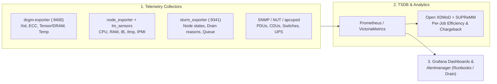

# 6.26 Cluster monitoring and health at scale

| | |
|---|---|
| Level | Advanced |
| Priority tier | 2 |
| Lab venue | A cluster or VM stack with Prometheus; GPU node for DCGM |
| Part | Part 6: HPC and Slurm |
| Status | Drafted. **Run**: `code/part06/slurm_exporter.py --selftest` (parser and metric rendering against canned `sinfo`/`squeue` output, `prometheus-client` library; output shown) and `check_alert_rules.py` on `alerts_gpu_cluster.yml` (9 rules, DCGM metric names cross-checked against `etc/default-counters.csv` from NVIDIA/dcgm-exporter commit `fafd151`, 2026-09-18; a deliberately broken copy was caught). **Not run**: Prometheus itself (`promtool` unavailable), Slurm, DCGM, Grafana, any real cluster. The `sinfo -O` fixed-width field format and `squeue -o` specifiers were checked against the Slurm man pages; the real command output was not captured. Labs **untested** |

## Why this matters for AI infrastructure

Monitoring is how a 2,000-GPU cluster stays a cluster instead of a heap of expensive, silently failing parts. It answers four different questions: *Is it up?* (health), *Is it healthy?* (errors, thermals, fabric), *Is it used well?* (utilisation, queue, goodput) and *Is it going to fail?* (trends, predictive signals). It also feeds chargeback, capacity planning and incident analysis. The signals are different from web services: GPU errors (Xid, ECC, remapped rows), NVLink and InfiniBand counters, thermal throttling, power, storage latency, scheduler state.

## Prerequisites and outcomes

Needs 6.2, 6.8 to 6.14, Part 2. After this chapter you can:

- Place the classic tools (SNMP, Ganglia, Nagios, Zabbix, XDMoD) and the modern Prometheus stack, and say what each is good at.
- Define a monitoring plan by layer: facility, node, GPU, network fabric, storage, scheduler, application.
- Collect GPU metrics with DCGM and `dcgm-exporter`; know the key fields and how to interpret them.
- Write, test and route alerts that page for the right things; link alerts to runbooks and automatic remediation.
- Combine monitoring with health checks (6.14) and security scans; build usage reports.
- Scale the stack: cardinality, retention, federation, long-term storage.

## 1. The tool landscape



The SCL book (chapter 19, "Cluster Status Monitoring Systems") surveys the generations:

| Tool | Idea | Today |
|---|---|---|
| **SNMP** (Simple Network Management Protocol, 1988; v1, v2c, v3) | Poll devices' management information bases (MIBs) for counters and settings; the de facto standard for switches, PDUs, UPSes. v1 has short counters, poor security, no encryption; v2c (community strings) is the most common; v3 adds authentication and encryption | Still the way to read many network and power devices; exported to Prometheus via `snmp_exporter` |
| **Ganglia** | Lightweight multicast/unicast daemons (`gmond`), aggregators (`gmetad`), RRD storage, web UI; designed for clusters | Largely historic, simple and scalable for its time |
| **Nagios** (and forks Icinga, Naemon) | Check-based monitoring: plugins return OK/WARN/CRIT/UNKNOWN, with notifications and dependencies | Common for host/service up-down checks and legacy estates |
| **Zabbix** | Agent plus server with templates, auto-discovery, triggers, graphs, SQL backend | Popular all-rounder, strong in enterprises |
| **XDMoD** | Open XDMoD (XSEDE/ACCESS) analyses accounting data (scheduler logs, performance data) into usage and efficiency reports | Used by HPC centres for utilisation reporting, chargeback, job performance |
| **Prometheus + Grafana** (the "modern approach") | Pull-based metrics scraped from exporters, labels instead of hierarchies, PromQL, alert manager, dashboards | De facto standard for AI/cloud-native clusters |
| **DCGM / dcgm-exporter** | NVIDIA's data-centre GPU manager and its Prometheus exporter | GPU-specific telemetry and diagnostics |
| **Commercial/vendor** | BCM monitoring, Datadog, Splunk, NVIDIA UFM (fabric), Mission Control | Integrated stacks |

The book's "Healthchecks" and "Security Scans" sections complete the picture (below), and "lm_sensors/hwmon", "IPMI" and "APCUPS/NUT" cover the in-band and out-of-band hardware sensors and UPS monitoring.

### SNMP, `snmpconf`, and `snmptrapd` handlers

In SNMP, the monitored device runs an **agent** (listening on UDP port `161`, or `10161` for v3 over TLS, RFC `6353`) and the monitoring server runs a **manager** (receiving asynchronous **Trap** notifications on UDP port `162`, or `10162` for v3 TLS). The protocol defines six core operations: `GetRequest`, `GetNextRequest`, `SetRequest`, `GetResponse`, `GetBulkRequest`, and `Trap`. Each variable in a device's Management Information Base (MIB) has a numeric sequence of numbers called an Object Identifier (OID), such as `1.3.6.1.2.1.1.1.3`—whose human-readable MIB name is `iso.org.dod.internet.mgmt.mib-2.system.sysUpTime` (the time the device has been running since it was last powered on; most OID branches are standardized by IETF, ISO, and IANA, with enterprise sub-branches delegated to manufacturers such as Cisco and APC).

From the `net-snmp` (or `snmp`) package, the book highlights these client utilities and their outputs `(untested here)`:

```bash
# 1. Read a single OID (omitting default prefix iso.org.dod.internet.mgmt.mib-2.system) (untested here)
snmpget -v 2c -c demopublic test.net-snmp.org sysUpTime.0
# DISMAN-EVENT-MIB::sysUpTimeInstance = Timeticks: (4935618) 13:42:36.18

# 2. Translate an OID name offline: outputs DESCRIPTION, SYNTAX, MAX-ACCESS, and full numeric path (untested here)
snmptranslate -Td -Ib 'sysUptime'
# SNMPv2-MIB::sysUpTime (FROM SNMPv2-MIB, RFC1213-MIB, SYNTAX TimeTicks, MAX-ACCESS read-only, STATUS current)
# DESCRIPTION "The time (in hundredths of a second) since the network management portion of the system was last re-initialized."
# ::={iso(1) org(3) dod(6) internet(1) mgmt(2) mib-2(1) system(1) 3}

# 3. Walk an entire OID subtree without knowing its composition beforehand (defaults to mib-2 if omitted) (untested here)
snmpwalk -v 2c -c demopublic test.net-snmp.org system
# SNMPv2-MIB::sysDescr.0 = STRING: test.net-snmp.org
# SNMPv2-MIB::sysObjectID.0 = OID: NET-SNMP-MIB::netSnmpAgentOIDs.10
# DISMAN-EVENT-MIB::sysUpTimeInstance = Timeticks: (5337593) 14:49:35.93
# SNMPv2-MIB::sysContact.0 = STRING: Net-SNMP Coders
# SNMPv2-MIB::sysName.0 = STRING: test.net-snmp.org
# SNMPv2-MIB::sysLocation.0 = STRING: Undisclosed
# SNMPv2-MIB::sysORDescr.1..5 = STRING: The MIB module for SNMPv2 entities / View-based Access Control Model / Message Processing / SNMP Management Architecture MIB
# SNMPv2-MIB::sysORUpTime.1..5 = Timeticks: (4) 0:00:00.04 / (5) 0:00:00.05
```

(`snmpbulkget`, `snmpbulkwalk`, and `snmpset` perform bulk reads and variable writes.)

To configure the local SNMP agent (`/etc/snmp/snmpd.conf`), back up the original file (`cp /etc/snmp/snmpd.conf{,.bak}`) and run the interactive `snmpconf` utility `(untested here)`. Selecting `snmpd.conf` and section `6` (`Access Control Setup`) → option `3` (`a SNMPv1/SNMPv2c read-only access community name`) for community `public` and network `192.168.0.0` produces the directive:

```text
rocommunity public 192.168.0.0
```

To receive and act on SNMP traps from switches, PDUs, cooling units, or UPSs, configure `snmptrapd` in `/etc/snmp/snmptrapd.conf` (and if TCP wrappers are active, add `snmptrapd: 0.0.0.0` in `/etc/hosts.allow`). In the book's example, `authCommunity` authorizes the `public` community to log, execute handlers, and forward traps, while `traphandle` invokes a custom script whenever a matching notification OID arrives `(untested here)`:

```text
# /etc/snmp/snmptrapd.conf (untested here)
authCommunity log,execute,net public
traphandle NET-SNMP-EXAMPLES-MIB::netSnmpExampleHeartbeatNotification /tmp/demo demo-trap
```

The handler script reads the sender hostname on line 1, the sender IP/transport on line 2, and `oid val` pairs on subsequent lines of standard input `(untested here)`:

```sh
#!/bin/sh
# /tmp/demo (chmod a+x /tmp/demo; use a non-/tmp path in production) (untested here)
read host
read ip
vars=
while read oid val
do
  if [ "x$vars" = "x" ]
  then
    vars="$oid = $val"
  else
    vars="$vars,\n$oid = $val"
  fi
done
echo -e "trap: $1 $host $ip $vars" > /tmp/demo.log
```

You can test the trap pipeline from the command line with `snmptrap` `(untested here)`:

```bash
# (untested here)
snmptrap -v 2c -c public localhost "" \
  NET-SNMP-EXAMPLES-MIB::netSnmpExampleHeartbeatNotification \
  netSnmpExampleHeartbeatRate i 123456
```

### Ganglia multicast routing, Zabbix proxies, VictoriaMetrics, and XDMoD

- **Ganglia**: originally developed for computing clusters by scientists at the University of California, Berkeley (`http://ganglia.sourceforge.net/`). Each machine runs the `gmond` daemon (which collects CPU speed, memory usage, and custom C++/Python or XDR metrics and sends them in either `multicast` mode—the default, where everyone subscribed to the multicast stream receives the packet—or `unicast` mode to a specific server), and the collector server runs `gmetad` (compiled with `./configure --with-gmetad && make && make install` `(untested here)`, which processes and aggregates received metrics such as max or sum, stores Round-Robin Database RRD files in `/var/lib/ganglia/rrds` owned by `nobody:nobody`, and serves the web interface copied to `/var/www/html/ganglia/`). Generate a default agent config via `gmond -t | tee /etc/ganglia/gmond.conf` `(untested here)`. Because `gmond` defaults to multicast transmission on `239.2.11.71`, the book notes you must add the multicast route on the interface facing the compute nodes (`eth0` in the book's example) so packets reach `gmetad` `(untested here)`:
  ```bash
  # (untested here)
  ip route add 239.2.11.71/4 dev eth0
  ```
- **Nagios and Zabbix at cluster scale**: In Nagios (`http://www.nagios.org/`, and its fork Icinga `https://icinga.com/`), implementing plug-ins as separate programs or scripts is both a strength and a weakness: on the one hand, it gives high flexibility (it is very easy to write your own plug-in to monitor SMTP, HTTP, SNMP, Cisco, or Brocade gear), but on the other hand, collecting many metrics requires running many separate programs (via SSH or local NRPE), which creates high load on compute nodes and limits polling frequency to every few minutes. Zabbix uses a **Server → Proxy → Agent** hierarchy (backed by MySQL, PostgreSQL, SQLite, or Oracle) that scales to roughly `1000` nodes when proxies aggregate traffic, and includes automatic SNMP device discovery, though polling hundreds of nodes directly on one flat LAN without proxies can still cause network spikes.
- **Time-series databases (TSDBs)**: alongside Prometheus TSDB and InfluxDB (paired with `prometheus`, `telegraf`, or `collectd` collectors and Grafana or Kibana visualizers), the book highlights **VictoriaMetrics** as a fast, disk-efficient TSDB for cluster metrics, noting one constraint: VictoriaMetrics stores only numeric values and cannot store string metrics.
- **XDMoD and SUPReMM**: Open XDMoD ingests scheduler accounting logs (`SLURM`, `PBS`) into a MySQL/MariaDB and Apache/PHP/Node.js stack to chart usage efficiency by user, group, or project. To correlate job records with node-level hardware counters (including GPU usage, licences, and energy via Slurm TRES/GRES), extend XDMoD with its **SUPReMM** module backed by Prometheus, Performance Co-Pilot (PCP), or `TACC_Stats`.

### In-band hardware sensors: `lm_sensors` and `/etc/sensors3.conf`

The `lm_sensors` package (along with the kernel's `/sys/class/hwmon` interface and `libsensors`) reads over `150` sensor types across ISA, I2C, SMBus, SPI, Super-I/O, south bridge, CPU die (`coretemp`), and DIMM thermal sensors. Run `sensors-detect` `(untested here)` to probe controllers and write the required kernel module list to `/etc/sysconfig/lm_sensors`.

Sensor formatting, scaling formulas, and hardware threshold limits are defined in `/etc/sensors3.conf` (or `/etc/sensors.conf` on older releases). Each stanza starts with a `chip` selector formatted as `type-bus-hexaddress` (for example `lm78-i2c-2d` for an LM78 chip at address `0x2d` on the I2C bus, or `lm78-*` using wildcards). Standardized input names are `in0, in1, ...` (voltages, with parameters such as `in0_input`, `in0_min`, `in0_max`, `in0_alarm`), `fan1, fan2, ...` (fans), and `temp1, temp2, ...` (temperatures). Inside a `chip` block, four directives control behaviour `(untested here)`:

- `label`: sets the human-readable name shown by `sensors`:
  ```text
  label in3 "+5V"
  ```
- `ignore`: suppresses a noisy or unconnected sensor channel:
  ```text
  ignore fan1
  ```
- `compute`: defines two comma-separated conversion formulas using `@` for the raw value—first from raw chip reading to displayed value (needed for voltage dividers), and second the inverse formula from displayed value back to raw register value when writing limits:
  ```text
  compute in3 ((6.8/10)+1)*@, @/((6.8/10)+1)
  ```
- `set`: programs minimum or maximum alarm thresholds into the sensor chip:
  ```text
  set in3_min 5 * 0.95
  set in3_max 5 * 0.05 + 5
  ```
  (or `set in3_max 5 * 1.05` as in the book's example).

After editing `/etc/sensors3.conf`, write the configured `set` thresholds into the hardware registers and read the current values `(untested here)`:

```bash
# Program min/max limits into sensor chips (untested here)
sensors -s

# Display current voltage, fan RPM, and temperature readings (untested here)
sensors
```

In `SCL` Chapter 19, running `sensors` on a server (`fschds-i2c-5-73` on `Adapter: SMBus I801 adapter at 1c20` and `coretemp-isa-0000` on `Adapter: ISA adapter`) outputs `+12V: +12.00 V`, `+5V: +5.15 V`, `Vbat: +3.14 V`, `PSU Fan: 1440 RPM (div = 4)`, `CPU Fan: 720 RPM (div = 4)`, **`System FAN2: FAULT (div = 4)`** (immediately flagging a failed chassis fan), `System FAN3: 720 RPM`, `System FAN4: 720 RPM`, `CPU Temp: +36.0°C (high = +69.0°C)`, `Super I/O Temp: +38.0°C (high = +52.0°C)`, `System Temp: +41.0°C (high = +56.0°C)`, and `Core 0..3: +51.0°C / +49.0°C (high = +82.0°C, crit = +100.0°C)`.

For out-of-band sensor readings via IPMI (`ipmitool`), the book cautions that polling BMCs remotely at high frequency can overload BMC controllers; prefer reading IPMI sensors locally on each node through an agent such as `node_exporter` or `prometheus-ipmi-exporter`.

### UPS monitoring with Network UPS Tools (`NUT`) and `apcupsd`

Computing clusters solve large resource-intensive tasks, so ensuring reliable uninterrupted operation requires an uninterruptible power supply (`UPS`) system—both physical UPS hardware and software that organizes interaction between the UPS and the protected equipment (`SCL` Chapter 19, *APCUPS* and *NUT*). Cluster UPS systems are typically designed to provide power for at least `10–30 minutes` during a grid outage and must initiate a controlled cluster shutdown if utility power is not restored within `5 minutes`—prohibiting new jobs and shutting down compute nodes first to relieve the energy load, while network file systems and monitoring servers shut down last. For APC UPSs, the freely distributed `apcupsd` package (comprising the `apcupsd` daemon, `apcaccess` status reader, parameter adjustment tools, and CGI web scripts, built from source via `./configure --prefix=/usr --sbindir=/sbin --enable-threads --enable-snmp --enable-cgi --with-libwrap=/lib64/libwrap.so.0 --with-cgi-bin=/usr/apache/cgi-bin && make && make install` `(untested here)`) queries UPS status via `apcaccess` (reporting `APC: 001 / 048 / 1157`, `HOSTNAME: rsufs`, `VERSION: 3.14.7`, `UPSNAME: UPS_3`, `MODEL: SNMP UPS Driver`, `STATUS: ONLINE`, `LINEV: 226.0 Volts`, `LOADPCT: 32.0 Percent Load Capacity`, `BCHARGE: 100.0 Percent`, `TIMELEFT: 73.0 Minutes`, `MBATTCHG: 5 Percent`, `MINTIMEL: 3 Minutes`, `MAXTIME: 0 Seconds`, `MAXLINEV: 227.0 Volts`, `MINLINEV: 221.0 Volts`, `OUTPUTV: 218.0 Volts`, `APCMODEL: Smart-UPS RT 10000`), runs `/etc/apcupsd/onbattery` and `offbattery`, and serves the `http://localhost/cgi-bin/multimon.cgi` web dashboard from `/etc/apcupsd/hosts.conf` (`MONITOR 192.168.5.11 "asile1"`, `MONITOR 192.168.5.77 "asile2"`, `MONITOR 192.168.5.99 "storage"`). Concrete `apcupsd.conf` parameters and staged shutdown scripts are detailed in Chapter 6.30.

For multi-vendor UPS fleets, **Network UPS Tools (`NUT`)** separates hardware drivers, the network server (`upsd`), and the reaction client (`upsmon`) across four files in `/etc/nut` `(untested here)`:

1. **`/etc/nut/ups.conf` (driver settings)**: names each UPS section and selects the driver from `/usr/share/nut/driver.list`:
   ```ini
   [ups1]
   driver = usbhid-ups
   port   = auto
   serial = 1234567890
   ```
2. **`/etc/nut/upsd.conf` (server settings)**: optional tuning for `MAXAGE seconds` (stale data timeout), `LISTEN interface port` (for example `172.0.0.1`), and `MAXCONN connections`.
3. **`/etc/nut/upsd.users` (access control and roles)**: defines NUT users, passwords, allowed `actions` (`set` to modify UPS parameters, `fsd` for forced shutdown), instant commands (`instcmds`), and whether `upsmon` runs in `master` mode (shut down last, attached to the UPS) or `slave` mode (shut down first):
   ```ini
   [admin]
   password = adminpass
   actions = set
   actions = fsd
   instcmds = all

   [tester]
   password = tstpass
   instcmds = test.panel.start
   instcmds = test.panel.stop

   [monmaster]
   password = 123qweasd
   upsmon master
   ```
4. **`/etc/nut/upsmon.conf` (monitor and event actions)**: connects to `upsd` and defines how to react to state transitions (`ONLINE`, `ONBATT`, `LOWBATT`, `FSD`, `COMMOK`, `COMMBAD`, `SHUTDOWN`, `REPLBATT`, `NOCOMM`, `NOPARENT`) using flags `SYSLOG`, `WALL`, `EXEC` (runs `NOTIFYCMD` with the event name in `$NOTIFYTYPE`), or `IGNORE`:
   ```text
   MONITOR ups1@localhost 1 monmaster 123qweasd master
   ```

Once the `nut` / `upsd` service is started, query the live UPS state with `upsc` `(untested here)`:

```bash
# (untested here)
upsc ups1@localhost
```

## 2. What to monitor, by layer

| Layer | Signals | Source |
|---|---|---|
| **Facility** | Rack inlet/outlet temperature, humidity, PDU power per outlet, UPS state, CDU coolant temperature/flow/pressure, leak sensors | SNMP/Modbus/BACnet to PDUs, CDUs; UPS monitoring with APCUPS (`apcupsd`, which can also trigger orderly shutdown scripts) or NUT (Network UPS Tools); BMC sensors |
| **Node** | CPU load, memory, swap, disk space/IO, temperatures, fan speeds, power, kernel errors (`dmesg`, EDAC ECC), clock sync, services | `node_exporter` (+ textfile collector), `lm_sensors`/hwmon, IPMI/Redfish (`ipmi_exporter`, Part 7), journald |
| **GPU** | Utilisation, memory used, SM/memory clocks, power, temperature, **Xid errors**, ECC and **row remapping**, throttle reasons, NVLink bandwidth and errors, PCIe replay, tensor-pipe activity (profiling) | DCGM, `dcgm-exporter`, `nvidia-smi` |
| **Fabric** | Port state, link speed/width, symbol errors, link-down events, congestion (PFC/ECN counters), adaptive-routing, bandwidth per port | UFM, `ibstat`/`perfquery`, `node_exporter` InfiniBand collector, switch telemetry (Part 12) |
| **Storage** | Server health, OST/MDT utilisation, client latency/throughput, metadata ops, quotas, rebuilds | Lustre/GPFS/WEKA exporters, `lfs df`, `nfsiostat` (6.18 to 6.20) |
| **Scheduler** | Node states, drain reasons, queue length and wait time by partition, utilisation, failed jobs, controller RPC rate and backfill cycle | Slurm exporter, `sdiag`, `sacct` (6.14) |
| **Jobs/application** | Per-job GPU utilisation and efficiency, step time, tokens/s, loss, checkpoint duration, data-loader stalls | DCGM job mapping, framework metrics, MLflow/W&B, Slurm accounting |
| **Security** | Auth failures, new keys, privilege changes, image/package vulnerabilities, open ports | Audit logs, scanners (below) |

The Golden Rule: **alert on symptoms that need human action; graph everything else.** A GPU at 99 C might be fine for a minute; a rack at 40 percent of GPUs with Xid 79 is an incident.

## 3. GPU metrics with DCGM

`dcgm-exporter` exposes DCGM fields on `:9400/metrics`, configured by a CSV of counters. The default CSV in NVIDIA/dcgm-exporter (`etc/default-counters.csv`) includes, as read from the repository: `DCGM_FI_DEV_SM_CLOCK`, `DCGM_FI_DEV_MEM_CLOCK`, `DCGM_FI_DEV_GPU_TEMP`, `DCGM_FI_DEV_MEMORY_TEMP`, `DCGM_FI_DEV_POWER_USAGE`, `DCGM_FI_DEV_TOTAL_ENERGY_CONSUMPTION` (counter, mJ), `DCGM_FI_DEV_PCIE_REPLAY_COUNTER`, `DCGM_FI_DEV_GPU_UTIL`, `DCGM_FI_DEV_MEM_COPY_UTIL`, `DCGM_FI_DEV_ENC_UTIL`/`DEC_UTIL`, `DCGM_FI_DEV_XID_ERRORS` ("value of the last XID error encountered"), `DCGM_FI_DEV_FB_FREE`/`FB_USED`/`FB_RESERVED` (MiB), `DCGM_FI_DEV_NVLINK_BANDWIDTH_TOTAL`, `DCGM_FI_DEV_UNCORRECTABLE_REMAPPED_ROWS`, `DCGM_FI_DEV_CORRECTABLE_REMAPPED_ROWS`, `DCGM_FI_DEV_ROW_REMAP_FAILURE`, `DCGM_FI_DRIVER_VERSION` (label), and profiling fields `DCGM_FI_PROF_GR_ENGINE_ACTIVE`, `DCGM_FI_PROF_PIPE_TENSOR_ACTIVE`, `DCGM_FI_PROF_DRAM_ACTIVE`, `DCGM_FI_PROF_PCIE_TX_BYTES`/`RX_BYTES`. A larger set is in `dcp-metrics-included.csv`.

Interpretation tips: **`GPU_UTIL`** is the fraction of time any kernel was running, not how efficiently the SMs are used; a job can show 100 percent util while tensor cores idle. `PIPE_TENSOR_ACTIVE` and `DRAM_ACTIVE` indicate real efficiency (low tensor activity with high DRAM activity means memory-bound). `XID_ERRORS` shows the *last* Xid number (a gauge); alert on non-zero and keep the history in logs. Remapped rows and a failed remap are RMA signals. Temperature plus power plus clocks reveal throttling. Always include the job-to-GPU mapping labels (DCGM can map GPUs to Kubernetes pods; for Slurm map via `SLURM_JOB_GPUS`/cgroup or a prolog-written file consumed by the textfile collector) to attribute usage to users and projects.

Beyond metrics, **DCGM diagnostics** (`dcgmi diag -r 1|2|3`, from knowledge) run active tests (level 1 quick, higher levels stress memory, PCIe and compute): use them in health checks before jobs, not as continuous monitors (6.14).

## 4. A Slurm exporter (tested)

Maintained exporters exist (the community `prometheus-slurm-exporter` family and others); the point of `code/part06/slurm_exporter.py` is to show what such an exporter does and how to test its parser without a cluster. It runs

```text
sinfo -h -N -O "NodeList:32,StateLong:20,Gres:40,GresUsed:60,Reason:80,Partition:24"
squeue -h -o "%T|%P|%u|%D"
```

(`-O` fields `NodeList`, `StateLong`, `Gres`, `GresUsed`, `Reason`, `Partition` and the `-o` specifiers `%T %P %u %D` were verified in the `sinfo(1)` and `squeue(1)` man pages), parses fixed-width columns, de-duplicates nodes that appear in several partitions, extracts GPU counts from GRES strings such as `gpu:h100:8(S:0-1)`, classifies drain reasons (`gpu`, `network`, `storage`, `prolog`, `unresponsive`, `unkillable`...), and renders metrics with `prometheus_client`. The self-test uses six canned node rows (one node listed in two partitions; one with a GPU Xid reason; one down and not responding) and four jobs, asserts the aggregation, and printed:

```text
slurm_nodes{state="allocated"} 1.0
slurm_nodes{state="mixed"} 1.0
slurm_nodes{state="drained"} 1.0
slurm_nodes{state="down"} 1.0
slurm_nodes{state="idle"} 1.0
slurm_node_drain_reason{reason_class="gpu"} 1.0
slurm_node_drain_reason{reason_class="unresponsive"} 1.0
slurm_gpus{status="total"} 40.0
slurm_gpus{status="allocated"} 11.0
slurm_jobs{partition="gpu",state="running"} 1.0
slurm_jobs{partition="gpu",state="pending"} 2.0
slurm_jobs{partition="debug",state="running"} 1.0
slurm_exporter_scrape_ok 1.0
selftest passed
```

Design lessons embedded in it: expose *state counts*, not per-job series (cardinality); put the controller-load cost in perspective (every scrape runs `sinfo` and `squeue` against `slurmctld`: scrape every 30 to 60 seconds, never every second; this is the same RPC load issue as users running `watch squeue`, 6.14); emit a `scrape_ok` gauge so a dead exporter pages; treat unknown output formats as scrape failures rather than silently reporting zeros. Limits of this demo: it was not run against real `sinfo` output (the fixed-width format and node-state suffixes vary by version), it does not report per-user usage, and it parses CLI text rather than using the REST API (`slurmrestd`, 6.15), which is more robust for production.

## 5. Alerting

Principles:

1. **Page on user-visible or capacity-threatening symptoms**; ticket on degradations; graph the rest. A paged alert must be actionable at 3 a.m. and have a runbook.
2. **Use `for:` durations** to avoid flapping; group related alerts; inhibit lower-level alerts when a higher-level cause is firing (rack power loss should not page 32 nodes).
3. **Cardinality and labels**: hostname, GPU index, rack, partition; never user-supplied free text as a label.
4. **Alert on absence**: `absent()` for exporters; heartbeat ("dead man's switch") alerts to verify the alert path itself.
5. **Link to remediation**: annotations with runbook URL; automatic drain via webhook for known hardware faults (Alertmanager to a service that calls `scontrol update ... state=drain reason=...`; test for loops and false positives; 6.14 and 5.32 discuss the safety properties such automation needs: budgets, dry-run, provenance of what you changed).
6. **Review weekly**: delete alerts nobody acts on; measure alert precision.

`code/part06/alerts_gpu_cluster.yml` is an illustrative rule file with nine alerts across three groups: `GpuXidError` (any non-zero last-Xid for 1 minute), `GpuRowRemapFailure`, `GpuHot` (> 85 C for 10 minutes), `AllocatedGpuIdle` (30-minute average utilisation under 5 percent while GPUs are allocated), `SlurmNodesDrainedHigh` (> 5 percent drained/down for 15 minutes), `SlurmExporterDown`, `GpuQueueBacklogWhileIdle` (many pending GPU jobs while more than 16 GPUs idle: a policy or fragmentation problem), `TmpFull`, `IbPortDown`. `check_alert_rules.py` loads the YAML and checks structure, duplicate names, bracket balance, severity labels, required `summary` and `runbook` annotations, paging rules needing `for:` (with an exception for the row-remap failure which is a discrete, severe event), and that every `DCGM_FI_*` name appears in the exporter's counters CSV. On the rule file: `9 rules in 3 groups` and no problems. On a copy with `DCGM_FI_DEV_GPU_TEMP` mistyped as `DCGM_FI_DEV_GPU_TEMPERATURE > (85`:

```text
9 rules in 3 groups
PROBLEM GpuHot: unbalanced brackets in expr
PROBLEM GpuHot: DCGM_FI_DEV_GPU_TEMPERATURE is not in the dcgm-exporter counters file
```

This is a lint, not PromQL validation: run `promtool check rules` and unit-test rules with `promtool test rules` in CI. Several thresholds are guesses to be tuned (the 85 C limit depends on the GPU model's slowdown and shutdown temperatures; the idle test depends on workload; join keys such as `Hostname` depend on your relabelling; the `AllocatedGpuIdle` expression joins DCGM series with a Slurm series that does not carry a `Hostname` label in the demo exporter, so it needs per-node labels to work as written).

## 6. Health checks, scans, and active testing

- **Passive monitoring vs active healthchecks (`SCL` Chapter 19, *Healthchecks*)**: Passive monitoring tells you what already happened; after a node boots—and before each job starts—it makes sense to run active **healthchecks** (`node_health.sh` in Chapter 6.14, DCGM diagnostics, NCCL pair tests) to decide if the node is healthy enough to run user jobs. In Slurm, enable periodic execution of a custom healthcheck script (`HealthCheckProgram`) and include a fast check in the `Prolog` script (keeping prologue checks short because prologue time is limited and included in job runtime). You can write your own scripts or use the open-source **LBNL Node Health Check (`NHC`, `https://github.com/mej/nhc`)**, which is written in bash, highly portable, ships with many built-in modules, and lets you implement different check modes (such as a fast prologue check versus a full background check) simply by passing different configuration files.
- **Burn-in and acceptance**: stress tests (CPU, memory, GPU, network, storage) on new hardware (6.28).
- **Security scans**: the book lists regular scans as part of monitoring, recommending system software updates `two to four times a year` (tested on a small node subset first, after backups) and daily automated scans using open-source tools such as `chkrootkit`, `rkhunter`, `Nessus`, `Lynis`, and `Maltrail`, alongside commercial endpoint agents (SentinelOne, Palo Alto Networks, CrowdStrike) on user-facing and service nodes. Add vulnerability scanning of images and packages (Trivy, Grype, OpenSCAP), port scans of internal ranges to detect unexpected services (`nmap`), configuration audits (the `sshd_audit.py` idea from 6.25), integrity monitoring (AIDE), log analysis for auth anomalies and `sudo` activity, and container image provenance (5.22, Part 18). Treat scan results as inputs to the same ticketing and SLO process.
- **Out-of-band**: BMC sensors, SEL logs, Redfish events (Part 7) catch problems when the OS is dead.

## 7. Usage and efficiency analytics

Utilisation questions are a different kind of monitoring: *Who used which resources, how well, at what cost?* Sources: Slurm accounting (`sacct`, `sreport`, 6.9), job-level GPU metrics (DCGM job stats or per-job exporters), XDMoD-style tools combining accounting with performance data. Reports: cluster utilisation (allocated vs total GPU-hours), efficiency (average GPU utilisation of allocated GPUs; a classic finding is many allocated GPUs below 20 percent), wait times by queue, failure causes (`NODE_FAIL`, OOM, timeout), top users/projects, storage growth. Use them to right-size allocations, steer users to MIG for small jobs (6.10), plan capacity, and justify spend. Publish dashboards to users: transparency reduces wasteful allocation.

## 8. Scaling the monitoring stack

- **Cardinality**: per-GPU, per-port, per-job series multiply (2,000 GPUs x 30 fields x 15-second scrapes). Drop unused fields (CSV), aggregate with recording rules, keep per-job series out of Prometheus (use accounting).
- **Topology**: one Prometheus per cluster or per failure domain with remote-write or federation to a central long-term store (Thanos, Mimir, VictoriaMetrics); 15 to 30 s scrape intervals for GPU metrics, 60 s for slow signals; retention tiers.
- **Reliability of the monitor**: redundant Prometheus pairs, external dead-man's-switch, monitoring network separate from the data plane (so you can see during a fabric outage), time sync (6.18).
- **Logs and traces**: journald/syslog forwarding (Loki, Elasticsearch), structured logs from prolog/epilog/health scripts, kernel log filtering for Xid/ECC/MCE lines, central retention.
- **Exporter hygiene**: pin versions, run as non-root, bind to the management network, authenticate if remote, avoid scraping `slurmctld` too often.
- **Cost**: storage for long retention of high-cardinality data is real; define retention by use.

## 9. Lab

First, run the self-checking Python lab (`code/part06/slurm_exporter_lab.py`) locally. It runs `slurm_exporter.selftest()` (verifying that `gpu002` appearing in two partitions is deduplicated, reporting `40.0` total GPUs, `11.0` allocated GPUs, `gpu` and `unresponsive` drain reasons, and `slurm_exporter_scrape_ok 1.0`), runs `check_alert_rules.py` on `code/part06/alerts_gpu_cluster.yml` (`9` rules in `3` groups, `0` problems) and on a mutated copy (catching unbalanced brackets and unknown `DCGM_FI_*` metric names), and verifies `SCL` Chapter 19's `/etc/sensors3.conf` voltage-divider `compute in3` math (`1.68 * 2.9762 V = 5.00 V`):

```bash
python3 code/part06/slurm_exporter_lab.py
```

Tested: 1) install `prometheus-client`, run `slurm_exporter.py --selftest`; add a drain reason class and a test; extend the parser to a second `sinfo` layout. 2) Run `check_alert_rules.py` on the rules file and on copies with deliberate mistakes; add rules for NVLink bandwidth and PCIe replay counters (look up names in `dcp-metrics-included.csv`). 3) Write a recording rule for per-partition GPU utilisation efficiency (sketch).

Untested: 4) deploy `node_exporter` and `dcgm-exporter` on a GPU node, scrape with Prometheus, build a Grafana dashboard (utilisation, tensor activity, power, temperature, Xid). 5) Run `promtool check rules` and `promtool test rules` on the file. 6) Configure Alertmanager routes (page, warn, ticket) and an inhibition rule for rack power loss. 7) Wire a webhook that drains a node on `GpuXidError` in dry-run mode first. 8) Build an efficiency report from `sacct` and DCGM job stats. 9) Run a fabric congestion test and watch counters.

## 10. Interview angles

- What would you monitor on a 1,000-GPU training cluster, by layer, and what would page?
- What does `DCGM_FI_DEV_GPU_UTIL` really measure? Which fields show real efficiency?
- How do you attribute GPU usage to Slurm jobs and projects?
- Design alerting that avoids pages for symptoms with a known upstream cause.
- How do you scale Prometheus for tens of thousands of GPUs?
- SNMP v2c versus v3? Where is SNMP still necessary?
- How would you detect an allocated-but-idle GPU problem and what would you do about it?
- How do monitoring and health checks differ and how do they cooperate?
- A node shows Xid 79 once. What do you do?

## Exercises

1. **Deduplicating Multi-Partition Slurm Metrics (`code/part06/slurm_exporter.py` & `slurm_exporter_lab.py`):** Run `python3 code/part06/slurm_exporter_lab.py`. Trace how `slurm_exporter.parse()` parses fixed-width `sinfo -h -N -O "NodeList:32,StateLong:20,Gres:40,GresUsed:60,Reason:80,Partition:24"` output, why `seen.add(name)` is required so `gpu002` (listed in both `gpu` and `debug` partitions) is not double-counted, and why scraping `sinfo`/`squeue` every 1 second is an operational anti-pattern.
2. **Linting Prometheus GPU Alert Rules Against `dcgm-exporter` (`code/part06/check_alert_rules.py` & `alerts_gpu_cluster.yml`):** Run `python3 code/part06/check_alert_rules.py code/part06/alerts_gpu_cluster.yml`. Explain the 9 alert rules across the `gpu-health`, `slurm`, and `node` groups, why `GpuRowRemapFailure` pages immediately without a `for:` delay while `GpuHot` waits `10m` and `SlurmNodesDrainedHigh` waits `15m`, and how `check_alert_rules.py` validates `DCGM_FI_*` metric names against `default-counters.csv`.
3. **Configuring SNMP Agents and `snmptrapd` Handlers (`SCL` Chapter 19):** Write the `snmpget`, `snmptranslate -Td -Ib`, and `snmpwalk` commands to inspect `sysUpTime`, the `/etc/snmp/snmpd.conf` `rocommunity public 192.168.0.0` directive generated by `snmpconf`, the `/etc/snmp/snmptrapd.conf` `authCommunity` + `traphandle` configuration, and the `/bin/sh` trap handler script reading `host`, `ip`, and `oid val` pairs from standard input.
4. **Programming `lm_sensors` `/etc/sensors3.conf` Formulas and Thresholds (`SCL` Chapter 19 & `slurm_exporter_lab.py`):** Given a sensor chip `lm78-i2c-2d` where `+5V` is measured through a voltage divider on `in3`, write the `/etc/sensors3.conf` stanza using `label in3 "+5V"`, `ignore fan1`, `compute in3 ((6.8/10)+1)*@, @/((6.8/10)+1)`, `set in3_min 5 * 0.95`, and `set in3_max 5 * 1.05`, and verify with `sensors_compute_in3(2.9762)` in `code/part06/slurm_exporter_lab.py` that a raw reading of `2.9762 V` displays as `5.00 V` (`sensors -s`).
5. **Configuring Multi-Vendor UPS Monitoring with `NUT` and `apcupsd` (`SCL` Chapter 19):** Write the four `/etc/nut/` files (`ups.conf` with `driver = usbhid-ups`, `upsd.conf`, `upsd.users` with `admin`/`tester`/`monmaster`, and `upsmon.conf` with `MONITOR ups1@localhost 1 monmaster 123qweasd master`) and `upsc ups1@localhost` command. Explain why `slave` monitors (compute nodes) must shut down before the `master` monitor (storage/management server).
6. **Distinguishing `DCGM_FI_DEV_GPU_UTIL` from True Tensor Efficiency (`DCGM_FI_PROF_PIPE_TENSOR_ACTIVE`):** A researcher's 64-GPU job shows `DCGM_FI_DEV_GPU_UTIL = 99%`, yet `DCGM_FI_PROF_PIPE_TENSOR_ACTIVE = 4%`, `DCGM_FI_PROF_DRAM_ACTIVE = 82%`, and `DCGM_FI_DEV_POWER_USAGE = 260 W` (on 700 W H100 GPUs). Diagnose what the GPUs are actually doing and how Open XDMoD + `SUPReMM` surfaces inefficient jobs across accounts.

## Checkpoint

<details>
<summary>1. What four fundamental operational questions does cluster monitoring answer?</summary>

1. **Is it up?** (Availability of nodes, daemons, mounts, and fabrics)
2. **Is it healthy?** (Hardware errors: GPU `Xid`s, ECC/row-remapping, NVLink/IB symbol errors, thermals, fans, PSUs)
3. **Is it used well?** (Queue wait times, allocated vs idle GPUs, tensor-core efficiency, checkpoint overhead)
4. **Is it going to fail?** (Trends in correctable ECC rates, rising CDU/inlet temperatures, `/tmp` or OST capacity growth)
</details>

<details>
<summary>2. Compare **SNMP v1**, **v2c**, and **v3**, and state which UDP ports the SNMP agent and trap receiver use (`SCL` Chapter 19).</summary>

- **SNMP v1 (1988):** 32-bit counters, plaintext community string, no encryption.
- **SNMP v2c:** Adds 64-bit counters and `GetBulkRequest`, still using plaintext community strings (most common on internal management LANs).
- **SNMP v3:** Adds user authentication, encryption, and view-based access control (`VACM`).
- **Ports:** The monitored **agent** listens on **UDP port `161`** (`10161` for v3 TLS, RFC `6353`), and the monitoring **manager (`snmptrapd`)** receives asynchronous **Traps** on **UDP port `162`** (`10162` for v3 TLS).
</details>

<details>
<summary>3. What are the six core SNMP protocol operations, and what do `snmpget`, `snmptranslate -Td -Ib`, and `snmpwalk` do (`SCL` Chapter 19)?</summary>

- **6 operations:** `GetRequest`, `GetNextRequest`, `SetRequest`, `GetResponse`, `GetBulkRequest`, and `Trap`.
- **`snmpget`:** Reads a single OID value from a remote agent.
- **`snmptranslate -Td -Ib 'sysUptime'`:** Offline lookup that prints the MIB object's `SYNTAX`, `MAX-ACCESS`, `DESCRIPTION`, and full numeric OID path (`1.3.6.1.2.1.1.1.3`) without contacting a server.
- **`snmpwalk`:** Iteratively walks an entire OID subtree (defaulting to `iso.org.dod.internet.mgmt.mib-2`).
</details>

<details>
<summary>4. How do you configure `snmptrapd` (`/etc/snmp/snmptrapd.conf`) to execute a custom script when a trap arrives, and what does `snmptrapd` pass to the script's `stdin` (`SCL` Chapter 19)?</summary>

Add `authCommunity log,execute,net public` and `traphandle <OID> /path/to/handler arg1` in `/etc/snmp/snmptrapd.conf` (and `snmptrapd: 0.0.0.0` in `/etc/hosts.allow` if TCP wrappers are used). When the trap arrives, `snmptrapd` invokes `/path/to/handler` and writes the **sender hostname on line 1**, the **sender IP/transport on line 2**, and **`<oid> <value>` pairs on subsequent lines** of standard input.
</details>

<details>
<summary>5. Compare **Ganglia**, **Nagios**, and **Zabbix** on a compute cluster, and what multicast route does Ganglia require by default (`SCL` Chapter 19)?</summary>

- **Ganglia (`gmond` + `gmetad`):** Lightweight cluster metric collector storing RRD files in `/var/lib/ganglia/rrds`; defaults to multicast on `239.2.11.71`, requiring `ip route add 239.2.11.71/4 dev eth0` on the `gmetad` server (lacks built-in alerting).
- **Nagios (and Icinga):** Spawns a separate OS process per check plugin (via NRPE or SSH); great for service/switch checks, but high process-spawn overhead makes frequent compute-node metric polling too heavy.
- **Zabbix (`Server -> Proxy -> Agent`):** SQL-backed monitoring with web UI configuration and auto-SNMP discovery; scales to ~`1,000` nodes when hierarchical proxies aggregate traffic.
</details>

<details>
<summary>6. What are the four layers of the "Modern Approach" monitoring stack in `SCL` Chapter 19, and what is the one data-type constraint of **VictoriaMetrics**?</summary>

1. **Collectors:** `Prometheus` exporters, `Telegraf`, or `collectd`.
2. **Time-Series Database (TSDB):** `Prometheus TSDB`, `InfluxDB`, or **`VictoriaMetrics`** (which is faster and uses less disk space than InfluxDB, with the constraint that **VictoriaMetrics stores only numeric data and cannot store string metrics**).
3. **Visualization:** `Grafana` (or `Kibana`).
4. **Alerting:** `Alertmanager`, `Grafana Alert`, or `PagerDuty`.
</details>

<details>
<summary>7. What is **Open XDMoD**, and what does its **SUPReMM** module add (`SCL` Chapter 19)?</summary>

**Open XDMoD (XD Metrics on Demand)** ingests Slurm/PBS accounting logs to analyze resource utilization, wait times, and allocation fairness by user, group, and project. Adding the **SUPReMM** module correlates those job accounting records with node-level hardware performance metrics collected by **Prometheus**, **Performance Co-Pilot (`PCP`)**, or **`TACC_Stats`**—exposing per-job GPU efficiency, memory bandwidth, and CPU/I/O bottlenecks.
</details>

<details>
<summary>8. What are the four directives inside a `chip` stanza in `/etc/sensors3.conf` (`lm_sensors`), and what command writes threshold limits into the sensor hardware (`SCL` Chapter 19)?</summary>

Inside a `chip` stanza (e.g., `chip "lm78-i2c-2d"`):
1. **`label <sensor> "<name>"`:** Sets the display name (e.g., `label in3 "+5V"`).
2. **`ignore <sensor>`:** Hides an unused or faulty sensor channel (`ignore fan1`).
3. **`compute <sensor> <to_display>, <to_raw>`:** Forward and inverse scaling formulas using `@` (e.g., `compute in3 ((6.8/10)+1)*@, @/((6.8/10)+1)`).
4. **`set <param> <expr>`:** Sets min/max hardware alarm limits (`set in3_min 5 * 0.95`, `set in3_max 5 * 1.05`).
Run **`sensors -s`** to program the `set` limits into the chip registers, and **`sensors`** to display current readings.
</details>

<details>
<summary>9. Why does `SCL` Chapter 19 advise against polling compute-node IPMI sensors remotely over the network at high frequency?</summary>

High-frequency remote `ipmitool sensor` queries over the LAN can overwhelm slow embedded BMC microcontrollers, causing BMC lockups or false `Slurmd`/Redfish timeouts. Instead, read hardware sensors locally on each node via `/sys/class/hwmon` (`node_exporter`) or a local `ipmi_exporter` scraped at a reasonable interval.
</details>

<details>
<summary>10. What are the four configuration files in `/etc/nut/` for **Network UPS Tools (`NUT`)**, and what is the difference between `upsmon master` and `upsmon slave` (`SCL` Chapter 19)?</summary>

1. **`/etc/nut/ups.conf`:** Hardware driver definitions (`driver = usbhid-ups`, `port = auto`).
2. **`/etc/nut/upsd.conf`:** Network server settings (`MAXAGE`, `LISTEN`, `MAXCONN`).
3. **`/etc/nut/upsd.users`:** Credentials, `actions` (`set`, `fsd`), `instcmds`, and `upsmon` role.
4. **`/etc/nut/upsmon.conf`:** `MONITOR` target and `NOTIFYFLAG` / `NOTIFYCMD` actions (`SYSLOG`, `WALL`, `EXEC`, `IGNORE`).
**`upsmon slave`** nodes (compute nodes) shut down **first** during a power outage to shed load, while the **`upsmon master`** node (storage/management server physically attached to or controlling the UPS) shuts down **last**.
</details>

<details>
<summary>11. What is the difference between `DCGM_FI_DEV_GPU_UTIL` and `DCGM_FI_PROF_PIPE_TENSOR_ACTIVE` / `DCGM_FI_PROF_DRAM_ACTIVE` in `dcgm-exporter`?</summary>

- **`DCGM_FI_DEV_GPU_UTIL`:** Coarse percentage of time over the sample period during which *at least one* CUDA kernel was resident on the GPU—even if only 1 SM is active or the GPU is spinning in an `NCCL` wait loop.
- **`DCGM_FI_PROF_PIPE_TENSOR_ACTIVE` and `DCGM_FI_PROF_DRAM_ACTIVE`:** Fine-grained hardware profiling counters measuring the actual fraction of cycles that the **Tensor Cores** and **HBM memory interface** are actively transferring/computing data.
</details>

<details>
<summary>12. Which `dcgm-exporter` metrics indicate fatal hardware faults requiring node drain or GPU RMA?</summary>

- **`DCGM_FI_DEV_XID_ERRORS`:** Gauge reporting the last `Xid` error code encountered (`> 0` triggers investigation/drain for fatal codes like `48, 63, 64, 74, 79, 94, 95`).
- **`DCGM_FI_DEV_UNCORRECTABLE_REMAPPED_ROWS`** and **`DCGM_FI_DEV_ROW_REMAP_FAILURE`:** Uncorrectable HBM row remapping events; `DCGM_FI_DEV_ROW_REMAP_FAILURE == 1` means the HBM spare row table is exhausted or failed and the GPU is an immediate RMA candidate.
</details>

<details>
<summary>13. Why does `code/part06/slurm_exporter.py` deduplicate node names when parsing `sinfo -N`, and why does it export aggregate state counts instead of per-job time series?</summary>

In Slurm, a compute node that belongs to multiple partitions (e.g., `gpu002` in both `gpu` and `debug`) is printed once per partition by `sinfo -N`; without `seen.add(name)`, its GPUs and state would be counted twice. Exporting aggregate state counts (`slurm_jobs{partition,state}`) rather than a unique label per `JobID` prevents **unbounded label cardinality** in Prometheus as millions of jobs run over time.
</details>

<details>
<summary>14. Why should a Slurm Prometheus exporter scrape `slurmctld` every `30–60` seconds rather than every `1–2` seconds, and why must it emit `slurm_exporter_scrape_ok`?</summary>

Every scrape invokes `sinfo`/`squeue` (or `slurmrestd`) RPCs against `slurmctld`; scraping every second adds continuous RPC load that competes with job scheduling. Emitting `slurm_exporter_scrape_ok` (`1` on success, `0` on error) allows an alert (`SlurmExporterDown`: `slurm_exporter_scrape_ok == 0 or absent(slurm_exporter_scrape_ok)`) to page immediately when the exporter or controller stops responding instead of silently graphing stale or zero values.
</details>

<details>
<summary>15. State the **Golden Rule of Alerting**, and explain the roles of `for:` durations and **Alertmanager inhibition rules**.</summary>

- **Golden Rule:** **Page (`severity: page`) only on symptoms that require immediate human action; create tickets (`severity: ticket` / `warn`) for degradations; graph everything else.**
- **`for:` duration:** Requires the alert condition to hold continuously for a specified window (e.g., `for: 10m` on `GpuHot`) so transient spikes do not page on-call engineers.
- **Inhibition rules:** Suppress downstream symptom alerts when a root-cause alert is already firing (for example, inhibiting 32 individual node-down alerts when the top-of-rack switch or PDU alert for that rack is firing).
</details>

<details>
<summary>16. What checks does `code/part06/check_alert_rules.py` perform on a Prometheus alert rules YAML file?</summary>

1. Valid YAML structure (`groups` $\to$ `rules`).
2. No duplicate `alert` or `record` rule names.
3. Balanced parentheses `()`, brackets `[]`, and braces `{}` in every `expr`.
4. Valid `severity` label (`page`, `warn`, or `ticket`) on every alert.
5. Required `summary` and `runbook` annotations on every alert.
6. Every `severity: page` alert specifies a `for:` duration (except discrete hardware failure events like `GpuRowRemapFailure`).
7. Every `DCGM_FI_*` metric referenced in `expr` exists in `dcgm-exporter`'s counters CSV.
</details>

<details>
<summary>17. How do **passive monitoring** and **active healthchecks** (`NHC` / `node_health.sh` / `dcgmi diag`) complement each other (`SCL` Chapter 19)?</summary>

- **Passive monitoring (`Prometheus`, `DCGM`, `node_exporter`):** Continuously observes live metrics and logs while nodes are idle or running jobs, catching faults that manifest under workload.
- **Active healthchecks (`NHC`, `node_health.sh`, `dcgmi diag -r 2|3`):** Proactively exercise GPUs, PCIe/NVLink bandwidth, mounts, and `/tmp` space at boot, in Slurm `Prolog`/`Epilog`, and on idle nodes—catching latent faults and draining broken nodes *before* a 512-GPU job lands on them.
</details>

<details>
<summary>18. What five cybersecurity and vulnerability scanning practices does `SCL` Chapter 19 recommend as part of cluster monitoring?</summary>

1. Apply tested system software updates **2 to 4 times a year** (after backups and canary node testing).
2. Run **daily automated security scans** using open-source tools (**`chkrootkit`**, **`rkhunter`**, **`Nessus`**, **`Lynis`**, **`Maltrail`**) and read the reports.
3. Audit remote login and **`sudo` activity** logs continuously.
4. Enforce strict host and perimeter firewall rules (`nmap` internal port audits).
5. Deploy behavioral/EDR monitoring (`SentinelOne`, `Palo Alto Networks`, `CrowdStrike`, plus `Trivy`/`Grype`/`AIDE`) on all user-facing login and service nodes.
</details>

<details>
<summary>19. How do you control **Prometheus time-series cardinality** and scale retention across a 2,000+ GPU cluster?</summary>

1. Trim `dcgm-exporter`'s CSV to only the fields you graph or alert on.
2. Never put high-cardinality identifiers (`JobID`, PID, raw command strings) into Prometheus labels; attribute per-job metrics in `slurmdbd` / `XDMoD`.
3. Use Prometheus **recording rules** to pre-aggregate per-partition and per-rack metrics.
4. Run one Prometheus pair per failure domain/pod and `remote_write` to a horizontally scalable long-term TSDB (**VictoriaMetrics**, **Thanos**, or **Grafana Mimir**).
</details>

<details>
<summary>20. Why must the monitoring and alerting plane run over an out-of-band management network rather than the high-speed compute/storage fabric?</summary>

If Prometheus, Alertmanager, and `snmptrapd` traverse the InfiniBand/RoCE data fabric or depend on the parallel filesystem to boot, a fabric congestion storm or Lustre outage will blind the monitoring system at the exact moment the incident occurs.
</details>

## Sources and review notes

- Book source (`supercomputers-for-linux-sysadmins-managing-modern-hpc-clusters-and-supercomputers-from-software-to-hardware`, `SCL`):
  - Chapter 19 ("19. Cluster Status Monitoring Systems", read in full): SNMP operations and commands (`snmpget`, `snmptranslate -Td -Ib`, `snmpwalk`, `snmpset`, `snmpconf`, `/etc/snmp/snmptrapd.conf` `authCommunity` and `traphandle` script, `snmptrap`, RFC `6353` ports `161`/`162`/`10161`/`10162`), Ganglia (UC Berkeley origin, `gmond`, `gmetad`, multicast route `239.2.11.71/4` via `ip route add 239.2.11.71/4 dev eth0`), Nagios/Icinga separate-process plugin trade-off and Zabbix proxy hierarchy (up to `1000` nodes), TSDBs (`Prometheus`, `InfluxDB`, `VictoriaMetrics` numeric-only constraint), Open XDMoD + `SUPReMM` (`PCP`, `TACC_Stats`, NSF grant `2137603`), `lm_sensors` (`sensors-detect`, `/etc/sensors3.conf` directives `chip`, `label`, `ignore`, `compute`, `set`, `sensors -s`, and `sensors` output showing `System FAN2: FAULT`), IPMI local vs remote BMC polling, APCUPS (`apcupsd`, `apcaccess`, `multimon.cgi`, `/etc/apcupsd/hosts.conf`) and NUT (`ups.conf`, `upsd.conf`, `upsd.users`, `upsmon.conf`, `upsc`), LBNL Node Health Check (`NHC`, `https://github.com/mej/nhc`), and security scanning (`chkrootkit`, `rkhunter`, `Nessus`, `Lynis`, `Maltrail`).
- DCGM exporter metrics: `NVIDIA/dcgm-exporter` `etc/default-counters.csv` (commit `fafd151`). Slurm CLI formats: `sinfo(1)`, `squeue(1)` man pages (SchedMD/slurm commit `521370b`).
- Run here: `code/part06/slurm_exporter.py --selftest`, `code/part06/alerts_gpu_cluster.yml`, `code/part06/check_alert_rules.py`, and `python3 code/part06/slurm_exporter_lab.py` (3 passed, 0 failed).
- Explicitly labelled inferences: `sensors_compute_in3` in `code/part06/slurm_exporter_lab.py` is a deterministic check of `SCL` Chapter 19's `/etc/sensors3.conf` voltage divider formula.
- Not verified on live hardware: `node_exporter` metric names used in the sample rules (`node_infiniband_port_state_id`, filesystem metrics), live DCGM diag levels, SNMP/Ganglia/lm_sensors/NUT daemon execution on hardware, and live `sinfo` output across Slurm versions (`untested here`).
