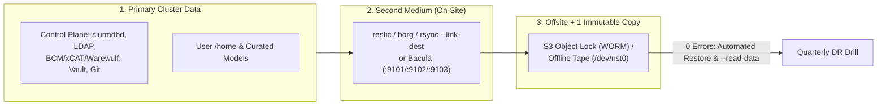

# 6.27 Backup and data protection

| | |
|---|---|
| Level | Intermediate |
| Priority tier | 2 |
| Lab venue | Laptop (tested experiments) |
| Part | Part 6: HPC and Slurm |
| Status | Drafted. **Run on a macOS laptop with conda-forge builds**: rsync 3.4.4 `--link-dest` snapshots, GNU tar 1.35 `--listed-incremental`, restic 0.19.1 (init, backup, snapshots, restore, check, `--read-data` corruption detection, forget/prune); outputs shown. Bacula, tape, ZFS/Lustre snapshots, Globus and cloud tiers were **not** run; those sections are from the SCL book and general knowledge. Labs for production tools are **untested** |

## Why this matters for AI infrastructure

Training clusters feel disposable (checkpoints can be regenerated, nodes are reimaged), which tempts teams to skip backups. But a cluster holds irreplaceable things: user code and results, curated datasets and labels, trained models and their lineage, the configuration that makes the cluster work, and the databases that define identity and accounting. Losing the Slurm accounting database, the LDAP directory, the head-node image repository, or a project's only copy of a fine-tuned model costs weeks. Ransomware aimed at research and cloud environments makes immutable, tested backups a security control as much as an operations task. This chapter separates what must be protected from what can be rebuilt, and shows the tools and tests.

## Prerequisites and outcomes

Needs 6.18 to 6.24. After this chapter you can:

- Classify cluster data by value and reproducibility and set RPO/RTO per class.
- Apply 3-2-1 and its modern variants (immutability, air gap, offsite).
- Use tar, rsync (hard-link snapshots), Bacula-style enterprise backup, and deduplicating tools (restic/borg/kopia), and understand the trade-offs.
- Design backups for parallel file systems and object stores; know why snapshots are not backups.
- Protect the control-plane state: head node, Slurm, LDAP, Git, Terraform state, secrets, container registries.
- Test restores and detect silent corruption; monitor backup health.

## 1. What to protect

| Class | Examples | Reproducible? | Policy |
|---|---|---|---|
| **Cluster definition** | Git repos for configs, Ansible/Terraform, images build files, Slurm configs, Helm values | Mostly (if in Git) | Git hosting with backups; mirror offsite; protect Terraform state (versioned, locked, backed up) |
| **Control-plane state** | `slurmdbd` database, `StateSaveLocation` (before upgrades), LDAP/FreeIPA database, BCM/xCAT/Warewulf databases, CA keys, munge key, secrets store, DNS/DHCP data, registry metadata | No | Frequent (hourly to daily), tested restore, offsite copy |
| **Software and images** | Node images, container registry blobs, module trees, Spack/EasyBuild caches | Yes, with time and compute | Keep build recipes; back up the current "golden" images and registry; rebuild is the fallback |
| **User homes** | Code, notebooks, small results, dotfiles | No | Daily snapshots + backup; quotas keep size manageable |
| **Project / shared data** | Curated datasets, labels, evaluation sets, trained models, papers' data | Partly (raw data may be re-downloaded; labels and curation cannot) | Backup to a different failure domain; versioned object store; DOIs/archival for published data |
| **Scratch / work** | Intermediate results, temporary datasets | Yes | **Not backed up** by policy; purged; state this loudly |
| **Checkpoints** | Training state | Regenerable at a cost | Retention policy; keep milestone checkpoints and final models in protected storage; checkpoints on the parallel file system are *not* a backup (6.21) |
| **Logs and metrics** | Syslog, job logs, accounting history | No (audit value) | Ship offsite; retention per compliance |
| **Databases for applications** | MLflow, experiment trackers, vector databases | No | Application-consistent dumps |

State **RPO** (recovery point objective: how much data you can lose) and **RTO** (recovery time objective: how long recovery may take) per class. A model-registry database may need RPO of minutes; a home directory 24 hours; scratch none.

## 2. Principles



- **3-2-1(-1-0)**: three copies of the data, on two different media/systems, one offsite, **one immutable or offline**, and zero errors verified by restore testing. The last two additions answer ransomware and silent corruption.
- **Snapshots are not backups.** File-system snapshots (ZFS, GPFS, Btrfs, array snapshots) protect against accidental deletion quickly but live in the same failure domain as the data (same array, same admin credentials). Use them as the first line and combine with replication or backup to a separate system.
- **Replication is not backup.** Synchronous or asynchronous mirrors copy deletions and corruption as faithfully as data.
- **Independent credentials and failure domains**: the backup system's admin account must not be the same identity that can delete production data; ideally append-only credentials for the writer.
- **Consistency**: for databases and busy file systems take application-consistent copies (`mysqldump --single-transaction`, `pg_basebackup`, LVM/ZFS snapshot then copy, quiesce). Backing up a live Postgres directory with `cp` yields garbage.
- **Encrypt** backups at rest and in transit; protect the keys separately (losing the key is losing the backups).
- **Test restores** regularly: a backup you have not restored is a hope. Include full-system recovery drills for the control plane.
- **Monitor**: job success, age of the newest backup per class, size and duration trends, error counts, repository integrity checks, restore-test results; alert on "no successful backup in N hours".

## 3. Classic tools (SCL chapter 20)

The SCL book's backup chapter covers three families: `tar`, **Bacula**, and `rsync` "and others".

### tar

`tar` archives files (optionally compressed) to a file or tape. Every `tar` invocation requires one of the eight operation modes from Table 20-1 in the book:

| Key | Meaning |
|---|---|
| `-A`, `--catenate` | Add archives to an existing archive |
| `-c`, `--create` | Create a new archive |
| `-d`, `--diff`, `--compare` | Find differences between files in the archive and on disk |
| `--delete` | Delete files from the archive (does not work on magnetic tapes) |
| `-r`, `--append` | Append files to the end of an uncompressed archive |
| `-t`, `--list` | List the files in the archive |
| `-u`, `--update` | Append only files newer than the existing copy in the archive |
| `-x`, `--extract`, `--get` | Extract files from the archive |

Besides `-z` (`gzip`, `.tar.gz` / `.tgz`) and `-j` (`bzip2`, `.tar.bz2` / `.tbz2`), GNU `tar` accepts `-I` to invoke an external compressor that supports `-d`, such as multi-core `pigz` (which compresses across many CPU cores). In `SCL` Chapter 20, basic archive creation, compression, listing, extraction (with `-C` to change target directory), and appending (`-r`, which works only on uncompressed `.tar` archives) use `(untested here)`:

```bash
# (untested here) — SCL Chapter 20 tar examples
tar cf filename_archive file1 file2
tar cf project.tar *.c includes
tar cvzf project.tar.gz *.c includes    # gzip archive (v outputs processed files)
tar cvjf project.tar.bz2 *.c includes   # bzip2 archive
tar cvzf project.tar.gz ./folder        # archive ./folder preserving full structure
tar xvzf project.tar.gz -C /path/to/folder
tar tzf project.tar.gz                  # list archive contents
tar rvf project.tar new_file            # append file/folder to uncompressed archive
tar rvf project.tar new_folder
```

Because `tar` preserves ownership, permissions, symbolic links, and special device files more faithfully than plain `cp`, the book uses a standard-output/standard-input pipeline to clone a directory tree locally (or over `ssh`/`netcat`) `(untested here)`:

```bash
# (untested here)
tar cf - data01 | (cd /db01; tar xvf -)
```

GNU tar supports **incremental backups** with a snapshot (`--listed-incremental`) metadata file (`.snar`) that records what was archived; passing `--level=0` (or deleting the `.snar` file, such as `/var/log/usr.snar` in the book's example) forces a full level-0 archive. Tested with GNU tar 1.35 on a 4 MB directory:

```bash
tar --listed-incremental=lvl.snar -czf full.tgz data      # level 0 (the .snar file is created)
echo more > data/new.txt
tar --listed-incremental=lvl.snar -czf inc1.tgz data      # only what changed since
```

Result: `full.tgz` 4,015,302 bytes; `inc1.tgz` 578 bytes, containing the new directory entries and `data/new.txt`. To restore, extract the full archive then each incremental in order, using `--listed-incremental=/dev/null`. (macOS's default `tar` is bsdtar, which lacks this option; use GNU tar. Two other classic UNIX archivers mentioned in the book are `cpio`, which reads file paths from standard input via `find`, and `pax`, which also writes tape archives.) Limits: no deduplication, no integrity verification beyond the compressor's checksums, no catalog, restore requires the chain, ACLs/xattrs need `--acls --xattrs`, sparse files need `--sparse`. Good for simple, offline, long-term archives and as a building block.

### rsync, batch updates, and hard-link snapshots

`rsync -a` mirrors a tree efficiently (one-way delta transfer comparing modification times and block checksums, preserving permissions, times, and links). As `SCL` Chapter 20 notes, the disadvantages of plain `rsync` include the absence of built-in incremental or differential archive chains (without `--link-dest` or wrapper tools), the inability to read data directly from standard input (for streaming database dumps), and the inability to work with removable tape drives; nevertheless, for relatively small backup tasks it remains a great tool:

```bash
# (untested here) — SCL Chapter 20 rsync examples (trailing slash copies contents without creating extra subdir)
rsync -avz host1:data_dir /backups/host1
rsync -av -e "ssh -l backuper -i secret_key" host1:/to_backup/ /backups/host1
```

The book summarises commonly used `rsync` flags in Table 20-3:

| Key | Meaning |
|---|---|
| `--delete` | Delete destination files that are no longer in the source directory |
| `-b` | Back up overwritten files into a separate directory (`--backup-dir`) or with a suffix (`--suffix`) |
| `-u` / `--update` | Skip files that are newer on the destination than on the source |
| `-n` / `--dry-run` | Show what would be transferred without copying |
| `--ignore-errors` | Continue deleting/copying even when I/O errors occur |
| `--max-size=N` | Skip files larger than `N` |
| `--exclude=PAT` / `--exclude-from=FILE` | Skip files and directories matching shell pattern `PAT` (or patterns read from `FILE`) |
| `-h` / `--human-readable` | Print sizes with `MB`, `GB` units |
| `-8` / `--8-bit-output` | Preserve 8-bit characters in file names in output (for UTF-8) |
| `--progress` | Show transfer progress |
| `--daemon` | Run as `rsyncd` daemon (`rsync://host/remote_path` or `host::remote_path`), avoiding SSH encryption CPU overhead on trusted internal networks (protect with `chroot` and a dedicated secrets file) |

When you need to apply the exact same incremental directory update across many nodes or backup targets without recomputing deltas for each host, `rsync --write-batch=update` `(untested here)` records the delta stream into two files—`update` and `update.sh`—instead of modifying a remote host directly. You then distribute `update` and `update.sh` (or mount them over a network file system) and execute `update.sh` (which runs `rsync --read-batch=update` under the hood) on each target machine.

The classic trick for versioned backups without dedup software is `--link-dest`: each new snapshot directory hard-links unchanged files from the previous one. Tested with rsync 3.4.4 (200 files of 20 KB, 4,004 KB total):

```bash
rsync -a data/ snaps/day1/
# modify one file and append to another
rsync -a --delete --link-dest=$PWD/snaps/day1 data/ snaps/day2/
```

Results: `ls -li` showed the **same inode** for the unchanged `f1.bin` in both snapshots and different inodes for the modified `f7.bin`; `snaps/day1` measured 4,004 KB while `snaps/day2` counted only 24 KB (its own changed files; `du` counts a hard-linked file once per invocation), and both together took 4,028 KB. Each snapshot directory looks like a full copy and can be browsed and restored with plain `cp`. Caveats: the first run copies everything; files modified in place cost a full copy each time (no block-level dedup); permissions and ownership require running as root on the target; hard links do not cross file systems; rotation scripts must prune old snapshots; macOS ships an old `openrsync`, so use a current rsync. `rsync` also moves data between systems (`rsync -aH --delete-after -e ssh`), the usual tool for syncing images and configuration to a standby head node, with `--checksum`, `--partial`, `--bwlimit` and `-z` as needed. For parallel file systems with millions of files use parallel tools (`mpifileutils` `dsync`/`dcp`, `fpsync`, `rclone` with many transfers) because single-threaded rsync walks the tree serially.

### Bacula

Bacula is an enterprise network backup system (Bacula, forks Bareos). Its components as listed in the book's chapter: **Director** (the scheduler/brain; configuration `/etc/bacula/bacula-dir.conf`, listening on port `9101`), **Storage Daemon** (writes to disk shelves or tape drives such as `/dev/nst0`; configuration `/etc/bacula/bacula-sd.conf`, listening on port `9103`), **File Daemon** (the data-server/client agent on each machine with direct access to the files; configuration `/etc/bacula/bacula-fd.conf`, listening on port `9102`), the **Catalog** (SQLite, MySQL, or PostgreSQL database recording where volumes and files live), and the **console** (`bconsole`, configured via `/etc/bacula/bconsole.conf`) for operators. Configuration objects: **Client**, **FileSet** (what to include/exclude), **Schedule** (when; full/differential/incremental levels), **Pool** (a set of volumes with retention), **Volume** (a single archive file or tape in a pool), **Device** (the physical drive or directory), **Storage**, **Job**, **JobDefs**, **Messages**.

In the book's example, the Storage Daemon configuration `/etc/bacula/bacula-sd.conf` on `stor1` defines the `Storage` listener, authorizes the `Director`, and declares a disk `Device` (`Random Access = Yes; RemovableMedia = no;` for disk directories versus `Random Access = No; RemovableMedia = Yes;` and `Archive Device = /dev/nst0` for tape) `(untested here)`:

```text
# /etc/bacula/bacula-sd.conf (untested here)
Storage {
  Name = stor1
  SDPort = 9103
  WorkingDirectory = "/var/spool/bacula"
  Pid Directory = "/var/run"
  Maximum Concurrent Jobs = 10
}
Director {
  Name = dir1
  Password = "storage-password"
}
Device {
  Name = DiskArray
  Media Type = MyFiles
  Archive Device = /mnt/backups
  Random Access = Yes;
  RemovableMedia = no;
  LabelMedia = yes;
}
```

On the Director server, `/etc/bacula/bacula-dir.conf` links the `Director`, `Storage`, `Pool`, `FileSet`, `Client`, `Schedule`, and `Job` stanzas `(untested here)`:

```text
# /etc/bacula/bacula-dir.conf (untested here)
Director {
  Name = my-director
  DIRport = 9101
  QueryFile = "/etc/bacula/query.sql"
  WorkingDirectory = "/var/spool/bacula"
  PidDirectory = "/var/run"
  Maximum Concurrent Jobs = 1
  Password = "my-password"
  Messages = Daemon
}
Storage {
  Name = dir-storage1
  Address = stor1.localnet
  SDPort = 9103
  Password = "storage-password"
  Device = DiskArray
  Media Type = MyFiles
}
Pool {
  Name = stor1-pool
  Pool Type = Backup
  AutoPrune = yes
  Recycle = yes
  Volume Retention = 1 month
  Maximum Volume Jobs = 1
  Maximum Volumes = 32
  Storage = Dir-Storage1
  Label Format = "stor1-"
}
FileSet {
  Name = "users-set"
  Include {
    Options {
      signature = MD5
      compression = GZIP
      recurse = yes
    }
    File = /home
    File = /etc/passwd
    File = /etc/shadow
    File = /etc/group
  }
  Exclude {
    File = /home/tmp
  }
}
Client {
  Name = client-1
  Address = headnode.localnet
  FDPort = 9102
  Catalog = my-catalog
  Password = "my-password"
}
Schedule {
  Name = "Weekly"
  Run = Full sat at 10:00
  Run = Incremental mon-thu at 02:01
}
Job {
  Name = "users-backup"
  Type = Backup
  Client = client1
  FileSet = "users-set"
  Schedule = "Weekly"
  Messages = Standard
  Pool = example-pool
  Write Bootstrap = "/var/spool/bacula/%n.bsr"
  Priority = 1
}
```

Notice `Write Bootstrap = "/var/spool/bacula/%n.bsr"` (`%n` expands to the job `Name`): this bootstrap file allows emergency data recovery even if the Bacula Catalog database is unavailable.

On each data server (client), `/etc/bacula/bacula-fd.conf` (or `/etc/bacula/bacula-fd`) specifies the `Director` password and the `FileDaemon` listener matching the Director's `Client` name `(untested here)`:

```text
# /etc/bacula/bacula-fd.conf (untested here)
Director {
  Name = my-director
  Password = "my-password"
}
FileDaemon {
  Name = client-1
  FDport = 9102
  WorkingDirectory = /var/spool/bacula
  Pid Directory = /var/run
  Maximum Concurrent Jobs = 20
}
```

Finally, the operator console `/etc/bacula/bconsole.conf` points to the Director `(untested here)`:

```text
# /etc/bacula/bconsole.conf (untested here)
Director {
  Name = my-director
  DIRport = 9101
  Address = headnode.localnet
  Password = "my-password"
}
```

Inside `bconsole`, Table 20-2 of the book lists the essential interactive commands `(untested here)`:

| Command | Meaning |
|---|---|
| `cancel` | Cancel a running task |
| `disable` | Temporarily prevent a scheduled task from running |
| `enable` | Re-enable a disabled task |
| `exit` / `quit` | Exit `bconsole` |
| `list` | View objects recorded in the catalog |
| `messages` | View recent daemon and job messages |
| `restore` | Start an interactive restore |
| `reload` | Reread the Director configuration file |
| `run` | Start a job (for example `run job=users-backup`) |
| `status` | Show the status of the director, storage servers, client file daemons, or all together |
| `show` | Display parsed configuration objects (use `show help` or `show tasks` to inspect job definitions) |

Strengths of Bacula: central policy, tape and disk pool management, long retention, mature. Costs: manual configuration across multiple files, catalog dependency (you must back up and be able to restore the catalog or `.bsr` bootstrap files), per-file catalog growth on huge file counts, and scan times on tens of millions of files.

## 4. Deduplicating repositories: restic, borg, kopia

Modern tools split files into content-defined chunks, deduplicate across all snapshots and hosts, compress and **encrypt** client-side, and store everything in a repository (local directory, SFTP, S3-compatible object store, REST server). Properties: every backup is a full-looking snapshot but costs only changed chunks; integrity checks via content hashes; flexible retention (`forget --keep-daily 7 --keep-weekly 4 ...`); mountable snapshots; fast restores of single files. restic is a single Go binary (the examples below use it); borg (Python/C, strong compression and append-only options) and kopia (Go, with server/UI) are alternatives.

Tested with restic 0.19.1 (tiny data set; the point is behaviour, not speed):

```text
restic init -r repo
restic -r repo backup data --tag day1          # 201 files, 3.8 MiB
(add a new 20 KB file / change one)
restic -r repo backup data
  Files: 0 new, 1 changed, 201 unmodified
  Added to the repository: 111.991 KiB (31.248 KiB stored)
restic -r repo snapshots      -> 2 snapshots, each showing the full 3.815 MiB
du -sk repo                   -> 4000 KB    (two full-looking snapshots stored in about the size of one)
restic -r repo check          -> no errors were found
restic -r repo restore latest --target restore   -> Restored 204 files/dirs
```

A second experiment on a 3-file directory: restoring the latest snapshot into a fresh directory and running `diff -r` against the live data printed "identical", while restoring the *first* snapshot differed from the live data in the modified file (`f2`), as it should. Then a pack file in the repository was corrupted by overwriting two bytes: `restic check --read-data` (which reads and verifies every pack) reported "repository contains errors" and suggested repair steps, while the default `restic check` (metadata only) is cheaper but would not read data blobs. The lesson: **schedule periodic `--read-data` (or `--read-data-subset`) checks**, and keep a second repository copy for repair. Finally `restic forget --keep-last 1 --prune` removed old packs, showing retention in action.

Operational notes: the repository password/key is essential (store it in a secret manager and on paper offsite; the experiments used a throwaway password); use a dedicated service account with **append-only** access to the repository (restic REST server `--append-only`, S3 object lock/versioning) so a compromised client cannot delete history; pin tool versions; test restores of a sample every week; watch memory use on huge trees (index size). In `SCL` Chapter 20, **`borgbackup`** (`https://www.borgbackup.org/`, with helper scripts in `https://github.com/zhum/hpc-book-matherials`) is highlighted alongside `rsync` for storing every backup as internal links to unique deduplicated objects in a special database (so removing an old backup only deletes chunks unique to that backup) with `sshfs` or native remote service transport and encryption. As `SCL` Chapter 20 concludes, all system administrators are divided into *"those who don't yet do backups and those who do now"*—and smart admins who test backups at least two times a year, because backups can fail silently and losing system or commercial software settings on a supercomputer can take weeks or months to rebuild if data volumes are not protected on a separate physical device.

## 5. Parallel file systems, object stores and AI-scale data

Backing up petabytes of small and large files is a different problem:

- **Walking the namespace is the bottleneck**: a full scan of 500 million files takes hours to days. Use change tracking instead of scanning: Lustre **changelogs** (consumed by tools such as Robinhood) and `lfs find` with `--newer`/mtime filters; GPFS **policy engine** (`mmapplypolicy`) and `mmbackup`; WEKA/VAST snapshot-and-diff APIs; object-store versioning and replication; ZFS `send/receive` incrementals.
- **Parallel data movers**: `mpifileutils`, `dsync`, `fpsync`, `rclone --transfers N`, Globus, vendor tools; spread over multiple data transfer nodes (6.25).
- **Tiering and HSM**: copy cold data to object storage or tape via HSM (Lustre HSM, GPFS ILM) so that backup and archive coincide.
- **Datasets and models**: store in a versioned object store (S3 with versioning, object lock) or a data-versioning layer (DVC, lakeFS) with immutable snapshots; record dataset versions in experiment metadata so a training run is reproducible and a lost model can be retrained. Large model checkpoints and weights go to object storage with lifecycle policies; do not stream TB-scale checkpoints through a backup agent.
- **Home directories** are small enough for the standard tools; enforce quotas (6.24) to keep them so.
- **What to exclude**: scratch, caches (`~/.cache`, pip/conda caches), job outputs flagged ephemeral, container layers; document exclusions.

## 6. Protecting the control plane

| Component | How to back up | Notes |
|---|---|---|
| Slurm accounting DB | `mysqldump --single-transaction` or physical replica snapshot, daily plus before upgrades (6.15) | Test importing into a scratch `slurmdbd` |
| Slurm state dir | Snapshot before upgrade; HA shared storage during operation | Not a long-term backup |
| LDAP/FreeIPA | `slapcat` (OpenLDAP) / `ipa-backup` (FreeIPA), CA and Kerberos keys | Offline copy of CA private keys |
| Cluster manager DB | BCM/xCAT/Warewulf native backup, plus Git of exports | Includes node inventory and images metadata |
| Images and registry | Store images in the registry with replication; keep build recipes in Git | Rebuild path documented |
| Git hosting / CI | Mirror repos to a second system; export CI config | Treat as critical |
| Terraform/OpenTofu state | Versioned, encrypted remote state with locking; periodic export | Losing state is painful (Part 4) |
| Secrets (Vault, SOPS keys) | Vault snapshots (`vault operator raft snapshot`), key escrow | Never in the same repository as data backups unencrypted |
| Switch/BMC configs | Config export on change, stored in Git | Part 2, 7 |
| DNS/DHCP | Zone and lease files from the provisioning source of truth (6.22 inventory) | Generated, so back up the source |

Disaster recovery drill: rebuild the head node and one compute node from nothing using only the backups and documentation; time it; record gaps.

## 7. Ransomware and insider risk

- **Immutability**: object lock/WORM (S3 Object Lock in compliance mode, immutable ZFS snapshots with holds, tape taken offline), append-only repositories.
- **Separate trust domain**: backup servers on a management network not reachable from user nodes; credentials not in LDAP groups users can influence; MFA for deletion; "four-eyes" retention changes.
- **Detect**: backup size anomalies (sudden growth or total change of every file), canary files, monitoring of mass deletions/encryption (entropy), alerts on repository integrity failures.
- **Recover**: documented order of restoration (identity, DNS, provisioning, storage, scheduler, then users), clean-room rebuild, rotation of all secrets after an incident.
- **Offsite and offline copy** of the most critical state (control-plane DB dumps, keys, Git mirrors).

## 8. Restore testing and metrics

Test levels: (1) automated daily restore of a random file and checksum compare; (2) weekly restore of a database dump into a scratch instance and a smoke query; (3) quarterly full-system recovery drill. Track: backup success rate, age of newest good backup per class, restore success and time versus RTO, data growth, dedup ratio, repository check status. Report to management as part of risk review.

## 9. Lab

First, run the self-checking Python lab (`code/part06/backup_protection_lab.py`) locally. It creates a two-day hard-link snapshot tree (`simulate_hardlink_snapshot`) to verify that unchanged files share the exact same inode while modified files receive a new inode (`4,004 KB + 24 KB = 4,028 KB`), simulates a deduplicated pack repository (`verify_pack_repository`) to prove that metadata-only checks miss a 2-byte pack corruption while full `--read-data` SHA-256 verification catches it immediately, and checks Bacula's TCP ports (`9101` Director, `9102` File Daemon, `9103` Storage Daemon) and the `3-2-1-1-0` backup rule:

```bash
python3 code/part06/backup_protection_lab.py
```

Tested here (install GNU tar, rsync 3 and restic; conda-forge has all three): 1) reproduce the three experiments on a small directory. 2) Delete a file, restore it from each tool. 3) Corrupt a restic pack file and detect it with `check --read-data`; repair the repository by restoring the pack from a second copy (`restic copy` to a second repo beforehand). 4) Script a rotation: 7 daily rsync snapshots with `--link-dest` pruning older ones; confirm disk usage stays near one full copy plus changes. 5) Write the RPO/RTO table for your cluster classes.

Untested: 6) Bacula/Bareos: director, storage daemon, file daemon on three VMs; back up and restore a directory; back up and restore the catalog. 7) restic to an S3-compatible bucket with object lock and an append-only credential; attempt deletion with the backup credential. 8) ZFS snapshot + `zfs send | receive` incremental replication to a second host. 9) Lustre changelog consumer (Robinhood-style) driving incremental copy. 10) Full DR drill of a test head node.

## 10. Interview angles

- Walk through 3-2-1-1-0. Why aren't snapshots and replication backups?
- How would you back up a 5 PB Lustre file system?
- Design backups for a Slurm cluster's control plane. Which pieces need application-consistent copies?
- tar vs rsync vs restic vs Bacula: when each?
- How does `rsync --link-dest` create space-efficient snapshots? Limitations?
- How do you prove your backups work?
- A ransomware incident encrypts user homes and your NFS server: what saves you?
- Should checkpoints be backed up? What is retained, what is not?
- What are RPO and RTO and how do you choose them for model artefacts?

## Exercises

1. **Verifying Hard-Link Snapshots and Pack Integrity Checks (`code/part06/backup_protection_lab.py`):** Run `python3 code/part06/backup_protection_lab.py`. Trace how `simulate_hardlink_snapshot()` proves that `day1/f1.bin` and `day2/f1.bin` share the same inode (`st_ino`) while modified `f7.bin` gets a new inode, and how `verify_pack_repository()` demonstrates why `restic check --read-data` catches a 2-byte silent bit-rot in a pack file that default metadata-only `restic check` misses.
2. **GNU `tar` Incremental Archives (`--listed-incremental`) and Streaming Pipes (`SCL` Chapter 20):** Write the GNU `tar` commands to create a level-0 baseline archive (`tar --listed-incremental=/var/log/usr.snar --level=0 -cf archive.0.tar /usr`), a daily incremental archive, a multi-core `pigz` compressed archive (`-I pigz`), and a pipe clone (`tar cf - data01 | (cd /db01; tar xvf -)`). Explain how to restore an incremental `tar` chain cleanly using `--listed-incremental=/dev/null`.
3. **Configuring a 3-Daemon Bacula Backup Topology (`SCL` Chapter 20):** Write the core sections of `/etc/bacula/bacula-sd.conf` (port `9103`), `/etc/bacula/bacula-dir.conf` (port `9101`, `Pool`, `FileSet`, `Client`, `Schedule`, `Job` with `Write Bootstrap = "/var/spool/bacula/%n.bsr"`), `/etc/bacula/bacula-fd.conf` (port `9102`), and `/etc/bacula/bconsole.conf`. Explain why the `.bsr` bootstrap file is critical if the SQL Catalog database is lost.
4. **Distributing Identical Updates with `rsync --write-batch` and `--link-dest` (`SCL` Chapter 20):** Compare `rsync -a --delete --link-dest=$PWD/snaps/day1 data/ snaps/day2/` (for rotated hard-link snapshots on a backup server) with `rsync --write-batch=update` (generating `update` and `update.sh` to apply an identical delta across 100 nodes without recomputing checksums 100 times). State the three limitations of plain `rsync` noted in `SCL` Chapter 20.
5. **Designing Control-Plane and Parallel Filesystem Data Protection for a 1,000-GPU Cluster:** Specify the exact backup tool, command, RPO, RTO, and immutability mechanism for (a) `slurmdbd` MySQL (`mysqldump --single-transaction`), (b) OpenLDAP/FreeIPA (`slapcat` / `ipa-backup`), (c) HashiCorp Vault (`vault operator raft snapshot`), (d) `/home` (50 TB), (e) curated datasets and final model weights on a 5 PB Lustre filesystem (using Lustre changelogs + `mpifileutils` `dsync` to S3 Object Lock), and (f) `/scratch` (excluded by policy).
6. **Ransomware Recovery Order and Clean-Room Restoration Drill:** An attacker compromises a cluster admin credential and attempts to wipe `/home`, LDAP, and the primary backup server. Explain which two elements of the **3-2-1-1-0** rule prevent total data loss, and state the exact dependency order for restoring the cluster from immutable/offline backups.

## Checkpoint

<details>
<summary>1. Which cluster data classes must be backed up with tight RPO/RTO, and which data class is deliberately **not** backed up?</summary>

- **Must be backed up:** Control-plane databases (`slurmdbd`, LDAP/FreeIPA, BCM/xCAT/Warewulf DB, Vault secrets, Terraform state, Git repos, CA/Munge keys), `/home` directories, and curated datasets/final trained model weights.
- **Deliberately NOT backed up:** **`/scratch` (and intermediate training checkpoints)**, which are regenerable and multi-petabyte in scale; this non-backup policy and automated purge window must be stated prominently in user onboarding and MOTD.
</details>

<details>
<summary>2. Define **RPO**, **RTO**, and the **3-2-1-1-0** backup rule.</summary>

- **RPO (Recovery Point Objective):** Maximum acceptable age of data lost when an incident occurs (determines backup frequency, e.g., 1 hour vs 24 hours).
- **RTO (Recovery Time Objective):** Maximum acceptable elapsed time to restore service after an incident.
- **3-2-1-1-0 rule:** Keep at least **3** copies of data, on **2** different storage media/systems, with **1** copy offsite, **1** copy **immutable (WORM) or offline (air-gapped)**, and **0** unverified errors (proven by automated restore testing).
</details>

<details>
<summary>3. Why are filesystem **snapshots** and synchronous/asynchronous **replication** not backups?</summary>

- **Snapshots (ZFS, GPFS, storage array):** Reside on the exact same storage array and trust domain as the live data; a storage pool loss, array firmware bug, or compromised storage-admin credential destroys both live files and snapshots together.
- **Replication (RAID, DRBD, cross-site mirror):** Immediately replicates accidental `rm -rf`, application database corruption, or ransomware encryption to the replica.
</details>

<details>
<summary>4. List the eight primary operation modes of `tar` (`SCL` Chapter 20 `Table 20-1`) and explain why `tar cf - src | (cd /dst; tar xvf -)` is preferred over `cp -r`.</summary>

The eight operation modes are **`-A` (`--catenate`)**, **`-c` (`--create`)**, **`-d` (`--diff`/`--compare`)**, **`--delete`** (disk archives only, not tape), **`-r` (`--append`, uncompressed archives only)**, **`-t` (`--list`)**, **`-u` (`--update`)**, and **`-x` (`--extract`/`--get`)**. Streaming `tar cf - | tar xvf -` preserves ownership, permissions, hard links, symbolic links, device nodes, and directory structures more faithfully than naive `cp`.
</details>

<details>
<summary>5. How does GNU `tar --listed-incremental` work, and how do you force a full Level-0 archive or restore an incremental chain (`SCL` Chapter 20)?</summary>

`tar --listed-incremental=/var/log/usr.snar -cf archive.tar /usr` stores directory and inode timestamp metadata in `/var/log/usr.snar`. If `.snar` does not exist (or if **`--level=0`** is passed), `tar` writes a full Level-0 backup; subsequent runs archive only files created, modified, or renamed since `.snar` was updated. To restore, extract the Level-0 archive followed by each incremental archive in chronological order, passing **`--listed-incremental=/dev/null`** so `tar` accurately removes files that were deleted between increments.
</details>

<details>
<summary>6. How does `rsync --link-dest` create space-efficient daily snapshots, and what did the 200-file experiment prove?</summary>

`rsync -a --delete --link-dest=$PWD/snaps/day1 data/ snaps/day2/` compares `data/` against `snaps/day1/`: every unchanged file is **hard-linked** into `snaps/day2/` (sharing the exact same disk blocks and inode number `st_ino`), while only modified or new files are written as new inodes. In the experiment (`4,004 KB` across 200 files), `snaps/day2/` added only **`24 KB`** (`4,028 KB` total for two complete, independently browsable directory trees).
</details>

<details>
<summary>7. What are the three limitations of plain `rsync` noted in `SCL` Chapter 20, and what does `rsync --write-batch=update` do?</summary>

- **Three limitations:** Plain `rsync` (1) does not build multi-point incremental/differential archive chains by itself (without `--link-dest` or wrapper scripts), (2) cannot read streaming data from `stdin` (such as a piped database dump), and (3) cannot write directly to magnetic tape drives.
- **`rsync --write-batch=update`:** Computes the delta between source and destination once and writes **`update`** (the binary delta payload) and **`update.sh`** (a replay script running `rsync --read-batch=update`) so the exact same update can be applied across many identical hosts without recomputing checksums.
</details>

<details>
<summary>8. Name the four core components of **Bacula**, their configuration files, and their default TCP ports (`SCL` Chapter 20).</summary>

1. **Director (`bacula-dir`):** Central scheduler and policy engine; `/etc/bacula/bacula-dir.conf`, **TCP port `9101`**.
2. **File Daemon (`bacula-fd`):** Client agent running on each backed-up server; `/etc/bacula/bacula-fd.conf`, **TCP port `9102`**.
3. **Storage Daemon (`bacula-sd`):** Writes backup streams to disk pools or tape drives (`/dev/nst0`); `/etc/bacula/bacula-sd.conf`, **TCP port `9103`**.
4. **Console (`bconsole`) & Catalog:** Operator CLI (`/etc/bacula/bconsole.conf` connecting to `9101`) and SQL database (`SQLite`, `MySQL`, or `PostgreSQL`).
</details>

<details>
<summary>9. In `/etc/bacula/bacula-dir.conf`, what does `Write Bootstrap = "/var/spool/bacula/%n.bsr"` do, and why is it essential (`SCL` Chapter 20)?</summary>

It writes a small text **Bootstrap Record (`.bsr`)** file (`%n` = job name) after every backup job listing the exact Volume names, file numbers, and block offsets needed to restore that job's files. If the Bacula SQL Catalog database is destroyed in a disaster, the `.bsr` file allows `bextract` / Bacula to recover the data and catalog directly from the storage volumes without scanning every tape or disk volume from end to end.
</details>

<details>
<summary>10. Name eight interactive commands in Bacula's `bconsole` (`SCL` Chapter 20 `Table 20-2`).</summary>

`run` (e.g., `run job=users-backup`), `status` (director, storage, client, or all), `messages`, `list`, `restore`, `cancel`, `disable` / `enable`, `reload`, and `show` (`show help`, `show tasks`).
</details>

<details>
<summary>11. How do modern deduplicating backup tools (**`restic`**, **`borgbackup`**, **`kopia`**) differ architecturally from `tar` and `rsync --link-dest`?</summary>

They split files into **content-defined variable-length chunks**, hash each chunk with a cryptographic digest (SHA-256 / BLAKE2), **deduplicate chunks globally** across all files, directories, snapshots, and hosts, compress and **encrypt** every pack client-side before transmission, and store them in an content-addressed repository (local disk, SFTP, REST server, or S3 object store). Modifying 4 KB inside a 10 GB file stores only the changed ~4 KB chunk rather than duplicating the entire 10 GB file as `rsync --link-dest` must.
</details>

<details>
<summary>12. What is the difference between `restic check` and `restic check --read-data`, and what did the pack-corruption experiment demonstrate?</summary>

- **`restic check` (default):** Verifies repository metadata, snapshot manifests, tree objects, and index consistency, but **does not read and hash the underlying data pack blobs**.
- **`restic check --read-data` (or `--read-data-subset`):** Reads every data pack from storage and verifies its SHA-256 hash against the repository index—immediately catching the 2-byte pack corruption that default `restic check` missed.
</details>

<details>
<summary>13. Why is backing up a 5 PB parallel filesystem (Lustre or GPFS) with single-threaded `rsync` impossible, and what two mechanisms solve it?</summary>

1. **Metadata change tracking instead of tree-walking:** Walking 500 million inodes via `readdir`/`stat` takes days. Use **Lustre Changelogs** (with a changelog consumer like Robinhood) or **GPFS's ILM policy engine (`mmapplypolicy` / `mmbackup`)** to identify modified files directly from metadata journals without scanning the tree.
2. **Parallel MPI data movers across DTNs:** Copy files in parallel across multiple Data Transfer Nodes using **`mpifileutils` (`dsync` / `dcp`)**, **`fpsync`**, or multi-stream `rclone` / Globus.
</details>

<details>
<summary>14. How do you take an **application-consistent** backup of `slurmdbd` (MySQL/MariaDB), OpenLDAP/FreeIPA, and HashiCorp Vault?</summary>

Never copy live database files with `cp` or `rsync` while the daemon is writing:
- **`slurmdbd` (MySQL/MariaDB):** `mysqldump --single-transaction --routines --triggers slurm_acct_db > slurm_acct.sql` (or snapshot a stopped replica).
- **OpenLDAP / FreeIPA:** `slapcat -l backup.ldif` (OpenLDAP) or `ipa-backup` (FreeIPA, including Dogtag CA and Kerberos keys).
- **HashiCorp Vault:** `vault operator raft snapshot save vault.snap`.
</details>

<details>
<summary>15. How do **append-only repositories** and **S3 Object Lock (WORM)** protect backups when a cluster root account is compromised by ransomware?</summary>

If a compute/login node or cluster admin account is compromised, an attacker will immediately try to run `restic forget --prune` or `aws s3 rm` using the backup credentials found on the host. Configuring the backup target as **append-only** (`restic-rest-server --append-only` or Borg `command="borg serve --append-only"`) or enabling **S3 Object Lock in Compliance Mode** ensures the backup client credential can write new snapshots but is cryptographically/hardware-blocked from deleting or overwriting existing backup packs until the retention timer expires.
</details>

<details>
<summary>16. What four anomaly signals in backup telemetry provide early warning of a ransomware or mass-corruption event?</summary>

1. **Sudden spike in daily delta size** (e.g., an incremental backup that normally adds `50 GB` suddenly writes `100%` of the dataset because every file was encrypted in place).
2. **Jump in data entropy / collapse in deduplication and compression ratios** (encrypted ciphertext does not compress or deduplicate).
3. **Modification or deletion of planted canary files.**
4. **Unexpected `restic check` / repository integrity failures or failed prune attempts.**
</details>

<details>
<summary>17. In what dependency order must you restore a cluster's control plane during a full disaster-recovery (DR) rebuild?</summary>

1. **Out-of-band & core network:** Switch configs, VLANs, routing, firewall, and NTP/DNS (`named`).
2. **Secrets & PKI:** Internal CA certificates, Vault, and `/etc/munge/munge.key`.
3. **Identity directory:** LDAP / FreeIPA (`slapadd` / `ipa-restore`) and SSSD so all UIDs/GIDs resolve.
4. **Provisioning & cluster manager:** BCM / Warewulf / xCAT database and golden OS node images (`rootfs.squashfs`).
5. **Storage mounts:** NFS `/home` and parallel filesystem (`/scratch`) mounts.
6. **Workload manager:** Restore `slurmdbd` MySQL database first, start `slurmdbd`, restore `StateSaveLocation` (if applicable), start `slurmctld`, and boot compute nodes (`slurmd`).
7. **User access portals:** Open OnDemand and login bastions last, once the cluster is healthy.
</details>

<details>
<summary>18. What are the three tiers of **restore testing** that prove a backup system actually works?</summary>

1. **Daily automated file restore:** Restore a random sample of files to a scratch directory and verify SHA-256 checksums against live data (plus periodic `restic check --read-data-subset`).
2. **Weekly automated database restore:** Import the latest `slurmdbd` MySQL dump and LDAP `slapcat` LDIF into isolated scratch containers and run verification queries (`sacctmgr show assoc`, `ldapsearch`).
3. **Semi-annual / quarterly full DR drill (`SCL` Chapter 20):** Rebuild a head node and compute node from bare metal in an isolated lab using only off-site backups and runbook documentation, timing the actual RTO.
</details>

<details>
<summary>19. Where must backup encryption keys and root CA / Vault unseal keys be stored?</summary>

In an **independent secret store and offline physical safe (paper/HSM escrow) outside the cluster**—never stored solely inside the cluster's own Vault, LDAP, or `/home` filesystem that you are trying to recover when the cluster is down.
</details>

<details>
<summary>20. Which five operational metrics should be graphed and alerted on for the backup system itself?</summary>

1. **Time since last successful backup per data class** (page if `age > RPO`, e.g., `> 26 hours` for daily jobs).
2. **Backup job exit status** (including a dead-man's-switch alert if the cron/systemd timer stops firing).
3. **Delta bytes added and deduplication/compression ratio** per run (anomaly detection).
4. **Repository integrity check (`--read-data`) status and age.**
5. **Automated restore-test pass/fail status and duration (measured RTO).**
</details>

## Sources and review notes

- Book source (`supercomputers-for-linux-sysadmins-managing-modern-hpc-clusters-and-supercomputers-from-software-to-hardware`, `SCL`):
  - Chapter 20 ("20. Backup", read in full): `tar` eight operation modes (`Table 20-1`), `-z`/`-j`/`-I` parallel compression (`pigz`), `tar cf - data01 | (cd /db01; tar xvf -)`, `--listed-incremental=/var/log/usr.snar` / `--level=0`, `cpio` and `pax`, Bacula architecture and configuration stanzas (`bacula-sd.conf` port `9103`, `bacula-dir.conf` port `9101`, `bacula-fd.conf` port `9102`, `bconsole.conf`, `Write Bootstrap = "/var/spool/bacula/%n.bsr"`, and `Table 20-2` `bconsole` commands), `rsync` flags (`Table 20-3`), `rsync --write-batch=update` / `update.sh`, `borgbackup` (`https://www.borgbackup.org/`, `https://github.com/zhum/hpc-book-matherials`), and testing backups at least twice a year.
- Experiments: run locally as described (tools from conda-forge: `rsync` 3.4.4, GNU `tar` 1.35, `restic` 0.19.1) and `python3 code/part06/backup_protection_lab.py` (3 passed, 0 failed).
- Explicitly labelled inferences: `simulate_hardlink_snapshot` and `verify_pack_repository` in `code/part06/backup_protection_lab.py` are deterministic Python models of `--link-dest` inode sharing and `restic check --read-data` pack verification.
- Not verified on live hardware: petabyte-scale Lustre changelog scan timings, live Bacula daemon and tape drive (`/dev/nst0`) execution, and S3 Object Lock compliance-mode retention tests (`untested here`).
