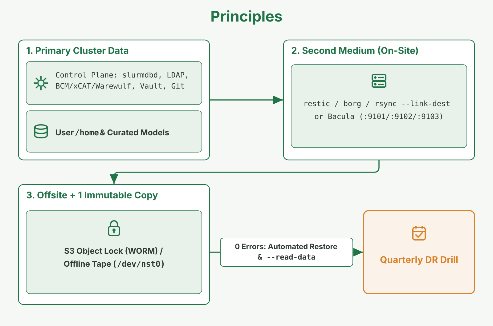

# 6.27 Backup and data protection

| | |
|---|---|
| Level | Intermediate |
| Priority tier | 2 |
| Lab venue | Laptop (tested experiments) |
| Part | Part 6: HPC and Slurm |
| Status | Drafted. **Run on a macOS laptop with conda-forge builds**: rsync 3.4.4 `--link-dest` snapshots, GNU tar 1.35 `--listed-incremental`, restic 0.19.1 (init, backup, snapshots, restore, check, `--read-data` corruption detection, forget/prune); outputs shown. Bacula, tape, ZFS/Lustre snapshots, Globus and cloud tiers were **not** run; those sections come from *Supercomputers for Linux Sysadmins* and general knowledge. Labs for production tools are **untested** |

## Why this matters for AI infrastructure

A training cluster can feel disposable. Checkpoints can be regenerated, and nodes can be reimaged, so backups are easy to skip. Skipping them is a mistake, because the cluster also holds things you cannot regenerate. Those include user code and results, curated datasets and labels, and trained models with their lineage. They also include the configuration that makes the cluster work, and the databases that define identity and accounting. Lineage means the record of which data, code and settings produced a model, and it is the part that is hardest to rebuild by hand.

Think about what happens when one of those is gone. Losing the Slurm accounting database, the LDAP directory, the head-node image repository, or a project's only copy of a fine-tuned model costs weeks of work. Nobody notices the gap until someone asks for the file. Ransomware aimed at research and cloud environments adds a second reason. An attacker who encrypts your data and your backups together has won, so immutable, tested backups are a security control as much as an operations task.

This chapter separates what you must protect from what you can rebuild. It also shows the tools, and the tests that prove a backup works. A backup that has never been restored is only a guess about what will happen later.

## Prerequisites and outcomes

You need chapters 6.18 to 6.24 first. The chapter starts by sorting cluster data into classes, and it sets a recovery target for each class. It then applies the 3-2-1 rule and its modern additions, which are immutability, an air gap and an offsite copy. Next it compares tar, rsync with hard-link snapshots, Bacula-style enterprise backup and deduplicating tools such as restic, borg or kopia, with their trade-offs. After that come the harder cases: parallel file systems, object stores and the control plane. The chapter ends with restore testing, silent corruption and the health of the backup system itself.

If you have not yet sorted your data into classes, start with section 1.

## 1. What to protect

Suppose the head node's disk fills up overnight, and the morning question is what you can safely delete and what you must restore. Without a classification, every file looks equally important, and you waste time on the wrong things. Not all cluster data deserves the same protection. Some of it can be regenerated, and some of it cannot. The table sorts each class by whether you can reproduce it, and it names the policy that fits.

| Class | Examples | Reproducible? | Policy |
|---|---|---|---|
| **Cluster definition** | Git repos for configs, Ansible/Terraform, images build files, Slurm configs, Helm values | Mostly (if in Git) | Git hosting with backups; mirror offsite; protect Terraform state (versioned, locked, backed up) |
| **Control-plane state** | `slurmdbd` database, `StateSaveLocation` (before upgrades), LDAP/FreeIPA database, BCM/xCAT/Warewulf databases, CA keys, munge key, secrets store, DNS/DHCP data, registry metadata | No | Frequent (hourly to daily), tested restore, offsite copy |
| **Software and images** | Node images, container registry blobs, module trees, Spack/EasyBuild caches | Yes, with time and compute | Keep build recipes; back up the current "golden" images and registry; rebuild is the fallback |
| **User homes** | Code, notebooks, small results, dotfiles | No | Daily snapshots + backup; quotas keep size manageable |
| **Project / shared data** | Curated datasets, labels, evaluation sets, trained models, papers' data | Partly (raw data may be re-downloaded; labels and curation cannot) | Backup to a different failure domain; versioned object store; DOIs/archival for published data |
| **Scratch / work** | Intermediate results, temporary datasets | Yes | **Not backed up** by policy; purged; state this loudly |
| **Checkpoints** | Training state | Regenerable at a cost | Retention policy; keep milestone checkpoints and final models in protected storage; checkpoints on the parallel file system are *not* a backup (6.21) |
| **Logs and metrics** | Syslog, job logs, accounting history | No (audit value) | Ship offsite; retention per compliance |
| **Databases for applications** | MLflow, experiment trackers, vector databases | No | Application-consistent dumps |

Give each class an RPO and an RTO. The RPO, or recovery point objective, is how much data you can afford to lose. Put simply, it is how far back in time your most recent good copy may be. The RTO, or recovery time objective, is how long recovery may take. A model-registry database may need an RPO of minutes, a home directory 24 hours, and scratch none. Those three answers show the same idea at three different levels of care. The model registry is expensive to lose, so its copy must be very recent. Scratch is cheap to lose, so nobody copies it at all.

Write down an RPO and an RTO for each class before you choose any tools. A tool choice made first tends to decide the answers for you, and the answers should come from the work the data supports, not from the software you already have.

## 2. Principles

Suppose an administrator deletes a project directory by mistake, and the team asks whether it can come back. Whether you can get it back depends on where the other copies live and how independent they are. The principles below are about that question, because a copy that fails with the original is not really a copy.



*Figure 6.27.1. Principles, as a diagram.*

Read the diagram from left to right. Primary cluster data is copied to a second medium on site. From there it goes to an offsite copy that is also immutable, which means nobody can change it after it is written. A quarterly disaster-recovery drill then checks that the restore really works.

Follow the 3-2-1-1-0 rule. Keep three copies of the data, on two different media or systems, with one copy offsite. One of those copies must be immutable or offline, and restore testing must show zero errors. The last two additions answer ransomware and silent corruption. Silent corruption is damage that the storage does not report, such as a flipped bit, so only a read test catches it.

Put plainly, the rule asks you to count three copies, to put one on a second system, to keep one away from the first, and then to prove that the copies can be restored. Each number answers one kind of disaster. The three copies cover a dead disk. The second medium covers a failed array. The offsite copy covers a fire or a flood. The immutable copy covers an attacker with valid credentials. The zero errors cover the quiet damage that no one notices until a restore fails.

Snapshots are not backups. File-system snapshots from ZFS, GPFS, Btrfs or a storage array protect against accidental deletion quickly. But they live in the same failure domain as the data, which means the same array and the same admin credentials. A failure domain is the set of parts that can fail or be attacked together. Use snapshots as the first line of defense, and combine them with replication or a backup to a separate system.

Replication is not backup either. Synchronous and asynchronous mirrors copy deletions and corruption as faithfully as they copy data. If an attacker deletes a file on the primary, the mirror deletes it too, usually within seconds. A mirror protects against a dead disk, and a backup protects against a bad change.

Keep the backup system's credentials independent. The admin account for the backup system must not be the same identity that can delete production data. Ideally, the writer uses append-only credentials, which can add new backups but cannot remove old ones.

Take application-consistent copies of databases and busy file systems. An application-consistent copy is one the database can start from without repair. You can use `mysqldump --single-transaction`, `pg_basebackup`, an LVM or ZFS snapshot followed by a copy, or quiesce the service first. Quiescing means pausing writes for a moment so the files on disk agree with each other. Backing up a live Postgres directory with `cp` yields garbage, because the files change while the copy runs, and the copy captures a mix of old and new pages.

Encrypt backups at rest and in transit. Protect the keys separately, because losing the key means losing the backups. A perfectly encrypted backup with a lost key is the same as no backup at all.

Test restores regularly. A backup you have not restored is only a hope. Include full-system recovery drills for the control plane, since a backup that restores files but not the database that knows about them still leaves the cluster down.

Monitor the backup system. Watch job success, the age of the newest backup per class, size and duration trends, error counts, repository integrity checks and restore-test results. Set an alert for "no successful backup in N hours". A silent backup job is the most dangerous kind, because nothing looks wrong until the day you need the copy.

The next step is to schedule a restore test, because until one succeeds, the backup is unproven.

## 3. Classic tools (*Supercomputers for Linux Sysadmins* chapter 20)

Suppose you need a backup tonight and can only use tools that already ship with the system. *Supercomputers for Linux SysAdmins* chapter 20 covers three families: `tar`, Bacula, and `rsync` "and others". These tools are old, simple and everywhere, which is why they still show up in production.

### tar

`tar` archives files, optionally compressed, into a single file or onto tape. Every `tar` command needs one of eight operation modes, which tell `tar` what to do with the archive. The table below shows them.

| Key | Meaning |
|---|---|
| `-A`, `--catenate` | Add archives to an existing archive |
| `-c`, `--create` | Create a new archive |
| `-d`, `--diff`, `--compare` | Find differences between files in the archive and on disk |
| `--delete` | Delete files from the archive (does not work on magnetic tapes) |
| `-r`, `--append` | Append files to the end of an uncompressed archive |
| `-t`, `--list` | List the files in the archive |
| `-u`, `--update` | Append only files newer than the existing copy in the archive |
| `-x`, `--extract`, `--get` | Extract files from the archive |

The modes you will use most in this section are `-c` to create an archive, `-t` to list it, and `-x` to extract it. Learn those three first, because they cover most of a restore.

GNU `tar` can compress with `-z` (`gzip`, for `.tar.gz` or `.tgz` files) or `-j` (`bzip2`, for `.tar.bz2` or `.tbz2` files). `-I` calls an external compressor instead, as long as it supports `-d`. Multi-core `pigz` is one example, and it compresses across many CPU cores, so a large archive finishes sooner.

The examples below cover basic archive creation, compression, listing, and extraction. Extraction uses `-C` to change the target directory, which keeps a restore away from the paths you are working in. Appending with `-r` works only on uncompressed `.tar` archives, because a compressed stream cannot be extended at its end. The examples are:

```bash
# SCL Chapter 20 tar examples
tar cf filename_archive file1 file2
tar cf project.tar *.c includes
tar cvzf project.tar.gz *.c includes    # gzip archive (v outputs processed files)
tar cvjf project.tar.bz2 *.c includes   # bzip2 archive
tar cvzf project.tar.gz ./folder        # archive ./folder preserving full structure
tar xvzf project.tar.gz -C /path/to/folder
tar tzf project.tar.gz                  # list archive contents
tar rvf project.tar new_file            # append file/folder to uncompressed archive
tar rvf project.tar new_folder
```

`tar` keeps ownership, permissions, symbolic links and special device files more faithfully than plain `cp` does. That is why a pipeline is the usual way to clone a directory tree. One side writes the archive to standard output, which is the stream of text a command prints, and the other reads it from standard input. You can run that locally, or over `ssh` or `netcat`:

```bash
tar cf - data01 | (cd /db01; tar xvf -)
```

GNU `tar` supports incremental backups. It keeps a snapshot metadata file, with the `.snar` extension, that records what it has already archived. Pass `--level=0`, or delete the `.snar` file (such as `/var/log/usr.snar`), and `tar` writes a full level-0 archive again. Level 0 is the baseline, and later incrementals only hold what changed since it. The test below used GNU tar 1.35 on a 4 MB directory.

```bash
tar --listed-incremental=lvl.snar -czf full.tgz data      # level 0 (the .snar file is created)
echo more > data/new.txt
tar --listed-incremental=lvl.snar -czf inc1.tgz data      # only what changed since
```

The full archive, `full.tgz`, came out at 4,015,302 bytes. The incremental, `inc1.tgz`, was only 578 bytes. It held the new directory entries and `data/new.txt`. To restore, extract the full archive first, then each incremental in order, using `--listed-incremental=/dev/null`. Order matters here, because each incremental assumes the ones before it were already applied.

The default `tar` on macOS is bsdtar, which lacks this option, so use GNU tar instead. *Supercomputers for Linux SysAdmins* also mentions two other classic UNIX archivers. `cpio` reads file paths from standard input, usually supplied by `find`. `pax` also writes tape archives.

`tar` has real limits. It does no deduplication and keeps no catalog, which is an index of what each archive holds. Its only integrity check is the compressor's checksums. A restore needs the whole chain of archives. ACLs and xattrs need `--acls --xattrs`, and sparse files need `--sparse`. ACLs are fine-grained access rules, and xattrs are extended attributes that hold extra file metadata. Use `tar` for simple, offline, long-term archives, or as a building block for something larger.

### rsync, batch updates, and hard-link snapshots

`rsync -a` mirrors a tree efficiently. It does a one-way delta transfer, comparing modification times and block checksums, and it preserves permissions, times and links. A delta transfer sends only the parts of a file that changed, not the whole file again. Plain `rsync` has three gaps, though. It has no built-in incremental or differential archive chains, unless you add `--link-dest` or a wrapper tool. It cannot read data from standard input, which rules out streaming database dumps. It also cannot work with removable tape drives. For relatively small backup tasks, it remains a great tool.

*Supercomputers for Linux SysAdmins* shows two copy commands. The trailing slash copies the contents of the directory without creating an extra subdirectory. The second command adds an SSH login and a key file, so the copy runs as a named backup user:

```bash
# SCL Chapter 20 rsync examples (trailing slash copies contents without creating extra subdir)
rsync -avz host1:data_dir /backups/host1
rsync -av -e "ssh -l backuper -i secret_key" host1:/to_backup/ /backups/host1
```

The commonly used `rsync` flags are:

| Key | Meaning |
|---|---|
| `--delete` | Delete destination files that are no longer in the source directory |
| `-b` | Back up overwritten files into a separate directory (`--backup-dir`) or with a suffix (`--suffix`) |
| `-u` / `--update` | Skip files that are newer on the destination than on the source |
| `-n` / `--dry-run` | Show what would be transferred without copying |
| `--ignore-errors` | Continue deleting/copying even when I/O errors occur |
| `--max-size=N` | Skip files larger than `N` |
| `--exclude=PAT` / `--exclude-from=FILE` | Skip files and directories matching shell pattern `PAT` (or patterns read from `FILE`) |
| `-h` / `--human-readable` | Print sizes with `MB`, `GB` units |
| `-8` / `--8-bit-output` | Preserve 8-bit characters in file names in output (for UTF-8) |
| `--progress` | Show transfer progress |
| `--daemon` | Run as `rsyncd` daemon (`rsync://host/remote_path` or `host::remote_path`), avoiding SSH encryption CPU overhead on trusted internal networks (protect with `chroot` and a dedicated secrets file) |

Use `-n` when you want to preview a run, because it shows what would transfer without copying anything. Make a habit of it before any run that uses `--delete`. `--delete` is the flag that removes destination files which no longer exist in the source, so a wrong source path combined with it can empty a backup.

The rest of the table is easier to remember in groups. The first group decides what gets copied and what gets removed, and it holds `--delete`, `--exclude` and `--max-size`. The second group decides how existing files are treated, and it holds `-b`, `-u` and `--backup-dir`. The third group controls how the run looks and how it connects, and it holds `--progress`, `-h` and `--daemon`. When you are unsure which flag you need, ask which group the problem belongs to first. That usually narrows the choice to two or three flags.

Sometimes you need the same incremental update on many nodes. `rsync --write-batch=update` helps there, because it avoids recomputing the deltas for each host. Instead of changing a remote host directly, it records the delta stream into two files, `update` and `update.sh`. You distribute those files, or mount them over a network file system, and run `update.sh` on each target. That script runs `rsync --read-batch=update` underneath, so every node applies the same recorded change.

The classic way to keep versioned backups without dedup software is `--link-dest`. Each new snapshot directory hard-links unchanged files from the previous one. A hard link is a second name for the same file data, so an unchanged file costs no extra space. The test used rsync 3.4.4 on 200 files of 20 KB each, 4,004 KB in total.

```bash
rsync -a data/ snaps/day1/
# modify one file and append to another
rsync -a --delete --link-dest=$PWD/snaps/day1 data/ snaps/day2/
```

The first snapshot measures 4,004 KB. The second counts only 24 KB, because only its changed files take new space. The `du` command counts a hard-linked file once per run, so the second figure looks small. Together the two take 4,028 KB. That is the first snapshot's 4,004 KB plus the 24 KB of changes.

`ls -li` shows the same inode number for the unchanged `f1.bin` in both snapshots. An inode is the number that identifies a file on disk. The modified `f7.bin` gets a different inode. Each snapshot directory looks like a full copy, and you can browse and restore it with plain `cp`. Nothing special is needed to read an old snapshot, which is one of its best properties during a stressful restore.

The caveats matter. The first run copies everything. A file modified in place costs a full copy each time, because there is no block-level dedup. Permissions and ownership need root on the target. Hard links do not cross file systems, and rotation scripts must prune old snapshots, or the disk fills up slowly. macOS ships an old `openrsync`, so use a current rsync.

`rsync` also moves data between systems. The command `rsync -aH --delete-after -e ssh` is the usual way to sync images and configuration to a standby head node. Add `--checksum`, `--partial`, `--bwlimit` or `-z` as needed. Parallel file systems with millions of files need parallel tools instead, such as the `mpifileutils` tools `dsync` and `dcp`, `fpsync`, or `rclone` with many transfers. Single-threaded `rsync` walks the tree one step at a time, and at that scale the walk itself becomes the slow part.

### Bacula

The Bacula commands and configuration files in this section were not run on live hardware. Bacula is an enterprise network backup system, and Bareos is a fork of it. Bacula has several parts. The Director is the scheduler and the brain. Its configuration is `/etc/bacula/bacula-dir.conf`, and it listens on port `9101`. The Storage Daemon writes to disk shelves or tape drives such as `/dev/nst0`. Its configuration is `/etc/bacula/bacula-sd.conf`, and it listens on port `9103`. The File Daemon is the agent on each machine with direct access to the files. Its configuration is `/etc/bacula/bacula-fd.conf`, and it listens on port `9102`.

The Catalog is an SQLite, MySQL or PostgreSQL database that records where volumes and files live. The console, `bconsole`, is what operators use, and it reads `/etc/bacula/bconsole.conf`. The configuration itself is made of objects, and each object describes one piece of the job. A Client names the machine. A FileSet says what to include and exclude. A Schedule says when to run, and at which level: full, differential or incremental. A Pool is a set of volumes with a retention policy, and a Volume is one archive file or tape in that pool. A Device is the physical drive or directory. Storage, Job, JobDefs and Messages complete the list.

The Storage Daemon configuration is `/etc/bacula/bacula-sd.conf`. On `stor1`, it defines the `Storage` listener, authorises the `Director`, and declares a disk `Device`. A disk device uses `Random Access = Yes;` and `RemovableMedia = no;`. A tape device uses `Random Access = No;` and `RemovableMedia = Yes;`, with `Archive Device = /dev/nst0`. The random-access setting matters because a disk can jump to any position, while a tape must be wound to the right place:

```text
# /etc/bacula/bacula-sd.conf
Storage {
  Name = stor1
  SDPort = 9103
  WorkingDirectory = "/var/spool/bacula"
  Pid Directory = "/var/run"
  Maximum Concurrent Jobs = 10
}
Director {
  Name = dir1
  Password = "storage-password"
}
Device {
  Name = DiskArray
  Media Type = MyFiles
  Archive Device = /mnt/backups
  Random Access = Yes;
  RemovableMedia = no;
  LabelMedia = yes;
}
```

On the Director server, `/etc/bacula/bacula-dir.conf` links the `Director`, `Storage`, `Pool`, `FileSet`, `Client`, `Schedule`, and `Job` stanzas together. A stanza is one named block of settings. The names must match across files, which is where most Bacula mistakes start:

```text
# /etc/bacula/bacula-dir.conf
Director {
  Name = my-director
  DIRport = 9101
  QueryFile = "/etc/bacula/query.sql"
  WorkingDirectory = "/var/spool/bacula"
  PidDirectory = "/var/run"
  Maximum Concurrent Jobs = 1
  Password = "my-password"
  Messages = Daemon
}
Storage {
  Name = dir-storage1
  Address = stor1.localnet
  SDPort = 9103
  Password = "storage-password"
  Device = DiskArray
  Media Type = MyFiles
}
Pool {
  Name = stor1-pool
  Pool Type = Backup
  AutoPrune = yes
  Recycle = yes
  Volume Retention = 1 month
  Maximum Volume Jobs = 1
  Maximum Volumes = 32
  Storage = Dir-Storage1
  Label Format = "stor1-"
}
FileSet {
  Name = "users-set"
  Include {
    Options {
      signature = MD5
      compression = GZIP
      recurse = yes
    }
    File = /home
    File = /etc/passwd
    File = /etc/shadow
    File = /etc/group
  }
  Exclude {
    File = /home/tmp
  }
}
Client {
  Name = client-1
  Address = headnode.localnet
  FDPort = 9102
  Catalog = my-catalog
  Password = "my-password"
}
Schedule {
  Name = "Weekly"
  Run = Full sat at 10:00
  Run = Incremental mon-thu at 02:01
}
Job {
  Name = "users-backup"
  Type = Backup
  Client = client1
  FileSet = "users-set"
  Schedule = "Weekly"
  Messages = Standard
  Pool = example-pool
  Write Bootstrap = "/var/spool/bacula/%n.bsr"
  Priority = 1
}
```

Notice the `Write Bootstrap = "/var/spool/bacula/%n.bsr"` line. `%n` expands to the job `Name`, so each job writes its own file. That bootstrap file lets you recover data even when the Bacula Catalog database is unavailable. In a disaster, that is the difference between a restore that starts and a restore that waits for the database to come back.

Each data server, which acts as a client, needs its own File Daemon configuration. The file is `/etc/bacula/bacula-fd.conf`, and it can also be named `/etc/bacula/bacula-fd`. It holds the Director password and the File Daemon listener, which must match the Director's `Client` name:

```text
# /etc/bacula/bacula-fd.conf
Director {
  Name = my-director
  Password = "my-password"
}
FileDaemon {
  Name = client-1
  FDport = 9102
  WorkingDirectory = /var/spool/bacula
  Pid Directory = /var/run
  Maximum Concurrent Jobs = 20
}
```

Finally, the operator console reads `/etc/bacula/bconsole.conf`, which points to the Director:

```text
# /etc/bacula/bconsole.conf
Director {
  Name = my-director
  DIRport = 9101
  Address = headnode.localnet
  Password = "my-password"
}
```

These are the essential interactive commands inside `bconsole`. You will use `status` and `messages` most often, because they tell you whether a job ran and why it failed.

| Command | Meaning |
|---|---|
| `cancel` | Cancel a running task |
| `disable` | Temporarily prevent a scheduled task from running |
| `enable` | Re-enable a disabled task |
| `exit` / `quit` | Exit `bconsole` |
| `list` | View objects recorded in the catalog |
| `messages` | View recent daemon and job messages |
| `restore` | Start an interactive restore |
| `reload` | Reread the Director configuration file |
| `run` | Start a job (for example `run job=users-backup`) |
| `status` | Show the status of the director, storage servers, client file daemons, or all together |
| `show` | Display parsed configuration objects (use `show help` or `show tasks` to inspect job definitions) |

Bacula gives you central policy, tape and disk pool management, long retention, and a mature design. The costs are real. Configuration is spread across multiple files, and a single mismatched name breaks the chain. The catalog becomes a dependency, so you must back it up and be able to restore it, or keep the `.bsr` bootstrap files. Catalog growth on huge file counts is another cost, and scanning tens of millions of files takes a long time.

Choose the tool by the job. Use `tar` for simple archives, rsync snapshots for smaller trees, and Bacula where central policy and tape matter. Most sites end up using more than one of these, each for the kind of data it handles best.

## 4. Deduplicating repositories: restic, borg, kopia

Imagine a repository holding two years of nightly backups of the same home directories. Most files never change, yet a plain copy each night would store them again and again. Modern tools take a different approach to that waste. They split files into content-defined chunks and deduplicate those chunks across every snapshot and host. Deduplication means storing each unique chunk once, no matter how many snapshots point to it. Content-defined chunking cuts files at boundaries set by the data itself, so an edit near the start of a file does not shift every chunk after it. They compress and encrypt on the client, and they store everything in a repository. That repository can be a local directory, SFTP, an S3-compatible object store or a REST server.

Each backup looks like a full snapshot, but it costs only the chunks that changed. Integrity checks use content hashes, which means each chunk is verified against a fingerprint of its own contents. Retention is flexible, so you can write a rule such as `forget --keep-daily 7 --keep-weekly 4 ...`, which keeps a recent daily history and a longer weekly one. Snapshots can be mounted, and single files restore quickly. restic is a single Go binary, and the examples below use it. borg is written in Python and C, and it offers strong compression and append-only options. kopia is written in Go, and it comes with a server and a UI.

Choosing among the three is less about speed and more about the team that will run it. restic is the simplest to script and to explain to a new person. borg suits teams that want strong compression and an append-only server. kopia suits teams that want a server and a graphical view. In each case, the tool matters less than the restore tests you run against it.

Here is the test with restic 0.19.1 on a tiny data set. The point is how it behaves, not how fast it runs. A small test shows the shape of the behaviour, and you should measure speed on your own data.

```text
restic init -r repo
restic -r repo backup data --tag day1          # 201 files, 3.8 MiB
(add a new 20 KB file / change one)
restic -r repo backup data
  Files: 0 new, 1 changed, 201 unmodified
  Added to the repository: 111.991 KiB (31.248 KiB stored)
restic -r repo snapshots      -> 2 snapshots, each showing the full 3.815 MiB
du -sk repo                   -> 4000 KB    (two full-looking snapshots stored in about the size of one)
restic -r repo check          -> no errors were found
restic -r repo restore latest --target restore   -> Restored 204 files/dirs
```

Look at the sizes. Each snapshot shows the full 3.815 MiB, but the repository takes 4000 KB on disk. The second backup added 111.991 KiB to the repository, with 31.248 KiB stored. So two full-looking snapshots take about the space of one. `restic check` reported no errors, and restoring the latest snapshot gave 204 files and directories. The difference between the 111.991 KiB added and the 31.248 KiB stored comes from compression, which squeezes the new data further.

A second experiment used a three-file directory. Restoring the latest snapshot into a fresh directory, then running `diff -r` against the live data, printed "identical". Restoring the first snapshot differed from the live data in the modified file, `f2`, as it should. That check is the simplest proof that a restore is faithful, and it is worth running on your own data before you trust the tool.

Then a pack file in the repository was corrupted by overwriting two bytes. A pack file is the container where restic stores many chunks together. `restic check --read-data` reads and verifies every pack. It reported "repository contains errors" and suggested repair steps. The default `restic check` checks metadata only. It is cheaper, but it would not read the data blobs. A blob is one stored chunk of data, and metadata is the index that points to it. Metadata can look perfect while the chunk itself is damaged. The lesson is to **schedule periodic `--read-data` (or `--read-data-subset`) checks**, and to keep a second repository copy for repair. Finally, `restic forget --keep-last 1 --prune` removed old packs, which shows retention in action.

Some operational points matter here. You need the repository password or key, so store it in a secret manager and on paper offsite. The experiments used a throwaway password. Use a dedicated service account with append-only access. A REST server running `--append-only`, or S3 object lock and versioning, stops a compromised client from deleting history. Pin tool versions, test restores of a sample every week, and watch memory use on huge trees, where the index gets large.

*Supercomputers for Linux SysAdmins* chapter 20 highlights `borgbackup` alongside `rsync`. Borg stores each backup as internal links to unique, deduplicated objects in a special database. Removing an old backup therefore deletes only the chunks unique to that backup. It can use `sshfs` or native remote service transport, with encryption. The project is at `https://www.borgbackup.org/`, and the helper scripts are at `https://github.com/zhum/hpc-book-matherials`.

*Supercomputers for Linux SysAdmins* closes its backup chapter with a warning. Administrators fall into two groups: "those who don't yet do backups and those who do now". The smart admins test their backups at least two times a year. Backups can fail silently. Losing system or commercial software settings on a supercomputer can take weeks or months to rebuild if the data is not protected on a separate physical device.

Decide how often you will run `--read-data` checks before you rely on the repository. Put that schedule in the same calendar as your restore drills, so that the check and the test happen together.

## 5. Parallel file systems, object stores and AI-scale data

Imagine a backup job that has been walking a parallel file system for days and still has not finished. A parallel file system can hold petabytes of small and large files, and backing it up is a different problem from backing up a home directory. Walking the namespace and moving the data both slow down at this scale, so the methods change. The namespace is the tree of names and folders, and walking it means asking the file system about every entry in turn.

Walking the namespace is the bottleneck you hit first. A full scan of 500 million files takes hours to days, so use change tracking instead of scanning. Change tracking means the file system records what changed, and you read that record instead of looking at everything. Lustre changelogs, consumed by tools such as Robinhood, and `lfs find` with `--newer` or mtime filters can identify what changed. GPFS offers its policy engine (`mmapplypolicy`) and `mmbackup`. WEKA and VAST expose snapshot-and-diff APIs, which compare two snapshots and list only the differences. Object-store versioning and replication, along with ZFS `send/receive` incrementals, also avoid the scan.

The reason the scan hurts so much is that every entry is a separate request to the file system's metadata service, which is the part that keeps track of names, sizes and times. Millions of small requests queue up behind one another, and a backup tool that asks for each file in turn ends up waiting on the metadata service more than on the data. Change tracking flips that around. You ask one question, what changed since the last run, and you get a short list back. The data then moves in parallel, which is where the time goes anyway.

Parallel data movers copy many files at once. The list includes `mpifileutils`, `dsync`, `fpsync`, `rclone --transfers N`, Globus and vendor tools. You can spread the work across several data transfer nodes, as section 6.25 describes. A transfer node is a machine dedicated to moving data, so the copy does not compete with the jobs on the compute nodes.

Tiering and HSM move cold data to object storage or tape. Cold data is data nobody has touched for a long time, and HSM (hierarchical storage management) is the system that moves it down a tier and brings it back on demand. Lustre HSM and GPFS ILM do this, so backup and archive happen together.

Datasets and models need versioning. Store them in a versioned object store, such as S3 with versioning and object lock. A data-versioning layer such as DVC or lakeFS also works, because it keeps immutable snapshots. Record dataset versions in experiment metadata, so a training run stays reproducible and a lost model can be retrained. Large checkpoints and weights go to object storage with lifecycle policies, which automatically move or delete objects after a set age. Do not stream TB-scale checkpoints through a backup agent, because the agent becomes the bottleneck and the transfer can take longer than the training step it protects.

Home directories are small enough for the standard tools. Enforce quotas (6.24) to keep them that way, because a quota stops one user from turning a home directory into the largest thing you have to back up.

Decide what to exclude. That means scratch, caches such as `~/.cache` and pip or conda caches, job outputs flagged ephemeral, and container layers. These can all be rebuilt, so copying them only costs space and time. Document every exclusion, so that the next person does not wonder why a path is missing from the backup.

Before you point a backup tool at a parallel file system, decide which change-tracking method it will use. Choosing the method first keeps the backup from scanning the whole namespace by accident.

## 6. Protecting the control plane

Picture a head node that dies on a Monday morning. The jobs stop, users cannot log in, and nobody can find the admin password. The control plane is the set of services that holds the state making the cluster run, including the scheduler database, the directory service, the cluster manager and the secrets store. Each piece needs its own backup method, and the table below lists them.

| Component | How to back up | Notes |
|---|---|---|
| Slurm accounting DB | `mysqldump --single-transaction` or physical replica snapshot, daily plus before upgrades (6.15) | Test importing into a scratch `slurmdbd` |
| Slurm state dir | Snapshot before upgrade; HA shared storage during operation | Not a long-term backup |
| LDAP/FreeIPA | `slapcat` (OpenLDAP) / `ipa-backup` (FreeIPA), CA and Kerberos keys | Offline copy of CA private keys |
| Cluster manager DB | BCM/xCAT/Warewulf native backup, plus Git of exports | Includes node inventory and images metadata |
| Images and registry | Store images in the registry with replication; keep build recipes in Git | Rebuild path documented |
| Git hosting / CI | Mirror repos to a second system; export CI config | Treat as critical |
| Terraform/OpenTofu state | Versioned, encrypted remote state with locking; periodic export | Losing state is painful (Part 4) |
| Secrets (Vault, SOPS keys) | Vault snapshots (`vault operator raft snapshot`), key escrow | Never in the same repository as data backups unencrypted |
| Switch/BMC configs | Config export on change, stored in Git | Part 2, 7 |
| DNS/DHCP | Zone and lease files from the provisioning source of truth (6.22 inventory) | Generated, so back up the source |

Read the notes column with care. It flags the traps, such as a state directory that is not a long-term backup, or DNS and DHCP files that are generated and so need their source backed up instead. A generated file can be rebuilt from its source in seconds, so the source is the thing that deserves the copy.

Finish with a disaster recovery drill. Rebuild the head node and one compute node from nothing, using only the backups and documentation. Time the rebuild, and record every gap you find. The gaps are the most valuable output of the drill, because each one is a step that would have stalled a real recovery.

Schedule that drill before you need it, not after the head node fails. A drill held during an outage teaches you the lesson the hard way, at the moment when every minute costs the most.

Keep the drill notes next to the runbook, so the next person who rebuilds the head node starts from what you learned. Each gap that you record and fix makes the next drill shorter.

## 7. Ransomware and insider risk

Picture an attacker who gets one administrator password and starts encrypting files. Ransomware can encrypt user homes and the NFS server in one attack, and your backups must survive it. If the backup server trusts the same password, the attacker can reach the backups too.

Make backups immutable. Object lock or WORM storage, such as S3 Object Lock in compliance mode, stops changes to stored copies. WORM stands for write once, read many, which means the data can be read but never rewritten or deleted until its retention period ends. Immutable ZFS snapshots and append-only repositories also work.

Keep the backup servers in a separate trust domain, on a management network that user nodes cannot reach. Credentials should not sit in LDAP groups that users can influence. Require MFA for deletion, which means a second proof of identity such as a hardware key before anything can be erased. Require four-eyes approval for retention changes, so that one person cannot shorten the retention of a backup and then delete it.

Watch for signs of attack. Sudden growth in backup size, or a total change of every file, is one. Canary files, which are decoy files that nobody should ever touch, are another, since any change to them is a clear alarm. Monitoring of mass deletions or encryption (by entropy) and alerts on repository integrity failures are others. Entropy is a measure of how random data looks, and encrypted files look almost perfectly random, so a sudden jump in entropy across many files is a warning sign.

Document the order of restoration: identity, DNS, provisioning, storage, scheduler, then users. Each layer depends on the one before it, so restoring users first gives you accounts with nowhere to log in. Plan a clean-room rebuild, which means rebuilding on fresh hardware rather than cleaning the infected machines. Rotate all secrets after an incident. Keep an offsite, offline copy of the most critical state: control-plane database dumps, keys and Git mirrors.

Decide now which state gets an offline copy. You will find that choice hard to make mid-incident, when the pressure is on and every system looks essential.

In practice, the offline copy should be small enough to carry or to store in a locked room, but complete enough to rebuild identity and the scheduler. Write the list of those items down now, along with where the copy lives and who can open it. An offline copy that nobody remembers to refresh is almost as weak as none. Set a reminder to refresh it on the same schedule as the restore drill, so the two checks stay in step.

## 8. Restore testing and metrics

Picture a backup job that reports success every night for a year. Then one day someone tries to restore a file, and the file will not open. The job did its work, but nobody checked the result. A backup you have never restored is untested. The chapter recommends three levels of restore test, and you can start with the first. Level 1 is an automated daily restore of a random file, with a checksum compare. A checksum compare confirms that the restored bytes match the original. Level 2 is a weekly restore of a database dump into a scratch instance, followed by a smoke query. A smoke query is a simple read that proves the restored database answers at all. Level 3 is a quarterly full-system recovery drill.

Track these numbers: backup success rate, the age of the newest good backup per class, restore success and time against the RTO, data growth, dedup ratio and repository check status. The dedup ratio tells you how much space the deduplication saves, and a sudden drop can mean the data has changed in a way the tool no longer recognises. Report them to management as part of the risk review, so the cost of backups stays visible alongside their value.

A useful habit is to put these numbers on one page that you review each week. Look for the trend first, and only then look at a single value. One failed job is a small event, while a slow rise in restore time is an early warning that the RTO is at risk.

## 9. Lab

You want proof that the snapshot and corruption behaviour works before you trust it with real data. Start with the self-checking Python lab, and run it locally before you try the steps below.

Running the lab first costs almost nothing, and it shows you the behaviour before any real data is involved. The script builds a two-day hard-link snapshot tree with `simulate_hardlink_snapshot`. It checks that unchanged files share the same inode while modified files get a new one. The total should match the first snapshot plus the changes, which is `4,004 KB + 24 KB = 4,028 KB`.

Next, `verify_pack_repository` simulates a deduplicated pack repository. It shows that a metadata-only check misses a 2-byte pack corruption. Full `--read-data` SHA-256 verification catches it at once. SHA-256 is a fingerprint function, and comparing fingerprints is how the check spots a changed byte. The script also checks Bacula's TCP ports and the `3-2-1-1-0` backup rule. The Director listens on `9101`, the File Daemon on `9102`, and the Storage Daemon on `9103`.

Run the script with this command:

```bash
python3 code/part06/backup_protection_lab.py
```

The steps that were tested here need GNU tar, rsync 3 and restic. conda-forge provides all three. The steps below are split by what was run. Steps 1 to 5 ran on a laptop. Steps 6 to 10 were not run, so treat them as a plan.

1. Reproduce the three experiments on a small directory.
2. Delete a file, then restore it with each tool.
3. Corrupt a restic pack file and detect it with `check --read-data`. Then repair the repository by restoring the pack from a second copy, which you make beforehand with `restic copy` into a second repo.
4. Script a rotation of 7 daily rsync snapshots with `--link-dest`, pruning the older ones. Confirm that disk usage stays near one full copy plus the changes.
5. Write the RPO and RTO table for your cluster classes.
6. Run Bacula or Bareos with the director, storage daemon and file daemon on three VMs. Back up and restore a directory, then back up and restore the catalog.
7. Send restic to an S3-compatible bucket with object lock and an append-only credential, then attempt a deletion with the backup credential.
8. Test ZFS snapshots with `zfs send | receive` incremental replication to a second host.
9. Drive an incremental copy with a Lustre changelog consumer in the Robinhood style.
10. Run a full DR drill of a test head node.

Work through the tested steps first, because they need only the three tools above. Once they pass, the plan steps show you what the production setup still needs.

## 10. Interview angles

Interviewers often start with a disaster story rather than a definition. Each question below asks you to reason from the situation to the design, and each one tests a different part of this chapter.

- Walk through 3-2-1-1-0. Why are snapshots and replication not backups?
- How would you back up a 5 PB Lustre file system?
- How would you design backups for a Slurm cluster's control plane, and which pieces need application-consistent copies?
- When would you choose tar, rsync, restic or Bacula?
- How does `rsync --link-dest` create space-efficient snapshots, and what are its limits?
- How do you prove that your backups work?
- A ransomware attack encrypts user homes and your NFS server. What saves you?
- Should checkpoints be backed up? What do you keep, and what do you not keep?
- What are RPO and RTO, and how do you choose them for model artefacts?

Start with the ransomware question, since it draws on most of this chapter.

## Exercises

Work through these after the lab. Each one asks you to write, run or explain a specific part of the chapter.

1. Run `python3 code/part06/backup_protection_lab.py`. Trace how `simulate_hardlink_snapshot()` proves that `day1/f1.bin` and `day2/f1.bin` share the same inode (`st_ino`), while the modified `f7.bin` gets a new inode. Then trace how `verify_pack_repository()` shows why `restic check --read-data` catches a 2-byte silent bit-rot in a pack file. Ask yourself why the default metadata-only `restic check` misses it.
2. Write the GNU `tar` commands for these steps, which come from chapter 20 of *Supercomputers for Linux SysAdmins*. Create a level-0 baseline archive with `tar --listed-incremental=/var/log/usr.snar --level=0 -cf archive.0.tar /usr`. Create a daily incremental archive. Create a multi-core `pigz` compressed archive with `-I pigz`. Run the pipe clone `tar cf - data01 | (cd /db01; tar xvf -)`. Explain how to restore an incremental `tar` chain cleanly, using `--listed-incremental=/dev/null`.
3. Write the core sections of the Bacula configuration. Cover `/etc/bacula/bacula-sd.conf` (port `9103`), `/etc/bacula/bacula-dir.conf` (port `9101`, with `Pool`, `FileSet`, `Client`, `Schedule`, and `Job` containing `Write Bootstrap = "/var/spool/bacula/%n.bsr"`), `/etc/bacula/bacula-fd.conf` (port `9102`), and `/etc/bacula/bconsole.conf`. Then explain why the `.bsr` bootstrap file is critical if you lose the SQL Catalog database.
4. Compare two ways to keep copies. The first is `rsync -a --delete --link-dest=$PWD/snaps/day1 data/ snaps/day2/`, which makes rotated hard-link snapshots on a backup server. The second is `rsync --write-batch=update`, which generates `update` and `update.sh` to apply one identical delta across 100 nodes without recomputing checksums 100 times. Then state the three limitations of plain `rsync` that chapter 20 notes.
5. Design the protection for a 1,000-GPU cluster. For each item, name the exact backup tool, command, RPO, RTO and immutability mechanism. Cover `slurmdbd` MySQL with `mysqldump --single-transaction`. Cover OpenLDAP and FreeIPA with `slapcat` or `ipa-backup`. Cover HashiCorp Vault with `vault operator raft snapshot`. Cover `/home` at 50 TB. Cover curated datasets and final model weights on a 5 PB Lustre filesystem, using Lustre changelogs and `mpifileutils` `dsync` to S3 Object Lock. Say why `/scratch`, which is excluded by policy, needs no backup.
6. An attacker compromises a cluster admin credential and tries to wipe `/home`, LDAP and the primary backup server. Explain which two elements of the **3-2-1-1-0** rule prevent total data loss. Then state the exact dependency order for restoring the cluster from immutable or offline backups.

Start with exercise 1, since it reuses the lab you just ran.

## Checkpoint

<details>
<summary>1. Which cluster data classes must be backed up with tight RPO/RTO, and which data class is deliberately **not** backed up?</summary>

The control-plane databases, `/home` directories, and curated datasets with final trained model weights must be backed up. The control-plane databases include `slurmdbd`, LDAP or FreeIPA, the BCM, xCAT or Warewulf database, Vault secrets, Terraform state, Git repos, and the CA and Munge keys. `/scratch` and intermediate training checkpoints are deliberately not backed up. They can be regenerated, and they run to multiple petabytes. The non-backup policy and the automated purge window must be stated in user onboarding and the MOTD.
</details>

<details>
<summary>2. Define **RPO**, **RTO**, and the **3-2-1-1-0** backup rule.</summary>

RPO, the recovery point objective, is the maximum acceptable age of the data you lose when an incident happens. It sets how often you back up, for example every hour or every 24 hours. RTO, the recovery time objective, is the maximum acceptable time to restore service. The 3-2-1-1-0 rule says you keep at least 3 copies of data, on 2 different storage media or systems. One copy must be offsite, and one must be immutable (WORM) or offline (air-gapped). There must be 0 unverified errors, and automated restore testing proves it.
</details>

<details>
<summary>3. Why are filesystem **snapshots** and synchronous/asynchronous **replication** not backups?</summary>

Snapshots from ZFS, GPFS or a storage array sit on the same array and trust domain as the live data. A storage pool loss, an array firmware bug, or a compromised storage-admin credential destroys the live files and the snapshots together. Replication is no better for these failures. It copies an accidental `rm -rf`, application database corruption, or ransomware encryption to the replica straight away. The same goes for RAID, DRBD and cross-site mirrors.
</details>

<details>
<summary>4. List the eight primary operation modes of `tar` (chapter 20 of *Supercomputers for Linux SysAdmins*) and explain why `tar cf - src | (cd /dst; tar xvf -)` is preferred over `cp -r`.</summary>

The eight operation modes are `-A` (`--catenate`), `-c` (`--create`), `-d` (`--diff`/`--compare`), `--delete` (disk archives only, not tape), `-r` (`--append`, uncompressed archives only), `-t` (`--list`), `-u` (`--update`), and `-x` (`--extract`/`--get`). A streaming pipe such as `tar cf - | tar xvf -` keeps ownership, permissions, hard links, symbolic links, device nodes and directory structures more faithfully than naive `cp`.
</details>

<details>
<summary>5. How does GNU `tar --listed-incremental` work, and how do you force a full Level-0 archive or restore an incremental chain (chapter 20 of the Supercomputers for Linux SysAdmins book)?</summary>

`tar --listed-incremental=/var/log/usr.snar -cf archive.tar /usr` stores directory and inode timestamp metadata in `/var/log/usr.snar`. If the `.snar` file does not exist, or if `--level=0` is passed, `tar` writes a full Level-0 backup. Later runs archive only files created, modified or renamed since the `.snar` file was updated. To restore, extract the Level-0 archive, then each incremental archive in chronological order, passing `--listed-incremental=/dev/null`. That lets `tar` remove files that were deleted between increments.
</details>

<details>
<summary>6. How does `rsync --link-dest` create space-efficient daily snapshots, and what did the 200-file experiment prove?</summary>

`rsync -a --delete --link-dest=$PWD/snaps/day1 data/ snaps/day2/` compares `data/` with `snaps/day1/`. Every unchanged file is hard-linked into `snaps/day2/`, sharing the same disk blocks and the same inode number (`st_ino`). Only modified or new files are written as new inodes. In the experiment, the 200 files came to `4,004 KB`, and `snaps/day2/` added only `24 KB`. The two snapshots together take `4,028 KB`, and each one is a complete directory tree you can browse.
</details>

<details>
<summary>7. What are the three limitations of plain `rsync` noted in chapter 20 of the Supercomputers for Linux SysAdmins book, and what does `rsync --write-batch=update` do?</summary>

Plain `rsync` has three limits. It does not build multi-point incremental or differential archive chains by itself, unless you use `--link-dest` or wrapper scripts. It cannot read streaming data from `stdin`, such as a piped database dump. And it cannot write directly to magnetic tape drives. `rsync --write-batch=update` computes the delta between source and destination once. It writes `update`, the binary delta payload, and `update.sh`, a replay script that runs `rsync --read-batch=update`. The same update can then be applied to many identical hosts without recomputing checksums.
</details>

<details>
<summary>8. Name the four core components of **Bacula**, their configuration files, and their default TCP ports (chapter 20 of the Supercomputers for Linux SysAdmins book).</summary>

1. The Director (`bacula-dir`) is the central scheduler and policy engine. It is configured in `/etc/bacula/bacula-dir.conf` and listens on TCP port `9101`.
2. The File Daemon (`bacula-fd`) runs on each backed-up server. It is configured in `/etc/bacula/bacula-fd.conf` and listens on TCP port `9102`.
3. The Storage Daemon (`bacula-sd`) writes backup streams to disk pools or tape drives such as `/dev/nst0`. It is configured in `/etc/bacula/bacula-sd.conf` and listens on TCP port `9103`.
4. The console (`bconsole`) and the Catalog. The console is the operator CLI, configured in `/etc/bacula/bconsole.conf` and connecting to `9101`. The Catalog is an SQL database, which can be SQLite, MySQL or PostgreSQL.
</details>

<details>
<summary>9. In `/etc/bacula/bacula-dir.conf`, what does `Write Bootstrap = "/var/spool/bacula/%n.bsr"` do, and why is it essential (chapter 20 of the Supercomputers for Linux SysAdmins book)?</summary>

After every backup job, it writes a small text Bootstrap Record file with the `.bsr` extension. `%n` stands for the job name. The record lists the exact Volume names, file numbers and block offsets needed to restore that job's files. If the Bacula SQL Catalog is destroyed in a disaster, the `.bsr` file lets `bextract` or Bacula recover the data and the catalog straight from the storage volumes. You do not have to scan every tape or disk volume from end to end.
</details>

<details>
<summary>10. Name eight interactive commands in Bacula's `bconsole` (chapter 20 of *Supercomputers for Linux SysAdmins*).</summary>

The commands are `run` (for example `run job=users-backup`), `status` (for the director, storage, client, or all together), `messages`, `list`, `restore`, `cancel`, `disable` and `enable`, `reload`, and `show` (with `show help` or `show tasks`).
</details>

<details>
<summary>11. How do modern deduplicating backup tools (**`restic`**, **`borgbackup`**, **`kopia`**) differ architecturally from `tar` and `rsync --link-dest`?</summary>

These tools split files into content-defined, variable-length chunks. Each chunk gets a cryptographic digest, such as SHA-256 or BLAKE2. They deduplicate chunks across all files, directories, snapshots and hosts. They compress and encrypt every pack on the client before it is sent, and they store the packs in a content-addressed repository on local disk, SFTP, a REST server or an S3 object store. If you modify about 4 KB inside a 10 GB file, only that changed chunk is stored. `rsync --link-dest` has to duplicate the whole 10 GB file.
</details>

<details>
<summary>12. What is the difference between `restic check` and `restic check --read-data`, and what did the pack-corruption experiment demonstrate?</summary>

The default `restic check` verifies repository metadata, snapshot manifests, tree objects and index consistency. It does not read and hash the underlying data pack blobs. `restic check --read-data`, or `--read-data-subset`, reads each data pack and verifies its SHA-256 hash against the repository index. That is how it caught the 2-byte pack corruption that the default check missed.
</details>

<details>
<summary>13. Why is backing up a 5 PB parallel filesystem (Lustre or GPFS) with single-threaded `rsync` impossible, and what two mechanisms solve it?</summary>

Walking 500 million inodes through `readdir` and `stat` takes days. Instead, track the changes in metadata. Lustre changelogs, read by a consumer such as Robinhood, or GPFS's ILM policy engine (`mmapplypolicy` or `mmbackup`), can find modified files from the metadata journals without scanning the tree. The second mechanism is parallel MPI data movers that copy files across several Data Transfer Nodes. Those include `mpifileutils` (`dsync` and `dcp`), `fpsync`, and multi-stream `rclone` or Globus.
</details>

<details>
<summary>14. How do you take an **application-consistent** backup of `slurmdbd` (MySQL/MariaDB), OpenLDAP/FreeIPA, and HashiCorp Vault?</summary>

Never copy live database files with `cp` or `rsync` while the daemon is writing. For `slurmdbd` on MySQL or MariaDB, run `mysqldump --single-transaction --routines --triggers slurm_acct_db > slurm_acct.sql`, or snapshot a stopped replica. For OpenLDAP, run `slapcat -l backup.ldif`. For FreeIPA, run `ipa-backup`, which includes the Dogtag CA and Kerberos keys. For HashiCorp Vault, run `vault operator raft snapshot save vault.snap`.
</details>

<details>
<summary>15. How do **append-only repositories** and **S3 Object Lock (WORM)** protect backups when a cluster root account is compromised by ransomware?</summary>

If a compute or login node, or a cluster admin account, is compromised, an attacker will try `restic forget --prune` or `aws s3 rm` with the backup credentials found on the host. Two settings stop that. One is an append-only target, such as `restic-rest-server --append-only` or Borg's `command="borg serve --append-only"`. The other is S3 Object Lock in Compliance Mode. Either way, the client can write new snapshots, but it is blocked, cryptographically or in hardware, from deleting or overwriting existing backup packs until the retention timer expires.
</details>

<details>
<summary>16. What four anomaly signals in backup telemetry provide early warning of a ransomware or mass-corruption event?</summary>

The first is a sudden spike in the daily delta size. For example, an incremental backup that normally adds `50 GB` suddenly writes `100%` of the dataset, because every file was encrypted in place. The second is a jump in data entropy, with deduplication and compression ratios collapsing, since encrypted ciphertext does not compress or deduplicate. The third is modification or deletion of planted canary files. The fourth is unexpected `restic check` or repository integrity failures, or failed prune attempts.
</details>

<details>
<summary>17. In what dependency order must you restore a cluster's control plane during a full disaster-recovery (DR) rebuild?</summary>

Restore in this order. First, bring up the out-of-band and core network, including switch configs, VLANs, routing, the firewall, and NTP and DNS (`named`). Second, restore secrets and PKI: the internal CA certificates, Vault, and `/etc/munge/munge.key`. Third, restore the identity directory, LDAP or FreeIPA, with `slapadd` or `ipa-restore`, plus SSSD, so that every UID and GID resolves. Fourth, restore provisioning and the cluster manager: the BCM, Warewulf or xCAT database, and the golden OS node images (`rootfs.squashfs`). Fifth, mount storage: NFS `/home` and the parallel filesystem at `/scratch`. Sixth, restore the workload manager. Restore the `slurmdbd` MySQL database first, start `slurmdbd`, restore `StateSaveLocation` if it applies, start `slurmctld`, and boot the compute nodes with `slurmd`. Seventh, open Open OnDemand and the login bastions last, once the cluster is healthy.
</details>

<details>
<summary>18. What are the three tiers of **restore testing** that prove a backup system actually works?</summary>

The first tier is a daily automated file restore. Restore a random sample of files to a scratch directory, and verify their SHA-256 checksums against the live data. Add periodic `restic check --read-data-subset` runs. The second tier is a weekly automated database restore. Import the latest `slurmdbd` MySQL dump and the LDAP `slapcat` LDIF into isolated scratch containers, then run verification queries such as `sacctmgr show assoc` and `ldapsearch`. The third tier is a semi-annual or quarterly full DR drill, as chapter 20 of the Supercomputers for Linux SysAdmins book describes. Rebuild a head node and a compute node from bare metal in an isolated lab, using only off-site backups and runbook documentation. Time the actual RTO.
</details>

<details>
<summary>19. Where must backup encryption keys and root CA / Vault unseal keys be stored?</summary>

They belong in an independent secret store and in an offline physical safe, such as paper or HSM escrow, outside the cluster. Never keep them only inside the cluster's own Vault, LDAP or `/home` filesystem, because those are the systems you need to recover when the cluster is down.
</details>

<details>
<summary>20. Which five operational metrics should be graphed and alerted on for the backup system itself?</summary>

The first is the time since the last successful backup for each data class. It should page you when the age is greater than the RPO, for example 26 hours for daily jobs. The second is the backup job exit status, plus a dead-man's-switch alert if the cron or systemd timer stops firing. The third is the delta bytes added per run and the deduplication and compression ratio, which catch anomalies. The fourth is the status and age of the repository integrity check (`--read-data`). The fifth is the pass or fail result and duration of automated restore tests, which gives you the measured RTO.
</details>

## Sources and review notes

- Book source (`supercomputers-for-linux-sysadmins-managing-modern-hpc-clusters-and-supercomputers-from-software-to-hardware`, *Supercomputers for Linux Sysadmins*):
  - Chapter 20 ("20. Backup", read in full): `tar` eight operation modes (`Table 20-1`), `-z`/`-j`/`-I` parallel compression (`pigz`), `tar cf - data01 | (cd /db01; tar xvf -)`, `--listed-incremental=/var/log/usr.snar` / `--level=0`, `cpio` and `pax`, Bacula architecture and configuration stanzas (`bacula-sd.conf` port `9103`, `bacula-dir.conf` port `9101`, `bacula-fd.conf` port `9102`, `bconsole.conf`, `Write Bootstrap = "/var/spool/bacula/%n.bsr"`, and `Table 20-2` `bconsole` commands), `rsync` flags (`Table 20-3`), `rsync --write-batch=update` / `update.sh`, `borgbackup` (`https://www.borgbackup.org/`, `https://github.com/zhum/hpc-book-matherials`), and testing backups at least twice a year.
- Experiments: run locally as described (tools from conda-forge: `rsync` 3.4.4, GNU `tar` 1.35, `restic` 0.19.1) and `python3 code/part06/backup_protection_lab.py` (3 passed, 0 failed).
- Explicitly labelled inferences: `simulate_hardlink_snapshot` and `verify_pack_repository` in `code/part06/backup_protection_lab.py` are deterministic Python models of `--link-dest` inode sharing and `restic check --read-data` pack verification.
- Not verified on live hardware: petabyte-scale Lustre changelog scan timings, live Bacula daemon and tape drive (`/dev/nst0`) execution, and S3 Object Lock compliance-mode retention tests (`untested here`).

