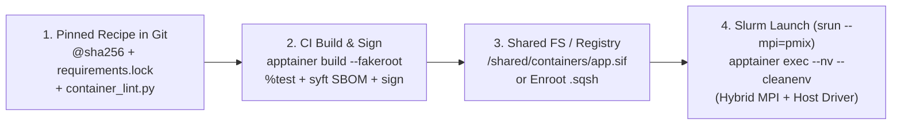

# 6.29 Containers and reproducibility in HPC: Apptainer and enroot

| | |
|---|---|
| Level | Intermediate |
| Priority tier | 2 |
| Lab venue | Linux host with Apptainer; Slurm for the MPI parts |
| Part | Part 6: HPC and Slurm |
| Status | Drafted. Apptainer statements come from the Apptainer user documentation (apptainer/apptainer-userdocs commit `69efb83`, 2026-10-23: definition files, GPU, MPI, build environment); enroot/pyxis from 6.13. `code/part06/container_lint.py` was run on a bad and a good definition file (output shown). **Apptainer itself was not run** (Linux only), and no container build was run either. Security-model statements come from general knowledge and still need checking. The labs were not run, except the linter steps |

## Why this matters for AI infrastructure

Suppose a training run that worked last month now gives different numbers on a new cluster. The researcher asks what changed, and the honest answer is that nobody knows yet. You have to find out which layer moved: the driver, a library, the base image, or the cluster itself. Chapter 6.13 showed how NVIDIA's enroot and pyxis run containers inside Slurm, the batch scheduler that hands out cluster resources. Many clusters, including most academic and national-lab systems, use **Apptainer** instead. Apptainer was formerly known as Singularity. Many scientific groups publish their software as Apptainer or Singularity images, so you will meet these files on almost any shared research system.

Whichever runtime you use, the harder problem is **reproducibility**. Can you rebuild the same environment next year? Can you prove which libraries produced a result, and run that same environment on a different cluster? Those questions matter more than which tool you picked. A runtime that starts a job quickly does not help you if you cannot say later what was inside the container.

AI makes this sharper. CUDA (NVIDIA's GPU programming platform), cuDNN (its library of deep learning routines), NCCL (its library for moving data between GPUs), PyTorch, the GPU drivers and Python wheels, which are packaged Python libraries, all interact with each other. A one-line drift in any of them can change speed or the numbers a calculation produces. This chapter compares the runtimes and gives you a discipline that makes container images trustworthy. Decide which runtime fits your cluster first, then apply the discipline to its images.

## Prerequisites and outcomes

This chapter builds on 6.6, 6.13, and either 6.4 or 6.12, which cover MPI (the Message Passing Interface, the standard way programs on many nodes send data to each other) and NCCL. The chapter starts with what a container is mechanically, using cgroups (the kernel's resource limit mechanism), namespaces and `chroot`, and why HPC runtimes differ from Docker. It then covers building, running and sharing Apptainer images. After that comes a comparison of Apptainer, Charliecloud and enroot with pyxis, a reproducibility discipline with a linter that checks it, and the way images are cached, signed and distributed. If one of these ideas is new to you, read its section before you start the labs.

## 1. What a container is, and why HPC needed new runtimes

Picture a shared research cluster where a dozen teams each want their own version of Python, CUDA and a handful of scientific libraries. One team upgrades a shared library on a Friday afternoon, and on Monday another team's job fails to start. Nobody did anything wrong, but everyone shares one set of files. Containers are one way out of that trap. They are also the reason HPC sites need runtimes that behave differently from the ones built for cloud servers.

The diagram below shows the path a container takes on a well-run cluster. Read it from left to right. Each box is a step that someone performs, and each step has a clear owner.



The first box is the recipe, which is the text that says how the image is built. It lives in Git, pins its base image by digest and lists its Python packages with a lock file. The second box is a build that runs in a continuous integration system, which is an automated build server, and not on someone's laptop. The build runs the image's tests and produces a software bill of materials (SBOM), a list of every component inside the image. Then it signs the result. The third box is where the finished image sits, either on a shared file system or in a registry. The fourth box is the moment a job starts. Slurm launches the container on each node, and the container uses the host's GPU driver and MPI launcher.

*Supercomputers for Linux SysAdmins*, in chapter 16, defines a container as "an isolated set of processes". Those processes have limited access to the other processes, the network, the file system and devices. A container is similar to a virtual machine, but it does no emulation. Every process is real, and you can see each one from the host. That last point is worth remembering, because it means a container process is just another process to the kernel, with some limits applied.

Three kernel facilities build a container. **cgroups** limit memory, CPU and devices. **namespaces** isolate PID, user, mount, network and IPC, so processes can have "virtual" numbers. A PID is a process ID, and IPC means inter-process communication. **chroot** changes the root directory, so the process sees a different tree of files as if it were `/`. Docker packages these with a root daemon, which is a background service that runs as root and does the work for every user, and with a layered image format.

HPC clusters need different properties. Each row of the table below shows one of them, and how the two models handle it.

| Requirement | Docker daemon model | HPC runtimes |
|---|---|---|
| No root daemon, no privilege escalation by users | Root daemon; docker group = root | Unprivileged execution (setuid helper or user namespaces) |
| Same user identity and file permissions inside | Often root inside; UID remapping | Run as the invoking user (shared file systems demand it) |
| Scheduler owns the processes | Containers are children of the daemon | The container is the Slurm task (cgroups, accounting, signals) |
| Direct access to the fabric and GPUs | Needs plumbing | Host devices and driver libraries bound in |
| Shared file systems and home mounted | Explicit volumes | Home, scratch and project mounted by default |
| One portable file | Layered store | Single image file (SIF, squashfs) |
| MPI across nodes | Network namespaces get in the way | Host network, host or hybrid MPI |

Notice that the HPC column keeps each user's own identity, and it leaves the scheduler in charge of the processes. Think about what that means for a shared cluster. If a user runs a container and it writes a file to the project directory, the file should belong to that user, not to root. If a job runs out of its allocation, Slurm should be the thing that stops it, using the same accounting it uses for every other job. The table is really asking one question in several ways: who owns this process, and who can stop it?

### Layers and data mounts

Containers help you escape dependency hell, the tangle that appears when you recompile a program or try to run one binary next to other software. Picture a team that wants to test a new database for an afternoon. They cannot install it on the shared system without risking a clash with the software already there. A container avoids this by carrying its own files: the binaries, the libraries and even a private copy of `libc`, the C library that nearly every Linux program depends on.

Under the hood, a container is cgroups, namespaces and `chroot` applied to a set of processes. When it starts, its file system is mounted, the cgroups and namespaces are set up, and the first process starts with `chroot` into that file system. That first process is usually the one you asked for, and every child it starts inherits the same walls.

The network side is a little more involved, but the idea is the same. You can limit a container so it sees only certain interfaces, usually virtual ones you created for it. The options go further. For example, you can allow a container to use no more than 20% of your memory, or only one CPU core. Those limits are the cgroup part of the story, and they protect your neighbours on a shared node from a runaway job.

Docker adds a layered design on top of this. The first layer is a base system, such as a freshly installed Ubuntu system. Each later layer stores the changes you make on top of the layer below, including file deletions. Because layers live in the registry and on local storage, a second image built on the same base downloads only its new layers. That saves time and disk space, and it is the reason a team can share one base across many images.

Almost every line in a Dockerfile creates a new squashfs layer. A Dockerfile is the recipe file Docker reads to build an image, and squashfs is a compressed, read-only file system format. Suppose you edit one line and rebuild. Only that line and the lines after it are rebuilt, because the earlier layers have not changed. That is why the order of lines in a Dockerfile matters so much, and why the chapter returns to it in section 4.

Your data still has to reach the container. On Linux, the `--bind` option mounts a local directory into another directory, so your files appear inside the container. Container systems let you choose both what to mount and the path where it appears inside the container. A dataset that lives at `/scratch` on the host can appear at `/scratch` inside, or at a different path if your code expects one. The mount is a view, not a copy, so the container reads and writes the same bytes as the host.

### Containers in short

In short, a container is an isolated set of processes and a light alternative to virtual machines. It is handy when you want to run an application without installing new packages or compiling it from source. On an HPC system, though, you need to be careful. Jobs need low-latency access to devices and must run MPI applications, and an isolation layer that gets in the way of those needs is a problem, not a feature. Pick a runtime that supports both.

## 2. Apptainer

Imagine you have just received a container file from a collaborator, and you want to run it on your cluster tomorrow morning. You need a format that is one file, that you can copy to a shared disk, and that runs without asking the cluster for root access. Apptainer is built around that need. It runs a container from a single **SIF** file. SIF stands for Singularity Image Format. It is a squashfs-based, immutable image that can also carry signatures, definition files and extra data partitions. Immutable means the file cannot be changed after it is built. Apptainer is the Linux Foundation project formerly known as Singularity. The name "Singularity" also belongs to a separate commercial line from Sylabs Inc.

### Singularity and Apptainer

Singularity comes from Sylabs Inc. Its open source community edition is mature, and it uses its own image format. You can convert a Docker container into that format with little effort. Singularity was designed for HPC, which is why it integrates easily with any batch system.

It gives HPC applications transparent access to InfiniBand and GPU accelerators. InfiniBand is the fast network fabric used between nodes in most large clusters. For NVIDIA GPUs, the host needs `nvidia-container-toolkit` installed, because that package is what makes the GPU visible to the container.

Apptainer is a fork of Singularity, developed independently under the Linux Foundation. A fork is a copy of the code that then goes its own way. Most of what is written about Singularity applies to Apptainer too. The history is a little more tangled than that, because Singularity was itself a fork. The Apptainer community announcement explains the details. For day-to-day work, the commands and image workflows are the same, so you can follow either set of documentation with confidence.

### Core commands

The commands below cover the common workflow, from pulling an image to signing it. Read them as a story. You first fetch or build an image, then run it, then check it and sign it.

```bash
apptainer pull docker://ubuntu:24.04                        # create a SIF from an OCI image (cached)
apptainer build myenv.sif myenv.def                          # build from a definition file
apptainer build --fakeroot myenv.sif myenv.def               # unprivileged build using user-namespace fake root
apptainer exec --nv -B /scratch:/scratch myenv.sif python train.py     # run a command with NVIDIA GPU support and a bind mount
apptainer shell myenv.sif ; apptainer run myenv.sif          # interactive shell / run the %runscript
apptainer inspect myenv.sif ; apptainer sign myenv.sif ; apptainer verify myenv.sif
```

The first line pulls an image from an OCI registry. OCI stands for Open Container Initiative, the standards body behind the image format that Docker and most registries use. Apptainer converts it into a SIF file and keeps a copy in its cache, so the next pull is faster. The second line builds a SIF from your own definition file. The third line does the same thing without root, which is the setting you will use on a shared cluster.

Notice that `--fakeroot` lets you build without root, and `--nv` exposes the GPU to the container. The command set comes from the Apptainer user documentation, which also lists the `-B/--bind` flag. The `exec` line is the one you will type most often. It runs one command inside the container, and the `-B` flag adds a mount so the container can see `/scratch`. The last line handles trust. `inspect` shows the metadata, `sign` adds a signature, and `verify` checks that signature before anyone relies on the file.

### Definition files

The Apptainer documentation describes a definition file, or "def" file, as "a set of blueprints explaining how to build a custom container." You write one to say how an image gets built. Think of it as a recipe that says where to start, what to install and what to check. Every definition file has a **header** and a set of sections.

The header starts with `Bootstrap:`, which selects the *bootstrap agent*. A bootstrap agent is the method Apptainer uses to fetch the starting system. For the `docker` agent, the `From:` line names the base image. Other agents include `oras`, `localimage`, `scratch`, `library`, `shub`, `yum`/`dnf` and `debootstrap`. Each agent answers the question "where does the first layer of this image come from?" in a different way.

Sections start with `%`. The main ones are `%files`, which copies from the host; `%post`, which runs build-time commands; `%environment`; `%runscript`; `%startscript`; `%test`, which runs at the end of the build; `%labels`; `%help`; `%setup`; and `%arguments`. Build-time sections run under `/bin/sh`. Keep that in mind when you write one. A line that works in your interactive bash shell may not work inside `%post`, because the build uses the simpler shell.

The example below pins its base image by digest and ends with a `%test` section. The digest pin means the build always starts from the same bytes, and the test at the end means the build fails loudly if PyTorch does not import.

```text
Bootstrap: docker
From: nvcr.io/nvidia/pytorch@sha256:<digest>

%labels
    Version 2026.10
    Maintainer hpc-team@example.org

%post
    pip install --no-cache-dir -r /opt/requirements.lock

%test
    python -c "import torch; print(torch.__version__)"
```

Notice that the `From:` line points to a digest, not a tag. A tag is a human-friendly name such as `24.04`, and a digest is a fingerprint of the exact image bytes. Section 4 explains why that difference matters for reproducibility.

### Cache

Apptainer caches SIF images built from remote sources, along with OCI and Docker layers. A cache is a local store of work you have already done, so you do not repeat it. By default the cache sits under `$HOME/.apptainer/cache`. To move it, set `APPTAINER_CACHEDIR`. For a root build, use `sudo -E` so the variable carries through. The `-E` flag keeps your environment variables when sudo switches to root.

On a cluster, point the cache and `APPTAINER_TMPDIR` at node-local or scratch storage. Node-local means the disk physically inside the compute node. Avoid a small, quota-limited home directory, or a shared mount that is sensitive to metadata load. Metadata load is the pressure that many small file operations put on a shared file system, and a cache full of image layers creates exactly that pressure. Clean the cache from time to time with `apptainer cache clean`. *Supercomputers for Linux SysAdmins* makes the same point in its "Caching" section, covering image and layer caches for the HPC runtimes it describes.

### GPUs

The `--nv` flag prepares a container for NVIDIA GPUs. It binds the host driver libraries and device nodes into the container. A device node is the file under `/dev` that a program opens to talk to hardware. The documentation says Apptainer natively supports NVIDIA's CUDA, AMD's ROCm and Intel's Gaudi. It also supports OCI **CDI** (Container Device Interface) as a generic method. An experimental `--nvccli` option uses `nvidia-container-cli`.

The documentation warns about one practical failure. Because libraries come from the host, the **libc versions in the container and on the host must not be too far apart**. libc is the C standard library, and it is the lowest layer that every other library calls. Otherwise you get libc mismatch errors. The error can occur when the container's libc is older than the host's. It can also occur when the container's libc is much newer.

The CUDA toolkit in the image must also be compatible with the host driver. The toolkit is the set of compilers and libraries inside the image, and the driver is the component on the host that talks to the GPU. Their version rules are covered in Part 10. A quick check is `apptainer exec --nv img.sif nvidia-smi`, followed by a small CUDA test. If `nvidia-smi` lists the GPUs, the driver is visible. The small CUDA test then proves the toolkit can actually run a kernel on them.

### MPI

The documentation describes two models for MPI applications. The difference between them is simple: who carries the MPI library, the container or the host.

Under the hybrid model, the host provides `mpirun` or `srun`, along with its own MPI. The container also carries an MPI. The launcher starts the container once per rank, and the MPI inside connects back through PMI. A rank is one copy of your program, and PMI (Process Management Interface) is the protocol that lets those copies find each other. For Open MPI, `orted` launches Apptainer, which starts the application, which connects back through PMI.

The container's MPI must be ABI and PMI compatible with the host's. ABI stands for application binary interface, the low-level contract that lets compiled code work with a library without being rebuilt. That means the same implementation and a close version. The advantage is that the application is self-contained. You can move the image to another cluster with a different host MPI, and it still carries its own working copy.

Under the bind model, the container has no MPI. The host's MPI libraries are bind-mounted in instead. This model needs administrators to allow user-specified bind mounts. In exchange, the MPI in use is exactly the one the cluster tested, so you avoid version mismatches. The price is that the image now depends on that cluster's host layout.

On Slurm, you launch with `srun --mpi=pmix apptainer exec ... ./app`, as covered in 6.12. For AI jobs, NCCL ships with the framework in the image. It uses the host's IB devices and driver, and it needs host networking. Host networking means the container shares the node's network stack, instead of getting a private one. That is what lets NCCL reach the fast fabric directly.

### Security model (general knowledge, verify)

Apptainer can run with a small setuid-root helper. Setuid means a program runs with the owner's privileges, here root, even when a normal user starts it. The helper mounts SIFs and sets up namespaces. Apptainer can also run entirely in unprivileged mode, using user namespaces. In that mode, the `--fakeroot` feature maps your user to root inside the build. That mapping exists only inside the build, and it does not give you real root on the host.

The design principle is simple. Privilege escalation inside the container is impossible, because the user stays the same user. There is no `sudo` inside. A researcher who runs a container is still the same person with the same files and the same limits, which is exactly what a shared cluster needs.

Security controls include signed SIF images. PGP keys are the default, used with `apptainer sign` and `verify`, and with a key server. A key server is a public directory where signing keys are published. Other controls are image encryption and restrictions on which images may run. Those restrictions come from `limit container` settings in `apptainer.conf`. The settings can cover allowed paths, owners, groups, or signed-only images.

Some distributions restrict unprivileged user namespaces, and some Ubuntu configurations do this. On those systems, ask your administrators to allow it, or use the setuid mode. Either way, the decision belongs to the people who run the cluster, not to the person building the image.

## 3. Charliecloud, enroot and the comparison

Suppose your group has two clusters. One runs Apptainer, and the other is an NVIDIA system that uses enroot. A colleague builds an image on her laptop and asks whether it will run on both. To answer, you need to know what each runtime expects, so you can decide what to test and what to rebuild. This section describes the three HPC options and the rootless Docker-style option, and then puts them side by side.

**Charliecloud** comes from Los Alamos. It provides minimal, unprivileged containers that use only user namespaces. Its images are directory trees or squashfs. `ch-image` builds them, and `ch-run` runs them. Its small code size is a selling point for security reviews, because a reviewer can read the whole thing in a reasonable time. *Supercomputers for Linux SysAdmins* describes Charliecloud as intended to be lightweight and uncomplicated. It integrates with job management systems through PMIx, which keeps its use simple. *Supercomputers for Linux SysAdmins* covers it together with Singularity.

**enroot + pyxis** is NVIDIA's pair, covered in 6.13. enroot converts OCI images to squashfs and runs them unprivileged. It has hooks for GPU, IB and PMIx. A hook is a small piece of code that runs at a set point in the container's start-up, so enroot can, for example, add GPU device files at the right moment. Slurm integration comes through the pyxis SPANK plugin, which provides `srun --container-*` options. SPANK is Slurm's plugin system, and pyxis is the plugin that adds container flags to `srun`.

**Podman rootless** and **Docker rootless** are OCI-compliant tools that run in user namespaces. They offer more features, but they are heavier and less tuned for HPC. They can still work on workstations and on some clusters. If your team already builds images with Docker or Podman on a laptop, these tools let you run the same image without giving anyone root.

If you need to compare the four runtimes, the table below does it side by side. Each row asks one practical question, such as which image format you will store, or who gets root.

| | Apptainer | Charliecloud | enroot + pyxis | Podman rootless |
|---|---|---|---|---|
| Image | SIF (squashfs-based, signable) | dir/squashfs/tar | squashfs (import from OCI) | OCI layers |
| Build on cluster | `apptainer build` (fakeroot), def files | `ch-image build` (Dockerfile) | `enroot import` + modify; usually build elsewhere | `podman build` |
| Privilege | setuid helper or userns | userns only | userns/setuid-less | userns |
| GPU | `--nv`, `--rocm`, CDI | bind/hooks | hooks (libnvidia-container) | CDI/nvidia-container-toolkit |
| Slurm integration | `srun apptainer ...` (scripts) | `srun ch-run ...` | pyxis (native options) | scripts |
| MPI | host-MPI hybrid/bind | host MPI | PMIx hooks | host network |
| Ecosystem | Widest in academic HPC; OCI compat | Smaller | Strong in NVIDIA clusters (NGC) | Dev workflows |

When you look at the Privilege row, notice that only Apptainer lists a setuid helper. That is the one place where a small piece of software runs as root on the host, so it deserves the closest review. The other three stay entirely in user namespaces.

All four can consume OCI and Docker images. You can therefore build once with a standard tool and deploy to whichever runtime a cluster uses. Test each runtime yourself anyway. The runtimes differ in environment handling, home mounting, and PID and network namespace choices. Those differences rarely show up in a small test, and they often show up on the first real multi-node job.

## 4. Reproducibility discipline

Imagine a reviewer asks you to rerun an analysis from a paper you published two years ago. The image file still exists on the shared disk, but nobody can say which base image it came from or which package versions it holds. Reproducibility is the work of making that question easy to answer, long before anyone asks it.

Reproducibility comes in four levels. You can *rerun* the same image, which depends on immutability. You can *rebuild* the same image, which depends on the build being deterministic, meaning the same recipe always produces the same result. You can *reuse* the environment on another system, which depends on portability. And you can *understand* it, which depends on provenance and metadata. Provenance means a written record of where each piece came from. Each level asks more of your process, so most teams aim for the first two and make the last two possible.

The discipline comes down to twelve practices. Each one closes a specific gap that the four levels expose.

1. Pin the base image by digest, written `From: image@sha256:...`, not by tag. Tags are mutable: `latest` moves, and even `24.04` moves with patch updates. A patch update is a small security or bug fix to the same release. Record the digest in the lab notebook, the job log and the image labels.
2. Pin every dependency with a lock file that includes hashes. `pip install --require-hashes -r requirements.lock` does this, and `conda-lock` and `uv.lock` are alternatives. A hash is a short fingerprint of a package file, and a mismatch means the file is not the one you locked. System packages can be pinned with `apt-get install pkg=version`. A more practical option is to pin the repository snapshot, such as a dated mirror like snapshot.debian.org or an internal Artifactory or Nexus mirror. Then rebuilds see the same packages.
3. Avoid floating network fetches in `%post`. A floating fetch downloads whatever is current on the day of the build. Verify checksums with `sha256sum -c` or GPG signatures, and do not use `curl | sh`. When you clone Git repositories, use a tag, and verify the commit hash too.
4. Do not upgrade the system during the build. A command such as `apt-get upgrade` makes the result depend on the build date.
5. Record metadata as you go. Put the version, the recipe's Git commit, the build date, the base digest and the maintainer in `%labels`. Keep the definition file and lock files in Git, next to the code. Embed or attach a software bill of materials (SBOM), which you can generate with `syft` or a similar tool. Keep the output of your vulnerability scans with it.
6. Build in CI, not on someone's laptop, and build in a clean environment. Tag each image with the recipe's commit. Store it in an OCI registry with Apptainer `oras` support, or in a shared directory of SIFs on the parallel file system, with checksums. A parallel file system is shared storage that many nodes read at once, and you will meet it again in 6.18.
7. Test at build time with `%test`, and test again before promotion. Promotion means moving an image from a test area into the area that real jobs use. Import the framework, run a tiny GPU kernel, run a short NCCL test, and compare numerics to a reference.
8. Sign and verify images that run in production, using `apptainer sign` and `verify`, or cosign for OCI images. See 5.22.
9. Keep the base separate from the application. A slow-moving base image, with CUDA and the framework, can sit under a fast-moving application layer. Rebuild the application layer often.
10. Record the runtime environment at run time. Log the image digest, host driver, kernel, GPU model, and environment variables. A few lines in your job prologue will do it. The prologue is the script Slurm runs before your job starts.
11. Bitwise reproducibility across GPU architectures and library versions is not guaranteed. Bitwise means every bit of the result matches. The reasons are covered in 6.5 for fast-math and reductions, and in 6.12 for NCCL algorithms. Fix seeds and use deterministic modes when you need identical results. Otherwise, accept statistical equivalence, which means the results agree within normal run-to-run noise.
12. Keep images for the life of the publication or project. The registry's garbage collection must not delete referenced digests. Garbage collection is the cleanup pass that removes data nothing points to any more, and a digest that a paper cites counts as something that points to it.

Before you promote an image, check that every digest is pinned, recorded and tested. If one of the three is missing, the image is not ready, however well it runs on the day you built it.

### A linter (tested)

`code/part06/container_lint.py` checks an Apptainer definition file or a Dockerfile for the violations above. A linter is a program that reads a file and points at risky lines without running them. This one is a text check, so it is quick and safe to run on any file. It flags floating base tags, such as `:latest`, missing tags, and tags without digests. It also flags `upgrade` steps, unpinned `apt` and `pip` installs, `curl | sh`, downloads without checksums, `git clone` without a pinned ref, and missing labels and tests.

Here is its output on a deliberately poor file. Read each line as a question the linter asks. An ERROR means the image is not reproducible at all, a warning means it is probably fragile, and an info line is a tidy-up suggestion.

```text
ERROR line 2: base image 'ubuntu:latest' is not pinned (use a version tag, better a digest @sha256:...)
warn  line 5: system upgrade/update step makes the image depend on the build date
warn  line 6: system upgrade/update step makes the image depend on the build date
warn  line 7: apt install without version pins (acceptable if the base image and repo snapshot are pinned)
ERROR line 8: pipes a download into a shell: unverifiable and non-reproducible
warn  line 8: download without a following checksum/signature check
warn  line 9: download without a following checksum/signature check
warn  line 11: git clone without pinning a tag/commit
warn  line 12: pip install without version pins (use a lock file with hashes)
info  line 12: pip install without --no-cache-dir inflates the image
info  no %labels section ...
info  no %test section ...
```

The good file produced "no findings". It had a digest-pinned base, a lock-file `pip install` with `--no-cache-dir`, a checksum-verified download, labels and a test. Compare the two outputs side by side. Almost every warning on the poor file corresponds to a practice from the list of twelve, which is the point of building the linter from that list.

The first version of the linter had two bugs, and the test files exposed both. It missed `apt-get -y upgrade`, because the flag came before the verb. It also flagged `... | sha256sum -c -` as "pipes into a shell", because the pattern `| sh` matched the start of `sha256sum`. Both were fixed with word-boundary and optional-flag patterns. That is a reminder to test a linter on both good and bad inputs. A linter that only ever sees bad files can pass every check while missing the cases it was meant to allow.

The linter is a heuristic text check. It does not parse multi-line continuations or build stages. A continuation is a single command split over several lines with a backslash, and a build stage is one section of a multi-stage Dockerfile. Run it on your own definition files and Dockerfiles, and test any change to it on both bad and good inputs.

## 5. Distribution and operations

Imagine the image works perfectly on one node. You are happy, and then you submit the same job to every node in a large GPU partition at once. Within minutes, the file server slows, the first ranks are waiting on the image, and the rest queue behind them. Once you have an image that works on one node, the harder questions start. Where does it live, and how do thousands of ranks reach it without stalling?

Images need a home. Use a registry, such as Harbor, Artifactory, GHCR or the NGC private registry, for OCI images. A registry is the server that stores and serves images by name and digest. For Apptainer, keep a controlled directory of SIFs on the parallel file system, for example `/shared/containers/<name>/<version>.sif`, with a `sha256` file beside it. The checksum file lets anyone confirm the image has not been damaged or swapped. Squashfs is one file, which makes it a good fit for Lustre or GPFS (see 6.18) and for staging to node-local NVMe. Lustre and GPFS are parallel file systems, and NVMe is fast solid-state disk inside the node.

Start-up at scale is its own problem. When thousands of ranks pull or mount the same image, the registry and the file system both feel it. Stage the image to local disk, or rely on page-cache sharing. The page cache is the memory the kernel uses to hold recently read file data, so once one rank reads the file, others on the same node can read it from memory. Do not pull from a registry inside the job, and avoid unpacking the image on every rank. Unpacking on every rank multiplies the work by the number of ranks, and that work is the first thing that stalls.

Default binds can leak host state. Apptainer's defaults bind home, `/tmp`, `/proc`, `/sys` and `/dev`, so verify that list for your version. Those binds can break reproducibility. For example, `~/.local` Python packages silently override container packages. A bind that carries host state into the container means the container is no longer the self-contained environment you tested. Use `--no-home`, `--cleanenv` or `--containall` where needed, or set `PYTHONNOUSERSITE=1`. Prefer explicit, minimal binds for datasets and outputs, so the container sees only what the job needs.

The environment leaks too. Apptainer passes the host environment by default, and `--cleanenv` (`-e`) starts clean. A host variable such as a different `LD_LIBRARY_PATH` can change which libraries load, and that change is invisible from inside the image. Combine it with Slurm's `--export` choices, covered in 6.11, so you decide on purpose which variables cross into the job.

Quotas and cleanup need automation. Image caches and build directories grow. A quota is the limit a file system puts on how much one user or project can store. Automate cleanup in prolog and epilog scripts, or with cron. The prolog and epilog run before and after each job, and cron is the standard Linux scheduler for timed tasks. A cleanup job that runs on a schedule is far more reliable than a reminder to clean up by hand.

Publish a support matrix. List which base images, CUDA versions, MPI and PMIx versions, and runtimes each partition supports, as covered in 6.6. A partition is a named group of nodes in Slurm, such as one set of GPU nodes. Give your users a test job they can run to verify an image. A test job that takes a minute tells a researcher whether their image will run on a partition before they wait in the queue for a long job.

Keep the image runtime-agnostic. The same OCI image should run under Kubernetes (Part 11) and under Slurm, through enroot or Apptainer. Put runtime-specific settings in the launch scripts, not in the image. That way the image stays the same no matter where it runs, and only the thin launch layer changes.

## 6. Lab

Start with the self-checking Python lab, `code/part06/container_lint_lab.py`. Run it locally, so you can see each result. It checks `lint()` in `code/part06/container_lint.py` against three inputs. The first is a digest-pinned Apptainer `good.def`, which should produce `0` findings. That result confirms that `| sha256sum -c -` is not falsely flagged as `| sh`. The second is a broken `bad.def`. It should produce `2` `ERROR`s, for the unpinned `ubuntu:latest` and the `curl ... | sh` line, plus `10` warnings and infos. The third is a digest-pinned `Dockerfile`. Run the lab with this command:

```bash
python3 code/part06/container_lint_lab.py
```

Each of the three inputs tests a different promise. The good file tests that the linter stays quiet when you do the right thing. The bad file tests that it speaks up when you do the wrong thing. The Dockerfile tests that the same rules apply to a second format. If any of the three answers changes, the linter itself has changed, and you should find out why before you trust it.

The tested items come first. These steps run on any laptop with Python.

1. Run `container_lint.py` on a Dockerfile and on a definition file of your own. Fix every ERROR and warning. This shows the linter on real files, not only on the test fixtures.
2. Add one new check, such as an `ADD http://` instruction in a Dockerfile, and give it a test. Then create the `bad.def` and `good.def` pair from section 4, and reproduce the output. A new check earns trust only after you have seen it fire on bad input and stay quiet on good input.

The next items need Linux with Apptainer. These steps were not run in this chapter, so treat them as a plan to follow on your own GPU node.

3. Run `apptainer pull docker://...`, then `build` a definition file that has a `%test` section. Run it with `--nv` on a GPU node. Then trigger a libc mismatch with an old base image, and diagnose it. This ties together the build, the GPU binding and the libc failure from section 2 on real hardware.
4. Run an MPI hello program with the hybrid model under `srun --mpi=pmix`. A hello program is the smallest MPI test, so a pass proves the launch path works before you run anything large.
5. Measure how long a 5 GB SIF takes to start on Lustre, and compare that with node-local NVMe, using 64 ranks. The gap shows what the shared file system costs when many ranks start at the same moment.
6. Sign an image and verify it. Then try to run a modified copy. The modified copy should be refused, which shows the signature is doing its job.
7. Rebuild the same definition file twice, a week apart. Do one build with digest and lock-file pinning, and one without. Compare `pip freeze` and the image checksums. The difference between the two builds is the cost of skipping the pins.
8. Convert one workflow between Apptainer and enroot/pyxis. List the differences in environment and mounts. Those differences are where an image that works in one runtime breaks in the other.
9. Generate an SBOM for an image, and scan the image. The SBOM tells you what is inside, and the scan tells you which of those parts has a known problem.

Start with the tested items, then work through the rest on a Linux GPU node that you can reach. Keep a notebook open while you do. Write down the digest, the driver version and the result of each step, because the notebook is the provenance record that section 4 asked for.

## 7. Interview angles

- How is an HPC container runtime different from Docker?
- Explain `--nv` and the libc mismatch problem.
- Hybrid vs bind MPI model: trade-offs?
- How do you make a container build reproducible?
- Why pin by digest and what does a tag guarantee?
- How would you let researchers build images on a shared cluster safely?
- Compare Apptainer and enroot/pyxis for an NVIDIA GPU cluster.
- What gets leaked from the host into a container by default and how do you control it?
- A job works in the container on cluster A and fails on cluster B: what do you check?

### 6.1 Troubleshooting guide: Why a "reproducible" container fails when moved between GPU clusters

Picture this on-call page. *"A researcher built an Apptainer `.sif` or Enroot `.sqsh` container on Cluster A, where their multi-node training job ran at full speed. They copied the exact same image file to Cluster B. It either crashes on launch or runs ten times slower. Why?"*

HPC containers share the host Linux kernel. They also bind host GPU and RDMA driver libraries at runtime. RDMA (remote direct memory access) lets one node read and write another node's memory over the network without going through the CPU. That means an immutable image is **not** completely self-contained at the hardware boundary. The image holds your code and libraries, but the hardware-facing pieces come from whichever host you run on. Work through these five checks in order.

The first check compares glibc on the host with the NVIDIA driver libraries that `--nv` (or `98-nvidia.sh`) injects. glibc is the GNU version of the C library. Passing `--nv` in Apptainer, or running Pyxis and Enroot with `nvidia-container-cli`, bind-mounts the host OS's user-space driver libraries into the container. Those are `libcuda.so` and `libnvidia-ml.so`, and they match the loaded `nvidia.ko` module. They were compiled against the host OS's glibc. Suppose Cluster B runs Ubuntu 24.04 with glibc 2.39, but the image was built on Ubuntu 18.04 with glibc 2.27. Dynamic linking then fails at once, with `version 'GLIBC_2.34' not found (required by libcuda.so.1)`. Rebase the container onto a modern base whose glibc is at least as new as the host's.

The second check is CUDA forward compatibility, which compares `cudaDriverGetVersion` with `cudaRuntimeGetVersion`. Those two calls report the driver version the host is running and the CUDA runtime version the container was built with. The container holds the CUDA toolkit and runtime, `libcudart.so`, for example CUDA 12.6. The host provides the kernel driver, `libcuda.so`. Suppose Cluster B runs an older driver branch that does not support that toolkit. If the matching `cuda-compat` package is not installed and added to `LD_LIBRARY_PATH`, then `torch.cuda.is_available()` returns `False`. It may also throw `CUDA driver version is insufficient for CUDA runtime version`. The fix is either a newer driver on the host or a compatibility package in the image, and the error message tells you which side is out of date.

The third check is `$HOME` and `~/.local` leakage. By default, Apptainer bind-mounts your shared `$HOME` and inherits the calling shell's environment variables. Suppose the researcher ran `pip install --user` on Cluster B's login node. Python inside the container then adds `~/.local/lib/python3.x/site-packages` to `sys.path`. `sys.path` is the list of places Python looks for packages, and that directory is searched alongside the packages baked into the image. Those broken host files silently shadow the container's locked PyTorch or Triton packages. Always pass `--cleanenv` (`-e`). Then add either `--no-home` or `--containall`, or export `PYTHONNOUSERSITE=1` in the job script.

The fourth check is whether the MPI, PMIx, UCX and libfabric providers match the interconnect. PMIx is the process-management protocol introduced in section 2. UCX and libfabric are the low-level communication libraries that MPI and NCCL use to reach the network. Suppose Cluster A uses NVIDIA Quantum InfiniBand with `mlx5` Verbs and UCX. Cluster B uses RoCEv2, which needs `NCCL_IB_GID_INDEX`, or Slingshot with the libfabric CXI provider, or AWS EFA. An image that compiled Open MPI and NCCL only against standard libibverbs lacks the target fabric plugin. The same happens if `/dev/infiniband` or the host OFED providers are not bind-mounted. NCCL then silently falls back from NET/IB, which uses GPUDirect RDMA, to NET/Socket, which uses host TCP over Ethernet. That causes a $10\times$ drop in multi-node AllReduce bandwidth. To check it at once, inspect `NCCL_DEBUG=INFO` on Rank 0. The silent part is what makes this check important. The job still runs, just far more slowly, so the only sign is in the NCCL log.

Work through the checks in order, starting with glibc, before you change the image. Each check is cheap to run and rules out a whole family of causes. If you jump straight to rebuilding the image, you may spend a day fixing something that was never broken.

## Exercises

1. Your team's lint check failed on a definition file, and you want to know why before you change it. Run `python3 code/part06/container_lint_lab.py` first, so you can see the linter pass its own tests. Use `code/part06/container_lint.py` and `container_lint_lab.py` to check your own definition files for reproducibility. Explain why `container_lint.py` flags `From: ubuntu:latest` as a hard `ERROR`. Explain why it flags `curl ... | sh` as a hard `ERROR` too. Explain why `apt-get upgrade` makes an image non-reproducible across build dates. Explain why the word-boundary regex `\b(ba)?sh\b` is needed, so that `echo "<hash>  file" | sha256sum -c -` is not misread as piping into a shell.
2. A researcher needs a definition file that pins everything, so a rebuild next year gives the same result. Write a complete Apptainer `.def` file that starts with `Bootstrap: docker` and `From: nvcr.io/nvidia/pytorch@sha256:...`. Copy a hash-locked `requirements.lock` into the image with `%files`. In `%post`, install the packages with `pip install --no-cache-dir --require-hashes -r /opt/requirements.lock`. Record the git commit and base digest in `%labels`. Add a PyTorch and CUDA import check in `%test`. Show the unprivileged `apptainer build --fakeroot` command. Show the PGP `apptainer sign` and `verify` commands last.
3. Your job must start MPI across several nodes from one batch script. Write the Slurm batch launch line, `srun --mpi=pmix apptainer exec --nv --cleanenv -B /scratch:/scratch myenv.sif python train.py`. Describe the hybrid MPI model. In that model, the container holds its own PMIx-compatible Open MPI or HPC-X, which talks to host `slurmstepd`. Describe the bind MPI model. In that model, host MPI libraries are bound into the container. Then compare the two models.
4. A researcher built `old.sif` from an Ubuntu 18.04 base image, which has glibc 2.27. On an Ubuntu 24.04 GPU node, which has glibc 2.39, `apptainer exec --nv old.sif nvidia-smi` fails with `GLIBC_2.34 not found`. Explain why `--nv` triggers this error. Explain how CDI or a newer base image resolves it. Then explain how `~/.local/lib/python3.x/site-packages` on a shared `$HOME` can silently override container packages. Name the three ways to stop that: `--no-home`, `--containall`, or `PYTHONNOUSERSITE=1`.
5. Your cluster's nodes have local NVMe, and you want the Apptainer cache off the shared home directory. Write the `/etc/profile.d/containers.sh` snippet that points `APPTAINER_CACHEDIR` and `APPTAINER_TMPDIR` to node-local NVMe at `/tmp/$USER/apptainer`. It should replace `$HOME/.apptainer/cache`. Then explain why `sudo -E` is required when you pass `APPTAINER_CACHEDIR` to a privileged build.
6. Your team must pick one runtime for a new cluster, and you want a fair comparison first. Compare all four runtimes: Apptainer, Charliecloud, Enroot with Pyxis, and rootless Podman. Cover image format (`.sif` vs `.sqsh` vs OCI layers). Cover privilege mechanism (setuid or userns). Cover GPU injection (`--nv`/CDI vs `98-nvidia.sh`). Cover Slurm integration (`srun apptainer exec` vs SPANK `--container-image`). Cover cryptographic image signing.

If you start with exercise 1, you need only the lint scripts. Write each answer in your own words before you check it against the section it comes from.

## Exercises

1. Your team's lint check failed on a definition file, and you want to know why before you change it. Run `python3 code/part06/container_lint_lab.py` first, so you can see the linter pass its own tests. Use `code/part06/container_lint.py` and `container_lint_lab.py` to check your own definition files for reproducibility. Explain why `container_lint.py` flags `From: ubuntu:latest` as a hard `ERROR`. Explain why it flags `curl ... | sh` as a hard `ERROR` too. Explain why `apt-get upgrade` makes an image non-reproducible across build dates. Explain why the word-boundary regex `\b(ba)?sh\b` is needed, so that `echo "<hash>  file" | sha256sum -c -` is not misread as piping into a shell.
2. A researcher needs a definition file that pins everything, so a rebuild next year gives the same result. Write a complete Apptainer `.def` file that starts with `Bootstrap: docker` and `From: nvcr.io/nvidia/pytorch@sha256:...`. Copy a hash-locked `requirements.lock` into the image with `%files`. In `%post`, install the packages with `pip install --no-cache-dir --require-hashes -r /opt/requirements.lock`. Record the git commit and base digest in `%labels`. Add a PyTorch and CUDA import check in `%test`. Show the unprivileged `apptainer build --fakeroot` command. Show the PGP `apptainer sign` and `verify` commands last.
3. Your job must start MPI across several nodes from one batch script. Write the Slurm batch launch line, `srun --mpi=pmix apptainer exec --nv --cleanenv -B /scratch:/scratch myenv.sif python train.py`. Describe the hybrid MPI model. In that model, the container holds its own PMIx-compatible Open MPI or HPC-X, which talks to host `slurmstepd`. Describe the bind MPI model. In that model, host MPI libraries are bound into the container. Then compare the two models.
4. A researcher built `old.sif` from an Ubuntu 18.04 base image, which has glibc 2.27. On an Ubuntu 24.04 GPU node, which has glibc 2.39, `apptainer exec --nv old.sif nvidia-smi` fails with `GLIBC_2.34 not found`. Explain why `--nv` triggers this error. Explain how CDI or a newer base image resolves it. Then explain how `~/.local/lib/python3.x/site-packages` on a shared `$HOME` can silently override container packages. Name the three ways to stop that: `--no-home`, `--containall`, or `PYTHONNOUSERSITE=1`.
5. Your cluster's nodes have local NVMe, and you want the Apptainer cache off the shared home directory. Write the `/etc/profile.d/containers.sh` snippet that points `APPTAINER_CACHEDIR` and `APPTAINER_TMPDIR` to node-local NVMe at `/tmp/$USER/apptainer`. It should replace `$HOME/.apptainer/cache`. Then explain why `sudo -E` is required when you pass `APPTAINER_CACHEDIR` to a privileged build.
6. Your team must pick one runtime for a new cluster, and you want a fair comparison first. Compare all four runtimes: Apptainer, Charliecloud, Enroot with Pyxis, and rootless Podman. Cover image format (`.sif` vs `.sqsh` vs OCI layers). Cover privilege mechanism (setuid or userns). Cover GPU injection (`--nv`/CDI vs `98-nvidia.sh`). Cover Slurm integration (`srun apptainer exec` vs SPANK `--container-image`). Cover cryptographic image signing.

If you start with exercise 1, you need only the lint scripts. Write each answer in your own words before you check it against the section it comes from.

## Checkpoint

<details>
<summary>1. Which three Linux kernel facilities make up a container (*Supercomputers for Linux SysAdmins*, chapter 16), and what seven properties do HPC container runtimes change compared to the Docker daemon model?</summary>

A container combines cgroups for resource and device limits, namespaces for PID, mount, user and IPC isolation, and `chroot`, with `pivot_root`. Compared with Docker, HPC runtimes such as Apptainer, Enroot and Charliecloud change seven things. They run unprivileged, without a root-equivalent daemon. They keep the invoking user's numeric UID and GID inside the container. They run directly as children of `slurmstepd`, inside Slurm's job cgroup. They bind host GPUs and InfiniBand RDMA devices in transparently. They mount shared filesystems, such as `/home` and `/scratch`, automatically or with simple flags. They package images as single immutable files, `.sif` or `.sqsh`, which suit parallel filesystems. And they share the host network namespace and PMIx sockets for multi-node MPI and NCCL.
</details>

<details>
<summary>2. What is an Apptainer **SIF** file, and how does it differ from an Enroot `.sqsh` file?</summary>

A SIF file, short for Singularity Image Format, is a single-file container image. Its core is a read-only `squashfs` root filesystem. Around that core sits an extensible header and metadata. The metadata stores the build definition file, the OCI configuration, cryptographic PGP signatures from `apptainer sign` and `verify`, and optional encrypted partitions. An Enroot `.sqsh` file is different. It is a raw `squashfs` archive that gets unpacked into `ENROOT_DATA_PATH`.
</details>

<details>
<summary>3. What is the structure of an Apptainer definition (`.def`) file, which keyword must appear first, and what are its main `%` sections?</summary>

A `.def` file begins with a header. The first keyword must be `Bootstrap:`, which selects the bootstrap agent. Agents include `docker`, `oras`, `localimage`, `scratch`, `library`, `yum`/`dnf` and `debootstrap`. The header is followed by `From:`. After the header come the `%` sections. `%files` copies files from the build host into the container. `%post` runs shell commands with `/bin/sh` at build time to install software. `%environment` sets environment variables at runtime. `%runscript` and `%startscript` hold the default entrypoint, which `apptainer run` or `instance start` executes. `%test` runs smoke tests at the end of `apptainer build`. `%labels` and `%help` hold provenance metadata and usage documentation, which `apptainer inspect` shows.
</details>

<details>
<summary>4. What does `apptainer build --fakeroot` do, and why is it important on shared clusters?</summary>

The `--fakeroot` flag uses Linux user namespaces to map you to UID `0`, which is fake root, inside the build. The mapping comes from `/etc/subuid` and `/etc/subgid`. Inside `%post`, researchers and CI runners can then run `apt-get`, `dnf` or `pip`, and build `.sif` images. None of them needs `sudo` on the host. That matters on shared clusters.
</details>

<details>
<summary>5. Where does Apptainer store its image/layer cache by default, why is that default problematic on HPC clusters, and how do you relocate it?</summary>

By default, Apptainer caches downloaded OCI layers and converted SIFs in `$HOME/.apptainer/cache`. That default causes trouble on HPC clusters. `$HOME` usually sits on a quota-limited NFS mount. Extracting multi-gigabyte layers there can trigger quota failures (`EDQUOT`) and metadata storms. To relocate the cache, export `APPTAINER_CACHEDIR` and `APPTAINER_TMPDIR`, pointing them at node-local NVMe, `/tmp/$USER`, or fast `/scratch`. Then clean old layers with `apptainer cache clean`.
</details>

<details>
<summary>6. What does `apptainer exec --nv` do, and why can it fail with a **`glibc` version mismatch** error?</summary>

`--nv` finds the host's NVIDIA driver user-space libraries, `libcuda.so`, `libnvidia-ml.so` and `nvidia-smi`. It also finds the `/dev/nvidia*` device nodes, and it bind-mounts them into the container. Those host `.so` libraries were compiled against the host OS's glibc. Suppose the container runs a much older distribution. Its `libc.so.6` may lack symbol versions that the driver libraries need. In that case, dynamic linking fails with `GLIBC_2.xx not found`. The fix is a container base image whose glibc version is compatible with the host OS.
</details>

<details>
<summary>7. Compare Apptainer's **hybrid MPI model** and **bind MPI model**.</summary>

Under the hybrid model, both the host and the container have MPI installed. The host launcher, `srun --mpi=pmix` or `mpirun`, starts `apptainer exec myenv.sif ./app` on each node. The container's internal MPI links against the application and talks to the host's `slurmstepd` or `orted` daemon through PMIx or PMI2. The model is self-contained and portable. It needs ABI and PMIx compatibility between host and container MPI.

Under the bind model, the container contains no MPI. Instead, the host's MPI directory, `/opt/openmpi` or HPC-X, is bind-mounted with `-B` at runtime, along with the interconnect libraries. That guarantees an exact match with the host MPI. The trade-off is that the container is tied to that cluster's host paths and glibc.
</details>

<details>
<summary>8. How does Apptainer's security model prevent privilege escalation inside a container, and how can administrators restrict which `.sif` images may execute?</summary>

Inside an Apptainer container, the user keeps the same unprivileged UID as on the host. The output of `id` is identical inside and outside. The container filesystem is mounted `nosuid`, so `su`, `sudo` and setuid binaries inside the image cannot raise privileges. Administrators can tighten this further in `/etc/apptainer/apptainer.conf`. Options include `limit container owners`, `limit container paths`, and `ecl.toml` execution control lists. With them, only `.sif` files in root-owned directories, or files signed by a trusted PGP key, may run. Signing uses `apptainer sign` and `apptainer verify`.
</details>

<details>
<summary>9. Compare **Apptainer**, **Charliecloud**, and **Enroot + Pyxis** across image format, Slurm launch syntax, and ecosystem fit.</summary>

Apptainer uses a single `.sif` file that can be signed or encrypted. You launch it with `srun --mpi=pmix apptainer exec --nv app.sif ...`, and it is common across academic and national-lab HPC. Charliecloud uses an unpacked directory or a `.sqsh` archive. You launch it with `srun ch-run ...`, and its minimal user-namespace codebase is favored at Los Alamos and DOE labs. Enroot with Pyxis uses a single `.sqsh` file, unpacked per task into node-local `ENROOT_DATA_PATH`. It integrates into `srun` and `sbatch` through the SPANK `--container-image` and `--container-mounts` flags, with NVIDIA, Mellanox and PMIx hooks. It is standard on NVIDIA DGX SuperPOD and AI neoclouds.
</details>

<details>
<summary>10. What are the four levels of scientific/AI container reproducibility?</summary>

The first level is rerun, which relies on immutability. Running the exact same archived `.sif` or `.sqsh` binary gives the same software environment. The second level is rebuild. Rebuilding the `.def` or Dockerfile from source a year later should give an identical package set. The third level is reuse, or portability. The image runs across different clusters or cloud orchestrators, such as Slurm and Kubernetes. The fourth level is understand, or provenance. Inspect `%labels`, the git commit, lock files, and the Software Bill of Materials (SBOM) to know every library version inside the image.
</details>

<details>
<summary>11. Why is pinning a base image by tag (`From: nvcr.io/nvidia/pytorch:24.07-py3` or `ubuntu:24.04`) insufficient for strict rebuild reproducibility, and what should you use instead?</summary>

Registry tags are mutable pointers. Vendors often push security updates or rebuilt layers under the same `24.04` tag, and `:latest` moves all the time. Pin by immutable manifest digest instead, for example `From: nvcr.io/nvidia/pytorch@sha256:<64_hex_chars>`. A digest guarantees that every rebuild pulls the exact same base layers, byte for byte.
</details>

<details>
<summary>12. Why does running `apt-get upgrade` or `dnf upgrade` inside `%post` or `RUN` violate build reproducibility (`code/part06/container_lint.py`)?</summary>

Because `apt-get upgrade` upgrades every installed system package. Each package moves to whatever version the upstream mirror holds on the day the build runs. The image then depends on the build date, not on the recipe in Git.
</details>

<details>
<summary>13. How do you make Python `pip`, `conda`, or `uv` package installations inside a container build completely deterministic and tamper-proof?</summary>

Generate a fully resolved lock file with cryptographic SHA-256 wheel hashes. The lock file comes from `pip-compile --generate-hashes`, `uv.lock` or `conda-lock`. Commit it to Git. Then install with `pip install --no-cache-dir --require-hashes -r /opt/requirements.lock`. With that command, `pip` refuses to resolve floating transitive dependencies. It also refuses to install any wheel whose SHA-256 digest does not match.
</details>

<details>
<summary>14. Why does `code/part06/container_lint.py` reject `curl ... | sh` as an `ERROR`, and what is the safe pattern for downloading external binaries in `%post`?</summary>

Piping a download straight into a shell, as in `curl ... | sh`, runs unverified remote code. That code can change at any moment, or an attacker can tamper with it in transit. That is why the linter treats it as an `ERROR`. Use three steps instead. First, download the specific, versioned archive to a file with `curl -fsSL <url> -o /tmp/pkg.tar.gz`. Second, verify its digest against a hash pinned in the recipe, using `echo "<sha256>  /tmp/pkg.tar.gz" | sha256sum -c -`. Third, extract and install it.
</details>

<details>
<summary>15. What two regex edge cases did testing `code/part06/container_lint.py` against both `good.def` and `bad.def` uncover?</summary>

The first edge case was `apt-get upgrade` with flags in between. The pattern missed `apt-get -y upgrade`, and the fix was the pattern `(-\S+\s+)*`. The second was `| sh` with no word boundary. It flagged `echo "..." | sha256sum -c -` as piping into a shell, because `sha256sum` starts with `sh`. The fix was `\b(ba)?sh\b`.
</details>

<details>
<summary>16. How does Apptainer's default `$HOME` bind mount silently break Python reproducibility inside containers, and what three flags prevent it?</summary>

By default, Apptainer bind-mounts the user's host `$HOME` into the container. Suppose you ran `pip install --user ...` on the login node. Python inside the container then adds **`~/.local/lib/python3.x/site-packages`** to `sys.path`. Those packages can override or clash with the packages baked into the `.sif` image. Three options prevent this. The first is `--no-home`, which does not mount `$HOME` when the current working directory is not in `$HOME`. The second is `--containall`, written `-C`, which isolates filesystems, PID, IPC and environment. You can also use `--cleanenv`, written `-e`, which clears the host environment variables. The third is to export `PYTHONNOUSERSITE=1` inside `%environment`.
</details>

<details>
<summary>17. What metadata should be recorded in `%labels` (at build time) and in the Slurm job log (at run time)?</summary>

At build time, record the recipe's Git commit SHA, the build date, the base image `@sha256` digest, the CUDA, PyTorch and NCCL versions, and a maintainer contact in `%labels`. Add an SBOM generated with `syft`. At run time, the job log should hold the container's `.sif` or `.sqsh` path and its SHA-256 digest. It should also record the `scontrol show job` allocation, the host kernel from `uname -r`, the host NVIDIA driver version from `nvidia-smi`, and the GPU hardware model and UUIDs.
</details>

<details>
<summary>18. Even when running the exact same digest-pinned container image and random seed, why can floating-point training results differ slightly across runs or GPU generations?</summary>

The reason is that floating-point addition is non-associative. In IEEE 754 arithmetic, $(a + b) + c \ne a + (b + c)$. Atomic additions in CUDA kernels, and multi-node NCCL ring or tree reductions, can run in different orders. The order depends on thread scheduling, NVLink or network topology, and the Tensor Core architecture. For example, an A100 and an H100 use different `tf32`, `bf16` and `fp8` accumulators. To force identical results, you set `torch.use_deterministic_algorithms(True)` and fix the NCCL tree or ring orderings. That has a throughput cost.
</details>

<details>
<summary>19. How should a 10 GB `.sif` or `.sqsh` container image be launched across 512 compute nodes without stalling the parallel filesystem?</summary>

Never pull from a remote registry inside the batch job. You have two options. The first is to place the single `.sif` or `.sqsh` file on a wide-striped Lustre or GPFS directory, set up with `lfs setstripe -c 16 -S 4M /shared/containers`. The second is to stage the file to each allocated node's local NVMe `/tmp` once, at job start, using `sbcast /shared/containers/env.sif /tmp/env.sif`. Then all 4,096 ranks read from local NVMe.
</details>

<details>
<summary>20. How do you design a single container build pipeline so the resulting image runs unchanged on both **Kubernetes** and **Slurm (Apptainer / Enroot)**?</summary>

Build a standard OCI container image from a digest-pinned `Dockerfile` in CI, and push it to your OCI registry, such as Harbor, GHCR or NGC. Each runtime then gets the image in its own way. Kubernetes pulls the OCI image directly by `@sha256` digest. Enroot with Pyxis imports the image once, with `enroot import docker://registry#repo:tag`, into `/shared/images/app.sqsh`. Apptainer pulls the image once with `apptainer pull app.sif docker://registry/repo@sha256:...`. You can also push or pull the `.sif` directly to the OCI registry with `oras://`. Keep cluster-specific mounts, such as `-B` and `--container-mounts`, and scheduler variables outside the image, in the launch scripts.
</details>

## Sources and review notes

- Container fundamentals, Singularity/Apptainer, Charliecloud, Pyxis + Enroot, caching: read in full from *Supercomputers for Linux SysAdmins* (`supercomputers-for-linux-sysadmins-managing-modern-hpc-clusters-and-supercomputers-from-software-to-hardware`) Chapter 16 ("16. Containers").
- Apptainer definition files, GPU support (`--nv`, CDI, `glibc` warning), MPI hybrid/bind models, build-environment cache variables (`APPTAINER_CACHEDIR`, `APPTAINER_TMPDIR`): Apptainer user documentation (`apptainer/apptainer-userdocs` commit `69efb83`).
- enroot/pyxis: see Chapter 6.13.
- Run here: `code/part06/container_lint.py` and `python3 code/part06/container_lint_lab.py` (3 passed, 0 failed).
- Explicitly labelled inferences: `GOOD_DEF`, `BAD_DEF`, and `GOOD_DOCKERFILE` in `code/part06/container_lint_lab.py` are deterministic test fixtures verifying `container_lint.py`.
- Not verified on live hardware: Apptainer security-model specifics (setuid vs userns, `apptainer.conf` limits), live `apptainer build --fakeroot` and `sign`/`verify` execution, and multi-node hybrid MPI benchmarks (`untested here`).
