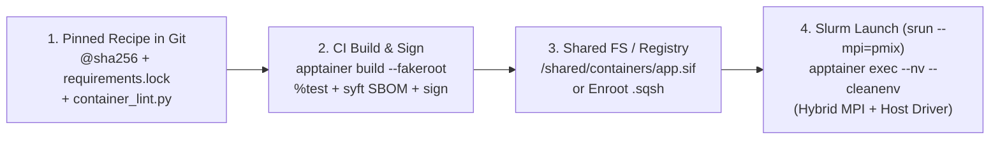

# 6.29 Containers and reproducibility in HPC: Apptainer and enroot

| | |
|---|---|
| Level | Intermediate |
| Priority tier | 2 |
| Lab venue | Linux host with Apptainer; Slurm for the MPI parts |
| Part | Part 6: HPC and Slurm |
| Status | Drafted. Apptainer statements come from the Apptainer user documentation (apptainer/apptainer-userdocs commit `69efb83`, 2026-10-23: definition files, GPU, MPI, build environment); enroot/pyxis from 6.13. `code/part06/container_lint.py` was run on a bad and a good definition file (output shown). **Apptainer itself was not run** (Linux only), nor any container build. Security-model statements are from general knowledge. Labs **untested** |

## Why this matters for AI infrastructure

6.13 showed how NVIDIA's enroot and pyxis run containers inside Slurm. Many clusters, including most academic and national-lab systems, use **Apptainer** (formerly Singularity), and many scientific groups publish their software as Apptainer/Singularity images. Whichever runtime you use, the harder problem is **reproducibility**: can you rebuild the same environment next year, prove which libraries produced a result, and run it on a different cluster? AI makes this sharper: CUDA, cuDNN, NCCL, PyTorch, drivers and Python wheels interact, and a one-line drift changes performance or numerics. This chapter compares the runtimes and gives a discipline that makes container images trustworthy.

## Prerequisites and outcomes

Needs 6.6, 6.13, 6.4/6.12 (MPI, NCCL). After this chapter you can:

- Explain what a container is mechanically (cgroups, namespaces, chroot) and why HPC runtimes differ from Docker.
- Build, run and share Apptainer images (SIF, definition files, `build`, `exec`, `--nv`, binds), and explain the host-MPI hybrid and bind models.
- Compare Apptainer, Charliecloud and enroot/pyxis along security, GPU, MPI, image format and Slurm integration.
- Apply a reproducibility discipline and lint definition files and Dockerfiles for violations.
- Manage caches, signing, and image distribution.

## 1. What a container is, and why HPC needed new runtimes



The SCL book (chapter 16) defines a container as "an isolated set of processes" with limited access to the other processes, the network, the file system and devices: similar to a virtual machine but with no emulation, since all processes are real and visible from the host. It is built from three kernel facilities: **cgroups** (limits on memory, CPU, devices), **namespaces** (PID, user, mount, network, IPC isolation, so processes can have "virtual" numbers) and **chroot** (change root directory). Docker packaged these with a root daemon and a layered image format. HPC clusters need different properties:

| Requirement | Docker daemon model | HPC runtimes |
|---|---|---|
| No root daemon, no privilege escalation by users | Root daemon; docker group = root | Unprivileged execution (setuid helper or user namespaces) |
| Same user identity and file permissions inside | Often root inside; UID remapping | Run as the invoking user (shared file systems demand it) |
| Scheduler owns the processes | Containers are children of the daemon | The container is the Slurm task (cgroups, accounting, signals) |
| Direct access to the fabric and GPUs | Needs plumbing | Host devices and driver libraries bound in |
| Shared file systems and home mounted | Explicit volumes | Home, scratch and project mounted by default |
| One portable file | Layered store | Single image file (SIF, squashfs) |
| MPI across nodes | Network namespaces get in the way | Host network, host or hybrid MPI |

## 2. Apptainer

Apptainer (the Linux Foundation project formerly known as Singularity; "Singularity" is also the name of SylabsInc's separate commercial line) runs a container from a single **SIF** (Singularity Image Format) file, a squashfs-based immutable image that can also carry signatures, definition files and extra data partitions.

### Core commands

```bash
apptainer pull docker://ubuntu:24.04                        # create a SIF from an OCI image (cached)
apptainer build myenv.sif myenv.def                          # build from a definition file
apptainer build --fakeroot myenv.sif myenv.def               # unprivileged build using user-namespace fake root
apptainer exec --nv -B /scratch:/scratch myenv.sif python train.py     # run a command with NVIDIA GPU support and a bind mount
apptainer shell myenv.sif ; apptainer run myenv.sif          # interactive shell / run the %runscript
apptainer inspect myenv.sif ; apptainer sign myenv.sif ; apptainer verify myenv.sif
```

(Command set from the user documentation; flags such as `--fakeroot`, `--nv`, `-B/--bind` appear there.)

### Definition files

From the documentation: a definition ("def") file is "a set of blueprints explaining how to build a custom container". It has a **header** (`Bootstrap:` first, which selects the *bootstrap agent*; for the `docker` agent `From:` names the base image; other agents include `oras`, `localimage`, `scratch`, `library`, `shub`, `yum`/`dnf`, `debootstrap`) and **sections** introduced by `%`: `%files` (copy from host), `%post` (build-time commands), `%environment`, `%runscript`, `%startscript`, `%test` (run at build end), `%labels`, `%help`, `%setup`, `%arguments`. Build-time sections run under `/bin/sh`.

```text
Bootstrap: docker
From: nvcr.io/nvidia/pytorch@sha256:<digest>

%labels
    Version 2026.10
    Maintainer hpc-team@example.org

%post
    pip install --no-cache-dir -r /opt/requirements.lock

%test
    python -c "import torch; print(torch.__version__)"
```

### Cache

Apptainer caches SIF images generated from remote sources and OCI/docker layers, by default under `$HOME/.apptainer/cache`; set `APPTAINER_CACHEDIR` to move it (use `sudo -E` to carry the variable through a root build). On clusters point the cache and `APPTAINER_TMPDIR` to node-local or scratch storage, not a small, quota-limited home or a metadata-sensitive shared mount, and clean it periodically (`apptainer cache clean`). The SCL book's "Caching" section makes the same point about image and layer caches for the HPC runtimes it covers.

### GPUs

`--nv` sets up the container for NVIDIA GPUs by binding the host driver libraries and device nodes into the container (documentation: "natively supports ... NVIDIA's CUDA ..., AMD's ROCm ..., and Intel's Gaudi", plus OCI **CDI** (Container Device Interface) as a generic method, and experimental `--nvccli` to use `nvidia-container-cli`). The documentation warns about one practical failure: because libraries are bound from the host, the **libc versions in the container and on the host must not be too far apart**, or you get libc mismatch errors (the error happens when the container's libc is older than the host's, and sometimes when it is much newer). The CUDA toolkit in the image must also be compatible with the host driver (Part 10). Check with `apptainer exec --nv img.sif nvidia-smi` and a small CUDA test.

### MPI

Two documented models for MPI applications:

- **Hybrid model**: the host provides `mpirun`/`srun` and its MPI; the container also contains an MPI; the launcher starts the container per rank and the MPI inside connects back through PMI (for Open MPI, `orted` launches Apptainer, which starts the application, which connects back through PMI). Needs the container's MPI to be ABI/PMI-compatible with the host's (same implementation and a close version). Advantage: the application is self-contained.
- **Bind model**: the container has no MPI; the host's MPI libraries are bind-mounted in. Needs administrators to allow user-specified bind mounts.

In Slurm: `srun --mpi=pmix apptainer exec ... ./app` (6.12). For AI jobs NCCL ships with the framework in the image, uses the host's IB devices and driver, and needs host networking.

### Security model (general knowledge, verify)

Apptainer can run with a small setuid-root helper (to mount SIFs and set up namespaces) or entirely in **unprivileged mode using user namespaces** (and the `--fakeroot` feature maps your user to root inside the build). The design principle: privilege escalation inside the container is impossible because the user stays the same user (there is no `sudo` inside). Security controls include signed SIF images (PGP keys by default: `apptainer sign` / `verify`, with a key server), image encryption, and restricting which images may run (`limit container` settings in `apptainer.conf`: allowed paths/owners/groups, signed-only). Distributions that restrict unprivileged user namespaces (some Ubuntu configurations) need the administrators to allow it or use the setuid mode.

## 3. Charliecloud, enroot and the comparison

- **Charliecloud** (from Los Alamos): minimal, unprivileged containers using only user namespaces; images are directory trees or squashfs; `ch-image` builds, `ch-run` runs; its small code size is a selling point for security reviews. The SCL book covers it together with Singularity.
- **enroot + pyxis** (6.13): NVIDIA's pair; converts OCI images to squashfs, runs unprivileged, hooks for GPU/IB/PMIx, Slurm integration via the pyxis SPANK plugin with `srun --container-*` options.
- **Podman rootless** and **Docker rootless**: OCI-compliant tools that can run in user namespaces; more features, heavier, less HPC-tuned (can work on workstations and some clusters).

| | Apptainer | Charliecloud | enroot + pyxis | Podman rootless |
|---|---|---|---|---|
| Image | SIF (squashfs-based, signable) | dir/squashfs/tar | squashfs (import from OCI) | OCI layers |
| Build on cluster | `apptainer build` (fakeroot), def files | `ch-image build` (Dockerfile) | `enroot import` + modify; usually build elsewhere | `podman build` |
| Privilege | setuid helper or userns | userns only | userns/setuid-less | userns |
| GPU | `--nv`, `--rocm`, CDI | bind/hooks | hooks (libnvidia-container) | CDI/nvidia-container-toolkit |
| Slurm integration | `srun apptainer ...` (scripts) | `srun ch-run ...` | pyxis (native options) | scripts |
| MPI | host-MPI hybrid/bind | host MPI | PMIx hooks | host network |
| Ecosystem | Widest in academic HPC; OCI compat | Smaller | Strong in NVIDIA clusters (NGC) | Dev workflows |

Interoperability: all can consume OCI/Docker images; build once with a standard tool and deploy to whichever runtime a cluster uses, but test each, because the runtimes differ in environment handling, home mounting and PID/network namespace choices.

## 4. Reproducibility discipline

Reproducibility has levels: *rerun* the same image (immutability), *rebuild* the same image (determinism of the build), *reuse* the environment on another system (portability), and *understand* it (provenance and metadata).

1. **Pin the base by digest** (`From: image@sha256:...`) not by tag; tags are mutable (`latest`, even `24.04` moves with patch updates). Record the digest in the lab notebook, job log and image labels.
2. **Pin every dependency** with a lock file that includes hashes: `pip install --require-hashes -r requirements.lock`, `conda-lock`, `uv.lock`; pin system packages (`apt-get install pkg=version`) or, more practically, pin the **repository snapshot** (a dated mirror such as snapshot.debian.org or an internal Artifactory/Nexus mirror) so rebuilds see the same packages.
3. **No floating network fetches** in `%post`: verify checksums (`sha256sum -c`) or GPG signatures; avoid `curl | sh`; clone Git repositories at a tag **and** verify the commit hash.
4. **Do not upgrade the system in the build** (`apt-get upgrade`) because the result depends on the build date.
5. **Record metadata**: `%labels` (version, git commit of the recipe, build date, base digest, maintainer), keep the definition file and lock files in Git next to code, and embed or attach a software bill of materials (SBOM, via `syft` or similar) and record vulnerability scan output.
6. **Build in CI**, not on someone's laptop; build in a clean environment; tag images with the recipe's commit; store in a registry (OCI registry with Apptainer `oras` support, or a shared directory of SIFs on the parallel file system with checksums).
7. **Test at build time** (`%test`) and before promotion: import the framework, run a tiny GPU kernel, run a short NCCL test, compare numerics to a reference.
8. **Sign and verify** images used for production runs (`apptainer sign/verify`, or cosign for OCI images; 5.22).
9. **Separate base from application**: a slow-moving base image (CUDA + framework) and a fast-moving application layer; rebuild the application layer often.
10. **Record the runtime environment at run time**: image digest, host driver, kernel, GPU model, and environment variables in the job log (a few lines in your job prologue).
11. **Floating-point and hardware caveats**: bitwise reproducibility across GPU architectures and library versions is not guaranteed (6.5 on fast-math and reductions, 6.12 on NCCL algorithms); fix seeds and use deterministic modes when you need identical results, accept statistical equivalence otherwise.
12. **Retention**: keep images for the life of the publication or project; the registry's garbage collection must not delete referenced digests.

### A linter (tested)

`code/part06/container_lint.py` checks an Apptainer definition file or Dockerfile for the violations above: floating base tags (`:latest`, missing tag, tag without digest), `upgrade` steps, unpinned `apt`/`pip` installs, `curl | sh`, downloads without checksum, `git clone` without a pinned ref, missing labels and tests. On a deliberately poor file:

```text
ERROR line 2: base image 'ubuntu:latest' is not pinned (use a version tag, better a digest @sha256:...)
warn  line 5: system upgrade/update step makes the image depend on the build date
warn  line 6: system upgrade/update step makes the image depend on the build date
warn  line 7: apt install without version pins (acceptable if the base image and repo snapshot are pinned)
ERROR line 8: pipes a download into a shell: unverifiable and non-reproducible
warn  line 8: download without a following checksum/signature check
warn  line 9: download without a following checksum/signature check
warn  line 11: git clone without pinning a tag/commit
warn  line 12: pip install without version pins (use a lock file with hashes)
info  line 12: pip install without --no-cache-dir inflates the image
info  no %labels section ...
info  no %test section ...
```

and a good file (digest-pinned base, lock-file pip install with `--no-cache-dir`, checksum-verified download, labels and a test) produced "no findings". The first version of the linter had two bugs that the test files exposed: it missed `apt-get -y upgrade` (flags before the verb) and it flagged `... | sha256sum -c -` as "pipes into a shell" because the pattern `| sh` matched the start of `sha256sum`. Both were fixed with word-boundary and optional-flag patterns, a reminder to test linters on both good and bad inputs. It is a heuristic text check: it does not parse multi-line continuations or build stages.

## 5. Distribution and operations

- **Where images live**: a registry (Harbor, Artifactory, GHCR, NGC private registry) for OCI images; a controlled directory of SIFs on the parallel file system (`/shared/containers/<name>/<version>.sif` with `sha256` file) for Apptainer. Squashfs is one file: ideal for Lustre/GPFS (6.18) and for staging to node-local NVMe.
- **Start-up at scale**: thousands of ranks pulling or mounting the same image: stage to local disk or rely on page-cache sharing; do not pull from a registry in the job; avoid per-rank unpacking.
- **Bind policy**: default binds home, `/tmp`, `/proc`, `/sys`, `/dev` (Apptainer defaults; verify) can leak host state into containers and break reproducibility (`~/.local` Python packages silently override container packages: use `--no-home`, `--cleanenv`, `--containall` where needed, or set `PYTHONNOUSERSITE=1`). Prefer explicit, minimal binds for datasets and outputs.
- **Environment leakage**: Apptainer passes the host environment by default; `--cleanenv` (`-e`) starts clean. Combine with Slurm's `--export` choices (6.11).
- **Quotas and cleanup**: image caches and build directories grow; automate cleanup in prolog/epilog or cron.
- **Support matrix**: publish which base images, CUDA versions, MPI/PMIx versions, and runtimes are supported on which partitions (6.6), and a test job users can run to verify an image.
- **Kubernetes parity**: the same OCI image should run under Kubernetes (Part 11) and Slurm (enroot, Apptainer); keep the image runtime-agnostic and put runtime-specific settings in launch scripts.

## 6. Lab

First, run the self-checking Python lab (`code/part06/container_lint_lab.py`) locally. It verifies `lint()` in `code/part06/container_lint.py` against a digest-pinned Apptainer `good.def` (`0` findings, confirming that `| sha256sum -c -` is not falsely flagged as `| sh`), a broken `bad.def` (`2` `ERROR`s for unpinned `ubuntu:latest` and `curl ... | sh` plus `10` warnings/infos), and a digest-pinned `Dockerfile`:

```bash
python3 code/part06/container_lint_lab.py
```

Tested: 1) run `container_lint.py` on a Dockerfile and a def file of yours; fix every ERROR and warn; add one new check (for example an `ADD http://` instruction in a Dockerfile) with a test. 2) Create the `bad.def`/`good.def` pair from section 4 and reproduce the output.

Untested (Linux with Apptainer): 3) `apptainer pull docker://...`, `build` a def file with `%test`, run with `--nv` on a GPU node; trigger and diagnose a libc mismatch with an old base image. 4) Run an MPI hello with the hybrid model under `srun --mpi=pmix`. 5) Measure start-up latency of a 5 GB SIF on Lustre vs node-local NVMe with 64 ranks. 6) Sign and verify an image; try to run a modified copy. 7) Rebuild the same def file twice a week apart with and without digest and lock-file pinning; compare `pip freeze` and image checksums. 8) Convert one workflow between Apptainer and enroot/pyxis and list differences in environment and mounts. 9) Generate an SBOM and scan the image.

## 7. Interview angles

- How is an HPC container runtime different from Docker?
- Explain `--nv` and the libc mismatch problem.
- Hybrid vs bind MPI model: trade-offs?
- How do you make a container build reproducible?
- Why pin by digest and what does a tag guarantee?
- How would you let researchers build images on a shared cluster safely?
- Compare Apptainer and enroot/pyxis for an NVIDIA GPU cluster.
- What gets leaked from the host into a container by default and how do you control it?
- A job works in the container on cluster A and fails on cluster B: what do you check?

### 6.1 Troubleshooting guide: Why a "reproducible" container fails when moved between GPU clusters

One of the most common interview and on-call scenarios in HPC and AI infrastructure is: *"A researcher built an Apptainer `.sif` or Enroot `.sqsh` container on Cluster A where their multi-node training job ran at full speed. They copied the exact same image file to Cluster B, and it either crashes on launch or runs ten times slower. Why?"*

Because HPC containers share the host Linux kernel and dynamically bind host GPU and RDMA driver libraries at runtime, an immutable container image is **not** completely self-contained at the hardware boundary. Walk through these five host-to-container boundary checks in order:

1. **Host `glibc` versus injected NVIDIA driver `.so` libraries (`--nv` / `98-nvidia.sh`):**
   When you pass `--nv` in Apptainer (or run Pyxis/Enroot with `nvidia-container-cli`), the runtime bind-mounts the **host OS's** user-space NVIDIA driver libraries (`libcuda.so`, `libnvidia-ml.so`) into the container so they match the host kernel's loaded `nvidia.ko` module. Those host `.so` files were compiled against the **host OS's `glibc`**. If Cluster B runs a newer host OS (say, Ubuntu 24.04 with `glibc 2.39`) while the researcher's container was built on an ancient base distribution (say, Ubuntu 18.04 with `glibc 2.27`), dynamic linking inside the container fails immediately with `version 'GLIBC_2.34' not found (required by libcuda.so.1)`. The fix is to rebase the container onto a modern base distribution whose `glibc` is at least as new as the host's.
2. **CUDA Driver-to-Runtime forward compatibility (`cudaDriverGetVersion` vs `cudaRuntimeGetVersion`):**
   The container holds the **CUDA Toolkit / Runtime (`libcudart.so`, e.g., CUDA `12.6`)**, while the host node provides the **NVIDIA Kernel Driver (`libcuda.so`)**. If Cluster B is running an older NVIDIA driver branch that does not support the CUDA Toolkit version inside the container (and does not have the matching `cuda-compat` forward-compatibility package installed and added to `LD_LIBRARY_PATH`), `torch.cuda.is_available()` returns `False` or throws `CUDA driver version is insufficient for CUDA runtime version`.
3. **Host `$HOME` environment and `~/.local` Python site-packages leakage:**
   By default, Apptainer bind-mounts the user's shared `$HOME` directory and inherits the calling shell's environment variables. If the researcher previously ran `pip install --user ...` on Cluster B's login node, Python inside the container automatically prepends `~/.local/lib/python3.x/site-packages` to `sys.path`—silently shadowing the container's locked PyTorch or Triton packages with broken host files! Always pass `--cleanenv` (`-e`) and either `--no-home` / `--containall` or export `PYTHONNOUSERSITE=1` in the job script.
4. **MPI / PMIx / UCX / `libfabric` provider mismatch across interconnects:**
   Suppose Cluster A uses NVIDIA Quantum InfiniBand (`mlx5` Verbs + UCX), while Cluster B uses RoCEv2 (`NCCL_IB_GID_INDEX`), Slingshot (`libfabric` CXI provider), or AWS EFA. If the container image only compiled Open MPI and NCCL against standard `libibverbs` without the target cluster's fabric plugin (or if `/dev/infiniband` / host OFED user-space providers are not bind-mounted into the container), NCCL silently falls back from `NET/IB` (GPUDirect RDMA) to `NET/Socket` (host TCP over Ethernet), causing a $10\times$ drop in multi-node `AllReduce` bandwidth. Inspect `NCCL_DEBUG=INFO` on Rank 0 (`NET/IB` vs `NET/Socket`) to verify immediately.

## Exercises

1. **Linting Apptainer Definition Files and Dockerfiles for Reproducibility (`code/part06/container_lint.py` & `container_lint_lab.py`):** Run `python3 code/part06/container_lint_lab.py`. Explain why `container_lint.py` flags `From: ubuntu:latest` and `curl ... | sh` as hard `ERROR`s, why `apt-get upgrade` makes an image non-reproducible across build dates, and why the word-boundary regex `\b(ba)?sh\b` is necessary so `echo "<hash>  file" | sha256sum -c -` is not misclassified as piping into a shell.
2. **Writing a Digest-Pinned Apptainer Definition File with `%labels`, `%post`, and `%test`:** Write a complete Apptainer `.def` file (`Bootstrap: docker`, `From: nvcr.io/nvidia/pytorch@sha256:...`) that copies a hash-locked `requirements.lock` via `%files`, installs packages with `pip install --no-cache-dir --require-hashes -r /opt/requirements.lock` in `%post`, records git commit and base digest in `%labels`, and runs a PyTorch/CUDA import check in `%test`. Show the unprivileged `apptainer build --fakeroot` and PGP `apptainer sign` / `verify` commands.
3. **Comparing the Hybrid MPI Model and Bind MPI Model in Apptainer (`srun --mpi=pmix`):** Write the Slurm batch launch line (`srun --mpi=pmix apptainer exec --nv --cleanenv -B /scratch:/scratch myenv.sif python train.py`) and compare Apptainer's **hybrid MPI model** (container holds its own PMIx-compatible Open MPI / HPC-X talking to host `slurmstepd`) with the **bind MPI model** (binding host MPI libraries into the container).
4. **Diagnosing `--nv` `glibc` Mismatches and Host Environment Leakage:** A researcher builds an Apptainer `.sif` image from an Ubuntu 18.04 (`glibc 2.27`) base image and runs `apptainer exec --nv old.sif nvidia-smi` on an Ubuntu 24.04 (`glibc 2.39`) GPU node, failing with `GLIBC_2.34 not found`. Explain why `--nv` triggers this error and how CDI / newer base images resolve it. Then explain how `~/.local/lib/python3.x/site-packages` on a shared `$HOME` silently overrides container packages unless `--no-home`, `--containall`, or `PYTHONNOUSERSITE=1` is used.
5. **Configuring Apptainer and Enroot Cache Paths (`APPTAINER_CACHEDIR` & `APPTAINER_TMPDIR`):** Write the `/etc/profile.d/containers.sh` snippet that points `APPTAINER_CACHEDIR` and `APPTAINER_TMPDIR` to node-local NVMe (`/tmp/$USER/apptainer`) instead of `$HOME/.apptainer/cache`, and explain why `sudo -E` is required when passing `APPTAINER_CACHEDIR` to a privileged build.
6. **Runtime Comparison Matrix (Apptainer vs Charliecloud vs Enroot + Pyxis vs Rootless Podman):** Compare all four runtimes across image format (`.sif` vs `.sqsh` vs OCI layers), privilege mechanism (setuid/userns), GPU injection (`--nv`/CDI vs `98-nvidia.sh`), Slurm integration (`srun apptainer exec` vs SPANK `--container-image`), and cryptographic image signing.

## Checkpoint

<details>
<summary>1. Which three Linux kernel facilities make up a container (`SCL` Chapter 16), and what seven properties do HPC container runtimes change compared to the Docker daemon model?</summary>

A container combines **`cgroups`** (resource/device limits), **`namespaces`** (PID, mount, user, IPC isolation), and **`chroot`** / `pivot_root`. Compared to Docker, HPC runtimes (Apptainer, Enroot, Charliecloud):
1. Run **unprivileged** without a root-equivalent daemon.
2. Preserve the **invoking user's numeric UID/GID** inside the container.
3. Run directly as children of **`slurmstepd`** inside Slurm's job cgroup.
4. Bind host **GPUs and InfiniBand RDMA devices** in transparently.
5. Mount shared filesystems (`/home`, `/scratch`) automatically or via simple flags.
6. Package images as **single immutable files** (`.sif` or `.sqsh`) suited to parallel filesystems.
7. Share the **host network namespace** and PMIx sockets for multi-node MPI/NCCL.
</details>

<details>
<summary>2. What is an Apptainer **SIF** file, and how does it differ from an Enroot `.sqsh` file?</summary>

**SIF (Singularity Image Format)** is a single-file container image containing a read-only `squashfs` root filesystem payload **plus an extensible container header and metadata descriptors** that store the build definition file, OCI configuration, cryptographic **PGP signatures** (`apptainer sign`/`verify`), and optional encrypted partitions—whereas an Enroot `.sqsh` file is a raw `squashfs` archive unpacked into `ENROOT_DATA_PATH`.
</details>

<details>
<summary>3. What is the structure of an Apptainer definition (`.def`) file, which keyword must appear first, and what are its main `%` sections?</summary>

A `.def` file begins with a **header** where **`Bootstrap:`** must be the first keyword (selecting the bootstrap agent such as `docker`, `oras`, `localimage`, `scratch`, `library`, `yum`/`dnf`, or `debootstrap`, followed by `From:`), followed by `%` sections:
- **`%files`:** Copy files from the build host into the container.
- **`%post`:** Shell commands (`/bin/sh`) run inside the container at build time to install software.
- **`%environment`:** Environment variables sourced at container runtime.
- **`%runscript` / `%startscript`:** Default entrypoint executed by `apptainer run` / `instance start`.
- **`%test`:** Smoke tests executed at the end of `apptainer build`.
- **`%labels` and `%help`:** Provenance metadata and usage documentation (`apptainer inspect`).
</details>

<details>
<summary>4. What does `apptainer build --fakeroot` do, and why is it important on shared clusters?</summary>

`--fakeroot` uses Linux user namespaces (`/etc/subuid` and `/etc/subgid` mappings) to map the invoking unprivileged user to UID `0` ("fake root") inside the build namespace, allowing researchers and CI runners to run `apt-get`/`dnf`/`pip` inside `%post` and build `.sif` images without granting them `sudo` on the host.
</details>

<details>
<summary>5. Where does Apptainer store its image/layer cache by default, why is that default problematic on HPC clusters, and how do you relocate it?</summary>

By default, Apptainer caches downloaded OCI layers and converted SIFs in **`$HOME/.apptainer/cache`**. On HPC clusters, `$HOME` usually lives on a quota-limited NFS mount where multi-gigabyte layer extraction triggers quota failures (`EDQUOT`) and metadata storms. Relocate it by exporting **`APPTAINER_CACHEDIR`** and **`APPTAINER_TMPDIR`** to node-local NVMe (`/tmp/$USER`) or fast `/scratch`, and clean old layers with `apptainer cache clean`.
</details>

<details>
<summary>6. What does `apptainer exec --nv` do, and why can it fail with a **`glibc` version mismatch** error?</summary>

`--nv` locates the host's NVIDIA kernel driver user-space libraries (`libcuda.so`, `libnvidia-ml.so`, `nvidia-smi`) and `/dev/nvidia*` device nodes and bind-mounts them into the container. Because those host `.so` libraries were compiled against the **host OS's `glibc`**, if the container runs a much older Linux distribution whose internal `libc.so.6` lacks symbol versions required by the host's driver libraries, dynamic linking fails (`GLIBC_2.xx not found`). Fix by using a container base image with a `glibc` version compatible with the host OS.
</details>

<details>
<summary>7. Compare Apptainer's **hybrid MPI model** and **bind MPI model**.</summary>

- **Hybrid model:** Both the host and the container have MPI installed. The host launcher (`srun --mpi=pmix` or `mpirun`) spawns `apptainer exec myenv.sif ./app` on each node, and the container's internal MPI links against the application and communicates with the host's `slurmstepd`/`orted` daemon via PMIx/PMI2. Self-contained and portable, requiring ABI/PMIx compatibility between host and container MPI.
- **Bind model:** The container contains no MPI; instead, the host's MPI directory (`/opt/openmpi` or HPC-X) and interconnect libraries are bind-mounted (`-B`) into the container at runtime. Guarantees exact host MPI matching, but ties the container to that specific cluster's host paths and `glibc`.
</details>

<details>
<summary>8. How does Apptainer's security model prevent privilege escalation inside a container, and how can administrators restrict which `.sif` images may execute?</summary>

Inside an Apptainer container, **the user remains the exact same unprivileged UID as on the host** (`id` inside equals `id` outside), and the container filesystem is mounted `nosuid`, so `su`/`sudo` or setuid binaries inside the image cannot elevate privileges. Administrators can further configure `/etc/apptainer/apptainer.conf` (`limit container owners`, `limit container paths`, and `ecl.toml` execution control lists) to allow only `.sif` files located in root-owned directories or signed by a trusted PGP key (`apptainer sign` / `apptainer verify`).
</details>

<details>
<summary>9. Compare **Apptainer**, **Charliecloud**, and **Enroot + Pyxis** across image format, Slurm launch syntax, and ecosystem fit.</summary>

- **Apptainer:** Single `.sif` file (signable/encryptable); launched via `srun --mpi=pmix apptainer exec --nv app.sif ...`; universal across academic and national-lab HPC.
- **Charliecloud:** Unpacked directory or `.sqsh` archive; launched via `srun ch-run ...`; minimal user-namespace codebase favored at Los Alamos / DOE labs.
- **Enroot + Pyxis:** Single `.sqsh` file unpacked per task into node-local `ENROOT_DATA_PATH`; integrated into `srun`/`sbatch` via SPANK `--container-image` / `--container-mounts` flags with NVIDIA/Mellanox/PMIx hooks; standard on NVIDIA DGX SuperPOD and AI neoclouds.
</details>

<details>
<summary>10. What are the four levels of scientific/AI container reproducibility?</summary>

1. **Rerun (Immutability):** Running the exact same archived `.sif` / `.sqsh` binary produces the same software environment.
2. **Rebuild (Deterministic build):** Rebuilding the `.def` / `Dockerfile` from source a year later produces an identical package set.
3. **Reuse (Portability):** Running the image across different clusters or cloud orchestrators (Slurm and Kubernetes).
4. **Understand (Provenance):** Inspecting `%labels`, git commit, lock files, and the Software Bill of Materials (SBOM) to know every library version inside the image.
</details>

<details>
<summary>11. Why is pinning a base image by tag (`From: nvcr.io/nvidia/pytorch:24.07-py3` or `ubuntu:24.04`) insufficient for strict rebuild reproducibility, and what should you use instead?</summary>

Registry tags are **mutable pointers**—vendors routinely push security updates or rebuilt layers under the same `24.04` tag, and `:latest` moves constantly. Pinning by immutable cryptographic **manifest digest** (`From: nvcr.io/nvidia/pytorch@sha256:<64_hex_chars>`) guarantees that every rebuild pulls the exact same byte-for-byte base layers.
</details>

<details>
<summary>12. Why does running `apt-get upgrade` or `dnf upgrade` inside `%post` or `RUN` violate build reproducibility (`code/part06/container_lint.py`)?</summary>

Because `apt-get upgrade` upgrades every installed system package to whatever version happens to sit in the upstream distribution mirror on the day the build runs—making the resulting image depend on the **build date** rather than the recipe in Git.
</details>

<details>
<summary>13. How do you make Python `pip`, `conda`, or `uv` package installations inside a container build completely deterministic and tamper-proof?</summary>

Generate a fully resolved lock file containing cryptographic **SHA-256 wheel hashes** (`pip-compile --generate-hashes`, `uv.lock`, or `conda-lock`) committed to Git, and install with **`pip install --no-cache-dir --require-hashes -r /opt/requirements.lock`** so `pip` refuses to resolve floating transitive dependencies or install any wheel whose SHA-256 digest does not match.
</details>

<details>
<summary>14. Why does `code/part06/container_lint.py` reject `curl ... | sh` as an `ERROR`, and what is the safe pattern for downloading external binaries in `%post`?</summary>

Piping an HTTP download directly into a shell (`curl ... | sh`) executes unverified remote code that can change at any moment or be MITM-tampered. Instead:
1. Download the specific versioned archive to a file (`curl -fsSL <url> -o /tmp/pkg.tar.gz`).
2. Verify its cryptographic digest against a pinned hash in the recipe (`echo "<sha256>  /tmp/pkg.tar.gz" | sha256sum -c -`).
3. Extract and install.
</details>

<details>
<summary>15. What two regex edge cases did testing `code/part06/container_lint.py` against both `good.def` and `bad.def` uncover?</summary>

1. Matching `apt-get upgrade` without allowing intermediate flags missed `apt-get -y upgrade` (fixed with `(-\S+\s+)*`).
2. Matching `| sh` without a word boundary falsely flagged `echo "..." | sha256sum -c -` as piping into a shell because `sha256sum` starts with `sh` (fixed with `\b(ba)?sh\b`).
</details>

<details>
<summary>16. How does Apptainer's default `$HOME` bind mount silently break Python reproducibility inside containers, and what three flags prevent it?</summary>

By default, Apptainer bind-mounts the user's host `$HOME` directory into the container. If the user previously ran `pip install --user ...` on the login node, Python inside the container automatically adds **`~/.local/lib/python3.x/site-packages`** to `sys.path`, overriding or clashing with the packages baked into the `.sif` image. Prevent this with:
1. **`--no-home`** (do not mount `$HOME` when current working directory is not in `$HOME`),
2. **`--containall`** (`-C`, isolates filesystems, PID, IPC, and environment) or **`--cleanenv`** (`-e`, clears host environment variables), or
3. Exporting **`PYTHONNOUSERSITE=1`** inside `%environment`.
</details>

<details>
<summary>17. What metadata should be recorded in `%labels` (at build time) and in the Slurm job log (at run time)?</summary>

- **Build-time `%labels` (plus SBOM via `syft`):** Recipe Git commit SHA, build date, base image `@sha256` digest, CUDA/PyTorch/NCCL versions, and maintainer contact.
- **Run-time job log:** Container `.sif`/`.sqsh` path and SHA-256 digest, `scontrol show job` allocation, host kernel (`uname -r`), host NVIDIA driver version (`nvidia-smi`), and GPU hardware model/UUIDs.
</details>

<details>
<summary>18. Even when running the exact same digest-pinned container image and random seed, why can floating-point training results differ slightly across runs or GPU generations?</summary>

Because atomic floating-point additions in CUDA kernels and multi-node `NCCL` ring/tree collective reductions are **non-associative** ($(a + b) + c \ne a + (b + c)$ in IEEE 754 floating point) and can execute in different orders depending on thread scheduling, NVLink/network topology, or Tensor Core architecture (e.g., A100 vs H100 `tf32`/`bf16`/`fp8` accumulators), unless `torch.use_deterministic_algorithms(True)` and fixed `NCCL` tree/ring orderings are forced (at a throughput cost).
</details>

<details>
<summary>19. How should a 10 GB `.sif` or `.sqsh` container image be launched across 512 compute nodes without stalling the parallel filesystem?</summary>

Never pull from a remote registry inside the batch job. Place the single `.sif` or `.sqsh` file on a wide-striped Lustre/GPFS directory (`lfs setstripe -c 16 -S 4M /shared/containers`) or stage it to each allocated node's local NVMe `/tmp` once at job start using **`sbcast /shared/containers/env.sif /tmp/env.sif`** so all 4,096 ranks read from local NVMe.
</details>

<details>
<summary>20. How do you design a single container build pipeline so the resulting image runs unchanged on both **Kubernetes** and **Slurm (Apptainer / Enroot)**?</summary>

Build a standard **OCI container image** from a digest-pinned `Dockerfile` in CI and push it to your OCI registry (Harbor/GHCR/NGC):
- **Kubernetes** pulls the OCI image directly by `@sha256` digest.
- **Enroot + Pyxis** imports the OCI image once via `enroot import docker://registry#repo:tag` into `/shared/images/app.sqsh`.
- **Apptainer** pulls the OCI image once via `apptainer pull app.sif docker://registry/repo@sha256:...` (or pushes/pulls the `.sif` directly to the OCI registry via `oras://`).
Keep cluster-specific mounts (`-B` / `--container-mounts`) and scheduler variables outside the image in the launch scripts.
</details>

## Sources and review notes

- Container fundamentals, Singularity/Apptainer, Charliecloud, Pyxis + Enroot, caching: read in full from *Supercomputers for Linux SysAdmins* (`supercomputers-for-linux-sysadmins-managing-modern-hpc-clusters-and-supercomputers-from-software-to-hardware`, `SCL`) Chapter 16 ("16. Containers").
- Apptainer definition files, GPU support (`--nv`, CDI, `glibc` warning), MPI hybrid/bind models, build-environment cache variables (`APPTAINER_CACHEDIR`, `APPTAINER_TMPDIR`): Apptainer user documentation (`apptainer/apptainer-userdocs` commit `69efb83`).
- enroot/pyxis: see Chapter 6.13.
- Run here: `code/part06/container_lint.py` and `python3 code/part06/container_lint_lab.py` (3 passed, 0 failed).
- Explicitly labelled inferences: `GOOD_DEF`, `BAD_DEF`, and `GOOD_DOCKERFILE` in `code/part06/container_lint_lab.py` are deterministic test fixtures verifying `container_lint.py`.
- Not verified on live hardware: Apptainer security-model specifics (setuid vs userns, `apptainer.conf` limits), live `apptainer build --fakeroot` and `sign`/`verify` execution, and multi-node hybrid MPI benchmarks (`untested here`).
