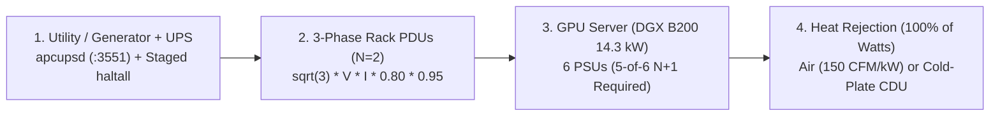

# 6.30 Facility basics: power, cooling, racks and liquid cooling

| | |
|---|---|
| Level | Beginner to Intermediate |
| Priority tier | 1 |
| Lab venue | Laptop (calculators) |
| Part | Part 6: HPC and Slurm |
| Status | Drafted. The rack power table, airflow figures and cost example from the books were **recomputed** with `code/part06/facility_calc.py`: all nine rows of NVIDIA's DGX B200 power table matched. `code/part06/ups_shutdown_sim.py` simulates the book's staged UPS shutdown; its battery sizes are invented for illustration. No real facility was measured. Cooling and power figures are the books' planning numbers: always use your vendor's current site-requirements document |

## Why this matters for AI infrastructure

A GPU server is a machine that turns electricity into computation, and almost all of that electricity ends up as heat. The more GPUs you pack in a rack, the more power you must bring in and the more heat you must carry out. Power, cooling and space are the three limits of every data center, and they limit how many GPUs you can run before software even matters. Infrastructure engineers do not have to design buildings, but they must speak to the facility team, understand why a rack holds only two servers, and know what happens when the power fails.

## Prerequisites and outcomes

Nothing special. After this chapter you can:

- Convert between watts, kilowatts, megawatts and kilowatt-hours, and estimate a cluster's energy bill.
- Explain why a rack can hold only a few GPU servers, using power and cooling limits.
- Read a power provisioning table: voltage, amps, breaker derating, usable kW, stranded power.
- Explain N and N+1 redundancy for servers that have internal power supplies, and why some designs make things worse.
- Describe air cooling and the four kinds of liquid cooling, and say what PUE tells you.
- Plan racks, cabling and distances for an InfiniBand cluster.
- Describe what a UPS does and how to shut a cluster down in stages when power fails.

## 1. Start with the simple idea



Every watt a server draws becomes a watt of heat. A server that draws 10 kilowatts (kW) heats the room like ten space heaters of 1 kW each running all day. Cooling must remove exactly as much heat as the machines make.

The units, in plain words:

| Unit | Meaning | Example |
|---|---|---|
| Watt (W) | Rate of using energy | A GPU can draw 700 W |
| Kilowatt (kW) | 1,000 W | One DGX server: about 10 to 14 kW |
| Megawatt (MW) | 1,000 kW | A large AI cluster: several MW; one GB300 SuperPOD scalable unit alone is rated about 1.2 MW |
| Kilowatt-hour (kWh) | Energy: 1 kW used for 1 hour | What your electricity bill counts |

Data centers have **finite resources**: the NVIDIA data-center guide says the three main constraints are **power, cooling and space**, they are linked, and "excess demand on one resource could negatively impact other resources". For example, pushing more power into a rack needs more cooling, and spreading racks apart to cool them makes InfiniBand cables longer than they are allowed to be.

The ADC book (*AI Data Center Network Design and Technologies*, chapter 5) puts data centers in context: they use roughly 2 percent of the world's electricity, and AI makes it grow. Inside a data center, it estimates IT equipment takes 40 to 45 percent of the power, the **cooling system 35 to 40 percent** (the second biggest consumer), and the rest goes to power distribution, UPS and lighting.

## 2. How much power does the equipment use?

| Item | Power | Source |
|---|---|---|
| One H100 GPU (SXM) | up to 700 W | AI Factory vol. 21 |
| DGX H100 server (8 GPUs) | about 10.2 kW maximum | vol. 21 (NVIDIA user guide) |
| DGX B200 server (8 GPUs) | 14.3 kW maximum | NVIDIA DGX B200 data-center guide |
| Network switch, 64 x 400 G | about 3 kW power supply | ADC book (example switch) |
| Optical module, QSFP28 / QSFP56-DD / OSFP | 3.2 W / 12 W / 15 W | ADC book |
| Traditional rack | about 10 to 25 kW budget; most around 16 to 18 kW | ADC book |

Optics look small but add up: a 64-port switch full of 15 W modules has close to 1 kW of optics alone.

A note that avoids confusion: the ADC book says a DGX H100 has six power supplies of 3.3 kW with 4+2 redundancy, so "it consumes 4 x 3.3 kW = 13.2 kW". That 13.2 kW is the **capacity of the four working supplies**, not what the server draws. NVIDIA's rated maximum for the DGX H100 is about 10.2 kW. Use the vendor's rated maximum for planning, and measured power (DCGM, PDU meters, 6.26) to learn what you really use.

**Planning rule** (vol. 21): provision circuits, PDUs and cooling for the server's rated maximum, then use measurements to refine your cost estimates.

Why racks hold so few servers: a DGX B200 is 14.3 kW. Two per rack is 28.6 kW; four per rack is 57.2 kW. The books say a typical enterprise rack was built for about 15 kW, so a rack of GPU servers needs special power and cooling. (The volume-01 notes say a rack "can consume over 100 kW"; that is true for liquid-cooled rack-scale systems such as GB200 NVL72, not for air-cooled DGX racks. Be careful with such ranges.)

## 3. How power gets to the rack

### 3.1 Circuits, voltage and amps

Data-center racks are fed by **three-phase** circuits. The usable power of one circuit is:

```text
usable kW = square root of 3 x line-to-line volts x amps x breaker derating x power factor
```

- **Breaker derating**: you may only load a circuit breaker to 80 percent of its rating for continuous loads (common practice; the NVIDIA table uses 80 percent and also shows 100 percent for sites that allow it).
- **Power factor**: how efficiently the load uses the current; NVIDIA uses 0.95.

`code/part06/facility_calc.py` applies this formula for two circuits and a 14.3 kW server. It reproduced **every row** of NVIDIA's table:

| Volts (line to line) | Amps | Derating | Servers/rack | Capacity (kW) | Demand (kW) | Stranded (kW) |
|---|---|---|---|---|---|---|
| 380 | 32 | 80% | 2 | 32.0 | 28.6 | 3.4 |
| 400 | 32 | 80% | 2 | 33.7 | 28.6 | 5.1 |
| 415 | 32 | 80% | 2 | 35.0 | 28.6 | 6.4 |
| 415 | 60 | 80% | 4 | 65.6 | 57.2 | 8.4 |
| 415 | 63 | 80% | 4 | 68.8 | 57.2 | 11.6 |
| 380 | 32 | 100% | 2 | 40.0 | 28.6 | 11.4 |
| 415 | 32 | 100% | 2 | 43.7 | 28.6 | 15.1 |
| 415 | 60 | 100% | 4 | 81.9 | 57.2 | 24.7 |
| 415 | 63 | 100% | 4 | 86.0 | 57.2 | 28.8 |

(The table's small differences, for example 34 versus 33.7 kW, are rounding.) **Stranded power** is capacity you paid for and installed but cannot use because the next whole server does not fit. Stranded power is a real cost: choose circuits so that the rack is filled efficiently. With two circuits each must be able to carry 50 percent of the rack's peak demand, as NVIDIA's guide says ("N = 2 power circuits").

### 3.2 Redundancy: why servers with internal power supplies need care

A DGX B200 has **six power supplies and needs five of them** to run (internal N+1). It keeps working if one supply loses power, but not if two do, *no matter how redundant the feeds upstream are*. The guide therefore says: traditional power redundancy models are not effective, and you should treat rack provisioning as delivering only **N**, even with two feeds. It compares designs:

| Design | What happens on a failure | Verdict in the guide |
|---|---|---|
| **N with two separate sources** (half the servers on UPS A, half on UPS B) | A failed PDU or UPS affects only half the servers | Fewest dependencies, the best option when only two UPS sources exist |
| **N with one source** | A UPS failure stops all servers; more risk during maintenance | Weaker |
| **N with interleaved dual sources** (each server fed from both) | A failure of either source can take down every server, because losing three of six supplies breaks the 5-of-6 rule | Marked STOP: not recommended |
| **N+1 with a static transfer switch (STS)** | The switch itself becomes a single point of failure | NVIDIA has not tested STS with DGX B200 and does not recommend it |
| **N+1 "6 to make 5"** (six separate sources, one per supply) | A single PDU or UPS failure affects nothing | Highest availability, but few sites can provide six UPS sources; usually limited to 2 servers per rack |

The lesson is general: always ask how a server's internal redundancy interacts with the facility's redundancy.

### 3.3 Rack PDUs

NVIDIA recommends smart rack PDUs (rPDUs) with: a network interface and REST API, per-PDU and per-outlet metering, remote outlet switching, ports for temperature and humidity probes, locking receptacles, and optionally red/blue colours to tell the two circuits apart. These give you power telemetry for monitoring (6.26) and remote power-cycling.

### 3.4 UPS and staged shutdown

A **UPS** (uninterruptible power supply) is a battery that keeps equipment running during an outage for minutes, usually just long enough for generators to start or for an orderly shutdown. The SCL book (chapters 19 and 28) shows how the author handled this on real clusters with the `apcupsd` daemon (for APC UPS units; a similar multi-vendor tool is NUT, Network UPS Tools, covered in 6.26).

#### Configuring `/etc/apcupsd/apcupsd.conf`

When building `apcupsd` from source, the book enables SNMP and CGI support (`./configure --prefix=/usr --sbindir=/sbin --enable-threads --enable-snmp --enable-cgi --with-libwrap=/lib64/libwrap.so.0 --with-cgi-bin=/usr/apache/cgi-bin && make && make install` `(untested here)`) and verifies communication with `apcaccess` (which prints `STATUS: ONLINE`, `LINEV`, `LOADPCT`, `BCHARGE`, `TIMELEFT`). In `/etc/apcupsd/apcupsd.conf`, the key daemon, network, and shutdown parameters from the book's Chapter 28 example are `(untested here)`:

```text
# /etc/apcupsd/apcupsd.conf excerpt (untested here)
UPSNAME Smart-UPS RT 10000
UPSCABLE smart                  # simple, smart, ether, usb
UPSTYPE snmp
DEVICE 195.208.252.115:161:APC:private
#POLLTIME 60                    # polling interval in seconds (default 60)
LOCKFILE /var/lock
SCRIPTDIR /etc/apcupsd
PWRFAILDIR /etc/apcupsd
NOLOGINDIR /etc

# Parameters used on power failure (whichever of BATTERYLEVEL, MINUTES, or TIMEOUT trips first triggers doshutdown)
ONBATTERYDELAY 6                # seconds on battery before reacting to power failure
BATTERYLEVEL 5                  # remaining battery charge (%) that triggers server shutdown
MINUTES 3                       # remaining runtime (minutes) that triggers server shutdown
TIMEOUT 0                       # max seconds on battery (0 disables timer)
ANNOY 300                       # seconds between user warning broadcasts
ANNOYDELAY 60                   # delay after power failure before warning users
NOLOGON disable                 # when to block user logins: disable, timeout, percent, minutes, always
KILLDELAY 0                     # seconds between UPS killpower and shutdown command (0 disables)

# Network Information Server (NIS) for apcaccess and multimon.cgi
NETSERVER on
NISIP 0.0.0.0
NISPORT 3551                    # default port 3551
EVENTSFILE /var/log/apcupsd.events
EVENTSFILEMAX 10                # max kilobytes

UPSCLASS standalone             # standalone | shareslave | sharemaster
UPSMODE disable                 # disable | share
```

(The file also holds EEPROM parameters used by `apctest` such as `WAKEUP 60`, `SLEEP 180`, `LOTRANSFER 208`, `HITRANSFER 253`, `LOWBATT 2`, `OUTPUTVOLTS 230`, and `SELFTEST 336`.) Table 28-1 of the book lists the supported `UPSTYPE` and `DEVICE` combinations:

| `UPSTYPE` | `DEVICE` | Meaning |
|---|---|---|
| `apcsmart` | `/dev/tty**` | Serial COM port connection |
| `usb` | `-` (blank) | USB connection (auto-detected in most cases) |
| `net` | `hostname:port` | Slave connection to another computer running `apcupsd` |
| `dumb` | `/dev/tty**` | Voltage-signalling serial connection for older unmanaged UPSs |
| `pcnet` | `ipaddr:username:passphrase` | APC PowerChute Network Shutdown protocol over IP |
| `snmp` | `hostname:port:vendor:community` | SNMP network connection (UPS must have SNMP enabled) |

#### Staged cluster shutdown scripts (`onbattery`, `offbattery`, and `haltall`)

While `/etc/apcupsd/apccontrol` handles standard `doshutdown` events when `BATTERYLEVEL` or `MINUTES` trips, shutting down an entire cluster takes longer than a single server and benefits from shedding idle nodes early. In the book's Chapter 28 recipe, `/etc/apcupsd/onbattery` emails the administrator (`apcaccess status`) and launches `/etc/apcupsd/haltall` in the background (`nohup /etc/apcupsd/haltall &`), while `/etc/apcupsd/offbattery` aborts an in-progress shutdown if utility power returns (`pkill -9 haltall`) `(untested here)`:

1. Log the event and warn users via `wall`.
2. **Wait 30 minutes (`sleep 1800`)**: most outages are short; if power returns, `offbattery` kills `haltall`.
3. Power off the **idle nodes** (scanning `/etc/nodes` via `ping` and checking if node load `/usr/local/cluster/ndload` is `< 10`, then running `ssh $host /sbin/poweroff`) to stretch the battery for busy nodes.
4. Poll `apcaccess` in `tlwait 5` (`awk '$1 == "TIMELEFT" {printf "%.0f\n", $3}'`) every 60 seconds until only **5 minutes of battery** remain.
5. Stop the batch queue (`qstop $CLUSTERNAME`) and cancel running jobs (`qdel $LIST`).
6. Wait 1 minute (`sleep 60`), power off all remaining compute nodes (`ssh $host /sbin/poweroff`), wait 1 more minute (`sleep 60`), and power off the head node (`/sbin/poweroff`).

```sh
#!/bin/sh
# /etc/apcupsd/haltall excerpt from the book's PBS example (untested here)
CLUSTERNAME=MYCLUSTER
OUT=/etc/apcupsd/halt.log
TPRED=7200

tlprint() {
  t=$(/sbin/apcaccess | awk '$1 == "TIMELEFT" {printf "%.0f\n", $3}')
  echo "TIMELEFT = $t" >> $OUT 2>&1
}

tlwait() {
  while [ $t -gt $1 ]; do
    sleep 60
    t=$(/sbin/apcaccess | awk '$1 == "TIMELEFT" {printf "%.0f\n", $3}')
    echo "TIMELF=$t SECONDS=$SECONDS" >> $OUT 2>&1
    if [ $SECONDS -gt $TPRED ]; then
      break
    fi
  done
}

echo "::: Starting Shutdown process: $(date):::" | wall
tlprint
sleep 1800
tlprint

# Turn off free (idle) nodes
for host in $(cat /etc/nodes); do
  ping $host -i 1 -c 1 > /dev/null 2>&1
  if [ $? -eq 0 ]; then
    avg=$(ssh $host /usr/local/cluster/ndload)
    if [ $avg -lt 10 ]; then
      ssh $host /sbin/poweroff
      sleep 1
    fi
  fi
done

tlprint
tlwait 5
qstop $CLUSTERNAME
LIST=$(qstat -a | grep $CLUSTERNAME | grep " R " || awk -F. '/^[0-9]*\./ {print $1}')
qdel $LIST
sleep 60

# Turn off all remaining nodes, then host computer
for host in $(cat /etc/nodes); do
  ping $host -i 1 -c 1 > /dev/null 2>&1 && ssh $host /sbin/poweroff
done
sleep 60
/sbin/poweroff
```

#### APC SNMP ambient and internal temperature monitoring (`ambtemp.sh` and `upstemp`)

Many APC UPS management cards expose both an internal UPS temperature sensor and an external room probe over SNMP. In Chapter 28, the book pairs `ambtemp.sh` (which queries the APC enterprise MIB OIDs via `snmpget`) with a daemon loop `upstemp` that polls every 10 minutes (`sleep 600`), warns `root` by mail and terminal `write` above `25.0` °C (`TMAXW=25.0`), and runs an immediate `haltall` emergency shutdown above `30.0` °C (`TMAXSH=30.0`) `(untested here)`:

```bash
#!/bin/bash
# /usr/local/cluster/ambtemp.sh (untested here)
# SNMP OID for internal temperature of the APC UPS:
inttempcmd=".1.3.6.1.4.1.318.1.1.1.2.2.2.0"
# SNMP OID for external ambient temperature sensor attached to the APC UPS:
ambtempcmd=".1.3.6.1.4.1.318.1.1.10.2.3.2.1.4.0"

function sendcmd(){
  host=$1
  cmd=$2
  res=$(snmpget -c public -v 2c $host $cmd | awk -F: '{print $4}')
  echo $res
}

tempamb=$(sendcmd ups_3 $ambtempcmd)
echo $tempamb
```

The book cautions that these scripts are examples and must be adapted for your storage servers, scheduler (Slurm `scontrol` instead of Torque `qstop`/`qdel`), power connections, and UPS load distribution.

`code/part06/ups_shutdown_sim.py` models these steps with made-up battery numbers (100 nodes, 60 busy; battery runtime inversely proportional to load). Output:

```text
--- outage lasts 10 min
  t+ 10 min  power restored: shutdown aborted (100 nodes still on, 65 min left)
--- outage lasts 45 min
  t+ 30 min  30 min elapsed: powered off 40 idle nodes; 75 min of battery left
  t+ 45 min  power restored: shutdown aborted (60 nodes still on, 60 min left)
--- long outage
  t+ 30 min  30 min elapsed: powered off 40 idle nodes; 75 min of battery left
  t+101 min  battery at 4.0 min: queue stopped, running jobs cancelled
  t+102 min  all nodes powered off
  t+103 min  head node powered off. End of shutdown.
UPS temperature policy: 22 C ok; 26 C warn admin; 31 C halt cluster now
```

It shows why step 3 matters: shutting idle nodes down gives the busy ones about 15 extra minutes. Real GPU clusters differ: GPU racks draw so much that UPS runtime is often a few minutes, so modern designs rely on generators, and newer racks (the GB300 reference design) put large energy storage in the rack power shelf to flatten peak demand. Checkpointed training jobs should survive a power loss because they can restart (6.21); the staged shutdown mainly protects data and hardware.

## 4. Getting the heat out: air cooling

### 4.1 How much air?

NVIDIA's planning figure is **about 150 cubic feet per minute (CFM) of cold air per kilowatt**. A rack with two DGX B200 (28.6 kW) needs about 4,290 CFM; four per rack (57.2 kW) needs about 8,580 CFM (matches the guide: the calculator printed 4290 and 8580). Each DGX B200 needs up to roughly 2,145 CFM at sea level. A general formula (vol. 21) is `CFM = 3.16 x watts / temperature rise in degrees Fahrenheit`: for 81.6 kW and a 20 C (36 F) rise it gives about 7,160 CFM, which the calculator confirmed (7,163).

### 4.2 Conditions the room must meet

The DGX B200 guide: supply air should generally meet **ASHRAE Class A1** (15 to 32 C allowed) but at most **30 C (86 F)** at the server inlet; the server operates at 5 to 30 C and less at high altitude (5 to 25 C between 5,000 and 10,000 feet). Air must be filtered: at least MERV 13 filters and an ISO 14644-1 Class 8 clean room level for the rack area (dust damages electronics and clogs filters). Noise is high: around 96 to 101 dB sound power, so these are not offices.

### 4.3 Good habits for air-cooled rooms

The guide's list: **aisle containment** (separate hot and cold aisles with physical barriers), **blanking panels** (fill empty rack slots so hot air cannot flow back), brush grommets on cable openings, humidification control, proper filtration, perforated floor tile airflow audits (measured with an anemometer), and computational fluid dynamics (CFD) modelling. Rear-door heat exchangers and in-row coolers are "not typically suitable" for DGX B200 per the guide, but are a normal way to cool other dense racks (section 5).

### 4.4 Airflow direction

From the ADC book: **front-to-back** airflow (cold air in at the port side, hot air out the back) is what most customers prefer, and it cools the network optics first. **Back-to-front** cools the power supplies first and may need extra heat sinks on optics. **Bidirectional fans** can do both but cost a lot. Rule: pick one direction for the whole room before you buy, and make sure every device (servers, storage, switches) matches.

## 5. Liquid cooling

Water or special fluids carry heat far better than air, so they allow denser racks and lower power for cooling. The ADC book describes four types (it says liquid cooling could cut cooling power by about 70 percent and improve PUE, with market growth to billions of dollars):

| Type | How it works | Good for | Cost and trade-offs |
|---|---|---|---|
| **Immersion, single-phase** | Whole servers sit in a tank of non-conductive liquid; pumps move the liquid to a heat exchanger | Very high density | Whole room and all equipment must support it; messy servicing |
| **Immersion, two-phase** | Liquid boils at a low temperature on hot parts, vapour condenses on a cold-water tube at the top of the tank and drips back | Highest density; no external heat exchanger | Fluid choice is critical; specialised |
| **Cold plate (direct to chip)** | Pipes carry liquid to plates sitting on CPUs and GPUs; warm liquid goes to a heat exchanger | High density with normal servers | Equipment is cheaper than immersion; needs plumbing, a coolant distribution unit (CDU), leak detection |
| **Rear-door heat exchanger** | A radiator door at the back of the rack cools the exhaust air with chilled water; can cool about a 20 kW rack at normal chilled-water temperatures | Retrofitting dense air-cooled racks | Simplest; less efficient than the other types; equipment must be air cooled and ideally front-to-back |
| **Spray** | Coolant is sprayed on hot parts | Targeted cooling with little coolant | Equipment must be modified; the book cites 25.8 percent lower total energy than air cooling |

The book names real adopters: Microsoft uses two-phase immersion in production, Google uses cold-plate-like cooling for TPUs, and Meta plans rear-door and cold-plate cooling. (A small error in the book: it expands the rear-door acronym AALC as "air-assisted liquid chromatography" in the text; the acronym appendix correctly says **Air-Assisted Liquid Cooling**.)

NVIDIA's newer rack-scale systems use **hybrid cooling**: the DGX GB300 liquid-cools the most power-hungry parts (GPUs, CPUs) and air-cools the rest, and its rack-integrated design is meant for quick installation of liquid-cooled, high-density compute racks. Liquid cooling adds new things to operate: CDUs, coolant quality and temperature, flow and pressure sensors, leak detection, quick-disconnect couplings, and building-management integration. The GB300 reference architecture also says the data center should generally meet Uptime Institute Tier 3 design standards (or equivalents such as TIA-942-B Rated 3 or EN 50600 Availability Class 3). It notes the building management system's power and cooling telemetry must flow through the uplink interfaces as part of the *untrusted* zone, a security design point (Part 18).

## 6. Efficiency: PUE and the energy bill

**PUE (power usage effectiveness)** = total facility power divided by the power used by the computing equipment. The ideal is 1.0; higher means more of your electricity goes to cooling and losses. Example from the AI Factory notes (illustrative): an 8-server H100 cluster has an IT load of 8 x 10.2 = 81.6 kW; with a PUE of 1.35 the facility draws about 110 kW. With 16 hours/day of training at 110 kW, 4 hours idle at 20 kW and 4 hours maintenance at 40 kW, the monthly energy is 52,800 + 2,400 + 4,800 = **60,000 kWh**, which at $0.12 per kWh is **$7,200 per month**, about $86,400 per year (calculator output matches). The notes list air cooling as lowest capital but highest operating cost and liquid options as higher capital but lower operating cost; compare options by your **measured** PUE, not generic numbers.

A quick check on the ADC percentages: if IT is 40 to 45 percent of the total, PUE is about 2.2 to 2.5, which describes older or poorly cooled sites; modern efficient data centers aim for 1.1 to 1.4.

## 7. Space, racks and cables

**Racks**: NVIDIA does not name a brand, but racks must follow the **EIA-310** standard (19-inch mounting), be at least **24 x 44 inches (600 x 1100 mm)** and at least **48U** tall; NVIDIA recommends **30 x 48 x 52U (700 x 1200 mm)**. A DGX B200 is 10U, weighs over 130 kg and is 897 mm deep, so floor loading and doorways matter. Do **not** share DGX racks with unrelated equipment, and do not put unrelated equipment in spaces between DGX racks that exist to spread the cooling load.

**Building block**: a DGX SuperPOD "scalable unit" (SU) is up to 32 DGX B200 systems, about 458 kW. A full SuperPOD has up to four SUs in the typical build (the reference design can scale much further); with UFM management appliances, up to 127 servers (1,016 GPUs) in the table. Cable counts grow quickly: the guide's table lists 1 SU: 31 nodes, 8 leaf switches, 4 spine switches, 252 node cables; 4 SUs: 127 nodes, 32 leaf, 16 spine, 1,020 node cables and 1,024 spine-leaf cables. Cables concentrate in the management racks and overhead trays, so plan: cable tray type, width, depth and fill ratio, top-of-rack penetrations, structural load, and cable management.

**Cable types and distance limits** (InfiniBand): passive DAC (direct-attach copper) works up to about **5 m** at 100 Gb (the guide says up to 3 m at 400 Gb); active optical cables (AOC) reach up to **30 m**. Distance limits come from signal loss and delay of the **whole path**, so you cannot extend them with patch panels (they add loss) or extra top-of-rack switches (they add latency), says the guide's FAQ. This is why rack distance is limited and why cooling needs and cable lengths conflict.

**Cabling practices from the guide**: bundle cables by purpose (inter-switch links, uplinks), use the right length and allow for bend radius, keep runs under 90 percent of the maximum supported distance, separate copper from fiber, install spare cables in advance, colour-code cable ties by endpoint and label both ends (and along the run).

## 8. People and ownership

The guide's closing point: a deployment succeeds only if five groups agree on the plan: **facility operations** (power, cooling), **IT operations**, the **systems operations center**, **network operations**, and the **application owner**. A fix in one area (cooling) changes budgets, staff and schedules in another. When you propose a cluster, ask: who owns power and cooling? How many kW per rack, on which circuits? What are the inlet temperature and airflow limits? Where are the cable paths? Who is on call for a cooling alarm?

## 9. Monitoring the physical layer

Feed these into 6.26's monitoring: rack inlet and outlet temperature, PDU and outlet power, UPS state and time left, CDU temperature/flow/pressure, leak sensors, BMC sensors (Part 7), GPU temperature and throttle reasons (DCGM). Alert on rising temperature at constant load (a failing fan or blocked airflow), power near the circuit limit, and any containment breach. Practise the response: a cooling failure can overheat a dense rack within minutes, so know in advance which jobs to stop and which nodes to power off first (the staged-shutdown idea).

## Exercises

First, run the self-checking Python lab (`code/part06/facility_calc_lab.py`) locally:

```bash
python3 code/part06/facility_calc_lab.py
```

1. **Reproducing the NVIDIA DGX B200 Rack Power Table (`code/part06/facility_calc.py` & `facility_calc_lab.py`):** Run `python3 code/part06/facility_calc_lab.py`. Using $P_{\text{circuit}} = \sqrt{3} \times V_{\text{LL}} \times I \times \text{derating} \times \text{PF} / 1000$ (`PF = 0.95`), verify that two 3-phase `415 V`, `60 A` circuits at `80%` breaker derating deliver `65.6 kW` total capacity (`57.2 kW` demand for 4 DGX B200 servers at `14.3 kW` each, leaving `8.4 kW` stranded power).
2. **Evaluating 400 V / 63 A Rack Circuits and Stranded Power (`facility_calc_lab.py`):** A facility offers two 3-phase `400 V`, `63 A` circuits per rack with `80%` breaker derating. Calculate the usable rack capacity (`66.3 kW`), the maximum number of `14.3 kW` DGX B200 servers that fit (`4` servers = `57.2 kW`), and the resulting stranded power (`9.1 kW`), and verify your answer with `rack_plan(400, 63, 0.8, 4)`.
3. **Analyzing Server Internal `5-of-6` PSU Redundancy vs Facility Dual-Feed Topologies:** Draw the power-supply connection diagram for a rack of four DGX B200 servers (each having 6 PSUs and requiring 5 energized PSUs to stay up). Prove why **interleaved dual-source** wiring (3 PSUs on UPS A, 3 PSUs on UPS B) causes *every* server in the rack to crash if UPS A fails, and why putting half the servers entirely on UPS A and half on UPS B (**N with two separate sources**) or using **"6 to make 5"** avoids a full-rack outage.
4. **Calculating Rack Airflow (`CFM`), PUE, and Monthly Electricity Cost (`code/part06/facility_calc.py`):** Calculate the required cold-air volume for 2 and 4 DGX B200 servers per rack at `150 CFM/kW` (`4,290 CFM` and `8,580 CFM`) and for an `81.6 kW` H100 cluster with a $20^\circ\text{C}$ ($36^\circ\text{F}$) temperature rise using $\text{CFM} = 3.16 \times W / \Delta T_{\text{F}}$ (`7,163 CFM`). Then compute the monthly kWh and electricity bill at `$0.12/kWh` and `PUE = 1.35` (`60,000 kWh`, `$7,200/month`, `$86,400/year`).
5. **Simulating Staged UPS Cluster Shutdown and Ambient Temperature Protection (`code/part06/ups_shutdown_sim.py` & `SCL` Chapter 28):** Trace the 6-step `haltall` algorithm in `code/part06/ups_shutdown_sim.py` across a 10-minute outage, a 45-minute outage, and a full battery drain, explaining why powering off the 40 idle nodes at $t+30\text{ min}$ extends runtime for the 60 busy nodes by 15 minutes. State the two APC SNMP temperature OIDs in `ambtemp.sh` and the warning (`25.0` °C) and shutdown (`30.0` °C) thresholds in `upstemp`.
6. **Comparing Air Cooling, Cold-Plate DLC, Rear-Door Heat Exchangers, and Immersion Cooling (`ADC` Chapter 5):** Compare the five cooling technologies in `ADC` Chapter 5 (air with hot/cold aisle containment, rear-door heat exchanger, direct-to-chip cold plate + CDU, single-phase immersion, and two-phase immersion) along rack power density, retrofit complexity, PUE impact, and operational failure modes.

## 11. Interview angles

- Why can only two DGX B200 servers go in a typical air-cooled rack?
- What is stranded power and how do you reduce it?
- Why does internal N+1 power supply design break the usual dual-feed redundancy model?
- Compare air cooling with cold-plate and immersion cooling.
- What is PUE? What does a PUE of 1.5 mean?
- Why can't InfiniBand cable limits be extended with patch panels?
- What happens in your cluster when power is lost for 10 minutes? For two hours?
- Which teams must agree before a GPU cluster is installed?

## Checkpoint

<details>
<summary>1. Define **Watt (W)**, **Kilowatt (kW)**, **Megawatt (MW)**, and **Kilowatt-hour (kWh)**, and state the three linked physical constraints of every data center.</summary>

- **Watt (`W`) / Kilowatt (`1,000 W`) / Megawatt (`1,000 kW`):** Instantaneous rate of electrical power consumption (and heat generation).
- **Kilowatt-hour (`kWh`):** Energy consumed (`1 kW` sustained for `1 hour`).
- **Three linked data-center constraints:** **Power**, **Cooling**, and **Space** (packing more kW per rack requires higher-capacity cooling; spreading servers across more racks to cool them increases InfiniBand cable lengths).
</details>

<details>
<summary>2. Roughly what share of total data-center electricity is consumed by IT equipment versus the cooling system (`ADC` Chapter 5), and what are the rated maximum power draws of a DGX H100 and a DGX B200 server?</summary>

In traditional data centers surveyed in `ADC` Chapter 5, IT equipment consumes roughly **`40–45%`** of total facility power while the **cooling system consumes `35–40%`** (with power distribution, UPS losses, and lighting taking the remainder). A **DGX H100 (8 GPUs)** has a rated maximum draw of **`~10.2 kW`**, and a **DGX B200 (8 GPUs)** has a rated maximum draw of **`14.3 kW`**.
</details>

<details>
<summary>3. Why does a DGX H100 have six `3.3 kW` power supplies ($4 \times 3.3\text{ kW} = 13.2\text{ kW}$) when its rated maximum draw is `10.2 kW`, and how much power do 64 `OSFP` (`15 W`) optical transceivers add to a switch?</summary>

`13.2 kW` is the combined output **nameplate capacity** of the 4 active power supplies (in a `4+2` redundant PSU configuration), providing headroom above the server's actual **`10.2 kW`** maximum draw. On a 64-port `400G`/`800G` switch, 64 `OSFP` optical modules at `15 W` each add **`960 W` (`~1 kW`)** of power and heat from optics alone (`QSFP28` draws `~3.2 W`, `QSFP56-DD` draws `~12 W`).
</details>

<details>
<summary>4. Write the 3-phase usable power formula (`code/part06/facility_calc.py`), and explain **breaker derating**, **power factor**, and **stranded power**.</summary>

$$\text{Usable kW per circuit} = \frac{\sqrt{3} \times V_{\text{line-to-line}} \times I_{\text{amps}} \times \text{derating} \times \text{PF}}{1000}$$
- **Breaker derating (`0.80`):** Electrical codes commonly cap continuous loads at **80%** of a breaker's rated amperage.
- **Power factor (`0.95`):** Ratio of real working power to apparent power.
- **Stranded power:** Installed and paid-for rack circuit capacity (`Capacity - Demand`) that cannot be used because adding one more whole server (`14.3 kW`) would exceed the circuit limit.
</details>

<details>
<summary>5. Why does a DGX B200's internal **`5-of-6` PSU redundancy** break traditional **interleaved dual-source (`A/B`)** rack power designs, and what are the two recommended designs?</summary>

A DGX B200 has 6 internal PSUs and **requires at least 5 energized PSUs to run** (it survives losing 1 PSU, but shuts down if 2 PSUs lose power). If you wire 3 PSUs to UPS A and 3 PSUs to UPS B (**interleaved dual-source**), a failure of *either* UPS A or UPS B drops 3 PSUs on every server—**crashing 100% of the servers in the rack**. Instead, use:
1. **`N` with two separate sources:** Place half the servers entirely on UPS A (all 6 cords) and half entirely on UPS B, so a single UPS failure affects only 50% of servers.
2. **`N+1` "6 to make 5":** Feed each of the 6 PSUs from 6 independent power sources so any single source failure drops only 1 PSU per server.
</details>

<details>
<summary>6. What capabilities should smart **rack PDUs (`rPDU`s)** provide in an AI data center?</summary>

Network management interface (REST API / Redfish / SNMP), per-PDU and **per-outlet power/current metering**, remote per-outlet power switching, environmental sensor ports (inlet/outlet temperature and humidity probes), locking power receptacles (`C13`/`C19` or `C20`), and color-coded chassis (e.g., red and blue) to prevent cross-wiring circuits.
</details>

<details>
<summary>7. In `/etc/apcupsd/apcupsd.conf`, which three parameters work together to trigger a server shutdown on battery, and what are the six `UPSTYPE` modes in `SCL` Chapter 28 `Table 28-1`?</summary>

The three shutdown-trigger parameters (whichever trips first initiates shutdown) are:
1. **`BATTERYLEVEL`** (remaining battery charge percentage, e.g., `5%`),
2. **`MINUTES`** (remaining estimated runtime in minutes, e.g., `3` min), and
3. **`TIMEOUT`** (maximum seconds on battery; `0` disables).
The six `UPSTYPE` modes in `Table 28-1` are **`apcsmart`** (`/dev/tty**`), **`usb`** (blank/auto), **`net`** (`hostname:port`), **`dumb`** (`/dev/tty**`), **`pcnet`** (`ipaddr:user:passphrase`), and **`snmp`** (`hostname:port:vendor:community`).
</details>

<details>
<summary>8. Walk through the 6-step staged cluster shutdown algorithm (`haltall`) in `SCL` Chapter 28 (`code/part06/ups_shutdown_sim.py`).</summary>

1. Power fails: `apcupsd` invokes `/etc/apcupsd/onbattery`, which emails the admin, broadcasts a `wall` notice, and starts `/etc/apcupsd/haltall` in the background.
2. **Wait 30 minutes (`sleep 1800`):** Ride through brief utility outages (if power returns, `/etc/apcupsd/offbattery` kills `haltall`).
3. **Power off idle compute nodes** (`ndload < 10`) via SSH `/sbin/poweroff` to reduce load on the UPS and stretch remaining battery time for busy nodes.
4. **Poll `TIMELEFT` (`tlwait 5`)** every 60 seconds until only **5 minutes** of battery runtime remain.
5. **Stop the batch queue and terminate running jobs** (`qstop` / `scontrol` + `qdel` / `scancel`), then wait 1 minute (`sleep 60`).
6. **Power off all remaining compute nodes**, wait 1 minute (`sleep 60`), and **power off the head/storage server** (`/sbin/poweroff`).
</details>

<details>
<summary>9. What are the two APC SNMP temperature OIDs in `ambtemp.sh`, and what two temperature thresholds does `upstemp` enforce (`SCL` Chapter 28)?</summary>

- **Internal UPS temperature OID:** `.1.3.6.1.4.1.318.1.1.1.2.2.2.0`
- **External ambient room probe OID:** `.1.3.6.1.4.1.318.1.1.10.2.3.2.1.4.0`
`upstemp` polls every 10 minutes (`sleep 600`), sends an admin warning (`mail` + `write`) when ambient temperature exceeds **`25.0` °C (`TMAXW=25.0`)**, and triggers an immediate `haltall` emergency cluster shutdown when ambient temperature exceeds **`30.0` °C (`TMAXSH=30.0`)**.
</details>

<details>
<summary>10. State NVIDIA's airflow planning rule of thumb (`CFM` per `kW`) and the general sensible-heat airflow formula (`code/part06/facility_calc.py`).</summary>

- **NVIDIA sea-level planning rule:** **`150 CFM` per `kW`** (so 1 DGX B200 at `14.3 kW` requires `2,145 CFM`, 2 per rack require `4,290 CFM`, and 4 per rack require `8,580 CFM`).
- **General sensible-heat formula:**
  $$\text{CFM} \approx \frac{3.16 \times \text{Watts}}{\Delta T\ (^\circ\text{F})}$$
  (For `81,600 W` and a $20^\circ\text{C} = 36^\circ\text{F}$ temperature rise, $\text{CFM} = 3.16 \times 81600 / 36 \approx \mathbf{7,163\text{ CFM}}$.)
</details>

<details>
<summary>11. What inlet air temperature, filtration, and clean-room standards does the DGX B200 site guide specify?</summary>

- **Inlet air temperature:** ASHRAE Class A1 envelope, capped at **`30` °C (`86` °F)** maximum at the server inlet ($5\text{–}30^\circ\text{C}$ at sea level; derated to $5\text{–}25^\circ\text{C}$ at $5,000\text{–}10,000$ feet altitude).
- **Filtration and cleanliness:** At least **MERV 13** air filtration and **ISO 14644-1 Class 8** clean-room particulate levels (with acoustic levels reaching `96–101 dB`).
</details>

<details>
<summary>12. List six physical best practices for air-cooled GPU rooms, and explain why **front-to-back** airflow is standard (`ADC` Chapter 5).</summary>

1. **Hot/cold aisle containment** (physical doors/curtains separating cold supply air from hot exhaust air).
2. **Blanking panels** in every empty rack U-slot to prevent hot exhaust air from recirculating to the cold inlet.
3. **Brush grommets** sealing floor and rack cable cutouts.
4. **Perforated floor tile audits** with an anemometer and CFD modeling.
5. **Humidity and MERV 13 filtration control.**
6. **Uniform airflow direction:** **Front-to-back (port-side intake)** draws cold air across temperature-sensitive optical transceivers (`OSFP`/`QSFP-DD`) first before exhausting through the rear; mixing front-to-back servers with back-to-front switches in the same rack causes one device to inhale the other's hot exhaust.
</details>

<details>
<summary>13. Compare the five liquid cooling technologies described in `ADC` Chapter 5 (**Rear-door heat exchanger**, **Cold-plate direct-to-chip**, **Single-phase immersion**, **Two-phase immersion**, and **Spray**).</summary>

- **Rear-door heat exchanger (Air-Assisted Liquid Cooling, `AALC`):** Chilled-water radiator door mounted on the back of an air-cooled rack (handles `~20 kW`/rack; easiest retrofit).
- **Cold-plate (direct-to-chip):** Liquid-cooled copper plates mounted directly on CPUs/GPUs/NVSwitches fed by a **Coolant Distribution Unit (`CDU`)** while fans cool lower-power DIMMs/NICs (the standard for dense HGX/GB200/GB300 racks).
- **Single-phase immersion:** Whole servers submerged in a sealed bath of dielectric hydrocarbon/synthetic fluid circulated through a heat exchanger.
- **Two-phase immersion:** Servers submerged in a low-boiling-point fluorochemical liquid that boils on hot chips and condenses on a top-mounted chiller coil.
- **Spray cooling:** Dielectric coolant sprayed directly onto hot dies (`25.8%` lower total energy than air cooling in `ADC` Chapter 5, but requires specialized chassis).
</details>

<details>
<summary>14. What is **hybrid liquid cooling** in NVIDIA's DGX GB300 / NVL72 rack architecture, and what new facility components must be monitored?</summary>

**Hybrid cooling** uses direct-to-chip liquid cold plates to capture `80–90%+` of the rack's heat from the GPUs, CPUs, and NVLink switches into a facility water loop, while standard air cooling handles the remaining heat from power shelves, boot drives, and optics. Operators must monitor **CDUs (Coolant Distribution Units)**, supply/return coolant temperatures, flow rates (`L/min`), differential pressure, coolant pH/conductivity/biocide quality, drip trays, and **leak-detection ropes/sensors** (isolated in the untrusted BMS telemetry zone).
</details>

<details>
<summary>15. Define **PUE (Power Usage Effectiveness)**, calculate the total facility load for an `81.6 kW` IT cluster at `PUE = 1.35`, and compare an older `PUE = 2.2` site with a modern liquid-cooled site.</summary>

$$\text{PUE} = \frac{\text{Total Facility Power}}{\text{IT Equipment Power}}$$
- Ideal PUE is **`1.0`**.
- For `81.6 kW` of IT load at `PUE = 1.35`, total facility power is $81.6 \times 1.35 = \mathbf{110.16\text{ kW}}$ (`~110 kW`).
- An older air-cooled site where IT is `40–45%` of total power has $\text{PUE} = 1 / 0.45 \text{ to } 1 / 0.40 = \mathbf{2.22 \text{ to } 2.50}$, whereas modern liquid-cooled AI factories achieve **`PUE = 1.08 to 1.25`**.
</details>

<details>
<summary>16. What are the minimum and recommended physical rack dimensions (`EIA-310`) for DGX B200 systems, and how big is a single DGX B200 chassis?</summary>

Racks must comply with **EIA-310** (19-inch rails):
- **Minimum rack size:** `24 x 44 inches` (`600 x 1100 mm`) footprint, at least **`48U`** tall.
- **Recommended rack size:** **`30 x 48 inches x 52U`** (`700 x 1200 mm`) to accommodate wide PDU power cords and InfiniBand/liquid manifolds.
- **DGX B200 chassis:** **`10U`** tall, `897 mm` deep, weighing over **`130 kg`**.
</details>

<details>
<summary>17. How many nodes, switches, and cables make up a 1-SU (`31`-node) and a 4-SU (`127`-node / `1,016`-GPU) DGX B200 SuperPOD?</summary>

- **1 Scalable Unit (`1 SU`):** `31` compute nodes (up to `32` DGX B200s, `~458 kW`), `8` leaf switches, `4` spine switches, and **`252` node cables**.
- **4 Scalable Units (`4 SUs`):** `127` compute nodes (`1,016` GPUs), `32` leaf switches, `16` spine switches, **`1,020` node cables**, and **`1,024` spine-to-leaf cables**.
</details>

<details>
<summary>18. What are the maximum supported cable lengths for InfiniBand **passive DAC** (Direct-Attach Copper) and **AOC** (Active Optical Cable), and why can't you extend them with patch panels?</summary>

- **Passive DAC (copper):** Up to **`5 m`** at `100G` (and up to **`3 m`** at `400G` NDR).
- **AOC (Active Optical Cable):** Up to **`30 m`** (longer spans require discrete optical transceivers and single-mode fiber).
You cannot extend DAC/AOC limits with passive patch panels because high-speed PAM4 signaling budgets are governed by **total end-to-end insertion loss and latency**; every connector pair in a patch panel adds signal attenuation and reflections that cause link down-training or symbol errors. Keep planned runs under **90%** of the rated maximum length.
</details>

<details>
<summary>19. Which five organizational teams must sign off on a GPU cluster deployment plan before installation begins?</summary>

1. **Facility operations** (electrical feeds, breakers, chillers, CDUs, floor loading)
2. **IT operations** (racks, PDUs, cabling, asset management)
3. **Systems operations center** (OS provisioning, Slurm/K8s, monitoring, on-call)
4. **Network operations** (InfiniBand/RoCE fabric, spine-leaf routing, firewalls, WAN/DTN)
5. **Application owners** (workload power profiles, checkpointing, acceptance criteria)
</details>

<details>
<summary>20. What physical-layer telemetry should trigger an immediate page or automated workload throttling on a GPU rack?</summary>

1. **CDU or chilled-water flow loss / high supply coolant temperature** (a dense rack can overheat in under 2 minutes without coolant flow).
2. **Leak-detection sensor alarm** under a rack or manifold.
3. **Rack inlet air temperature approaching `30` °C** or rising rapidly at constant IT load (fan failure or containment breach).
4. **Rack PDU current exceeding `80%` breaker derating** or loss of one feed (`N` redundancy degradation).
5. **UPS switching to `ONBATT`** or ambient room temperature exceeding `25` °C / `30` °C.
</details>

## Sources and review notes

- Book source (`supercomputers-for-linux-sysadmins-managing-modern-hpc-clusters-and-supercomputers-from-software-to-hardware`, `SCL`):
  - Chapter 19 ("19. Cluster Status Monitoring Systems", read in full): APCUPS (`apcupsd`, `apcaccess`, `onbattery`/`offbattery`, `multimon.cgi`, `/etc/apcupsd/hosts.conf`).
  - Chapter 28 ("28. One-Two-Three Instructions", read in full): `/etc/apcupsd/apcupsd.conf` parameters (`UPSCABLE`, `UPSTYPE`, `DEVICE`, `ONBATTERYDELAY`, `BATTERYLEVEL`, `MINUTES`, `TIMEOUT`, `NETSERVER`, `NISIP`, `NISPORT` `3551`, and Table 28-1 `UPSTYPE`/`DEVICE` values), `onbattery`/`offbattery` and the staged cluster shutdown script (`haltall`), and the `upstemp`/`ambtemp.sh` APC SNMP temperature scripts (`.1.3.6.1.4.1.318.1.1.1.2.2.2.0` internal UPS temperature and `.1.3.6.1.4.1.318.1.1.10.2.3.2.1.4.0` external sensor temperature).
- Thermal and power concepts, airflow, liquid cooling types (`25.8%` spray energy reduction, `70%` cooling power reduction), PUE (`40–45%` IT, `35–40%` cooling), optical module power (`3.2 W` / `12 W` / `15 W`), rack power budgets: read in full from *AI Data Center Network Design and Technologies* (`ai-data-center-network-design-and-technologies`, `ADC`), Chapter 5 ("5. Thermal and Power Efficiency Considerations").
- DGX B200 power profiles (`14.3 kW`), 9-row power provisioning table, `5-of-6` PSU redundancy designs, ASHRAE/MERV 13/ISO Class 8 filtration, best practices, cabling (`1 SU` `31` nodes / `252` cables; `4 SUs` `127` nodes / `1,016` GPUs / `1,020` + `1,024` cables), FAQ: read in full from NVIDIA, *Data Center Best Practices with DGX B200* (`superpod-b200-dc`).
- GB300 hybrid cooling (`~1.2 MW`), power shelves with energy storage, Tier 3 availability, BMS telemetry untrusted zone: NVIDIA, *DGX SuperPOD Reference Architecture, DGX GB300* (`superpod-gb300`).
- AI Factory power, cooling, PUE (`1.35`, `60,000 kWh`, `$7,200/month`), and infrastructure landscape: *AI Factory* (`ai-factory`, `AF`) and migrated from `nvidia-devops` (`nvidia-zero-to-hero/volume-01/04-nvidia-ecosystem-overview.md`, `nvidia-zero-to-hero/volume-01/05-enterprise-ai-platforms.md`, `nvidia-zero-to-hero/volume-01/06-volume-01-summary.md`, `nvidia-zero-to-hero/volume-01/chapter-01-what-is-ai-infrastructure.md`, `nvidia-zero-to-hero/volume-01/chapter-02-why-cpus-became-insufficient.md`, `nvidia-zero-to-hero/volume-01/chapter-03-cpu-vs-gpu.md`, `nvidia-zero-to-hero/volume-01/chapter-04-what-happens-when-chatgpt-answers.md`, `nvidia-zero-to-hero/volume-01/chapter-05-ai-infrastructure-landscape.md`, `nvidia-zero-to-hero/volume-01/chapter-06-modern-ai-factory.md`, `nvidia-zero-to-hero/volume-01/labs/lab-01-inspect-an-ai-infrastructure-host.md`, and `nvidia-zero-to-hero/volume-01/labs/lab-02-trace-an-ai-request-path.md`).
- Run here: `code/part06/facility_calc.py`, `code/part06/ups_shutdown_sim.py`, and `python3 code/part06/facility_calc_lab.py` (3 passed, 0 failed).
- Explicitly labelled inferences: The battery capacity parameters in `code/part06/ups_shutdown_sim.py` are illustrative teaching values demonstrating `SCL` Chapter 28's staged `haltall` algorithm.
- Not verified on live hardware: regional electrical code breaker derating rules, live CDU/facility BMS loops, and live `apcupsd` / `haltall` execution (`untested here`).
