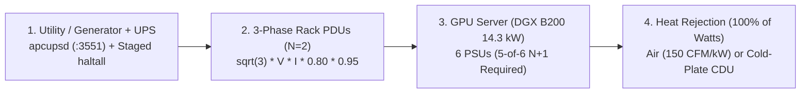

# 6.30 Facility basics: power, cooling, racks and liquid cooling

| | |
|---|---|
| Level | Beginner to Intermediate |
| Priority tier | 1 |
| Lab venue | Laptop (calculators) |
| Part | Part 6: HPC and Slurm |
| Status | Drafted. The rack power table, airflow figures and cost example come from NVIDIA's DGX B200 data-center guide, *AI Data Center Network Design and Technologies* and *AI Factory*. The rack power table was **recomputed** with `code/part06/facility_calc.py`: all nine rows of NVIDIA's DGX B200 power table matched. `code/part06/ups_shutdown_sim.py` simulates the staged UPS shutdown, and its battery sizes are invented for illustration. No real facility was measured, and the shutdown script was not run on live equipment. Cooling and power figures are planning numbers, so always use your vendor's current site-requirements document |

## Why this matters for AI infrastructure

Suppose the facility team tells you a rack can hold only two of the GPU servers you ordered. Why would that be? A GPU server turns electricity into computation, and almost all of that electricity leaves the machine as heat. The more GPUs you pack into a rack, the more power you must bring in and the more heat you must carry out. A rack that looks roomy on the floor plan can still be full on power.

Power, cooling and space are the three limits of every data center. They decide how many GPUs you can run before software even matters. You do not have to design buildings. You do need to speak to the facility team, understand why a rack holds so few servers, and know what happens when the power fails. A facility team speaks in kilowatts, amps and cubic feet per minute, and an AI team usually speaks in GPUs and jobs. This chapter is the bridge between the two languages.

Start every capacity conversation by asking the facility team how much power and cooling each rack can receive. This chapter is the beginner primer. Chapter 9.11 goes deeper on power delivery, thermal design and liquid cooling. Thermal design means how heat is moved away from the parts that produce it.

## Prerequisites and outcomes

You need no special preparation for this chapter. It walks through the units you use to talk about power, then how much power a server and its switches draw, then how that power reaches a rack through circuits and redundant supplies. From there it covers the two main ways to remove heat, air and liquid, and how to measure the efficiency of a site with PUE. The last sections cover racks, cables, the people who own each part, and the monitoring that tells you when something is going wrong. Each section ends with a short check you can run on paper or on your laptop.

## 1. Start with the simple idea

Picture a new order of GPU servers arriving on a Monday. The procurement form asks for a power figure, and the facility team asks how many kilowatts the rack will draw. Before you can answer either question, you need one simple idea and the mechanism behind it.



The diagram follows one path. Power comes in from the utility or a generator, passes through a UPS (a battery that bridges short outages), and reaches the rack through power distribution units (PDUs, the strips that feed each server). The server then turns the power into computation and heat, and the heat has to leave the room through the cooling system. Read it from left to right, and notice that the final box is not optional. Every watt that goes in must come out again as heat.

Think of a GPU server as a heater that also does useful work. Every watt it draws comes back out as a watt of heat. A server that draws 10 kilowatts (kW) warms the room like ten 1 kW space heaters running all day. Cooling has one job: remove exactly as much heat as the machines make. If the cooling falls behind, the room warms up, the servers slow down to protect themselves, and your jobs take longer than the benchmark said they would.

The units matter, so read them carefully before you size anything. Power and energy are different things, and mixing them up is the most common mistake in a first capacity estimate.

| Unit | Meaning | Example |
|---|---|---|
| Watt (W) | Rate of using energy | A GPU can draw 700 W |
| Kilowatt (kW) | 1,000 W | One DGX server: about 10 to 14 kW |
| Megawatt (MW) | 1,000 kW | A large AI cluster: several MW; one GB300 SuperPOD scalable unit alone is rated about 1.2 MW |
| Kilowatt-hour (kWh) | Energy: 1 kW used for 1 hour | What your electricity bill counts |

Three of the four units measure how fast power is used. The fourth, the kilowatt-hour, measures the total energy used over time, and it is the unit your electricity bill counts. A way to keep them apart is to think of a water tap. A watt is how fast the water runs, and a kilowatt-hour is how much water has flowed out of the tap in total.

Data centers have finite resources. NVIDIA's data-center guide for the DGX B200 names three constraints: **power, cooling and space**. Demand beyond what one of them can give hurts the other two. Pushing more power into a rack needs more cooling. Spreading racks apart to make cooling easier makes InfiniBand cables longer than they are allowed to be. InfiniBand is the high-speed network that connects GPU servers, and it has strict limits on cable length.

The wider picture is this. Data centers use roughly 2 percent of the world's electricity, and AI makes that share grow. Inside a data center, IT equipment takes 40 to 45 percent of the power. The cooling system takes 35 to 40 percent, which makes it the second biggest consumer. The rest goes to power distribution, the UPS and lighting. That split explains why cooling is worth your attention even if you never touch a pipe.

Keep the four units in front of you whenever you size a rack, because a rate and an amount of energy are easy to confuse.

## 2. How much power does the equipment use?

Imagine you are filling in a spreadsheet for a new cluster. Each row asks for one device's power, and you have to decide which number to type. The wrong choice here means a rack that trips its breaker on the first big training run. Power planning starts with what each device can draw at most. The table below gives those figures and where each one comes from.

| Item | Power |
|---|---|
| One H100 GPU (SXM) | up to 700 W |
| DGX H100 server (8 GPUs) | about 10.2 kW maximum |
| DGX B200 server (8 GPUs) | 14.3 kW maximum |
| Network switch, 64 x 400 G | about 3 kW power supply |
| Optical module, QSFP28 / QSFP56-DD / OSFP | 3.2 W / 12 W / 15 W |
| Traditional rack | about 10 to 25 kW budget; most around 16 to 18 kW |

Optics look small, but they add up. Optics are the transceivers that turn electrical signals into light for fiber cables. A 64-port switch full of 15 W modules has close to 1 kW of optics alone. That is a whole extra server's worth of heat on the switch, which is easy to forget when you only read the switch's main rating.

A DGX H100 has six power supplies of 3.3 kW in a 4+2 arrangement. A power supply is the unit that converts the wall feed into the voltages the server needs. Four working supplies add up to 13.2 kW, which is the capacity of the supplies and not what the server draws. The 4+2 label means four supplies do the work and two stand by as spares. NVIDIA's rated maximum for the DGX H100 is about 10.2 kW. When you plan, use the vendor's rated maximum. Then use measured power (DCGM, PDU meters, 6.26) to learn what you really use. DCGM is NVIDIA's GPU monitoring tool, and 6.26 covers the measurements in detail.

The planning rule is short. Provision circuits, PDUs and cooling for the server's rated maximum. Then use measurements to refine your cost estimates. Planning for the maximum is cautious on purpose. A real workload may sit below the maximum most of the time, but a full-power burn-in or a hot day can push it right up to the top.

Here is why racks hold so few servers. A DGX B200 draws up to 14.3 kW, so two of them need 28.6 kW and four need 57.2 kW. A typical enterprise rack was built for about 15 kW, so a rack of GPU servers needs special power and cooling. Racks above 100 kW exist. That holds for liquid-cooled rack-scale systems such as GB200 NVL72, not for air-cooled DGX racks, so read such ranges with care. The gap between the rack you have and the rack you need is where most of the cost of an AI cluster hides.

Plan each rack against the vendor's rated maximum for every server. You can refine that plan later with measurements.

## 3. How power gets to the rack

Suppose you plan to put four GPU servers in one rack. Before you order anything, consider the circuits that will feed it. A circuit is the electrical path from the building's panel to the rack, protected by a breaker, which is a switch that trips to stop the current if it gets too high. Data-center racks are fed by three-phase circuits, and one formula tells you what a circuit can deliver.

### 3.1 Circuits, voltage and amps

```text
usable kW = square root of 3 x line-to-line volts x amps x breaker derating x power factor
```

The formula has two factors you must understand before you use it. The first is breaker derating. For continuous loads, you can load a circuit breaker to no more than 80 percent of its rating. A continuous load is one that runs for hours at a time, which describes a training job. That is common practice, and the NVIDIA table uses 80 percent too. The same table also shows 100 percent for sites that allow it. The second factor is power factor, which describes how efficiently the load uses the current. Some of the current in an AC circuit does no useful work, and power factor is the fraction that does. NVIDIA uses 0.95.

The file `code/part06/facility_calc.py` applies this formula to two circuits and a 14.3 kW server. It reproduced every row of NVIDIA's table. Reproducing a published table is a good habit, because it shows that the formula and your reading of it agree with the vendor.

| Volts (line to line) | Amps | Derating | Servers/rack | Capacity (kW) | Demand (kW) | Stranded (kW) |
|---|---|---|---|---|---|---|
| 380 | 32 | 80% | 2 | 32.0 | 28.6 | 3.4 |
| 400 | 32 | 80% | 2 | 33.7 | 28.6 | 5.1 |
| 415 | 32 | 80% | 2 | 35.0 | 28.6 | 6.4 |
| 415 | 60 | 80% | 4 | 65.6 | 57.2 | 8.4 |
| 415 | 63 | 80% | 4 | 68.8 | 57.2 | 11.6 |
| 380 | 32 | 100% | 2 | 40.0 | 28.6 | 11.4 |
| 415 | 32 | 100% | 2 | 43.7 | 28.6 | 15.1 |
| 415 | 60 | 100% | 4 | 81.9 | 57.2 | 24.7 |
| 415 | 63 | 100% | 4 | 86.0 | 57.2 | 28.8 |

The small differences in the table, such as 34 versus 33.7 kW, are rounding. Take the 415 V, 60 A, 80 percent row as a worked example. Two circuits give 65.6 kW of capacity. Four servers at 14.3 kW need 57.2 kW. The gap, 65.6 minus 57.2, is 8.4 kW, which is the stranded power in that row. Read the row as a story. The circuits can carry more than the servers need, and that leftover is the cost you will think about next.

**Stranded power** is capacity you paid for and installed but cannot use, because the next whole server does not fit. It is a real cost, so choose circuits that let you fill the rack efficiently. A bigger circuit that you cannot fill is money spent on capacity that sits idle. NVIDIA's guide says that with two circuits, each one must be able to carry 50 percent of the rack's peak demand. It calls this "N = 2 power circuits". The N stands for the amount you need, and the 2 says there are two feeds, each sized to carry the full load alone if the other fails.

### 3.2 Redundancy: why servers with internal power supplies need care

Imagine the facility engineer tells you the building has two independent feeds, so the rack is fully protected. That sounds reassuring, but the server has its own power supplies, and those change the answer. A DGX B200 has six power supplies, and it needs five of them to run. Engineers call this internal N+1. The server keeps working if one supply loses power, but not if two do. That holds no matter how redundant the feeds upstream are.

The guide therefore says that traditional power redundancy models are not effective. You should treat rack provisioning as delivering only **N**, even with two feeds. The table compares the designs it discusses. Each row asks what one failure does to the rack, so read the table with a single failure in mind.

| Design | What happens on a failure | Verdict in the guide |
|---|---|---|
| **N with two separate sources** (half the servers on UPS A, half on UPS B) | A failed PDU or UPS affects only half the servers | Fewest dependencies, the best option when only two UPS sources exist |
| **N with one source** | A UPS failure stops all servers; more risk during maintenance | Weaker |
| **N with interleaved dual sources** (each server fed from both) | A failure of either source can take down every server, because losing three of six supplies breaks the 5-of-6 rule | Marked STOP: not recommended |
| **N+1 with a static transfer switch (STS)** | The switch itself becomes a single point of failure | NVIDIA has not tested STS with DGX B200 and does not recommend it |
| **N+1 "6 to make 5"** (six separate sources, one per supply) | A single PDU or UPS failure affects nothing | Highest availability, but few sites can provide six UPS sources; usually limited to 2 servers per rack |

Read the table from top to bottom. The first row keeps the fewest dependencies, and the interleaved row is marked STOP because one failure can take down every server. The lesson is general. Always ask how a server's internal redundancy interacts with the facility's redundancy. Two layers of protection can cancel each other out if they are wired the wrong way, and a diagram of the wiring is the fastest way to see it.

### 3.3 Rack PDUs

Picture a night when one rack shows a red alarm, and you need to know which outlet is drawing too much power without walking to the rack in the dark. A smart PDU is the answer to that situation. NVIDIA recommends smart rack PDUs (rPDUs). Such a unit has a network interface and REST API, which is a web-style interface that software can call, plus per-PDU and per-outlet metering, and remote outlet switching. It also has ports for temperature and humidity probes, locking receptacles, and optional red and blue colours to tell the two circuits apart. Together these features give you power telemetry for monitoring (6.26) and for remote power cycling, which means turning a server off and on again from your desk.

### 3.4 UPS and staged shutdown

Suppose the power fails in the middle of a training run. A **UPS** (uninterruptible power supply) is a battery that keeps equipment running during an outage. It usually lasts just long enough for generators to start or for an orderly shutdown, which means minutes. A UPS does not replace a generator. It bridges the gap between the outage and the moment the generator takes over, and it gives the software time to shut down cleanly.

Sites handle this with a UPS monitoring daemon that watches the battery and runs a script when mains power fails. A daemon is a background program that runs without a terminal. The `apcupsd` daemon does this for APC units, and NUT, Network UPS Tools, is a multi-vendor alternative that 6.26 covers. In `/etc/apcupsd/apcupsd.conf`, three settings decide when the shutdown starts, and whichever trips first wins: `BATTERYLEVEL` is the remaining charge in percent, `MINUTES` is the remaining runtime, and `TIMEOUT` is the longest time on battery in seconds, where 0 turns the timer off. Think of these as three alarms on the same clock. The first one that rings starts the shutdown.

Shutting down a whole cluster takes longer than shutting down one server, so a common design runs a staged script, here called `haltall`, started by the daemon's `onbattery` event. A matching `offbattery` event stops it if power returns. The stages are these.

1. Log the event and warn users with `wall`, which broadcasts a message to every logged-in terminal.
2. Wait 30 minutes. Most outages are short, so if power returns, the `offbattery` script ends `haltall`.
3. Power off the idle nodes, found by checking each node's load. This stretches the battery for the busy nodes.
4. Poll the UPS `TIMELEFT` value every minute until only 5 minutes of battery remain.
5. Stop the batch queue and cancel running jobs, with `scontrol` and `scancel` on Slurm. Wait a minute.
6. Power off all remaining compute nodes, wait another minute, then power off the head node.

Each stage gives up something to save something else. Stage 2 gives up time to ride through a brief outage. Stage 3 gives up the idle nodes to save power for the busy ones. Stage 5 gives up the running jobs to save the file system and the hardware. Walking through the stages in order, and asking what each one costs, is the best way to understand the script.

A second script can watch the room. In a common setup it polls the UPS's ambient temperature probe over SNMP every 10 minutes. SNMP is a simple protocol that devices use to report their status on the network. The script warns the administrator above 25 °C and starts an immediate emergency shutdown above 30 °C. That emergency version powers off everything at once, not in stages, because a room that hot will damage hardware faster than a careful sequence can protect it.

These are starting points, not finished tools. Adapt them to your storage servers, your scheduler, your power connections and the way load is spread across your UPS units. A script that works on one room can fail on another if the storage servers are missing from the list.

The simulation `code/part06/ups_shutdown_sim.py` models these steps. It uses made-up battery numbers: 100 nodes, 60 of them busy, and a battery runtime that is inversely proportional to load. Inversely proportional means that doubling the load halves the runtime. Its output is below.

```text
--- outage lasts 10 min
  t+ 10 min  power restored: shutdown aborted (100 nodes still on, 65 min left)
--- outage lasts 45 min
  t+ 30 min  30 min elapsed: powered off 40 idle nodes; 75 min of battery left
  t+ 45 min  power restored: shutdown aborted (60 nodes still on, 60 min left)
--- long outage
  t+ 30 min  30 min elapsed: powered off 40 idle nodes; 75 min of battery left
  t+101 min  battery at 4.0 min: queue stopped, running jobs cancelled
  t+102 min  all nodes powered off
  t+103 min  head node powered off. End of shutdown.
UPS temperature policy: 22 C ok; 26 C warn admin; 31 C halt cluster now
```

Read the three cases one at a time. In the 10-minute outage, power returns before the 30-minute wait ends, so nothing is shut down. In the 45-minute outage, the idle nodes go off at 30 minutes, and power returns at 45 minutes, so the busy nodes keep running. In the long outage, the battery runs down to about 4 minutes, and the script stops the queue and powers off the rest in order. The output shows why stage 3 matters. Shutting idle nodes down gives the busy ones about 15 extra minutes. Real GPU clusters differ, though. GPU racks draw so much power that UPS runtime is often a few minutes, so modern designs rely on generators. Newer racks, such as the GB300 reference design, put large energy storage in the rack power shelf to flatten peak demand. A power shelf is the rack-level unit that feeds power to the servers.

Checkpointed training jobs should survive a power loss, because they can restart (6.21). A checkpoint is a saved copy of the model and optimizer state, written to disk at intervals, so a restarted job can pick up from the last save. The staged shutdown mainly protects data and hardware. For each rack, decide in advance which failures it must survive, and which steps of the staged shutdown you will run.

## 4. Getting the heat out: air cooling

Air cooling is the familiar approach. Cold air goes in at the front of the rack, passes over the hot parts, and leaves warm at the back. The question is always whether enough cold air arrives and whether the hot air leaves before it mixes back in. Most of the problems in an air-cooled room come down to those two questions.

### 4.1 How much air?

Suppose you plan an air-cooled rack of DGX B200 servers. Air has to carry all of that heat away, so you need to know how much air to move. NVIDIA's planning figure is about 150 cubic feet per minute (CFM) of cold air per kilowatt. CFM is the volume of air that moves each minute. A rack with two DGX B200 servers draws 28.6 kW, so it needs about 4,290 CFM. Four per rack, at 57.2 kW, need about 8,580 CFM. The calculator printed the same 4290 and 8580, so the figures check out.

Work one server on its own to see the scale. A DGX B200 at 14.3 kW needs up to roughly 2,145 CFM at sea level, which is 14.3 times 150. Sea level matters because thinner air at altitude moves less heat, so the figure changes with where your building stands.

The general formula is CFM = 3.16 x watts / temperature rise in degrees Fahrenheit. The temperature rise is how much warmer the air leaves than it entered. For 81.6 kW and a temperature rise of 20 C (36 F), it gives about 7,160 CFM. The calculator confirmed 7,163 CFM. The small difference is rounding, and the two numbers agree for practical purposes.

### 4.2 Conditions the room must meet

Picture a summer afternoon when the room feels fine near the door but the racks at the far end start throttling. The room conditions are what keep that from happening. The DGX B200 guide sets limits on the air that reaches the servers. Supply air should generally meet ASHRAE Class A1, a standard set by the American Society of Heating, Refrigerating and Air-Conditioning Engineers that describes a safe range of intake temperatures. Class A1 allows 15 to 32 C. At the server inlet, the temperature must stay at most 30 C (86 F). The server runs from 5 to 30 C, and at high altitude the range is lower. Between 5,000 and 10,000 feet, it runs from 5 to 25 C.

The air must also be clean. The guide asks for at least MERV 13 filters, which is a rating for how small a particle the filter catches, and an ISO 14644-1 Class 8 clean-room level in the rack area. Dust damages electronics and clogs filters, so the air quality matters as much as the temperature. Noise is high as well, around 96 to 101 dB of sound power. Sound power is the total sound the machine produces, not how loud it feels at one spot. These rooms are not offices, and hearing protection is a sensible habit for anyone who spends long hours there.

### 4.3 Good habits for air-cooled rooms

A room can meet the room conditions listed earlier in this section and still have hot spots. The guide lists habits that keep cold air where it belongs. Aisle containment separates hot and cold aisles with physical barriers. An aisle is the walkway between two rows of racks. Blanking panels fill empty rack slots, so hot air cannot flow back. Brush grommets seal the cable openings. You should also control humidification, keep proper filtration, audit the airflow from perforated floor tiles with an anemometer, which is a meter that measures air speed, and model the room with computational fluid dynamics (CFD). CFD is software that simulates how air moves through a space, and it is the cheapest way to find a hot spot before you build it.

The guide says rear-door heat exchangers and in-row coolers are "not typically suitable" for DGX B200. They are still a normal way to cool other dense racks, as section 5 explains. Suitability depends on the server, so a cooling option that is right for one rack can be wrong for another.

### 4.4 Airflow direction

Airflow direction decides which equipment gets the coolest air first. Front-to-back airflow is what most customers prefer. Cold air enters at the port side and hot air leaves at the back. This layout cools the network optics first. The optics are the most heat-sensitive part of a switch, so giving them the cold air first is a sensible priority.

Back-to-front airflow cools the power supplies first, and it may need extra heat sinks on the optics. A heat sink is a block of metal fins that pulls heat away from a part. Bidirectional fans can do both, but they cost a lot. The rule is simple. Pick one direction for the whole room before you buy. Then make sure every device, including servers, storage and switches, matches it. A mixed rack lets one device breathe the other's hot exhaust, and that problem is hard to see until something overheats.

## 5. Liquid cooling

Air works until the racks get dense enough that the fans cannot keep up. Then the air becomes the bottleneck, and the fans spin faster, make more noise and still cannot move enough heat. Water and special fluids carry heat far better than air. That allows denser racks and lower power for cooling. Four types are in common use, with spray cooling as a fifth, newer option. Liquid cooling could cut cooling power by about 70 percent and improve PUE, which section 6 explains.

| Type | How it works | Good for | Cost and trade-offs |
|---|---|---|---|
| **Immersion, single-phase** | Whole servers sit in a tank of non-conductive liquid; pumps move the liquid to a heat exchanger | Very high density | Whole room and all equipment must support it; messy servicing |
| **Immersion, two-phase** | Liquid boils at a low temperature on hot parts, vapour condenses on a cold-water tube at the top of the tank and drips back | Highest density; no external heat exchanger | Fluid choice is critical; specialised |
| **Cold plate (direct to chip)** | Pipes carry liquid to plates sitting on CPUs and GPUs; warm liquid goes to a heat exchanger | High density with normal servers | Equipment is cheaper than immersion; needs plumbing, a coolant distribution unit (CDU), leak detection |
| **Rear-door heat exchanger** | A radiator door at the back of the rack cools the exhaust air with chilled water; can cool about a 20 kW rack at normal chilled-water temperatures | Retrofitting dense air-cooled racks | Simplest; less efficient than the other types; equipment must be air cooled and ideally front-to-back |
| **Spray** | Coolant is sprayed on hot parts | Targeted cooling with little coolant | Equipment must be modified; one source cites 25.8 percent lower total energy than air cooling |

Notice that the rear-door option is the simplest to retrofit, but it is less efficient than the others. As you read the table, ask what each option asks of your site. Each row trades cost, density and site work in a different way. A CDU, for example, is the box that pumps coolant around the loop and passes the heat to the facility water. Leak detection is the sensor that tells you a pipe has started to drip before the drip reaches a server.

The rear-door type is sometimes written AALC, which stands for Air-Assisted Liquid Cooling. The name says what the door does: it helps the air, and the liquid does the heavy lifting.

NVIDIA's newer rack-scale systems use hybrid cooling. Hybrid means some parts are liquid cooled and some are air cooled. The DGX GB300 liquid-cools the most power-hungry parts, the GPUs and CPUs, and air-cools the rest. Its rack-integrated design is meant for quick installation of liquid-cooled, high-density compute racks.

Liquid cooling also adds things you must operate. These include CDUs, coolant quality and temperature, flow and pressure sensors, leak detection, quick-disconnect couplings and building-management integration. A quick-disconnect coupling lets a technician swap a server without draining the loop. Building management is the system that watches the whole facility. The GB300 reference architecture says the data center should generally meet Uptime Institute Tier 3 design standards, or equivalents such as TIA-942-B Rated 3 or EN 50600 Availability Class 3. These are industry ratings for how well a building keeps running through failures. It also notes that the building management system's power and cooling telemetry must flow through the uplink interfaces, which sit in the *untrusted* zone. That is a security design point, covered in Part 18.

Decide early whether your team can operate the CDUs, sensors and leak detection that a liquid option adds. Keep the five rows in mind when a vendor proposes one of them. A liquid option that your team cannot maintain in the middle of the night is a risk, however good its efficiency figures look on paper.

## 6. Efficiency: PUE and the energy bill

Your finance team asks what the cluster costs to run each month. That question leads straight to PUE, the efficiency number that facility teams quote most often. The answer depends on two things: how much of the power reaches the computers, and how much the schedule uses.

**PUE (power usage effectiveness)** is the total facility power divided by the power used by the computing equipment. The ideal value is 1.0. A higher PUE means more of your electricity goes to cooling and losses. A worked example, which is illustrative, follows. An 8-server H100 cluster has an IT load of 8 x 10.2 = 81.6 kW. With a PUE of 1.35, the facility draws about 110 kW. The gap between the 81.6 kW of IT load and the 110 kW the facility draws is cooling and power losses, and you pay for it on every hour the cluster runs.

Now add the schedule. The cluster trains for 16 hours a day at 110 kW. It sits idle for 4 hours at 20 kW, and it spends 4 hours in maintenance at 40 kW. Over a month, the three parts add up to 52,800 + 2,400 + 4,800 = 60,000 kWh. At 0.12 US dollars per kWh, that is 7,200 dollars per month, or about 86,400 dollars per year, for a 30-day month. The calculator output matches.

Work the bill one line at a time. The training block is the biggest, because it runs at full power for the most hours. The idle block is small in energy, but it still costs money, which is why a cluster that sits idle at a high power draw is a waste. Each part is a rate multiplied by a time, and the monthly figure is the sum of those products.

Air cooling has the lowest capital cost but the highest operating cost. Liquid options cost more to buy but less to run. Compare options with your **measured** PUE, not with generic numbers. A measured figure tells you what your site does on a hot week and a cold week, while a generic figure tells you what a brochure hopes for.

The percentages from the first section make the point clearer. If IT takes 40 to 45 percent of the total, PUE is about 2.2 to 2.5. That describes older or poorly cooled sites. Modern efficient data centers aim for 1.1 to 1.4. The same arithmetic works in reverse, so you can check any PUE claim against the share of power that IT takes.

Compare cooling options with the PUE you have measured on your own site, and treat generic figures as a starting point only.

## 7. Space, racks and cables

Suppose the first rack arrives at the loading dock and the doorway is a few centimetres too narrow. The rack has to fit through the door, the floor has to hold its weight, and the cables have to reach the switches. Each of those is a fact you can measure before the truck arrives. The size of a rack decides whether your servers fit, whether the floor can carry the weight, and whether the cables can reach the switches. NVIDIA does not name a rack brand. It does set standards. Racks must follow the EIA-310 standard for 19-inch mounting, which describes the rail spacing that servers bolt into. They must be at least 24 x 44 inches (600 x 1100 mm) and at least 48U tall. A U is one rack unit, the standard height step that rack rails are drilled to. NVIDIA recommends 30 x 48 x 52U (700 x 1200 mm). A DGX B200 is 10U tall, weighs over 130 kg and is 897 mm deep, so floor loading and doorways matter.

Do not share DGX racks with unrelated equipment. Keep unrelated equipment out of the spaces between DGX racks, because those spaces exist to spread the cooling load. A rack that is packed tight with other gear loses the airflow it was designed around.

A DGX SuperPOD "scalable unit" (SU) is the building block. A SuperPOD is NVIDIA's reference design for a large GPU cluster, and an SU is one repeatable section of it. One SU holds up to 32 DGX B200 systems and draws about 458 kW. A full SuperPOD has up to four SUs in the typical build, though the reference design can scale much further. With UFM management appliances, the table reaches up to 127 servers, or 1,016 GPUs. UFM is the Unified Fabric Manager, the software and appliance that configures and watches the InfiniBand network.

Cable counts grow quickly. With 1 SU, the guide's table lists 31 nodes, 8 leaf switches, 4 spine switches and 252 node cables. Leaf and spine switches are the two layers of a network fabric. The leaf switches connect to the servers, and the spine switches connect the leaves to each other. With four SUs, it lists 127 nodes, 32 leaf switches, 16 spine switches, 1,020 node cables and 1,024 spine-leaf cables. Most of those cables end up in the management racks and overhead trays. Plan the cable tray type, width, depth and fill ratio. Plan the top-of-rack penetrations, the structural load and the cable management too. A tray that looks big enough on paper can be full after the first month of changes.

For InfiniBand, passive DAC (direct-attach copper) works up to about 5 m at 100 Gb. DAC is a copper cable with the transceivers built into its ends, and passive means it has no powered electronics. The guide says it reaches only 3 m at 400 Gb. Active optical cables (AOC) reach up to 30 m. An AOC is a fiber cable with built-in electronics at each end. Distance limits come from signal loss and delay along the whole path. That is why you cannot extend them with patch panels, which add loss, or with extra top-of-rack switches, which add latency. The guide's FAQ says so. Rack distance is therefore limited, and cooling needs and cable lengths pull against each other.

The guide's cabling practices are concrete. Bundle cables by purpose, such as inter-switch links and uplinks. Use the right length and allow for bend radius, which is how sharply a cable can curve before it is damaged. Keep runs under 90 percent of the maximum supported distance. Separate copper from fiber, and install spare cables in advance. Colour-code cable ties by endpoint, and label both ends and the run. Labels at both ends save hours when a link fails at night and someone has to find the other end.

Measure every planned cable run against its distance limit before you order the cables, because patch panels cannot stretch a run that is too long.

## 8. People and ownership

A cooling alarm goes off on a weekend, and nobody on the team knows whose job it is to answer it. The cluster is fine until the room gets hot, and then the question of ownership becomes urgent. A GPU deployment succeeds only when five groups agree on the plan. The closing point of NVIDIA's guide names them: facility operations (power and cooling), IT operations, the systems operations center, network operations and the application owner. A fix in one area, such as cooling, changes budgets, staff and schedules in another. Agreeing on those links before the install is much cheaper than discovering them during an outage.

When you propose a cluster, ask these questions. Who owns power and cooling? How many kW per rack, and on which circuits? What are the inlet temperature and airflow limits? Where are the cable paths? Who is on call for a cooling alarm? Each question has a name attached, and a question without a name is a risk you have not yet accepted.

Name the owner of power and cooling before you propose the cluster.

## 9. Monitoring the physical layer

Picture a rack whose inlet temperature has crept up by a few degrees over a week, while the jobs running on it have not changed. Nothing has alarmed yet, but something physical is drifting. Monitoring the physical layer is how you notice before the rack throttles or shuts down. Feed the physical measurements into the monitoring you set up in 6.26. Track rack inlet and outlet temperature, PDU and outlet power, and UPS state and time left. Add CDU temperature, flow and pressure, leak sensors and BMC sensors (Part 7). A BMC is the baseboard management controller, a small computer inside each server that reports its health even when the operating system is down. Include GPU temperature and throttle reasons from DCGM.

Alert on rising temperature at constant load, because that can mean a failing fan or blocked airflow. The useful word there is "constant". If the load has not changed and the temperature has, the cause is physical. Alert on power near the circuit limit, and on any containment breach. A containment breach is a gap in the barriers that separate hot and cold air, such as a missing panel or an open door.

Practise the response before you need it. A cooling failure can overheat a dense rack within minutes. Know in advance which jobs to stop and which nodes to power off first, which is the staged-shutdown idea from section 3. A written plan that the on-call engineer has read beats a clever plan that exists only in one person's head.

Write the response plan now, while the rack is healthy.

## Exercises

Start by running the self-checking Python lab, `code/part06/facility_calc_lab.py`, on your own machine. Nothing in these steps was run on a live facility. It runs the calculator's own self-checks on your machine, so you can see the results for yourself.

```bash
python3 code/part06/facility_calc_lab.py
```

1. Your facility team quotes a rack capacity, and you want to check the table yourself. Reproduce the NVIDIA DGX B200 rack power table, using `code/part06/facility_calc.py` and `facility_calc_lab.py`. Run `python3 code/part06/facility_calc_lab.py`. Check one row by hand with the formula in section 3.1, using a power factor of 0.95. Take two three-phase circuits rated `415 V` and `60 A`. They run at `80%` breaker derating. Together they should deliver `65.6 kW`. Four DGX B200 servers at `14.3 kW` each demand `57.2 kW`. That leaves `8.4 kW` of stranded power.
2. A customer wants more servers in a rack than the table suggests, so you check the capacity. A rack has two three-phase circuits, each rated `400 V` and `63 A`. They run with `80%` breaker derating. Find the usable rack capacity, which is `66.3 kW`. Then count the number of `14.3 kW` DGX B200 servers that fit. Four servers use `57.2 kW`. So the stranded power is `9.1 kW`. Check your answer with `rack_plan(400, 63, 0.8, 4)`.
3. Your team is comparing the server's internal redundancy with two facility feed designs. Draw the power-supply connections for a rack of four DGX B200 servers. Each server has 6 PSUs and needs 5 energized PSUs to stay up. Prove why interleaved dual-source wiring, with 3 PSUs on UPS A and 3 on UPS B, crashes every server in the rack if UPS A fails. Then show why the other two designs avoid a full-rack outage. The first is half the servers entirely on UPS A and half on UPS B, which is N with two separate sources. The second is the "6 to make 5" design.
4. You need the airflow and the electricity cost for a few racks. Use `code/part06/facility_calc.py` for all of it. Start with `150 CFM/kW`. Run it for a rack of 2 DGX B200 servers, which gives `4,290 CFM`. Run it again for a rack of 4 servers, which gives `8,580 CFM`. Next, take an `81.6 kW` H100 cluster with a 20 °C (36 °F) temperature rise. Apply the formula from section 4.1, which gives `7,163 CFM`. Last, work out the monthly kWh and the bill at `$0.12/kWh` and `PUE = 1.35`. You should get `60,000 kWh`, `$7,200/month` and `$86,400/year`.
5. Your facility team wants to see what a staged shutdown does before anyone trusts it. Simulate the staged UPS shutdown, using `code/part06/ups_shutdown_sim.py`. Trace the six stages through three cases. The cases are a 10-minute outage, a 45-minute outage and a full battery drain. Explain why powering off the 40 idle nodes at 30 minutes gives the 60 busy nodes 15 more minutes. Then state the two temperature thresholds of the room-temperature watch.
6. Your team is choosing a cooling design for a new room. Compare five cooling technologies: air with hot and cold aisle containment, the rear-door heat exchanger, direct-to-chip cold plates with a CDU, single-phase immersion, and two-phase immersion. Compare them on four points. The four points are rack power density, retrofit complexity, PUE impact and operational failure modes.

Each exercise builds on the sections before it, so work through them in order. Write your answer for each one on paper first, then check it against the calculator.

## 11. Interview angles

- Why can only two DGX B200 servers go in a typical air-cooled rack?
- What is stranded power and how do you reduce it?
- Why does internal N+1 power supply design break the usual dual-feed redundancy model?
- Compare air cooling with cold-plate and immersion cooling.
- What is PUE? What does a PUE of 1.5 mean?
- Why can't InfiniBand cable limits be extended with patch panels?
- What happens in your cluster when power is lost for 10 minutes? For two hours?
- Which teams must agree before a GPU cluster is installed?

## Checkpoint

<details>
<summary>1. Define Watt (W), Kilowatt (kW), Megawatt (MW), and Kilowatt-hour (kWh), and state the three linked physical constraints of every data center.</summary>

A watt measures the rate at which electrical power is used, and that power becomes heat at the same rate. A kilowatt is 1,000 W, and a megawatt is 1,000 kW. A kilowatt-hour is an amount of energy: 1 kW sustained for 1 hour. For your planning, the three linked constraints are power, cooling and space. Packing more kW into a rack requires higher-capacity cooling, and spreading servers over more racks to cool them makes InfiniBand cables longer.
</details>

<details>
<summary>2. Roughly what share of total data-center electricity is consumed by IT equipment versus the cooling system and what are the rated maximum power draws of a DGX H100 and a DGX B200 server?</summary>

In traditional data centers, IT equipment uses roughly 40 to 45 percent of total facility power. The cooling system uses 35 to 40 percent. Power distribution, UPS losses and lighting take the remainder. A DGX H100 with 8 GPUs has a rated maximum draw of about 10.2 kW. A DGX B200 with 8 GPUs has a rated maximum draw of 14.3 kW.
</details>

<details>
<summary>3. Why does a DGX H100 have six 3.3 kW power supplies (4 x 3.3 kW = 13.2 kW) when its rated maximum draw is 10.2 kW, and how much power do 64 OSFP (15 W) optical transceivers add to a switch?</summary>

The 13.2 kW figure is the combined nameplate capacity of the four active power supplies, in a 4+2 redundant configuration. It gives headroom above the server's real maximum draw of 10.2 kW. On a 64-port 400G or 800G switch, 64 OSFP optical modules at 15 W each add 960 W, or about 1 kW, of power and heat from optics alone. QSFP28 modules draw about 3.2 W each, and QSFP56-DD modules draw about 12 W.
</details>

<details>
<summary>4. Write the 3-phase usable power formula (`code/part06/facility_calc.py`), and explain breaker derating, power factor, and stranded power.</summary>

```text
usable kW per circuit = sqrt(3) x line-to-line volts x amps x derating x power factor
```

Electrical codes commonly cap continuous loads at 80 percent of a breaker's rated amperage. The 0.80 derating factor reflects that cap. The power factor of 0.95 is the ratio of real working power to apparent power. Stranded power is installed, paid-for circuit capacity that you cannot use. It equals capacity minus demand, and it appears because adding one more whole 14.3 kW server would exceed the circuit limit.
</details>

<details>
<summary>5. Why does a DGX B200's internal `5-of-6` PSU redundancy break traditional interleaved dual-source (`A/B`) rack power designs, and what are the two recommended designs?</summary>

A DGX B200 has six internal PSUs and needs at least five energized to run. It survives losing one PSU, but it shuts down if two lose power. If you wire three PSUs to UPS A and three to UPS B, which is the interleaved dual-source design, a failure of either UPS drops three PSUs on every server. That crashes 100 percent of the servers in the rack. Two designs avoid this. The first is N with two separate sources. Put half the servers entirely on UPS A, with all 6 cords, and half entirely on UPS B, so one UPS failure affects only 50 percent of servers. The second is N+1 "6 to make 5". Feed each of the six PSUs from six independent sources, so any single source failure drops only one PSU per server.
</details>

<details>
<summary>6. What capabilities should smart rack PDUs (`rPDU`s) provide in an AI data center?</summary>

A smart rack PDU should offer a network management interface, such as a REST API, Redfish or SNMP. It should meter power per PDU and per outlet, including power and current. It should switch power per outlet remotely. It should have environmental sensor ports for inlet and outlet temperature and humidity probes. It should have locking power receptacles, such as C13, C19 or C20. Its chassis can be color coded, for example red and blue, to prevent cross-wiring circuits.
</details>

<details>
<summary>7. In `/etc/apcupsd/apcupsd.conf`, which three parameters work together to trigger a server shutdown on battery?</summary>

Three parameters work together, and whichever trips first starts the shutdown. `BATTERYLEVEL` is the remaining battery charge percentage, such as 5 percent. `MINUTES` is the remaining runtime in minutes, such as 3. `TIMEOUT` is the maximum number of seconds on battery, where 0 disables it. For example, a site might set 5 percent, 3 minutes and no timeout.
</details>

<details>
<summary>8. Walk through the 6-step staged cluster shutdown algorithm (`haltall`) described in this chapter (`code/part06/ups_shutdown_sim.py`).</summary>

1. Power fails, and `apcupsd` invokes `/etc/apcupsd/onbattery`. That script emails the admin, broadcasts a `wall` notice and starts `/etc/apcupsd/haltall` in the background.
2. Wait 30 minutes (`sleep 1800`) to ride through brief utility outages. If power returns, `/etc/apcupsd/offbattery` kills `haltall`.
3. Power off the idle compute nodes, those whose `ndload` is below 10, using SSH and `/sbin/poweroff`. This reduces the load on the UPS and stretches the remaining battery time for busy nodes.
4. Poll `TIMELEFT` with `tlwait 5`, every 60 seconds, until only 5 minutes of battery runtime remain.
5. Stop the batch queue and terminate running jobs, using `qstop` and `qdel`, or `scontrol` and `scancel` on Slurm. Then wait 1 minute (`sleep 60`).
6. Power off all remaining compute nodes. Wait 1 more minute (`sleep 60`), then power off the head or storage server with `/sbin/poweroff`.
</details>

<details>
<summary>9. What two temperature thresholds does a UPS room-temperature watch enforce, and what happens at each?</summary>

The watch polls the UPS's ambient probe over SNMP every 10 minutes. Above 25 °C it warns the administrator by mail and terminal message. Above 30 °C it triggers an immediate emergency cluster shutdown, which powers everything off at once instead of in stages.
</details>

<details>
<summary>10. State NVIDIA's airflow planning rule of thumb (`CFM` per `kW`) and the general sensible-heat airflow formula (`code/part06/facility_calc.py`).</summary>

NVIDIA's sea-level planning rule is 150 CFM per kW. One DGX B200 at 14.3 kW therefore needs 2,145 CFM. Two per rack need 4,290 CFM, and four per rack need 8,580 CFM. The general sensible-heat formula is

```text
CFM = 3.16 x watts / temperature rise in degrees Fahrenheit
```

For 81,600 W and a 20 °C (36 °F) temperature rise, CFM = 3.16 x 81,600 / 36, which is about 7,163 CFM.
</details>

<details>
<summary>11. What inlet air temperature, filtration, and clean-room standards does the DGX B200 site guide specify?</summary>

For your site, inlet air should fall within the ASHRAE Class A1 envelope, with a maximum of 30 °C (86 °F) at the server inlet. That range runs from 5 to 30 °C at sea level. At 5,000 to 10,000 feet of altitude, it drops to 5 to 25 °C. The guide requires at least MERV 13 air filtration and ISO 14644-1 Class 8 clean-room particulate levels. Acoustic levels reach 96 to 101 dB.
</details>

<details>
<summary>12. List six physical best practices for air-cooled GPU rooms, and explain why front-to-back airflow is standard.</summary>

1. Hot and cold aisle containment, using physical doors or curtains that separate cold supply air from hot exhaust air.
2. Blanking panels in every empty rack U-slot, so hot exhaust air cannot recirculate to the cold inlet.
3. Brush grommets that seal floor and rack cable cutouts.
4. Perforated floor tile audits with an anemometer, backed by CFD modeling.
5. Humidity control and MERV 13 filtration.
6. Uniform airflow direction. Front-to-back airflow, with intake on the port side, draws cold air across temperature-sensitive optical transceivers, such as OSFP and QSFP-DD, before the air leaves through the rear. Mixing front-to-back servers with back-to-front switches in one rack lets one device breathe the other's hot exhaust.
</details>

<details>
<summary>13. Compare the five liquid cooling technologies (rear-door heat exchanger, cold-plate direct-to-chip, single-phase immersion, two-phase immersion, and spray).</summary>

- **Rear-door heat exchanger:** A chilled-water radiator door on the back of an air-cooled rack, also called Air-Assisted Liquid Cooling (AALC). It handles about 20 kW per rack and is the easiest to retrofit.
- **Cold plate (direct-to-chip):** Copper cold plates sit directly on CPUs, GPUs and NVSwitches, fed by a coolant distribution unit (CDU). Fans cool the lower-power DIMMs and NICs. This is the standard for dense HGX, GB200 and GB300 racks.
- **Single-phase immersion:** Whole servers sit in a sealed bath of dielectric hydrocarbon or synthetic fluid, which circulates through a heat exchanger.
- **Two-phase immersion:** Servers sit in a low-boiling-point fluorochemical liquid. It boils on hot chips and condenses on a top-mounted chiller coil.
- **Spray:** Dielectric coolant is sprayed directly onto hot dies. One source gives 25.8 percent lower total energy than air cooling, but spray requires a specialized chassis.
</details>

<details>
<summary>14. What is hybrid liquid cooling in NVIDIA's DGX GB300 / NVL72 rack architecture, and what new facility components must be monitored?</summary>

Hybrid cooling uses direct-to-chip liquid cold plates to carry away 80 to 90 percent or more of the rack's heat. That heat comes from the GPUs, CPUs and NVLink switches, and it goes into a facility water loop. Standard air cooling handles the rest, from power shelves, boot drives and optics. Operators must monitor CDUs (coolant distribution units), supply and return coolant temperatures, flow rates in L/min, differential pressure, coolant pH, conductivity and biocide quality, drip trays, and leak-detection ropes or sensors. Those leak sensors are isolated in the untrusted BMS telemetry zone.
</details>

<details>
<summary>15. Define PUE (Power Usage Effectiveness), calculate the total facility load for an 81.6 kW IT cluster at `PUE = 1.35`, and compare an older `PUE = 2.2` site with a modern liquid-cooled site.</summary>

```text
PUE = total facility power / IT equipment power
```

The ideal PUE is 1.0. For 81.6 kW of IT load at PUE = 1.35, total facility power is 81.6 x 1.35 = 110.16 kW, or about 110 kW. An older air-cooled site, where IT is 40 to 45 percent of total power, has PUE = 1 / 0.45 to 1 / 0.40, which is 2.22 to 2.50. Modern liquid-cooled AI factories achieve `PUE = 1.08 to 1.25`.
</details>

<details>
<summary>16. What are the minimum and recommended physical rack dimensions (`EIA-310`) for DGX B200 systems, and how big is a single DGX B200 chassis?</summary>

Your racks must comply with EIA-310 for 19-inch rails. The minimum rack size is a 24 x 44 inch (600 x 1100 mm) footprint and at least 48U tall. The recommended size is 30 x 48 inches by 52U (700 x 1200 mm). That extra room fits wide PDU power cords and InfiniBand or liquid manifolds. A DGX B200 chassis is 10U tall, 897 mm deep and weighs over 130 kg.
</details>

<details>
<summary>17. How many nodes, switches, and cables make up a 1-SU (31-node) and a 4-SU (127-node / 1,016-GPU) DGX B200 SuperPOD?</summary>

One scalable unit (1 SU) has 31 compute nodes. It can host up to 32 DGX B200s, which draw about 458 kW. It has 8 leaf switches, 4 spine switches and 252 node cables. Four scalable units (4 SUs) have 127 compute nodes and 1,016 GPUs. They use 32 leaf switches, 16 spine switches, 1,020 node cables and 1,024 spine-to-leaf cables.
</details>

<details>
<summary>18. What are the maximum supported cable lengths for InfiniBand passive DAC (Direct-Attach Copper) and AOC (Active Optical Cable), and why can't you extend them with patch panels?</summary>

Passive DAC, which is copper, supports up to 5 m at 100G, and up to 3 m at 400G NDR. AOC, or active optical cable, supports up to 30 m. Longer spans need discrete optical transceivers and single-mode fiber. Patch panels cannot extend these limits, because high-speed PAM4 signaling budgets depend on total end-to-end insertion loss and latency. Every connector pair in a patch panel adds signal attenuation and reflections. Those can cause link down-training or symbol errors. Keep your planned runs under 90 percent of the rated maximum length.
</details>

<details>
<summary>19. Which five organizational teams must sign off on a GPU cluster deployment plan before installation begins?</summary>

1. Facility operations handle electrical feeds, breakers, chillers, CDUs and floor loading.
2. IT operations own racks, PDUs, cabling and asset management.
3. The systems operations center handles OS provisioning, Slurm and K8s, monitoring and on-call.
4. Network operations run the InfiniBand or RoCE fabric, spine-leaf routing, firewalls and WAN or DTN.
5. Application owners set workload power profiles, checkpointing and acceptance criteria.
</details>

<details>
<summary>20. What physical-layer telemetry should trigger an immediate page or automated workload throttling on a GPU rack?</summary>

1. CDU or chilled-water flow loss, or a high supply coolant temperature. A dense rack can overheat in under 2 minutes without coolant flow.
2. A leak-detection sensor alarm under a rack or manifold.
3. Rack inlet air temperature approaching 30 °C, or rising fast at constant IT load, which points to a fan failure or a containment breach.
4. Rack PDU current above 80 percent breaker derating, or loss of one feed, which means N redundancy is degraded.
5. UPS switching to `ONBATT`, or ambient room temperature exceeding 25 °C or 30 °C.
</details>

## Sources and review notes

- Book source (`supercomputers-for-linux-sysadmins-managing-modern-hpc-clusters-and-supercomputers-from-software-to-hardware`, *Supercomputers for Linux Sysadmins*):
  - Chapter 19 ("19. Cluster Status Monitoring Systems", read in full): APCUPS (`apcupsd`, `apcaccess`, `onbattery`/`offbattery`, `multimon.cgi`, `/etc/apcupsd/hosts.conf`).
  - Chapter 28 ("28. One-Two-Three Instructions", read in full): `/etc/apcupsd/apcupsd.conf` parameters (`UPSCABLE`, `UPSTYPE`, `DEVICE`, `ONBATTERYDELAY`, `BATTERYLEVEL`, `MINUTES`, `TIMEOUT`, `NETSERVER`, `NISIP`, `NISPORT` `3551`, and Table 28-1 `UPSTYPE`/`DEVICE` values), `onbattery`/`offbattery` and the staged cluster shutdown script (`haltall`), and the `upstemp`/`ambtemp.sh` APC SNMP temperature scripts (`.1.3.6.1.4.1.318.1.1.1.2.2.2.0` internal UPS temperature and `.1.3.6.1.4.1.318.1.1.10.2.3.2.1.4.0` external sensor temperature).
- Thermal and power concepts, airflow, liquid cooling types (`25.8%` spray energy reduction, `70%` cooling power reduction), PUE (`40–45%` IT, `35–40%` cooling), optical module power (`3.2 W` / `12 W` / `15 W`), rack power budgets: read in full from *AI Data Center Network Design and Technologies* (`ai-data-center-network-design-and-technologies`), Chapter 5 ("5. Thermal and Power Efficiency Considerations").
- DGX B200 power profiles (`14.3 kW`), 9-row power provisioning table, `5-of-6` PSU redundancy designs, ASHRAE/MERV 13/ISO Class 8 filtration, best practices, cabling (`1 SU` `31` nodes / `252` cables; `4 SUs` `127` nodes / `1,016` GPUs / `1,020` + `1,024` cables), FAQ: read in full from NVIDIA, *Data Center Best Practices with DGX B200* (`superpod-b200-dc`).
- GB300 hybrid cooling (`~1.2 MW`), power shelves with energy storage, Tier 3 availability, BMS telemetry untrusted zone: NVIDIA, *DGX SuperPOD Reference Architecture, DGX GB300* (`superpod-gb300`).
- AI Factory power, cooling, PUE (`1.35`, `60,000 kWh`, `$7,200/month`), and infrastructure landscape: *AI Factory* (`ai-factory`) and migrated from `nvidia-devops` (`nvidia-zero-to-hero/volume-01/04-nvidia-ecosystem-overview.md`, `nvidia-zero-to-hero/volume-01/05-enterprise-ai-platforms.md`, `nvidia-zero-to-hero/volume-01/06-volume-01-summary.md`, `nvidia-zero-to-hero/volume-01/chapter-01-what-is-ai-infrastructure.md`, `nvidia-zero-to-hero/volume-01/chapter-02-why-cpus-became-insufficient.md`, `nvidia-zero-to-hero/volume-01/chapter-03-cpu-vs-gpu.md`, `nvidia-zero-to-hero/volume-01/chapter-04-what-happens-when-chatgpt-answers.md`, `nvidia-zero-to-hero/volume-01/chapter-05-ai-infrastructure-landscape.md`, `nvidia-zero-to-hero/volume-01/chapter-06-modern-ai-factory.md`, `nvidia-zero-to-hero/volume-01/labs/lab-01-inspect-an-ai-infrastructure-host.md`, and `nvidia-zero-to-hero/volume-01/labs/lab-02-trace-an-ai-request-path.md`).
- Run here: `code/part06/facility_calc.py`, `code/part06/ups_shutdown_sim.py`, and `python3 code/part06/facility_calc_lab.py` (3 passed, 0 failed).
- Explicitly labelled inferences: The battery capacity parameters in `code/part06/ups_shutdown_sim.py` are illustrative teaching values that demonstrate the staged `haltall` algorithm from *Supercomputers for Linux Sysadmins*, chapter 28.
- Not verified on live hardware: regional electrical code breaker derating rules, live CDU/facility BMS loops, and live `apcupsd` / `haltall` execution.
- Rework notes: the long `apcupsd.conf`, EEPROM, `UPSTYPE` table, `haltall` and `ambtemp.sh` listings from *Supercomputers for Linux Sysadmins* were reduced to prose, because they are source transcription and were not run here. The wrong expansion of AALC in the *AI Data Center Network Design and Technologies* text was dropped from the body. Deeper facility numbers live in chapter 9.11.
